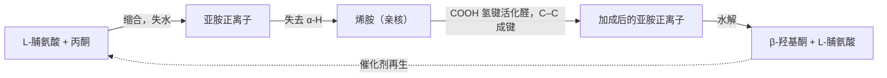
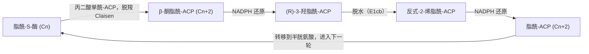

上一章（[6.5.21](/6.5.21)）讨论了**烯醇**与**烯醇负离子**作为**亲核试剂**与质子、卤素、亚胺正离子和卤代烷的反应。本章讨论它们最重要的一类**亲电试剂**——另一个羰基化合物。烯醇负离子加到醛酮的羰基上是羟醛反应，加到酯上并排出烷氧基是 Claisen 缩合，加到 α,β-不饱和羰基化合物的 β 碳上是 **Michael 加成**；三者分别生成 1,3-二氧化的（β-羟基羰基、1,3-二羰基）与 1,5-二羰基化合物，是构建碳骨架的基本方法。本章先讲这三类反应及其变体（Perkin、Knoevenagel、Reformatsky、Darzens、Robinson 环化）和不对称羟醛反应，再讲 1,3-二羰基化合物这类特别容易生成烯醇负离子的化合物及以它们为基础的乙酰乙酸乙酯合成法与丙二酸酯合成法，然后讨论生物合成中的同一类化学（醛缩酶、乙酰辅酶 A 的 Claisen 缩合与脂肪酸合成），最后把本章的反应整理成双官能团化合物的**逆合成**规则。本章用到 [6.5.16](/6.5.16#sec-16.2) 的羰基**亲核加成**与**烯胺**（[6.5.16](/6.5.16#sec-16.9.3)）、[6.5.17](/6.5.17#sec-17.6) 的**共轭加成**、[6.5.18](/6.5.18#sec-18.4) 的**脱羧**、[6.5.19](/6.5.19#sec-19.2) 的**亲核酰基取代**，以及 [6.5.9](/6.5.9#sec-9.5.1) 的 **E1cb 反应**。

## 22.1. 羟醛反应

### 22.1.1. 缩合反应与羟醛反应

**定义 22.1.1** 两个分子结合成一个较大的分子、同时失去水、醇、二氧化碳等小分子的反应，称为**缩合反应**（condensation reaction）。

**定义 22.1.2（羟醛反应）** 一分子醛或酮的烯醇负离子（或烯醇）加到另一分子醛或酮的羰基上，生成 β-羟基醛或 β-羟基酮的反应，称为**羟醛加成**；β-羟基羰基化合物进一步失水生成 α,β-不饱和醛酮时，称为**羟醛缩合**（aldol condensation）。两者统称**羟醛反应**（aldol reaction）。"aldol"取自 aldehyde 与 alcohol。

```smiles
CC=O.CC=O>>CC(O)CC=O
CC(O)CC=O>>C/C=C/C=O
```

乙醛在稀 NaOH 中于室温生成 3-羟基丁醛（"羟醛"），加热则失水生成 (E)-丁-2-烯醛（巴豆醛）。机理有三步，每一步都可逆：


羟醛反应中一分子羰基化合物作**亲核试剂**（经**烯醇负离子**），另一分子作**亲电试剂**；碱只需要催化量，因为平衡时烯醇负离子的浓度很低（乙醛与 $\ce{HO-}$ 的 $\lg K \approx 14.00 - 16.7 \approx -3$，[6.5.21](/6.5.21#sec-21.1.3)），绝大部分醛仍以羰基形式存在，可以充当亲电试剂。这与需要定量烯醇负离子的烷基化正好相反。

### 22.1.2. 平衡与脱水

羟醛加成把一个 C=O π 键换成一个 C–C σ 键，焓变有利，但两分子变成一分子，熵变不利。醛的平衡偏向产物；酮的羰基较稳定、产物较拥挤，平衡偏向原料：丙酮在碱中的平衡混合物里只有百分之几的二丙酮醇（4-羟基-4-甲基戊-2-酮）。要得到酮的羟醛产物，需要把产物不断移出平衡体系：经典的做法是在 Soxhlet 提取器中回流丙酮，让冷凝的丙酮流过放在套管中的固体 $\ce{Ba(OH)2}$ 催化剂，生成的二丙酮醇随溶液流回烧瓶、离开催化剂，不再分解。

升高温度时，β-羟基羰基化合物失水，生成与羰基共轭的 α,β-不饱和醛酮。共轭与失去的水分子（熵）使脱水在热力学上很有利，从而把整个平衡拉向产物；所以酮的羟醛反应一般在加热下直接得到缩合产物。碱性条件下的脱水是 **E1cb 反应**（[6.5.9](/6.5.9#sec-9.5.1)，那里有 4-羟基-4-甲基戊-2-酮脱水的机理图）：碱先夺去酸性的 α-H 生成烯醇负离子，烯醇负离子再排出 β 位的 $\ce{HO-}$。$\ce{HO-}$ 本来是很差的**离去基团**，能在这里离去，是因为生成的共轭体系稳定、而且离去前的**碳负离子**已经被羰基稳定。酸性条件下脱水经过**烯醇**：β-羟基质子化后以水的形式离去（**E1** 或 **E2** 型）。产物以位阻较小、较稳定的 (E) 异构体为主；与芳环共轭时（苯甲醛的缩合），脱水更容易，在室温就能发生。

### 22.1.3. 逆羟醛反应

**定义 22.1.3** β-羟基羰基化合物在碱（或酸）催化下断裂 $\mathrm{C}_\alpha$–$\mathrm{C}_\beta$ 键、生成两分子羰基化合物的反应，即羟醛加成的逆反应，称为**逆羟醛反应**（retro-aldol reaction）。

机理是正反应的逆过程：β-羟基去质子化生成烷氧负离子，烷氧负离子的孤对电子推回、重新形成 C=O，同时排出烯醇负离子作为离去基团。二丙酮醇与少量 NaOH 共热时分解为丙酮，就是逆羟醛反应；在热力学不利的体系中（酮、高温），逆反应限制了羟醛产物的收率。逆羟醛反应在生物化学中很重要：糖酵解中醛缩酶把果糖-1,6-二磷酸断裂为两个三碳糖（22.10.1 节），本质上就是逆羟醛反应。

## 22.2. 交叉羟醛与分子内羟醛

### 22.2.1. 交叉羟醛反应的问题

两种不同的、都可**烯醇化**的醛在碱中混合时，每一种都能作**亲核试剂**，也都能作**亲电试剂**，于是得到四种羟醛产物（以及它们的脱水产物与立体异构体）。乙醛与丙醛混合缩合，得到 3-羟基丁醛、3-羟基-2-甲基戊醛、3-羟基戊醛与 3-羟基-2-甲基丁醛的混合物，没有实用价值。要得到单一的交叉产物，必须让一个组分只当亲核试剂、另一个只当亲电试剂。

### 22.2.2. 获得单一产物的策略

策略一：一个组分不能烯醇化。甲醛、苯甲醛等芳香醛、2,2-二甲基丙醛、糠醛、乙醛酸酯没有 α-H，只能作亲电试剂；而且醛比酮活泼，作亲电试剂时优先被进攻。

**定义 22.2.1** 没有 α-H 的芳香醛与有 α-H 的醛或酮在碱（NaOH 或 KOH 的乙醇溶液）中的交叉羟醛缩合，称为 **Claisen–Schmidt 缩合**（Claisen–Schmidt condensation）。

```smiles
O=Cc1ccccc1.CC(C)=O>>CC(=O)/C=C/c1ccccc1
O=Cc1ccccc1.CC(=O)c1ccccc1>>O=C(/C=C/c1ccccc1)c1ccccc1
```

苯甲醛与丙酮得到 (E)-4-苯基丁-3-烯-2-酮（亚苄基丙酮），苯甲醛过量时两侧都缩合，得到二亚苄基丙酮；与苯乙酮得到查耳酮。操作上把可烯醇化的组分缓慢滴加到不可烯醇化的醛与碱的混合物中，使前者一生成**烯醇负离子**就遇到大量的芳香醛，自身缩合的机会很小；而酮的自身缩合本来就不利。产物与芳环共轭，脱水自发进行，常常从溶液中析出。

甲醛的交叉羟醛反应在工业上制备季戊四醇：乙醛与过量甲醛在 $\ce{Ca(OH)2}$ 中，乙醛的三个 α-H 依次与三分子甲醛发生羟醛加成，生成三羟甲基乙醛 $\ce{(HOCH2)3CCHO}$；它没有 α-H，再与第四分子甲醛发生交叉 **Cannizzaro 反应**（定义 17.4.1），甲醛被氧化为甲酸盐，三羟甲基乙醛被还原为季戊四醇 $\ce{C(CH2OH)4}$。季戊四醇用于醇酸树脂、合成润滑油的多元醇酯与炸药季戊四醇四硝酸酯，也是构筑树枝状大分子的四官能团核心。

策略二：先定量生成一个组分的烯醇负离子。用 LDA 在 $-78$ °C 把酮（或酯）完全转化为烯醇锂，再加入醛：溶液中没有未去质子化的酮，烯醇负离子只能进攻加入的醛，低温又使加成物不发生逆反应与脱水，得到 β-羟基酮（定向羟醛反应）。

```smiles
CC(=O)C(C)(C)C.O=CC1CCCCC1>>CC(C)(C)C(=O)CC(O)C1CCCCC1
```

策略三：用烯醇的等价物。**烯醇硅醚**在 **Lewis 酸**作用下与醛反应（Mukaiyama 羟醛反应，22.6.2 节），醛的**烯胺**或**亚胺**作为亲核组分（22.6.3 节）。

### 22.2.3. 分子内羟醛反应

一个分子中有两个羰基时，分子内的羟醛反应比分子间反应快得多（成环时熵的损失小），主要生成张力最小的五元或六元环。由于每一步都可逆，产物由**热力学控制**：即使能生成别的环，最终也流向最稳定的五元或六元环状 α,β-不饱和酮。

```smiles
CC(=O)CCC(C)=O>>CC1=CC(=O)CC1
CC(=O)CCCC(C)=O>>CC1=CC(=O)CCC1
```

己-2,5-二酮在碱中只生成 3-甲基环戊-2-烯-1-酮：C1（甲基）的烯醇负离子进攻 C5 的羰基，形成五元环；C3 的烯醇负离子进攻 C5 只能形成三元环，张力太大，即使生成也会经逆羟醛反应回到原料。庚-2,6-二酮同样只给出六元环的 3-甲基环己-2-烯-1-酮，而不是四元环。分子内羟醛缩合是合成五元与六元环状 α,β-不饱和酮的标准方法，也是 Robinson 环化的第二步（22.5.2 节）。

## 22.3. Claisen 缩合与 Dieckmann 缩合

### 22.3.1. Claisen 缩合

酯的**烯醇负离子**也能进攻另一分子酯的羰基。与醛酮不同，酯的**四面体中间体**可以排出烷氧基，重新形成 C=O：结果是**亲核酰基取代**（[6.5.19](/6.5.19#sec-19.2.1)），产物是 β-酮酸酯。

**定义 22.3.1（Claisen 缩合）** 两分子含 α-H 的酯在醇钠作用下缩合，一分子酯的 α 碳取代另一分子酯的烷氧基，生成 β-酮酸酯（3-氧亚基羧酸酯）的反应，称为 **Claisen 缩合**（Claisen condensation，Claisen 1887）。

```smiles
CCOC(C)=O.CCOC(C)=O>>CCOC(=O)CC(C)=O.CCO
```

乙酸乙酯在乙醇钠作用下缩合得到乙酰乙酸乙酯（3-氧亚基丁酸乙酯）。机理：


这个机理有几点值得注意：

- 前三步（**烯醇化**、加成、消除）的总平衡是不利的：乙酸乙酯的 α-H（$\mathrm{p}K_{\mathrm{a}}$ 约 25）比乙醇（15.9）弱得多，烯醇负离子浓度极低，生成 β-酮酸酯本身也是吸热的。推动反应的是最后一步：产物 β-酮酸酯的 $\mathrm{p}K_{\mathrm{a}}$ 为 10.7，比乙醇强约 5 个单位，被乙氧基负离子定量去质子化（$K \approx 10^5$）。所以醇钠必须用一当量，它在反应中被消耗为 β-酮酸酯的钠盐，反应结束后要酸化。
- 因此，酯的 α 碳上必须至少有两个 H：一个在缩合时失去，另一个留在产物两个羰基之间，供最后的去质子化。2-甲基丙酸乙酯只有一个 α-H，与乙醇钠不发生 Claisen 缩合（若生成产物 2,2,4-三甲基-3-氧亚基戊酸乙酯，它在乙醇钠中也会发生逆 Claisen 断裂，22.7.2 节）。
- 醇钠的烷基要与酯的烷氧基相同（乙酯用乙醇钠），否则发生**酯交换**，得到混合酯。不能用 NaOH，它会把酯**皂化**为不再反应的羧酸盐。
- 名称相近的 **Claisen 重排**（定义 12.5.3）是烯丙基乙烯基醚的 [3,3]-σ 迁移，与 Claisen 缩合无关，只是同一位化学家发现的。

### 22.3.2. Dieckmann 缩合

**定义 22.3.2（Dieckmann 缩合）** 同一分子中的两个酯基之间发生的分子内 Claisen 缩合，生成环状 β-酮酸酯的反应，称为 **Dieckmann 缩合**（Dieckmann condensation，Dieckmann 1894）。

```smiles
CCOC(=O)CCCCC(=O)OCC>>CCOC(=O)C1CCCC1=O
CCOC(=O)CCCCCC(=O)OCC>>CCOC(=O)C1CCCCC1=O
```

己二酸二乙酯生成 2-氧亚基环戊烷甲酸乙酯，庚二酸二乙酯生成 2-氧亚基环己烷甲酸乙酯；与分子内羟醛反应一样，五元与六元环最容易形成。两个酯基的 α 碳不等价时，产物由最后的去质子化决定：只有那种在两个羰基之间留下 H 的环化产物能被醇钠去质子化而稳定下来，另一种环化可逆地回到原料（见思考题 3）。

### 22.3.3. 交叉 Claisen 缩合

两种都有 α-H 的酯在醇钠中混合，得到四种缩合产物。与交叉羟醛反应一样，有两类办法得到单一产物：

1. 一个组分没有 α-H，只能作**亲电试剂**：甲酸乙酯（引入甲酰基）、碳酸二乙酯（引入乙氧羰基）、草酸二乙酯（引入乙氧草酰基）、苯甲酸乙酯。没有 α-H 的酯过量。酮也可以作亲核组分：酮的 α-H 比酯强约 6 个 $\mathrm{p}K_{\mathrm{a}}$ 单位，在醇钠或 NaH 中优先生成酮的烯醇负离子，与酯缩合得到 1,3-二酮或 β-酮酸酯。

   ```smiles
   O=C1CCCCC1.CCOC(=O)OCC>>CCOC(=O)C1CCCCC1=O
   O=C1CCCCC1.CCOC=O>>O=CC1CCCCC1=O
   CC(=O)c1ccccc1.CCOC(=O)C(=O)OCC>>CCOC(=O)C(=O)CC(=O)c1ccccc1
   ```

   （依次为：环己酮与碳酸二乙酯在 NaH 中得到 2-氧亚基环己烷甲酸乙酯；与甲酸乙酯得到 2-甲酰基环己酮，它主要以**烯醇式** 2-(羟基亚甲基)环己酮存在；苯乙酮与草酸二乙酯得到 2,4-二氧亚基-4-苯基丁酸乙酯。）

2. 用强碱定量生成一个组分的烯醇负离子，再加入作亲电试剂的酯或酰氯（更活泼，常用）。用 LDA 时，烯醇负离子的生成与加成都是不可逆的，不再需要产物去质子化来推动平衡，所以只有一个 α-H 的酯也能被酰化：2-甲基丙酸乙酯先用 LDA（或三苯甲基钠）去质子化，再与苯甲酰氯反应，得到 2,2-二甲基-3-氧亚基-3-苯基丙酸乙酯；用乙醇钠则不能。

## 22.4. 其他缩合反应

羟醛与 Claisen 缩合的思路——一个被活化的 C–H 去质子化后加到羰基上——还有几个以人名命名的重要变体，它们的区别在于亲核组分与促进反应的试剂：

| 反应 | 亲核组分 | 亲电组分 | 试剂 | 产物 |
|---|---|---|---|---|
| Perkin | 酸酐（经**烯醇负离子**） | 芳香醛 | 相应羧酸的钠盐或钾盐，170–180 °C | (E)-β-芳基丙烯酸 |
| Knoevenagel | 活泼亚甲基化合物 | 醛、酮 | 弱碱（哌啶、吡啶、胺盐） | α,β-不饱和二羰基化合物或酸 |
| Reformatsky | α-溴代酯 + Zn（烯醇锌） | 醛、酮 | Zn，惰性溶剂 | β-羟基酯 |
| Darzens | α-卤代酯（经烯醇负离子） | 醛、酮 | 醇钠、叔丁醇钾 | α,β-环氧酯（缩水甘油酸酯） |

### 22.4.1. Perkin 反应

**定义 22.4.1（Perkin 反应）** 芳香醛与含 α-H 的羧酸酐在相应羧酸盐（或 $\ce{K2CO3}$、三乙胺）存在下加热缩合，生成 β-芳基-α,β-不饱和羧酸的反应，称为 **Perkin 反应**（Perkin reaction，Perkin 1868）。

```smiles
O=Cc1ccccc1.CC(=O)OC(C)=O>>O=C(O)/C=C/c1ccccc1
O=Cc1ccccc1O.CC(=O)OC(C)=O>>O=c1ccc2ccccc2o1
```

苯甲醛、乙酸酐与乙酸钠在 180 °C 反应，得到 (E)-肉桂酸；水杨醛的 Perkin 反应生成的邻羟基肉桂酸（顺式）立即内酯化，得到香豆素（Perkin 正是因合成香豆素而发现这一反应）。乙酸根作碱生成酸酐的烯醇负离子；它加到醛上，生成的烷氧负离子在分子内被相邻的酸酐乙酰化（**酰基转移**），然后经 **E1cb** 消除乙酸根得到不饱和的混合酸酐，水解得到产物酸。酸酐的 α-H 酸性比酯稍强，但乙酸根是弱碱，所以需要高温。

### 22.4.2. Knoevenagel 缩合

**定义 22.4.2（Knoevenagel 缩合）** 活泼亚甲基化合物（丙二酸酯、丙二酸、氰基乙酸酯、乙酰乙酸酯、丙二腈、Meldrum 酸等）在弱碱（哌啶、吡啶或胺的乙酸盐）催化下与醛或酮缩合，生成亚烷基（亚苄基）衍生物的反应，称为 **Knoevenagel 缩合**（Knoevenagel condensation，Knoevenagel 1894）。

```smiles
O=Cc1ccccc1.CCOC(=O)CC(=O)OCC>>CCOC(=O)C(=Cc1ccccc1)C(=O)OCC
O=Cc1ccccc1.O=C(O)CC(=O)O>>O=C(O)/C=C/c1ccccc1
```

活泼亚甲基化合物的 $\mathrm{p}K_{\mathrm{a}}$ 在 9–13（22.7 节），胺这样的弱碱就能生成足够的**碳负离子**；而醛在弱碱中几乎不发生自身的羟醛反应，所以交叉产物单一。仲胺催化时，它还先与醛生成比醛更亲电的亚胺正离子，加成后再消除胺（亚胺正离子催化）。用丙二酸在吡啶中（加少量哌啶）反应时，缩合产物同时**脱羧**，直接得到 (E)-肉桂酸一类的 α,β-不饱和酸（Doebner 改良法），这是 Perkin 反应的温和替代。乙酰乙酸乙酯与醛在 KOH 中一锅进行 Knoevenagel 缩合、酯水解与脱羧，可以得到 (E)-烷基乙烯基甲基酮 $\ce{RCH=CHCOCH3}$；直接用丙酮与醛则不行，因为醛会自身缩合、丙酮的两侧都会反应。

Knoevenagel 产物是很强的 Michael 受体（双活化的烯烃），常在原位与第二个**亲核试剂**进行 **Michael 加成**，组成多组分串联反应。

### 22.4.3. Reformatsky 反应

**定义 22.4.3（Reformatsky 反应）** α-溴代羧酸酯与锌在惰性溶剂（乙醚、苯、THF）中生成有机锌试剂（烯醇锌），再与醛或酮加成，水解后得到 β-羟基羧酸酯的反应，称为 **Reformatsky 反应**（Reformatsky reaction，Reformatsky 1887）。

```smiles
O=C1CCCCC1.CCOC(=O)CBr>>CCOC(=O)CC1(O)CCCCC1
```


烯醇锌的**亲核性**比烯醇锂、**Grignard 试剂**弱得多：它能加到醛酮的羰基上，却不与酯基反应，所以试剂可以在醛酮存在下原位生成，而且不发生酯的自身 Claisen 缩合。用镁代替锌不行：生成的镁试剂太活泼，会进攻尚未反应的溴代酯的酯基。Reformatsky 反应的另一个优点是条件中性，对碱敏感的底物与位阻大的酮也适用；产物 β-羟基酯脱水得到 α,β-不饱和酯。

### 22.4.4. Darzens 反应

**定义 22.4.4（Darzens 反应）** 醛或酮与 α-卤代羧酸酯在强碱（醇钠、叔丁醇钾、NaH）作用下缩合，生成 α,β-环氧羧酸酯（缩水甘油酸酯）的反应，称为 **Darzens 反应**（Darzens reaction，Darzens 1904）。


第一步是羟醛型加成，第二步是分子内的 Williamson 型成醚（[6.5.10](/6.5.10#sec-10.2.2)），生成**环氧化合物**。缩水甘油酸酯水解为酸后加热，脱羧并开环，经烯醇得到比原来的醛酮多一个碳的醛：环己酮经 Darzens 反应、水解、脱羧得到环己烷甲醛。这是一种碳链增长的方法。

## 22.5. Michael 加成与 Robinson 环化

### 22.5.1. 烯醇负离子的 Michael 加成

烯醇负离子也能加到 α,β-不饱和羰基化合物的 β 碳上，这是 **Michael 加成**（**共轭加成**的通论、**1,2-加成**与 **1,4-加成**的竞争见 [6.5.17](/6.5.17#sec-17.6)）。按 [6.5.17](/6.5.17#sec-17.6.2) 的规律，软的、稳定的、加成可逆的**亲核试剂**发生 1,4-加成，所以最好的 Michael 给体是 1,3-二羰基化合物的烯醇负离子（以及硝基烷烃、氰基乙酸酯的负离子），常用的 Michael 受体是甲基乙烯基酮（MVK）、丙烯醛、丙烯酸酯、丙烯腈、硝基烯烃与乙烯基砜。


Michael 加成只需要催化量的碱：加成生成的烯醇负离子是一个简单酮的烯醇负离子（$\mathrm{p}K_{\mathrm{a}}$ 约 19），比给体的负离子（9–13）碱性强得多，它从乙醇或另一分子给体上夺取质子，再生催化剂。产物是 1,5-二羰基化合物。

简单酮的烯醇锂与 α,β-不饱和酮在 $-78$ °C 混合时，常常得到 1,2-加成（羟醛型）与 1,4-加成产物的混合物，并伴随受体的聚合；所以简单醛酮的 Michael 加成通常改用以下等价物：

- **烯胺**（Stork，[6.5.21](/6.5.21#sec-21.8)）：环己酮的吡咯烷烯胺与 MVK 加成，生成的亚胺正离子–烯醇负离子两性离子经质子转移后水解，得到 2-(3-氧亚基丁基)环己酮。烯胺是中性、软的亲核试剂，只发生 1,4-加成。
- 1,3-二羰基化合物：先用乙酰乙酸乙酯或丙二酸酯作给体，再水解、**脱羧**除去多余的酯基（22.8、22.9 节）。
- 在**质子性溶剂**中用催化量醇钠或 KOH，使 1,2-加成可逆，最终流向热力学稳定的 1,4-产物。

### 22.5.2. Robinson 环化

**定义 22.5.1（Robinson 环化）** 酮的烯醇负离子（或烯胺）与 α,β-不饱和酮（通常是甲基乙烯基酮）发生 Michael 加成，生成的 1,5-二酮再经分子内羟醛缩合，形成一个新的环己-2-烯-1-酮环的反应，称为 **Robinson 环化**（Robinson annulation，Rapson 与 Robinson 1935）。


Robinson 环化一次形成两个 C–C 键和一个新的六元环，产物是环己-2-烯-1-酮，可以继续用作 Michael 受体或进行下一次环化。它是合成甾体与萜类化合物的六元环的经典方法：2-甲基环己-1,3-二酮与 MVK 的 Robinson 环化得到 Wieland–Miescher 酮，2-甲基环戊-1,3-二酮的类似产物是 Hajos–Parrish 酮，两者都是甾体全合成的标准原料，后者的**不对称合成**见 22.6.3 节。MVK 易聚合，实际操作中常用它的 **Mannich 碱**或**季铵盐**（[6.5.21](/6.5.21#sec-21.6.1)）在反应中原位生成。

Robinson 环化可以换用别的 Michael 给体与受体。例如查耳酮（受体）与乙酰乙酸乙酯（给体）在 KOH/乙醇中 Michael 加成，乙酰基的甲基再与苯甲酰基发生分子内羟醛缩合，最后酯水解、脱羧，得到 3,5-二苯基环己-2-烯-1-酮：

```smiles
O=C(/C=C/c1ccccc1)c1ccccc1.CCOC(=O)CC(C)=O>>O=C1C=C(c2ccccc2)CC(c2ccccc2)C1
```

逆合成地看，环己-2-烯-1-酮总可以先在 C2=C3 处切断（羟醛缩合），再切断 C4–C5 键（Michael 加成），得到一个酮（提供 C3、C4）与一个 α,β-不饱和酮（提供 C5、C6、C1、C2）（22.11 节）。

## 22.6. 不对称羟醛反应

羟醛加成通常生成两个新的**手性中心**（α 碳与 β 碳），产物有 syn 与 anti 两种**非对映体**，每种又有一对**对映体**。控制相对构型与绝对构型，是 20 世纪后半叶有机合成的核心课题之一，聚酮类天然产物（大环内酯抗生素等）的合成依赖它。

### 22.6.1. Zimmerman–Traxler 模型

**定义 22.6.1（Zimmerman–Traxler 模型）** 金属烯醇盐与醛的羟醛加成经过一个椅式的六元环过渡态：金属同时与烯醇氧和醛的氧配位，醛的取代基处于平伏位置以避开 1,3-双直立相互作用。由此 (Z)-烯醇盐生成 syn-羟醛产物，(E)-烯醇盐生成 anti-羟醛产物。这一过渡态模型称为 **Zimmerman–Traxler 模型**（Zimmerman–Traxler model，1957）。

模型把羟醛反应的立体化学变成了 [6.5.4](/6.5.4#sec-4.5.1) 的**构象分析**问题：**烯醇盐**的几何构型决定了 α 碳上取代基在椅式**过渡态**中的位置，醛的 R 平伏决定了 β 碳的取向。M–O 键越短、过渡态越紧凑，选择性越高：硼烯醇盐（B–O 约 140 pm）比锂烯醇盐（Li–O 约 190 pm）给出高得多的非对映选择性。Evans（1981）把噁唑烷酮**手性辅基**（[6.5.21](/6.5.21#sec-21.7.3)）与二丁基硼的 (Z)-烯醇盐结合，得到 syn-羟醛产物，非对映选择性与对映选择性都超过 99 : 1，称为 Evans 羟醛反应。

### 22.6.2. Mukaiyama 羟醛反应

**定义 22.6.2（Mukaiyama 羟醛反应）** **烯醇硅醚**（烯醇的三烷基硅醚 $\ce{R2C=C(OSiR3)R'}$）在 Lewis 酸（$\ce{TiCl4}$、$\ce{BF3*OEt2}$、手性的 B、Ti、Cu、Sn 配合物）活化下与醛或酮加成，水解后得到 β-羟基羰基化合物的反应，称为 **Mukaiyama 羟醛反应**（Mukaiyama aldol reaction，Mukaiyama 1973）。

```smiles
C[Si](C)(C)OC1=CCCCC1.O=Cc1ccccc1>>O=C1CCCCC1C(O)c1ccccc1
```

**Lewis 酸**与醛的氧配位，使醛的羰基强烈亲电；**烯醇硅醚**是中性的弱**亲核试剂**（**烯醇**的等价物），在没有 Lewis 酸时不与醛反应，所以两个组分可以同时存在而不发生自身缩合。这就把"谁作亲核试剂、谁作**亲电试剂**"完全确定了下来：烯醇硅醚可以事先以确定的区域化学与几何构型制备（[6.5.21](/6.5.21#sec-21.3.2)）。与金属烯醇盐不同，Mukaiyama 反应一般经过开放的（非环状）过渡态，烯醇硅醚的几何构型与产物的 syn/anti 选择性之间没有简单的对应关系。用催化量的**手性** Lewis 酸可以实现对映选择性的 Mukaiyama 反应（**不对称催化**）。

### 22.6.3. 脯氨酸催化与有机催化

**定义 22.6.3** 不含金属的、通常较小的有机分子作催化剂（如脯氨酸、手性仲胺、硫脲、手性磷酸、氮杂环卡宾）催化有机反应的方法，称为**有机催化**（organocatalysis）。

1971 年，Hoffmann-La Roche 的 Hajos 与 Parrish 和 Schering 的 Eder、Sauer 与 Wiechert 分别发现，3 mol% 的 (S)-脯氨酸可以催化 2-甲基-2-(3-氧亚基丁基)环戊-1,3-二酮的分子内羟醛反应，产物的**对映体过量**达 93 %。这一发现在近三十年里被视为特例。List、Lerner 与 Barbas（2000）证明脯氨酸同样能催化分子间的羟醛反应：丙酮与 4-硝基苯甲醛在 DMSO 中，30 mol% L-脯氨酸催化，得到 (R)-4-羟基-4-(4-硝基苯基)丁-2-酮（收率 68 %，ee 76 %），与异丁醛的反应 ee 达 96 %。同年 MacMillan 提出了亚胺正离子催化的不对称 **Diels–Alder 反应**，"有机催化"由此成为与金属催化、酶催化并列的第三类不对称催化，List 与 MacMillan 获 2021 年诺贝尔化学奖。

脯氨酸的作用与 I 类醛缩酶（22.10.1 节）几乎相同：



仲胺与酮生成亲核的**烯胺**，羧酸的质子与醛的氧形成**氢键**、把醛固定在烯胺的一面并活化它，C–C 键在一个类似 Zimmerman–Traxler 的椅式过渡态中形成（Houk 与 List 的计算模型，2003）；生成的亚胺正离子水解，放出产物与催化剂。龚流柱与吴云东（2004）据此设计了脯氨酰胺类催化剂，酰胺 N–H 与末端羟基同时与醛形成氢键，对映选择性进一步提高。有机催化剂对水和空气不敏感、无毒、廉价，在药物合成中尤其有吸引力。

## 22.7. 1,3-二羰基化合物

### 22.7.1. 结构与酸性

**定义 22.7.1** 两个羰基被一个碳原子隔开的化合物，称为 **1,3-二羰基化合物**（1,3-dicarbonyl compound，也称 β-二羰基化合物），包括 β-二酮、β-酮酸（酯）与丙二酸（酯）。更一般地，两个吸电子基团（羰基、酯基、氰基、硝基、砜基）之间的 $\ce{CH2}$ 称为活泼亚甲基，相应的化合物称为**活泼亚甲基化合物**（active methylene compound）。

两个羰基之间的 α-H 酸性特别强，因为负电荷可以离域到两个氧上（三个**共振式**）。$\mathrm{p}K_{\mathrm{a}}$ 取自 [6.5.3 的统一表](/6.5.3#sec-3.1.4)：

| 化合物 | $\mathrm{p}K_{\mathrm{a}}$（水） | $\mathrm{p}K_{\mathrm{a}}$（DMSO） |
|---|---|---|
| 乙酰丙酮 $\ce{CH3COCH2COCH3}$ | 8.9 | 13.3 |
| 乙酰乙酸乙酯 $\ce{CH3COCH2COOC2H5}$ | 10.7 | 14.2 |
| 丙二腈 $\ce{CH2(CN)2}$ | 11.2 | 11.1 |
| 丙二酸二乙酯 $\ce{CH2(COOC2H5)2}$ | 约 13 | 16.4 |
| （对照）丙酮 | 19.3 | 26.5 |

酸性次序反映了两个吸电子基团的强弱：酮羰基 > 酯羰基（酯的烷氧基给电子）。Meldrum 酸（2,2-二甲基-1,3-二氧六环-4,6-二酮）的 $\mathrm{p}K_{\mathrm{a}}$ 约 4.8（水中），与乙酸相近，远强于开链的丙二酸酯：环把两个酯基固定在开链酯中不常见的构象上，这一构象效应使负离子相对稳定得多（详细的解释仍有讨论）。

因此 1,3-二羰基化合物用醇钠就能基本定量地去质子化（$\lg K$ 约 3–7），甚至 $\ce{K2CO3}$、胺也足够；它们与金属钠放出氢气，与 Cu²⁺、Fe³⁺ 等形成稳定的六元环螯合物（乙酰丙酮的金属**配位化合物**，[6.1.5](/6.1.5)）。生成的负离子碱性弱、**亲核性**适中，烷基化时 **E2** 副反应少，也不会对酯基发生 Claisen 缩合。1,3-二羰基化合物的酮–烯醇互变见 [6.5.21](/6.5.21#sec-21.2.4)。

### 22.7.2. β-酮酸酯的酮式分解与酸式分解

**定义 22.7.2** β-酮酸酯在稀碱（或稀酸）中水解为 β-酮酸、再加热脱羧，生成甲基酮 $\ce{RCOCH3}$ 的反应，称为**酮式分解**（ketonic cleavage）；在浓碱中发生逆 Claisen 断裂、生成两分子羧酸（盐）的反应，称为**酸式分解**（acid cleavage）。

```smiles
CCOC(=O)CC(C)=O>>CC(C)=O.O=C=O.CCO
CCOC(=O)CC(C)=O>>CC(=O)O.CC(=O)O.CCO
```

- 酮式分解（如 5 % NaOH 水解后酸化、加热，或直接在稀 $\ce{H2SO4}$ 中回流）：酯水解得到 β-酮酸，β-酮酸经六元环状**过渡态**发生**脱羧**，先生成烯醇再互变为酮（[6.5.18](/6.5.18#sec-18.4.1)）。乙酰乙酸乙酯给出丙酮；烷基化后的乙酰乙酸乙酯给出取代丙酮。
- 酸式分解（40 % NaOH 加热）：浓的 $\ce{HO-}$ 直接加到酮羰基上，**四面体中间体**排出酯的**烯醇负离子**（一个稳定的碳负离子**离去基团**），这正是 Claisen 缩合的逆反应：


  酸式分解的产物是乙酸与取代乙酸，但取代乙酸用丙二酸酯合成法制备更好（22.9 节），所以乙酰乙酸乙酯合成法主要利用酮式分解。没有两个 α-H、不能被醇钠去质子化的 β-酮酸酯，在醇钠中也会发生这种断裂（逆 Claisen）。

丙二酸酯水解后得到取代丙二酸，丙二酸受热（约 150 °C）同样经环状过渡态脱羧，生成取代乙酸。不经过水解的温和方法是 Krapcho 脱烷氧羰基：β-酮酸酯或丙二酸酯与 LiCl（或 NaCl）在含少量水的 DMSO 中加热到 150 °C 左右，$\ce{Cl-}$ 对酯的甲基或乙基发生 **SN2 反应**，生成的羧酸根随即脱羧，直接除去一个酯基。

## 22.8. 乙酰乙酸乙酯合成法

**定义 22.8.1** 以乙酰乙酸乙酯的烯醇负离子为亲核试剂，与卤代烷、酰氯、α,β-不饱和羰基化合物等亲电试剂反应，再经酮式分解，制备取代丙酮（甲基酮）及其衍生物的方法，称为**乙酰乙酸乙酯合成法**（acetoacetic ester synthesis）。

```smiles
CCOC(=O)CC(C)=O.CCCCBr>>CCCCC(C(C)=O)C(=O)OCC
CCCCC(C(C)=O)C(=O)OCC>>CCCCCC(C)=O
```

（乙酰乙酸乙酯在乙醇钠中与 1-溴丁烷反应，得到 2-丁基-3-氧亚基丁酸乙酯；酮式分解得到庚-2-酮。）合成法的三步是：(1) 加醇钠生成**烯醇负离子**；(2) 与**亲电试剂**反应（**SN2** 只适用于甲基、伯卤代烷与活泼卤代烷）；(3) 酮式分解。步骤 (1)、(2) 可以重复一次，引入第二个烷基，得到 $\ce{RR'CHCOCH3}$。酯基在这里是一个"活化基团"：它使烯醇负离子容易生成、只在一个碳上生成，并在完成任务后以 $\ce{CO2}$ 的形式离开。直接用丙酮的烯醇负离子烷基化会遇到多烷基化与自身缩合（[6.5.21](/6.5.21#sec-21.7.1)），乙酰乙酸乙酯合成法避免了这些问题。

逆合成的规则：在目标甲基酮中找到 $\ce{CH3CO-C}$ 单元，这个丙酮单元来自乙酰乙酸乙酯，连在它的 α 碳上的其余部分来自卤代烷。除简单的取代丙酮外，常见的变化有：

| 亲电试剂 | 酮式分解后的产物 |
|---|---|
| RX，再 R'X | $\ce{RR'CHCOCH3}$ |
| 酰氯 RCOCl（用镁盐或 NaH，C-酰化为主） | 1,3-二酮 $\ce{RCOCH2COCH3}$ |
| $\ce{Br(CH2)nBr}$（2 当量碱，$n$ = 2–5） | 环烷基甲基酮（$n = 4$：环戊基甲基酮） |
| α-卤代酮 $\ce{BrCH2COR}$ | 1,4-二酮 $\ce{CH3COCH2CH2COR}$（可经 Paal–Knorr 反应得到呋喃、吡咯，定义 25.7.1） |
| α,β-不饱和酮（**Michael 加成**） | 1,5-二酮 |
| 醛（Knoevenagel，22.4.2 节） | α,β-不饱和甲基酮 |
| 0.5 当量 $\ce{I2}$（氧化偶联） | 1,4-二酮（己-2,5-二酮） |

1,4-二酮与 α-卤代酮之间的这种关系，在 22.11 节里称为"**极性反转**"的切断。

用两当量强碱（先 NaH，再 $n$-BuLi）处理乙酰乙酸乙酯，得到 C2 与 C4 都去质子化的二负离子；第二个负离子（γ 位，乙酰基的甲基上）碱性与**亲核性**都更强，与一当量卤代烷选择性地在 γ 位反应（Weiler，1974），得到 $\ce{RCH2COCH2COOEt}$。这把乙酰乙酸乙酯的反应位置从两个羰基之间转移到了末端。

## 22.9. 丙二酸酯合成法

**定义 22.9.1** 以丙二酸二乙酯的烯醇负离子为亲核试剂，与卤代烷等亲电试剂反应，再经水解与脱羧，制备取代乙酸 $\ce{RCH2COOH}$、$\ce{RR'CHCOOH}$ 的方法，称为**丙二酸酯合成法**（malonic ester synthesis）。

```smiles
CCOC(=O)CC(=O)OCC.CCCCBr>>CCCCC(C(=O)OCC)C(=O)OCC
CCCCC(C(=O)OCC)C(=O)OCC>>CCCCCC(=O)O
```

（丙二酸二乙酯在乙醇钠中与 1-溴丁烷反应，水解、酸化后加热**脱羧**，得到己酸。）丙二酸酯合成法与乙酰乙酸乙酯合成法的关系，相当于取代乙酸与取代丙酮的关系：在目标羧酸中找到 $\ce{-CH-COOH}$（即 $\ce{CH2COOH}$ 单元），它来自丙二酸酯，α 碳上的其余部分来自卤代烷。为什么不直接烷基化乙酸或乙酸乙酯？乙酸先在 O–H 上去质子化，羧酸根的 α-H 极难再去质子化；乙酸乙酯要用 LDA 才能生成**烯醇负离子**，而且会发生 Claisen 缩合。丙二酸酯用醇钠就能定量去质子化，产物单一。

主要变化：

- 两次烷基化得到 $\ce{RR'CHCOOH}$；与 $\ce{Br(CH2)nBr}$ 及两当量碱分子内二烷基化，得到环烷烃甲酸（1,3-二溴丙烷：环丁烷甲酸；1,4-二溴丁烷：环戊烷甲酸）。W. H. Perkin Jr.（1883–1884）用这种方法合成了最早的三元与四元碳环化合物，而当时普遍认为这样的小环难以存在。
- 两分子丙二酸酯与 $\ce{CH2I2}$ 或 $\ce{Br(CH2)nBr}$ 各自单烷基化，水解脱羧后得到二元羧酸 $\ce{HOOC(CH2)_{n+2}COOH}$。
- 与 α,β-不饱和羰基化合物（**Michael 加成**）、醛（Knoevenagel 缩合）、环氧化合物（开环，得到 γ-内酯）反应。
- 乙酰氨基丙二酸二乙酯烷基化后水解、脱羧，得到外消旋的 α-氨基酸：与苄氯得到苯丙氨酸（[6.5.33](/6.5.33)）。
- 不水解，而与脲缩合，得到巴比妥类药物：二乙基丙二酸二乙酯与脲在乙醇钠中缩合得到巴比妥（5,5-二乙基巴比妥酸，[6.5.20](/6.5.20#sec-20.5.3)）。

两种合成法的共同局限来自 **SN2**：叔卤代烷、乙烯基卤与芳基卤不能用作烷基化试剂；仲卤代烷收率较低。

## 22.10. 生物合成中的缩合反应

生物体中的碳–碳键形成主要依靠本章的三类反应：羟醛反应、Claisen 缩合与 **Michael 加成**。酶在接近中性的水溶液中、在室温下进行这些反应，面对的是一个化学难题：羰基 α-H 的 $\mathrm{p}K_{\mathrm{a}}$ 约 19–25，而酶活性中心的碱（Asp、Glu 的羧酸根，His 的咪唑基，Lys 的氨基）共轭酸的 $\mathrm{p}K_{\mathrm{a}}$ 只有 4–10，热力学上只能生成极少量的**烯醇负离子**。生物化学的解决办法有三种：把羰基转化为更强的电子池（质子化的**亚胺**），用金属离子或**氢键**稳定烯醇负离子，以及用硫酯代替氧酯。

### 22.10.1. 醛缩酶

醛缩酶（aldolase）催化羟醛反应及其逆反应。糖酵解中的果糖-1,6-二磷酸醛缩酶把果糖-1,6-二磷酸断裂为磷酸二羟丙酮（DHAP）与甘油醛-3-磷酸，糖异生中催化同一反应的逆反应；从化学上看，这是一个逆羟醛反应（定义 22.1.3）：果糖开链式中 C4 的羟基是"β-羟基"，C2 的酮羰基是"羰基"，断裂的是 C3–C4 键。

- I 类醛缩酶（动物与植物）：活性中心的赖氨酸（兔肌醛缩酶中为 Lys229）的 ε-氨基与底物的酮羰基形成质子化的 Schiff 碱（亚胺正离子，[6.5.16](/6.5.16#sec-16.9.1)）。C4 的羟基去质子化后，C3–C4 键断裂，电子流入带正电的亚胺正离子——它是比中性羰基强得多的电子池，生成的是中性的**烯胺**而不是高能的烯醇负离子；放出甘油醛-3-磷酸后，烯胺在 C3 上质子化、亚胺正离子水解，放出 DHAP。逆方向（合成方向）就是烯胺对醛的羟醛加成，与脯氨酸催化（22.6.3 节）的机理相同。Schiff 碱中间体的证据来自硼氢化钠捕获实验（Horecker 等，1962）：在底物存在下加入 $\ce{NaBH4}$，亚胺被还原为稳定的仲胺，酶不可逆地失活，水解后得到与 DHAP 的三碳单元相连的赖氨酸。
- II 类醛缩酶（细菌与真菌）：用 $\ce{Zn^2+}$ 作 **Lewis 酸**，与底物的羰基氧配位，使 α-H 酸化，并稳定生成的烯醇负离子（烯醇锌，与 Reformatsky 试剂相似）。

醛缩酶已成为**不对称合成**的工具：2-脱氧核糖-5-磷酸醛缩酶（DERA）能把氯乙醛与两分子乙醛串联加成，一步得到两个**手性中心**构型确定的内**半缩醛**，用于他汀类降脂药（阿托伐他汀）侧链的工业合成，酶的活性与稳定性通过定向进化进一步提高。胶原蛋白的交联也依赖羟醛缩合：赖氨酰氧化酶把赖氨酸侧链的氨基氧化为醛（醛赖氨酸），两个醛赖氨酸之间发生羟醛缩合，生成 α,β-不饱和醛的交联；抑制这种酶（如 β-氨基丙腈）会使胶原蛋白强度下降（山黧豆中毒）。

### 22.10.2. 硫酯的 Claisen 缩合：乙酰辅酶 A 与脂肪酸合成

生物体中的"酯"缩合用的不是氧酯，而是辅酶 A（CoA–SH）或酰基载体蛋白（ACP）的硫酯，最重要的是乙酰辅酶 A $\ce{CH3CO-SCoA}$。硫酯在化学上有两点适合这一用途（硫酯的一般性质见 [6.5.19](/6.5.19#sec-19.9.1)）：

- α-H 酸性更强：S 的 3p 孤对电子与 C=O 的 π* 重叠较差，硫酯羰基受到的共振给电子作用比氧酯小，接受 α 碳负电荷的能力更接近酮。硫代乙酸乙酯的 α-H 在水中的 $\mathrm{p}K_{\mathrm{a}}$ 约 21，比乙酸乙酯（约 25）强约 4 个单位（Amyes 与 Richard，1996）。
- 羰基更亲电、$\ce{RS-}$ 是更好的**离去基团**（硫醇的 $\mathrm{p}K_{\mathrm{a}}$ 约 10，醇约 16），**亲核酰基取代**更容易。

于是，乙酰辅酶 A 既是好的亲核组分（**烯醇化**容易），又是好的亲电组分（酰基化能力强）。它参与的几个核心反应：

| 酶 | 反应 | 类型 |
|---|---|---|
| 硫解酶 | 2 乙酰辅酶 A ⇌ 乙酰乙酰辅酶 A + CoASH | Claisen 缩合；在脂肪酸 β-氧化中逆向进行（逆 Claisen，硫解） |
| 柠檬酸合酶 | 乙酰辅酶 A + 草酰乙酸 → 柠檬酰辅酶 A → 柠檬酸 + CoASH | 硫酯烯醇对酮羰基的羟醛加成，随后硫酯水解推动平衡 |
| HMG-CoA 合酶 | 乙酰辅酶 A + 乙酰乙酰辅酶 A → HMG-CoA | 羟醛加成；通向胆固醇、萜类与酮体 |
| β-酮脂酰-ACP 合酶 | 脂酰-ACP + 丙二酸单酰-ACP → β-酮脂酰-ACP + $\ce{CO2}$ | **脱羧**的 Claisen 缩合 |

柠檬酸合酶中，Asp 的羧酸根夺去乙酰辅酶 A 的 α-H，His 与羰基氧形成氢键，稳定生成的烯醇（或烯醇负离子）；它进攻草酰乙酸的酮羰基，生成柠檬酰辅酶 A，随后硫酯水解，放出的大量自由能使整个反应不可逆。

脂肪酸合成每次延长两个碳，但两碳单元并不直接来自乙酰辅酶 A 的烯醇，而是来自丙二酸单酰辅酶 A：乙酰辅酶 A 羧化酶（以生物素为辅基，消耗 ATP）先把乙酰辅酶 A 羧化。β-酮脂酰合酶中，生长中的脂酰基连在半胱氨酸的巯基上（硫酯），丙二酸单酰基连在 ACP 的磷酸泛酰巯基乙胺上；丙二酸单酰基脱羧，生成的硫酯烯醇负离子随即进攻脂酰硫酯的羰基，排出半胱氨酸的硫醇：


这与丙二酸酯合成法（22.9 节）和 Knoevenagel–Doebner 反应的逻辑相同：羧基先活化 α 碳、再以 $\ce{CO2}$ 离去；脱羧的熵与焓都有利，使本来可逆的 Claisen 缩合（硫解酶的反应接近平衡）变得不可逆，由 ATP 的水解（羧化一步）付出代价。生成的 β-酮脂酰-ACP 依次被还原（NADPH，酮还原为 (R)-3-羟基）、脱水（**E1cb**，生成反式-2-烯脂酰-ACP）、再还原（NADPH，C=C 还原），得到多两个碳的饱和脂酰-ACP；这一循环重复七次，得到软脂酰基（C16），由硫酯酶水解放出。



如果省去部分或全部还原步骤，就得到聚β-酮链，它们经分子内的羟醛或 Claisen 缩合环化、芳构化，生成聚酮（polyketide）类天然产物：一分子乙酰辅酶 A 与三分子丙二酸单酰辅酶 A 组装的聚β-酮链经 C2–C7 的羟醛缩合与芳构化得到苔色酸；红霉素、四环素、洛伐他汀等重要药物都是由模块化或迭代的聚酮合酶合成的。

## 22.11. 双官能团化合物的逆合成

逆合成分析与**合成子**的一般方法见 [6.5.20](/6.5.20#sec-20.8.1)。本章的反应都在两个官能团之间形成 C–C 键，所以它们的逆合成规则可以按两个官能团（以羰基或其衍生物 OH、C=C 为代表）之间的距离来整理。把羰基碳编为 1，相邻的碳为 2，依次编号：羰基碳是天然的亲电位置（$a^1$），α 碳经**烯醇负离子**是天然的亲核位置（$d^2$），共轭的 β 碳是亲电位置（$a^3$）。两个官能团的相对位置使这些天然极性"匹配"时，切断直接对应本章的反应：

| 目标结构 | 切断的键 | 合成子与试剂 | 反应 |
|---|---|---|---|
| β-羟基羰基（1,3-二氧化） | $\mathrm{C}_\alpha$–$\mathrm{C}_\beta$ | 烯醇负离子 + 醛酮 | 羟醛加成（22.1、22.6 节） |
| α,β-不饱和羰基 | $\mathrm{C}_\alpha$=$\mathrm{C}_\beta$ | 烯醇负离子 + 醛酮，或活泼亚甲基 + 醛 | 羟醛缩合、Claisen–Schmidt、Knoevenagel、Perkin |
| 1,3-二羰基 | C2–C3（酰基与 α 碳之间） | 烯醇负离子 + 酯（或酰氯） | Claisen、Dieckmann、交叉 Claisen（22.3 节） |
| 1,5-二羰基 | C3–C4 | 稳定的烯醇负离子（或**烯胺**）+ α,β-不饱和羰基 | **Michael 加成**（22.5.1 节） |
| 环己-2-烯-1-酮 | C2=C3，再 C4–C5 | 酮 + 甲基乙烯基酮 | Robinson 环化（22.5.2 节） |
| $\ce{RCH2COCH3}$、$\ce{RCH2COOH}$ | α 碳与 R 之间 | $\ce{CH3COCH2-}$、$\ce{-CH2COOH}$ 合成子 + RX | 乙酰乙酸乙酯、丙二酸酯合成法（22.8、22.9 节） |
| α,β-环氧酯、β-羟基酯 | $\mathrm{C}_\alpha$–$\mathrm{C}_\beta$ | α-卤代酯 + 醛酮 | Darzens、Reformatsky（22.4 节） |

两个官能团处于 1,2-、1,4-、1,6-位置时，天然极性不匹配：例如 1,4-二羰基化合物切断 C2–C3 后，两个碎片都需要在 α 碳上带正电（或都在 α 碳上亲核），没有一个碎片能由普通的烯醇负离子提供。这时需要：

- 一个"反常极性"的合成子：α-卤代酮（α 碳是亲电的，$a^2$），与烯醇负离子组合得到 1,4-二羰基（乙酰乙酸乙酯 + α-溴代酮，22.8 节）；酰基负离子等价物（1,3-二噻烷、**氰醇**、氮杂环**卡宾**催化的**苯偶姻缩合**，羰基碳变成亲核的 $d^1$，[6.5.16](/6.5.16#sec-16.10)），用于 1,2-二氧化与 1,4-二羰基化合物；
- 或者别的成键方式：1,6-二羰基化合物最方便的来源是环己烯的**臭氧化**或其他氧化断裂（[6.5.11](/6.5.11#sec-11.8.3)），而环己烯可以由 **Diels–Alder 反应**得到；硝基烷烃负离子的 Michael 加成再经 Nef 反应把硝基变成羰基，也能得到 1,4-二羰基。

两个例子：

1. 2-氧亚基环己烷甲酸乙酯是 1,3-二羰基化合物，有两种切断：切断环内的 C1–C2 键（酮羰基与 α 碳之间），得到庚二酸二乙酯（Dieckmann 缩合）；切断环外的 C–$\ce{CO2Et}$ 键，得到环己酮与碳酸二乙酯（交叉 Claisen 缩合）。两条路线都很短，后者原料更便宜。
2. 9-氧亚基癸-2-烯酸（(E) 构型，蜜蜂的"蜂王物质"，一种信息素）是一个甲基酮：从 $\ce{CH3CO-CH2}$ 单元与其余部分之间切断，得到乙酰乙酸乙酯的烯醇负离子与一个末端带卤素的 (E)-庚-2-烯酸酯。合成上，(E)-7-羟基庚-2-烯酸先酯化、再用 $\ce{PBr3}$ 把羟基转化为溴，然后与乙酰乙酸乙酯的钠盐反应，最后酮式分解（酯同时水解），得到目标物。

## 22.12. 研究前沿：催化的直接羟醛反应

经典的羟醛反应要么需要当量的强碱与低温（定向羟醛反应），要么需要预先制备**烯醇硅醚**并用当量的 **Lewis 酸**（Mukaiyama）。原子经济性更好的方向是"直接催化的不对称羟醛反应"：酮或醛本身作亲核组分，催化量的**手性**催化剂同时完成**烯醇化**与立体控制。除了上面的脯氨酸与 I 类醛缩酶模拟物，Shibasaki 的镧–锂–BINOL 双金属催化剂与 Trost 的双核锌催化剂都在一个催化剂分子中同时提供 Brønsted 碱（生成**烯醇负离子**）与 Lewis 酸（活化醛），这与 II 类醛缩酶的 $\ce{Zn^2+}$ 活性中心思路相同。另一方向是用定向进化改造醛缩酶与"人工醛缩酶"：Baker 与 Houk 等（2008）用计算设计的、以赖氨酸**烯胺**为中间体的人工逆羟醛酶，再经定向进化，活性提高了几个数量级，这类工作把有机化学的机理理解直接转化为蛋白质设计。

## 小结

- 羟醛反应（定义 22.1.2）：**烯醇负离子**加到醛酮羰基上得到 β-羟基羰基化合物，每一步可逆；醛有利、酮不利；加热经 **E1cb** 脱水得到 (E)-α,β-不饱和醛酮，脱水拉动平衡。逆羟醛反应（定义 22.1.3）断裂 $\mathrm{C}_\alpha$–$\mathrm{C}_\beta$。
- 交叉羟醛：用不可**烯醇化**的醛（Claisen–Schmidt，定义 22.2.1）、预先定量生成的烯醇负离子（LDA）、**烯醇硅醚**或**烯胺**，使两个组分角色确定。分子内羟醛在**热力学控制**下生成五元、六元环状 α,β-不饱和酮。
- Claisen 缩合（定义 22.3.1）：一当量醇钠，烷氧基与酯一致；需要两个 α-H，因为推动力是产物 β-酮酸酯（$\mathrm{p}K_{\mathrm{a}}$ 10.7）的去质子化；Dieckmann（定义 22.3.2）成五、六元环；交叉 Claisen 用无 α-H 的酯或强碱。
- 其他缩合：Perkin（定义 22.4.1）、Knoevenagel（定义 22.4.2）、Reformatsky（定义 22.4.3）、Darzens（定义 22.4.4），对照见 22.4 节的表。
- **Michael 加成**用稳定的给体（1,3-二羰基负离子、烯胺），催化量的碱，得到 1,5-二羰基；Robinson 环化（定义 22.5.1）= Michael 加成 + 分子内羟醛缩合，得到环己-2-烯-1-酮。
- 立体化学：Zimmerman–Traxler 椅式**过渡态**（定义 22.6.1），Z-烯醇盐 → syn，E → anti；Mukaiyama 羟醛反应（定义 22.6.2）用烯醇硅醚与 **Lewis 酸**；有机催化（定义 22.6.3）中脯氨酸经烯胺，与 I 类醛缩酶同一机理。

| 1,3-二羰基化合物 | 要点 |
|---|---|
| 酸性（定义 22.7.1） | $\mathrm{p}K_{\mathrm{a}}$ 9–13，醇钠定量去质子化，负离子亲核而碱性弱 |
| 分解（定义 22.7.2） | 酮式分解：水解 + 环状过渡态**脱羧** → 甲基酮；酸式分解：浓碱逆 Claisen → 两分子酸；Krapcho 脱烷氧羰基 |
| 乙酰乙酸乙酯合成法（定义 22.8.1） | 烷基化/酰基化 + 酮式分解 → $\ce{RR'CHCOCH3}$、1,3-、1,4-、1,5-二酮；二负离子在 γ 位反应 |
| 丙二酸酯合成法（定义 22.9.1） | 烷基化 + 水解脱羧 → $\ce{RR'CHCOOH}$、环烷烃甲酸、二元酸、氨基酸、巴比妥类 |

- 生物合成：I 类醛缩酶用赖氨酸 **Schiff 碱**作电子池（烯胺中间体），II 类用 $\ce{Zn^2+}$；乙酰辅酶 A 的硫酯使 α-H 更酸、酰基更活泼；脂肪酸与聚酮合成用丙二酸单酰硫酯的脱羧 Claisen 缩合，使 C–C 成键不可逆。
- **逆合成**（22.11 节）：1,3- 与 1,5-关系的双官能团化合物由羟醛、Claisen、Michael 直接切断；1,2-、1,4-、1,6-关系需要**极性反转**的**合成子**或氧化断裂。

## 思考题

1. 写出下列反应的主要产物：(a) 丙醛在 NaOH 水溶液中加热；(b) 环己酮在 NaOEt/EtOH 中加热；(c) 2 当量苯甲醛与 1 当量丙酮在 NaOH/乙醇中；(d) 2,2-二甲基丙醛与丙醛（缓慢滴加）在 NaOH 中。

   **答** (a) 自身羟醛缩合：(E)-2-甲基戊-2-烯醛。丙醛的**烯醇负离子**（C2）进攻另一分子丙醛的羰基，得到 3-羟基-2-甲基戊醛，加热经 **E1cb** 脱水。(b) 2-(环己-1-烯-1-基)环己-1-酮（以及共轭的 2-亚环己基环己酮）：酮的羟醛平衡不利，但加热脱水推动反应。(c) (1E,4E)-1,5-二苯基戊-1,4-二烯-3-酮（二亚苄基丙酮）：丙酮两侧的甲基依次与苯甲醛发生 Claisen–Schmidt 缩合。(d) 主要为 (E)-2,4,4-三甲基戊-2-烯醛：2,2-二甲基丙醛没有 α-H，只作**亲电试剂**；丙醛缓慢加入，自身缩合较少。由于 2,2-二甲基丙醛的羰基位阻大、活性较低，仍会有丙醛自身缩合的副产物，比用苯甲醛的 Claisen–Schmidt 缩合差。

2. 化合物 DPHP 是 (E)-3-[4-(二对甲苯基氨基)苯基]-1-(1-羟基萘-2-基)丙-2-烯-1-酮，一种用于双光子荧光成像的分子。用羟醛缩合设计它的合成，指出所需的醛、酮与碱，并说明为什么不会生成多种交叉产物。

   **答** 在 α,β-不饱和酮的 C=C 处切断（羟醛缩合）：亲核组分是 1-(1-羟基萘-2-基)乙-1-酮（2-乙酰基-1-萘酚，羰基的 α 甲基提供烯醇负离子），亲电组分是 4-(二对甲苯基氨基)苯甲醛。在 KOH 或 NaOH 的乙醇溶液中进行 Claisen–Schmidt 缩合，加热脱水得到 (E)-查耳酮型产物。醛没有 α-H，只能作亲电试剂；酮虽可以自身缩合，但酮作亲电试剂远不如醛活泼，自身缩合在热力学上也不利；产物与两个芳环共轭，脱水自发，平衡完全偏向目标物。酚羟基在强碱中先去质子化，用过量的碱即可，酚氧负离子还因分子内**氢键**与共轭而不干扰反应。

3. 2-甲基庚二酸二乙酯 $\ce{EtO2CCH(CH3)(CH2)4CO2Et}$ 在乙醇钠中发生 Dieckmann 缩合。可能的两种环化产物是什么？实际得到哪一种？为什么？

   **答** (i) C6 的烯醇负离子（未取代的一侧）进攻 C1 的酯羰基，得到 3-甲基-2-氧亚基环己烷-1-甲酸乙酯：酯基与甲基分别在酮羰基两侧，酯基所在的 C1（两个羰基之间）上还有一个 H。(ii) C2 的烯醇负离子（带甲基的一侧）进攻 C7 的酯羰基，得到 1-甲基-2-氧亚基环己烷-1-甲酸乙酯，两个羰基之间的碳是季碳，没有 H。实际只得到 (i)。两种环化本身都是可逆的，推动 Claisen 缩合的是产物两个羰基之间 C–H 的去质子化；(ii) 没有这个 H，不能被醇钠转化为稳定的负离子，在醇钠中经逆 Claisen 回到原料，最终全部流向能被去质子化的 (i)。若改用 LDA 在 $-78$ °C 预先生成烯醇负离子，选择性则由动力学决定。

4. 3-乙基环戊-2-烯-1-酮在 NaOH 水溶液中加热，转化为它的异构体 2,3-二甲基环戊-2-烯-1-酮。写出合理的机理。

   **答** (1) $\ce{HO-}$ 对 α,β-不饱和酮的 β 碳（C3）发生**共轭加成**，烯醇负离子质子化，得到 3-乙基-3-羟基环戊-1-酮。(2) 这是一个 β-羟基酮：羟基去质子化后发生逆羟醛反应，断开 C2–C3 键，开环得到庚-2,5-二酮（C2 成为甲基酮的甲基，C3 成为乙基酮的羰基）。(3) 庚-2,5-二酮发生另一种分子内羟醛反应：乙基酮一侧的 $\ce{CH2}$（乙基的亚甲基）形成烯醇负离子，进攻甲基酮的羰基，生成新的五元环 2-甲基-3-羟基-3-甲基环戊酮。(4) E1cb 脱水得到 2,3-二甲基环戊-2-烯-1-酮。总的结果是一个碳从环内换到了环外。产物的 C=C 上有两个取代基（四取代烯烃），比原料（三取代）更稳定，平衡因此偏向产物——整个过程处于**热力学控制**之下。

5. 2-氧亚基环己烷甲酸乙酯可以由两条路线合成（22.11 节）。分别写出反应条件，并说明在第二条路线中为什么环己酮作亲核组分、碳酸二乙酯作亲电组分，而不会发生碳酸二乙酯的自身缩合或环己酮的自身羟醛缩合。

   **答** 路线 a：庚二酸二乙酯，NaOEt/EtOH 回流（Dieckmann 缩合），再用稀酸酸化。路线 b：环己酮与过量碳酸二乙酯，NaH（或 NaOEt），加热，酸化。碳酸二乙酯没有 α-H，不能形成烯醇负离子，只能作亲电试剂，也就不能自身缩合；它的羰基受到两个烷氧基的共振给电子作用，亲电性不如酮，但在大过量时，环己酮的烯醇负离子遇到它的机会远多于遇到另一分子环己酮。更重要的是热力学：环己酮的自身羟醛反应可逆且不利，而与碳酸二乙酯缩合生成的 β-酮酸酯被碱定量去质子化（$\mathrm{p}K_{\mathrm{a}}$ 约 11），反应被拉向这一产物。

6. 用乙酰乙酸乙酯合成法或丙二酸酯合成法，选用合适的卤代烷与其他必要试剂合成：(a) 3-甲基戊-2-酮；(b) 4-苯基丁-2-酮；(c) 环丁烷甲酸；(d) 2-甲基丁酸；(e) 己-2,5-二酮。

   **答** (a) 乙酰乙酸乙酯，NaOEt，$\ce{CH3CH2Br}$；再 NaOEt，$\ce{CH3I}$；稀 NaOH 水解，酸化加热**脱羧**，得到 $\ce{CH3COCH(CH3)CH2CH3}$。(b) 乙酰乙酸乙酯，NaOEt，苄溴；酮式分解得到 $\ce{CH3COCH2CH2C6H5}$；苄溴是活泼的卤代烷，烷基化收率高。(c) 丙二酸二乙酯，2 当量 NaOEt，1,3-二溴丙烷，分子内二烷基化得到环丁烷-1,1-二甲酸二乙酯；水解，加热脱羧得到环丁烷甲酸。(d) 丙二酸二乙酯，NaOEt，$\ce{CH3CH2Br}$；NaOEt，$\ce{CH3I}$；水解脱羧得到 $\ce{CH3CH2CH(CH3)COOH}$。(e) 1,4-二酮是极性不匹配的结构：乙酰乙酸乙酯的钠盐与氯丙酮（α-卤代酮，亲电的 α 碳）反应，得到 2-乙酰基-4-氧亚基戊酸乙酯，酮式分解得到 $\ce{CH3COCH2CH2COCH3}$；或者乙酰乙酸乙酯的钠盐用 0.5 当量 $\ce{I2}$ 氧化偶联，再两次酮式分解。

7. 设计 Robinson 环化合成下列化合物，写出所需的原料：(a) 4,4a,5,6,7,8-六氢萘-2(3H)-酮（Δ1,9-八氢萘-2-酮）；(b) 4a-甲基-4,4a,5,6,7,8-六氢萘-2(3H)-酮；(c) 4-乙基环己-2-烯-1-酮。对 (b)，2-甲基环己酮应该在什么条件下生成烯醇负离子？

   **答** (a) 环己酮 + 甲基乙烯基酮：环己酮的烯醇负离子（或吡咯烷烯胺）发生 **Michael 加成**，得到 2-(3-氧亚基丁基)环己酮，再经分子内羟醛缩合（侧链甲基进攻环上的羰基）与脱水。(b) 2-甲基环己酮 + MVK，需要在甲基所在的 C2 上反应，即**热力学烯醇负离子**：在**质子性溶剂**中用催化量的醇钠或 KOH（或经 **Mannich 碱**原位生成 MVK），使两种烯醇负离子平衡；若用 LDA 或烯胺，则在 C6 上反应，得到不带角甲基的产物。(c) 在 C=C（C2=C3）处切断羟醛，C3 来自醛基；再在 C4–C5 处切断 Michael 加成，得到丁醛（给体，α 碳带乙基侧链）与 MVK（受体）。丁醛的烯醇负离子会自身缩合，所以用丁醛的吡咯烷烯胺与 MVK 进行 Stork–Michael 加成，水解得到 2-乙基-5-氧亚基己醛，再在碱中分子内羟醛缩合：甲基酮的甲基进攻醛基，脱水得到 4-乙基环己-2-烯-1-酮。

8. 下面的转化中，化合物 1（一个烯酮二硫缩醛，羰基一侧连苯乙烯基）与丙二酸二乙酯在 $\ce{K2CO3}$ 中反应，得到环己-2-烯酮 2。写出合理的机理。

   ```smiles
   Cc1ccc(/C=C/C(=O)C(C(=O)Nc2ccc(Cl)cc2)=C(SCC)SCC)cc1 1
   CCOC(=O)C1(C(=O)OCC)C(c2ccc(C)cc2)CC(=O)C(C(=O)Nc2ccc(Cl)cc2)=C1SCC 2
   ```

   **答** (1) $\ce{K2CO3}$ 使丙二酸二乙酯去质子化（$\mathrm{p}K_{\mathrm{a}}$ 约 13）。(2) 丙二酸酯负离子对苯乙烯基酮的 β 碳（连芳基的碳）发生 Michael 加成，生成的烯醇负离子质子化。(3) 加成后的丙二酸酯单元上还剩一个酸性的 C–H，再次去质子化；这个**碳负离子**在分子内进攻烯酮二硫缩醛的 β 碳（连两个 SEt 的碳），加成生成被酮羰基与酰胺羰基共同稳定的碳负离子，它再排出 $\ce{EtS-}$，重新形成 C=C（加成–消除，即烯基碳上的亲核取代）。(4) 新环由六个原子组成：酮羰基碳、原来的 α-$\ce{CH2}$、连芳基的 CH、季碳 $\ce{C(CO2Et)2}$、连 SEt 的烯碳、连酰胺基的烯碳，后两者之间的 C=C 与酮羰基共轭。烯酮二硫缩醛的 β 碳受两个羰基吸电子，是好的 Michael 受体，SEt 又是好的**离去基团**，这是它在杂环与碳环合成中广泛使用的原因。

9. 解释：(a) Claisen 缩合用乙醇钠时需要一当量而不是催化量的碱，而 Michael 加成只需要催化量；(b) 脂肪酸合成用丙二酸单酰辅酶 A 而不是第二分子乙酰辅酶 A 作亲核组分；(c) I 类醛缩酶在反应中把底物转化为亚胺正离子。

   **答** (a) Claisen 缩合的产物 β-酮酸酯（$\mathrm{p}K_{\mathrm{a}}$ 10.7）比乙醇（15.9）酸性强，被乙氧基负离子定量去质子化，碱被消耗；而且正是这一步推动了不利的平衡。Michael 加成的产物是普通的酮（$\mathrm{p}K_{\mathrm{a}}$ 约 19），比给体（1,3-二羰基化合物，9–13）酸性弱，加成生成的烯醇负离子从给体上夺取质子，碱被再生。(b) 两分子乙酰辅酶 A 的 Claisen 缩合（硫解酶的反应）接近平衡，不能高效地延长碳链；而且在中性条件下乙酰辅酶 A **烯醇化**很慢。丙二酸单酰硫酯的脱羧在温和条件下生成硫酯烯醇负离子，正好在需要的位置提供亲核碳；放出 $\ce{CO2}$ 使缩合不可逆，所消耗的自由能来自前面羧化一步的 ATP 水解。这与丙二酸酯合成法中"活化基团最后以 $\ce{CO2}$ 离开"的思路相同。(c) 质子化的亚胺是比羰基强得多的电子池：逆羟醛断裂时，C–C 键的电子流入亚胺正离子，生成的是中性的烯胺，而不是在中性水溶液中极难生成的烯醇负离子；合成方向上，烯胺是比**烯醇**强得多、又不需要强碱的**亲核试剂**。这与有机催化中脯氨酸的作用相同。
