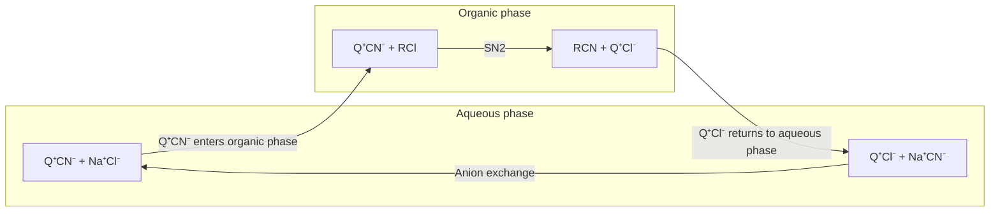

Amines are the hydrocarbyl derivatives of ammonia and the most important organic bases. The lone pair on nitrogen determines all of their chemistry: when it accepts a proton, the amine is a base; when it attacks an electron-poor carbon, the amine is a **nucleophile**. Amine structures are ubiquitous, from neurotransmitters, alkaloids, and amino acids to the great majority of drug molecules: about four-fifths of small-molecule drugs contain nitrogen, most of them as amines or nitrogen heterocycles. This chapter first treats the structure, physical properties, and basicity of amines (the basicity data are taken uniformly from the [pKa table of 6.5.3](/6.5.3#sec-3.1.4)), then the preparation and reactions of amines, and finally quaternary ammonium salts and the Hofmann elimination. The reaction of amines with nitrous acid (**diazotization**) and other nitrogen-containing functional groups are in [6.5.24](/6.5.24#sec-24.2); cyclic amines and aromatic nitrogen heterocycles are in [6.5.25](/6.5.25); the formation of **imines** and **enamines** from amines and aldehydes or ketones is in [6.5.16](/6.5.16#sec-16.9), and the structure of amides and the **Hofmann rearrangement** are in [6.5.20](/6.5.20#sec-20.2); the chemistry of amino acids and peptides is in [6.5.33](/6.5.33).

## 23.1. Classification, Nomenclature, and Natural Occurrence

### 23.1.1. Classification

**Definition 23.1.1 (Amine)** A compound in which hydrogen atoms of ammonia ($\ce{NH3}$) are replaced by hydrocarbyl groups is called an **amine**. By the number of hydrocarbyl groups on nitrogen, amines are divided into primary ($\ce{RNH2}$), secondary ($\ce{R2NH}$), and tertiary ($\ce{R3N}$) amines; a positively charged ion $\ce{R4N+}$ with four hydrocarbyl groups on nitrogen is called a quaternary ammonium ion (Section 23.7). An amine in which all the hydrocarbyl groups are aliphatic is an aliphatic amine, and one with at least one aryl group attached directly to nitrogen is an arylamine.

The classification of primary, secondary, and tertiary amines is based on the number of substituents on nitrogen, which differs from the classification of alcohols, based on the carbon bearing the hydroxyl group: *tert*-butylamine $\ce{(CH3)3CNH2}$ is a primary amine, whereas *tert*-butyl alcohol $\ce{(CH3)3COH}$ is a tertiary alcohol. A nitrogen attached to a carbonyl group makes an amide ([6.5.20](/6.5.20)), and a nitrogen in a ring makes a nitrogen heterocycle ([6.5.25](/6.5.25)); their properties differ greatly from those of amines.

### 23.1.2. Nomenclature

Under the 2013 IUPAC recommendations ([Section 1.4 of 6.5.1](/6.5.1#sec-1.4)), an amine takes the suffix -amine, added to the name of the parent hydride; other hydrocarbyl groups on nitrogen are prefixes whose position is indicated by italic $N$. Simple amines are also often named "hydrocarbyl name + amine" (methylamine), a general name that IUPAC permits.

```smiles
CCN 1
CCCN(C)CC 2
CC(N)CC(C)C 3
CCC(C)CCNCC 4
COc1ccc(N(C)C)cc1 5
NCCC(C)CCO 6
CN(C)c1ccc(cc1)C(=O)O 7
```

| No. | Name | Note |
|---|---|---|
| 1 | ethanamine (ethylamine) | Primary amine |
| 2 | $N$-ethyl-$N$-methylpropan-1-amine | The longest chain containing N is the parent; the other hydrocarbyl groups are $N$-substituents, in alphabetical order |
| 3 | 4-methylpentan-2-amine | The amine group takes the lowest locant |
| 4 | $N$-ethyl-3-methylpentan-1-amine | Substituents in alphabetical order (ethyl before methyl) |
| 5 | 4-methoxy-$N$,$N$-dimethylaniline | Aniline is a retained name and can serve as the parent |
| 6 | 5-amino-3-methylpentan-1-ol | The alcohol has priority over the amine, which is written as the prefix amino |
| 7 | 4-(dimethylamino)benzoic acid | The carboxylic acid has priority, and the amine is a prefix |

For the order of priority of functional groups see [Section 1.4.2 of 6.5.1](/6.5.1#sec-1.4.2): amines rank after carboxylic acids, carboxylic acid derivatives, nitriles, aldehydes, ketones, alcohols, and thiols, and with these groups present the amino group is a prefix. Halogens, nitro, and nitroso groups can only be prefixes and do not compete for the suffix.

### 23.1.3. Alkaloids and Amine Drugs

**Definition 23.1.2 (Alkaloid)** A naturally occurring organic compound containing a basic nitrogen atom, obtained from living organisms (mainly plants), is called an **alkaloid**. Their nitrogen is mostly in a heterocycle, and most have marked physiological activity.

The "alkali" in the name refers to their ability to form salts with acids: plant material is extracted with dilute acid, the alkaloid enters the aqueous layer as the ammonium salt, and it is then made basic and extracted with an organic solvent (Section 23.4.5); this is just how they were first isolated (Sertürner obtained morphine from opium in 1805). Important alkaloids include morphine, cocaine, nicotine, quinine, caffeine (a purine, [6.5.25](/6.5.25#sec-25.8)), and vincristine (an anticancer drug that binds to tubulin and arrests mitosis in metaphase). Compounds with the phenethylamine skeleton form another large class: dopamine, norepinephrine, and epinephrine are neurotransmitters or hormones (Carlsson received the 2000 Nobel Prize in Physiology or Medicine for discovering the transmitter role of dopamine and its relation to Parkinson's disease), mescaline is an alkaloid from cacti, and amphetamine and MDMA (ecstasy) are synthetic stimulants and drugs of abuse. Strictly speaking, epinephrine is an animal hormone and amphetamine and MDMA are synthetic drugs, and none of them is an alkaloid.

```smiles
NCCc1ccc(O)c(O)c1 dopamine
CNC[C@H](O)c1ccc(O)c(O)c1 adrenaline
CC(N)Cc1ccccc1 amphetamine
CN1CCC[C@H]1c1cccnc1 nicotine
```

## 23.2. Physical Properties and Spectra

Amines are polar molecules. Primary and secondary amines have N–H bonds and form N–H···N **hydrogen bonds** between molecules; tertiary amines have no N–H but can accept hydrogen bonds from water or alcohols. The **electronegativity** of nitrogen is lower than that of oxygen, and N–H···N hydrogen bonds are weaker than O–H···O, so the boiling points of amines lie between those of alkanes and alcohols of similar molar mass:

| Compound | Molar mass/($\mathrm{g\,mol^{-1}}$) | Boiling point/$^\circ\mathrm{C}$ |
|---|---|---|
| Butane $\ce{CH3CH2CH2CH3}$ | 58 | $-0.5$ |
| Trimethylamine $\ce{(CH3)3N}$ | 59 | 3 |
| $N$-Methylethanamine $\ce{CH3CH2NHCH3}$ | 59 | 37 |
| Propan-1-amine $\ce{CH3CH2CH2NH2}$ | 59 | 48 |
| Propan-1-ol $\ce{CH3CH2CH2OH}$ | 60 | 97 |

The boiling points of isomeric amines decrease in the order primary > secondary > tertiary, consistent with the number of N–H bonds. Lower amines (up to six carbons) are soluble in water because all of them can form hydrogen bonds with water. Lower amines smell of ammonia or fish (the smell of fish comes mainly from trimethylamine); butane-1,4-diamine (putrescine) and pentane-1,5-diamine (cadaverine), produced by the decay of protein, smell foul; arylamines are mostly toxic and readily absorbed through the skin.

Spectral features (principles in [6.4](/6.4); methods of structure elucidation in [6.5.6](/6.5.6)):

| Method | Features |
|---|---|
| IR | A primary amine has two N–H stretching absorptions (about 3400 and $3300\,\mathrm{cm^{-1}}$, the asymmetric and symmetric stretches), a secondary amine one (about $3300\text{–}3350\,\mathrm{cm^{-1}}$, weaker), a tertiary amine none; N–H peaks are narrower and weaker than O–H peaks of alcohols. A primary amine has the scissoring bend of $\ce{NH2}$ at about $1600\,\mathrm{cm^{-1}}$ |
| ¹H NMR | N–H at $\delta$ 0.5–3.0, often a broad peak that disappears on shaking with $\ce{D2O}$ because of H/D exchange; N–CH at $\delta$ 2.2–2.9 |
| ¹³C NMR | Carbons attached to N at $\delta$ 30–60 |
| MS | A molecule with an odd number of N has an odd mass number for the molecular ion (the **nitrogen rule**, [6.4.15](/6.4.15)); the most important fragmentation is α-cleavage: **homolysis** of the C–C bond next to N gives the resonance-stabilized iminium ion $\ce{R2N+=CH2}$, usually the base peak |

For example, α-cleavage of triethylamine ($M = 101$) with loss of a $\ce{CH3}$ **radical** gives $\ce{(CH3CH2)2N+=CHCH3}$ at $m/z$ 86 (the base peak). The larger hydrocarbyl group is lost preferentially, because the more stable radical forms more easily.

## 23.3. Structure, Nitrogen Inversion, and Chirality

### 23.3.1. Structure of Amines

The nitrogen of an aliphatic amine is sp³-hybridized, with three σ bonds and one lone pair in a tetrahedral arrangement, and the molecule is trigonal pyramidal: the H–N–H angle of $\ce{NH3}$ is $107^\circ$, and the C–N–C angle of trimethylamine is about $111^\circ$.

The nitrogen of aniline is between sp³ and sp². The lone pair conjugates with the π system of the benzene ring, which tends to flatten the nitrogen (conjugation requires the lone pair to be in a p orbital), whereas the geometry of the bonding electrons still favors the tetrahedron; the compromise is a "flattened" pyramid: the H–N–H angle is about $114^\circ$, the angle between the $\ce{NH2}$ plane and the ring plane is about $40^\circ$, and the C–N bond length is $140\,\mathrm{pm}$, shorter than the $147\,\mathrm{pm}$ of methylamine. The orbital holding the lone pair has more p character and can conjugate with the ring; the nitrogen of arylamines conjugated with strongly electron-withdrawing groups (such as 4-nitroaniline) and of amides is close to planar sp².

### 23.3.2. Nitrogen Inversion

An amine with three different groups, such as the N of $N$-methylethanamine (H, methyl, ethyl, and a lone pair), is formally **chiral**, the lone pair acting as the fourth "group". But such amines cannot be separated by **chiral resolution** into **enantiomers**, because of nitrogen inversion.

**Definition 23.3.1 (Nitrogen Inversion)** The process in which a trigonal pyramidal amine passes through a planar transition state, with N sp²-hybridized and the lone pair in a p orbital, and becomes its mirror-image configuration is called **nitrogen inversion**, like an umbrella blown inside out by the wind.

The barrier to nitrogen inversion is low: about $24\,\mathrm{kJ\,mol^{-1}}$ for $\ce{NH3}$ and about $25\text{–}35\,\mathrm{kJ\,mol^{-1}}$ for simple tertiary amines. By the **Eyring equation** ([6.5.3](/6.5.3#sec-3.8)), a barrier of $30\,\mathrm{kJ\,mol^{-1}}$ corresponds at room temperature to a rate constant of about $10^7\,\mathrm{s^{-1}}$; the two configurations interconvert instantly, and what is obtained is always the **racemate**. The inversion of $\ce{NH3}$ also involves quantum tunneling, and its splitting frequency of $23.8\,\mathrm{GHz}$ is the working frequency of the ammonia maser.


Three kinds of amines can be resolved into enantiomers:

- Quaternary ammonium salts: nitrogen has no lone pair, and a quaternary ammonium ion with four different groups is an ordinary **stereocenter** that cannot invert (Pope and Peachey first resolved a quaternary ammonium salt with a chiral nitrogen in 1899). Amine oxides $\ce{R3N+-O-}$ are the same.
- Nitrogen at a bridgehead: a bicyclic structure locks N, and inversion would distort the rings severely, as in Tröger's base (resolved by Prelog in 1944) and sparteine (an alkaloid often used as a chiral ligand).
- Nitrogen in a small ring: in the planar **transition state** of aziridine ([6.5.25](/6.5.25#sec-25.9.1)) the C–N–C angle must widen from $60^\circ$ to $120^\circ$, which strains the ring greatly and raises the barrier to $70\text{–}80\,\mathrm{kJ\,mol^{-1}}$; when N also carries an atom of high **electronegativity** (N–Cl, N–OR), inversion is slow enough that the two configurations can be separated at room temperature.

```smiles
CC1=CC2=C(C=C1)N3CC4=C(C=CC(=C4)C)N(C2)C3 Tröger
```

## 23.4. Basicity

### 23.4.1. Measures of Basicity

The lone pair makes an amine both a base (accepting a proton) and a **nucleophile** (attacking carbon and other electrophilic centers); the two properties run largely parallel, but **nucleophilicity** is more strongly affected by steric hindrance (Section 23.5.1). The basicity of an amine is expressed by the $\mathrm{p}K_{\mathrm{a}}$ of its conjugate acid $\ce{R3NH+}$ (sometimes written $\mathrm{p}K_{\mathrm{aH}}$): the larger the $\mathrm{p}K_{\mathrm{a}}$, the stronger the base ([Section 3.1.2 of 6.5.3](/6.5.3#sec-3.1.2)). The data in the table below are from [Table 3.2 of 6.5.3](/6.5.3#sec-3.1.4) (aqueous solution, 25 °C); those marked with * are supplementary data from outside that table (CRC, same convention):

| Base | $\mathrm{p}K_{\mathrm{a}}$ of conjugate acid | Base | $\mathrm{p}K_{\mathrm{a}}$ of conjugate acid |
|---|---|---|---|
| Guanidine $\ce{HN=C(NH2)2}$ | 13.6 | $\ce{NH3}$ | 9.25 |
| Pyrrolidine | 11.27 | Imidazole | 6.99 |
| Piperidine | 11.12 | Pyridine | 5.23 |
| Triethylamine | 10.75 | $N$,$N$-Dimethylaniline* | 5.07 |
| Dimethylamine | 10.73 | 4-Methoxyaniline* | 5.34 |
| Methylamine | 10.66 | Aniline | 4.60 |
| Trimethylamine | 9.80 | 4-Chloroaniline* | 3.98 |
| 4-(Dimethylamino)pyridine (DMAP) | 9.6 | 3-Nitroaniline* | 2.47 |
| | | 4-Nitroaniline | 1.0 |
| | | Acetamide (protonated on O) | About $-0.5$ |


The approximate order of basicity is alkylamines (about 10–11) ≫ pyridine, aniline (about 5) ≫ amides (about $-0.5$). By Eq. (3.1), triethylamine deprotonates anilinium almost completely ($K = 10^{10.75 - 4.60} \approx 10^{6}$).

### 23.4.2. Alkylamines: Electronic, Steric, and Solvation Effects

In the gas phase basicity increases monotonically with the number of alkyl groups on nitrogen: $\ce{NH3}$ < $\ce{CH3NH2}$ < $\ce{(CH3)2NH}$ < $\ce{(CH3)3N}$. Alkyl groups stabilize the positive charge of the ammonium ion by the **inductive effect** and by polarization; this is the intrinsic basicity of the isolated molecule. In water the order is instead dimethylamine (10.73) > methylamine (10.66) > trimethylamine (9.80) > ammonia (9.25), and tertiary amines are anomalously weak. The reason is solvation: the N–H of an ammonium ion is stabilized by **hydrogen bonds** to water, and $\ce{RNH3+}$ has three N–H whereas $\ce{R3NH+}$ has only one; the more alkyl groups, the poorer the solvation of the positive charge. The two effects oppose each other and give a maximum at the secondary amine. The proton is very small, and "steric hindrance to the approach of the proton" is not the main reason; the role of steric hindrance is mainly to hinder the solvation of the ammonium ion.

Because of solvation, the order of basicity of aliphatic amines differs between solvents, and the differences are small (all around 10–11); in synthesis they are usually regarded as bases of comparable strength, and the differences lie in nucleophilicity and steric hindrance: triethylamine and diisopropylethylamine (Hünig's base, conjugate-acid $\mathrm{p}K_{\mathrm{a}}$ about 11) are hindered, weakly nucleophilic organic bases, often used to take up the acid formed in a reaction. In cyclic amines (pyrrolidine, piperidine) the hydrocarbyl groups are "tied back" in the ring and do not shield the lone pair, so both basicity and nucleophilicity are slightly higher than for open-chain secondary amines.

### 23.4.3. Arylamines

Aniline is weaker as a base than cyclohexylamine (conjugate-acid $\mathrm{p}K_{\mathrm{a}}$ 10.6, in water, CRC) by a factor of about $10^6$. The lone pair of aniline is delocalized to the *ortho* and *para* positions of the benzene ring (the **conjugation effect**, [6.5.2](/6.5.2#sec-2.5)), and this delocalization is lost on protonation: aniline itself is resonance-stabilized but anilinium is not, so the protonation equilibrium is unfavorable. In addition, N attached to an sp² carbon experiences a stronger electron-withdrawing inductive effect.

The effect of substituents follows the **Hammett equation** ([Section 3.5 of 6.5.3](/6.5.3#sec-3.5)): the reaction constant for dissociation of anilinium is $\rho \approx 2.9$, much more sensitive than that of benzoic acid (defined as 1), because the charge is on the atom directly attached to the ring. Electron-donating groups (4-$\ce{OCH3}$, 4-$\ce{CH3}$) increase the basicity and electron-withdrawing groups decrease it; 4-nitroaniline (1.0) is much weaker than 3-nitroaniline (2.47) because the *para* nitro group can accept the lone pair of N directly through resonance (a **resonance structure** of the $\ce{H2N+=C6H4=NO2-}$ type), whereas the *meta* group can act only inductively. The conjugate-acid $\mathrm{p}K_{\mathrm{a}}$ of diphenylamine is about 0.8, and triphenylamine is hardly basic at all.


$N$,$N$-Dimethylaniline (5.07) is similar to aniline; but when a methyl group is introduced *ortho* to $\ce{NMe2}$, the basicity actually increases: the *ortho* methyl group twists $\ce{NMe2}$ out of the plane of the ring, and the lone pair no longer conjugates with the ring (steric inhibition of resonance).

### 23.4.4. Other Nitrogen Bases

The more stable the lone pair on nitrogen, the weaker the basicity ([Section 3.2 of 6.5.3](/6.5.3#sec-3.2)). Several common classes of nitrogen compounds:

| Class | Example (conjugate-acid $\mathrm{p}K_{\mathrm{a}}$) | Reason |
|---|---|---|
| Amides | Acetamide (about $-0.5$, protonated on O) | The lone pair on N is conjugated with C=O, and protonation occurs on O |
| Nitriles | $\ce{RC#NH+}$ (about $-10$) | sp hybridization, the lone pair has 50 % s character |
| Pyridine | 5.23 | sp² lone pair, 33 % s character ([6.5.25](/6.5.25#sec-25.3.1)) |
| Pyrrole | $-3.8$ (protonated on C2) | The lone pair is part of the aromatic 6π system |
| DMAP | 9.6 | After protonation of the pyridine N, the lone pair of the 4-$\ce{NMe2}$ conjugates with the ring and disperses the positive charge |
| Amidines (DBU), guanidines | DBU 24.3 (in acetonitrile); guanidinium 13.6 (water) | After protonation the positive charge is delocalized over two (three) N, and the conjugate acid is especially stable |


DMAP and DBU are organic bases commonly used in synthesis: DMAP is used mainly as a nucleophilic catalyst for acylation ([6.5.19](/6.5.19#sec-19.3.2)), and DBU (1,8-diazabicyclo[5.4.0]undec-7-ene) is a hindered, weakly nucleophilic strong base often used in eliminations. 1,8-Bis(dimethylamino)naphthalene (the "proton sponge", conjugate-acid $\mathrm{p}K_{\mathrm{a}}$ 12.1) is another design: the lone pairs of the two $\ce{NMe2}$ groups repel each other, and a proton lodged between the two N forms a strong intramolecular hydrogen bond and relieves this repulsion; it is strongly basic but kinetically hard to approach, and has almost no nucleophilicity.

```smiles
CN(C)c1ccncc1 DMAP
C1CCC2=NCCCN2CC1 DBU
CN(C)c1cccc2cccc(N(C)C)c12 proton sponge
```

### 23.4.5. Amine Salts and Acid–Base Extraction

An amine and an acid form an ammonium salt, an ionic compound that is readily soluble in water and insoluble in nonpolar solvents such as ether; adding a strong base releases the free amine again. This allows amines to be separated from neutral and acidic organic compounds by acid–base extraction (complementary to the separation of carboxylic acids and phenols in [Example 3.1.1 of 6.5.3](/6.5.3#sec-3.1.2)). Many amine drugs are made into hydrochlorides (procaine hydrochloride, diphenhydramine hydrochloride) to increase water solubility and stability and to remove the odor of the free amine.

**Example 23.4.1** How are aniline, phenol, and toluene separated from their solution in ether?

**Solution** Extract with dilute hydrochloric acid: aniline (conjugate acid 4.60) is protonated to anilinium and enters the aqueous layer, whereas phenol and toluene stay in the ether layer. Then extract the ether layer with aqueous NaOH: phenol (9.99) enters the aqueous layer as the sodium salt ($K = 10^{14.00 - 9.99} \approx 10^4$), and toluene stays in the ether layer. Making the first aqueous layer basic with NaOH and extracting with ether gives aniline; acidifying the second aqueous layer gives phenol. $\square$

The distribution of drug molecules in the body follows the same rules: amine drugs are almost completely protonated in the stomach (pH about 2), and in the small intestine (pH about 6–7) a part is present in the neutral form and can cross cell membranes and be absorbed (the **partition coefficient** varies with pH, [6.4](/6.4)).

### 23.4.6. Amines as Acids

The N–H of an amine is an extremely weak acid: the $\mathrm{p}K_{\mathrm{a}}$ of $\ce{NH3}$ in DMSO is 41 ([Table 3.3](/6.5.3#sec-3.1.4)), and that of diisopropylamine in THF is about 36. Only strong bases such as **organolithium reagents** (conjugate acid about 50) can deprotonate them, and the amide anions ($\ce{R2N-}$) obtained are extremely strong bases: *lithium diisopropylamide* (LDA) is made from diisopropylamine and $n$-BuLi, is hindered and weakly nucleophilic, and is used to generate **enolates** quantitatively ([6.5.21](/6.5.21#sec-21.1.3)); $\ce{NaNH2}$ is used for deprotonation of terminal alkynes ([6.5.11](/6.5.11#sec-11.12.2)) and for generation of **benzyne** ([6.5.15](/6.5.15#sec-15.1.3)).

## 23.5. Preparation of Amines

The synthesis of amines has two problems to solve: how to introduce nitrogen onto carbon (formation of the C–N bond) and how to control the number of substituents on nitrogen (obtaining only a primary, secondary, or tertiary amine). The methods below are organized by these two points.

### 23.5.1. Direct Alkylation and Its Problem

The **SN2 reaction** of ammonia or an amine with an alkyl halide gives an ammonium salt, which loses a proton to give an amine with one more hydrocarbyl group. The problem is that the product amine is no less nucleophilic than the starting material (the electron-donating alkyl group makes it slightly more so) and goes on to react with the alkyl halide, giving a mixture of primary, secondary, and tertiary amines and the quaternary ammonium salt:

```smiles
N.CCBr>>CCN
CCN.CCBr>>CCNCC
CCNCC.CCBr>>CCN(CC)CC
CCN(CC)CC.CCBr>>CC[N+](CC)(CC)CC.[Br-]
```

Direct alkylation is useful only in two extreme cases: with a large excess of ammonia, the reaction with an alkyl halide gives mainly the primary amine (statistically the alkyl halide meets ammonia more often); an amine with excess alkyl halide (especially iodomethane) is alkylated completely to the quaternary ammonium salt (Section 23.8). Intramolecular alkylation to give five- and six-membered cyclic amines is also efficient, because ring closure is faster than intermolecular realkylation. To introduce only one hydrocarbyl group one must either use a "masked" nitrogen nucleophile (the Gabriel synthesis, azide ion, cyanide ion) or change to a reaction that does not overalkylate (reductive amination, acylation–reduction).


### 23.5.2. The Gabriel Synthesis

**Definition 23.5.1 (Gabriel Synthesis)** The method in which the potassium salt of phthalimide undergoes an SN2 reaction with a primary alkyl halide to give an $N$-alkylphthalimide, and a primary amine is then released by hydrazinolysis or hydrolysis, is called the **Gabriel synthesis** (Gabriel 1887).

The N–H of phthalimide is flanked by two carbonyl groups, the negative charge can be delocalized onto two oxygens, and the acidity is fairly strong ($\mathrm{p}K_{\mathrm{a}}$ 8.3, Table 3.2), so KOH or $\ce{K2CO3}$ can deprotonate it. The nitrogen anion formed is a good nucleophile and a weak base, suited to SN2; after alkylation the lone pair on N is conjugated with the two carbonyl groups and is no longer nucleophilic, so only one hydrocarbyl group is introduced. Finally, refluxing with hydrazine in ethanol (the Ing–Manske procedure), hydrazine attacks the two carbonyl groups and a cyclic phthalhydrazide precipitates, releasing the primary amine; hydrolysis with strong acid or strong base is also possible but the conditions are harsher.


In hydrazinolysis the two N of hydrazine attack the two carbonyl groups in turn (two **nucleophilic acyl substitutions**) and form cyclic phthalhydrazide:


```smiles
O=C1c2ccccc2C(=O)N1CC.NN>>O=C1NNC(=O)c2ccccc12.CCN
```

The Gabriel synthesis is suitable only for primary alkyl halides and sulfonates (secondary alkyl halides mainly eliminate) and cannot make arylamines directly (aryl halides do not undergo SN2). Using an α-bromomalonate as the alkylating agent followed by the **malonic ester synthesis** is the Gabriel synthesis of amino acids ([6.5.33](/6.5.33)).

### 23.5.3. Reduction of Azides and Nitriles

The azide ion $\ce{N3-}$ is a very good nucleophile and a very weak base ($\mathrm{p}K_{\mathrm{a}}$ of $\ce{HN3}$ 4.72), and undergoes SN2 smoothly with primary and secondary alkyl halides with little elimination; the alkyl azide formed is not nucleophilic and does not overalkylate. Alkyl azides are reduced to primary amines with $\ce{LiAlH4}$, catalytic hydrogenation, or $\ce{PPh3}$/$\ce{H2O}$ (the **Staudinger reduction**, Definition 26.5.1), with no change in the number of carbons. Alkyl azides of low molecular mass are explosive and are usually reduced without isolation (for the safety of **azides** see [6.5.24](/6.5.24#sec-24.8.1)).

SN2 of cyanide ion with an alkyl halide gives a nitrile, which is reduced with $\ce{LiAlH4}$ or by catalytic hydrogenation to $\ce{RCH2NH2}$, with one more carbon than the alkyl halide (chemistry of nitriles in [6.5.20](/6.5.20#sec-20.4)):


```smiles
CCCCBr.[N-]=[N+]=[N-]>>CCCCN=[N+]=[N-]
CCCCN=[N+]=[N-]>>CCCCN
CCCCBr.[C-]#N>>CCCCC#N
CCCCC#N>>CCCCCN
```

### 23.5.4. Reductive Amination

**Definition 23.5.2 (Reductive Amination)** The reaction in which an aldehyde or ketone condenses with ammonia or a primary or secondary amine to give an imine (or iminium ion), which is then reduced to an amine, is called **reductive amination**. Ammonia, primary amines, and secondary amines give primary, secondary, and tertiary amines, respectively.

Reductive amination amounts to "alkylation of an amine with a carbonyl compound", in which the carbonyl carbon becomes the new N-alkyl carbon. It has no problem of overalkylation: after a primary amine has condensed with an aldehyde and been reduced to a secondary amine, the secondary amine can still form an iminium ion with the aldehyde, but as long as the amount of aldehyde is controlled to one equivalent the reaction stops at the desired stage; conversely, when a tertiary amine is wanted, one can deliberately carry out another reductive amination.

The mechanism has two stages. The first is **nucleophilic addition** of the amine to the carbonyl group and dehydration ([6.5.16](/6.5.16#sec-16.9.1)): the amine attacks the carbonyl carbon to give a carbinolamine, the hydroxyl group is protonated and leaves as water to give an iminium ion, and the iminium ion of a primary amine loses an N–H proton to give a neutral imine. This stage is fastest in weak acid (pH about 5–6): if the acid is too strong all the amine is protonated and loses its nucleophilicity, and if too weak the hydroxyl group cannot leave. The second stage is transfer of hydride to the carbon of the iminium ion.


The key is the choice of reducing agent. When aldehyde or ketone, amine, and reducing agent are mixed in "one pot", the reducing agent must reduce the iminium ion and not the starting aldehyde or ketone, otherwise an alcohol is obtained. $\ce{NaBH4}$ reduces both and can be used only in a "stepwise" procedure: the imine is prepared and isolated first and then reduced. In sodium cyanoborohydride $\ce{NaBH3CN}$ (Borch 1971) the cyano group is electron-withdrawing and lowers the hydride activity of B–H, so that at pH 6–7 it hardly reduces aldehydes and ketones but rapidly reduces the positively charged, far more electrophilic iminium ion; it is stable in weak acid, which is just what imine formation needs. $\ce{NaBH3CN}$ is toxic (HCN is evolved in acidic work-up) and has now largely been replaced by sodium triacetoxyborohydride $\ce{NaBH(OAc)3}$ (Abdel-Magid 1996): the three acetoxy groups likewise lower the hydride activity, the selectivity is good and the toxicity low, and it is often used in 1,2-dichloroethane or THF with a little acetic acid. Catalytic hydrogenation ($\ce{H2}$/Pd, Ni) can also be used.

```smiles
O=Cc1ccccc1.N>>NCc1ccccc1
CC(=O)CC.NC1CCCCC1>>CCC(C)NC1CCCCC1
O=CC1CCCCC1.C1CCNC1>>C(C1CCCCC1)N1CCCC1
```

Two common variants: a primary or secondary amine heated with formaldehyde and formic acid (Eschweiler–Clarke methylation), in which formic acid is the hydride donor, completely $N$-methylates the amine to the tertiary amine without forming a quaternary ammonium salt (a tertiary amine cannot form another iminium ion); an aldehyde or ketone condensed with hydroxylamine gives an oxime, which is reduced to the primary amine with $\ce{LiAlH4}$, Zn/HCl, or catalytic hydrogenation.

Living organisms also synthesize and metabolize amino acids by "reductive amination" and its reverse: glutamate dehydrogenase reductively aminates α-ketoglutarate with $\ce{NH4+}$ to glutamate using NADPH; transaminases, with pyridoxal phosphate as coenzyme, transfer the amino group between amino acids and α-keto acids through imine intermediates. Asymmetric reductive amination with imine reductases is already one of the industrial methods for producing **chiral** amines in the pharmaceutical industry.

### 23.5.5. Reduction of Amides and Nitro Compounds

Amides are reduced by $\ce{LiAlH4}$ (or $\ce{BH3}$), C=O becoming $\ce{CH2}$, to give amines: $\ce{RCONR'2 -> RCH2NR'2}$. Unlike the reduction of esters, which has a similar mechanism, the **tetrahedral intermediate** here loses oxygen (as an aluminate), giving an iminium ion that accepts a second hydride ([6.5.19](/6.5.19#sec-19.7)). Acylation (Section 23.6) followed by reduction amounts to introducing one hydrocarbyl group on nitrogen without overalkylation: primary amine → secondary amine, secondary amine → tertiary amine.

```smiles
CC(=O)Nc1ccccc1>>CCNc1ccccc1
```

The main source of arylamines is the reduction of nitroarenes: nitration of the arene ([6.5.14](/6.5.14#sec-14.6)) followed by reduction with Fe/HCl, Sn/HCl, $\ce{SnCl2}$, or catalytic hydrogenation ($\ce{H2}$/Pd, Pt, Ni). Aniline is made industrially by catalytic hydrogenation of nitrobenzene. Intermediates and selective reduction of nitro groups are in [6.5.24](/6.5.24#sec-24.7.4).

### 23.5.6. Degradation of Carboxylic Acid Derivatives

A primary amide reacts with bromine (or chlorine) in aqueous NaOH, loses its carbonyl carbon, and gives a primary amine with one carbon fewer (the **Hofmann rearrangement**, Definition 20.2.1); the **Curtius rearrangement** of acyl azides and the **Schmidt reaction** of carboxylic acids give the same result ([6.5.24](/6.5.24#sec-24.8)). All three pass through isocyanates, and the configuration of the migrating hydrocarbyl group is retained, so a chiral carboxylic acid gives a chiral primary amine of defined configuration; tertiary alkyl primary amines (such as *tert*-butylamine) and arylamines can also be prepared, which SN2-type methods cannot do.

The three-component condensation of an aldehyde or ketone, formaldehyde, and an amine (the **Mannich reaction**, Definition 21.6.1) gives β-amino carbonyl compounds and is a method for introducing C–N and C–C bonds into a carbon skeleton at the same time; Robinson used it in 1917 to synthesize tropinone in one step.

### 23.5.7. Comparison of Methods

| Method | Product | Carbon number | Scope and limitations |
|---|---|---|---|
| Direct alkylation of ammonia | Primary amine (large excess of $\ce{NH3}$) or quaternary ammonium salt | Unchanged | Mixtures, limited synthetic value; effective intramolecularly for ring closure |
| Gabriel synthesis | Primary amine | Unchanged | Primary alkyl halides, sulfonates |
| Azide substitution–reduction | Primary amine | Unchanged | Primary and secondary alkyl halides (SN2 with inversion); safety |
| Cyanation–reduction | Primary amine $\ce{RCH2NH2}$ | One more | Primary and secondary alkyl halides |
| Reductive amination | Primary, secondary, tertiary amines | Set by the carbonyl compound | Most general; $\ce{NaBH(OAc)3}$ or $\ce{NaBH3CN}$ |
| Acylation–reduction | Secondary, tertiary amines | Set by the acyl group | Introduces $\ce{RCH2}$-type hydrocarbyl groups |
| Nitro reduction | Arylamine | Unchanged | Main source of arylamines |
| Hofmann, Curtius rearrangements | Primary amine | One fewer | Retention of configuration; gives tertiary alkylamines and arylamines |

Arylamines can also be obtained directly from aryl halides and amines by palladium-catalyzed **Buchwald–Hartwig amination** (Definition 29.4.5), one of the most common methods for forming aryl C–N bonds in modern drug synthesis.

## 23.6. Acylation, Sulfonylation, and Protection of Amines

Primary and secondary amines undergo **nucleophilic acyl substitution** with acyl chlorides and acid anhydrides ([6.5.19](/6.5.19#sec-19.3.2)) to give $N$-substituted or $N$,$N$-disubstituted amides; a tertiary amine has no H on N, and the $N$-acylammonium ion formed is unstable and no amide results (but for this very reason pyridine and DMAP can act as nucleophilic catalysts for acylation). One equivalent of HCl is formed in the reaction and must be taken up by a base, otherwise HCl converts half of the amine into the non-nucleophilic ammonium salt: triethylamine or pyridine is commonly used, and for cheap amines two equivalents of the amine itself; the reaction can also be run in a two-phase system of aqueous NaOH and an organic solvent (Schotten–Baumann conditions), in which the acyl chloride reacts with the amine in the organic phase much faster than it is hydrolyzed at the interface.

```smiles
CC(=O)Cl.NCc1ccccc1>>CC(=O)NCc1ccccc1
```

The lone pair on the amide N is conjugated with the carbonyl group, and both basicity and nucleophilicity are much lower than in amines, so acylation is the basic method for protecting an amino group:

- The $\ce{NH2}$ of aniline is a very strong activating group, and bromination gives 2,4,6-tribromoaniline directly; after acetylation to acetanilide the activation is weaker and the group larger, bromination gives mainly the *para* monobromide, and hydrolysis then removes the acetyl group ([Section 14.5 of 6.5.14](/6.5.14#sec-14.5)).
- The N of aniline coordinates to $\ce{AlCl3}$ to give the strongly electron-withdrawing $\ce{-NH2+-AlCl3-}$ and cannot undergo the **Friedel–Crafts reaction**; acetanilide can.
- An acetyl group is removed only by hydrolysis with strong acid or strong base under harsh conditions. Peptide synthesis and the synthesis of complex molecules mostly use carbamate **protecting groups**: *tert*-butoxycarbonyl (Boc, introduced with $\ce{(Boc)2O}$ and removed with trifluoroacetic acid), benzyloxycarbonyl (Cbz or Z, removed by hydrogenolysis), and 9-fluorenylmethoxycarbonyl (Fmoc, removed with piperidine); the mechanisms of their introduction and removal are in [6.5.33](/6.5.33).

Amines and sulfonyl chlorides give sulfonamides. The N–H of $\ce{ArSO2NHR}$ from a primary amine is acidic because of the strong electron-withdrawing effect of the sulfonyl group ($\mathrm{p}K_{\mathrm{a}}$ of benzenesulfonamide 10.1, Table 3.2) and dissolves in NaOH solution; $\ce{ArSO2NR2}$ from a secondary amine has no N–H and is insoluble in base; a tertiary amine gives no stable sulfonamide. Treating an unknown amine with benzenesulfonyl chloride and NaOH solution and observing whether the precipitate dissolves in base distinguishes primary, secondary, and tertiary amines; this is the classical Hinsberg test (Hinsberg 1890). The sulfa drugs are derivatives of 4-aminobenzenesulfonamide ([6.5.26](/6.5.26#sec-26.10.2)).


Other reactions of amines are in the corresponding chapters: formation of **imines** and **enamines** with aldehydes and ketones ([6.5.16](/6.5.16#sec-16.9)), **conjugate addition** ([6.5.17](/6.5.17#sec-17.6)), reaction with nitrous acid ([6.5.24](/6.5.24#sec-24.2)), and oxidation by peroxides to amine oxides (Section 23.8.4).

## 23.7. Quaternary Ammonium Salts, Phase-Transfer Catalysis, and Phospholipids

### 23.7.1. Quaternary Ammonium Salts and Hydroxides

**Definition 23.7.1 (Quaternary Ammonium Salt)** A salt of a positively charged ion $\ce{R4N+}$, with four hydrocarbyl groups on nitrogen, and an anion is called a **quaternary ammonium salt**; when the anion is $\ce{OH-}$ it is called a quaternary ammonium hydroxide.

The **SN2 reaction** of a tertiary amine with an alkyl halide (the Menshutkin reaction) gives a quaternary ammonium salt. This reaction forms an **ion pair** from two neutral molecules, the charge separation in the **transition state** is large, and the reaction is greatly accelerated in polar solvents, a classical example of a solvent effect ([Section 8.8 of 6.5.8](/6.5.8#sec-8.8)). Quaternary ammonium salts are ionic crystals, soluble in water and insoluble in nonpolar solvents; on heating they can undergo the reverse SN2 (halide attacking the α carbon) and decompose to the tertiary amine and the alkyl halide.

![The Menshutkin reaction: the lone pair on the nitrogen of triethylamine attacks the carbon of iodomethane from the back side of iodine (SN2). In the transition state (middle) the N···C bond is partly formed and the C···I bond partly broken, the three hydrogens of the methyl group lie in one plane, and charge has already separated (partial positive charge on N, partial negative charge on I); two neutral molecules become an ion pair, so polar solvents strongly stabilize the transition state and accelerate the reaction](./plots/menshutkin.py)

Quaternary ammonium hydroxides are obtained from a quaternary ammonium halide and moist silver oxide: the halide precipitates as AgX, and evaporation of the filtrate gives $\ce{R4N+OH-}$. A quaternary ammonium hydroxide is completely dissociated in water, as strongly basic as NaOH or KOH, and absorbs $\ce{CO2}$ from the air and is deliquescent. The quaternary ammonium ion itself has no lone pair and is neither a base nor a **nucleophile**.

### 23.7.2. Surfactants and Phase-Transfer Catalysis

A quaternary ammonium salt with one long alkyl chain and three methyl groups, such as cetyltrimethylammonium bromide (CTAB), is ionic at one end and a hydrocarbon chain at the other, and is a cationic **surfactant** that forms **micelles** in water ([6.3](/6.3)); benzalkonium chloride (benzyldimethyl long-chain alkylammonium chloride) is a common disinfectant.

In many reactions the two reactants are soluble only in water and in an organic solvent, respectively: for example, sodium cyanide dissolves only in water and 1-chlorooctane only in organic solvents; mixing the two phases directly hardly gives any reaction, because reaction can occur only at the very small interface.

**Definition 23.7.2 (Phase-Transfer Catalysis)** The method in which a small amount of a lipophilic salt (quaternary ammonium or phosphonium salt) or a crown ether is added so that anions of the aqueous phase enter the organic phase as ion pairs and react with the substrate there, thus accelerating reactions between two phases, is called **phase-transfer catalysis** (Starks 1971).

A quaternary ammonium ion $\ce{Q+}$ (such as tetrabutylammonium $\ce{Bu4N+}$ or methyltrioctylammonium $\ce{MeOct3N+}$) carries hydrocarbyl groups large enough that its ion pairs with anions are soluble in the organic phase. The catalytic cycle is as follows:



Phase-transfer catalysis has two benefits. One is that it carries ionic reagents into the organic phase; the other is that the anion in the organic phase is almost unsolvated (organic solvents cannot form **hydrogen bonds** to anions, and the interaction between the large $\ce{Q+}$ and the anion is also weak), a "naked" anion whose **nucleophilicity** and basicity are far higher than in water ([6.5.8](/6.5.8#sec-8.8)), so that SN2, alkylation, and oxidation ($\ce{KMnO4}$ dissolved in benzene as "purple benzene") can be carried out under mild conditions without costly anhydrous **polar aprotic solvents**. With **chiral** quaternary ammonium salts derived from cinchona alkaloids as catalysts, asymmetric phase-transfer alkylation is possible (for example, asymmetric alkylation of glycine imine esters to prepare amino acids).

### 23.7.3. Phospholipids

Phosphatidylcholine (lecithin) is the most abundant phospholipid in cell membranes: two hydroxyl groups of glycerol are esterified with long-chain fatty acids, the third with phosphoric acid, and the phosphoric acid in turn with choline $\ce{HOCH2CH2N+(CH3)3}$. Its hydrophilic head group is a **zwitterion** of a quaternary ammonium ion and a phosphate anion, the two hydrocarbon chains are the hydrophobic tail, and in water they assemble spontaneously into bilayer membranes. The ester chemistry of glycerides and phospholipids is in [6.5.19](/6.5.19#sec-19.9.3), and the structure and function of membranes are left to biochemistry. Acetylcholine, the acetate ester of choline, is a neurotransmitter and is likewise a quaternary ammonium ion.

```smiles
CC(=O)OCC[N+](C)(C)C acetylcholine
```

## 23.8. The Hofmann Elimination

### 23.8.1. Reaction and Mechanism

**Definition 23.8.1 (Hofmann Elimination)** The reaction in which a quaternary ammonium hydroxide on heating (usually $100\text{–}200\,^\circ\mathrm{C}$) has a β-hydrogen removed by hydroxide while a tertiary amine leaves as the leaving group, giving an alkene, a tertiary amine, and water, is called the **Hofmann elimination** (A. W. Hofmann 1851). When several kinds of β-hydrogen are present, the main product is the alkene with fewer substituents on the double bond.

```smiles
CCC(C)[N+](C)(C)C.[OH-]>>CCC=C.CN(C)C.O
```

The Hofmann elimination is an **E2 reaction** ([6.5.9](/6.5.9#sec-9.4)): removal of the β-hydrogen by the base, formation of the π bond, and cleavage of the C–N bond proceed in concert, and the H–C–C–N unit must be **antiperiplanar**. The operation has three steps: the amine is completely methylated with excess iodomethane to the quaternary ammonium iodide (three equivalents of $\ce{CH3I}$ for a primary amine, two for a secondary, one for a tertiary); moist $\ce{Ag2O}$ replaces iodide with hydroxide; and the salt is heated to eliminate. Methylation not only converts the poor **leaving group** $\ce{NH2-}$ into a good one (a neutral tertiary amine) but also, because the methyl groups have no β-hydrogens, restricts elimination to the original hydrocarbyl groups, so the product is unambiguous.


### 23.8.2. Orientation: Why the Less Substituted Alkene Forms

Butan-2-yltrimethylammonium hydroxide eliminates to give about 95 % but-1-ene and only about 5 % but-2-ene, whereas the E2 reaction of 2-bromobutane with sodium ethoxide gives mainly but-2-ene (**Zaitsev's rule**). The Hofmann elimination obeys the **Hofmann rule** ([Definition 9.4.3 of 6.5.9](/6.5.9#def-9.4.3)), for two reasons:

1. The **transition state** leans toward **E1cB**. $\ce{-NMe3+}$ is a rather poor leaving group (the C–N bond is harder to break than C–Br), and its positive charge increases the acidity of the β-hydrogen through the **inductive effect**. In the transition state the C–H bond is therefore broken to a greater extent and the C–N bond to a lesser, partial negative charge accumulates on the β carbon, and the transition state resembles a **carbanion** ([Section 9.5 of 6.5.9](/6.5.9#sec-9.5)). The stability of carbanions is primary > secondary > tertiary (alkyl groups destabilize a carbanion by electron donation), so the hydrogens on the terminal methyl group are removed most easily. The stabilization of the transition state by the degree of substitution of the alkene (the origin of Zaitsev orientation) is now of secondary importance.
2. Steric hindrance. $\ce{-NMe3+}$ is very bulky. For elimination from C3, the C3–H must be antiperiplanar to C–N, and then the methyl group on C3 (C4) must be gauche to either $\ce{NMe3+}$ or the methyl group on C2, an unfavorable conformation; for elimination from C1, one of the three equivalent hydrogens is always antiperiplanar, with no such crowding. The base also approaches the terminal methyl group more easily than a methylene group.

Both orientations are under **kinetic control**: the product alkenes do not interconvert under the reaction conditions, and the product ratio is set by the difference in activation energies of the two pathways. The common contrast "Hofmann rule = kinetic control, Zaitsev rule = **thermodynamic control**" is wrong in its second half. E2 of alkyl halides gives more of the more substituted alkene not because the products have reached equilibrium, but because in a transition state with more C–X bond breaking the partly formed double bond already feels the stabilization by **hyperconjugation** of alkyl groups, and the transition state leading to the more substituted alkene is lower in energy; this is still kinetic control. The two rules differ in the nature of the transition state (E1cB-like or more **E1**-like), not in the mode of control.

When the β carbon bears an aryl, vinyl, or carbonyl group, the hydrogens on this carbon are much more acidic and the alkene formed is conjugated, so elimination takes place preferentially on this side and does not obey the Hofmann rule: $N$,$N$-dimethyl-$N$-ethyl-2-phenylethylammonium hydroxide eliminates to give mainly styrene, not ethylene.

### 23.8.3. Exhaustive Methylation and Structure Determination

Before NMR became widespread, exhaustive methylation followed by Hofmann elimination was the main method for determining the structures of nitrogen-containing natural products: each cycle breaks one C–N bond, and a nitrogen in a ring needs two cycles to be removed. In the 1880s Hofmann used it to degrade piperidine: after two eliminations the nitrogen is completely removed, giving a pentadiene, and this established the cyclic structure of piperidine:

```smiles
C1CCNCC1>>C[N+]1(C)CCCCC1
C[N+]1(C)CCCCC1>>CN(C)CCCC=C
CN(C)CCCC=C>>C=CCC=C
```

The first elimination opens the ring to give $N$,$N$-dimethylpent-4-en-1-amine; methylation and elimination again release the nitrogen as trimethylamine and give the diene (partly isomerized to the conjugated penta-1,3-diene under strong base and high temperature). In 1911 Willstätter made cyclooctatetraene for the first time from pseudopelletierine, an alkaloid of the pomegranate bark, by several exhaustive methylation–Hofmann eliminations ([6.5.13](/6.5.13#sec-13.6)).


To infer the products one need only look at the β-hydrogens of each carbon attached to N: every β-hydrogen may be removed in some elimination, each elimination of a ring N opens one ring, and the opened hydrocarbyl group is still attached to N until N leaves as trimethylamine. In modern synthesis the Hofmann elimination is used to introduce terminal double bonds specifically at a mild position.

### 23.8.4. The Cope Elimination

A tertiary amine is oxidized by hydrogen peroxide or *m*-chloroperoxybenzoic acid to an amine oxide $\ce{R3N+-O-}$. An amine oxide with a β-hydrogen, heated to $100\text{–}150\,^\circ\mathrm{C}$, undergoes *syn* elimination through a five-membered cyclic transition state to give an alkene and an $N$,$N$-dialkylhydroxylamine (the Cope elimination, Cope 1949). It is complementary to the Hofmann elimination: the mechanism is a concerted intramolecular process (the Ei mechanism) requiring H and N–O to be on the same side (*syn* coplanar), no external base is needed, the conditions are milder, and the orientation also favors the less substituted alkene.

![The Cope elimination of N,N-dimethylbutan-2-amine N-oxide: the negatively charged oxygen of the amine oxide, through a planar five-membered cyclic transition state, removes the β-H on the same side as the C–N bond; the electrons of the C–H bond form C=C, and the C–N bond breaks with its electrons remaining on nitrogen (syn elimination, Ei mechanism, no external base required). As in the Hofmann elimination the main product is the less substituted but-1-ene; the other product is N,N-dimethylhydroxylamine](./plots/cope-elimination.py)

```smiles
CCC(C)[N+](C)(C)[O-]>>CCC=C.CN(C)O
```

## 23.9. Research Frontier

The synthesis of amines is one of the most frequently performed reactions in medicinal chemistry, and recent advances have concentrated on new ways of forming C–N bonds: palladium- and copper-catalyzed amination of aryl compounds is already routine ([6.5.29](/6.5.29#sec-29.4.6)); **photoredox catalysis** can generate α-amino **radicals** or aminium radicals by one-electron oxidation of amines and achieve α-C–H functionalization of amines and hydroamination of alkenes ([6.5.31](/6.5.31#sec-31.5)); in biocatalysis, transaminases and **imine** reductases improved by directed evolution synthesize **chiral** amines in water with high enantioselectivity, and the production of the antidiabetic drug sitagliptin by Merck and Codexis with an engineered transaminase is the representative industrial example of this route.

## Summary

- Amines (Definition 23.1.1) are divided by the number of substituents on N into primary, secondary, and tertiary amines and quaternary ammonium ions; names use the suffix -amine and the prefix $N$-; alkaloids (Definition 23.1.2) are naturally occurring basic nitrogen compounds.
- Physical properties: N–H···N **hydrogen bonds** are weaker than O–H···O, so boiling points lie between those of alkanes and alcohols; in IR a primary amine has two N–H peaks and a secondary amine one; in MS an odd molecular mass (nitrogen rule) and iminium ions from α-cleavage.
- Structure: the N of aliphatic amines is sp³, that of aniline is between sp³ and sp²; the barrier of nitrogen inversion (Definition 23.3.1) is about $25\text{–}35\,\mathrm{kJ\,mol^{-1}}$, and only quaternary ammonium salts, bridgehead nitrogen, and nitrogen in small rings keep their configuration.
- Basicity (conjugate-acid $\mathrm{p}K_{\mathrm{a}}$, unified table of 6.5.3):

  | Class | Typical value | Determining factor |
  |---|---|---|
  | Amidines, guanidines | 13–14 | Delocalization of positive charge in the conjugate acid |
  | Alkylamines | 9.8–11.3 | **Inductive effect** opposed by solvation; secondary amines strongest in water |
  | DMAP | 9.6 | Resonance of the exocyclic N |
  | Pyridine, aniline, imidazole | 4.6–7.0 | sp² lone pair; lone pair conjugated with the aromatic ring |
  | Amides | About $-0.5$ | Lone pair conjugated with C=O, protonation on O |

- Preparation: direct alkylation overalkylates; to introduce only one hydrocarbyl group use the Gabriel synthesis (Definition 23.5.1) or substitution–reduction of azide or cyanide; reductive amination (Definition 23.5.2) is the most general, the key being $\ce{NaBH3CN}$ and $\ce{NaBH(OAc)3}$, which reduce only the iminium ion; arylamines come from reduction of nitro compounds; the Hofmann and **Curtius rearrangements** give primary amines with one carbon fewer and retention of configuration.
- Acylation gives amides and is used to protect and to moderate the reactivity of arylamines; the Hinsberg test distinguishes primary, secondary, and tertiary amines by the acidity of the sulfonamide.
- Quaternary ammonium salts (Definition 23.7.1): prepared by the Menshutkin reaction; long-chain quaternary ammonium salts are surfactants, and quaternary ammonium ions as phase-transfer catalysts (Definition 23.7.2) carry "naked" anions into the organic phase; the choline head of phospholipids is a quaternary ammonium ion.
- The Hofmann elimination (Definition 23.8.1): exhaustive methylation, $\ce{Ag2O}$, heating; **E2** mechanism, with a **transition state** leaning toward **E1cB** and a bulky $\ce{NMe3+}$, giving the less substituted alkene, under **kinetic control**; a conjugating β position is preferred; used in structure determination. The Cope elimination is the *syn* thermal elimination of amine oxides.

## Questions

1. Arrange in order of decreasing basicity and explain: (a) aniline, 4-methoxyaniline, 4-nitroaniline, cyclohexylamine; (b) pyrrole, pyridine, piperidine, acetamide.

   **Answer** (a) Cyclohexylamine (10.6) > 4-methoxyaniline (5.34) > aniline (4.60) > 4-nitroaniline (1.0). The lone pair of cyclohexylamine is localized on an sp³ N; the lone pair of an arylamine is conjugated with the ring, and the conjugation is lost on protonation; the *para* methoxy group, being electron-donating, raises the basicity slightly, and the *para* nitro group accepts the lone pair directly through resonance and lowers the basicity by a factor of about $10^{3.6}$. (b) Piperidine (11.12) > pyridine (5.23) > acetamide (about $-0.5$) > pyrrole ($-3.8$). Piperidine is an sp³ secondary amine; the lone pair of pyridine is in an sp² orbital with higher s character; the lone pair of acetamide is conjugated with the carbonyl group and protonation occurs on O; the lone pair of pyrrole belongs to the aromatic 6π system, and protonation can occur only on C2 and destroys the **aromaticity**.

2. $N$-Methyl-$N$-ethylaniline cannot be separated by **chiral resolution**, whereas $N$-methyl-$N$-ethyl-$N$-allylanilinium iodide can be resolved into a pair of **enantiomers**. Explain, and estimate the inversion rate constant at room temperature for a nitrogen inversion barrier of $30\,\mathrm{kJ\,mol^{-1}}$.

   **Answer** The lone pair of a tertiary amine lets nitrogen invert through a planar **transition state**, the two configurations interconvert rapidly, and only the **racemate** can be obtained; the nitrogen of a quaternary ammonium ion carries four different groups, has no lone pair, cannot invert, and is a stable **stereocenter**. By the Eyring equation, $k = \frac{k_{\mathrm{B}}T}{h}\mathrm{e}^{-\Delta G^\ddagger/RT} \approx 6.2\times10^{12}\,\mathrm{s^{-1}} \times \mathrm{e}^{-30000/(8.314\times298)} \approx 3\times10^{7}\,\mathrm{s^{-1}}$, that is, about ten million inversions per second (the N of anilines is flatter, and the barrier is actually lower).

3. Synthesize 2-phenylethanamine $\ce{C6H5CH2CH2NH2}$ by each of the following methods, giving the starting materials and reagents: (a) Gabriel synthesis; (b) the azide method; (c) reduction of a nitrile; (d) reductive amination; (e) the **Hofmann rearrangement**.

   **Answer** (a) 2-Phenylethyl bromide and potassium phthalimide in DMF, then hydrazinolysis with hydrazine in ethanol. (b) 2-Phenylethyl bromide and $\ce{NaN3}$ (DMSO or DMF), then reduction with $\ce{LiAlH4}$ or $\ce{H2}$/Pd. (c) Benzyl bromide and NaCN give phenylacetonitrile $\ce{C6H5CH2CN}$, reduced with $\ce{LiAlH4}$ or by catalytic hydrogenation (one more carbon). (d) Phenylacetaldehyde with ammonia (for example $\ce{NH4OAc}$) and $\ce{NaBH3CN}$; with ammonia the primary amine product may react further, and an excess of ammonia is needed. (e) 3-Phenylpropanamide $\ce{C6H5CH2CH2CONH2}$ with $\ce{Br2}$/NaOH (one carbon fewer).

4. How would you prepare by reductive amination, from suitable starting materials: (a) $N$-benzylcyclohexanamine; (b) $N$,$N$-dimethylcyclohexanamine (two methods)? Why are $\ce{NaBH3CN}$ or $\ce{NaBH(OAc)3}$, and not $\ce{NaBH4}$, used in the one-pot procedure?

   **Answer** (a) Cyclohexanone and benzylamine, or benzaldehyde and cyclohexylamine, with $\ce{NaBH(OAc)3}$. (b) Cyclohexanone with dimethylamine and $\ce{NaBH(OAc)3}$ (through the iminium ion); or cyclohexylamine heated with excess formaldehyde and formic acid (Eschweiler–Clarke methylation); formaldehyde with $\ce{NaBH3CN}$ can also be used. $\ce{NaBH4}$ would reduce the aldehyde or ketone directly to the alcohol, competing with imine formation; $\ce{NaBH3CN}$ and $\ce{NaBH(OAc)3}$ have lower hydride activity and in weak acid hardly reduce neutral carbonyl groups but reduce only the far more electrophilic iminium ion, so all the reactants can be mixed together.

5. On heating, 2-methylbutan-2-yltrimethylammonium hydroxide $\ce{(CH3)2C(NMe3+)CH2CH3}$ gives which alkene as the main product? What is the main product with 2-bromo-2-methylbutane and sodium ethoxide? Explain the difference in terms of the nature of the transition state.

   **Answer** The Hofmann elimination gives mainly 2-methylbut-1-ene (elimination from $\ce{CH3}$); 2-bromo-2-methylbutane with sodium ethoxide gives mainly 2-methylbut-2-ene (about 70 %, [6.5.9](/6.5.9#sec-9.4.3)). $\ce{NMe3+}$ is a poor **leaving group** and makes the β-H more acidic, so in the **E2** transition state cleavage of the C–H bond is ahead, the transition state has carbanion character, and the hydrogens on the primary carbon leave most easily; $\ce{NMe3+}$ is bulky, and the **antiperiplanar** conformation needed for elimination from the $\ce{CH2}$ side suffers gauche repulsion. In the transition state of the bromoalkane more C–Br cleavage has occurred and the double-bond character is stronger, so **hyperconjugation** by alkyl groups lowers the transition state leading to the more substituted alkene. Both cases are under **kinetic control**.

6. Phencyclidine (PCP), $\ce{C17H25N}$, is an anesthetic. PCP is treated with excess iodomethane and then heated with moist $\ce{Ag2O}$ to give three main products: 1-phenylcyclohexene, $N$-methylpiperidine, and $N$-methyl-$N$-(1-phenylcyclohexyl)pent-4-en-1-amine. Deduce the structure of PCP.

   ```smiles
   c1ccc(cc1)C1=CCCCC1 a
   CN1CCCCC1 b
   C=CCCCN(C)C1(CCCCC1)c1ccccc1 c
   ```

   **Answer** Only one equivalent of iodomethane is consumed (N carries only one more methyl group in the products), so PCP is a tertiary amine; one product is $N$-methylpiperidine, showing that N is in a piperidine ring; another is 1-phenylcyclohexene, showing that N is attached to the quaternary carbon C1, which bears the phenyl group, of a cyclohexane. PCP is therefore 1-(1-phenylcyclohexyl)piperidine. After $N$-methylation both kinds of β-hydrogen can be eliminated: an H on C2 of the cyclohexane is removed to give 1-phenylcyclohexene and $N$-methylpiperidine (the leaving group is $N$-methylpiperidine); an H on C3 of the piperidine ring is removed, the piperidine ring opens, and the third product results.

   ```smiles
   c1ccc(cc1)C1(CCCCC1)N1CCCCC1 PCP
   ```

7. Write the mechanism of the following reaction: methyl (*S*)-3,4-dimethoxyphenylalaninate reacts with 4-chlorobutanal in weak acid to give a tricyclic amine in which a pyrrolidine ring is fused to a tetrahydroisoquinoline ring (Pictet–Spengler reaction followed by intramolecular N-alkylation).

   ```smiles
   COc1ccc(C[C@@H](C(=O)OC)N)cc1OC.O=CCCCCl>>COc1cc2C[C@@H](C(=O)OC)N3CCCC3c2cc1OC
   ```

   **Answer** (1) The primary amine attacks the aldehyde group, dehydration gives an imine, which is protonated in acid to the iminium ion (the same as the first stage of reductive amination). (2) The electron-rich aromatic ring (activated by the two methoxy groups, the position of attack being *para* to one methoxy group) acts as the **nucleophile** and attacks the carbon of the iminium ion, forming a six-membered ring; this is an intramolecular **SEAr** (**σ complex**, Definition 14.2.1), and loss of a proton restores aromaticity to give the 1-substituted tetrahydroisoquinoline (a secondary amine). This step is the Pictet–Spengler reaction, which is the same reaction used in the biosynthesis of isoquinoline alkaloids. (3) The N of the secondary amine attacks the terminal $\ce{CH2Cl}$ of the side chain, closing the five-membered pyrrolidine ring by intramolecular **SN2** with loss of HCl, and giving the tricyclic tertiary amine. The configuration of the **chiral** carbon is unchanged in the reaction; the configuration of the newly formed stereocenter (C1) is determined by the diastereoselectivity of the cyclization.

8. Explain: (a) why two equivalents of amine, or added triethylamine, are used when an amine and an acyl chloride form an amide; (b) why tetrabutylammonium bromide greatly accelerates the reaction of 1-bromooctane with aqueous NaCN, and why the **nucleophilicity** of cyanide is greater in the organic phase than in water.

   **Answer** (a) Each molecule of amide formed releases one molecule of HCl, and HCl forms with the amine a non-nucleophilic ammonium salt; without added base at most half of the amine can react. The extra amine or triethylamine takes up the HCl (triethylamine is hindered and is itself not acylated to a stable product). (b) The **ion pair** of $\ce{Bu4N+}$ and $\ce{CN-}$ is soluble in the organic phase and carries cyanide into the phase containing the substrate; in the organic phase $\ce{CN-}$ is not solvated by **hydrogen bonds** to water molecules, and the ion pairing with the large $\ce{Bu4N+}$ is also weak, so it is in a high-energy "naked" state and the activation energy of SN2 is markedly lowered.
