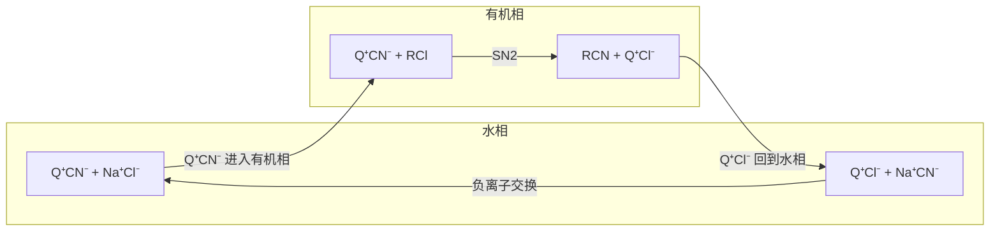

胺是氨的烃基衍生物，是最重要的有机碱。氮上的一对孤对电子决定了胺的全部化学：它接受质子，胺就是碱；它进攻缺电子的碳，胺就是**亲核试剂**。从神经递质、生物碱、氨基酸到绝大多数药物分子，胺类结构无处不在：约八成小分子药物含有氮原子，其中多数是胺或含氮杂环。本章先讲胺的结构、物性与碱性（碱性的数据统一取自 [6.5.3 的 pKa 表](/6.5.3#sec-3.1.4)），再讲胺的制备与反应，最后讲季铵盐与 Hofmann 消除。胺与亚硝酸的反应（**重氮化**）及其他含氮官能团见 [6.5.24](/6.5.24#sec-24.2)；氮原子在环中的胺与芳香含氮杂环见 [6.5.25](/6.5.25)；胺与醛酮生成**亚胺**、**烯胺**的反应见 [6.5.16](/6.5.16#sec-16.9)，酰胺的结构与 **Hofmann 重排**见 [6.5.20](/6.5.20#sec-20.2)；氨基酸与肽的化学见 [6.5.33](/6.5.33)。

## 23.1. 分类、命名与天然存在

### 23.1.1. 分类

**定义 23.1.1（胺）** 氨（$\ce{NH3}$）分子中的氢原子被烃基取代的化合物称为**胺**（amine）。按氮上所连烃基的数目分为伯胺（一级胺，$\ce{RNH2}$）、仲胺（二级胺，$\ce{R2NH}$）与叔胺（三级胺，$\ce{R3N}$）；氮上连四个烃基、带正电荷的离子 $\ce{R4N+}$ 称为季铵离子（23.7）。烃基都是脂肪烃基的称为脂肪胺，至少有一个芳基直接连在氮上的称为芳胺。

伯、仲、叔胺的分级看氮上的取代数，与醇看羟基所在碳的分级不同：叔丁胺 $\ce{(CH3)3CNH2}$ 是伯胺，而叔丁醇 $\ce{(CH3)3COH}$ 是叔醇。氮连在羰基上的是酰胺（[6.5.20](/6.5.20)），氮在环中的是含氮杂环（[6.5.25](/6.5.25)），它们的性质与胺差别很大。

### 23.1.2. 命名

按 IUPAC 2013 推荐（[6.5.1 的 1.4 节](/6.5.1#sec-1.4)），胺以 -amine（胺）为后缀，加在母体氢化物的名称后面；氮上的其他烃基作为前缀，用斜体 $N$ 标明位置。简单的胺也常用"烃基名 + amine"的写法（methylamine，甲胺），这是 IUPAC 允许的一般名称，中文也常用这种写法（甲胺、二乙胺、三甲胺）。

```smiles
CCN 1
CCCN(C)CC 2
CC(N)CC(C)C 3
CCC(C)CCNCC 4
COc1ccc(N(C)C)cc1 5
NCCC(C)CCO 6
CN(C)c1ccc(cc1)C(=O)O 7
```

| 序号 | 英文名 | 中文名 | 说明 |
|---|---|---|---|
| 1 | ethanamine（ethylamine） | 乙胺 | 伯胺 |
| 2 | $N$-ethyl-$N$-methylpropan-1-amine | $N$-乙基-$N$-甲基丙-1-胺 | 最长的含 N 碳链为母体，其余烃基作 $N$-取代基，按字母排序 |
| 3 | 4-methylpentan-2-amine | 4-甲基戊-2-胺 | 胺基取最低位次 |
| 4 | $N$-ethyl-3-methylpentan-1-amine | $N$-乙基-3-甲基戊-1-胺 | 取代基按英文字母排序（ethyl 在 methyl 前） |
| 5 | 4-methoxy-$N$,$N$-dimethylaniline | 4-甲氧基-$N$,$N$-二甲基苯胺 | aniline（苯胺）是保留名，可作母体 |
| 6 | 5-amino-3-methylpentan-1-ol | 5-氨基-3-甲基戊-1-醇 | 醇优先于胺，胺写成前缀 amino（氨基） |
| 7 | 4-(dimethylamino)benzoic acid | 4-(二甲氨基)苯甲酸 | 羧酸优先，胺作前缀 |

官能团的优先次序见 [6.5.1 的 1.4.2 节](/6.5.1#sec-1.4.2)：胺排在羧酸、羧酸衍生物、腈、醛、酮、醇与硫醇之后，含这些基团时氨基作前缀。卤素、硝基、亚硝基只能作前缀，不参加后缀的竞争。

中文用字有三种："氨"指 $\ce{NH3}$ 及作取代基的 $\ce{-NH2}$（氨基、甲氨基）；"胺"指作为母体的有机化合物（甲胺、二甲胺）；"铵"指带正电荷的氮（氯化甲铵 $\ce{CH3NH3+Cl-}$，氢氧化四甲基铵 $\ce{(CH3)4N+OH-}$）。

### 23.1.3. 生物碱与胺类药物

**定义 23.1.2（生物碱）** 从生物体（主要是植物）中得到的、含碱性氮原子的天然有机化合物称为**生物碱**（alkaloid）。它们的氮大多在杂环中，多数有显著的生理活性。

"碱"指它们能与酸成盐：植物材料用稀酸浸取，生物碱以铵盐进入水层，再碱化、用有机溶剂萃取（23.4.5），这正是它们最早被分离出来的方法（Sertürner 1805 年由鸦片得到吗啡）。重要的生物碱有吗啡、可卡因、尼古丁、奎宁、咖啡因（嘌呤类，[6.5.25](/6.5.25#sec-25.8)）与长春新碱（与微管蛋白结合、使有丝分裂停在中期的抗癌药）。苯乙胺骨架的化合物是另一大类：多巴胺、去甲肾上腺素、肾上腺素是神经递质或激素（Carlsson 因发现多巴胺的递质作用及其与 Parkinson 病的关系获 2000 年诺贝尔生理学或医学奖），墨斯卡林是仙人掌中的生物碱，苯丙胺与 MDMA（摇头丸）则是合成的兴奋剂与毒品。严格地说，肾上腺素是动物激素，苯丙胺与 MDMA 是合成药物，都不属于生物碱。

```smiles
NCCc1ccc(O)c(O)c1 dopamine
CNC[C@H](O)c1ccc(O)c(O)c1 adrenaline
CC(N)Cc1ccccc1 amphetamine
CN1CCC[C@H]1c1cccnc1 nicotine
```

## 23.2. 物理性质与波谱

胺是极性分子。伯胺与仲胺有 N–H 键，分子之间形成 N–H…N **氢键**；叔胺没有 N–H，但可以接受水或醇的氢键。N 的**电负性**小于 O，N–H…N 氢键比 O–H…O 弱，所以胺的沸点介于相近分子量的烷烃与醇之间：

| 化合物 | 摩尔质量/($\mathrm{g\,mol^{-1}}$) | 沸点/$^\circ\mathrm{C}$ |
|---|---|---|
| 丁烷 $\ce{CH3CH2CH2CH3}$ | 58 | $-0.5$ |
| 三甲胺 $\ce{(CH3)3N}$ | 59 | 3 |
| $N$-甲基乙胺 $\ce{CH3CH2NHCH3}$ | 59 | 37 |
| 丙-1-胺 $\ce{CH3CH2CH2NH2}$ | 59 | 48 |
| 丙-1-醇 $\ce{CH3CH2CH2OH}$ | 60 | 97 |

同分异构的胺沸点按伯 > 仲 > 叔的次序降低，与 N–H 键的数目一致。低级胺（六个碳以下）易溶于水，因为都能与水形成氢键。低级胺有氨味或鱼腥味（鱼的腥味主要来自三甲胺），蛋白质腐败产生的丁-1,4-二胺（腐胺）与戊-1,5-二胺（尸胺）恶臭；芳胺多有毒，易经皮肤吸收。

波谱特征（原理见 [6.4](/6.4)，结构解析的方法见 [6.5.6](/6.5.6)）：

| 方法 | 特征 |
|---|---|
| IR | 伯胺有两个 N–H 伸缩吸收（约 3400 与 $3300\,\mathrm{cm^{-1}}$，分别是不对称与对称伸缩），仲胺一个（约 $3300\text{–}3350\,\mathrm{cm^{-1}}$，较弱），叔胺没有；N–H 峰比醇的 O–H 峰窄而弱。伯胺在约 $1600\,\mathrm{cm^{-1}}$ 有 $\ce{NH2}$ 的剪式弯曲振动 |
| ¹H NMR | N–H 在 $\delta$ 0.5–3.0，常为宽峰，加 $\ce{D2O}$ 振摇后因 H/D 交换而消失；N–CH 在 $\delta$ 2.2–2.9 |
| ¹³C NMR | 与 N 相连的碳在 $\delta$ 30–60 |
| MS | 含奇数个 N 的分子，分子离子的质量数为奇数（**氮规则**，[6.4.15](/6.4.15)）；最重要的碎裂是 $\alpha$ 断裂：与 N 相邻的 C–C 键**均裂**，生成共振稳定的亚胺鎓离子 $\ce{R2N+=CH2}$，通常是基峰 |

例如三乙胺（$M = 101$）的 $\alpha$ 断裂失去 $\ce{CH3}$ **自由基**，得到 $m/z$ 86 的 $\ce{(CH3CH2)2N+=CHCH3}$（基峰）。较大的烃基优先失去，因为较稳定的自由基较易生成。

## 23.3. 结构、氮翻转与手性

### 23.3.1. 胺的结构

脂肪胺的氮是 sp³ 杂化的，三个 σ 键与一对孤对电子呈四面体排布，分子为三角锥形：$\ce{NH3}$ 的 H–N–H 键角 $107^\circ$，三甲胺的 C–N–C 键角约 $111^\circ$。

苯胺的氮介于 sp³ 与 sp² 之间。孤对电子与苯环的 π 体系共轭，使氮趋向平面（共轭要求孤对电子在 p 轨道中），而成键电子的几何仍倾向于四面体，两者折中的结果是一个"压扁的"三角锥：H–N–H 键角约 $114^\circ$，$\ce{NH2}$ 平面与苯环平面的夹角约 $40^\circ$，C–N 键长 $140\,\mathrm{pm}$，比甲胺的 $147\,\mathrm{pm}$ 短。孤对电子所在的轨道含较多 p 成分，能与环共轭；与强吸电子基团共轭的芳胺（如 4-硝基苯胺）与酰胺的氮则接近平面的 sp²。

### 23.3.2. 氮翻转

连有三个不同基团的胺，如 $N$-甲基乙胺的 N（H、甲基、乙基与孤对电子），在形式上是**手性**的，孤对电子充当第四个"基团"。但这样的胺不能**拆分**为**对映体**，原因是氮翻转。

**定义 23.3.1（氮翻转）** 三角锥形的胺经过 N 为 sp² 杂化、孤对电子在 p 轨道中的平面过渡态，变为它的镜像构型的过程称为**氮翻转**（nitrogen inversion），像雨伞被风吹翻。

氮翻转的能垒很低：$\ce{NH3}$ 约 $24\,\mathrm{kJ\,mol^{-1}}$，简单的叔胺约 $25\text{–}35\,\mathrm{kJ\,mol^{-1}}$。由 **Eyring 方程**（[6.5.3](/6.5.3#sec-3.8)），$30\,\mathrm{kJ\,mol^{-1}}$ 的能垒在室温下对应约 $10^7\,\mathrm{s^{-1}}$ 的速率常数，两种构型瞬间互变，得到的总是**外消旋体**。$\ce{NH3}$ 的翻转还包含量子隧穿，其分裂频率 $23.8\,\mathrm{GHz}$ 就是氨微波激射器的工作频率。


有三类胺能拆分出对映体：

- 季铵盐：氮上没有孤对电子，四个不同基团的季铵离子是普通的**手性中心**，不能翻转（Pope 与 Peachey 1899 年第一次拆分了含手性氮的季铵盐）。胺氧化物 $\ce{R3N+-O-}$ 同理。
- 氮在桥头：双环结构把 N 锁住，翻转会使环极度扭曲，如 Tröger 碱（Prelog 1944 年拆分）与鹰爪豆碱（sparteine，一种常用作手性配体的生物碱）。
- 氮在小环中：氮杂环丙烷（[6.5.25](/6.5.25#sec-25.9.1)）的平面**过渡态**中 C–N–C 角要从 $60^\circ$ 张开到 $120^\circ$，环张力很大，能垒升到 $70\text{–}80\,\mathrm{kJ\,mol^{-1}}$；N 上再连**电负性**大的原子（N–Cl、N–OR）时，翻转慢到可以在室温下分离两种构型。

```smiles
CC1=CC2=C(C=C1)N3CC4=C(C=CC(=C4)C)N(C2)C3 Tröger
```

## 23.4. 碱性

### 23.4.1. 碱性的度量

胺的孤对电子使它既是碱（接受质子），又是**亲核试剂**（进攻碳等其他亲电中心），两种性质大体平行，但**亲核性**受空间位阻影响更大（23.5.1）。胺的碱性用其共轭酸 $\ce{R3NH+}$ 的 $\mathrm{p}K_{\mathrm{a}}$（有时写作 $\mathrm{p}K_{\mathrm{aH}}$）表示：$\mathrm{p}K_{\mathrm{a}}$ 越大，胺的碱性越强（[6.5.3 的 3.1.2 节](/6.5.3#sec-3.1.2)）。下表的数据取自 [6.5.3 的表 3.2](/6.5.3#sec-3.1.4)（25 °C 水溶液），带 * 的是该表以外的补充数据（CRC，同一约定）：

| 碱 | 共轭酸的 $\mathrm{p}K_{\mathrm{a}}$ | 碱 | 共轭酸的 $\mathrm{p}K_{\mathrm{a}}$ |
|---|---|---|---|
| 胍 $\ce{HN=C(NH2)2}$ | 13.6 | $\ce{NH3}$ | 9.25 |
| 吡咯烷 | 11.27 | 咪唑 | 6.99 |
| 哌啶 | 11.12 | 吡啶 | 5.23 |
| 三乙胺 | 10.75 | $N$,$N$-二甲基苯胺* | 5.07 |
| 二甲胺 | 10.73 | 4-甲氧基苯胺* | 5.34 |
| 甲胺 | 10.66 | 苯胺 | 4.60 |
| 三甲胺 | 9.80 | 4-氯苯胺* | 3.98 |
| 4-二甲氨基吡啶（DMAP） | 9.6 | 3-硝基苯胺* | 2.47 |
| | | 4-硝基苯胺 | 1.0 |
| | | 乙酰胺（O 上质子化） | 约 $-0.5$ |


碱性的大致次序是：烷基胺（约 10–11）≫ 吡啶、苯胺（约 5）≫ 酰胺（约 $-0.5$）。由式 (3.1)，三乙胺能把苯胺鎓几乎完全去质子化（$K = 10^{10.75 - 4.60} \approx 10^{6}$）。

### 23.4.2. 烷基胺：电子、空间与溶剂化效应

在气相中，碱性随氮上烷基的增多单调增强：$\ce{NH3}$ < $\ce{CH3NH2}$ < $\ce{(CH3)2NH}$ < $\ce{(CH3)3N}$。烷基通过**诱导效应**与极化稳定铵离子的正电荷，这是孤立分子的内禀碱性。在水中次序却是 二甲胺（10.73）> 甲胺（10.66）> 三甲胺（9.80）> 氨（9.25），叔胺反常地弱。原因是溶剂化：铵离子的 N–H 与水形成**氢键**而被稳定，$\ce{RNH3+}$ 有三个 N–H，$\ce{R3NH+}$ 只有一个；烷基越多，正电荷的溶剂化越差。两种效应相反，在仲胺处得到最大值。质子很小，"空间位阻使质子难以接近"不是主要原因；空间位阻的作用主要在于妨碍铵离子的溶剂化。

由于溶剂化的影响，脂肪胺的碱性在不同溶剂中排序不同，相差也不大（都在 10–11 附近），合成中通常把它们看作强度相当的碱，区别在于亲核性与位阻：三乙胺与二异丙基乙胺（Hünig 碱，共轭酸 $\mathrm{p}K_{\mathrm{a}}$ 约 11）是位阻大、亲核性弱的有机碱，常用来吸收反应生成的酸。环状胺（吡咯烷、哌啶）的烃基被"绑"在环上，不挡住孤对电子，碱性与亲核性都略强于开链的仲胺。

### 23.4.3. 芳胺

苯胺的碱性比环己胺（共轭酸 $\mathrm{p}K_{\mathrm{a}}$ 10.6，水中，CRC）弱约 $10^6$ 倍。苯胺的孤对电子离域到苯环的邻、对位（**共轭效应**，[6.5.2](/6.5.2#sec-2.5)），质子化后这种离域消失：苯胺本身被共振稳定，苯胺鎓却不能，于是质子化的平衡不利。另外，与 sp² 碳相连的 N 受到较强的吸电子诱导。

取代基的影响符合 **Hammett 方程**（[6.5.3 的 3.5 节](/6.5.3#sec-3.5)）：苯胺鎓解离的反应常数 $\rho \approx 2.9$，比苯甲酸（定义为 1）敏感得多，因为电荷就在与环直接相连的原子上。给电子基团（4-$\ce{OCH3}$、4-$\ce{CH3}$）使碱性增强，吸电子基团使碱性减弱；4-硝基苯胺（1.0）比 3-硝基苯胺（2.47）弱得多，因为对位的硝基能通过共振直接接受 N 的孤对电子（$\ce{H2N+=C6H4=NO2-}$ 型的**共振式**），间位的只能靠诱导。二苯胺的共轭酸 $\mathrm{p}K_{\mathrm{a}}$ 约 0.8，三苯胺几乎没有碱性。


$N$,$N$-二甲基苯胺（5.07）与苯胺相近；但若在 $\ce{NMe2}$ 的邻位引入甲基，碱性反而增强：邻位甲基迫使 $\ce{NMe2}$ 扭离环平面，孤对电子不再与环共轭（空间抑制共振）。

### 23.4.4. 其他含氮碱

氮原子的孤对电子越稳定，碱性越弱（[6.5.3 的 3.2 节](/6.5.3#sec-3.2)）。几类常见的含氮化合物：

| 类别 | 例（共轭酸 $\mathrm{p}K_{\mathrm{a}}$） | 原因 |
|---|---|---|
| 酰胺 | 乙酰胺（约 $-0.5$，O 上质子化） | N 的孤对电子与 C=O 共轭，质子化发生在 O 上 |
| 腈 | $\ce{RC#NH+}$（约 $-10$） | sp 杂化，孤对电子 s 成分 50% |
| 吡啶 | 5.23 | sp² 孤对电子，s 成分 33%（[6.5.25](/6.5.25#sec-25.3.1)） |
| 吡咯 | $-3.8$（C2 上质子化） | 孤对电子是芳香 6π 体系的一部分 |
| DMAP | 9.6 | 吡啶 N 质子化后，4-位 $\ce{NMe2}$ 的孤对电子与环共轭，分散正电荷 |
| 脒（DBU）、胍 | DBU 24.3（乙腈中）；胍鎓 13.6（水） | 质子化后正电荷在两个（三个）N 上离域，共轭酸特别稳定 |


DMAP 与 DBU 是合成中常用的有机碱：DMAP 主要用作酰化的亲核催化剂（[6.5.19](/6.5.19#sec-19.3.2)），DBU（1,8-二氮杂双环[5.4.0]十一碳-7-烯）是位阻较大、亲核性弱的强碱，常用于消除反应。1,8-双(二甲氨基)萘（"质子海绵"，共轭酸 $\mathrm{p}K_{\mathrm{a}}$ 12.1）是另一种设计：两个 $\ce{NMe2}$ 的孤对电子彼此挤压，质子嵌在两个 N 之间形成强的分子内氢键，释放了这种排斥；它的碱性强、动力学上却很难接近，几乎没有亲核性。

```smiles
CN(C)c1ccncc1 DMAP
C1CCC2=NCCCN2CC1 DBU
CN(C)c1cccc2cccc(N(C)C)c12 proton sponge
```

### 23.4.5. 胺盐与酸碱萃取

胺与酸生成铵盐，铵盐是离子化合物，易溶于水、不溶于乙醚等非极性溶剂；加强碱又释放出游离胺。这使胺可以用酸碱萃取与中性、酸性有机物分离（与 [6.5.3 的例 3.1.1](/6.5.3#sec-3.1.2) 分离羧酸与酚的方法互补）。许多胺类药物做成盐酸盐（如盐酸普鲁卡因、盐酸苯海拉明），以提高水溶性与稳定性、去掉游离胺的气味。

**例 23.4.1** 怎样分离苯胺、苯酚与甲苯的乙醚溶液？

**解** 用稀盐酸萃取：苯胺（共轭酸 4.60）被质子化为苯胺鎓，进入水层，苯酚与甲苯留在醚层。再用 NaOH 水溶液萃取醚层：苯酚（9.99）成钠盐进入水层（$K = 10^{14.00 - 9.99} \approx 10^4$），甲苯留在醚层。第一个水层加 NaOH 碱化、乙醚萃取得苯胺；第二个水层酸化得苯酚。$\square$

药物分子在体内的分配也服从同样的规律：胺类药物在胃（pH 约 2）中几乎全部质子化，在小肠（pH 约 6–7）中有一部分以中性形式存在、可以穿过细胞膜被吸收（**分配系数**随 pH 变化，[6.4](/6.4)）。

### 23.4.6. 胺作为酸

胺的 N–H 是极弱的酸：$\ce{NH3}$ 在 DMSO 中的 $\mathrm{p}K_{\mathrm{a}}$ 为 41（[表 3.3](/6.5.3#sec-3.1.4)），二异丙胺在 THF 中约 36。只有**有机锂试剂**（共轭酸约 50）这样的强碱才能把它们去质子化，得到的氨基负离子（$\ce{R2N-}$）是极强的碱：**二异丙基氨基锂**（LDA）由二异丙胺与 $n$-BuLi 制得，位阻大、亲核性弱，用来定量生成**烯醇负离子**（[6.5.21](/6.5.21#sec-21.1.3)）；$\ce{NaNH2}$ 用于端炔的去质子化（[6.5.11](/6.5.11#sec-11.12.2)）与**苯炔**的生成（[6.5.15](/6.5.15#sec-15.1.3)）。

## 23.5. 胺的制备

胺的合成要解决两个问题：怎样在碳上引入氮（C–N 键的形成），以及怎样控制氮上的取代数（只得到伯胺、仲胺或叔胺之一）。下面的方法按这两点组织。

### 23.5.1. 直接烷基化及其问题

氨或胺对卤代烷的 **SN2 反应**生成铵盐，铵盐失去质子得到多一个烃基的胺。问题在于产物胺的**亲核性**不比原料差（烷基的给电子作用使它略强），会继续与卤代烷反应，得到伯、仲、叔胺与季铵盐的混合物：

```smiles
N.CCBr>>CCN
CCN.CCBr>>CCNCC
CCNCC.CCBr>>CCN(CC)CC
CCN(CC)CC.CCBr>>CC[N+](CC)(CC)CC.[Br-]
```

直接烷基化只在两种极端情况下有用：大大过量的氨与卤代烷反应，以伯胺为主（统计上卤代烷更多地遇到氨）；胺与过量卤代烷（尤其是碘甲烷）反应，彻底烷基化为季铵盐（23.8）。分子内的烷基化生成五元、六元环胺时也很有效，因为成环比分子间的再烷基化快。为了只引入一个烃基，要么用一个"被掩蔽的"氮亲核试剂（Gabriel 合成、叠氮负离子、氰负离子），要么换成不会过度烷基化的反应（还原胺化、酰化–还原）。


### 23.5.2. Gabriel 合成

**定义 23.5.1（Gabriel 合成）** 邻苯二甲酰亚胺的钾盐与伯卤代烷发生 SN2 反应生成 $N$-烷基邻苯二甲酰亚胺，再经肼解或水解释放出伯胺的方法称为 **Gabriel 合成**（Gabriel synthesis，Gabriel 1887）。

邻苯二甲酰亚胺的 N–H 夹在两个羰基之间，负电荷可以离域到两个氧上，酸性较强（$\mathrm{p}K_{\mathrm{a}}$ 8.3，表 3.2），KOH 或 $\ce{K2CO3}$ 就能将它去质子化。生成的氮负离子是好的亲核试剂、弱的碱，适合 SN2；烷基化之后，N 上的孤对电子与两个羰基共轭，不再有亲核性，所以只引入一个烃基。最后用肼在乙醇中回流（Ing–Manske 法），肼进攻两个羰基，生成环状的邻苯二甲酰肼沉淀，放出伯胺；也可以用强酸或强碱水解，但条件较剧烈。


肼解时肼的两个 N 先后进攻两个羰基（两次**亲核酰基取代**），生成环状的邻苯二甲酰肼：


```smiles
O=C1c2ccccc2C(=O)N1CC.NN>>O=C1NNC(=O)c2ccccc12.CCN
```

Gabriel 合成只适用于伯卤代烷与磺酸酯（仲卤代烷以消除为主），不能直接制芳胺（芳卤不发生 SN2）。用 $\alpha$-溴代丙二酸酯作烷化剂再接**丙二酸酯合成法**，就是氨基酸的 Gabriel 合成（[6.5.33](/6.5.33)）。

### 23.5.3. 叠氮与腈的还原

叠氮负离子 $\ce{N3-}$ 是很好的亲核试剂、很弱的碱（$\ce{HN3}$ 的 $\mathrm{p}K_{\mathrm{a}}$ 4.72），与伯、仲卤代烷顺利地进行 SN2，消除很少；生成的烷基叠氮没有亲核性，不会过度烷基化。烷基叠氮用 $\ce{LiAlH4}$、催化氢化或 $\ce{PPh3}$/$\ce{H2O}$（**Staudinger 还原**，定义 26.5.1）还原为伯胺，碳数不变。低分子量的烷基叠氮有爆炸性，通常不经分离直接还原（**叠氮化合物**的安全见 [6.5.24](/6.5.24#sec-24.8.1)）。

氰负离子与卤代烷的 SN2 得到腈，腈用 $\ce{LiAlH4}$ 或催化氢化还原为 $\ce{RCH2NH2}$，比卤代烷多一个碳（腈的化学见 [6.5.20](/6.5.20#sec-20.4)）：


```smiles
CCCCBr.[N-]=[N+]=[N-]>>CCCCN=[N+]=[N-]
CCCCN=[N+]=[N-]>>CCCCN
CCCCBr.[C-]#N>>CCCCC#N
CCCCC#N>>CCCCCN
```

### 23.5.4. 还原胺化

**定义 23.5.2（还原胺化）** 醛或酮与氨、伯胺或仲胺缩合生成亚胺（或亚胺鎓离子），亚胺随即被还原为胺的反应称为**还原胺化**（reductive amination）。氨、伯胺、仲胺分别得到伯胺、仲胺、叔胺。

还原胺化相当于"用羰基化合物把胺烷基化"，羰基碳成为新的 N–烷基碳。它没有过度烷基化的问题：伯胺与醛缩合、还原得到仲胺后，仲胺虽然还能与醛生成亚胺鎓离子，但只要醛的量控制在一当量，就停在所需的一步；反过来，需要叔胺时可以有意地再进行一次还原胺化。

机理分两段。第一段是胺对羰基的**亲核加成**与脱水（[6.5.16](/6.5.16#sec-16.9.1)）：胺进攻羰基碳生成半缩醛胺（carbinolamine），羟基质子化后以水的形式离去，得到亚胺鎓离子，伯胺的亚胺鎓离子失去 N–H 质子得到中性的亚胺。这一段在弱酸性（pH 约 5–6）下最快：酸太强时胺都被质子化而失去亲核性，酸太弱时羟基不能离去。第二段是负氢转移到亚胺鎓离子的碳上。


关键是还原剂的选择。醛、酮、胺与还原剂混在一起"一锅"反应时，还原剂必须还原亚胺鎓离子而不还原原料醛酮，否则得到的是醇。$\ce{NaBH4}$ 两者都还原，只能用于"分步"的做法：先制备并分离亚胺，再还原。氰基硼氢化钠 $\ce{NaBH3CN}$（Borch 1971）的氰基吸电子，B–H 的负氢活性降低，在 pH 6–7 下几乎不还原醛酮，却能迅速还原带正电荷、亲电性强得多的亚胺鎓离子；它在弱酸中稳定，而弱酸正是亚胺生成所需要的。$\ce{NaBH3CN}$ 有毒（酸性后处理时放出 HCN），现在多已被三乙酰氧基硼氢化钠 $\ce{NaBH(OAc)3}$（Abdel-Magid 1996）取代：三个乙酰氧基同样降低了负氢活性，选择性好，毒性低，常在 1,2-二氯乙烷或 THF 中、加少量乙酸使用。也可以用催化氢化（$\ce{H2}$/Pd、Ni）。

```smiles
O=Cc1ccccc1.N>>NCc1ccccc1
CC(=O)CC.NC1CCCCC1>>CCC(C)NC1CCCCC1
O=CC1CCCCC1.C1CCNC1>>C(C1CCCCC1)N1CCCC1
```

两个常见的变体：伯胺或仲胺与甲醛、甲酸一起加热（Eschweiler–Clarke 甲基化），甲酸作负氢供体，把胺彻底 $N$-甲基化为叔胺，且不会生成季铵盐（叔胺不能再生成亚胺鎓离子）；醛酮与羟胺缩合得到肟，肟用 $\ce{LiAlH4}$、Zn/HCl 或催化氢化还原为伯胺。

生物体合成与代谢氨基酸也用"还原胺化"及其逆反应：谷氨酸脱氢酶用 NADPH 把 $\alpha$-酮戊二酸与 $\ce{NH4+}$ 还原胺化为谷氨酸；转氨酶以磷酸吡哆醛为辅酶，经亚胺中间体在氨基酸与 $\alpha$-酮酸之间转移氨基。用亚胺还原酶进行不对称还原胺化，已是制药工业生产**手性**胺的方法之一。

### 23.5.5. 酰胺与硝基的还原

酰胺用 $\ce{LiAlH4}$（或 $\ce{BH3}$）还原，C=O 变为 $\ce{CH2}$，得到胺：$\ce{RCONR'2 -> RCH2NR'2}$。与机理相似的酯还原不同，**四面体中间体**失去的是氧（以铝氧盐的形式），生成亚胺鎓离子，再接受第二个负氢（[6.5.19](/6.5.19#sec-19.7)）。先酰化（23.6）再还原，等于在氮上引入一个烃基，且不会过度烷基化：伯胺 → 仲胺，仲胺 → 叔胺。

```smiles
CC(=O)Nc1ccccc1>>CCNc1ccccc1
```

芳胺的主要来源是硝基芳烃的还原：芳烃硝化（[6.5.14](/6.5.14#sec-14.6)）、再用 Fe/HCl、Sn/HCl、$\ce{SnCl2}$ 或催化氢化（$\ce{H2}$/Pd、Pt、Ni）还原。工业上苯胺由硝基苯催化氢化制得。硝基还原的中间产物与选择性还原见 [6.5.24](/6.5.24#sec-24.7.4)。

### 23.5.6. 由羧酸衍生物降解

伯酰胺与溴（或氯）在 NaOH 水溶液中反应，失去羰基碳，得到少一个碳的伯胺（**Hofmann 重排**，定义 20.2.1）；酰基叠氮的 **Curtius 重排**与羧酸的 **Schmidt 反应**得到同样的结果（[6.5.24](/6.5.24#sec-24.8)）。三者都经过异氰酸酯中间体，迁移的烃基构型保持，因此可以由手性羧酸得到构型确定的手性伯胺，也能制备叔烷基伯胺（如叔丁胺）与芳胺，这是 SN2 类方法做不到的。

醛酮、甲醛与胺的三组分缩合（**Mannich 反应**，定义 21.6.1）生成 $\beta$-氨基羰基化合物，是在碳骨架中同时引入 C–N 与 C–C 键的方法；Robinson 1917 年用它一步合成了托品酮。

### 23.5.7. 方法的比较

| 方法 | 产物 | 碳数 | 适用范围与限制 |
|---|---|---|---|
| 氨的直接烷基化 | 伯胺（大过量 $\ce{NH3}$）或季铵盐 | 不变 | 混合物，合成价值有限；分子内成环有效 |
| Gabriel 合成 | 伯胺 | 不变 | 伯卤代烷、磺酸酯 |
| 叠氮取代–还原 | 伯胺 | 不变 | 伯、仲卤代烷（SN2 构型翻转）；注意安全 |
| 氰化–还原 | 伯胺 $\ce{RCH2NH2}$ | 多一个 | 伯、仲卤代烷 |
| 还原胺化 | 伯、仲、叔胺 | 由羰基化合物决定 | 最通用；$\ce{NaBH(OAc)3}$ 或 $\ce{NaBH3CN}$ |
| 酰化–还原 | 仲、叔胺 | 由酰基决定 | 引入 $\ce{RCH2}$ 型烃基 |
| 硝基还原 | 芳胺 | 不变 | 芳胺的主要来源 |
| Hofmann、Curtius 重排 | 伯胺 | 少一个 | 构型保持；可得叔烷基胺与芳胺 |

芳胺也可以用钯催化的 **Buchwald–Hartwig 偶联**由芳基卤与胺直接得到（定义 29.4.5），这是现代药物合成中形成芳基 C–N 键最常用的方法之一。

## 23.6. 胺的酰化、磺酰化与保护

伯胺、仲胺与酰氯、酸酐发生**亲核酰基取代**（[6.5.19](/6.5.19#sec-19.3.2)），生成 $N$-取代或 $N$,$N$-二取代酰胺；叔胺的 N 上没有 H，生成的 $N$-酰基铵离子不稳定，不能得到酰胺（但正因如此，吡啶、DMAP 能作酰化的亲核催化剂）。反应生成一当量 HCl，必须用碱吸收，否则 HCl 会把一半的胺变成没有**亲核性**的铵盐：常用三乙胺或吡啶，便宜的胺可以直接用两当量；也可以在 NaOH 水溶液与有机溶剂的两相体系中进行（Schotten–Baumann 条件），酰氯在有机相中与胺反应的速率远大于在界面上水解的速率。

```smiles
CC(=O)Cl.NCc1ccccc1>>CC(=O)NCc1ccccc1
```

酰胺 N 上的孤对电子与羰基共轭，碱性与亲核性都比胺低得多，所以酰化是保护氨基的基本方法：

- 苯胺的 $\ce{NH2}$ 是很强的活化基团，溴化时直接生成 2,4,6-三溴苯胺；乙酰化成乙酰苯胺后活化减弱、体积增大，溴化主要得到对位一溴代物，再水解除去乙酰基（[6.5.14 的 14.5 节](/6.5.14#sec-14.5)）。
- 苯胺的 N 与 $\ce{AlCl3}$ 配位，生成强吸电子的 $\ce{-NH2+-AlCl3-}$，不能进行 **Friedel–Crafts 反应**；乙酰苯胺可以。
- 乙酰基要用强酸或强碱水解才能除去，条件剧烈。肽合成与复杂分子的合成多用氨基甲酸酯类**保护基**：叔丁氧羰基（Boc，用 $\ce{(Boc)2O}$ 引入，三氟乙酸脱除）、苄氧羰基（Cbz 或 Z，氢解脱除）、9-芴甲氧羰基（Fmoc，哌啶脱除），它们的引入与脱除机理见 [6.5.33](/6.5.33)。

胺与磺酰氯生成磺酰胺。伯胺生成的 $\ce{ArSO2NHR}$ 的 N–H 受磺酰基的强吸电子作用而有酸性（苯磺酰胺的 $\mathrm{p}K_{\mathrm{a}}$ 10.1，表 3.2），溶于 NaOH 溶液；仲胺生成的 $\ce{ArSO2NR2}$ 没有 N–H，不溶于碱；叔胺不生成稳定的磺酰胺。用苯磺酰氯与 NaOH 溶液处理未知胺、观察沉淀是否溶于碱，就能区分伯、仲、叔胺，这是经典的 Hinsberg 试验（Hinsberg 1890）。磺胺类药物是对氨基苯磺酰胺的衍生物（[6.5.26](/6.5.26#sec-26.10.2)）。


胺的其他反应在相应的章节中：与醛酮生成**亚胺**、**烯胺**（[6.5.16](/6.5.16#sec-16.9)），**共轭加成**（[6.5.17](/6.5.17#sec-17.6)），与亚硝酸反应（[6.5.24](/6.5.24#sec-24.2)），被过氧化物氧化为胺氧化物（23.8.4）。

## 23.7. 季铵盐、相转移催化与磷脂

### 23.7.1. 季铵盐与季铵碱

**定义 23.7.1（季铵盐）** 氮原子上连有四个烃基、带一个正电荷的离子 $\ce{R4N+}$ 与负离子组成的盐称为**季铵盐**（quaternary ammonium salt）；负离子为 $\ce{OH-}$ 时称为季铵碱。

叔胺与卤代烷的 **SN2 反应**（Menshutkin 反应）生成季铵盐。这个反应由两个中性分子生成**离子对**，**过渡态**的电荷分离程度很大，在极性溶剂中大大加速，是溶剂效应的经典例子（[6.5.8 的 8.8 节](/6.5.8#sec-8.8)）。季铵盐是离子晶体，溶于水，不溶于非极性溶剂；加热时可以发生逆向的 SN2（卤离子进攻 $\alpha$ 碳），分解为叔胺与卤代烷。


季铵碱由季铵卤化物与湿的氧化银反应得到：卤离子以 AgX 沉淀，滤液蒸干即得 $\ce{R4N+OH-}$。季铵碱在水中完全解离，碱性与 NaOH、KOH 相当，能吸收空气中的 $\ce{CO2}$，易潮解。季铵离子本身没有孤对电子，既不是碱也不是**亲核试剂**。

### 23.7.2. 表面活性剂与相转移催化

一个长链烷基与三个甲基组成的季铵盐，如十六烷基三甲基溴化铵（CTAB），一端是离子、一端是烃链，是阳离子型**表面活性剂**，在水中形成**胶束**（[6.3](/6.3)）；苯扎氯铵（苄基二甲基长链烷基氯化铵）是常用的消毒剂。

许多反应的两种反应物分别只溶于水与有机溶剂：例如氰化钠只溶于水，1-氯辛烷只溶于有机溶剂，两相直接混合几乎不反应，因为反应只能在很小的界面上发生。

**定义 23.7.2（相转移催化）** 加入少量亲脂性的盐（季铵盐、季鏻盐）或冠醚，使水相中的负离子以离子对的形式进入有机相、在有机相中与底物反应，从而加速两相反应的方法称为**相转移催化**（phase-transfer catalysis，Starks 1971）。

季铵离子 $\ce{Q+}$（如四丁基铵 $\ce{Bu4N+}$、甲基三辛基铵 $\ce{MeOct3N+}$）带有足够大的烃基，它与负离子组成的离子对能溶于有机相。催化循环如下：



相转移催化有两个好处。其一是把离子试剂带进有机相；其二是进入有机相的负离子几乎没有溶剂化（有机溶剂不能与负离子形成**氢键**，大的 $\ce{Q+}$ 与负离子之间的作用也弱），是"裸露的"负离子，**亲核性**与碱性远高于在水中（[6.5.8](/6.5.8#sec-8.8)），所以 SN2、烷基化、氧化（$\ce{KMnO4}$ 溶于苯成为"紫苯"）等反应可以在温和的条件下进行，并省去昂贵的无水**非质子极性溶剂**。用金鸡纳生物碱衍生的**手性**季铵盐作催化剂，可以进行不对称的相转移烷基化（如甘氨酸亚胺酯的不对称烷基化制备氨基酸）。

### 23.7.3. 磷脂

磷脂酰胆碱（卵磷脂）是细胞膜中含量最多的磷脂：甘油的两个羟基与长链脂肪酸成酯，第三个羟基与磷酸成酯，磷酸再与胆碱 $\ce{HOCH2CH2N+(CH3)3}$ 成酯。它的亲水头部是一个季铵离子与一个磷酸根负离子组成的**两性离子**，两条烃链是疏水的尾部，在水中自发组装成双层膜。甘油酯与磷脂的酯键化学见 [6.5.19](/6.5.19#sec-19.9.3)，膜的结构与功能留给生物化学。胆碱的乙酸酯乙酰胆碱是神经递质，同样是季铵离子。

```smiles
CC(=O)OCC[N+](C)(C)C acetylcholine
```

## 23.8. Hofmann 消除

### 23.8.1. 反应与机理

**定义 23.8.1（Hofmann 消除）** 季铵碱受热（通常 $100\text{–}200\,^\circ\mathrm{C}$）时，氢氧根夺取 $\beta$-氢，叔胺作为离去基团离去，生成烯烃、叔胺与水的反应称为 **Hofmann 消除**（Hofmann elimination，A. W. Hofmann 1851）。有几种 $\beta$-氢时，主要产物是双键上取代基较少的烯烃。

```smiles
CCC(C)[N+](C)(C)C.[OH-]>>CCC=C.CN(C)C.O
```

Hofmann 消除是一个 **E2 反应**（[6.5.9](/6.5.9#sec-9.4)）：碱夺取 $\beta$-氢、形成 π 键与 C–N 键断裂协同进行，要求 H–C–C–N **反式共平面**。实际操作分三步：胺与过量碘甲烷彻底甲基化为季铵碘化物（伯胺需要三当量 $\ce{CH3I}$，仲胺两当量，叔胺一当量）；用湿的 $\ce{Ag2O}$ 把碘离子换成氢氧根；加热消除。甲基化不仅把差的**离去基团** $\ce{NH2-}$ 变成好的离去基团（中性的叔胺），而且因为甲基上没有 $\beta$-氢，消除只能发生在原来的烃基上，产物明确。


### 23.8.2. 取向：为什么生成少取代的烯烃

丁-2-基三甲基铵氢氧化物消除，生成丁-1-烯约 95%，丁-2-烯只有约 5%；而 2-溴丁烷与乙醇钠的 E2 主要生成丁-2-烯（**Zaitsev 规则**）。Hofmann 消除服从 **Hofmann 规则**（[6.5.9 的定义 9.4.3](/6.5.9#def-9.4.3)），有两个原因：

1. **过渡态**偏向 **E1cb**。$\ce{-NMe3+}$ 是较差的离去基团（C–N 键比 C–Br 键难断），而它的正电荷又通过**诱导效应**使 $\beta$-氢的酸性增强。于是过渡态中 C–H 键断裂得多、C–N 键断裂得少，$\beta$ 碳上积累了部分负电荷，过渡态像一个**碳负离子**（[6.5.9 的 9.5 节](/6.5.9#sec-9.5)）。碳负离子的稳定性是伯 > 仲 > 叔（烷基给电子使碳负离子不稳定），所以末端甲基上的氢最容易被夺去。烯烃取代度对过渡态的稳定作用（Zaitsev 取向的来源）此时退居次要地位。
2. 空间位阻。$\ce{-NMe3+}$ 体积很大。要从 C3 上消除，C3–H 必须与 C–N 反式共平面，此时 C3 上的甲基（C4）必然与 $\ce{NMe3+}$ 或 C2 上的甲基处于邻位交叉，构象不利；从 C1 上消除，三个等价的氢总有一个处于反式位置，没有这种拥挤。碱接近末端甲基也比接近亚甲基容易。

两种取向都是**动力学控制**的：产物烯烃在反应条件下并不互相转化，产物比例由两条途径的活化能之差决定。常见的"Hofmann 规则 = 动力学控制、Zaitsev 规则 = **热力学控制**"的对比，后半句不对。卤代烷 E2 得到较多的多取代烯烃，不是因为产物达到了平衡，而是因为在 C–X 键断裂较多的过渡态中，部分形成的双键已经能感受到烷基的**超共轭**稳定，通向多取代烯烃的过渡态能量更低，这仍是动力学控制。两种规则的差别在于过渡态的性质（偏 E1cb 还是偏 **E1**），而不在于控制方式。

$\beta$ 碳上连有芳基、乙烯基或羰基时，这个碳上的氢酸性大大增强，生成的又是共轭烯烃，消除优先发生在这一侧，不服从 Hofmann 规则：$N$,$N$-二甲基-$N$-乙基-2-苯乙基铵氢氧化物消除，主要生成苯乙烯，而不是乙烯。

### 23.8.3. 彻底甲基化与结构推断

在核磁共振普及之前，彻底甲基化–Hofmann 消除是测定含氮天然产物结构的主要方法：每进行一次，就断开一个 C–N 键；环中的氮需要两次才能脱出。Hofmann 在 1880 年代用它降解哌啶，两次消除后氮完全脱出、得到戊二烯，从而确定了哌啶的环状结构：

```smiles
C1CCNCC1>>C[N+]1(C)CCCCC1
C[N+]1(C)CCCCC1>>CN(C)CCCC=C
CN(C)CCCC=C>>C=CCC=C
```

第一次消除开环得到 $N$,$N$-二甲基戊-4-烯-1-胺；再甲基化、消除，氮以三甲胺的形式离去，得到二烯（在强碱和高温下部分异构化为共轭的戊-1,3-二烯）。Willstätter 1911 年由石榴皮中的生物碱伪石榴皮碱出发，经多次彻底甲基化–Hofmann 消除第一次合成了环辛四烯（[6.5.13](/6.5.13#sec-13.6)）。


推断产物时只需看与 N 相连的每个碳的 $\beta$-氢：每个 $\beta$-氢都可能在某一次消除中被除去，环上的 N 每消除一次开一个环，开环后的烃基与 N 仍相连，直到 N 以三甲胺离去。现代合成中，Hofmann 消除用来在温和的位置专一地引入末端双键。

### 23.8.4. Cope 消除

叔胺被过氧化氢或间氯过氧苯甲酸氧化为胺氧化物 $\ce{R3N+-O-}$。有 $\beta$-氢的胺氧化物加热到 $100\text{–}150\,^\circ\mathrm{C}$，经五元环状过渡态发生顺式消除，生成烯烃与 $N$,$N$-二烷基羟胺（Cope 消除，Cope 1949）。它与 Hofmann 消除互补：机理是协同的分子内过程（Ei 机理），要求 H 与 N–O 处于同侧（顺式共平面），不需要外加碱，条件较温和，取向也以少取代烯烃为主。


```smiles
CCC(C)[N+](C)(C)[O-]>>CCC=C.CN(C)O
```

## 23.9. 研究前沿

胺的合成是药物化学中最常进行的反应之一，近年的进展集中在形成 C–N 键的新方式上：钯与铜催化的芳基胺化已是常规方法（[6.5.29](/6.5.29#sec-29.4.6)）；**光氧化还原催化**可以由胺的单电子氧化产生 $\alpha$-氨基**自由基**或胺基自由基，实现胺的 $\alpha$-C–H 官能团化与烯烃的氢胺化（[6.5.31](/6.5.31#sec-31.5)）；生物催化方面，经过定向进化的转氨酶与**亚胺**还原酶能在水中高对映选择性地合成**手性**胺，Merck 与 Codexis 用工程化的转氨酶生产降糖药西格列汀，是这一路线工业化的代表。

## 小结

- 胺（定义 23.1.1）按氮上的取代数分为伯、仲、叔胺与季铵离子；命名用 -amine 后缀与 $N$-前缀，"氨、胺、铵"三字各有所指；生物碱（定义 23.1.2）是天然的碱性含氮化合物。
- 物性：N–H…N **氢键**弱于 O–H…O，沸点介于烷烃与醇之间；IR 中伯胺两个、仲胺一个 N–H 峰；MS 中奇数分子量（氮规则）与 $\alpha$ 断裂生成的亚胺鎓离子。
- 结构：脂肪胺的 N 为 sp³，苯胺的 N 介于 sp³ 与 sp² 之间；氮翻转（定义 23.3.1）的能垒约 $25\text{–}35\,\mathrm{kJ\,mol^{-1}}$，只有季铵盐、桥头氮与小环中的氮能保持构型。
- 碱性（共轭酸 $\mathrm{p}K_{\mathrm{a}}$，6.5.3 的统一表）：

  | 类别 | 典型值 | 决定因素 |
  |---|---|---|
  | 脒、胍 | 13–14 | 共轭酸中正电荷离域 |
  | 烷基胺 | 9.8–11.3 | **诱导效应**与溶剂化相反，水中仲胺最强 |
  | DMAP | 9.6 | 环外 N 的共振 |
  | 吡啶、苯胺、咪唑 | 4.6–7.0 | sp² 孤对电子；孤对电子与芳环共轭 |
  | 酰胺 | 约 $-0.5$ | 孤对电子与 C=O 共轭，O 上质子化 |

- 制备：直接烷基化会过度烷基化；只引入一个烃基用 Gabriel 合成（定义 23.5.1）、叠氮或氰的取代–还原；还原胺化（定义 23.5.2）最通用，关键是只还原亚胺鎓离子的 $\ce{NaBH3CN}$、$\ce{NaBH(OAc)3}$；芳胺由硝基还原；Hofmann、**Curtius 重排**得到少一个碳、构型保持的伯胺。
- 酰化生成酰胺，用于保护与调节芳胺的活性；Hinsberg 试验用磺酰胺的酸性区分伯、仲、叔胺。
- 季铵盐（定义 23.7.1）：Menshutkin 反应制备，长链季铵盐是表面活性剂，季铵离子作相转移催化剂（定义 23.7.2）把"裸露的"负离子带入有机相；磷脂的胆碱头部是季铵离子。
- Hofmann 消除（定义 23.8.1）：彻底甲基化、$\ce{Ag2O}$、加热；**E2** 机理，**过渡态**偏 **E1cb** 且 $\ce{NMe3+}$ 位阻大，生成少取代烯烃，这是**动力学控制**；共轭的 $\beta$ 位优先；用于结构推断。Cope 消除是胺氧化物的顺式热消除。

## 思考题

1. 按碱性由强到弱排列，并说明理由：(a) 苯胺、4-甲氧基苯胺、4-硝基苯胺、环己胺；(b) 吡咯、吡啶、哌啶、乙酰胺。

   **答** (a) 环己胺（10.6）> 4-甲氧基苯胺（5.34）> 苯胺（4.60）> 4-硝基苯胺（1.0）。环己胺的孤对电子定域在 sp³ N 上；芳胺的孤对电子与环共轭，质子化后共轭消失；对位甲氧基给电子使碱性略增，对位硝基通过共振直接接受孤对电子，使碱性降低约 $10^{3.6}$ 倍。(b) 哌啶（11.12）> 吡啶（5.23）> 乙酰胺（约 $-0.5$）> 吡咯（$-3.8$）。哌啶是 sp³ 仲胺；吡啶的孤对电子在 sp² 轨道中，s 成分较高；乙酰胺的孤对电子与羰基共轭，质子化发生在 O 上；吡咯的孤对电子属于芳香 6π 体系，质子化只能发生在 C2 上并破坏**芳香性**。

2. $N$-甲基-$N$-乙基苯胺不能**拆分**，而 $N$-甲基-$N$-乙基-$N$-烯丙基苯胺鎓碘化物可以拆分为一对**对映体**。解释原因，并估计室温下氮翻转能垒为 $30\,\mathrm{kJ\,mol^{-1}}$ 时的翻转速率常数。

   **答** 叔胺的孤对电子使氮可以经平面**过渡态**翻转，两种构型迅速互变，只能得到**外消旋体**；季铵离子的氮连有四个不同的基团、没有孤对电子，不能翻转，是稳定的**手性中心**。由 Eyring 方程，$k = \frac{k_{\mathrm{B}}T}{h}\mathrm{e}^{-\Delta G^\ddagger/RT} \approx 6.2\times10^{12}\,\mathrm{s^{-1}} \times \mathrm{e}^{-30000/(8.314\times298)} \approx 3\times10^{7}\,\mathrm{s^{-1}}$，即每秒翻转约千万次（苯胺类的 N 较平，能垒实际上更低）。

3. 分别用下列方法合成 2-苯乙胺 $\ce{C6H5CH2CH2NH2}$，写出原料与试剂：(a) Gabriel 合成；(b) 叠氮法；(c) 腈的还原；(d) 还原胺化；(e) **Hofmann 重排**。

   **答** (a) 2-苯乙基溴与邻苯二甲酰亚胺钾在 DMF 中反应，再用肼的乙醇溶液肼解。(b) 2-苯乙基溴与 $\ce{NaN3}$（DMSO 或 DMF），再用 $\ce{LiAlH4}$ 或 $\ce{H2}$/Pd 还原。(c) 苄基溴与 NaCN 得苯乙腈 $\ce{C6H5CH2CN}$，$\ce{LiAlH4}$ 或催化氢化还原（多一个碳）。(d) 苯乙醛与氨（如 $\ce{NH4OAc}$）、$\ce{NaBH3CN}$；用氨时伯胺产物可能继续反应，需要过量的氨。(e) 3-苯丙酰胺 $\ce{C6H5CH2CH2CONH2}$ 与 $\ce{Br2}$/NaOH（少一个碳）。

4. 怎样用还原胺化由合适的原料制备：(a) $N$-苄基环己胺；(b) $N$,$N$-二甲基环己胺（两种方法）？为什么一锅法要用 $\ce{NaBH3CN}$ 或 $\ce{NaBH(OAc)3}$ 而不用 $\ce{NaBH4}$？

   **答** (a) 环己酮与苄胺，或苯甲醛与环己胺，加 $\ce{NaBH(OAc)3}$。(b) 环己酮与二甲胺、$\ce{NaBH(OAc)3}$（经亚胺鎓离子）；或环己胺与过量甲醛、甲酸加热（Eschweiler–Clarke 甲基化），也可以用甲醛与 $\ce{NaBH3CN}$。$\ce{NaBH4}$ 会把醛酮直接还原为醇，与亚胺的生成竞争；$\ce{NaBH3CN}$、$\ce{NaBH(OAc)3}$ 的负氢活性较低，在弱酸中几乎不还原中性的羰基，只还原亲电性强得多的亚胺鎓离子，因此可以把所有反应物混在一起。

5. 2-甲基丁-2-基三甲基铵氢氧化物 $\ce{(CH3)2C(NMe3+)CH2CH3}$ 加热，主要生成哪种烯烃？若换成 2-溴-2-甲基丁烷与乙醇钠，主要产物是什么？用过渡态的性质解释差别。

   **答** Hofmann 消除主要生成 2-甲基丁-1-烯（从 $\ce{CH3}$ 上消除）；2-溴-2-甲基丁烷与乙醇钠主要生成 2-甲基丁-2-烯（约 70%，[6.5.9](/6.5.9#sec-9.4.3)）。$\ce{NMe3+}$ 是差的**离去基团**且使 $\beta$-H 酸性增强，**E2** 过渡态中 C–H 键断裂超前，带碳负离子性质，伯碳上的氢最易离去；$\ce{NMe3+}$ 体积大，从 $\ce{CH2}$ 一侧消除所需的**反式共平面**构象有邻位交叉的排斥。溴代烷的过渡态中 C–Br 断裂较多，双键性质较强，烷基的**超共轭**使通向多取代烯烃的过渡态更低。两种情况都是**动力学控制**。

6. 苯环己哌啶（PCP）$\ce{C17H25N}$ 是一种麻醉剂。PCP 用过量碘甲烷处理，再与湿 $\ce{Ag2O}$ 一起加热，得到三种主要产物：1-苯基环己烯、$N$-甲基哌啶，以及 $N$-甲基-$N$-(1-苯基环己基)戊-4-烯-1-胺。推出 PCP 的结构。

   ```smiles
   c1ccc(cc1)C1=CCCCC1 a
   CN1CCCCC1 b
   C=CCCCN(C)C1(CCCCC1)c1ccccc1 c
   ```

   **答** 只消耗一当量碘甲烷（产物中 N 上只多了一个甲基），PCP 是叔胺；一种产物是 $N$-甲基哌啶，说明 N 在哌啶环中；另一种是 1-苯基环己烯，说明 N 连在环己烷上带苯基的季碳 C1 上。所以 PCP 是 1-(1-苯基环己基)哌啶。$N$-甲基化后，两类 $\beta$-氢都可以消除：环己烷 C2 上的 H 被夺去，生成 1-苯基环己烯与 $N$-甲基哌啶（离去基团是 $N$-甲基哌啶）；哌啶环 C3 上的 H 被夺去，哌啶开环，得到第三种产物。

   ```smiles
   c1ccc(cc1)C1(CCCCC1)N1CCCCC1 PCP
   ```

7. 写出下列反应的机理：(S)-3,4-二甲氧基苯丙氨酸甲酯与 4-氯丁醛在弱酸中反应，生成一个吡咯烷环与四氢异喹啉环稠合的三环胺（Pictet–Spengler 反应接分子内 N-烷基化）。

   ```smiles
   COc1ccc(C[C@@H](C(=O)OC)N)cc1OC.O=CCCCCl>>COc1cc2C[C@@H](C(=O)OC)N3CCCC3c2cc1OC
   ```

   **答** (1) 伯胺进攻醛基，脱水生成亚胺，在酸中质子化为亚胺鎓离子（与还原胺化的第一段相同）。(2) 富电子的芳环（两个甲氧基活化，进攻位置在一个甲氧基的对位）作为**亲核试剂**进攻亚胺鎓离子的碳，形成六元环，这是分子内的 **SEAr**（**σ 络合物**，定义 14.2.1）；失去质子恢复芳香性，得到 1-取代四氢异喹啉（仲胺）。这一步就是 Pictet–Spengler 反应，生物合成异喹啉生物碱用的是同一反应。(3) 仲胺的 N 进攻侧链末端的 $\ce{CH2Cl}$，分子内 **SN2** 形成五元的吡咯烷环，失去 HCl，得到三环叔胺。**手性**碳的构型在反应中不变；新生成的手性中心（C1）的构型由环化的非对映选择性决定。

8. 解释：(a) 胺与酰氯生成酰胺时为什么要用两当量胺或加三乙胺？(b) 四丁基溴化铵能使 1-溴辛烷与 NaCN 水溶液的反应大大加速，为什么在有机相中氰负离子的**亲核性**比在水中强？

   **答** (a) 反应每生成一分子酰胺就放出一分子 HCl，HCl 与胺生成没有亲核性的铵盐；不加碱时最多只有一半的胺能反应。多加的胺或三乙胺吸收 HCl（三乙胺位阻大，自身不被酰化成稳定产物）。(b) $\ce{Bu4N+}$ 与 $\ce{CN-}$ 组成的**离子对**溶于有机相，把氰负离子带到底物所在的相中；在有机相中 $\ce{CN-}$ 没有水分子的**氢键**溶剂化，与大的 $\ce{Bu4N+}$ 之间的离子对作用也很弱，处于高能的"裸露"状态，SN2 的活化能显著降低。
