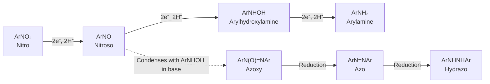

This chapter treats several classes of nitrogen-containing functional groups that have N–N bonds or N–O bonds: diazonium salts $\ce{RN2+}$ and diazo compounds $\ce{R2C=N2}$, azo compounds $\ce{R-N=N-R'}$, nitro compounds $\ce{R-NO2}$, and azides $\ce{R-N3}$. What they have in common is a high energy content: $\ce{N2}$ is an extremely stable molecule (the N≡N **bond enthalpy** is $945\,\mathrm{kJ\,mol^{-1}}$), and the release of $\ce{N2}$ is the driving force of many reactions and also the reason why these compounds are explosion hazards. In synthesis, aryl diazonium salts convert the $\ce{-NH2}$ of an arylamine into almost any substituent and are the key tool for designing polysubstituted arenes ([6.5.14](/6.5.14#sec-14.5)); diazomethane and α-diazo ketones are sources of **carbenes** and ketenes; the nitro group is a precursor of arylamines and also a strongly electron-withdrawing group; and the azido group is a "masked" amino group and the central functional group of click chemistry and bioorthogonal chemistry. The structure and basicity of amines are in [6.5.23](/6.5.23).

## 24.1. Diazonium Salts and Diazo Compounds

**Definition 24.1.1 (Diazonium Salt)** A salt $\ce{RN2+X-}$ containing the cation $\mathrm{R{-}N^{+}{\equiv}N}$ is called a **diazonium salt**; when R is aryl it is called an arenediazonium salt, and when R is alkyl an alkyl diazonium salt.

**Definition 24.1.2 (Diazo Compound)** An electrically neutral compound with the structure $\ce{R2C=N2}$ is called a **diazo compound**, such as diazomethane $\ce{CH2N2}$ and ethyl diazoacetate $\ce{N2CHCOOEt}$.

Both contain an $\ce{-N2}$ unit, and the difference lies in the charge: a diazonium salt is a cation, with a C–N single bond and a terminal N≡N triple bond; a diazo compound is a neutral molecule for which two main **resonance structures** can be written, with partial negative charge on carbon:

```smiles
C[N+]#N methyldiazonium
C=[N+]=[N-] diazomethane
[CH2-][N+]#N diazomethane
```

The carbon of diazomethane is nucleophilic (the second resonance structure), and protonation at carbon gives the methyldiazonium ion $\ce{CH3N2+}$, which is the first step in the methylation of carboxylic acids by diazomethane (Section 24.5.2). The negative charge of an α-diazo carbonyl compound (such as $\ce{RCOCHN2}$) can also be delocalized onto the carbonyl oxygen, so it is far more stable than a simple diazoalkane and can be isolated and stored.

## 24.2. Reactions of Amines with Nitrous Acid

### 24.2.1. Diazotization of Primary Amines

**Definition 24.2.1 (Diazotization)** The reaction of a primary amine with nitrous acid to give a diazonium salt is called **diazotization** (Griess 1858). An arylamine is usually diazotized at $0\text{–}5\,^\circ\mathrm{C}$ with $\ce{NaNO2}$ and an excess of hydrochloric or sulfuric acid: $\ce{ArNH2 + NaNO2 + 2HCl -> ArN2+Cl- + NaCl + 2H2O}$.

Nitrous acid is unstable and is generated in the reaction mixture from sodium nitrite and a strong acid. The actual **electrophile** is the nitrosonium ion $\ce{NO+}$ (or NOCl or $\ce{N2O3}$ in hydrochloric acid): nitrous acid is protonated and loses water to give $\ce{N+=O}$. The lone pair of the amine attacks the nitrogen of $\ce{NO+}$, and loss of a proton gives the $N$-nitrosamine; the $N$-nitrosamine tautomerizes by two proton transfers to the diazohydroxide $\ce{Ar-N=N-OH}$, whose hydroxyl group is protonated and leaves as water to give the diazonium ion.


Several experimental points follow from this mechanism and from the properties of the products:

- Temperature. Aryl diazonium salts are hydrolyzed to phenols when heated in water (Section 24.4.2), so they are prepared at $0\text{–}5\,^\circ\mathrm{C}$ and used immediately. Arylamines bearing electron-withdrawing groups such as $\ce{-NO2}$ and $\ce{-SO3H}$ are very weakly basic and their diazonium salts are also more stable, and they can be diazotized at higher temperatures ($40\text{–}60\,^\circ\mathrm{C}$).
- The acid must be in excess (about 2.5 equivalents). One equivalent is used to form nitrous acid and one becomes the counterion of the diazonium salt, and the excess protonates all the arylamine not yet converted, preventing it from coupling with the diazonium salt formed to give a triazene $\ce{ArN=N-NHAr}$ (Section 24.6.2).
- A slight excess of nitrous acid is used, and the end point is checked with starch–potassium iodide paper ($\ce{HNO2}$ oxidizes $\ce{I-}$ to $\ce{I2}$ and the paper turns blue); the surplus nitrous acid is then destroyed with urea or sulfamic acid ($\ce{CO(NH2)2 + 2HNO2 -> CO2 + 2N2 + 3H2O}$) so that it does not decompose the diazonium salt or cause side reactions in later steps.

### 24.2.2. Secondary and Tertiary Amines

A secondary amine reacts with nitrous acid only as far as the $N$-nitrosamine $\ce{R2N-N=O}$: there is no second hydrogen on N, so it cannot tautomerize to a diazohydroxide. $N$-Nitrosamines are yellow oils, insoluble in acid, a property once used to distinguish secondary amines.


Most $N$-nitrosamines are strong carcinogens: in the liver they are hydroxylated at the α carbon by cytochrome P450 and decompose to alkyldiazonium ions, which alkylate DNA bases (such as O6 and N7 of guanine, [6.5.25](/6.5.25#sec-25.8.4)). The International Agency for Research on Cancer (IARC) lists $N$-nitrosodimethylamine (NDMA) and $N$-nitrosodiethylamine in Group 2A ("probably carcinogenic to humans"). Nitrosamines in food arise from nitrite and amines in cured products (fried bacon, salted fish) and are also present in tobacco smoke; from 2018 many sartan antihypertensive drugs were recalled worldwide because NDMA entered their production, and nitrosamine impurities in drugs have been strictly limited since.

The reaction of an aliphatic tertiary amine with nitrous acid is complicated (formation of the ammonium salt, or nitrosative dealkylation); an aromatic tertiary amine such as $N$,$N$-dimethylaniline undergoes **SEAr** on the ring, with $\ce{NO+}$ as a weak electrophile attacking the strongly activated *para* position to give 4-nitroso-$N$,$N$-dimethylaniline (green).

```smiles
CNC.O=NO>>CN(C)N=O NDMA
CN(C)c1ccccc1.O=NO>>CN(C)c1ccc(N=O)cc1
```

## 24.3. Alkyl Diazonium Salts

Primary aliphatic amines can also be diazotized, but alkyl diazonium ions are extremely unstable: $\ce{N2}$ is one of the best **leaving groups** (a very stable neutral molecule is formed on departure), and $\ce{R-N2+}$ loses $\ce{N2}$ the instant it forms, leaving a "hot" **carbocation** with almost no protection by solvent or counterion. This carbocation immediately undergoes the usual reactions of carbocations ([Section 8.3 of 6.5.8](/6.5.8#sec-8.3)): combination with water or halide (**SN1**), loss of a proton (**E1**), and rearrangement, giving a complex mixture. For example, butan-1-amine and nitrous acid give a mixture of butan-1-ol, butan-2-ol, butenes, and chlorobutanes.


```smiles
CCCCN>>CCCC[N+]#N
CCCC[N+]#N>>CCC[CH2+]
```

The intermolecular reactions of alkyl diazonium salts therefore have no synthetic value, and their uses are concentrated in two classes:

- Intramolecular reactions and ring expansion. Diazotization of a cycloalkylmethylamine gives a primary carbocation that undergoes ring enlargement (the **Demjanov rearrangement**), and diazotization of a β-amino alcohol undergoes a semipinacol-type ring expansion (the **Tiffeneau–Demjanov rearrangement**); for example, 1-(aminomethyl)cyclohexanol, obtained from cyclohexanone by way of the **cyanohydrin** and reduction, expands on diazotization to cycloheptanone. They belong with the **pinacol rearrangement** among 1,2-shifts of carbocations ([6.5.10](/6.5.10#sec-10.8)) and are treated together in [6.5.30](/6.5.30#sec-30.3.2).
- Reactions of α-amino acids. An amino acid and nitrous acid release $\ce{N2}$ quantitatively, and measuring the gas volume determines the content of primary amino groups (the Van Slyke method). The product is an α-hydroxy acid with retention of configuration: the diazonium ion is displaced from the back side by the neighboring carboxylate to give an α-lactone (first inversion), and water opens it from the back side (second inversion), an example of **neighboring group participation** ([Section 8.10 of 6.5.8](/6.5.8#sec-8.10)).


## 24.4. Reactions of Aryl Diazonium Salts

### 24.4.1. Stability of Aryl Diazonium Salts

Aryl diazonium salts are much more stable than alkyl diazonium salts and can be kept in aqueous solution at $0\,^\circ\mathrm{C}$ for hours. The reason lies mainly in the product after loss of $\ce{N2}$: the empty orbital of the aryl cation is an sp² orbital in the plane of the ring, orthogonal to the π system of the ring, and it gets no conjugative stabilization, so the energy is very high; moreover the σ bond between an sp² carbon and N is stronger than that of an sp³ carbon. In addition, the π orbital of $\ce{-N2+}$ conjugates with the aromatic ring, so that the C–N bond has some double-bond character, which also stabilizes it somewhat.

Dry diazonium salts (especially chlorides, nitrates, and perchlorates) are sensitive to impact and heat and explode violently, so they are generally used only in solution. Tetrafluoroborates $\ce{ArN2+BF4-}$, tosylates, and $\ce{ZnCl2}$ double salts are more stable and can be isolated and stored for a time at low temperature, but they should still be prepared in small amounts and not ground or heated.

The diazonium group is an extremely strong electron-withdrawing group (its σ value exceeds that of the nitro group) and makes the ring carbon attached to it electron-poor. The reactions of aryl diazonium salts fall into two classes: those that release $\ce{N2}$ and replace the diazonium group by another group (Sections 24.4.2–24.4.4), and those that retain both nitrogen atoms and either couple as **electrophiles** (Section 24.6) or are reduced to hydrazines (Section 24.4.4).

### 24.4.2. Replacement by Hydroxyl and Iodine

Heating a solution of a diazonium salt in sulfuric acid releases $\ce{N2}$ and gives the phenol. The mechanism is of the **SN1** type: the diazonium salt loses $\ce{N2}$ to give the aryl cation (slow step), and water combines with it rapidly. Sulfuric acid rather than hydrochloric acid is used because the **nucleophilicity** of $\ce{HSO4-}$ is even lower than that of water, whereas $\ce{Cl-}$ would combine with the aryl cation to give the aryl chloride. A milder method is to add $\ce{Cu2O}$ and a large excess of aqueous $\ce{Cu(NO3)2}$ at room temperature, which gives the phenol by way of an aryl radical.


Warming a diazonium salt solution with potassium iodide gives the aryl iodide, with no catalyst needed. $\ce{I-}$ is a good reducing agent and transfers one electron to the diazonium ion to give an aryl radical and an iodine atom, which then combine to ArI. This is the most common way to prepare aryl iodides, because direct iodination of arenes is difficult ([6.5.14](/6.5.14#sec-14.7)).

```smiles
Cc1ccc(cc1)[N+]#N>>Cc1ccc(O)cc1
Cc1ccc(cc1)[N+]#N.[I-]>>Cc1ccc(I)cc1
```

### 24.4.3. The Sandmeyer Reaction and the Balz–Schiemann Reaction

**Definition 24.4.1 (Sandmeyer Reaction)** The reaction in which an aryl diazonium salt releases $\ce{N2}$ under the action of a copper(I) salt CuX (X = Cl, Br, CN) to give ArX is called the **Sandmeyer reaction** (Sandmeyer 1884).

The Sandmeyer reaction is a substitution through radicals, in which Cu(I) acts both as a single-electron reductant and as a halogen atom transfer reagent (proposed by Kochi in 1957):

1. Cu(I) transfers one electron to the diazonium ion (**single electron transfer**) to give Cu(II) and the aryldiazenyl radical $\ce{ArN2^.}$;
2. $\ce{ArN2^.}$ rapidly releases $\ce{N2}$ to give the aryl radical $\ce{Ar^.}$;
3. The aryl radical abstracts a halogen atom from $\ce{CuX2}$ to give ArX and at the same time reduces Cu(II) back to Cu(I).


Evidence for the radical mechanism includes biaryls among the by-products (coupling of two aryl radicals) and Ar–H (hydrogen abstraction from solvent by the aryl radical); aryl radicals can be trapped by alkenes (Meerwein arylation); and in substrates with an *ortho* allyloxy group the aryl radical first undergoes 5-*exo* cyclization and is then halogenated, which acts as a **radical clock** ([6.5.7](/6.5.7#sec-7.5)). Gattermann (1890) used copper powder and a hydrohalic acid in place of CuX and likewise obtained aryl halides (the Gattermann reaction), with a similar mechanism (after oxidation Cu provides Cu(I)) but generally lower yields, and the Sandmeyer method is now mostly used.

```smiles
Clc1cccc(c1)[N+]#N>>Clc1cccc(Br)c1
Cc1ccccc1[N+]#N>>Cc1ccccc1C#N
```

Aryl fluorides cannot be obtained with CuF. The diazonium salt is converted to the tetrafluoroborate (adding $\ce{HBF4}$ or $\ce{NaBF4}$; the tetrafluoroborate is sparingly soluble and precipitates), which is filtered, dried, and heated, releasing $\ce{N2}$ and $\ce{BF3}$ to give the aryl fluoride.

**Definition 24.4.2 (Balz–Schiemann Reaction)** The thermal decomposition of an aryl diazonium tetrafluoroborate to the aryl fluoride, $\ce{N2}$, and $\ce{BF3}$ is called the **Balz–Schiemann reaction** (1927): $\ce{ArN2+BF4- ->[\Delta] ArF + N2 + BF3}$.

Its mechanism is of the SN1 type: the aryl cation abstracts $\ce{F-}$ from $\ce{BF4-}$. This is the classical method for introducing fluorine into an aromatic ring, and many aryl fluorides in fluorine-containing drugs (about a quarter of new drugs) were first prepared by it; thermal decomposition of solid diazonium salts risks a thermal runaway, and in industry the reaction is now mostly carried out in solution or in continuous-flow reactors, or replaced by halogen exchange by **SNAr** (the Halex reaction, [6.5.14](/6.5.14#sec-14.11)).

### 24.4.4. Deamination and Reduction to Hydrazines

A diazonium salt treated with hypophosphorous acid $\ce{H3PO2}$ (or ethanol) has its diazonium group replaced by hydrogen, with release of $\ce{N2}$. This is a radical chain reaction: the aryl radical abstracts a hydrogen atom from the P–H bond of $\ce{H3PO2}$, and the $\ce{H2PO2^.}$ formed transfers an electron to the next diazonium ion. The point of deamination is "use and discard": the strong activation and *ortho*,*para* direction of $\ce{-NH2}$ are first used to introduce other groups, and it is then removed, giving substitution patterns that cannot be obtained by direct substitution (see Section 24.4.5).


Reduction of the diazonium salt with $\ce{SnCl2}$/HCl or sodium sulfite retains both nitrogen atoms and gives the salt of the arylhydrazine, and basification gives the arylhydrazine. Phenylhydrazine is the reagent for the **Fischer indole synthesis** (Definition 25.7.2) and for the osazone reaction of sugars ([6.5.32](/6.5.32)). With a stronger reducing agent (Zn/HCl) the N–N bond is cleaved and the arylamine is regained.

```smiles
Cc1ccc([N+]#N)c(Br)c1>>Cc1cccc(Br)c1
c1ccc(cc1)[N+]#N>>NNc1ccccc1
```

### 24.4.5. Applications in Synthesis

Products obtainable from aniline through the diazonium salt:

| Reagent | Product | Reaction |
|---|---|---|
| $\ce{H2O}$, $\ce{H2SO4}$, heat; or $\ce{Cu2O}$/$\ce{Cu(NO3)2}$ | ArOH | Hydrolysis |
| KI | ArI | Iodination |
| CuCl, CuBr | ArCl, ArBr | Sandmeyer |
| CuCN | ArCN (then hydrolyzed to ArCOOH) | Sandmeyer |
| $\ce{HBF4}$, then heat | ArF | Balz–Schiemann |
| $\ce{H3PO2}$ or EtOH | ArH | Deamination |
| $\ce{SnCl2}$/HCl | $\ce{ArNHNH2}$ | Reduction |
| ArOH (pH 9) or $\ce{ArNMe2}$ (pH 5) | $\ce{Ar-N=N-Ar'}$ | Azo coupling (Section 24.6) |
| $\ce{NaN3}$ | $\ce{ArN3}$ | Azidation (Section 24.8) |

Diazonium salts turn the design of substituents on an aromatic ring into "occupy first, convert later": a nitro group (*meta* directing) is reduced to an amino group (*ortho*,*para* directing), and the amino group is converted into any group or removed. Three typical routes:

1. 1-Bromo-3-chlorobenzene (two *ortho*,*para*-directing groups, whose **directing effect** cannot place them *meta* to each other directly): diazotization of 3-nitroaniline and treatment with CuCl give 1-chloro-3-nitrobenzene, Fe/HCl reduction gives 3-chloroaniline, and diazotization again and CuBr give 1-bromo-3-chlorobenzene.
2. 3-Bromotoluene: nitration of toluene gives 4-nitrotoluene, which is reduced and acetylated to 4-methylacetanilide; in bromination, bromine enters *ortho* to the much stronger directing group $\ce{NHCOCH3}$ (that is, *meta* to the methyl group); after hydrolysis and diazotization, deamination with $\ce{H3PO2}$ gives 3-bromotoluene.
3. 1,3,5-Tribromobenzene (three bromines *meta* to one another, which cannot be obtained by direct bromination of benzene): aniline is brominated with bromine water to give 2,4,6-tribromoaniline; diazotization and deamination give 1,3,5-tribromobenzene.

```smiles
Nc1ccccc1>>Nc1c(Br)cc(Br)cc1Br
Nc1c(Br)cc(Br)cc1Br>>Brc1cc(Br)cc(Br)c1
```

Diazonium salts are still widely used in modern synthesis: under palladium catalysis aryl diazonium salts can replace aryl halides in Heck-type couplings (the Heck–Matsuda reaction, [6.5.29](/6.5.29#sec-29.4.2)); under visible light with a **photoredox catalyst**, diazonium salts are reduced by one electron to aryl radicals, which are used in arylation, borylation, and other reactions ([6.5.31](/6.5.31#sec-31.5)).

## 24.5. Diazomethane and α-Diazo Carbonyl Compounds

### 24.5.1. Diazomethane

**Definition 24.5.1 (Diazomethane)** The simplest diazo compound, $\ce{CH2N2}$, is called **diazomethane**; it has a linear C–N–N unit and can be written with the two resonance structures $\ce{CH2=N+=N-}$ and $\mathrm{\overset{-}{C}H_2{-}N^{+}{\equiv}N}$.


Diazomethane is a yellow, highly toxic gas (boiling point $-23\,^\circ\mathrm{C}$) and is strongly explosive: the pure gas or a concentrated solution may explode on contact with a rough surface (ground-glass joints, scratches, metal), with strong light, or on heating (above about $100\,^\circ\mathrm{C}$). Its ethereal solution is more stable, and it is prepared and used immediately, in fire-polished glassware without ground joints, behind a blast shield in a fume hood. It is also a strong sensitizer and a suspected carcinogen.

Diazomethane is prepared by decomposition of $N$-methyl-$N$-nitroso-*p*-toluenesulfonamide (trade name Diazald) with base: $\ce{RO-}$ attacks the sulfonyl group to give $\ce{CH3N=N-O-}$ (methyldiazotate), which loses $\ce{OH-}$ to give diazomethane, distilled out with ether. Because of the safety problems, trimethylsilyldiazomethane $\ce{Me3SiCHN2}$ (not explosive, though still very toxic on inhalation) is increasingly used in laboratories in its place for methyl esterification, and in industry diazomethane is generated and consumed on the spot in continuous-flow reactors.


```smiles
Cc1ccc(cc1)S(=O)(=O)N(C)N=O.[OH-]>>C=[N+]=[N-].Cc1ccc(cc1)S(=O)(=O)[O-]
```

### 24.5.2. Reactions of Diazomethane

The most common use of diazomethane is the methyl esterification of carboxylic acids. It reacts with a carboxylic acid at room temperature rapidly and quantitatively to give the methyl ester with release of only $\ce{N2}$, and work-up needs only evaporation of the solvent, which makes it the classical method for esterifying small amounts of precious samples (such as derivatization before chromatography). The mechanism has two steps: the carboxylic acid gives its proton to the carbon of diazomethane (the $\mathrm{p}K_{\mathrm{a}}$ of a carboxylic acid is about 4–5, acidic enough), forming an **ion pair** of the carboxylate and the methyldiazonium ion; the carboxylate then carries out an **SN2** reaction on the methyl group and $\ce{N2}$ leaves.


Phenols, which are less acidic ($\mathrm{p}K_{\mathrm{a}}$ about 10), and **enols** (such as acetylacetone) react more slowly to give methyl ethers; alcohols are too weakly acidic and need catalysis by $\ce{HBF4}$ or $\ce{BF3}$.

Diazomethane is also a source of carbenes. Under light or catalysis by copper or rhodium salts it releases $\ce{N2}$ to give the methylene **carbene** (or a metal carbene), which undergoes **cyclopropanation** of alkenes ([Section 11.10 of 6.5.11](/6.5.11#sec-11.10)): free methylene under light is extremely reactive and also inserts indiscriminately into C–H bonds; with cyclohexene under light only about 40 % of norcarane (bicyclo[4.1.0]heptane) is obtained. Metal catalysts "tame" the carbene into a metal carbene, with far better selectivity ([6.5.28](/6.5.28#sec-28.5.4)).

Diazomethane is also a 1,3-dipole for **1,3-dipolar cycloaddition** and gives pyrazolines with alkenes ([6.5.12](/6.5.12#sec-12.4.5)); with aldehydes and ketones, the nucleophilic carbon attacks the carbonyl group and the subsequent rearrangement lengthens the carbon chain of the ketone by one $\ce{CH2}$ (ring expansion of cyclic ketones).

### 24.5.3. The Wolff Rearrangement and the Arndt–Eistert Synthesis

An acyl chloride reacts with diazomethane (or $\ce{Me3SiCHN2}$, with triethylamine to take up the HCl) to give an α-diazo ketone $\ce{RCOCHN2}$.


**Definition 24.5.2 (Wolff Rearrangement)** The reaction in which an α-diazo ketone, under light, heat, or catalysis by Ag(I), releases $\ce{N2}$ and the group R attached to the carbonyl group migrates to the former diazo carbon, giving a **ketene** $\ce{RCH=C=O}$, is called the **Wolff rearrangement** (Wolff 1902).

The Wolff rearrangement can be concerted ($\ce{N2}$ departure and 1,2-shift of R occur at the same time, from the conformation in which C=O and C–N₂ are *s*-*cis*) or can go through an α-carbonyl carbene intermediate, depending on the substrate and conditions. The configuration of the migrating R is retained. The **ketene** (Definition 17.9.1) formed is a strong **electrophile** and is captured by water, alcohols, or amines to give carboxylic acids, esters, or amides, respectively.


**Definition 24.5.3 (Arndt–Eistert Synthesis)** The method in which a carboxylic acid is converted through the acyl chloride and diazomethane to an α-diazo ketone, which undergoes the Wolff rearrangement and capture by a nucleophile to give a carboxylic acid (or its ester or amide) with one more carbon atom, is called the **Arndt–Eistert synthesis** (1935): $\ce{RCOOH -> RCOCl -> RCOCHN2 -> RCH2COOH}$.

The typical use of the Arndt–Eistert synthesis is the preparation of β-amino acids (monomers of β-peptides) from α-amino acids, with complete retention of configuration at the migrating **chiral** carbon. Wolff rearrangement of a cyclic α-diazo ketone contracts the ring by one carbon and can be used to make strained rings; in industry, the Wolff rearrangement of diazonaphthoquinones under ultraviolet light, which converts a hydrophobic photoresist into a carboxylic acid soluble in base, is the chemistry behind semiconductor photolithography ($g$-line and $i$-line photoresists).

```smiles
CC(C)C(=O)Cl>>CC(C)C(=O)C=[N+]=[N-]
CC(C)C(=O)C=[N+]=[N-].O>>CC(C)CC(=O)O
```

α-Diazo esters (ethyl diazoacetate) form metal carbenes with rhodium and copper catalysts, used for cyclopropanation and for C–H and X–H insertion; stable diazo compounds are also used in chemical biology, for example for selective esterification of carboxyl groups on proteins in water ([6.5.33](/6.5.33)).

## 24.6. Azo Compounds

### 24.6.1. Structure and Properties

**Definition 24.6.1 (Azo Compound)** A compound with the structure $\ce{R-N=N-R'}$ (two hydrocarbyl groups joined by an N=N double bond) is called an **azo compound**.

In aryl azo compounds the two aromatic rings are conjugated through N=N into one large π system, which absorbs visible light and is colored: *trans*-azobenzene is orange-red (a strong π→π* absorption at about $320\,\mathrm{nm}$ and a weak n→π* absorption at about $440\,\mathrm{nm}$), and with donor and acceptor substituents on the rings the color is deeper (a push–pull system decreases the HOMO–LUMO gap, [6.4.9](/6.4.9)). Azo dyes are the class of synthetic dyes with the largest number of members, making up more than 60 % of all dyes.

Applications of azo compounds:

- Acid–base indicators. Methyl orange is red below pH 3.1 (one N of the azo group protonated, a quinoid structure) and yellow above pH 4.4 (**acid–base indicator**, [6.4.2](/6.4.2)); the transition range of methyl red is pH 4.4–6.2.
- Biological staining. Trypan blue is a large, negatively charged azo dye that cannot cross intact cell membranes and stains only dead cells, and it is used in cell counting to judge viability.
- **Radical initiators**. Azobisisobutyronitrile (AIBN) undergoes **homolysis** on heating ($60\text{–}80\,^\circ\mathrm{C}$), releasing $\ce{N2}$ and two 2-cyanopropan-2-yl radicals ([6.5.7](/6.5.7#sec-7.2.2)).
- **Molecular photoswitches**. The *E* form of azobenzene is converted to the *Z* form by ultraviolet light of about 340–365 nm ($\pi\to\pi^*$), and the *Z* form returns to the *E* form under visible light of about 440 nm ($\mathrm{n}\to\pi^*$) or on heating ([Section 5.1.4 of 6.5.5](/6.5.5#sec-5.1.4)). The two isomers differ in shape (planar and extended versus bent and compact) and in electric dipole moment (about 0 and about $1.0\times10^{-29}\,\mathrm{C\,m}$, that is, about 3 D), so azobenzene is used as a molecular switch: embedded in host–guest systems it allows light to control guest binding and gelation, incorporated in liquid-crystalline polymers it converts light energy into bending and motion of films, and attached to drugs or ion-channel ligands it allows light to control biological activity (photopharmacology, [6.5.31](/6.5.31#sec-31.3.2)).

The safety problems of azo dyes come mainly from their metabolites: the azo bond is reduced and cleaved by intestinal bacteria or in the liver, releasing arylamines, some of which (benzidine, 4-aminobiphenyl, and others) are carcinogens. EU regulations prohibit azo dyes that can release any of 22 carcinogenic arylamines in textiles in prolonged contact with the skin; Sudan red (an oil-soluble azo dye) may not be added to food.

```smiles
CC(C)(C#N)N=NC(C)(C)C#N AIBN
CN(C)c1ccc(cc1)N=Nc1ccc(cc1)S(=O)(=O)[O-] methyl orange
```

### 24.6.2. Azo Coupling

**Definition 24.6.2 (Azo Coupling)** The reaction in which an aryl diazonium ion, acting as an electrophile, attacks a strongly activated aromatic ring such as a phenol or an arylamine in an electrophilic aromatic substitution to give an azo compound is called **azo coupling**. The component that supplies the diazonium ion is called the diazo component, and the arene attacked is called the coupling component.

The diazonium ion is a very weak electrophile and attacks only electron-rich aromatic rings: phenols (in fact the phenoxide is what is attacked), aromatic tertiary amines, naphthols, and naphthylamines. Coupling takes place *para* to the hydroxyl or amino group, and *ortho* if the *para* position is occupied.


The choice of pH is the key to this reaction, and it must suit both components:

- Coupling with phenols is carried out in weakly basic medium (pH 8–10). Phenoxide is much more reactive than phenol (by a factor of about $10^{10}$), so the pH should be near or above the $\mathrm{p}K_{\mathrm{a}}$ of the phenol; but when the medium is too strongly basic the diazonium ion combines with $\ce{OH-}$ to give the diazotate $\ce{Ar-N=N-O-}$, which cannot couple.
- Coupling with arylamines is carried out in weakly acidic medium (pH 4–7). The arylamine must be present as the free amine to couple, so the pH cannot be too low; acid also suppresses decomposition of the diazonium salt. Primary and secondary arylamines couple first on N to give triazenes $\ce{ArN=N-NHAr'}$ (diazoamino compounds), which rearrange in acid to the C-coupled aminoazo compounds.

```smiles
c1ccc(cc1)[N+]#N.[O-]c1ccccc1>>Oc1ccc(cc1)N=Nc1ccccc1
c1ccc(cc1)[N+]#N.CN(C)c1ccccc1>>CN(C)c1ccc(cc1)N=Nc1ccccc1
```

The second product, 4-dimethylaminoazobenzene (once called "butter yellow" and used to color margarine), was later shown to be a carcinogen and is now banned.

## 24.7. Nitro Compounds

### 24.7.1. Structure and Nomenclature

**Definition 24.7.1 (Nitro Compound)** A compound in which a hydrogen atom of a hydrocarbon is replaced by a nitro group ($\ce{-NO2}$, with the nitrogen atom bonded directly to carbon) is called a **nitro compound**.

The N of the nitro group is sp²-hybridized and carries one positive charge, the two O together carry one negative charge, and two equivalent **resonance structures** can be written, so that the two N–O bonds are equal in length (about $122\,\mathrm{pm}$, between the N–O single bond, about $145\,\mathrm{pm}$, and the N=O double bond, about $118\,\mathrm{pm}$); the p orbitals of the three atoms O, N, and O form a three-center four-electron π system, with the same electronic structure as the allyl anion ([6.5.2](/6.5.2#sec-2.2.2)).

```smiles
C[N+](=O)[O-] nitro
CON=O nitrite
```

A nitro compound $\ce{R-NO2}$ and a nitrite ester $\ce{R-O-N=O}$ are constitutional isomers. The nitrite ion is an **ambident nucleophile** ([Section 8.7.3 of 6.5.8](/6.5.8#sec-8.7.3)), and both products may form in its reaction with alkyl halides: $\ce{NaNO2}$ in DMF (Kornblum) or $\ce{AgNO2}$ in ether (Victor Meyer) gives mainly N-alkylation, that is, the nitroalkane. By the number of substituents on C, nitroalkanes are divided into primary, secondary, and tertiary nitro compounds (the α carbon of a tertiary nitro compound has no hydrogen).

In nomenclature the nitro group is only a prefix: 1-nitropropane, 2-nitropropane, 1-methyl-4-nitrobenzene (4-nitrotoluene), 1-chloro-2,4-dinitrobenzene (2,4-dinitrochlorobenzene).

Note that a nitrate ester $\ce{R-O-NO2}$ is not a nitro compound: nitroglycerin (glyceryl trinitrate), pentaerythritol tetranitrate (PETN), and nitrocellulose are nitrate esters, with the nitro group attached to O.

### 24.7.2. Properties, Spectra, and Explosives

The nitro group is strongly polar (the **electric dipole moment** of nitromethane is about $1.2\times10^{-29}\,\mathrm{C\,m}$, that is, 3.5 D), so nitro compounds boil much higher than hydrocarbons of similar molar mass (nitromethane $101\,^\circ\mathrm{C}$), have densities greater than 1, and are sparingly soluble in water. Aliphatic nitro compounds are generally colorless liquids, and aromatic ones are mostly pale yellow. Nitro compounds are toxic; aromatic nitro compounds are readily absorbed through the skin and are reduced in the body to arylhydroxylamines, which oxidize hemoglobin to methemoglobin.

| Method | Features |
|---|---|
| IR | Asymmetric and symmetric stretching of $\ce{NO2}$, two strong peaks: aliphatic at about 1550 and $1375\,\mathrm{cm^{-1}}$, aromatic at about 1520 and $1345\,\mathrm{cm^{-1}}$ (conjugation lowers the wavenumber) |
| ¹H NMR | $\ce{CH-NO2}$ at $\delta$ 4.2–4.6; the *ortho* H of nitrobenzene at $\delta$ 8.2 |
| MS | Loss of $\ce{NO2}$ ($M - 46$) and of NO ($M - 30$) is common |

Polynitro compounds are important explosives. 2,4,6-Trinitrotoluene (TNT) is insensitive to impact and friction, melts at $81\,^\circ\mathrm{C}$ and can be melt-cast, and has a detonation velocity of about $6900\,\mathrm{m\,s^{-1}}$; it is the standard against which the power of other explosives is measured (TNT equivalent). Explosion is an intramolecular redox reaction: C and H are oxidized by the oxygen of the molecule itself, N forms $\ce{N2}$, and a large amount of heat and gas is released. The oxygen in the TNT molecule is not enough to oxidize all the carbon to $\ce{CO2}$ (negative oxygen balance), so CO and soot form on decomposition and the explosion gives black smoke:

$$
\ce{2C7H5N3O6 -> 3N2 + 5H2O + 7CO + 7C}
$$
The heat of reaction can be estimated from enthalpies of formation by Hess's law ([6.1.6](/6.1.6)). Hexogen (RDX) and octogen (HMX) are cyclic nitramines (N–$\ce{NO2}$) and more powerful than TNT; picric acid (2,4,6-trinitrophenol) is a strong acid ($\mathrm{p}K_{\mathrm{a}}$ 0.42) that was once used as an explosive and was abandoned because its metal salts are very sensitive to impact. Explosives detection at airports commonly uses ion mobility spectrometry: the vaporized sample is ionized and drifts in an electric field, and different ions are distinguished by arrival time because of their different mobilities. Nitroglycerin is both an explosive and a drug for relieving angina: it is metabolized in vascular smooth muscle to release NO, which dilates blood vessels.

```smiles
Cc1c(cc(cc1[N+](=O)[O-])[N+](=O)[O-])[N+](=O)[O-] TNT
C1N(CN(CN1[N+](=O)[O-])[N+](=O)[O-])[N+](=O)[O-] RDX
```

### 24.7.3. Acidity of the α-H and the Henry Reaction

The nitro group is strongly electron-withdrawing and can accommodate negative charge by resonance, so the α-H of primary and secondary nitroalkanes is markedly acidic: the $\mathrm{p}K_{\mathrm{a}}$ of nitromethane is 10.2 (in water, 17.2 in DMSO, Tables 3.2 and 3.3), comparable to phenol, and it dissolves in NaOH solution. The anion obtained on deprotonation is called a nitronate, with the negative charge mainly on the two oxygens; protonation on O gives the aci-form of the nitroalkane, $\ce{R2C=N+(O-)OH}$, a tautomer of the nitroalkane that slowly tautomerizes back to the nitroalkane. Deprotonation of a nitroalkane is much slower than that of an O–H acid of the same acidity, because on forming the negative charge has to be redistributed from carbon to oxygen and the solvent has to reorganize accordingly (the "nitroalkane anomaly").

```smiles
C[N+](=O)[O-].[OH-]>>[CH2-][N+](=O)[O-]
[CH2-][N+](=O)[O-]>>C=[N+]([O-])[O-]
```

**Definition 24.7.2 (Henry Reaction)** The reaction in which, under base catalysis, the nitronate of a primary or secondary nitroalkane undergoes **nucleophilic addition** to the carbonyl group of an aldehyde or ketone to give a β-nitro alcohol is called the **Henry reaction** (Henry 1895), also called the nitroaldol reaction.


The Henry reaction resembles the aldol reaction ([6.5.22](/6.5.22#sec-22.1)) and is a reversible C–C bond-forming reaction. β-Nitro alcohols have many uses: dehydration gives nitroalkenes (β-nitrostyrene, a strong Michael acceptor); reduction of the nitro group to an amino group gives β-amino alcohols (the skeleton of many drugs, such as β-blockers); and treatment of the nitronate with strong acid (the Nef reaction) converts the nitro group to a carbonyl group. Asymmetric Henry reactions can be carried out with **chiral** metal catalysts (Shibasaki 1992).

```smiles
O=Cc1ccccc1.C[N+](=O)[O-]>>OC(C[N+](=O)[O-])c1ccccc1
OC(C[N+](=O)[O-])c1ccccc1>>[O-][N+](=O)/C=C/c1ccccc1
```

### 24.7.4. Reduction of the Nitro Group

Complete reduction of the nitro group gives the amine, the most important source of arylamines ([6.5.23](/6.5.23#sec-23.5.5)); with controlled conditions the reduction can be stopped at intermediate oxidation states. Reduction of aromatic nitro compounds follows the pathway proposed by Haber (1898), each step taking two electrons and two protons:



| Conditions | Main product |
|---|---|
| Fe, Sn, or Zn with hydrochloric acid; $\ce{SnCl2}$/HCl; $\ce{H2}$/Pd, Pt, Ni | $\ce{ArNH2}$ (intermediates do not accumulate in acid) |
| Zn/aqueous $\ce{NH4Cl}$ (neutral) | $\ce{ArNHOH}$ |
| Zn/NaOH (basic); $\ce{LiAlH4}$ with aromatic nitro compounds | Azo compounds (through condensation of nitroso and hydroxylamine); excess Zn gives the hydrazo compound |
| $\ce{Na2S}$, NaSH, or $\ce{(NH4)2S}$ (Zinin reduction) | Only one nitro group of a polynitroarene is reduced, for example 1,3-dinitrobenzene → 3-nitroaniline |

Aliphatic nitro compounds are reduced to amines with $\ce{LiAlH4}$, catalytic hydrogenation, or Fe/HCl, and to $N$-alkylhydroxylamines with Zn/$\ce{NH4Cl}$; with $\ce{SnCl2}$ and thiophenol and triethylamine the reduction can be stopped at the oxime. The selectivity also depends on the other functional groups in the substrate: catalytic hydrogenation also reduces C=C, removes benzyl groups, and removes aryl halogens, whereas Fe/AcOH and $\ce{SnCl2}$ retain carbonyl groups, esters, and halogens.

```smiles
O=[N+]([O-])c1cccc(c1)[N+](=O)[O-]>>Nc1cccc(c1)[N+](=O)[O-]
```

### 24.7.5. Effects of the Nitro Group on the Aromatic Ring

The nitro group is one of the strongest electron-withdrawing groups ($\sigma_p = 0.78$). Its effects on other groups on the aromatic ring:

- In **SEAr** it strongly deactivates and is *meta* directing ([Section 14.3 of 6.5.14](/6.5.14#sec-14.3));
- It makes halogens *ortho* and *para* to it replaceable by **nucleophiles** (**SNAr**, [Section 14.11 of 6.5.14](/6.5.14#sec-14.11)), the negative charge being delocalized onto the oxygens of the nitro group (the **Meisenheimer complex**); the reactivity order of halogens is F > Cl > Br > I because the **rate-determining step** is **nucleophilic addition** and not cleavage of the C–X bond;
- It strengthens the acidity of phenols and aromatic carboxylic acids, with *ortho* and *para* effects far larger than *meta*:

| Phenol | Phenol | 2-Nitrophenol* | 3-Nitrophenol* | 4-Nitrophenol | 2,4,6-Trinitrophenol |
|---|---|---|---|---|---|
| $\mathrm{p}K_{\mathrm{a}}$ (water) | 9.99 | 7.23 | 8.36 | 7.15 | 0.42 |

  (* CRC data outside Table 3.2 of 6.5.3.) A *para* or *ortho* nitro group can accept the negative charge of the phenoxide by resonance, whereas the *meta* group has only the **inductive effect** ([Section 15.7.2 of 6.5.15](/6.5.15#sec-15.7.2)); 2-nitrophenol is slightly less acidic than 4-nitrophenol because its OH forms an intramolecular **hydrogen bond** with the nitro group, which stabilizes the acid form.
- It strengthens the acidity of the C–H of methyl groups *ortho* and *para* to it: the methyl groups of 2,4-dinitrotoluene and 2,4,6-trinitrotoluene can be deprotonated by weak bases to give deeply colored benzyl anions, which undergo condensation reactions.

## 24.8. Azides

### 24.8.1. Structure and Safety

**Definition 24.8.1 (Azide)** A compound containing the azido group $\ce{-N3}$ (three nitrogen atoms linked linearly) is called an **azide**, such as alkyl azides $\ce{RN3}$, aryl azides $\ce{ArN3}$, and acyl azides $\ce{RCON3}$.

The azido group can be written with the two **resonance structures** $\ce{R-N=N+=N-}$ and $\mathrm{R{-}\overset{-}{N}{-}N^{+}{\equiv}N}$ and is a 1,3-dipole. In the IR it has a very strong asymmetric stretching absorption at about $2100\,\mathrm{cm^{-1}}$, which is easily recognized.

The $\mathrm{p}K_{\mathrm{a}}$ of hydrazoic acid $\ce{HN3}$ is 4.72 (Table 3.2), comparable to acetic acid, so it is a weak acid. The azide ion $\ce{N3-}$ is therefore a very weak base and a very good **nucleophile**, in which either terminal nitrogen can attack, and it undergoes substitution with alkyl halides, acyl halides, and aryl diazonium salts.

The hazards of azides are of two kinds:

- Toxicity. The toxicity of sodium azide is comparable to that of sodium cyanide (oral $\mathrm{LD_{50}}$ in rats about $27\,\mathrm{mg\,kg^{-1}}$), and it is readily absorbed through the skin. Like $\ce{CN-}$, $\ce{N3-}$ binds the heme $a_3$ iron of cytochrome c oxidase (complex IV) in the mitochondrial respiratory chain and blocks the transfer of electrons to $\ce{O2}$. Sodium azide with acid gives volatile $\ce{HN3}$ (boiling point $37\,^\circ\mathrm{C}$), which is extremely toxic and explosive.
- Explosiveness. Sodium azide itself is fairly stable (it is the gas generator in automobile airbags, decomposing to Na and $\ce{N2}$ only on heating to about $300\,^\circ\mathrm{C}$); the real dangers are heavy-metal azides (lead azide is a primary explosive, and pouring sodium azide solution into drain pipes containing copper or lead forms copper and lead azides), $\ce{HN3}$, and organic azides of low molecular mass. The empirical "rule of six" for organic azides is that there must be at least six carbons per azido group (or other energetic group), or $(N_{\mathrm{C}} + N_{\mathrm{O}})/N_{\mathrm{N}} \ge 3$, before they can be isolated and stored fairly safely. $\ce{NaN3}$ must not be used with dichloromethane (which forms the extremely explosive diazidomethane) and should not be handled with a metal spatula.

### 24.8.2. Preparation and Reduction

The main source of azides is sodium azide: $\ce{NaN3}$ undergoes **SN2** with primary and secondary alkyl halides or sulfonates in DMF or DMSO (with inversion and little elimination, [Section 23.5.3 of 6.5.23](/6.5.23#sec-23.5.3)), opens **epoxides** to give β-azido alcohols, and gives aryl azides with aryl diazonium salts. Primary amines can also be converted directly to azides with diazo-transfer reagents (such as imidazole-1-sulfonyl azide), which is commonly done in sugar and peptide chemistry. Acyl azides are obtained from acyl chlorides and $\ce{NaN3}$, from acyl hydrazides and nitrous acid, or from carboxylic acids and diphenylphosphoryl azide (DPPA).

Azides are reduced to primary amines with $\ce{H2}$/Pd, $\ce{LiAlH4}$, or $\ce{PPh3}$/$\ce{H2O}$ (the **Staudinger reduction**, Definition 26.5.1), so the azido group can be regarded as a protected amino group: it is stable to acids, bases, and most oxidants, is neither nucleophilic nor basic, and is reduced when needed.

### 24.8.3. The Curtius Rearrangement

**Definition 24.8.2 (Curtius Rearrangement)** The reaction in which an acyl azide on heating releases $\ce{N2}$ and the group R attached to the carbonyl group migrates from carbon to nitrogen to give an isocyanate $\ce{R-N=C=O}$ is called the **Curtius rearrangement** (Curtius 1890).

The thermal Curtius rearrangement is concerted: N–N bond cleavage, departure of $\ce{N2}$, and the 1,2-shift of R occur simultaneously, without a free acyl nitrene (a nitrene forms only under photochemical conditions). The configuration of the migrating R is completely retained. The isocyanate is captured by various nucleophiles: addition of water gives a carbamic acid, which spontaneously undergoes **decarboxylation** to the primary amine with one carbon fewer; addition of an alcohol gives a carbamate (with *tert*-butyl alcohol or benzyl alcohol, a Boc- or Cbz-protected amine); addition of an amine gives a urea.


```smiles
CC(C)(C)C(=O)Cl.[N-]=[N+]=[N-]>>CC(C)(C)C(=O)N=[N+]=[N-]
CC(C)(C)C(=O)N=[N+]=[N-]>>CC(C)(C)N=C=O
CC(C)(C)N=C=O.O>>CC(C)(C)N
```

DPPA and triethylamine give the isocyanate from a carboxylic acid in one pot (Shioiri–Yamada 1972) without isolating the dangerous acyl azide. The Curtius rearrangement has the same outcome as the **Hofmann rearrangement** (Definition 20.2.1) and the **Lossen rearrangement** (Definition 30.6.1): degradation of a carboxylic acid derivative through an isocyanate to an amine with one carbon fewer; for their comparison see [6.5.30](/6.5.30#sec-30.6).

### 24.8.4. The Schmidt Reaction

**Definition 24.8.3 (Schmidt Reaction)** The reaction of hydrazoic acid (or sodium azide with a strong acid, or an alkyl azide with a Lewis acid) with a ketone, a carboxylic acid, or an aldehyde under strong acid catalysis, with release of $\ce{N2}$ and migration of a hydrocarbyl group from carbon to nitrogen, to give an amide, a primary amine with one carbon fewer (with release of $\ce{CO2}$), or a nitrile, respectively, is called the **Schmidt reaction** (Schmidt 1924).

For a ketone: the protonated carbonyl group is attacked by $\ce{HN3}$ to give an azido alcohol; loss of water gives the iminodiazonium ion $\ce{R2C=N-N2+}$; the hydrocarbyl group *anti* to $\ce{N2}$ migrates to N while $\ce{N2}$ leaves, giving the nitrilium ion $\ce{R-C#N+-R'}$; addition of water and **tautomerism** give the amide. In an unsymmetrical ketone the larger group tends to be *anti* to $\ce{N2}$ and migrates preferentially.


In the Schmidt reaction of a carboxylic acid an acylium ion forms first and reacts with $\ce{HN3}$ to give a protonated acyl azide, which then goes through the isocyanate as in the Curtius rearrangement to the amine: for example, a long-chain fatty acid with $\ce{HN3}$ and $\ce{H2SO4}$ in chloroform at $40\,^\circ\mathrm{C}$ for 1 h gives the primary amine with one carbon fewer in about 90 % yield; one carboxyl group of a phthalic acid is converted to an amino group to give an aminobenzoic acid. The intramolecular Schmidt reaction of an alkyl azide with a ketone (Aubé) builds nitrogen-containing bicyclic lactams in one step and is used in the synthesis of **alkaloids**.

```smiles
O=C1CCCCC1.N=[N+]=[N-]>>O=C1CCCCCN1
CCCCCCCCCC(=O)O.N=[N+]=[N-]>>CCCCCCCCCN
```

### 24.8.5. Click Chemistry and Bioorthogonal Reactions

The **1,3-dipolar cycloaddition** of an organic azide with an alkyne gives a 1,2,3-triazole (Huisgen, [6.5.12](/6.5.12#sec-12.4.5)). The thermal reaction needs a rather high temperature and gives a mixture of 1,4- and 1,5-disubstituted products; the Cu(I)-catalyzed azide–alkyne **cycloaddition** (CuAAC, reported by Meldal and Sharpless independently in 2002) proceeds in water at room temperature, gives only the 1,4-disubstituted triazole in nearly quantitative yield, and is the paradigm of the "click chemistry" proposed by Sharpless. The azido group is small, absent from living organisms, and unreactive toward biomolecules, so it can be introduced into sugars, proteins, and nucleic acids by metabolic labeling; strain-promoted cycloaddition with a copper-free strained cyclooctyne (SPAAC, Bertozzi 2004), or Staudinger ligation with a phosphine, then allows them to be labeled selectively in living cells. Bertozzi, Meldal, and Sharpless received the 2022 Nobel Prize in Chemistry for this work. Bioorthogonal chemistry is treated in detail in [6.5.33](/6.5.33) and 6.6.

```smiles
CCCCN=[N+]=[N-].C#Cc1ccccc1>>CCCCn1cc(nn1)-c1ccccc1
```

## 24.9. Research Frontier

Nitrogen-rich compounds are a frontier of energetic-materials research: Zhang and coworkers (*Science* 2017) synthesized salts containing the cyclic pentazolate anion $\ce{cyclo-N5-}$ that are stable at room temperature, opening the possibility of all-nitrogen energetic materials; another direction is new insensitive explosives that raise energy density while lowering sensitivity. In synthetic methods, diazo compounds and azides are increasingly generated and used on the spot in continuous-flow reactors, which allows these hazardous reagents to be used safely on an industrial scale; photochemistry and electrochemistry allow aryl diazonium salts and nitro compounds to generate aryl radicals and nitrogen-centered radicals under mild conditions ([6.5.31](/6.5.31#sec-31.5)).

## Summary

- Diazonium salts (Definition 24.1.1) are $\ce{RN2+}$ cations and diazo compounds (Definition 24.1.2) are neutral $\ce{R2C=N2}$; the extreme stability of $\ce{N2}$ is both the driving force of the reactions of these compounds and the source of the explosion hazard.
- Diazotization (Definition 24.2.1): $\ce{NaNO2}$ + excess strong acid, $0\text{–}5\,^\circ\mathrm{C}$, **electrophile** $\ce{NO+}$, through the $N$-nitrosamine and the diazohydroxide; a secondary amine stops at the $N$-nitrosamine (mostly Group 2A carcinogens), and an aromatic tertiary amine is nitrosated *para* on the ring.
- Alkyl diazonium salts lose $\ce{N2}$ at once to give **carbocations** and mixtures, and are used only for ring expansion and amino acid analysis; aryl diazonium salts are stable at low temperature because the empty sp² orbital of the aryl cation gets no conjugative stabilization.
- Conversions of aryl diazonium salts:

  | Reaction | Reagent | Mechanism |
  |---|---|---|
  | Hydrolysis → ArOH | $\ce{H2O}$/$\ce{H2SO4}$, heat | Aryl cation (**SN1** type) |
  | Iodination → ArI | KI | **Single electron transfer** |
  | Sandmeyer (Definition 24.4.1) → ArCl, ArBr, ArCN | CuX | Cu(I) single electron transfer, aryl radical, halogen atom transfer |
  | Balz–Schiemann (Definition 24.4.2) → ArF | $\ce{HBF4}$, heat | Aryl cation |
  | Deamination → ArH | $\ce{H3PO2}$ | Radical chain |
  | Reduction → $\ce{ArNHNH2}$ | $\ce{SnCl2}$/HCl | — |
  | Coupling → ArN=NAr′ | Phenol (pH 8–10), arylamine (pH 4–7) | **SEAr** |

- Diazomethane (Definition 24.5.1): highly toxic and explosive, with carbon as the nucleophilic center; methyl esterification of carboxylic acids (proton transfer + **SN2**), **carbenes** and **cyclopropanation**, **1,3-dipolar cycloaddition**; the Wolff rearrangement of α-diazo ketones (Definition 24.5.2) gives ketenes, and the Arndt–Eistert synthesis (Definition 24.5.3) lengthens a carboxylic acid by one carbon with retention of configuration.
- Azo compounds (Definition 24.6.1): colored by conjugation, used as dyes, indicators (methyl orange), AIBN, and *E*/*Z* photoswitches; the pH of azo coupling (Definition 24.6.2) must balance the reactivity of the coupling component and the stability of the diazonium ion.
- Nitro compounds (Definition 24.7.1): two equal N–O bonds; IR at 1550/$1375\,\mathrm{cm^{-1}}$; polynitro compounds are explosives (TNT has a negative oxygen balance); acidity of the α-H (nitromethane 10.2) and the Henry reaction (Definition 24.7.2); reduction goes through nitroso and hydroxylamine to the amine, condenses to azo compounds in base, and $\ce{Na2S}$ reduces one nitro group selectively; strong electron-withdrawing effect on the aromatic ring (**SNAr**, acidity of phenols).
- Azides (Definition 24.8.1): $\mathrm{p}K_{\mathrm{a}}$ of $\ce{HN3}$ 4.72; toxicity comparable to cyanide, and heavy-metal azides, $\ce{HN3}$, and organic azides of low molecular mass are explosive; SN2 with $\ce{NaN3}$ followed by reduction is a method for primary amines; the Curtius rearrangement (Definition 24.8.2) and the Schmidt reaction (Definition 24.8.3) give isocyanates, amines, and amides by migration of a hydrocarbyl group to an electron-deficient nitrogen; CuAAC and SPAAC are central to click chemistry and bioorthogonal chemistry.

## Questions

1. Synthesize from benzene or toluene and the necessary inorganic reagents: (a) 3-bromophenol; (b) 4-fluorobenzoic acid; (c) 1,2,3-tribromobenzene (hint: first occupy and activate a position with an amino group that can later be removed).

   **Answer** (a) Nitrate benzene to nitrobenzene, brominate with $\ce{Br2}$/$\ce{FeBr3}$ (nitro is *meta* directing) to 1-bromo-3-nitrobenzene; reduce with Fe/HCl to 3-bromoaniline; diazotize with $\ce{NaNO2}$/$\ce{H2SO4}$ at $0\,^\circ\mathrm{C}$ and hydrolyze by heating in dilute sulfuric acid to 3-bromophenol. (b) Nitrate toluene and separate the *para* product 4-nitrotoluene; reduce to 4-methylaniline; diazotize and add $\ce{HBF4}$, and heat the tetrafluoroborate (Balz–Schiemann) to 4-fluorotoluene; oxidize the methyl group with $\ce{KMnO4}$ to 4-fluorobenzoic acid. (c) Acetylate aniline, nitrate (*para*), and hydrolyze to give 4-nitroaniline; brominate with bromine water, the bromines entering the two positions *ortho* to the amino group, to give 2,6-dibromo-4-nitroaniline; diazotize and use CuBr (Sandmeyer) so that the position of the former amino group receives the third bromine, giving 1,2,3-tribromo-5-nitrobenzene; reduce the nitro group with Fe/HCl, diazotize again, and deaminate with $\ce{H3PO2}$ to give 1,2,3-tribromobenzene. The idea: the amino group directs two bromines to its two sides and is itself then converted to the third bromine; the nitro group is first a blocking group and is finally removed through the amino group.

2. Write the main organic product, with its configuration, of the reaction of (*S*)-2-aminopropanoic acid (L-alanine) with nitrous acid, and explain with the mechanism.

   **Answer** (*S*)-2-Hydroxypropanoic acid (L-lactic acid) is obtained, with retention of configuration. Diazotization of the amino group gives $\ce{-N2+}$; the neighboring carboxylate attacks the α carbon from the back side and $\ce{N2}$ leaves, forming the three-membered α-lactone (first inversion); water attacks the α carbon from the back side of the lactone C–O bond and opens the ring (second inversion). The net result of the two inversions is retention of configuration, which is **neighboring group participation** by the carboxyl group.

3. Explain: (a) why the coupling of benzenediazonium salt with phenol is carried out in weakly basic rather than strongly basic solution; (b) why excess hydrochloric acid is used in diazotization; (c) why benzenediazonium chloride is not simply heated to prepare chlorobenzene but CuCl is added.

   **Answer** (a) The reactive coupling component is the phenoxide (faster than phenol by a factor of about $10^{10}$), so the pH should be near or above the $\mathrm{p}K_{\mathrm{a}}$ of phenol (9.99); at too high a pH the diazonium ion combines with $\ce{OH-}$ to give the diazotate $\ce{ArN=N-O-}$ and loses its electrophilicity. (b) The excess acid keeps unreacted aniline as anilinium, which prevents free aniline from coupling with the diazonium salt to give a triazene; it also ensures complete formation of nitrous acid and stabilizes the diazonium salt. (c) On direct heating the aryl cation is captured mainly by the large amount of water, giving phenol; CuCl generates an aryl radical by **single electron transfer**, and the radical abstracts Cl specifically from $\ce{CuCl2}$, so the yield is high and by-products are few.

4. Use diazomethane and the Arndt–Eistert synthesis to obtain methyl phenylacetate from benzoic acid; write the reagents and intermediates of each step. If the starting material is (*S*)-2-phenylpropanoic acid, what is the configuration of the product?

   **Answer** Benzoic acid + $\ce{SOCl2}$ → benzoyl chloride; with two equivalents of $\ce{CH2N2}$ (or $\ce{Me3SiCHN2}$/$\ce{Et3N}$) → α-diazoacetophenone $\ce{C6H5COCHN2}$ (the second equivalent of diazomethane takes up the HCl, forming $\ce{CH3Cl}$); silver benzoate in methanol (or light), the Wolff rearrangement gives phenylketene $\ce{C6H5CH=C=O}$, which is captured by methanol → methyl phenylacetate $\ce{C6H5CH2COOCH3}$. From (*S*)-2-phenylpropanoic acid one obtains methyl 3-phenylbutanoate, and the spatial arrangement at the migrating **chiral** carbon is unchanged. But the CIP order changes: originally COOH (O,O,O) > phenyl (C,C,C) > $\ce{CH3}$, now phenyl (C,C,C) > $\ce{CH2COOCH3}$ (C,H,H) > $\ce{CH3}$, so the first two exchange places and the descriptor changes from *S* to *R*: the product is methyl (*R*)-3-phenylbutanoate.

5. What products does cyclohexanone give (a) with $\ce{HN3}$/$\ce{H2SO4}$, and (b) on first forming the oxime with hydroxylamine and then heating with concentrated $\ce{H2SO4}$? What do the two reactions have in common?

   **Answer** Both give ε-caprolactam (azepan-2-one). (a) is the Schmidt reaction: through the iminodiazonium ion, a hydrocarbyl group migrates to N and $\ce{N2}$ leaves; (b) is the **Beckmann rearrangement** (Definition 30.5.1): the hydroxyl group of the oxime is protonated and leaves, and the *anti* hydrocarbyl group migrates to N. What they have in common: in both a hydrocarbyl group migrates from carbon to the electron-deficient nitrogen carrying the **leaving group** ($\ce{N2}$ or $\ce{H2O}$), the migrating group being *anti* to the leaving group, to give a nitrilium ion, which is hydrated to the amide.

6. Compound A ($\ce{C7H7NO2}$) is insoluble in dilute hydrochloric acid and NaOH solution, and its IR spectrum has strong absorptions at 1520 and $1345\,\mathrm{cm^{-1}}$. Reduction of A with Fe/HCl gives B ($\ce{C7H9N}$), which dissolves in dilute hydrochloric acid; diazotization of B, reaction with CuCN, and hydrolysis give 4-methylbenzoic acid. Write the structures of A and B; what is the main product if A is reduced with Zn/NaOH instead?

   **Answer** A is 4-nitrotoluene (five degrees of unsaturation; the two IR peaks are those of an aromatic $\ce{NO2}$) and B is 4-methylaniline (*p*-toluidine). Sandmeyer cyanation of the diazonium salt of B gives 4-methylbenzonitrile, hydrolyzed to 4-methylbenzoic acid, confirming the *para* position of the substituents. Zn/NaOH reduces in base; the nitroso and hydroxylamine intermediates condense, and the main product is 4,4′-dimethylazobenzene (with excess zinc the hydrazo compound is obtained further).

7. After sodium azide and 1-bromobutane have reacted in DMSO, someone plans to extract the product with dichloromethane and pour the aqueous layer containing sodium azide down the drain. Point out the safety problems. Is butyl azide $\ce{C4H9N3}$ suitable for distillation on a large scale?

   **Answer** Dichloromethane and residual $\ce{NaN3}$ form diazidomethane (and azidochloromethane), which is extremely explosive, so ether or ethyl acetate should be used instead; an azide-containing aqueous layer poured into copper or lead pipes forms heavy-metal azides that are extremely sensitive to impact, and acidification releases the extremely toxic and explosive $\ce{HN3}$, so it must first be destroyed with nitrous acid under acidic conditions ($\ce{2NaN3 + 2HNO2 -> 3N2 + 2NO + 2NaOH}$, in a fume hood). Butyl azide has only 4 carbons per azido group, $(N_{\mathrm{C}} + N_{\mathrm{O}})/N_{\mathrm{N}} = 4/3 < 3$, which does not satisfy the "rule of six", and it should not be distilled or concentrated on a large scale; it is usually reduced or used in the next reaction directly in solution.
