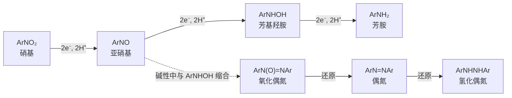

本章讨论氮原子之间成键、或氮与氧成键的几类含氮官能团：重氮盐 $\ce{RN2+}$ 与重氮化合物 $\ce{R2C=N2}$、偶氮化合物 $\ce{R-N=N-R'}$、硝基化合物 $\ce{R-NO2}$ 与叠氮化合物 $\ce{R-N3}$。它们的共同点是富含能量：$\ce{N2}$ 是极其稳定的分子（N≡N **键焓** $945\,\mathrm{kJ\,mol^{-1}}$），放出 $\ce{N2}$ 是许多反应的推动力，也是这类化合物有爆炸危险的原因。在合成上，芳基重氮盐把芳胺的 $\ce{-NH2}$ 转化为几乎任何取代基，是设计多取代芳烃的关键工具（[6.5.14](/6.5.14#sec-14.5)）；重氮甲烷与 $\alpha$-重氮酮是**卡宾**与烯酮的来源；硝基是芳胺的前体，也是强吸电子基团；叠氮基是"被掩蔽"的氨基，并且是点击化学与生物正交化学的核心官能团。胺的结构与碱性见 [6.5.23](/6.5.23)。

## 24.1. 重氮盐与重氮化合物

**定义 24.1.1（重氮盐）** 含有 $\mathrm{R{-}N^{+}{\equiv}N}$ 正离子的盐 $\ce{RN2+X-}$ 称为**重氮盐**（diazonium salt）；R 为芳基时称为芳基重氮盐（arenediazonium salt），R 为烷基时称为烷基重氮盐。

**定义 24.1.2（重氮化合物）** 含有 $\ce{R2C=N2}$ 结构、整体为电中性的化合物称为**重氮化合物**（diazo compound），如重氮甲烷 $\ce{CH2N2}$ 与重氮乙酸乙酯 $\ce{N2CHCOOEt}$。

两者都含 $\ce{-N2}$ 单元，区别在电荷：重氮盐是正离子，C–N 键是单键，末端 N≡N 是叁键；重氮化合物是中性分子，可以写出两个主要的**共振式**，碳上带部分负电荷：

```smiles
C[N+]#N methyldiazonium
C=[N+]=[N-] diazomethane
[CH2-][N+]#N diazomethane
```

重氮甲烷的碳是亲核的（第二个共振式），质子化碳就得到甲基重氮离子 $\ce{CH3N2+}$，这是重氮甲烷甲基化羧酸的第一步（24.5.2）。$\alpha$-重氮羰基化合物（如 $\ce{RCOCHN2}$）的负电荷还能离域到羰基氧上，所以比简单的重氮烷稳定得多，可以分离与储存。

## 24.2. 胺与亚硝酸的反应

### 24.2.1. 伯胺的重氮化

**定义 24.2.1（重氮化）** 伯胺与亚硝酸反应生成重氮盐的反应称为**重氮化**（diazotization，Griess 1858）。芳胺通常在 $0\text{–}5\,^\circ\mathrm{C}$ 下，用 $\ce{NaNO2}$ 与过量的盐酸或硫酸进行：$\ce{ArNH2 + NaNO2 + 2HCl -> ArN2+Cl- + NaCl + 2H2O}$。

亚硝酸不稳定，由亚硝酸钠与强酸在反应液中现制。真正的**亲电试剂**是亚硝鎓离子 $\ce{NO+}$（或在盐酸中的 NOCl、$\ce{N2O3}$）：亚硝酸质子化后失去水生成 $\ce{N+=O}$。胺的孤对电子进攻 $\ce{NO+}$ 的氮，失去质子得到 $N$-亚硝胺；$N$-亚硝胺经两次质子转移互变为重氮氢氧化物 $\ce{Ar-N=N-OH}$，羟基质子化后以水的形式离去，得到重氮离子。


实验上的几个要点都来自这一机理与产物的性质：

- 温度。芳基重氮盐在水中加热会水解为酚（24.4.2），所以要在 $0\text{–}5\,^\circ\mathrm{C}$ 下制备，制得后立即使用。环上有 $\ce{-NO2}$、$\ce{-SO3H}$ 等吸电子基团的芳胺碱性很弱，重氮盐也较稳定，可以在较高温度（$40\text{–}60\,^\circ\mathrm{C}$）下重氮化。
- 酸要过量（约 2.5 当量）。一当量用于生成亚硝酸，一当量成为重氮盐的抗衡离子，过量的酸使尚未反应的芳胺全部质子化，避免它与生成的重氮盐偶联生成三氮烯 $\ce{ArN=N-NHAr}$（24.6.2）。
- 亚硝酸稍过量，用淀粉–碘化钾试纸检验终点（$\ce{HNO2}$ 把 $\ce{I-}$ 氧化为 $\ce{I2}$，试纸变蓝），多余的亚硝酸再用尿素或氨基磺酸分解（$\ce{CO(NH2)2 + 2HNO2 -> CO2 + 2N2 + 3H2O}$），以免它在后续反应中分解重氮盐或发生副反应。

### 24.2.2. 仲胺与叔胺

仲胺与亚硝酸反应停在 $N$-亚硝胺 $\ce{R2N-N=O}$ 一步：N 上没有第二个氢，不能互变为重氮氢氧化物。$N$-亚硝胺是黄色的油状物，不溶于酸，这一现象曾用来区分仲胺。

$N$-亚硝胺多数是强致癌物：它们在肝脏中被细胞色素 P450 在 $\alpha$ 碳上羟基化，分解出烷基重氮离子，后者把 DNA 碱基烷基化（如鸟嘌呤的 O6 与 N7，[6.5.25](/6.5.25#sec-25.8.4)）。国际癌症研究机构（IARC）把 $N$-亚硝基二甲胺（NDMA）与 $N$-亚硝基二乙胺列为 2A 类（"很可能对人致癌"）。食物中的亚硝胺来自腌制品中的亚硝酸盐与胺（如煎培根、腌鱼），烟草烟雾中也有；2018 年起多种沙坦类降压药因生产中混入 NDMA 而在全球召回，此后药品中的亚硝胺杂质受到严格限制。

脂肪叔胺与亚硝酸反应复杂（生成铵盐，或发生亚硝化脱烷基）；芳香叔胺如 $N$,$N$-二甲基苯胺则发生环上的 **SEAr**，$\ce{NO+}$ 作为弱的亲电试剂进攻强活化的对位，得到 4-亚硝基-$N$,$N$-二甲基苯胺（绿色）。

```smiles
CNC.O=NO>>CN(C)N=O NDMA
CN(C)c1ccccc1.O=NO>>CN(C)c1ccc(N=O)cc1
```

## 24.3. 烷基重氮盐

脂肪伯胺也能重氮化，但烷基重氮离子极不稳定：$\ce{N2}$ 是最好的**离去基团**之一（离去时生成极稳定的中性分子），$\ce{R-N2+}$ 在生成的瞬间就失去 $\ce{N2}$，得到一个"热的"、几乎没有溶剂化与抗衡离子保护的**碳正离子**。这个碳正离子随即发生碳正离子的各种反应（[6.5.8 的 8.3 节](/6.5.8#sec-8.3)）：与水或卤离子结合（**SN1**）、失去质子（**E1**）、重排，得到复杂的混合物。例如丁-1-胺与亚硝酸生成丁-1-醇、丁-2-醇、丁烯与氯丁烷的混合物。

```smiles
CCCCN>>CCCC[N+]#N
CCCC[N+]#N>>CCC[CH2+]
```

所以烷基重氮盐的分子间反应没有合成价值，用途集中在两类：

- 分子内反应与扩环。环烷基甲胺重氮化生成的伯碳正离子发生环扩大（**Demjanov 重排**），$\beta$-氨基醇重氮化后发生半频哪醇型的扩环（**Tiffeneau–Demjanov 重排**），例如由环己酮经**氰醇**与还原得到的 1-(氨甲基)环己醇，重氮化后扩环为环庚酮。它们与**频哪醇重排**同属碳正离子的 1,2-迁移（[6.5.10](/6.5.10#sec-10.8)），在 [6.5.30](/6.5.30#sec-30.3.2) 中统一讨论。
- $\alpha$-氨基酸的反应。氨基酸与亚硝酸定量放出 $\ce{N2}$，测量气体体积就能测定伯氨基的含量（Van Slyke 法）。生成的产物是 $\alpha$-羟基酸，构型保持：重氮离子被邻位的羧基负离子从背面取代，生成 $\alpha$-内酯（第一次翻转），水再从背面开环（第二次翻转），这是**邻基参与**的例子（[6.5.8 的 8.10 节](/6.5.8#sec-8.10)）。

## 24.4. 芳基重氮盐的反应

### 24.4.1. 芳基重氮盐的稳定性

芳基重氮盐比烷基重氮盐稳定得多，可以在 $0\,^\circ\mathrm{C}$ 的水溶液中保存数小时。原因主要在于失去 $\ce{N2}$ 后的产物：芳基正离子的空轨道是环平面内的 sp² 轨道，与芳环的 π 体系正交，得不到任何共轭稳定，能量极高；而且 sp² 碳与 N 之间的 σ 键比 sp³ 碳的强。另外，$\ce{-N2+}$ 的 π 轨道与芳环共轭，使 C–N 键略带双键性质，也有一定的稳定作用。

干燥的重氮盐（尤其是氯化物、硝酸盐、高氯酸盐）对撞击和受热敏感，会猛烈爆炸，所以通常只在溶液中使用。四氟硼酸盐 $\ce{ArN2+BF4-}$、对甲苯磺酸盐与 $\ce{ZnCl2}$ 复盐较稳定，可以分离、在低温下保存一段时间，但仍应少量制备、避免研磨和加热。

重氮基是极强的吸电子基团（σ 值超过硝基），使芳环上与它相连的碳缺电子。芳基重氮盐的反应分为两类：放出 $\ce{N2}$、重氮基被其他基团取代（24.4.2–24.4.4）；保留两个氮原子，作为**亲电试剂**发生偶联（24.6）或被还原为肼（24.4.4）。

### 24.4.2. 被羟基与碘取代

重氮盐的硫酸溶液加热，放出 $\ce{N2}$，生成酚。机理是 **SN1** 型的：重氮盐失去 $\ce{N2}$ 生成芳基正离子（慢步骤），水迅速与它结合。用硫酸而不用盐酸，是因为 $\ce{HSO4-}$ 的**亲核性**比水还弱，而 $\ce{Cl-}$ 会与芳基正离子结合生成氯代芳烃。更温和的方法是在室温下加 $\ce{Cu2O}$ 与大量 $\ce{Cu(NO3)2}$ 的水溶液，经芳基自由基而得到酚。

把重氮盐溶液与碘化钾一起温热，得到碘代芳烃，不需要催化剂。$\ce{I-}$ 是好的还原剂，它把一个电子转移给重氮离子，生成芳基自由基与碘原子，再结合为 ArI。这是制备碘代芳烃最常用的方法，因为芳烃的直接碘化困难（[6.5.14](/6.5.14#sec-14.7)）。

```smiles
Cc1ccc(cc1)[N+]#N>>Cc1ccc(O)cc1
Cc1ccc(cc1)[N+]#N.[I-]>>Cc1ccc(I)cc1
```

### 24.4.3. Sandmeyer 反应与 Balz–Schiemann 反应

**定义 24.4.1（Sandmeyer 反应）** 芳基重氮盐在一价铜盐 CuX（X = Cl、Br、CN）的作用下放出 $\ce{N2}$、生成 ArX 的反应称为 **Sandmeyer 反应**（Sandmeyer reaction，Sandmeyer 1884）。

Sandmeyer 反应是经自由基的取代，Cu(I) 起单电子还原剂与卤原子转移试剂的双重作用（Kochi 1957 年提出）：

1. Cu(I) 把一个电子转移给重氮离子（**单电子转移**），生成 Cu(II) 与芳基重氮自由基 $\ce{ArN2^.}$；
2. $\ce{ArN2^.}$ 迅速放出 $\ce{N2}$，生成芳基自由基 $\ce{Ar^.}$；
3. 芳基自由基从 $\ce{CuX2}$ 上夺取卤原子，生成 ArX，同时把 Cu(II) 还原回 Cu(I)。


支持自由基机理的证据有：副产物中有联芳（两个芳基自由基偶联）与 Ar–H（芳基自由基从溶剂夺氢）；加入烯烃时可以捕获芳基自由基（Meerwein 芳基化）；在邻位带烯丙氧基的底物中，芳基自由基先发生 5-exo 环化再被卤化，起"**自由基钟**"的作用（[6.5.7](/6.5.7#sec-7.5)）。Gattermann 1890 年用铜粉与氢卤酸代替 CuX，同样得到卤代芳烃（Gattermann 反应），机理相似（Cu 被氧化后提供 Cu(I)），产率一般较低，现在多用 Sandmeyer 法。

```smiles
Clc1cccc(c1)[N+]#N>>Clc1cccc(Br)c1
Cc1ccccc1[N+]#N>>Cc1ccccc1C#N
```

芳基氟不能用 CuF 得到。把重氮盐转化为四氟硼酸盐（加 $\ce{HBF4}$ 或 $\ce{NaBF4}$，四氟硼酸盐溶解度小而沉淀），过滤、干燥后加热，放出 $\ce{N2}$ 与 $\ce{BF3}$，生成芳基氟。

**定义 24.4.2（Balz–Schiemann 反应）** 芳基重氮四氟硼酸盐受热分解为芳基氟、$\ce{N2}$ 与 $\ce{BF3}$ 的反应称为 **Balz–Schiemann 反应**（Balz–Schiemann reaction，1927）：$\ce{ArN2+BF4- ->[\Delta] ArF + N2 + BF3}$。

它的机理是 SN1 型的：芳基正离子从 $\ce{BF4-}$ 上夺取 $\ce{F-}$。这是在芳环上引入氟的经典方法，含氟药物（约占新药的四分之一）的许多芳基氟最初都由它制备；固体重氮盐的热分解有放热失控的危险，工业上现在多改为在溶液或连续流反应器中进行，或改用 **SNAr** 的卤素交换（Halex 反应，[6.5.14](/6.5.14#sec-14.11)）。

### 24.4.4. 去氨基与还原为肼

重氮盐与次磷酸 $\ce{H3PO2}$（或乙醇）作用，重氮基被氢取代，放出 $\ce{N2}$。这是一个自由基链反应：芳基自由基从 $\ce{H3PO2}$ 的 P–H 键上夺取氢原子，生成的 $\ce{H2PO2^.}$ 再把一个电子转移给下一个重氮离子。去氨基的意义在于"用完就扔"：先利用 $\ce{-NH2}$ 的强活化与邻对位定位引入其他基团，再把它除去，得到直接取代无法得到的取代模式（见 24.4.5 节）。

用 $\ce{SnCl2}$/HCl 或亚硫酸钠还原重氮盐，两个氮原子都保留，得到芳肼的盐，碱化后得到芳肼。苯肼是 **Fischer 吲哚合成**（定义 25.7.2）与糖脎反应（[6.5.32](/6.5.32)）的试剂。用更强的还原剂（Zn/HCl）则 N–N 键断裂，回到芳胺。

```smiles
Cc1ccc([N+]#N)c(Br)c1>>Cc1cccc(Br)c1
c1ccc(cc1)[N+]#N>>NNc1ccccc1
```

### 24.4.5. 在合成中的应用

由苯胺出发，经重氮盐可以得到的产物：

| 试剂 | 产物 | 反应 |
|---|---|---|
| $\ce{H2O}$，$\ce{H2SO4}$，加热；或 $\ce{Cu2O}$/$\ce{Cu(NO3)2}$ | ArOH | 水解 |
| KI | ArI | 碘代 |
| CuCl、CuBr | ArCl、ArBr | Sandmeyer |
| CuCN | ArCN（再水解为 ArCOOH） | Sandmeyer |
| $\ce{HBF4}$，再加热 | ArF | Balz–Schiemann |
| $\ce{H3PO2}$ 或 EtOH | ArH | 去氨基 |
| $\ce{SnCl2}$/HCl | $\ce{ArNHNH2}$ | 还原 |
| ArOH（pH 9）或 $\ce{ArNMe2}$（pH 5） | $\ce{Ar-N=N-Ar'}$ | 偶氮偶联（24.6） |
| $\ce{NaN3}$ | $\ce{ArN3}$ | 叠氮化（24.8） |

重氮盐把芳环上的取代基设计变成"先占位、后转化"：硝基（间位定位）还原为氨基（邻对位定位），氨基再转化为任意基团，或者去掉。三个典型的路线：

1. 1-溴-3-氯苯（两个邻对位**定位基**处于间位）：3-硝基苯胺重氮化后用 CuCl 得 1-氯-3-硝基苯，Fe/HCl 还原为 3-氯苯胺，再重氮化、用 CuBr 得 1-溴-3-氯苯。
2. 3-溴甲苯：甲苯硝化得 4-硝基甲苯，还原、乙酰化得 4-甲基乙酰苯胺；溴化时溴进入强得多的定位基 $\ce{NHCOCH3}$ 的邻位（即甲基的间位）；水解、重氮化后用 $\ce{H3PO2}$ 去氨基，得到 3-溴甲苯。
3. 1,3,5-三溴苯（三个溴互为间位，不能由苯直接溴化得到）：苯胺用溴水溴化，得 2,4,6-三溴苯胺；重氮化、去氨基，得到 1,3,5-三溴苯。

```smiles
Nc1ccccc1>>Nc1c(Br)cc(Br)cc1Br
Nc1c(Br)cc(Br)cc1Br>>Brc1cc(Br)cc(Br)c1
```

重氮盐在现代合成中仍然常用：钯催化下芳基重氮盐可以代替芳基卤进行 Heck 型偶联（Heck–Matsuda 反应，[6.5.29](/6.5.29#sec-29.4.2)）；在可见光与**光氧化还原催化剂**作用下，重氮盐被单电子还原为芳基自由基，用于芳基化、硼化等反应（[6.5.31](/6.5.31#sec-31.5)）。

## 24.5. 重氮甲烷与 α-重氮羰基化合物

### 24.5.1. 重氮甲烷

**定义 24.5.1（重氮甲烷）** 最简单的重氮化合物 $\ce{CH2N2}$ 称为**重氮甲烷**（diazomethane），结构为线形的 C–N–N 单元，可以写成 $\ce{CH2=N+=N-}$ 与 $\mathrm{\overset{-}{C}H_2{-}N^{+}{\equiv}N}$ 两个共振式。

重氮甲烷是黄色、剧毒的气体（沸点 $-23\,^\circ\mathrm{C}$），有强烈的爆炸性：纯的气体或浓溶液遇到粗糙的表面（磨口玻璃、划痕、金属）、强光或受热（约 $100\,^\circ\mathrm{C}$ 以上）就可能爆炸。它的乙醚溶液较稳定，实验中现制现用，用火焰抛光过的、没有磨口的玻璃仪器，在通风橱的防爆屏后操作。它同时是强烈的致敏剂与疑似致癌物。

重氮甲烷由 $N$-甲基-$N$-亚硝基对甲苯磺酰胺（商品名 Diazald）在碱的作用下分解制备：$\ce{RO-}$ 进攻磺酰基，生成 $\ce{CH3N=N-O-}$（甲基重氮酸根），后者失去 $\ce{OH-}$ 得到重氮甲烷，与乙醚一起蒸出。由于安全问题，实验室越来越多地用三甲基硅基重氮甲烷 $\ce{Me3SiCHN2}$（不爆炸，但吸入毒性仍很大）代替它进行甲酯化，工业上则在连续流反应器中即时生成、即时消耗重氮甲烷。

```smiles
Cc1ccc(cc1)S(=O)(=O)N(C)N=O.[OH-]>>C=[N+]=[N-].Cc1ccc(cc1)S(=O)(=O)[O-]
```

### 24.5.2. 重氮甲烷的反应

重氮甲烷最常见的用途是羧酸的甲酯化。它与羧酸在室温下迅速、定量地生成甲酯，只放出 $\ce{N2}$，后处理只需蒸去溶剂，是少量珍贵样品甲酯化（如色谱分析前的衍生化）的经典方法。机理分两步：羧酸把质子交给重氮甲烷的碳（羧酸的 $\mathrm{p}K_{\mathrm{a}}$ 约 4–5，酸性足够），生成羧酸根与甲基重氮离子的**离子对**；羧酸根随即对甲基进行 **SN2**，$\ce{N2}$ 离去。


酸性较弱的酚（$\mathrm{p}K_{\mathrm{a}}$ 约 10）与**烯醇**（如乙酰丙酮）反应较慢，得到甲基醚；醇的酸性太弱，需要 $\ce{HBF4}$ 或 $\ce{BF3}$ 催化。

重氮甲烷也是卡宾的来源。它在光照或铜盐、铑盐催化下放出 $\ce{N2}$，生成亚甲基**卡宾**（或金属卡宾），与烯烃发生**环丙烷化**（[6.5.11 的 11.10 节](/6.5.11#sec-11.10)）：光照下的游离亚甲基极其活泼，还会无选择地插入 C–H 键；与环己烯在光照下只得到约 40% 的降蒈烷（双环[4.1.0]庚烷）。金属催化剂使卡宾"驯化"为金属卡宾，选择性好得多（[6.5.28](/6.5.28#sec-28.5.4)）。

重氮甲烷还是 **1,3-偶极环加成**的 1,3-偶极体，与烯烃生成吡唑啉（[6.5.12](/6.5.12#sec-12.4.5)）；与醛酮作用时，亲核的碳进攻羰基，随后的重排使酮的碳链增长一个 $\ce{CH2}$（环酮的扩环）。

### 24.5.3. Wolff 重排与 Arndt–Eistert 合成

酰氯与重氮甲烷（或 $\ce{Me3SiCHN2}$，加三乙胺吸收 HCl）反应生成 $\alpha$-重氮酮 $\ce{RCOCHN2}$。

**定义 24.5.2（Wolff 重排）** $\alpha$-重氮酮在光照、加热或 Ag(I) 催化下放出 $\ce{N2}$，与羰基相连的基团 R 迁移到原来的重氮碳上，生成烯酮 $\ce{RCH=C=O}$ 的反应称为 **Wolff 重排**（Wolff rearrangement，Wolff 1902）。

Wolff 重排可以是协同的（$\ce{N2}$ 离去与 R 的 1,2-迁移同时发生，从 C=O 与 C–N₂ 处于 s-顺式的构象进行），也可以经过 $\alpha$-羰基卡宾中间体，取决于底物与条件。迁移的 R 构型保持。生成的**烯酮**（定义 17.9.1）是强的**亲电试剂**，被水、醇或胺捕获，分别得到羧酸、酯或酰胺。


**定义 24.5.3（Arndt–Eistert 合成）** 羧酸经酰氯与重氮甲烷生成 $\alpha$-重氮酮，再经 Wolff 重排与亲核试剂捕获，得到多一个碳原子的羧酸（或其酯、酰胺）的方法称为 **Arndt–Eistert 合成**（Arndt–Eistert synthesis，1935）：$\ce{RCOOH -> RCOCl -> RCOCHN2 -> RCH2COOH}$。

Arndt–Eistert 合成的典型用途是由 $\alpha$-氨基酸制备 $\beta$-氨基酸（$\beta$-肽的单体），迁移的**手性**碳构型完全保持。环状 $\alpha$-重氮酮的 Wolff 重排使环缩小一个碳，可用于合成张力环；工业上，重氮萘醌在紫外光下的 Wolff 重排把疏水的光刻胶转变为可溶于碱的羧酸，是半导体光刻（$g$ 线、$i$ 线光刻胶）的化学基础。

```smiles
CC(C)C(=O)Cl>>CC(C)C(=O)C=[N+]=[N-]
CC(C)C(=O)C=[N+]=[N-].O>>CC(C)CC(=O)O
```

$\alpha$-重氮酯（重氮乙酸乙酯）与铑、铜催化剂生成金属卡宾，用于环丙烷化、C–H 与 X–H 插入；稳定的重氮化合物也被用于化学生物学，例如在水中把蛋白质上的羧基选择性地酯化（[6.5.33](/6.5.33)）。

## 24.6. 偶氮化合物

### 24.6.1. 结构与性质

**定义 24.6.1（偶氮化合物）** 含有 $\ce{R-N=N-R'}$ 结构（两个烃基由 N=N 双键相连）的化合物称为**偶氮化合物**（azo compound）。

芳基偶氮化合物的两个芳环通过 N=N 共轭成一个大的 π 体系，吸收可见光而显色：反式偶氮苯为橙红色（强的 π→π* 吸收在约 $320\,\mathrm{nm}$，弱的 n→π* 吸收在约 $440\,\mathrm{nm}$），环上再有给电子与吸电子取代基时颜色更深（推–拉体系使 HOMO–LUMO 能隙减小，[6.4.9](/6.4.9)）。偶氮染料是品种最多的一类合成染料，约占全部染料的六成以上。

偶氮化合物的应用：

- 酸碱指示剂。甲基橙在 pH 3.1 以下为红色（偶氮基的一个 N 质子化，醌式结构），pH 4.4 以上为黄色（**酸碱指示剂**，[6.4.2](/6.4.2)）；甲基红的变色范围为 pH 4.4–6.2。
- 生物染色。台盼蓝是大的带负电荷的偶氮染料，不能通过完整的细胞膜，只使死细胞着色，用于细胞计数时判断细胞活力。
- **自由基引发剂**。偶氮二异丁腈（AIBN）受热（$60\text{–}80\,^\circ\mathrm{C}$）**均裂**，放出 $\ce{N2}$ 与两个 2-氰基丙-2-基自由基（[6.5.7](/6.5.7#sec-7.2.2)）。
- **光开关**。偶氮苯的 E 式在约 340–365 nm 的紫外光（$\pi\to\pi^*$）照射下转变为 Z 式，Z 式在约 440 nm 的可见光（$\mathrm{n}\to\pi^*$）照射或加热时回到 E 式（[6.5.5 的 5.1.4 节](/6.5.5#sec-5.1.4)）。两种异构体的形状（平面、伸展与弯曲、紧凑）与电偶极矩（约 0 与约 $1.0\times10^{-29}\,\mathrm{C\,m}$，即约 3 D）不同，偶氮苯因此被用作分子开关：嵌入主客体体系可以用光控制客体的结合与凝胶化，掺入液晶高分子可以把光能转化为薄膜的弯曲与运动，连在药物或离子通道配体上可以用光控制生物活性（光药理学，[6.5.31](/6.5.31#sec-31.3.2)）。

偶氮染料的安全问题主要来自它们的代谢产物：偶氮键在肠道细菌或肝脏中被还原断裂，释放出芳胺，其中一些（联苯胺、4-氨基联苯等）是致癌物。欧盟规定与皮肤长期接触的纺织品不得使用能释放 22 种致癌芳胺的偶氮染料；苏丹红（油溶性的偶氮染料）不允许添加到食品中。

```smiles
CC(C)(C#N)N=NC(C)(C)C#N AIBN
CN(C)c1ccc(cc1)N=Nc1ccc(cc1)S(=O)(=O)[O-] methyl orange
```

### 24.6.2. 偶氮偶联

**定义 24.6.2（偶氮偶联）** 芳基重氮离子作为亲电试剂进攻酚、芳胺等强活化的芳环，发生芳香亲电取代、生成偶氮化合物的反应称为**偶氮偶联**（azo coupling）。提供重氮离子的称为重氮组分，被进攻的芳烃称为偶联组分。

重氮离子是很弱的**亲电试剂**，只能进攻富电子的芳环：酚（实际进攻的是酚氧负离子）、芳香叔胺、萘酚与萘胺。偶联发生在羟基或氨基的对位，对位被占据时发生在邻位。


pH 的选择是这个反应的关键，要同时照顾两种组分：

- 与酚偶联在弱碱性（pH 8–10）中进行。酚氧负离子比酚活泼得多（约 $10^{10}$ 倍），所以溶液的 pH 要接近或高于酚的 $\mathrm{p}K_{\mathrm{a}}$；但碱性太强时重氮离子与 $\ce{OH-}$ 结合为不能偶联的重氮酸根 $\ce{Ar-N=N-O-}$。
- 与芳胺偶联在弱酸性（pH 4–7）中进行。芳胺必须以游离胺的形式才能偶联，pH 不能太低；酸性又抑制了重氮盐的分解。伯芳胺与仲芳胺首先在 N 上偶联，生成三氮烯 $\ce{ArN=N-NHAr'}$（重氮氨基化合物），在酸中重排为 C-偶联的氨基偶氮化合物。

```smiles
c1ccc(cc1)[N+]#N.[O-]c1ccccc1>>Oc1ccc(cc1)N=Nc1ccccc1
c1ccc(cc1)[N+]#N.CN(C)c1ccccc1>>CN(C)c1ccc(cc1)N=Nc1ccccc1
```

第二个产物 4-二甲氨基偶氮苯（曾叫"奶油黄"，用于给人造黄油着色）后来证明是致癌物，已被禁用。

## 24.7. 硝基化合物

### 24.7.1. 结构与命名

**定义 24.7.1（硝基化合物）** 烃分子中的氢原子被硝基（$\ce{-NO2}$，氮原子与碳直接相连）取代的化合物称为**硝基化合物**（nitro compound）。

硝基中的 N 为 sp² 杂化，带一个正电荷，两个 O 共带一个负电荷，可以写出两个等价的**共振式**，所以两个 N–O 键等长（约 $122\,\mathrm{pm}$，介于 N–O 单键（约 $145\,\mathrm{pm}$）与 N=O 双键（约 $118\,\mathrm{pm}$）之间）；O、N、O 三个原子的 p 轨道组成一个三中心四电子的 π 体系，与烯丙基负离子的电子结构相同（[6.5.2](/6.5.2#sec-2.2.2)）。

```smiles
C[N+](=O)[O-] nitro
CON=O nitrite
```

硝基化合物 $\ce{R-NO2}$ 与亚硝酸酯 $\ce{R-O-N=O}$ 是构造异构体。亚硝酸根是**两可亲核试剂**（[6.5.8 的 8.7.3 节](/6.5.8#sec-8.7.3)），与卤代烷反应时两种产物都可能生成：$\ce{NaNO2}$ 在 DMF 中（Kornblum）或 $\ce{AgNO2}$ 在乙醚中（Victor Meyer）以 N-烷基化为主，得到硝基烷。按 C 上的取代数，硝基烷分为伯、仲、叔硝基化合物（叔硝基化合物的 $\alpha$ 碳上没有氢）。

命名时硝基只作前缀：1-硝基丙烷、2-硝基丙烷、1-甲基-4-硝基苯（4-硝基甲苯）、1-氯-2,4-二硝基苯（2,4-二硝基氯苯）。

注意硝酸酯 $\ce{R-O-NO2}$ 不是硝基化合物：硝酸甘油（甘油三硝酸酯）、季戊四醇四硝酸酯（PETN）、硝化纤维都是硝酸酯，硝基连在 O 上。

### 24.7.2. 性质、波谱与炸药

硝基是强极性基团（硝基甲烷的**电偶极矩**约 $1.2\times10^{-29}\,\mathrm{C\,m}$，即 3.5 D），所以硝基化合物的沸点比分子量相近的烃高得多（硝基甲烷 $101\,^\circ\mathrm{C}$），密度大于 1，难溶于水。脂肪族硝基化合物一般是无色液体，芳香族的多为淡黄色。硝基化合物有毒，芳香硝基化合物易经皮肤吸收，在体内被还原为芳基羟胺，使血红蛋白氧化为高铁血红蛋白。

| 方法 | 特征 |
|---|---|
| IR | $\ce{NO2}$ 的不对称与对称伸缩，两个强峰：脂肪族约 1550 与 $1375\,\mathrm{cm^{-1}}$，芳香族约 1520 与 $1345\,\mathrm{cm^{-1}}$（共轭使波数降低） |
| ¹H NMR | $\ce{CH-NO2}$ 在 $\delta$ 4.2–4.6；硝基苯的邻位 H 在 $\delta$ 8.2 |
| MS | 常见失去 $\ce{NO2}$（$M - 46$）与 NO（$M - 30$） |

多硝基化合物是重要的炸药。2,4,6-三硝基甲苯（TNT）对撞击和摩擦不敏感，熔点 $81\,^\circ\mathrm{C}$，可以熔融浇铸，爆速约 $6900\,\mathrm{m\,s^{-1}}$，是衡量其他炸药威力的标准（TNT 当量）。爆炸是分子内的氧化还原反应：C、H 被分子自身的氧氧化，N 生成 $\ce{N2}$，放出大量的热与气体。TNT 分子中的氧不足以把全部碳氧化为 $\ce{CO2}$（氧平衡为负），所以分解时生成 CO 与碳黑，爆炸时冒黑烟：

$$
\ce{2C7H5N3O6 -> 3N2 + 5H2O + 7CO + 7C}
$$
反应热可以由生成焓用 Hess 定律估算（[6.1.6](/6.1.6)）。黑索金（RDX）与奥克托金（HMX）是环状的硝胺（N–$\ce{NO2}$），威力比 TNT 大；苦味酸（2,4,6-三硝基苯酚）是强酸（$\mathrm{p}K_{\mathrm{a}}$ 0.42），曾被用作炸药，因其金属盐对撞击很敏感而被淘汰。机场的爆炸物检测常用离子迁移谱：气化的样品电离后在电场中漂移，不同离子的迁移率不同，按到达时间区分。硝酸甘油是炸药，也是缓解心绞痛的药物：它在血管平滑肌中被代谢放出 NO，NO 使血管舒张。

```smiles
Cc1c(cc(cc1[N+](=O)[O-])[N+](=O)[O-])[N+](=O)[O-] TNT
C1N(CN(CN1[N+](=O)[O-])[N+](=O)[O-])[N+](=O)[O-] RDX
```

### 24.7.3. α-H 的酸性与 Henry 反应

硝基强烈吸电子，并能通过共振容纳负电荷，所以伯、仲硝基烷的 $\alpha$-H 有明显的酸性：硝基甲烷的 $\mathrm{p}K_{\mathrm{a}}$ 为 10.2（水中，DMSO 中 17.2，表 3.2、3.3），与苯酚相当，能溶于 NaOH 溶液。去质子化得到的负离子称为硝酮酸根（nitronate），负电荷主要在两个氧上；它质子化在 O 上得到硝基烷的互变异构体酸式硝基化合物（aci-form，$\ce{R2C=N+(O-)OH}$），后者慢慢互变回硝基烷。硝基烷的去质子化比同样酸性的 O–H 酸慢得多，因为负电荷生成时需要从碳重新分布到氧上，溶剂也要随之重组（"硝基烷反常"）。

```smiles
C[N+](=O)[O-].[OH-]>>[CH2-][N+](=O)[O-]
[CH2-][N+](=O)[O-]>>C=[N+]([O-])[O-]
```

**定义 24.7.2（Henry 反应）** 在碱催化下，伯或仲硝基烷的硝酮酸根对醛、酮的羰基进行亲核加成，生成 $\beta$-硝基醇的反应称为 **Henry 反应**（Henry reaction，Henry 1895），也称硝基羟醛反应（nitroaldol reaction）。


Henry 反应与羟醛反应（[6.5.22](/6.5.22#sec-22.1)）类似，是形成 C–C 键的可逆反应。$\beta$-硝基醇的用途很多：脱水得到硝基烯烃（$\beta$-硝基苯乙烯，强的 Michael 受体）；硝基还原为氨基，得到 $\beta$-氨基醇（许多药物的骨架，如 $\beta$ 受体阻断剂）；硝酮酸根用强酸处理（Nef 反应）则把硝基转化为羰基。用**手性**金属催化剂（Shibasaki 1992）可以进行不对称的 Henry 反应。

```smiles
O=Cc1ccccc1.C[N+](=O)[O-]>>OC(C[N+](=O)[O-])c1ccccc1
OC(C[N+](=O)[O-])c1ccccc1>>[O-][N+](=O)/C=C/c1ccccc1
```

### 24.7.4. 硝基的还原

硝基的完全还原得到胺，这是芳胺最主要的来源（[6.5.23](/6.5.23#sec-23.5.5)）；控制条件可以停在中间的氧化态。芳香硝基化合物的还原按 Haber（1898）提出的途径进行，每一步得到两个电子与两个质子：



| 条件 | 主要产物 |
|---|---|
| Fe、Sn 或 Zn 与盐酸；$\ce{SnCl2}$/HCl；$\ce{H2}$/Pd、Pt、Ni | $\ce{ArNH2}$（酸性下中间体不积累） |
| Zn/$\ce{NH4Cl}$ 水溶液（中性） | $\ce{ArNHOH}$ |
| Zn/NaOH（碱性）；$\ce{LiAlH4}$ 与芳香硝基化合物 | 偶氮化合物（经亚硝基与羟胺的缩合），过量 Zn 得氢化偶氮 |
| $\ce{Na2S}$、NaSH 或 $\ce{(NH4)2S}$（Zinin 还原） | 多硝基芳烃中只还原一个硝基，如 1,3-二硝基苯 → 3-硝基苯胺 |

脂肪族硝基化合物用 $\ce{LiAlH4}$、催化氢化或 Fe/HCl 还原为胺，用 Zn/$\ce{NH4Cl}$ 还原为 $N$-烷基羟胺；用 $\ce{SnCl2}$ 与苯硫酚、三乙胺可以停在肟。选择性也取决于底物中的其他官能团：催化氢化会同时还原 C=C、脱去苄基与芳卤，而 Fe/AcOH 与 $\ce{SnCl2}$ 能保留羰基、酯与卤素。

```smiles
O=[N+]([O-])c1cccc(c1)[N+](=O)[O-]>>Nc1cccc(c1)[N+](=O)[O-]
```

### 24.7.5. 硝基对芳环的影响

硝基是最强的吸电子基团之一（$\sigma_p = 0.78$），它对芳环上其他基团的影响：

- **SEAr** 中强钝化、间位定位（[6.5.14 的 14.3 节](/6.5.14#sec-14.3)）；
- 使邻、对位的卤素能被**亲核试剂**取代（**SNAr**，[6.5.14 的 14.11 节](/6.5.14#sec-14.11)），负电荷离域到硝基的氧上（**Meisenheimer 络合物**）；卤素的活性顺序 F > Cl > Br > I，因为**速控步**是**亲核加成**而不是 C–X 键断裂；
- 增强酚与芳香羧酸的酸性，邻、对位的影响远大于间位：

| 酚 | 苯酚 | 2-硝基苯酚* | 3-硝基苯酚* | 4-硝基苯酚 | 2,4,6-三硝基苯酚 |
|---|---|---|---|---|---|
| $\mathrm{p}K_{\mathrm{a}}$（水） | 9.99 | 7.23 | 8.36 | 7.15 | 0.42 |

  （* 为 6.5.3 表 3.2 以外的 CRC 数据。）对位与邻位的硝基能通过共振接受酚氧负离子的负电荷，间位只有**诱导效应**（[6.5.15 的 15.7.2 节](/6.5.15#sec-15.7.2)）；2-硝基苯酚的酸性略弱于 4-硝基苯酚，是因为它的 OH 与硝基形成分子内**氢键**，稳定了酸的形式。
- 增强邻、对位甲基 C–H 的酸性：2,4-二硝基甲苯、2,4,6-三硝基甲苯的甲基能被弱碱去质子化，得到深色的苄基负离子，发生缩合反应。

## 24.8. 叠氮化合物

### 24.8.1. 结构与安全

**定义 24.8.1（叠氮化合物）** 含有叠氮基 $\ce{-N3}$（三个氮原子线形相连）的化合物称为**叠氮化合物**（azide），如烷基叠氮 $\ce{RN3}$、芳基叠氮 $\ce{ArN3}$、酰基叠氮 $\ce{RCON3}$。

叠氮基可以写成 $\ce{R-N=N+=N-}$ 与 $\mathrm{R{-}\overset{-}{N}{-}N^{+}{\equiv}N}$ 两个**共振式**，是一种 1,3-偶极体。IR 中在约 $2100\,\mathrm{cm^{-1}}$ 有很强的不对称伸缩吸收，容易识别。

叠氮酸 $\ce{HN3}$ 的 $\mathrm{p}K_{\mathrm{a}}$ 为 4.72（表 3.2），与乙酸相当，是弱酸。叠氮负离子 $\ce{N3-}$ 因此是很弱的碱、很好的**亲核试剂**，两端的氮都能进攻，与卤代烷、酰卤、芳基重氮盐发生取代。

叠氮化合物的危险分两方面：

- 毒性。叠氮化钠的毒性与氰化钠相当（大鼠经口 $\mathrm{LD_{50}}$ 约 $27\,\mathrm{mg\,kg^{-1}}$），易经皮肤吸收。$\ce{N3-}$ 与 $\ce{CN-}$ 一样，与线粒体呼吸链中细胞色素 c 氧化酶（复合物 IV）的血红素 $a_3$ 铁结合，阻断电子传给 $\ce{O2}$。叠氮化钠遇酸生成挥发性的 $\ce{HN3}$（沸点 $37\,^\circ\mathrm{C}$），后者剧毒且易爆。
- 爆炸性。叠氮化钠本身较稳定（汽车安全气囊中的产气剂就是它，加热到约 $300\,^\circ\mathrm{C}$ 才分解为 Na 与 $\ce{N2}$），真正危险的是：重金属叠氮化物（叠氮化铅是起爆药；叠氮化钠溶液倒入含铜、铅的下水管道会生成铜、铅的叠氮化物），$\ce{HN3}$，以及低分子量的有机叠氮。有机叠氮的经验规则是"六规则"：每个叠氮基（或其他含能基团）至少配六个碳，或 $(N_{\mathrm{C}} + N_{\mathrm{O}})/N_{\mathrm{N}} \ge 3$，才可以较安全地分离与储存。$\ce{NaN3}$ 不能与二氯甲烷一起使用（生成极易爆炸的二叠氮甲烷），也不应用金属药匙取用。

### 24.8.2. 制备与还原

叠氮化合物的主要来源是叠氮化钠：$\ce{NaN3}$ 在 DMF 或 DMSO 中与伯、仲卤代烷或磺酸酯发生 **SN2**（构型翻转，很少消除，[6.5.23 的 23.5.3 节](/6.5.23#sec-23.5.3)），与环氧化合物开环生成 $\beta$-叠氮醇，与芳基重氮盐生成芳基叠氮。伯胺也可以用重氮转移试剂（如咪唑-1-磺酰叠氮）直接转化为叠氮，这在糖与肽的化学中常用。酰基叠氮由酰氯与 $\ce{NaN3}$、酰肼与亚硝酸，或羧酸与叠氮磷酸二苯酯（DPPA）得到。

叠氮化合物用 $\ce{H2}$/Pd、$\ce{LiAlH4}$ 或 $\ce{PPh3}$/$\ce{H2O}$（**Staudinger 还原**，定义 26.5.1）还原为伯胺，所以叠氮基可以看作被保护的氨基：它对酸、碱与大多数氧化剂稳定，不亲核、不碱性，在需要时再还原。

### 24.8.3. Curtius 重排

**定义 24.8.2（Curtius 重排）** 酰基叠氮受热放出 $\ce{N2}$，与羰基相连的基团 R 从碳迁移到氮上，生成异氰酸酯 $\ce{R-N=C=O}$ 的反应称为 **Curtius 重排**（Curtius rearrangement，Curtius 1890）。

热的 Curtius 重排是协同的：N–N 键断裂、$\ce{N2}$ 离去与 R 的 1,2-迁移同时发生，不经过自由的酰基氮宾（光化学条件下才生成氮宾）。迁移的 R 构型完全保持。异氰酸酯被不同的亲核试剂捕获：水加成得到氨基甲酸，后者自发**脱羧**得到少一个碳的伯胺；醇加成得到氨基甲酸酯（用叔丁醇或苄醇得到 Boc 或 Cbz 保护的胺）；胺加成得到脲。


```smiles
CC(C)(C)C(=O)Cl.[N-]=[N+]=[N-]>>CC(C)(C)C(=O)N=[N+]=[N-]
CC(C)(C)C(=O)N=[N+]=[N-]>>CC(C)(C)N=C=O
CC(C)(C)N=C=O.O>>CC(C)(C)N
```

用 DPPA 与三乙胺可以由羧酸一锅得到异氰酸酯（Shioiri–Yamada 1972），不需要分离危险的酰基叠氮。Curtius 重排与 **Hofmann 重排**（定义 20.2.1）、**Lossen 重排**（定义 30.6.1）的结果相同，都是羧酸衍生物经异氰酸酯降解为少一个碳的胺；它们的比较见 [6.5.30](/6.5.30#sec-30.6)。

### 24.8.4. Schmidt 反应

**定义 24.8.3（Schmidt 反应）** 叠氮酸（或叠氮化钠与强酸、烷基叠氮与 Lewis 酸）在强酸催化下与酮、羧酸或醛反应，放出 $\ce{N2}$、经烃基从碳到氮的迁移，分别生成酰胺、少一个碳的伯胺（同时放出 $\ce{CO2}$）或腈的反应称为 **Schmidt 反应**（Schmidt reaction，Schmidt 1924）。

以酮为例：质子化的羰基被 $\ce{HN3}$ 进攻，生成叠氮醇；失去水后得到亚胺重氮离子 $\ce{R2C=N-N2+}$；与 $\ce{N2}$ 处于反式的烃基迁移到 N 上，同时 $\ce{N2}$ 离去，生成腈鎓离子 $\ce{R-C#N+-R'}$；水加成、**互变异构**，得到酰胺。不对称的酮中，体积较大的基团倾向于处在 $\ce{N2}$ 的反式而优先迁移。


羧酸的 Schmidt 反应先生成酰基正离子，再与 $\ce{HN3}$ 生成质子化的酰基叠氮，然后同 Curtius 重排一样经异氰酸酯得到胺：例如长链脂肪酸与 $\ce{HN3}$、$\ce{H2SO4}$ 在氯仿中 $40\,^\circ\mathrm{C}$ 下反应 1 h，以约 90% 的产率得到少一个碳的伯胺；苯二甲酸的一个羧基转化为氨基，得到氨基苯甲酸。分子内的烷基叠氮与酮的 Schmidt 反应（Aubé）能一步构建含氮的双环内酰胺，用于**生物碱**的合成。

```smiles
O=C1CCCCC1.N=[N+]=[N-]>>O=C1CCCCCN1
CCCCCCCCCC(=O)O.N=[N+]=[N-]>>CCCCCCCCCN
```

### 24.8.5. 点击化学与生物正交反应

有机叠氮与炔烃的 **1,3-偶极环加成**生成 1,2,3-三唑（Huisgen，[6.5.12](/6.5.12#sec-12.4.5)）。热反应需要较高的温度，且得到 1,4-与 1,5-二取代产物的混合物；Cu(I) 催化的叠氮–炔**环加成**（CuAAC，Meldal 与 Sharpless 2002 年分别报道）在室温的水中进行，只生成 1,4-二取代三唑，产率接近定量，是 Sharpless 提出的"点击化学"的范例。叠氮基体积小、在生物体内不存在、与生物分子不反应，可以通过代谢标记引入糖、蛋白质与核酸；再用不需要铜的张力环炔（环辛炔）进行张力促进的环加成（SPAAC，Bertozzi 2004），或用膦进行 Staudinger 连接，就能在活细胞中选择性地标记它们。Bertozzi、Meldal 与 Sharpless 因此获得 2022 年诺贝尔化学奖。生物正交化学的详细内容见 [6.5.33](/6.5.33) 与 6.6。

```smiles
CCCCN=[N+]=[N-].C#Cc1ccccc1>>CCCCn1cc(nn1)-c1ccccc1
```

## 24.9. 研究前沿

富氮化合物是含能材料研究的前沿：Zhang 等（*Science* 2017）合成了含环状五唑负离子 $\ce{cyclo-N5-}$ 的盐，在室温下稳定，为全氮含能材料提供了可能；另一方向是在降低感度的同时提高能量密度的新型钝感炸药。在合成方法上，重氮化合物与叠氮化合物越来越多地在连续流反应器中即时生成、即时使用，使这些危险试剂可以在工业规模上安全地应用；光化学与电化学使芳基重氮盐、硝基化合物在温和条件下产生芳基自由基与氮中心自由基（[6.5.31](/6.5.31#sec-31.5)）。

## 小结

- 重氮盐（定义 24.1.1）是 $\ce{RN2+}$ 正离子，重氮化合物（定义 24.1.2）是中性的 $\ce{R2C=N2}$；$\ce{N2}$ 的极端稳定性既是这些化合物的反应推动力，也是爆炸危险的来源。
- 重氮化（定义 24.2.1）：$\ce{NaNO2}$ + 过量强酸，$0\text{–}5\,^\circ\mathrm{C}$，**亲电试剂** $\ce{NO+}$，经 $N$-亚硝胺与重氮氢氧化物；仲胺停在 $N$-亚硝胺（多为 2A 类致癌物），芳香叔胺发生对位亚硝化。
- 烷基重氮盐立即失去 $\ce{N2}$ 生成**碳正离子**，得到混合物，只用于扩环与氨基酸的分析；芳基重氮盐在低温下稳定，因为芳基正离子的空 sp² 轨道得不到共轭稳定。
- 芳基重氮盐的转化：

  | 反应 | 试剂 | 机理 |
  |---|---|---|
  | 水解 → ArOH | $\ce{H2O}$/$\ce{H2SO4}$，加热 | 芳基正离子（**SN1** 型） |
  | 碘代 → ArI | KI | **单电子转移** |
  | Sandmeyer（定义 24.4.1）→ ArCl、ArBr、ArCN | CuX | Cu(I) 单电子转移、芳基自由基、卤原子转移 |
  | Balz–Schiemann（定义 24.4.2）→ ArF | $\ce{HBF4}$，加热 | 芳基正离子 |
  | 去氨基 → ArH | $\ce{H3PO2}$ | 自由基链 |
  | 还原 → $\ce{ArNHNH2}$ | $\ce{SnCl2}$/HCl | — |
  | 偶联 → ArN=NAr′ | 酚（pH 8–10）、芳胺（pH 4–7） | **SEAr** |

- 重氮甲烷（定义 24.5.1）：剧毒、易爆，碳为亲核中心；羧酸甲酯化（质子转移 + **SN2**）、**卡宾**与**环丙烷化**、**1,3-偶极环加成**；$\alpha$-重氮酮的 Wolff 重排（定义 24.5.2）生成烯酮，Arndt–Eistert 合成（定义 24.5.3）使羧酸增长一个碳，构型保持。
- 偶氮化合物（定义 24.6.1）：共轭显色，染料、指示剂（甲基橙）、AIBN、顺反光开关；偶氮偶联（定义 24.6.2）的 pH 要兼顾偶联组分的活性与重氮离子的稳定。
- 硝基化合物（定义 24.7.1）：两个等长的 N–O 键；IR 1550/$1375\,\mathrm{cm^{-1}}$；多硝基化合物是炸药（TNT 氧平衡为负）；$\alpha$-H 酸性（硝基甲烷 10.2）与 Henry 反应（定义 24.7.2）；还原经亚硝基、羟胺到胺，碱性中缩合为偶氮，$\ce{Na2S}$ 选择性还原一个硝基；对芳环的强吸电子作用（**SNAr**、酚的酸性）。
- 叠氮化合物（定义 24.8.1）：$\ce{HN3}$ 的 $\mathrm{p}K_{\mathrm{a}}$ 4.72；毒性与氰化物相当，重金属叠氮、$\ce{HN3}$ 与低分子量有机叠氮易爆；$\ce{NaN3}$ 的 SN2 与还原是制伯胺的方法；Curtius 重排（定义 24.8.2）与 Schmidt 反应（定义 24.8.3）经烃基向缺电子氮的迁移得到异氰酸酯、胺与酰胺；CuAAC 与 SPAAC 是点击化学与生物正交化学的核心。

## 思考题

1. 由苯或甲苯及必要的无机试剂合成：(a) 3-溴苯酚；(b) 4-氟苯甲酸；(c) 1,2,3-三溴苯（提示：先用一个可以除去的氨基占据并活化位置）。

   **答** (a) 苯硝化 → 硝基苯，$\ce{Br2}$/$\ce{FeBr3}$ 溴化（硝基间位定位）→ 1-溴-3-硝基苯；Fe/HCl 还原 → 3-溴苯胺；$\ce{NaNO2}$/$\ce{H2SO4}$，$0\,^\circ\mathrm{C}$ 重氮化，再在稀硫酸中加热水解 → 3-溴苯酚。(b) 甲苯硝化，分离对位产物 4-硝基甲苯；还原为 4-甲基苯胺；重氮化后加 $\ce{HBF4}$，四氟硼酸盐加热（Balz–Schiemann）→ 4-氟甲苯；$\ce{KMnO4}$ 氧化甲基 → 4-氟苯甲酸。(c) 苯胺乙酰化、硝化（对位）、水解，得 4-硝基苯胺；溴水溴化，溴进入氨基的两个邻位，得 2,6-二溴-4-硝基苯胺；重氮化后用 CuBr（Sandmeyer），原来氨基的位置换成第三个溴，得 1,2,3-三溴-5-硝基苯；Fe/HCl 还原硝基，再重氮化、用 $\ce{H3PO2}$ 去氨基，得 1,2,3-三溴苯。思路是：氨基把两个溴定位到它的两侧，自己再转化为第三个溴；硝基先作为占位基团，最后经氨基除去。

2. 写出 (S)-2-氨基丙酸（L-丙氨酸）与亚硝酸反应的主要有机产物及其构型，并用机理解释。

   **答** 得到 (S)-2-羟基丙酸（L-乳酸），构型保持。氨基重氮化后生成 $\ce{-N2+}$；相邻的羧基负离子从背面进攻 $\alpha$ 碳，$\ce{N2}$ 离去，生成三元环的 $\alpha$-内酯（第一次翻转）；水从 $\alpha$-内酯 C–O 键的背面进攻 $\alpha$ 碳开环（第二次翻转）。两次翻转的净结果是构型保持，这是羧基的**邻基参与**。

3. 解释：(a) 苯重氮盐与苯酚的偶联为什么要在弱碱性而不是强碱性溶液中进行？(b) 重氮化时为什么要用过量的盐酸？(c) 制备氯苯时为什么不直接把苯重氮氯化物加热，而要加 CuCl？

   **答** (a) 活泼的偶联组分是酚氧负离子（比酚快约 $10^{10}$ 倍），所以 pH 应接近或高于苯酚的 $\mathrm{p}K_{\mathrm{a}}$（9.99）；pH 太高时重氮离子与 $\ce{OH-}$ 结合为重氮酸根 $\ce{ArN=N-O-}$，失去亲电性。(b) 过量的酸使未反应的苯胺以苯胺鎓的形式存在，防止游离苯胺与重氮盐偶联生成三氮烯；同时保证亚硝酸完全生成并稳定重氮盐。(c) 直接加热时芳基正离子主要被大量的水捕获，生成苯酚；CuCl 通过**单电子转移**生成芳基自由基，再从 $\ce{CuCl2}$ 上专一地夺取 Cl，产率高、副产物少。

4. 用重氮甲烷与 Arndt–Eistert 合成，由苯甲酸得到苯乙酸甲酯；写出每步的试剂与中间体。若起始物是 (S)-2-苯基丙酸，产物的构型如何？

   **答** 苯甲酸 + $\ce{SOCl2}$ → 苯甲酰氯；与两当量 $\ce{CH2N2}$（或 $\ce{Me3SiCHN2}$/$\ce{Et3N}$）→ $\alpha$-重氮苯乙酮 $\ce{C6H5COCHN2}$（第二当量重氮甲烷吸收 HCl，生成 $\ce{CH3Cl}$）；在甲醇中加苯甲酸银（或光照），Wolff 重排生成苯基烯酮 $\ce{C6H5CH=C=O}$，被甲醇捕获 → 苯乙酸甲酯 $\ce{C6H5CH2COOCH3}$。由 (S)-2-苯基丙酸得到 3-苯基丁酸甲酯，迁移的**手性**碳的空间排布保持不变。但 CIP 次序改变了：原来 COOH（O,O,O）> 苯基（C,C,C）> $\ce{CH3}$，现在 苯基（C,C,C）> $\ce{CH2COOCH3}$（C,H,H）> $\ce{CH3}$，前两位的次序对调，所以描述符由 S 变为 R，产物是 (R)-3-苯基丁酸甲酯。

5. 环己酮分别与 (a) $\ce{HN3}$/$\ce{H2SO4}$，(b) 先与羟胺生成肟、再与浓 $\ce{H2SO4}$ 加热反应，得到什么产物？两个反应有什么共同点？

   **答** 两者都得到 $\varepsilon$-己内酰胺（氮杂环庚-2-酮）。(a) 是 Schmidt 反应：经亚胺重氮离子，烃基迁移到 N 上、$\ce{N2}$ 离去；(b) 是 **Beckmann 重排**（定义 30.5.1）：肟的羟基质子化后离去，反式的烃基迁移到 N 上。共同点：都是烃基从碳迁移到与**离去基团**（$\ce{N2}$ 或 $\ce{H2O}$）相连的缺电子氮上，迁移基团处于离去基团的反式，生成腈鎓离子，再水合为酰胺。

6. 一种化合物 A（$\ce{C7H7NO2}$）不溶于稀盐酸与 NaOH 溶液，IR 在 1520 与 $1345\,\mathrm{cm^{-1}}$ 有强吸收。A 用 Fe/HCl 还原后得到 B（$\ce{C7H9N}$），B 溶于稀盐酸；B 重氮化后与 CuCN 反应、再水解得到对甲基苯甲酸。写出 A、B 的结构；若 A 改用 Zn/NaOH 还原，主要产物是什么？

   **答** A 是 4-硝基甲苯（不饱和度 5，IR 的两个峰是芳香 $\ce{NO2}$），B 是 4-甲基苯胺（对甲苯胺）。B 经重氮盐的 Sandmeyer 氰化得 4-甲基苯甲腈，水解为对甲基苯甲酸，确认取代基在对位。Zn/NaOH 在碱性中还原，亚硝基与羟胺中间体缩合，主要得到 4,4′-二甲基偶氮苯（过量锌时进一步得到氢化偶氮化合物）。

7. 叠氮化钠与 1-溴丁烷在 DMSO 中反应后，有人打算用二氯甲烷萃取产物，并把含叠氮化钠的水层倒入下水道。指出其中的安全问题。正丁基叠氮 $\ce{C4H9N3}$ 适合大量蒸馏提纯吗？

   **答** 二氯甲烷与残留的 $\ce{NaN3}$ 生成二叠氮甲烷（及叠氮氯甲烷），极易爆炸，应换用乙醚或乙酸乙酯；含叠氮的水层倒入铜、铅管道会生成对撞击极敏感的重金属叠氮化物，酸化还会放出剧毒、易爆的 $\ce{HN3}$，应先用亚硝酸在酸性下销毁（$\ce{2NaN3 + 2HNO2 -> 3N2 + 2NO + 2NaOH}$，在通风橱中操作）。正丁基叠氮只有 4 个碳对一个叠氮基，$(N_{\mathrm{C}} + N_{\mathrm{O}})/N_{\mathrm{N}} = 4/3 < 3$，不满足"六规则"，不宜大量蒸馏或浓缩，通常以溶液形式直接还原或用于后续反应。
