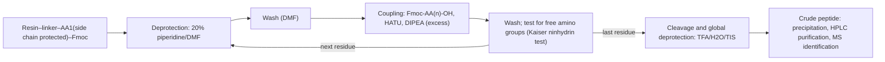
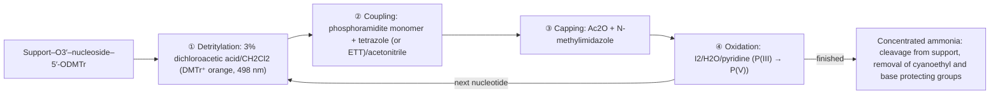

Proteins and nucleic acids are the two classes of information-carrying macromolecules of life. DNA stores genetic information; after transcription into RNA, the message is translated on the ribosome into a polypeptide chain built from 20 $\alpha$-amino acids joined by peptide bonds, and the chain folds into a functional protein (the "central dogma"). The higher-order structure of proteins, the kinetics and regulation of enzymes, and replication, transcription, translation and epigenetics belong to biochemistry and molecular biology ([7](/7)). This chapter treats only the organic chemistry of these molecules: the structure, acid–base behavior and reactions of amino acids; the structure of the peptide bond; sequencing and chemical synthesis of peptides; the structure and reactions of nucleosides and nucleotides; and the chemical synthesis of oligonucleotides.

Almost every section is a direct application of an earlier chapter. The acid–base equilibria of amino acids come from [6.4.2](/6.4.2); the peptide bond is an amide ([6.5.19](/6.5.19#sec-19.6)), and peptide synthesis is a series of controlled **nucleophilic acyl substitution** reactions, with coupling reagents taken over from the DCC chemistry of [6.5.19](/6.5.19#sec-19.6.1) and with **protecting groups** removed by **SN1**, **E1cB** and hydrogenolysis; native chemical ligation exploits the reactivity of thioesters; nucleosides are N-glycosides and share the oxocarbenium-ion and **neighboring group participation** chemistry of the **glycosylation** reactions in [6.5.32](/6.5.32#sec-32.8); the structures and pairing of the bases are treated in [6.5.25](/6.5.25#sec-25.8), and phosphate esters and P(III)/P(V) chemistry in [6.5.26](/6.5.26#sec-26.2.3). The part that leads from organic chemistry to chemical biology (bioorthogonal reactions, chemical modification of proteins) is outlined in Section 33.8, and treated in detail in chemical biology ([6.6](/6.6)).

## 33.1. Structure and Classification of Amino Acids

### 33.1.1. Structure and Configuration

**Definition 33.1.1 (Amino Acid)** A compound that contains both an amino group and a carboxyl group in the same molecule is called an **amino acid**. If the amino group is attached to the $\alpha$ carbon of the carboxyl group, the compound is an $\alpha$-amino acid, with general formula $\ce{H2N-CHR-COOH}$; R is called the side chain.

The 20 standard amino acids that make up proteins are all $\alpha$-amino acids (in proline the nitrogen is joined to the side chain in a ring, so proline is a secondary amine). Except for glycine (R = H), the $\alpha$ carbon is a **stereocenter**; ribosomally synthesized proteins contain only the L series (**D/L nomenclature**, [Definition 5.3.3](/6.5.5#def-5.3.3): when the carboxyl group is drawn at the top and the side chain at the bottom of a **Fischer projection**, the $\ce{NH2}$ group is on the left). In the **R/S nomenclature**, all L-amino acids are S except cysteine: the side chain $\ce{-CH2SH}$ of cysteine contains sulfur and therefore takes precedence over $\ce{-COOH}$ according to the **Cahn–Ingold–Prelog priority rules**, so L-cysteine is R although its spatial arrangement is the same as that of the other L-amino acids. Isoleucine and threonine carry a second stereocenter in the side chain; natural L-isoleucine is (2S,3S) and L-threonine is (2S,3R).

```smiles
N[C@@H](C)C(=O)O L-Ala
N[C@@H](CS)C(=O)O L-Cys
OC(=O)[C@@H]1CCCN1 L-Pro
```

D-Amino acids are not rare in nature: the peptidoglycan of bacterial cell walls contains D-alanine and D-glutamate; antibiotics made by nonribosomal peptide synthetases, such as gramicidin and vancomycin, contain D-amino acids; and D-serine in the mammalian brain is a co-agonist of a neurotransmitter receptor. Amino acid residues in proteins undergo extremely slow **racemization** ([Definition 5.6.2](/6.5.5#def-5.6.2)) in vivo; the D/L ratio of aspartic acid in dentin and in the lens of the eye increases with age and can be used to estimate age ([6.5.5](/6.5.5#sec-5.6.2)).

### 33.1.2. Classification of the Standard Amino Acids

According to the nature of the side chain, the 20 standard amino acids fall into several classes (three-letter and one-letter abbreviations in parentheses):

| Class | Amino acids | Chemical character of the side chain |
|---|---|---|
| Nonpolar aliphatic | Glycine (Gly, G), alanine (Ala, A), valine (Val, V), leucine (Leu, L), isoleucine (Ile, I), methionine (Met, M), proline (Pro, P) | Hydrophobic; the thioether of Met can be oxidized; the ring of Pro makes the backbone rigid |
| Aromatic | Phenylalanine (Phe, F), tyrosine (Tyr, Y), tryptophan (Trp, W) | The phenol of Tyr and the **indole** of Trp undergo electrophilic substitution; absorb in the UV at 280 nm |
| Polar, uncharged | Serine (Ser, S), threonine (Thr, T), cysteine (Cys, C), asparagine (Asn, N), glutamine (Gln, Q) | Alcohols, thiol and amides; Ser/Thr/Tyr can be phosphorylated, and Cys forms disulfide bonds |
| Acidic | Aspartic acid (Asp, D), glutamic acid (Glu, E) | Carboxylic acids, negatively charged at physiological pH |
| Basic | Lysine (Lys, K), arginine (Arg, R), histidine (His, H) | Primary amine, guanidine and imidazole; the $\mathrm{p}K_{\mathrm{a}}$ of His is close to 7, and it is the most common **acid–base catalysis** group in enzymes |

Two further amino acids, the "21st and 22nd", are encoded by the genetic code: selenocysteine (Sec, U, encoded by the stop codon UGA in a specific sequence context) and pyrrolysine (Pyl, O, found in some archaea). Nine essential amino acids cannot be synthesized by the human body and must be obtained from food: His, Ile, Leu, Lys, Met, Phe, Thr, Trp and Val.

## 33.2. Acid–Base Behavior and Isoelectric Points

### 33.2.1. Zwitterions

In aqueous solution and in the crystal, amino acids exist mainly as **zwitterions** ([Definition 2.8.2](/6.4.2#def-2.8.2)) $\ce{H3N+CHRCOO-}$: the $\mathrm{p}K_{\mathrm{a}}$ of the carboxyl group (about 2) is far lower than that of the ammonium group (about 9–10), and the **equilibrium constant** for proton transfer from the carboxyl group to the amino group is about $10^{7}$. The evidence is as follows. Amino acids are **ionic crystals** with high melting points (most decompose above 200 °C), readily soluble in water and poorly soluble in nonpolar solvents. Their **infrared spectroscopy** data lack the C=O band of a carboxylic acid (about $1710\,\mathrm{cm^{-1}}$) and instead show the absorptions of the carboxylate (about $1600$ and $1400\,\mathrm{cm^{-1}}$) and of $\ce{-NH3+}$. The dipole moment and the dielectric increment are both very large.

The carboxyl group of an $\alpha$-amino acid is much more acidic than acetic acid ($\mathrm{p}K_{\mathrm{a}}$ 4.76; glycine 2.34), and the ammonium group is also slightly more acidic than the methylammonium ion (10.66; 9.60): the adjacent positively charged $\ce{-NH3+}$ stabilizes the carboxylate through the **inductive effect** and electrostatic interaction, while the electron-withdrawing carboxyl group makes the ammonium group lose its proton more easily (data in Table 3.2 of [6.5.3](/6.5.3#sec-3.1.4)).

### 33.2.2. Isoelectric Points

Following the treatment in [6.4.2](/6.4.2#sec-2.8.3), the **isoelectric point** of an amino acid whose side chain does not ionize is $\mathrm{pI} = \tfrac12(\mathrm{p}K_{\mathrm{a}1} + \mathrm{p}K_{\mathrm{a}2})$; if the side chain ionizes, one takes the average of the two $\mathrm{p}K_{\mathrm{a}}$ values on either side of the **zwitterion** (the form with zero net charge). The $\mathrm{p}K_{\mathrm{a}}$ values in the table below are for the free amino acids in water at 25 °C (CRC Handbook; different sources differ by about 0.1–0.3), and pI is calculated from the tabulated data:

| Amino acid | $\alpha$-COOH | $\alpha$-$\ce{NH3+}$ | Side chain | pI |
|---|---|---|---|---|
| Glycine | 2.34 | 9.60 | — | 5.97 |
| Aspartic acid | 1.99 | 9.90 | 3.90 (COOH) | 2.95 |
| Glutamic acid | 2.16 | 9.58 | 4.15 (COOH) | 3.16 |
| Histidine | 1.82 | 9.17 | 6.00 (imidazolium) | 7.59 |
| Cysteine | 1.71 | 10.78 | 8.2 (SH) | 4.96 |
| Tyrosine | 2.24 | 9.04 | 10.10 (phenolic OH) | 5.64 |
| Lysine | 2.16 | 9.06 | 10.54 ($\varepsilon$-$\ce{NH3+}$) | 9.80 |
| Arginine | 2.17 | 9.04 | 12.48 (guanidinium) | 10.76 |


Several regularities emerge:

- Acidic amino acids, which have two carboxyl groups, have a pI of about 3; basic amino acids, which have two basic groups, have a pI of about 10; the others lie between 5 and 6.5.
- At physiological pH 7.4, Asp and Glu are negatively charged, Lys and Arg are positively charged, His is mostly neutral (side-chain $\mathrm{p}K_{\mathrm{a}}$ 6.0, about 4% protonated), and about 14% of the thiol of Cys is ionized to the thiolate. Inside a protein, the microenvironment can shift the $\mathrm{p}K_{\mathrm{a}}$ of a side chain by several units: the thiolate of Cys and the free amino group of Lys in enzyme active sites arise in this way.
- At the isoelectric point, the solubility of an amino acid or protein is lowest, and it does not move in an electric field. Different amino acids and proteins have different pI values; this is the basis for separating amino acids by **ion-exchange chromatography** ([6.4.14](/6.4.14#sec-14.3.5)), for isoelectric precipitation, and for **isoelectric focusing** ([6.4.14](/6.4.14#sec-14.5.6)). In a buffer whose pH differs from pI, charged amino acids and peptides undergo **electrophoresis** according to their charge and size.

## 33.3. Reactions of Amino Acids

Amino acids show the reactions of both amines and carboxylic acids, and the side chains contribute their own reactivity. The reactions commonly used in synthesis and analysis are the following.

### 33.3.1. Reactions of the Amino Group

- Acylation: with acyl chlorides, anhydrides (Schotten–Baumann conditions) or active esters, amino acids give N-acylamino acids; this is the basis of amino-group protection in peptide synthesis (Section 33.7.2).
- Arylation: Sanger's reagent, 1-fluoro-2,4-dinitrobenzene, undergoes **nucleophilic aromatic substitution** ([6.5.14](/6.5.14#sec-14.11.1)) with a free amino group in weak base to give the yellow 2,4-dinitrophenyl (DNP) derivative. The DNP–N bond resists acid hydrolysis; Sanger used it to label the N-terminus of insulin and determined the first amino acid sequence of a protein (1955; Nobel Prize in Chemistry 1958). Dansyl chloride (sulfonylation) gives strongly fluorescent N-terminal derivatives with higher sensitivity.
- Reaction with nitrous acid: a primary amino group undergoes **diazotization** and releases $\ce{N2}$, giving an $\alpha$-hydroxy acid with retention of configuration (through an $\alpha$-lactone formed by participation of the neighboring carboxyl group, [6.5.24](/6.5.24#sec-24.3)); measuring the volume of $\ce{N2}$ allows the free amino groups to be determined (Van Slyke method). Proline is a secondary amine and does not release $\ce{N2}$.
- With aldehydes, amino acids form **imines** ([Definition 16.9.1](/6.5.16#def-16.9.1)), and reduction with $\ce{NaBH3CN}$ then gives **reductive amination**; the reaction with formaldehyde is the basis of the Sørensen formol titration ([6.4.2](/6.4.2#sec-2.8.3)). The coenzyme pyridoxal phosphate (PLP) of transaminases first forms an imine with the amino acid and then completes the transamination through **tautomerism**; this chemistry is left to biochemistry.

### 33.3.2. Reactions of the Carboxyl Group

- Esterification: in $\ce{SOCl2}$/methanol (which generates HCl in situ), amino acids give the methyl ester hydrochlorides $\ce{Cl- H3N+CHRCOOMe}$; the amino group is protected as the ammonium salt and cannot condense with itself. Benzyl esters and tert-butyl esters (isobutene/$\ce{H2SO4}$) are commonly used carboxyl protection in peptide synthesis (Section 33.7.3).
- Acyl azides: an amino acid ester reacts with hydrazine to give the hydrazide, which with nitrous acid gives the acyl azide $\ce{RCON3}$. Acyl azides are mild acylating agents that cause little racemization in fragment condensation; they were the main method for joining fragments in early peptide synthesis (including the total synthesis of bovine insulin). On heating, however, they undergo the **Curtius rearrangement** to isocyanates ([6.5.24](/6.5.24#sec-24.8.3)), so they must be used at low temperature.
- Reduction: $\ce{LiAlH4}$ or $\ce{NaBH4}$/$\ce{I2}$ reduces amino acids (or their esters) to chiral $\beta$-amino alcohols (such as L-valinol), which are starting materials for chiral ligands and **chiral auxiliaries**.

### 33.3.3. The Ninhydrin Reaction

When an $\alpha$-amino acid is heated with ninhydrin (the hydrate of indane-1,2,3-trione) in weakly acidic solution, a blue-violet product (Ruhemann's purple, $\lambda_{\max}$ 570 nm) is formed. This is the most common color reaction for detecting and quantifying amino acids; automatic amino acid analyzers use it for detection after separation by ion-exchange chromatography ([6.4.14](/6.4.14#sec-14.3.5)). It is also used to develop latent fingerprints on porous surfaces such as paper, since sweat contains traces of amino acids.

The key step of the mechanism is **decarboxylation**. The amino group forms an imine with the central carbonyl group of ninhydrin; the C=N bond of the imine acts as an electron sink, allowing the adjacent carboxyl group to lose $\ce{CO2}$, and the resulting **carbanion** is stabilized by the two flanking carbonyl groups.


Hydrolysis of the new imine releases an aldehyde with one carbon fewer than the original amino acid (this oxidative decarboxylation is also called the Strecker degradation) and 2-aminoindane-1,3-dione. The latter condenses with a second molecule of ninhydrin to give Ruhemann's purple, whose color arises from a conjugated **enolate** in which one negative charge is delocalized over the two indanedione units:

```smiles
O=C1c2ccccc2C(=O)C1N.OC1(O)C(=O)c2ccccc2C1=O>>[O-]C1=C(N=C2C(=O)c3ccccc3C2=O)C(=O)c2ccccc21.O.O.O
```

All $\alpha$-amino acids give the same purple product, so the color intensity depends only on the amount of amino acid. Proline and hydroxyproline are secondary amines and can form only iminium ions, giving a yellow product ($\lambda_{\max}$ 440 nm).

### 33.3.4. Metal Complexes

Amino acids act as bidentate ligands through the carboxylate oxygen and the amino nitrogen and form five-membered **chelate** rings with transition-metal ions. Glycine and $\ce{Cu^2+}$ give the deep-blue bis(glycinato)copper(II), which exists as cis and trans geometric isomers ([6.1.5](/6.1.5)) that can be crystallized from solution, a property used to identify and precipitate amino acids. The same chelation allows $\ce{Ni^2+}$–nitrilotriacetic acid to bind histidine tags, which is used for the affinity purification of proteins ([6.4.14](/6.4.14)).

### 33.3.5. Reactivity and Selective Modification of the Side Chains

Selective modification of a single type of residue of a protein in water near physiological pH is a basic technique of chemical biology (Section 33.8). The reactivity of each side chain is determined by its **nucleophilicity**, its $\mathrm{p}K_{\mathrm{a}}$ and its abundance in proteins:

| Side chain | Reactivity | Common modification reactions |
|---|---|---|
| Cys (thiol) | The thiolate is the strongest **nucleophile** in proteins; low abundance (about 2%), so single-site modification is often possible | **Conjugate addition** (**Michael addition**) to maleimides, **SN2** alkylation with iodoacetamide, oxidation to disulfides; Pd-mediated S-arylation |
| Lys ($\varepsilon$-amino) | $\mathrm{p}K_{\mathrm{a}}$ 10.5, so only a little free amine is present at pH 7–9, but the residue is abundant (about 6%) and modification is often heterogeneous | Acylation with N-hydroxysuccinimide (NHS) esters, isothiocyanates (fluorescein isothiocyanate), **reductive amination** |
| N-terminal $\alpha$-amino | $\mathrm{p}K_{\mathrm{a}}$ about 8, lower than Lys, so selective acylation or ring formation with 2-pyridinecarboxaldehyde and similar reagents is possible at pH 6–7 | — |
| Tyr (phenol) | Electrophilic substitution is possible ortho to the phenol | **Azo coupling** with aryl diazonium salts, ene-type reaction with cyclic azodicarbonyl compounds (PTAD) |
| Trp (indole) | C2/C3 of the indole are electron rich; the least abundant residue (about 1%) | N–H or C–H insertion of rhodium carbenes |
| Met (thioether) | The thioether can be oxidized and alkylated to a sulfonium salt | Redox-activated coupling with oxaziridines (ReACT) |

Modification of cysteine has been applied to antibody–drug conjugates: a Cys on the antibody reacts with a maleimide carrying a cytotoxic drug, so that the drug is released only inside tumor cells recognized by the antibody. The formation and reduction of disulfide bonds (glutathione, dithiothreitol) are discussed in [6.5.26](/6.5.26#sec-26.8.4).

## 33.4. Preparation of Amino Acids

### 33.4.1. Hydrolysis of Proteins

Heating a protein in $6\,\mathrm{mol\,L^{-1}}$ HCl at 110 °C for about 24 h hydrolyzes all peptide bonds to amino acids. Under these conditions tryptophan is destroyed, asparagine and glutamine are hydrolyzed to aspartic and glutamic acid, and serine and threonine are partly lost, so corrections must be made in the analysis, or alkaline or enzymatic hydrolysis used instead. Industrially, amino acids are produced mainly by microbial fermentation (sodium glutamate, lysine), and a few by chemical synthesis.

### 33.4.2. The Strecker Synthesis

**Definition 33.4.1 (Strecker Synthesis)** The reaction of an aldehyde (or ketone) with ammonia (or an ammonium salt) and cyanide to give an $\alpha$-aminonitrile, which is then hydrolyzed to an $\alpha$-amino acid, is called the **Strecker synthesis** (1850).

The aldehyde and ammonia first form an imine (protonated to the iminium ion under the weakly acidic conditions provided by $\ce{NH4Cl}$), and cyanide adds to the carbon of the iminium ion. This is the same type of reaction as the formation of a **cyanohydrin** from an aldehyde ([Definition 16.7.1](/6.5.16#def-16.7.1)), except that the **electrophile** is now a C=N group:


The planar iminium ion is attacked from both faces with equal probability, so the product is a **racemate**. If a chiral amine (such as (S)-$\alpha$-methylbenzylamine) replaces ammonia, or if the addition of cyanide is catalyzed by a chiral thiourea or metal complex (the asymmetric Strecker reaction), a single enantiomer can be obtained directly. The Strecker reaction is also considered a possible route to amino acids before the origin of life: the discharge products of the Miller–Urey experiment contain aldehydes, HCN and ammonia, which are exactly its reagents.

### 33.4.3. Ammonolysis of α-Halo Acids and the Gabriel Method

A carboxylic acid is converted by the **Hell–Volhard–Zelinsky reaction** ([6.5.18](/6.5.18#sec-18.5)) to the $\alpha$-bromo acid, which undergoes **SN2** substitution with a large excess of ammonia to give a racemic $\alpha$-amino acid; the excess of ammonia suppresses further alkylation of the product amine. A cleaner method is the **Gabriel synthesis** ([6.5.23](/6.5.23#sec-23.5.2)), which uses potassium phthalimide in place of ammonia as the nitrogen **nucleophile**, since it can be alkylated only once. The **enolate** of diethyl phthalimidomalonate first reacts with an alkyl halide to introduce the side chain; hydrolysis, **decarboxylation** and removal of the phthaloyl group then give the amino acid. This combines the Gabriel synthesis with the malonic ester synthesis.

### 33.4.4. The Acetamidomalonate Method

The amino acid version of the **malonic ester synthesis** ([Definition 22.9.1](/6.5.22#def-22.9.1)) uses diethyl acetamidomalonate. Its $\alpha$-H is removed by ethoxide, the **enolate** introduces the side chain by an **SN2 reaction** with an alkyl halide, and heating in acid then hydrolyzes both esters and the acetamide simultaneously; the substituted malonic acid formed undergoes **decarboxylation** to give a racemic amino acid.

```smiles
CCOC(=O)C(NC(C)=O)C(=O)OCC.ClCc1ccccc1>>CCOC(=O)C(Cc1ccccc1)(NC(C)=O)C(=O)OCC.Cl
CCOC(=O)C(Cc1ccccc1)(NC(C)=O)C(=O)OCC>>NC(Cc1ccccc1)C(=O)O.CCO.CCO.CC(=O)O.O=C=O
```

(Benzyl chloride gives phenylalanine. The second step uses $\ce{H3O+}$ and heat.)

### 33.4.5. Asymmetric Synthesis and Resolution

All of the methods above give racemates. Single enantiomers can be obtained as follows:

- **Chiral resolution**: a racemic N-acetylamino acid is treated with an aminoacylase, which hydrolyzes only the acetamide of the L form; the L-amino acid formed and the unreacted N-acetyl-D-amino acid are easily separated. This is the industrial **kinetic resolution** ([Definition 5.7.2](/6.5.5#def-5.7.2)). The unreacted D form can be recycled after **racemization**.
- Asymmetric hydrogenation: Knowles (Monsanto, 1970s) used a Rh(I) complex of the chiral bisphosphine ligand DIPAMP to catalyze the hydrogenation of (Z)-$\alpha$-acetamidocinnamic acid derivatives, obtaining an L-DOPA precursor in 95% ee. This was the first industrial process based on **asymmetric catalysis** (Nobel Prize in Chemistry 2001; mechanism in [6.5.29](/6.5.29#sec-29.2.2)). The amide carbonyl of the enamide coordinates to Rh to form a **chelate**, which accounts for the high enantioselectivity.
- **Chiral auxiliaries** and asymmetric alkylation (the Schöllkopf bis-lactim ether method, **phase-transfer catalysis** alkylation of glycine imines), as well as C–H activation (Pd-catalyzed arylation or alkylation of $\beta$-C–H bonds directed by a directing group), are used to prepare unnatural amino acids with a wide variety of side-chain structures.

```smiles
COc1ccc(cc1OC(C)=O)/C=C(/NC(C)=O)C(=O)O.[H][H]>>COc1ccc(cc1OC(C)=O)C[C@H](NC(C)=O)C(=O)O
```

## 33.5. Structure of Peptides

### 33.5.1. The Peptide Bond and Primary Structure

**Definition 33.5.1 (Peptide Bond and Peptide)** The amide bond formed by dehydration between the carboxyl group of one amino acid and the amino group of another is called a **peptide bond**; a compound formed by joining amino acids through peptide bonds is called a *peptide*, and each amino acid unit in it is called a residue. The end carrying the free $\alpha$-amino group is the N-terminus, and the end carrying the free $\alpha$-carboxyl group is the C-terminus.

Peptides are written and named in the order from the N-terminus to the C-terminus: $\ce{H2N-CH(CH2SH)-CO-NH-CH(CH3)-COOH}$ is written H-Cys-Ala-OH or CA and named cysteinylalanine; it is a **constitutional isomer** of alanylcysteine (H-Ala-Cys-OH). The sequence of amino acid residues (together with the positions of disulfide bonds) is called the primary structure. Bovine insulin consists of an A chain (21 residues) and a B chain (30 residues), with one disulfide bond within the A chain and two disulfide bonds between the A and B chains.

### 33.5.2. Planarity and Cis–Trans Isomerism of the Peptide Bond

The peptide bond is an **amide**: the lone pair on nitrogen is conjugated with the carbonyl group ([6.5.19](/6.5.19#sec-19.1.2)), and it can be described by two **resonance structures**, $\ce{O=C-NH <-> O^- -C=N^+H}$. This gives the peptide bond several structural characteristics:

- The C–N bond length is about 133 pm, intermediate between a single bond ($\mathrm{C}_\alpha$–N, about 146 pm) and a double bond (about 127 pm); the C=O bond length is about 124 pm.
- The rotational barrier about the C–N bond is about $80\,\mathrm{kJ\,mol^{-1}}$, so rotation is not free at room temperature. The carbonyl carbon and oxygen, the nitrogen and its hydrogen, and the two neighboring $\alpha$ carbons, six atoms in all, lie in one plane, called the peptide plane (amide plane).
- The peptide bond can be cis or trans. In the trans form the two $\alpha$ carbons are on opposite sides of the C–N bond and **steric strain** is small, so almost all peptide bonds preceding non-proline residues are trans (less than 0.1% cis). The nitrogen of proline carries no H, and the two configurations of the X–Pro peptide bond (X being the preceding residue) differ little sterically; about 5% of X–Pro peptide bonds in protein structures are cis, and in short random-coil peptides the figure can reach 10%–30%. Cis–trans isomerization is slow (minutes) and is often the rate-limiting step of protein folding; in vivo it is catalyzed by peptidyl-prolyl cis–trans isomerases.
- The N–H of the peptide bond is a very weak acid ($\mathrm{p}K_{\mathrm{a}}$ about 15, close to acetamide, [6.5.3](/6.5.3#sec-3.1.4)) and does not ionize under physiological conditions; the oxygen is a weak base and interacts mainly with other N–H groups through **hydrogen bonds**.

Because the peptide plane is rigid, the conformation of the polypeptide backbone is determined only by the two **torsion angles** $\phi$ (N–C$\alpha$) and $\psi$ (C$\alpha$–C) about the single bonds on either side of each $\alpha$ carbon. Their allowed combinations (the Ramachandran plot) correspond to secondary structures such as the $\alpha$ helix and $\beta$ sheet. Regular hydrogen bonds between C=O and N–H groups of the backbone maintain these structures, while hydrophobic interactions, ionic bonds, hydrogen bonds and disulfide bonds between side chains maintain the tertiary and quaternary structure; all of this is left to biochemistry. The secondary structure of proteins can be determined by **circular dichroism** and by the amide I band in the infrared ([6.4.9](/6.4.9), [6.4.11](/6.4.11)).

## 33.6. Peptide Sequencing

### 33.6.1. Composition Analysis, End-Group Analysis and Specific Cleavage

The classical sequencing strategy (the method with which Sanger determined the primary structure of insulin) comprises several steps:

1. Amino acid composition: after complete acid hydrolysis, the amino acids are separated by **ion-exchange chromatography** and quantified by ninhydrin detection (Section 33.3.3).
2. Opening of disulfide bonds: oxidation to sulfonic acids with performic acid, or reduction with a thiol reagent followed by alkylation with iodoacetamide, which prevents the disulfide bonds from re-forming.
3. N-terminus and C-terminus: the N-terminus is labeled with Sanger's reagent or dansyl chloride and identified after hydrolysis, or determined by Edman degradation (Section 33.6.2); the C-terminus is cleaved off residue by residue with carboxypeptidase.
4. Specific cleavage: a reagent that cleaves at specific positions cuts a long peptide into fragments that can be sequenced separately, and a second reagent gives overlapping fragments from which the whole sequence is assembled.

| Reagent | Cleavage site |
|---|---|
| Trypsin | C-terminal side of Lys and Arg (no cleavage when followed by Pro) |
| Chymotrypsin | C-terminal side of Phe, Tyr and Trp |
| Cyanogen bromide ($\ce{BrCN}$) | C-terminal side of Met; Met is converted to C-terminal homoserine lactone |

Cleavage by cyanogen bromide is an organic reaction. The sulfur of the Met thioether attacks the carbon of BrCN to give a cyanosulfonium salt. The $\gamma$ carbon of the sulfonium salt becomes an excellent electrophilic center, and the carbonyl oxygen of Met itself attacks it intramolecularly by an **SN2** pathway, releasing $\ce{CH3SCN}$ and forming a five-membered iminolactone; on hydrolysis this breaks the peptide bond, and the C-terminus of the left-hand fragment becomes a homoserine **lactone**.

![Cleavage of a peptide chain by cyanogen bromide on the C-terminal side of methionine (model fragment Ac-Met-NHR′). Top: the thioether sulfur attacks the carbon of BrCN, and bromide leaves to give the cyanosulfonium salt. Bottom: the carbonyl oxygen of the Met amide attacks the γ carbon intramolecularly by SN2 (five-membered ring), releasing methyl thiocyanate and giving a cyclic iminolactone; on hydrolysis the peptide bond is broken, the left-hand fragment ends in homoserine lactone, and the right-hand fragment is released with a free N-terminal amino group](./plots/brcn-cleavage.py)

### 33.6.2. The Edman Degradation

**Definition 33.6.1 (Edman Degradation)** The method in which phenyl isothiocyanate reacts with the N-terminal amino group of a peptide and the N-terminal residue is then cleaved off in anhydrous acid as a thiazolinone while the rest of the chain remains intact, so that one residue is cleaved and identified in each round and the N-terminal sequence is read residue by residue, is called the **Edman degradation** (1950).

Each round consists of two reactions:

![Edman degradation. Top: at pH 8–9 the free N-terminal amino group adds to the central carbon of phenyl isothiocyanate to give the phenylthiocarbamoyl (PTC) peptide. Bottom: in anhydrous trifluoroacetic acid the thiocarbonyl sulfur attacks the carbonyl carbon of the first peptide bond (activated by protonation); the tetrahedral intermediate releases the amino group of the rest of the chain, giving the anilinothiazolinone (ATZ) of the first residue and a peptide one residue shorter. After extraction, the ATZ rearranges in dilute acid to the stable phenylthiohydantoin (PTH) derivative, which is identified by HPLC](./plots/edman.py)

- Coupling: in weak base, the free N-terminal amino group ($\mathrm{p}K_{\mathrm{a}}$ about 8) undergoes **nucleophilic addition** to the central carbon of phenyl isothiocyanate (PITC) $\ce{PhN=C=S}$ to give a thiourea (the PTC peptide).
- Cyclization–cleavage: in anhydrous trifluoroacetic acid, the sulfur atom of the thiourea acts as an intramolecular **nucleophile** and attacks the carbonyl carbon of the first peptide bond to form a five-membered ring; this is an intramolecular **nucleophilic acyl substitution** whose **leaving group** is the amino group of the second residue. The key is "anhydrous": without water, the other peptide bonds are not hydrolyzed, while the **nucleophilicity** of sulfur and the favorable geometry of the five-membered ring make the cleavage of the first peptide bond much faster than ordinary amide hydrolysis.
- Conversion: the unstable ATZ is extracted, opened in dilute aqueous acid and re-closed by attack of nitrogen to give the stable PTH-amino acid, which is identified by HPLC by comparison of its **retention time** with standards.

The peptide, shortened by one residue and carrying a new N-terminus, enters the next round. Automated sequencers (Edman and Begg, 1967) need about 1 h per round. The yield of each round cannot be 100%: at 99% per round, after 50 rounds only about 60% of the chains are in step with the "correct" round and the background signal grows, so the Edman degradation can generally read only 30–50 residues; proteins whose N-terminus is blocked (for example by N-acetylation or pyroglutamate) cannot be sequenced.

### 33.6.3. Sequencing by Mass Spectrometry

Today protein sequences are mostly deduced from gene sequences, and direct determination relies mainly on **mass spectrometry**. The protein is first digested with trypsin into peptides, whose masses are measured by LC-ESI-MS (**peptide mass fingerprinting**); the ions of selected peptides are then fragmented along the peptide bonds by **tandem mass spectrometry**, and the sequence is read from the mass differences in the b-ion and y-ion series ([6.4.15](/6.4.15#sec-15.5.3)). This is the basis of **proteomics**. Mass spectrometry can locate post-translational modifications (phosphorylation, glycosylation, acetylation) and is not limited by N-terminal blocking, but distinguishing isobaric residues (Leu and Ile) requires special fragmentation methods; the Edman degradation is still used to confirm N-terminal sequences. The size and purity of proteins are estimated by **SDS–polyacrylamide gel electrophoresis** ([6.4.14](/6.4.14#sec-14.5.5)).

## 33.7. Chemical Synthesis of Peptides

### 33.7.1. The Problem and the Strategy

If two amino acids are simply mixed and heated, the carboxylic acid and the amine merely form a salt ([6.5.19](/6.5.19#sec-19.6.1)); even when a condensing agent is used for activation, Phe and Gly give four dipeptides, Phe-Gly, Gly-Phe, Phe-Phe and Gly-Gly, as well as longer oligomers. To obtain a single product it is necessary to:

1. protect the amino and carboxyl groups that should not react (the $\alpha$-amino group of the "N-terminal component" and the $\alpha$-carboxyl group of the "C-terminal component"), as well as reactive side-chain functional groups;
2. activate the carboxyl group of the N-terminal component so that it forms a peptide bond with the amino group of the C-terminal component under mild conditions (coupling) without racemizing the $\alpha$ carbon;
3. remove one **protecting group** selectively and carry out the next coupling; at the end, remove all protecting groups.

Each step is an application of the chemistry of [6.5.19](/6.5.19) and [6.5.20](/6.5.20); the difficulty is that the sequence must be repeated dozens of times with each step nearly quantitative.

### 33.7.2. Amino-Protecting Groups

The $\alpha$-amino **protecting groups** ([Definition 16.5.2](/6.5.16#def-16.5.2)) used in peptide synthesis are almost all carbamates ("urethane-type" protecting groups): they convert the amine into a carbamate of very low **nucleophilicity**, and removal requires only cleavage of the O–alkyl bond, after which the carbamic acid formed spontaneously undergoes **decarboxylation** to release the amine (Section 20.5.2 of [6.5.20](/6.5.20#sec-20.5.2)). The removal conditions of the three most common protecting groups are mutually orthogonal:

| Protecting group | Introduction | Removal | Mechanism of removal | Stable toward |
|---|---|---|---|---|
| Benzyloxycarbonyl (Cbz, Z; Bergmann and Zervas, 1932) | Benzyl chloroformate, base | $\ce{H2}$, Pd/C; or HBr/AcOH | Hydrogenolysis of the C–O bond at the **benzylic position** (or **SN1**/**SN2** cleavage) | Mild acid and base |
| tert-Butoxycarbonyl (Boc; 1957) | $\ce{Boc2O}$, base | Trifluoroacetic acid (TFA) or HCl/dioxane | SN1: loss of the tert-butyl cation | Base, **nucleophiles**, hydrogenolysis |
| 9-Fluorenylmethoxycarbonyl (Fmoc; Carpino, 1970) | Fmoc-Cl or Fmoc-OSu, base | 20% piperidine/DMF | **E1cB**: loss of dibenzofulvene | Acid (TFA), hydrogenolysis (slowly cleaved) |


Removal of Boc is an **SN1**-type cleavage: the protonated carbamate releases the stable tertiary **carbocation**. This carbocation is a powerful **electrophile** that alkylates the indole of Trp, the sulfur of Met, the phenol ring of Tyr and the thiol of Cys, so water, triisopropylsilane or thiols are added to TFA as scavengers. Benzyl esters, benzyl ethers and Cbz are largely stable in TFA (the benzyl cation is far less stable than the tert-butyl cation) and require a stronger acid (anhydrous HF) for cleavage, which is the basis of the Boc/Bzl strategy.


Removal of Fmoc is an **E1cB reaction** ([Definition 9.5.1](/6.5.9#def-9.5.1)). The C9–H of fluorene can be removed by piperidine (conjugate acid $\mathrm{p}K_{\mathrm{a}}$ 11.12) because the fluorenyl anion formed is a 14π system with **aromaticity**; the $\mathrm{p}K_{\mathrm{a}}$ of fluorene in DMSO is 22.6 (Table 3.3 of [6.5.3](/6.5.3#sec-3.1.4)), about 20 units lower than that of an ordinary C–H bond. The C–O bond at the $\beta$ position of the anion breaks and the carbamate leaves. Dibenzofulvene absorbs strongly at 301 nm, and measuring its amount allows one to monitor whether deprotection is complete in each round.

### 33.7.3. Protection of the Carboxyl Group and the Side Chains

The C-terminal carboxyl group is often protected as a methyl or ethyl ester (removed by **saponification** with dilute base), a tert-butyl ester (removed with TFA, A$_{\mathrm{Al}}$1 mechanism) or a benzyl ester (removed by hydrogenolysis); in solid-phase synthesis the C-terminal carboxyl group is attached to the resin as an ester or amide, and the resin itself serves as the carboxyl **protecting group** (Section 33.7.6).

Side-chain protecting groups must remain unchanged throughout the synthesis and are removed at the end together with the linkage to the resin. In the now most common Fmoc/tBu strategy, the $\alpha$-amino group is protected with Fmoc (removed by base) and the side chains with tert-butyl-type groups (removed by acid); the two are orthogonal (Section 20.8.3 of [6.5.20](/6.5.20#sec-20.8.3)):

| Side chain | Protected form | Removal |
|---|---|---|
| $\varepsilon$-Amino group of Lys | Boc | TFA |
| Carboxyl group of Asp, Glu | tert-Butyl ester (OtBu) | TFA |
| Alcohol of Ser, Thr; phenol of Tyr | tert-Butyl ether (tBu) | TFA |
| Thiol of Cys | Trityl (Trt); acetamidomethyl (Acm) when it must be retained | TFA; Acm is removed with $\ce{I2}$, which at the same time forms the disulfide bond |
| Imidazole of His; amides of Asn and Gln | Trityl (Trt) | TFA |
| Guanidine of Arg | 2,2,4,6,7-Pentamethyldihydrobenzofuran-5-sulfonyl (Pbf) | TFA |
| Indole N–H of Trp | Boc | TFA |

### 33.7.4. Coupling Reagents

**Definition 33.7.1 (Coupling Reagent)** A reagent that converts a carboxylic acid in situ under mild conditions into an activated acyl compound (an active ester, anhydride, acylisourea, etc.), which then forms an amide bond with an amine, is called a **coupling reagent** (peptide condensing agent).

Coupling is always a two-step **nucleophilic acyl substitution**: the OH of the carboxyl group is first replaced by a good **leaving group**, and the amine then displaces it. The common methods are:

- Mixed anhydride method: the carboxylate of an N-protected amino acid and isobutyl chloroformate form a mixed anhydride at $-15\,^\circ\mathrm{C}$; the amine attacks the amino acid carbonyl group (less hindered and more electrophilic) rather than the carbonate carbonyl group, giving the peptide with release of $\ce{CO2}$ and isobutanol.
- Active ester method: p-nitrophenyl, pentafluorophenyl and N-hydroxysuccinimide (NHS) esters. The leaving phenoxide or N-oxide anion is weakly basic (p-nitrophenol $\mathrm{p}K_{\mathrm{a}}$ 7.15), and the reactivity of the ester lies between that of an ordinary ester and an anhydride, so the esters can be isolated and stored.
- Carbodiimide method: DCC or DIC converts the carboxylic acid into an O-acylisourea (mechanism in [6.5.19](/6.5.19#sec-19.6.1)). The O-acylisourea is very reactive but has two side reactions: intramolecular O→N acyl migration to the unreactive N-acylurea, and racemization through the oxazolone (Section 33.7.5). Added 1-hydroxybenzotriazole (HOBt), 1-hydroxy-7-azabenzotriazole (HOAt) or ethyl cyano(hydroxyimino)acetate (Oxyma) rapidly convert the O-acylisourea into active esters (OBt, OAt esters), which are reactive enough yet not prone to racemization.
- Uronium and phosphonium salts: HBTU, HATU (actually a guanidinium N-oxide in structure) and PyBOP convert carboxylic acids directly into OBt or OAt active esters in the presence of a tertiary amine (DIPEA); the reactions are fast, and these are the most common coupling reagents in solid-phase synthesis. The pyridine nitrogen of HOAt and HATU can guide the attacking amine through an intramolecular **hydrogen bond** (neighboring-group assistance), so they react faster and cause less racemization than the HOBt type.

![Two fates of the O-acylisourea formed by a carbodiimide (DIC as the example; R is the activated amino acid). Top: the HOBt anion intercepts it at the acyl carbon, and the tetrahedral intermediate releases diisopropylurea to give the OBt active ester, which acylates amines efficiently but does not readily form oxazolones. Bottom: without an additive, the imine nitrogen of the isourea attacks the same acyl carbon intramolecularly (O→N acyl migration through a four-membered ring intermediate) to give the unreactive N-acylurea, which lowers the yield](./plots/hobt-acylurea.py)

![Activation by HATU (drawn as the O-uronium form for clarity; the reagent exists mainly as the isomeric guanidinium N-oxide, which reacts in the same way). Top: the carboxylate (formed by DIPEA) adds to the electron-poor central carbon of the uronium salt and releases the HOAt anion, giving an O-acylisouronium ion. Middle: the HOAt anion attacks its acyl carbon, and the tetrahedral intermediate releases tetramethylurea to give the OAt active ester. Bottom: when the amine attacks the active ester, one of its N–H groups forms a hydrogen bond (dashed line) with the pyridine nitrogen of the leaving group, positioning and activating the amine; this neighboring-group assistance makes HOAt-type reagents couple faster and with less racemization than HOBt-type reagents](./plots/hatu-activation.py)

### 33.7.5. Racemization during Coupling

The greatest stereochemical risk in peptide synthesis is racemization of the $\alpha$ carbon of the activated amino acid. The main pathway is the formation of a 5(4H)-oxazolone:

![Racemization through a 5(4H)-oxazolone. Top: after activation of an N-acylamino acid (N-acetylalanine as the example; X is a leaving group such as an O-acylisourea), the carbonyl oxygen of the N-acyl group attacks the activated carbonyl carbon, X leaves, and the oxazolone ring closes. Bottom: the C4–H of the oxazolone is considerably acidic (its conjugate base is the aromatic oxazol-5-olate); when base removes it, the planar anion is reprotonated from either face and the stereocenter is lost; an amine can still open the oxazolone to give a peptide, but as a mixture of epimers](./plots/oxazolone.py)

- Formation of an oxazolone requires an ordinary acyl group on N (a peptide bond or an acetyl group): the carbonyl oxygen of the amide has enough **nucleophilicity** to attack the activated carboxyl group intramolecularly.
- The $\mathrm{p}K_{\mathrm{a}}$ of C4–H of the oxazolone is about 9. The anion formed on deprotonation is the oxazol-5-olate, a 6π system with **aromaticity**, which is stabilized as an **enolate** is; in the presence of the tertiary amine base used for coupling it undergoes rapid **racemization**.
- In urethane-type protecting groups (Boc, Fmoc, Cbz), the carbonyl oxygen is attached next to an alkoxy group and is weakly nucleophilic, so little 2-alkoxyoxazolone forms and it does not readily undergo **enolization**. For this reason racemization is negligible when single urethane-protected amino acids are added one by one from the C-terminus toward the N-terminus, which is why stepwise syntheses always proceed in the C→N direction.
- Conversely, when the C-terminal carboxyl group of a peptide fragment is activated to join another fragment (fragment condensation), the N of the activated residue carries a peptide bond and racemization is very easy. Unless the C-terminus is the achiral Gly or Pro, which cannot form an oxazolone, fragment condensation must use methods with little racemization (the acyl azide method, HOAt additive, low temperature, weak base), or chemical ligation that does not pass through an activated carboxyl group (Section 33.7.7).
- Cys and His are prone to racemization even under urethane protection: the $\alpha$-H of Cys is removed directly by base owing to the electron-withdrawing effect of sulfur, and the imidazole nitrogen of His can abstract the $\alpha$-H intramolecularly. They require weak bases, preformed active esters or special side-chain **protecting groups**.

### 33.7.6. Solid-Phase Peptide Synthesis

**Definition 33.7.2 (Solid-Phase Peptide Synthesis)** The synthetic method in which the C-terminus of the peptide chain is anchored through a cleavable linker to an insoluble polymer resin, the deprotection–coupling cycle is repeated in solution with excess reagents, excess reagents and by-products are removed after each step simply by filtration and washing, and the finished peptide is finally cleaved from the resin, is called **solid-phase peptide synthesis** (SPPS).

Merrifield reported this method in 1963 (Nobel Prize in Chemistry 1984). The first Boc-amino acid was attached as a benzyl ester to a chloromethylated cross-linked polystyrene resin, and the cycle of TFA removal of Boc, neutralization and DCC coupling was repeated; finally anhydrous HF cleaved the peptide and removed benzyl-type side-chain protecting groups simultaneously (Boc/Bzl strategy). The Fmoc/tBu strategy is now more common: Wang resin (p-alkoxybenzyl ester linkage; TFA cleavage gives the C-terminal carboxylic acid) or Rink amide resin (giving the C-terminal amide), with Fmoc removed in each round by piperidine, coupling with HBTU/HATU or DIC/Oxyma, and a final treatment with TFA/water/triisopropylsilane (95:2.5:2.5) that cleaves the peptide and removes the side-chain **protecting groups** at the same time. One cycle is as follows:



The advantages of solid-phase synthesis are that excess reagents can drive each step nearly to completion, purification requires only filtration, and the whole process can be automated. The price is that intermediates cannot be purified, and in each step the unreacted chains become deletion impurities lacking one residue that are extremely similar in properties to the product. The fraction of full-length product decreases exponentially with length:


At 99% per step, full-length chains account for about 61% of a 50-mer and only about 37% of a 100-mer; to synthesize proteins of more than 100 residues, the yield of each step must exceed 99.5%, or the long chain must be divided into several segments joined by chemical ligation. To raise the yield of each step, unreacted amino groups are often "capped" with acetic anhydride after coupling, so that deletion sequences become truncated sequences that are easier to purify. In difficult sequences the peptide chain aggregates into $\beta$ sheets on the resin and blocks access of reagents; heating (microwave), pseudoproline dipeptides or backbone protection can break up the aggregation. Sequences such as Asp followed by Gly readily cyclize to aspartimide in piperidine, a typical side reaction of the Fmoc strategy. In 2020 Pentelute and coworkers reported an automated flow-chemistry synthesizer that shortened each cycle to about 40 s and synthesized a 164-residue protein chain in a few hours.


### 33.7.7. Native Chemical Ligation

Peptides prepared directly by solid-phase synthesis generally do not exceed 50 residues. Longer proteins require several peptide segments to be joined, but protected large segments are poorly soluble and fragment condensation causes racemization. Native chemical ligation, introduced by Kent and coworkers in 1994, solved this problem:

**Definition 33.7.3 (Native Chemical Ligation)** An unprotected peptide with a C-terminal thioester reacts with an unprotected peptide with an N-terminal cysteine in neutral aqueous solution: the thiol of cysteine first undergoes transthioesterification with the thioester, and the thioester intermediate formed then undergoes S→N acyl migration through a five-membered transition state, forming a native peptide bond (Xaa-Cys) at the junction. This method of joining peptide segments is called **native chemical ligation** (NCL).

![Native chemical ligation. Top: the thiolate of the N-terminal cysteine of peptide 2 attacks the C-terminal thioester of peptide 1 (transthioesterification, reversible, catalyzed by added aryl thiols), releasing an alkyl thiol. Bottom: the new thioester is five atoms away from the amino group of the cysteine; the amino group attacks the carbonyl carbon through a five-membered tetrahedral intermediate and the C–S bond breaks; this S→N acyl migration is irreversible and produces the native peptide bond and the free cysteine side chain at the junction](./plots/ncl.py)

The design makes clever use of the properties of the **thioester** ([Definition 19.9.1](/6.5.19#def-19.9.1)): a thioester is reactive enough to be attacked by thiolate (transthioesterification is fast and reversible), yet fairly stable in water at pH 7 and hardly reacts with the amino group of lysine; only the N-terminal Cys can effect **acyl transfer** to nitrogen through an intramolecular five-membered ring, and because an amide is much more stable than a thioester, the overall reaction is irreversible. The reaction therefore has very high **chemoselectivity**: the other side chains of both peptide segments need not be protected, and the **stereocenter** at the junction is unaffected (there is no activated carboxyl group and no oxazolone formation). This S→N acyl migration itself was observed as early as 1953 by Wieland in the reaction of a valine thioester with cysteine.

Native chemical ligation requires Cys at the junction, and Cys is relatively rare in proteins. Two extensions allow it to be used for almost any sequence. After ligation, desulfurization with Raney Ni or by metal-free radical methods (Yan and Dawson 2001; Danishefsky 2007) converts the Cys at the junction into Ala, and other $\beta$-mercapto amino acids can likewise be ligated and then desulfurized. Expressed protein ligation (Muir, 1998) exploits the self-splicing of inteins to obtain proteins with a C-terminal thioester directly by recombinant expression, which are then ligated to synthetic peptide segments, to introduce fluorescent probes, post-translational modifications or unnatural amino acids into proteins. In 2013 Danishefsky and coworkers completed the total synthesis of glycosylated erythropoietin (EPO; 166 residues with four sugar chains) with methods of this kind.

### 33.7.8. Total Synthesis of Bovine Insulin

In 1965, the Shanghai Institute of Biochemistry and the Shanghai Institute of Organic Chemistry of the Chinese Academy of Sciences, together with Peking University, achieved the first total synthesis of crystalline bovine insulin with full biological activity, the first synthetic protein with natural activity in the world. The synthesis had three parts. The A chain (21 residues) and the B chain (30 residues) were each synthesized in solution from small peptide segments by fragment condensation (mainly by the acyl azide and DCC methods, to control racemization); after deprotection, air oxidation paired the six cysteines of the A and B chains correctly into three disulfide bonds and gave a crystalline product with the same activity as natural insulin. Before this (1963–1964), Zahn in Germany and Katsoyannis in the United States had reported the synthesis and combination of insulin chains, but with very low activity and without crystals. The chemical synthesis of peptides goes back to Emil Fischer, who synthesized the first dipeptide, glycylglycine, in 1901 and an 18-mer in 1907, but the total synthesis of a protein had to wait more than half a century and depended on the development of **protecting group** and coupling chemistry. In 1969 Gutte and Merrifield prepared active ribonuclease A (124 residues) by solid-phase synthesis.

## 33.8. From Organic Chemistry to Chemical Biology

### 33.8.1. Chemical Modification of Proteins

Attaching fluorophores, spin probes, photocrosslinking groups, affinity tags or drugs at specific positions of a protein is a basic means of studying protein structural dynamics, interactions and localization in cells. Compared with ordinary organic synthesis, such reactions face stringent requirements: they must proceed in water at pH 6–8 and 4–37 °C; no **protecting groups** can be used; the protein concentration is only micromolar, so the second-order rate constant must be $10^3$–$10^5$ times larger than that of an ordinary synthetic reaction for the reaction to be complete in a reasonable time; and excess reagent must be removable completely afterward. There are two routes to modification: use the reactivity of the natural amino acid side chains (Section 33.3.5), or first introduce an unnatural amino acid carrying a special functional group at a chosen position by genetic code expansion (with an orthogonal tRNA/aminoacyl-tRNA synthetase pair), and then modify it selectively with the bioorthogonal reactions below.

**Green fluorescent protein** ([6.4.10](/6.4.10)) is a natural example of "modification without added reagents". GFP from the jellyfish *Aequorea victoria* consists of 238 residues (about 27 kDa), and its **chromophore** forms spontaneously after folding from three of its own residues, Ser65–Tyr66–Gly67: the amide nitrogen of Gly67 attacks the carbonyl carbon of Ser65, cyclization and dehydration give an imidazolinone, and oxidation by $\ce{O2}$ then conjugates the side chain of Tyr66 with the imidazolinone. Wild-type GFP has its main absorption peak at 395 nm (phenol form) and a minor peak at 475 nm (phenolate form), and emits at 509 nm. Shimomura, Chalfie and Tsien received the Nobel Prize in Chemistry in 2008 for the discovery and development of GFP.

### 33.8.2. Bioorthogonal Reactions

**Definition 33.8.1 (Bioorthogonal Reaction)** A chemical reaction that can take place in living cells or organisms, in which two functional groups combine quickly and selectively with each other without reacting with the many other functional groups present in the organism and without disturbing biological processes, is called a **bioorthogonal reaction** (the name was proposed by Bertozzi in 2003).

For a reaction to be bioorthogonal, both functional groups must be absent from the organism, inert toward biomolecules, nontoxic and stable; the reaction must be fast enough under physiological conditions, must not require large amounts of catalyst, and must give a stable product. Representative reactions are:

| Reaction | Functional group pair | Second-order rate constant / $\mathrm{L\,mol^{-1}\,s^{-1}}$ | Key points |
|---|---|---|---|
| Staudinger ligation (Saxon and Bertozzi, 2000) | Azide + triarylphosphine with an ortho ester | about $10^{-3}$ | The aza-ylide of the **Staudinger reduction** ([6.5.26](/6.5.26#sec-26.5.5)) is trapped by the intramolecular ester to give an amide; slow, and the phosphine is easily oxidized |
| Cu(I)-catalyzed azide–alkyne cycloaddition (CuAAC; Meldal, Sharpless, 2002) | Azide + terminal alkyne | $10$–$10^3$ (with ligand) | Gives only the 1,4-triazole, the model "click reaction"; copper is toxic to cells, so used mostly outside cells and with fixed samples |
| Strain-promoted azide–alkyne cycloaddition (SPAAC; Bertozzi, 2004) | Azide + cyclooctyne | $10^{-3}$–$1$ | **Ring strain** (about $75\,\mathrm{kJ\,mol^{-1}}$) replaces copper catalysis; can be carried out in living organisms |
| Inverse-electron-demand Diels–Alder reaction of tetrazines (Fox, 2008) | 1,2,4,5-Tetrazine + trans-cyclooctene or norbornene | $10^3$–$10^6$ | The fastest bioorthogonal reaction; releases $\ce{N2}$ and is irreversible ([6.5.12](/6.5.12#sec-12.4.4)) |

```smiles
CCCCN=[N+]=[N-].C#Cc1ccccc1>>CCCCn1cc(nn1)-c1ccccc1
CCCCN=[N+]=[N-].C1CCC#CCCC1>>CCCCn1nnc2c1CCCCCC2
```

(CuAAC and SPAAC; both are **1,3-dipolar cycloadditions** in which the azide acts as the 1,3-dipole, [6.5.12](/6.5.12#sec-12.4.5); the chemistry of organic **azides** is treated in [6.5.24](/6.5.24#sec-24.8).)

The azido group is the most widely used bioorthogonal "handle": it is small, absent from organisms and unreactive toward biomolecules. Azide-modified sugars (such as N-azidoacetylmannosamine) can be incorporated metabolically into the glycans of the cell surface, and the glycans can then be imaged in living cells and even in living animals with a fluorescently labeled cyclooctyne. An earlier pioneering study is the FlAsH reagent of Tsien and coworkers (1998): a fluorescein derivative containing two arsenic atoms (protected with ethanedithiol) binds selectively to a genetically encoded tetracysteine sequence (Cys-Cys-Pro-Gly-Cys-Cys) in a protein and becomes fluorescent. Bertozzi, Meldal and Sharpless received the Nobel Prize in Chemistry in 2022 for click chemistry and bioorthogonal chemistry (the second Nobel Prize for Sharpless). Besides bond-forming reactions, "bond-breaking" bioorthogonal reactions (such as tetrazine-triggered elimination of trans-cyclooctene carbamates and Pd-catalyzed deprotection of propargyl carbamates) are used to release drugs or activate proteins on demand in vivo. These topics are discussed in detail in chemical biology ([6.6](/6.6)).

### 33.8.3. Organic Chemistry in Enzyme Catalysis

Enzymes are the catalysts of living organisms (**enzyme catalysis**; for kinetics see the **Michaelis–Menten equation** in [6.3.17](/6.3.17#sec-17.3.5)). Their catalytic efficiency is extremely high: for the decomposition of $\ce{H2O2}$, one mole of $\ce{Fe^3+}$ decomposes about $6\times10^{-4}$ mol per second, whereas one mole of catalase decomposes about $6\times10^{6}$ mol per second, a difference of about $10^{10}$.

What happens in an enzyme active site is the organic reactions already familiar from this course, carried out cooperatively by several precisely positioned groups. Two classic examples are:

- Serine proteases (chymotrypsin, trypsin, subtilisin) hydrolyze peptide bonds. Asp–His–Ser form a "catalytic triad": His acts as a general base and removes the proton from the hydroxyl group of Ser, so that the oxygen of Ser adds to the carbonyl carbon of the peptide bond and forms a **tetrahedral intermediate** with an oxyanion (stabilized by **hydrogen bonds** from two backbone N–H groups, the "oxyanion hole"); the intermediate collapses and releases the amine (His acting as a general acid and giving the proton to it), leaving an acyl–enzyme ester, which is hydrolyzed by water in the same way. This is exactly two successive **nucleophilic acyl substitution** reactions ([6.5.19](/6.5.19#sec-19.2)).

  

- Class I **aldolases** ([6.5.22](/6.5.22#sec-22.10.1)) catalyze the **aldol reaction** and its reverse: the $\varepsilon$-amino group of an active-site Lys forms an imine (Schiff base) with the carbonyl group of the substrate, and the iminium ion acts as an "electron sink", so that the **carbanion** formed on cleaving (or forming) the C–C bond is stabilized as an **enamine**. This is the same principle as the enamine chemistry of organic chemistry ([6.5.16](/6.5.16#sec-16.9.3), [6.5.21](/6.5.21#sec-21.8)) and the proline-catalyzed asymmetric aldol reaction.

Directed evolution of engineered enzymes (repeated cycles of mutation, screening and amplification; Arnold, Nobel Prize in Chemistry 2018) can now make enzymes catalyze reactions unknown in nature; for example, an engineered cytochrome c catalyzes carbene insertion into the Si–H bond to form a C–Si bond (2016). The structure, kinetics and regulation of enzymes are left to biochemistry.

## 33.9. Nucleosides, Nucleotides and Nucleic Acids

### 33.9.1. Nucleosides and Nucleotides

Nucleic acids are polymers of nucleotides, and a nucleotide consists of three parts: a base, a pentose and phosphate. The bases are derivatives of the **purines** (adenine A, guanine G) and the **pyrimidines** (cytosine C, thymine T, uracil U); their structures, **tautomerism** and the chemical basis of base pairing are treated in [6.5.25](/6.5.25#sec-25.8). The pentose is D-ribose in RNA and 2-deoxy-D-ribose in DNA, both present as $\beta$-furanoses ([6.5.32](/6.5.32#sec-32.3.2)).

**Definition 33.9.1 (Nucleoside and Nucleotide)** A compound in which a nitrogen of the base (N9 of a purine, N1 of a pyrimidine) is joined to the anomeric carbon C1′ of ribose or deoxyribose by a $\beta$-N-glycosidic bond is called a **nucleoside**; the product in which a hydroxyl group of the sugar (usually 5′-OH) is esterified with phosphoric acid is called a **nucleotide**.

To distinguish them from the numbering of the base, the carbons of the sugar are numbered with primes (C1′–C5′). The nucleosides are named adenosine, guanosine, cytidine and uridine (ribose), and deoxyadenosine, deoxyguanosine, deoxycytidine and thymidine (deoxyribose); the nucleotides are named adenosine 5′-monophosphate (AMP), deoxyadenosine 5′-monophosphate (dAMP) and so on, and the 5′-triphosphates (ATP, dATP) are the substrates of polymerases.

```smiles
Nc1ncnc2c1ncn2[C@@H]1O[C@H](CO)[C@@H](O)[C@H]1O adenosine
Cc1cn([C@H]2C[C@H](O)[C@@H](COP(=O)(O)O)O2)c(=O)[nH]c1=O dTMP
```

Nucleosides have two important conformational degrees of freedom: rotation of the base about the N-**glycosidic bond** (when most of the base lies above the sugar ring and points away from it the conformation is called anti; when it lies over the ring, syn) and puckering of the furanose ring (C2′-endo or C3′-endo). Nucleosides in B-DNA adopt anti and C2′-endo; RNA and the A-form double helix adopt anti and C3′-endo; guanosine in left-handed Z-DNA adopts syn.

### 33.9.2. Chemistry of Nucleosides

The N-**glycosidic bond** is an aminal, and its stability and reactions determine the chemical stability of nucleic acids:

- Depurination in acid: after protonation of N7 (or N3) of the purine, the base becomes a good **leaving group** and the C1′–N bond breaks to give a furanosyl oxocarbenium ion, as in the acidic hydrolysis of glycosides (Section 32.6.2 of [6.5.32](/6.5.32#sec-32.6.2)). Deoxyribose lacks the electron-withdrawing effect of the 2′-OH, so the oxocarbenium ion is more stable and DNA depurinates more easily than RNA; the N-glycosidic bonds of pyrimidine nucleosides are much more stable. Each cell in the human body spontaneously loses about $10^4$ purines per day, leaving abasic sites that are repaired by the base excision repair system (Lindahl, Nobel Prize in Chemistry 2015). Guanine alkylated at N7 carries a positive charge and depurinates faster ([6.5.25](/6.5.25#sec-25.8.4)).

  

- Cleavage of RNA in base: the 2′-OH of RNA, deprotonated in base, attacks the neighboring phosphodiester intramolecularly (through a five-coordinate phosphorus intermediate) to give a 2′,3′-cyclic phosphate and break the chain; DNA has no 2′-OH and is much more stable in base. This chemical difference is thought to be one reason why DNA rather than RNA became the long-term genetic material, and the catalysis by ribonuclease A uses the same mechanism.

  ![Cleavage of RNA in base (B is the base; R and R′ are the rest of the chain): the deprotonated 2′-hydroxyl group attacks the phosphorus of the adjacent 3′-phosphodiester intramolecularly (through a trigonal-bipyramidal five-coordinate phosphorus), and the 5′-oxygen of the next nucleotide leaves from the apical position, giving a 2′,3′-cyclic phosphate and breaking the chain; DNA has no 2′-OH and cannot react in this way. Ribonuclease A catalyzes the reaction by the same mechanism, with two histidines as acid and base](./plots/rna-cleavage.py)

- Bisulfite conversion: bisulfite adds to the C5=C6 double bond of cytosine (**conjugate addition**), making the amino group at C4 easy to hydrolyze, and elimination of bisulfite in base then converts cytosine into uracil; 5-methylcytosine carries a methyl group at C5, reacts much more slowly and remains unchanged. After PCR, unmethylated C is read as T and methylated C is still read as C; this is bisulfite sequencing for determining DNA methylation (an epigenetic modification). Selective chemical labeling aimed at other modified bases such as 5-formylcytosine (5fC) allows these to be located genome-wide at single-base resolution as well.

  

Nucleosides are usually synthesized by the Vorbrüggen **glycosylation**. The N–H and O–H groups of the base are first silylated with hexamethyldisilazane, which increases solubility and the **nucleophilicity** of N; 1-O-acetyl-2,3,5-tri-O-benzoyl-$\beta$-D-ribofuranose forms an oxocarbenium ion under the action of TMSOTf or $\ce{SnCl4}$, the benzoyl group at C2′ forms an acyloxonium ion by **neighboring group participation** (Section 32.8.3 of [6.5.32](/6.5.32#sec-32.8.3)), and the silylated base can attack only from the opposite face, giving the natural $\beta$-nucleoside stereospecifically; the benzoyl groups are finally removed. Many antiviral and antitumor drugs are nucleoside analogues, for example zidovudine (AZT, with a 3′-azido group in place of the 3′-OH, which terminates the DNA chain), sofosbuvir (a phosphoramidate prodrug of 2′-fluoro-2′-methyluridine) and remdesivir (a prodrug of a C-nucleoside).


### 33.9.3. The Phosphodiester Bond and the Primary Structure of Nucleic Acids

**Definition 33.9.2 (Phosphodiester Bond)** The linkage $\ce{C3'-O-P(=O)(O-)-O-C5'}$ formed when the 3′-hydroxyl group of one nucleotide is esterified with the 5′-phosphate of the next, so that phosphoric acid forms esters with two sugar hydroxyl groups at the same time, is called a **phosphodiester bond**.

The backbone of a nucleic acid consists of alternating sugars and phosphates, with the bases attached to the sugars and pointing to one side. The chain has a direction: one end is a 5′-phosphate (or 5′-OH) and the other a 3′-OH. By convention, sequences are written from the 5′ end to the 3′ end, such as 5′-ACGT-3′, abbreviated ACGT. The $\mathrm{p}K_{\mathrm{a}}$ of a phosphodiester is about 1, so each phosphate carries one negative charge at physiological pH, making nucleic acids polyanions that are soluble in water but cannot cross cell membranes; the negative charge also makes the phosphodiester extremely stable toward nucleophilic attack (the **nucleophile** is repelled electrostatically), and the half-life of spontaneous hydrolysis of a DNA backbone phosphodiester bond in neutral water is estimated to be about 30 million years. The general role of phosphate esters in life is discussed in [6.5.26](/6.5.26#sec-26.4).

Two antiparallel DNA strands form a right-handed double helix through **hydrogen bonds** between A–T and G–C ([6.5.25](/6.5.25#sec-25.8.2)) and stacking interactions between adjacent base pairs (Watson and Crick, 1953). The structure of the double helix, replication, transcription and the polymerase chain reaction (PCR) are left to molecular biology.

### 33.9.4. Oligonucleotide Synthesis by the Phosphoramidite Method

The primers for PCR, the DNA fragments used for sequencing and gene synthesis, antisense oligonucleotide drugs and siRNA are all obtained by chemical synthesis. The current method is the solid-phase phosphoramidite synthesis developed by Beaucage and Caruthers (1981).

**Definition 33.9.3 (Phosphoramidite Method)** The method that uses as monomers nucleosides protected at 5′-O with dimethoxytrityl (DMTr) and carrying a 2-cyanoethyl $N,N$-diisopropylphosphoramidite at 3′-O, attaches the nucleotides one by one on a solid support from the 3′ end toward the 5′ end through a cycle of four steps (detritylation, tetrazole-activated coupling, capping and oxidation), and finally removes all protecting groups to give the oligonucleotide, is called the **phosphoramidite method**.

The direction of synthesis (3′→5′) is opposite to that of biosynthesis (5′→3′). The 3′-OH of the first nucleoside is attached through a succinate ester to a controlled-pore glass (CPG) support; the exocyclic amino groups of the bases are protected as amides (benzoyl for A and C, isobutyryl for G), and T needs no protection. One cycle is as follows:



The chemistry of the steps is as follows:

1. Detritylation: the DMTr ether is cleaved in weak acid by an **SN1** mechanism. The positive charge of the trityl cation is delocalized over three benzene rings, and the two p-methoxy groups stabilize it further by conjugation (acidolysis of DMTr ethers is about 100 times faster than that of ordinary trityl ethers), so a weak acid such as dichloroacetic acid suffices and depurination is avoided. The released DMTr⁺ is orange, and measuring its **absorbance** allows the coupling yield of each round to be calculated in real time.
2. Coupling: the phosphoramidite itself is fairly stable. Tetrazole ($\mathrm{p}K_{\mathrm{a}}$ 4.9) or another acidic azole activator first protonates the nitrogen of the diisopropylamino group, and the tetrazolide anion, acting as a nucleophilic catalyst, displaces diisopropylamine to give a highly reactive tetrazolyl phosphoramidite; the 5′-OH on the support attacks P(III) and tetrazole leaves, giving a phosphite triester. Coupling is complete within 1 min, and the yield is usually 98.5%–99.5%.

   

3. Capping: the small amount of 5′-OH that has not coupled is acetylated by acetic anhydride (with N-methylimidazole as nucleophilic catalyst, on the same principle as DMAP) and takes no further part in coupling. The uncoupled chains thus become truncated sequences rather than "deletion sequences" lacking one nucleotide in the middle, which makes final separation easier.
4. Oxidation: the P(III) phosphite triester is unstable to acid, so in every round it is oxidized with iodine in aqueous pyridine to the P(V) phosphate triester: the lone pair of phosphorus attacks $\ce{I2}$ to give an iodophosphonium ion, and water attacks phosphorus with loss of HI. If a sulfurizing reagent is used in place of iodine, a phosphorothioate is obtained; it is stable toward nucleases and forms the backbone of antisense oligonucleotide drugs (such as nusinersen, used to treat spinal muscular atrophy).

   

After synthesis is complete, treatment with concentrated ammonia at 55 °C cleaves the succinate ester by ammonolysis, releasing the oligonucleotide from the support; the amide **protecting groups** on the bases are removed by ammonolysis; and the 2-cyanoethyl groups on the phosphate triesters are eliminated as acrylonitrile by an **E1cB** mechanism: the cyano group makes the $\alpha$-H acidic, and the phosphodiester anion is a good **leaving group**. The cyanoethyl group was designed precisely so that it could be removed in this way in mild base.

As in solid-phase peptide synthesis, the fraction of full-length product is the yield per step raised to the power $n-1$ (the figure in Section 33.7.6): at 99% per step, only about 37% of a 100-mer is full length, so chemically synthesized oligonucleotides are generally shorter than 200 nucleotides, and longer genes are obtained by enzymatic ligation or assembly of several synthetic fragments. RNA synthesis additionally requires protection of the 2′-OH (usually TBS or TOM ethers, removed at the end with fluoride), and coupling is slower.

## Summary

| Topic | Key points |
|---|---|
| Amino acids | 20 $\alpha$-amino acids (Definition 33.1.1); ribosomal proteins contain only the L series, all S except Cys (R); classified by side chain as nonpolar, aromatic, polar, acidic and basic |
| Acid–base behavior | Exist as **zwitterions**; $\mathrm{pI} = \frac12(\mathrm{p}K_{\mathrm{a}} + \mathrm{p}K_{\mathrm{a}}')$, taking the values on either side of the zwitterion; Gly 5.97, Asp 2.95, Lys 9.80, Arg 10.76, His 7.59 |
| Reactions | Amino group: acylation, Sanger's reagent (**SNAr**), nitrous acid (Van Slyke); carboxyl group: esters, acyl azides; ninhydrin: imine, **decarboxylation**, Ruhemann's purple; selective side-chain modification mainly of Cys, Lys and the N-terminus |
| Preparation | Strecker synthesis (Definition 33.4.1); ammonolysis of $\alpha$-halo acids, Gabriel; acetamidomalonate method; enzymatic **kinetic resolution**; Rh-DIPAMP asymmetric hydrogenation |
| Peptide bond | Definition 33.5.1; resonance shortens the C–N bond, makes it planar and hinders rotation; non-Pro peptide bonds are almost all trans, X–Pro has a considerable proportion of cis |
| Sequencing | Composition analysis, end-group analysis, cleavage by trypsin/chymotrypsin/BrCN; Edman degradation (Definition 33.6.1): PITC coupling, cyclization–cleavage in anhydrous TFA, ATZ→PTH; sequencing by **mass spectrometry** |
| **Protecting groups** | Cbz (hydrogenolysis), Boc (TFA, **SN1**, scavengers needed), Fmoc (piperidine, **E1cB**); orthogonal Fmoc/tBu strategy and table of side-chain protection |
| Coupling and racemization | Coupling reagents (Definition 33.7.1): mixed anhydride, active esters, DCC/DIC + HOBt/Oxyma, HATU; racemization through the 5(4H)-oxazolone (acidic C4–H, aromatic anion); urethane protection and stepwise C→N synthesis avoid racemization, fragment condensation is prone to it |
| Solid-phase synthesis and ligation | SPPS (Definition 33.7.2): excess reagents, filtration, automation; full-length fraction $p^{n-1}$; NCL (Definition 33.7.3): transthioesterification + S→N acyl migration, unprotected, no racemization; desulfurization and expressed protein ligation; total synthesis of bovine insulin in 1965 |
| Chemical biology | Bioorthogonal reactions (Definition 33.8.1): Staudinger ligation, CuAAC, SPAAC, tetrazine IEDDA; Nobel Prize 2022; spontaneous formation of the GFP **chromophore**; catalytic triad and oxyanion hole of serine proteases, Schiff base of class I **aldolases** |
| Nucleosides and nucleic acids | Nucleosides and nucleotides (Definition 33.9.1): $\beta$-N-**glycosidic bond** (N9 of purines, N1 of pyrimidines), anti/syn and sugar pucker; depurination in acid, alkaline cleavage of RNA, bisulfite conversion; Vorbrüggen **glycosylation** (**neighboring group participation** gives $\beta$); phosphodiester bond (Definition 33.9.2), written 5′→3′ |
| Phosphoramidite method | Definition 33.9.3: 3′→5′; DMTr removal (SN1, orange), tetrazole-activated coupling (nucleophilic catalysis), acetylation capping, iodine oxidation (or sulfurization); E1cB elimination of cyanoethyl in ammonia |

## Questions

1. Calculate the **isoelectric points** of glutamic acid ($\mathrm{p}K_{\mathrm{a}}$ 2.16, 4.15, 9.58) and histidine (1.82, 6.00, 9.17). In a pH 6.0 buffer, toward which pole do Glu, His, Lys and Gly move on **electrophoresis**?

   **Answer** The **zwitterion** of Glu is the form with $\alpha$-COO⁻, side-chain COOH and $\alpha$-$\ce{NH3+}$; the ionizations on either side are $\alpha$-COOH (2.16) and side-chain COOH (4.15), so $\mathrm{pI} = \frac12(2.16 + 4.15) = 3.16$. The zwitterion of His is the form with neutral imidazole, $\ce{NH3+}$ and COO⁻; the two sides are imidazolium (6.00) and $\alpha$-$\ce{NH3+}$ (9.17), so $\mathrm{pI} = 7.59$. At pH 6.0: Glu (pI 3.16, pH > pI, negatively charged) moves toward the positive pole; His (pI 7.59, pH < pI, imidazole half protonated, net charge about +0.5) moves toward the negative pole; Lys (pI 9.80, positively charged) moves toward the negative pole, faster than His; Gly (pI 5.97) hardly moves.

2. Design syntheses of phenylalanine by the Strecker synthesis and by the acetamidomalonate method, indicating the starting materials and key intermediates in each. Are the products optically active? How can L-phenylalanine be obtained?

   **Answer** Strecker: phenylacetaldehyde + $\ce{NH4Cl}$ + NaCN → 2-amino-3-phenylpropanenitrile (through the iminium ion) → hydrolysis with $\ce{H3O+}$ and heat gives phenylalanine. Malonic ester route: diethyl acetamidomalonate + NaOEt → **enolate**, which reacts with benzyl chloride by **SN2** → benzyl-substituted acetamidomalonate → $\ce{H3O+}$ and heat (hydrolysis of the esters and amide, **decarboxylation**) → phenylalanine. Both pass through a planar intermediate (iminium ion, enolate) and give the racemate, which is optically inactive. To obtain the L form: N-acetylate the racemate and carry out **kinetic resolution** with an aminoacylase (which hydrolyzes only the L form); or use the asymmetric hydrogenation of (Z)-$\alpha$-acetamidocinnamic acid catalyzed by a Rh chiral bisphosphine complex; or use the asymmetric Strecker reaction (chiral catalyst or chiral amine).

3. Write all products of the first round of the Edman degradation of H-Ala-Gly-Phe-OH. Why must the second step be carried out in anhydrous TFA? If the yield of each round is 98%, what fraction of the chains is in step with the correct round when the 30th residue is read?

   **Answer** First step: the amino group of the N-terminal Ala and PhNCS give PTC-Ala-Gly-Phe-OH. Second step (anhydrous TFA): sulfur attacks the carbonyl of Ala, cyclization–cleavage gives the anilinothiazolinone of Ala (ATZ-Ala) and H-Gly-Phe-OH; ATZ-Ala rearranges in dilute aqueous acid to PTH-Ala (5-methyl-3-phenyl-2-thiohydantoin), which is identified by HPLC. Anhydrous conditions are needed so that only the first peptide bond is cleaved: in the presence of water, strong acid would hydrolyze the other peptide bonds (including that of the PTC peptide itself), the chain would break at random, and sequential sequencing would be pointless; the intramolecular sulfur **nucleophile** can still attack the first carbonyl group rapidly under anhydrous conditions. In the 30th round the fraction of chains in step is about $0.98^{29} \approx 0.56$, that is, 56%; the remaining chains lag by one or more rounds, and the signal background grows.

4. Using the Fmoc/tBu strategy on Wang resin, synthesize the tripeptide H-Lys-Ser-Asp-OH, giving the protected amino acids required, the steps of each cycle and the final cleavage conditions. Why can Boc not be used for the $\alpha$-amino group of Lys with Fmoc on its side chain?

   **Answer** Starting materials: Fmoc-Asp(OtBu)-OH (attached beforehand to Wang resin as an ester), Fmoc-Ser(tBu)-OH and Fmoc-Lys(Boc)-OH. Cycle: (1) remove Fmoc with 20% piperidine/DMF and wash; (2) couple Fmoc-Ser(tBu)-OH with HATU (or DIC/Oxyma) and DIPEA, wash, and confirm complete coupling with the Kaiser test; (3) remove Fmoc; (4) couple Fmoc-Lys(Boc)-OH; (5) remove the last Fmoc. Finally treat with TFA/$\ce{H2O}$/TIS (95:2.5:2.5) for about 2 h: this cleaves the p-alkoxybenzyl ester to the Wang resin and at the same time removes Boc from Lys, tBu from Ser and OtBu from Asp; precipitation with ether and HPLC purification give the product. The reverse combination would destroy orthogonality: what has to be removed in each round is the $\alpha$-amino **protecting group**. If Boc were used at $\alpha$, TFA would be needed in every round, and although a side-chain Fmoc is acid stable, it would have to be removed separately with piperidine at the end; more importantly, the tert-butyl-type protection of Asp and Ser would also be removed by the TFA of every round, so the side chains would lose their protection. The design of Fmoc/tBu is "base in every round, acid once at the end".

5. Explain: (a) when Z-Gly-Phe-OH is coupled with H-Val-OMe using DCC, Phe racemizes appreciably, whereas when Z-Phe-OH is coupled with H-Val-OMe using DCC there is almost no racemization; (b) the addition of HOBt suppresses the racemization in the former case.

   **Answer** (a) In the former, the N of the activated Phe carries the peptide bond of Gly (an ordinary acyl group), and its carbonyl oxygen attacks the O-acylisourea intramolecularly to form a 2-substituted 5(4H)-oxazolone; the C4–H of the oxazolone (the $\alpha$-H of Phe) is fairly acidic, and deprotonation gives the oxazol-5-olate, an anion with **aromaticity**, which loses configuration on reprotonation. In the latter, the N of Phe carries a benzyloxycarbonyl group (urethane type), and the **nucleophilicity** of the carbonyl oxygen is lowered by the neighboring benzyloxy group, so an oxazolone is hard to form, and the 2-benzyloxyoxazolone that does form does not readily undergo **enolization**; racemization is therefore negligible. (b) HOBt attacks the O-acylisourea faster than the intramolecular amide oxygen does and converts it into the OBt active ester; the active ester has moderate reactivity, is not prone to cyclize to an oxazolone, and can still be aminolyzed smoothly by the amine, so coupling is complete before racemization can occur. In fragment condensation one can also choose a disconnection site at which the C-terminus is Gly or Pro, which avoids the problem at its root.

6. A 60-mer is to be synthesized by native chemical ligation; the sequence contains two Cys, at positions 28 and 45. Where should the chain be cut? What C-terminus and N-terminus does each fragment need? What can be done if there is no Cys in the sequence but position 31 is Ala?

   **Answer** Cut at an Xaa-Cys bond, that is, between positions 27/28 or between 44/45. If only one cut is made (for example 27/28): fragment 1 (1–27) carries a C-terminal thioester (for example $\ce{-COSR}$, obtainable by Boc-SPPS or from hydrazide or Dbz precursors in Fmoc-SPPS), and fragment 2 (28–60) has free Cys28 at its N-terminus; neither segment needs side-chain protection, and ligation is carried out in pH 7 buffer (containing 6 M guanidinium chloride, an aryl thiol catalyst and the reductant TCEP). If synthesizing a 33-mer is difficult, two cuts can be made to give three segments joined in order starting from the C-terminus, and the N-terminal Cys of the middle segment must be protected temporarily (for example as a thiazolidine) to avoid self-cyclization or polymerization. If there is no Cys, cut at Ala31: synthesize fragment 2 with Cys in place of Ala31, and after ligation convert the Cys to Ala by radical desulfurization (for example VA-044/TCEP/thiol) to obtain the natural sequence.

7. Explain the purpose and chemistry of each step of the phosphoramidite method: why DMTr rather than ordinary trityl? Why capping? Why must oxidation be carried out in every round rather than once at the end? Why can the cyanoethyl group be removed in ammonia?

   **Answer** The two p-methoxy groups of DMTr stabilize the trityl cation by conjugation, so that it can be removed by **SN1** in a very weak acid (dichloroacetic acid), avoiding the depurination caused by strong acid; the orange DMTr⁺ released can be used to measure the yield of each round. In coupling, tetrazole protonates the diisopropylamino nitrogen and the tetrazolide displaces diisopropylamine by **nucleophilic substitution** to form the reactive tetrazolyl phosphoramidite, which is then displaced by the 5′-OH. Capping acetylates the 5′-OH that has not coupled, so that failed chains stop growing; otherwise they would continue to react in the next round and give impurities lacking one nucleotide that are hard to separate from the product. The P(III) phosphite triester is unstable in the acid used to remove DMTr in the next round and would be cleaved, so it is immediately oxidized to the stable P(V) phosphate triester in every round. The cyano group makes the H of the 2-cyanoethyl group at the position $\alpha$ to the cyano group (two carbons from the phosphate oxygen) acidic; once base removes it, the phosphodiester anion leaves as a good **leaving group** by an **E1cB** mechanism, giving acrylonitrile and the natural phosphodiester under conditions mild enough not to damage DNA.

8. Why does DNA lose purine bases more easily than RNA in dilute acid, whereas RNA is cleaved more easily than DNA in dilute base? What do these two facts imply for the choice of DNA as genetic material?

   **Answer** Depurination is acid-catalyzed cleavage of the N-**glycosidic bond** and proceeds through the furanosyl oxocarbenium ion at C1′; the 2′-OH of RNA is an electron-withdrawing group that destabilizes the neighboring C1′ cation and slows the cleavage, and deoxyribose lacks this OH, so DNA depurinates faster (N7 of purines is easily protonated, and purines are lost more readily than pyrimidines). Chain cleavage in base needs a nearby nucleophile: the 2′-oxyanion of RNA attacks the 3′-phosphodiester intramolecularly, forming a 2′,3′-cyclic phosphate and breaking the chain; DNA has no 2′-OH, and its phosphodiesters are extremely stable toward external nucleophiles because of charge repulsion. The backbone of DNA is therefore far more stable than that of RNA under physiological conditions, which suits it to long-term storage of genetic information; the depurination damage to which DNA is more prone is handled by dedicated repair systems. The instability of RNA, on the other hand, suits it as a short-lived messenger and regulatory molecule.

9. What special requirements do bioorthogonal reactions have for conditions and rates compared with ordinary organic synthetic reactions? Why is the reaction of tetrazines with trans-cyclooctene $10^3$–$10^6$ times faster than SPAAC?

   **Answer** Requirements: the reaction must proceed in water at pH 6–8 and 4–37 °C; both functional groups must be absent from the organism, inert toward biomolecules, nontoxic and stable in the cellular environment; reactant concentrations are only nanomolar to micromolar, so the second-order rate constant must be large (at least about $1\,\mathrm{L\,mol^{-1}\,s^{-1}}$, preferably larger) for the reaction to be complete in minutes to hours; catalysts toxic to cells (such as Cu(I)) cannot be used; and the product must be stable and must not interfere with life processes. A tetrazine is an extremely electron-poor diene with a very low LUMO; the double bond of trans-cyclooctene is twisted and so has a very high HOMO and a great deal of strain, so in the inverse-electron-demand **Diels–Alder reaction** the HOMO (dienophile)–LUMO (diene) gap is small, the transition state releases much strain, and the subsequent loss of $\ce{N2}$ makes the reaction irreversible. In SPAAC the orbital interaction of the azide as 1,3-dipole is weaker and the strain of cyclooctyne is also smaller, so it is much slower.
