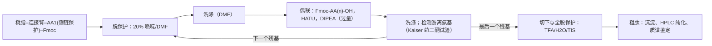
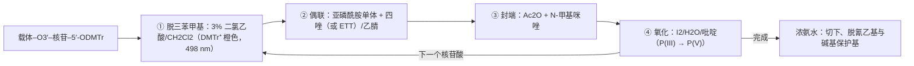

蛋白质与核酸是生命的两类信息大分子：DNA 储存遗传信息，经 RNA 转录，在核糖体上翻译为由 20 种 $\alpha$-氨基酸以肽键连接而成的多肽链，多肽链折叠为有功能的蛋白质（"中心法则"）。蛋白质的高级结构、酶的动力学与调控、复制、转录、翻译与表观遗传在生物化学与分子生物学中讨论（[7](/7)）；本章只讲这些分子的有机化学：氨基酸的结构、酸碱性与反应，肽键的结构，肽的测序与化学合成，核苷、核苷酸的结构与反应，以及寡核苷酸的化学合成。

本章几乎每一节都是前面某一章的直接应用：氨基酸的酸碱平衡来自 [6.4.2](/6.4.2)；肽键是酰胺（[6.5.19](/6.5.19#sec-19.6)），肽的合成是一系列受控的**亲核酰基取代**，偶联试剂沿用 [6.5.19](/6.5.19#sec-19.6.1) 的 DCC 化学，**保护基**的脱除分别是 **SN1**、**E1cb** 与氢解；天然化学连接利用硫酯的反应性；核苷是 N-糖苷，与 [6.5.32](/6.5.32#sec-32.8) 的**糖苷化**共用氧鎓离子与**邻基参与**的化学；碱基的结构与配对在 [6.5.25](/6.5.25#sec-25.8)，磷酸酯与 P(III)/P(V) 化学在 [6.5.26](/6.5.26#sec-26.2.3)。从有机化学通向化学生物学的部分（生物正交反应、蛋白质的化学修饰）在 33.8 中简述，详细内容在化学生物学（[6.6](/6.6)）。

## 33.1. 氨基酸的结构与分类

### 33.1.1. 结构与构型

**定义 33.1.1（氨基酸）** 分子中同时含有氨基与羧基的化合物称为**氨基酸**（amino acid）；氨基连在羧基的 $\alpha$ 碳上的称为 $\alpha$-氨基酸，通式 $\ce{H2N-CHR-COOH}$，R 称为侧链。

组成蛋白质的 20 种标准氨基酸都是 $\alpha$-氨基酸（脯氨酸的氮与侧链成环，是仲胺）。除甘氨酸（R = H）外，$\alpha$ 碳都是**手性中心**；核糖体合成的蛋白质中只有 L 型（**D/L 命名**，[定义 5.3.3](/6.5.5#def-5.3.3)：**Fischer 投影式** 中羧基在上、侧链在下时 $\ce{NH2}$ 在左边）。按 **R/S 命名**，L-氨基酸除半胱氨酸外都是 S：半胱氨酸的侧链 $\ce{-CH2SH}$ 含 S，按 **CIP 顺序规则**优先于 $\ce{-COOH}$，所以 L-半胱氨酸是 R，空间排列与其他 L-氨基酸并无不同。异亮氨酸与苏氨酸的侧链上还有第二个手性中心，天然的 L-异亮氨酸为 (2S,3S)，L-苏氨酸为 (2S,3R)。

```smiles
N[C@@H](C)C(=O)O L-Ala
N[C@@H](CS)C(=O)O L-Cys
OC(=O)[C@@H]1CCCN1 L-Pro
```

D-氨基酸在自然界并不罕见：细菌细胞壁肽聚糖中有 D-丙氨酸与 D-谷氨酸，短杆菌肽、万古霉素等由非核糖体肽合成酶合成的抗生素含 D-氨基酸，哺乳动物脑中的 D-丝氨酸是神经递质的辅助激动剂。蛋白质中的氨基酸残基在体内会极其缓慢地**外消旋化**（[定义 5.6.2](/6.5.5#def-5.6.2)），牙本质与眼晶状体中天冬氨酸的 D/L 比随年龄增加，可用于估计年龄（[6.5.5](/6.5.5#sec-5.6.2)）。

### 33.1.2. 标准氨基酸的分类

按侧链的性质，20 种标准氨基酸分为几类（括号内为三字母与单字母缩写）：

| 类别 | 氨基酸 | 侧链的化学特点 |
|---|---|---|
| 非极性脂肪族 | 甘氨酸（Gly, G）、丙氨酸（Ala, A）、缬氨酸（Val, V）、亮氨酸（Leu, L）、异亮氨酸（Ile, I）、甲硫氨酸（Met, M）、脯氨酸（Pro, P） | 疏水；Met 的硫醚可被氧化；Pro 的环使主链刚性 |
| 芳香族 | 苯丙氨酸（Phe, F）、酪氨酸（Tyr, Y）、色氨酸（Trp, W） | Tyr 的酚与 Trp 的**吲哚**可发生亲电取代；在 280 nm 有紫外吸收 |
| 极性不带电 | 丝氨酸（Ser, S）、苏氨酸（Thr, T）、半胱氨酸（Cys, C）、天冬酰胺（Asn, N）、谷氨酰胺（Gln, Q） | 醇、硫醇与酰胺；Ser/Thr/Tyr 可被磷酸化，Cys 形成二硫键 |
| 酸性 | 天冬氨酸（Asp, D）、谷氨酸（Glu, E） | 羧酸，生理 pH 下带负电 |
| 碱性 | 赖氨酸（Lys, K）、精氨酸（Arg, R）、组氨酸（His, H） | 伯胺、胍与咪唑；His 的 $\mathrm{p}K_{\mathrm{a}}$ 接近 7，是酶中最常见的**酸碱催化**基团 |

另有两种由遗传密码编码的"第 21、22 种"氨基酸：硒代半胱氨酸（Sec, U，由终止密码子 UGA 在特定序列环境中编码）与吡咯赖氨酸（Pyl, O，存在于某些古菌）。人体不能合成、必须从食物中获得的必需氨基酸有九种：His、Ile、Leu、Lys、Met、Phe、Thr、Trp、Val。

## 33.2. 酸碱性与等电点

### 33.2.1. 两性离子

氨基酸在水溶液与晶体中主要以**两性离子**（[定义 2.8.2](/6.4.2#def-2.8.2)）$\ce{H3N+CHRCOO-}$ 存在：羧基的 $\mathrm{p}K_{\mathrm{a}}$（约 2）远低于铵基（约 9–10），质子从羧基转移到氨基上的**平衡常数**约 $10^{7}$。证据是：氨基酸是高熔点（多在 200 °C 以上分解）、易溶于水而难溶于非极性溶剂的**离子晶体**；**红外光谱**中没有羧酸的 C=O 峰（约 $1710\,\mathrm{cm^{-1}}$），而有羧酸根（约 $1600$ 与 $1400\,\mathrm{cm^{-1}}$）与 $\ce{-NH3+}$ 的吸收；偶极矩与介电常数增量都很大。

$\alpha$-氨基酸的羧基比乙酸（$\mathrm{p}K_{\mathrm{a}}$ 4.76）酸性强得多（甘氨酸 2.34），铵基比甲铵离子（10.66）酸性也稍强（9.60）：相邻带正电的 $\ce{-NH3+}$ 通过**诱导效应**与静电作用稳定羧酸根，而吸电子的羧基使铵基更容易失去质子（数据见 [6.5.3](/6.5.3#sec-3.1.4) 的表 3.2）。

### 33.2.2. 等电点

按 [6.4.2](/6.4.2#sec-2.8.3) 的处理，侧链不解离的氨基酸的**等电点**为 $\mathrm{pI} = \tfrac12(\mathrm{p}K_{\mathrm{a}1} + \mathrm{p}K_{\mathrm{a}2})$；侧链可解离时，取**两性离子**（净电荷为零的形式）两侧的两个 $\mathrm{p}K_{\mathrm{a}}$ 的平均值。下表的 $\mathrm{p}K_{\mathrm{a}}$ 为 25 °C 水溶液中游离氨基酸的值（CRC Handbook；不同来源相差约 0.1–0.3），pI 由表中数据计算：

| 氨基酸 | $\alpha$-COOH | $\alpha$-$\ce{NH3+}$ | 侧链 | pI |
|---|---|---|---|---|
| 甘氨酸 | 2.34 | 9.60 | — | 5.97 |
| 天冬氨酸 | 1.99 | 9.90 | 3.90（COOH） | 2.95 |
| 谷氨酸 | 2.16 | 9.58 | 4.15（COOH） | 3.16 |
| 组氨酸 | 1.82 | 9.17 | 6.00（咪唑鎓） | 7.59 |
| 半胱氨酸 | 1.71 | 10.78 | 8.2（SH） | 4.96 |
| 酪氨酸 | 2.24 | 9.04 | 10.10（酚 OH） | 5.64 |
| 赖氨酸 | 2.16 | 9.06 | 10.54（$\varepsilon$-$\ce{NH3+}$） | 9.80 |
| 精氨酸 | 2.17 | 9.04 | 12.48（胍鎓） | 10.76 |


几点规律：

- 含两个羧基的酸性氨基酸 pI 约为 3，含两个碱性基团的碱性氨基酸 pI 约为 10，其余在 5–6.5 之间。
- 在生理 pH 7.4 下，Asp、Glu 带负电，Lys、Arg 带正电，His 大部分为中性（侧链 $\mathrm{p}K_{\mathrm{a}}$ 6.0，约 4% 质子化），Cys 的硫醇约 14% 解离为硫醇负离子。在蛋白质内部，微环境可以使侧链的 $\mathrm{p}K_{\mathrm{a}}$ 偏移几个单位：酶活性部位中的 Cys 硫醇负离子、Lys 的游离氨基都是这样产生的。
- 在等电点，氨基酸与蛋白质的溶解度最小，在电场中不移动。不同氨基酸与蛋白质的 pI 不同，这是用**离子交换色谱**分离氨基酸（[6.4.14](/6.4.14#sec-14.3.5)）、等电点沉淀与**等电聚焦**（[6.4.14](/6.4.14#sec-14.5.6)）的基础；在 pH 偏离 pI 的缓冲液中，带电的氨基酸与肽按电荷与大小发生**电泳**。

## 33.3. 氨基酸的反应

氨基酸兼有胺与羧酸的反应，侧链又带来各自的反应性。合成与分析中常用的反应如下。

### 33.3.1. 氨基的反应

- 酰化：与酰氯、酸酐（Schotten–Baumann 条件）或活性酯生成 N-酰基氨基酸，这是肽合成中保护氨基的基础（33.7.2）。
- 芳基化：Sanger 试剂 1-氟-2,4-二硝基苯在弱碱中与游离氨基发生**芳香亲核取代**（[6.5.14](/6.5.14#sec-14.11.1)），生成黄色的 2,4-二硝基苯基（DNP）衍生物；DNP–N 键耐酸水解，Sanger 用它标记胰岛素的 N 端，测定了第一个蛋白质的氨基酸序列（1955，1958 年诺贝尔化学奖）。丹磺酰氯（磺酰化）给出强荧光的 N 端衍生物，灵敏度更高。
- 与亚硝酸反应：伯氨基**重氮化**后放出 $\ce{N2}$，生成 $\alpha$-羟基酸（构型保持，经邻位羧基参与的 $\alpha$-内酯，[6.5.24](/6.5.24#sec-24.3)）；测量 $\ce{N2}$ 体积可以测定游离氨基的量（Van Slyke 法）。脯氨酸是仲胺，不放出 $\ce{N2}$。
- 与醛生成**亚胺**（[定义 16.9.1](/6.5.16#def-16.9.1)），再用 $\ce{NaBH3CN}$ 还原即**还原胺化**；与甲醛的反应是 Sørensen 甲醛滴定的基础（[6.4.2](/6.4.2#sec-2.8.3)）。生物体内转氨酶的辅酶磷酸吡哆醛（PLP）先与氨基酸生成亚胺，再经**互变异构**完成转氨，这一化学留给生物化学。

### 33.3.2. 羧基的反应

- 酯化：氨基酸在 $\ce{SOCl2}$/甲醇（原位生成 HCl）中生成甲酯盐酸盐 $\ce{Cl- H3N+CHRCOOMe}$，氨基以铵盐形式被保护，不会自身缩合。苄酯、叔丁酯（异丁烯/$\ce{H2SO4}$）是肽合成中常用的羧基保护（33.7.3）。
- 酰基叠氮：氨基酸酯与肼生成酰肼，再与亚硝酸生成酰基叠氮 $\ce{RCON3}$。酰基叠氮是较温和的酰化试剂，用于片段缩合时消旋很少，是早期肽合成（包括牛胰岛素的全合成）连接片段的主要方法；但它在受热时会发生 **Curtius 重排**生成异氰酸酯（[6.5.24](/6.5.24#sec-24.8.3)），要在低温下使用。
- 还原：$\ce{LiAlH4}$ 或 $\ce{NaBH4}$/$\ce{I2}$ 把氨基酸（或其酯）还原为手性的 $\beta$-氨基醇（如 L-缬氨醇），它们是制备手性配体与**手性辅基**的原料。

### 33.3.3. 茚三酮反应

$\alpha$-氨基酸与茚三酮（茚满-1,2,3-三酮的水合物）在弱酸性溶液中加热，生成蓝紫色的产物（Ruhemann 紫，$\lambda_{\max}$ 570 nm），这是检测与定量氨基酸最常用的显色反应，氨基酸自动分析仪就是在离子交换分离后用它显色（[6.4.14](/6.4.14#sec-14.3.5)）；它也用于显现纸张等多孔表面上的潜指纹（汗液中含微量氨基酸）。

机理的关键是**脱羧**：氨基与茚三酮中间的羰基生成亚胺，亚胺的 C=N 是一个电子"槽"，使相邻的羧基能够失去 $\ce{CO2}$；脱羧得到的**碳负离子**被两侧的羰基稳定。


新生成的亚胺水解，放出比原氨基酸少一个碳的醛（这一氧化脱羧也称 Strecker 降解）与 2-氨基茚满-1,3-二酮；后者再与第二分子茚三酮缩合，生成 Ruhemann 紫，它的颜色来自一个负电荷在两个茚满二酮之间离域的共轭**烯醇负离子**：

```smiles
O=C1c2ccccc2C(=O)C1N.OC1(O)C(=O)c2ccccc2C1=O>>[O-]C1=C(N=C2C(=O)c3ccccc3C2=O)C(=O)c2ccccc21.O.O.O
```

所有 $\alpha$-氨基酸生成同一种紫色产物，所以颜色的强度只与氨基酸的物质的量有关；脯氨酸与羟脯氨酸是仲胺，只能生成亚胺鎓离子，得到黄色产物（$\lambda_{\max}$ 440 nm）。

### 33.3.4. 金属配合物

氨基酸以羧酸根氧与氨基氮作双齿配体，与过渡金属离子生成五元螯合环。甘氨酸与 $\ce{Cu^2+}$ 生成深蓝色的二甘氨酸合铜(II)，有顺式与反式两种几何异构体（[6.1.5](/6.1.5)），可以从溶液中结晶分离，用于鉴定与沉淀氨基酸。同样的螯合作用使 $\ce{Ni^2+}$-次氮基三乙酸能结合组氨酸标签，用于蛋白质的亲和纯化（[6.4.14](/6.4.14)）。

### 33.3.5. 侧链的反应性与选择性修饰

在水中、生理 pH 附近选择性地修饰蛋白质的某一个残基，是化学生物学的基本技术（33.8）。各侧链的反应性由**亲核性**、$\mathrm{p}K_{\mathrm{a}}$ 与在蛋白质中的丰度决定：

| 侧链 | 反应性 | 常用的修饰反应 |
|---|---|---|
| Cys（硫醇） | 硫醇负离子是蛋白质中最强的**亲核试剂**；丰度低（约 2%），常可做到单一位点修饰 | 马来酰亚胺的**共轭加成**（**Michael 加成**）、碘乙酰胺的 **SN2** 烷基化、氧化成二硫键；Pd 介导的 S-芳基化 |
| Lys（$\varepsilon$-氨基） | $\mathrm{p}K_{\mathrm{a}}$ 10.5，在 pH 7–9 中只有少量游离胺，但数量多（约 6%），修饰常不均一 | N-羟基琥珀酰亚胺（NHS）酯的酰化、异硫氰酸酯（荧光素异硫氰酸酯）、**还原胺化** |
| N 端 $\alpha$-氨基 | $\mathrm{p}K_{\mathrm{a}}$ 约 8，比 Lys 低，在 pH 6–7 可选择性地酰化或与 2-吡啶甲醛等成环 | — |
| Tyr（酚） | 酚的邻位可发生亲电取代 | 芳基重氮盐的**偶氮偶联**、与环状偶氮二羰基化合物（PTAD）的 ene 型反应 |
| Trp（吲哚） | 吲哚 C2/C3 富电子，丰度最低（约 1%） | 铑卡宾的 N–H 或 C–H 插入 |
| Met（硫醚） | 硫醚可被氧化，可烷基化为锍盐 | 氧杂氮丙啶的氧化还原偶联（ReACT） |

半胱氨酸的修饰已经用于抗体–药物偶联物：抗体上的 Cys 与连接有细胞毒药物的马来酰亚胺反应，使药物只在被抗体识别的肿瘤细胞内释放。二硫键的形成与还原（谷胱甘肽、二硫苏糖醇）在 [6.5.26](/6.5.26#sec-26.8.4) 中讨论。

## 33.4. 氨基酸的制备

### 33.4.1. 蛋白质的水解

蛋白质在 $6\,\mathrm{mol\,L^{-1}}$ HCl 中于 110 °C 加热约 24 h，肽键全部水解为氨基酸。这一条件下色氨酸被破坏，天冬酰胺与谷氨酰胺水解为天冬氨酸与谷氨酸，丝氨酸与苏氨酸部分损失，分析时要校正或改用碱水解、酶水解。工业上的氨基酸主要由微生物发酵生产（谷氨酸钠、赖氨酸），少数用化学合成。

### 33.4.2. Strecker 合成

**定义 33.4.1（Strecker 合成）** 醛（或酮）与氨（或铵盐）和氰化物反应生成 $\alpha$-氨基腈，再水解得到 $\alpha$-氨基酸的方法称为 **Strecker 合成**（Strecker synthesis，1850）。

醛与氨先生成亚胺（在 $\ce{NH4Cl}$ 的弱酸性条件下质子化为亚胺鎓离子），氰离子加到亚胺鎓离子的碳上，这与醛的**氰醇**生成（[定义 16.7.1](/6.5.16#def-16.7.1)）是同一类反应，只是**亲电试剂**换成了 C=N：


平面的亚胺鎓离子两面被进攻的机会相等，产物是**外消旋体**。用手性的胺（如 (S)-$\alpha$-甲基苄胺）代替氨，或用手性的硫脲、金属配合物催化氰化物的加成（不对称 Strecker 反应），可以直接得到单一对映体。Strecker 反应也被认为是生命起源前氨基酸生成的可能途径：Miller–Urey 实验的放电产物中有醛、HCN 与氨，正好满足它的条件。

### 33.4.3. α-卤代酸的氨解与 Gabriel 法

羧酸经 **HVZ 反应**（[6.5.18](/6.5.18#sec-18.5)）得到 $\alpha$-溴代酸，再与大大过量的氨发生 **SN2** 取代，得到外消旋的 $\alpha$-氨基酸；过量的氨抑制了产物胺的进一步烷基化。更干净的方法是 **Gabriel 合成**（[6.5.23](/6.5.23#sec-23.5.2)）：用邻苯二甲酰亚胺钾代替氨作氮**亲核试剂**，它只能烷基化一次。邻苯二甲酰亚胺基丙二酸二乙酯的**烯醇负离子**先与卤代烷反应，引入侧链，再水解、**脱羧**并脱去邻苯二甲酰基，得到氨基酸，这把 Gabriel 合成与丙二酸酯合成结合了起来。

### 33.4.4. 乙酰氨基丙二酸酯法

**丙二酸酯合成法**（[定义 22.9.1](/6.5.22#def-22.9.1)）的氨基酸版本用乙酰氨基丙二酸二乙酯：它的 $\alpha$-H 被乙氧基负离子夺去，**烯醇负离子**与卤代烷发生 **SN2 反应**引入侧链，然后在酸中加热，两个酯与乙酰胺同时水解，生成的取代丙二酸**脱羧**，得到外消旋的氨基酸。

```smiles
CCOC(=O)C(NC(C)=O)C(=O)OCC.ClCc1ccccc1>>CCOC(=O)C(Cc1ccccc1)(NC(C)=O)C(=O)OCC.Cl
CCOC(=O)C(Cc1ccccc1)(NC(C)=O)C(=O)OCC>>NC(Cc1ccccc1)C(=O)O.CCO.CCO.CC(=O)O.O=C=O
```

（苄氯给出苯丙氨酸。第二步为 $\ce{H3O+}$、加热。）

### 33.4.5. 不对称合成与拆分

上述方法都得到外消旋体。得到单一对映体的方法有：

- **拆分**：把外消旋的 N-乙酰氨基酸用氨基酰化酶处理，酶只水解 L 型的乙酰胺，生成的 L-氨基酸与未反应的 N-乙酰-D-氨基酸很容易分离，这是工业上的**动力学拆分**（[定义 5.7.2](/6.5.5#def-5.7.2)）。未反应的 D 型可以**外消旋化**后循环使用。
- 不对称氢化：Knowles（孟山都公司，1970 年代）用手性双膦配体 DIPAMP 的 Rh(I) 配合物催化 (Z)-$\alpha$-乙酰氨基肉桂酸衍生物的氢化，得到 95% ee 的 L-DOPA 前体，这是第一个工业化的**不对称催化**过程（2001 年诺贝尔化学奖；机理见 [6.5.29](/6.5.29#sec-29.2.2)）。烯酰胺的酰胺羰基与 Rh 配位，形成**螯合物**，这是高对映选择性的原因。
- **手性辅基**与不对称烷基化（Schöllkopf 双内酰亚胺醚法、甘氨酸亚胺的**相转移催化**烷基化）以及 C–H 活化（用导向基团使 $\beta$-C–H 键在 Pd 催化下芳基化或烷基化），用于制备侧链结构多样的非天然氨基酸。

```smiles
COc1ccc(cc1OC(C)=O)/C=C(/NC(C)=O)C(=O)O.[H][H]>>COc1ccc(cc1OC(C)=O)C[C@H](NC(C)=O)C(=O)O
```

## 33.5. 肽的结构

### 33.5.1. 肽键与一级结构

**定义 33.5.1（肽键与肽）** 一个氨基酸的羧基与另一个氨基酸的氨基脱水生成的酰胺键称为**肽键**（peptide bond）；氨基酸通过肽键连接成的化合物称为肽（peptide），其中的每个氨基酸单元称为残基。含游离 $\alpha$-氨基的一端称为 N 端，含游离 $\alpha$-羧基的一端称为 C 端。

肽按从 N 端到 C 端的顺序书写与命名：$\ce{H2N-CH(CH2SH)-CO-NH-CH(CH3)-COOH}$ 写作 H-Cys-Ala-OH 或 CA，称为半胱氨酰丙氨酸；它与丙氨酰半胱氨酸（H-Ala-Cys-OH）是**构造异构体**。氨基酸残基的排列顺序（以及二硫键的位置）称为一级结构。牛胰岛素由 A 链（21 个残基）与 B 链（30 个残基）组成，A 链内有一个二硫键，A、B 链之间有两个二硫键。

### 33.5.2. 肽键的平面性与顺反异构

肽键是**酰胺**，氮的孤对电子与羰基共轭（[6.5.19](/6.5.19#sec-19.1.2)），可以用两个**共振式** $\ce{O=C-NH <-> O^- -C=N^+H}$ 描述。由此得到肽键的几个结构特征：

- C–N 键长约 133 pm，介于单键（$\mathrm{C}_\alpha$–N 约 146 pm）与双键（约 127 pm）之间；C=O 键长约 124 pm。
- C–N 键的旋转能垒约 $80\,\mathrm{kJ\,mol^{-1}}$，室温下不能自由旋转。羰基碳、氧、氮、氮上的氢以及两个相邻的 $\alpha$ 碳共六个原子处于同一平面，称为肽平面（酰胺平面）。
- 肽键有顺、反两种构型。反式中两个 $\alpha$ 碳在 C–N 键的两侧，**空间排斥**小，非脯氨酸残基前的肽键几乎全部是反式（顺式少于 0.1%）。脯氨酸的氮上没有 H，与前一个残基（X）的 X–Pro 肽键两种构型的空间差别小，在蛋白质结构中约 5% 的 X–Pro 肽键是顺式，在无规则的短肽中可达 10%–30%。顺反异构化很慢（分钟级），常是蛋白质折叠的限速步骤，生物体内由肽基脯氨酰顺反异构酶催化。
- 肽键 N–H 是很弱的酸（$\mathrm{p}K_{\mathrm{a}}$ 约 15，与乙酰胺相近，[6.5.3](/6.5.3#sec-3.1.4)），在生理条件下不解离；氧是弱碱，主要通过**氢键**与其他 N–H 相互作用。

由于肽平面是刚性的，多肽主链的构象只由每个 $\alpha$ 碳两侧单键的两个**二面角** $\phi$（N–C$\alpha$）与 $\psi$（C$\alpha$–C）决定，它们的允许组合（Ramachandran 图）对应于 $\alpha$ 螺旋、$\beta$ 折叠等二级结构。主链上 C=O 与 N–H 之间有规律的氢键维持这些结构，侧链之间的疏水作用、离子键、氢键与二硫键维持三级与四级结构，这些都留给生物化学。蛋白质的二级结构可以用**圆二色谱**与红外的酰胺 I 带测定（[6.4.9](/6.4.9)、[6.4.11](/6.4.11)）。

## 33.6. 肽的测序

### 33.6.1. 组成分析、端基分析与专一性断裂

经典的测序策略（Sanger 测定胰岛素一级结构的方法）分为几步：

1. 氨基酸组成：完全酸水解后，用**离子交换色谱**分离、茚三酮显色定量（33.3.3）。
2. 拆开二硫键：用过甲酸氧化为磺酸，或用巯基试剂还原后再用碘乙酰胺烷基化，防止重新生成二硫键。
3. N 端与 C 端：N 端用 Sanger 试剂、丹磺酰氯标记后水解鉴定，或用 Edman 降解（33.6.2）；C 端用羧肽酶依次切下。
4. 专一性断裂：用断裂位置专一的试剂把长肽切成可以分别测序的片段，再用另一种试剂得到相互重叠的片段，拼出全序列。

| 试剂 | 断裂位置 |
|---|---|
| 胰蛋白酶 | Lys、Arg 的羧基一侧（其后为 Pro 时不断） |
| 胰凝乳蛋白酶 | Phe、Tyr、Trp 的羧基一侧 |
| 溴化氰（$\ce{BrCN}$） | Met 的羧基一侧，Met 转变为 C 端的高丝氨酸内酯 |

溴化氰断裂是一个有机反应：Met 硫醚的硫进攻 BrCN 的碳，生成氰基锍盐；锍盐的 $\gamma$ 碳成为很好的亲电中心，Met 自身的羰基氧在分子内以 **SN2** 方式进攻它，放出 $\ce{CH3SCN}$，生成五元环的亚氨基内酯；后者水解时断开肽键，左侧片段的 C 端成为高丝氨酸**内酯**。

### 33.6.2. Edman 降解

**定义 33.6.1（Edman 降解）** 用异硫氰酸苯酯与肽的 N 端氨基反应，再在无水酸中把 N 端残基以噻唑啉酮的形式切下、而其余肽链保持完整，每一轮切下并鉴定一个残基，从而逐个测定 N 端序列的方法称为 **Edman 降解**（Edman degradation，1950）。

每一轮包括两步反应：


- 偶联：在弱碱中，N 端的游离氨基（$\mathrm{p}K_{\mathrm{a}}$ 约 8）**亲核加成**到异硫氰酸苯酯（PITC）$\ce{PhN=C=S}$ 的中心碳上，生成硫脲（PTC 肽）。
- 环化断裂：在无水三氟乙酸中，硫脲的硫原子作为分子内**亲核试剂**，进攻第一个肽键的羰基碳，形成五元环；这是一次分子内的**亲核酰基取代**，**离去基团**是第二个残基的氨基。关键在于"无水"：没有水，其余的肽键不会水解；而硫的**亲核性**与五元环的有利几何使第一个肽键的断裂比普通酰胺水解快得多。
- 转化：不稳定的 ATZ 被萃取出来，在稀的酸水溶液中开环、再以氮进攻重新闭环，生成稳定的 PTH-氨基酸，用 HPLC 与标准品比较**保留时间**来鉴定。

缩短了一个残基的肽带着新的 N 端进入下一轮。自动化的测序仪（Edman 与 Begg，1967）每轮约 1 h。每一轮的收率不可能是 100%：若每轮 99%，50 轮后只有约 60% 的肽链与"正确"的一轮同步，背景信号越来越强，所以 Edman 降解一般只能读出 30–50 个残基；N 端被封闭（如 N-乙酰化、焦谷氨酸）的蛋白质不能测定。

### 33.6.3. 质谱测序

今天蛋白质的序列多由基因序列推出，直接测定则主要用**质谱法**：蛋白质先用胰蛋白酶消化成肽段，用 LC-ESI-MS 测定肽段的质量（**肽质量指纹**），再用**串联质谱**使选定的肽段离子沿肽键碎裂，由 b 离子与 y 离子系列的质量差读出序列（[6.4.15](/6.4.15#sec-15.5.3)），这是**蛋白质组学**的基础。质谱能测定翻译后修饰（磷酸化、糖基化、乙酰化）的位置，不受 N 端封闭的限制，但区分同量异位的残基（Leu 与 Ile）需要特殊的碎裂方式；Edman 降解至今仍用于确证 N 端序列。蛋白质的大小与纯度用 **SDS-聚丙烯酰胺凝胶电泳** 估计（[6.4.14](/6.4.14#sec-14.5.5)）。

## 33.7. 肽的化学合成

### 33.7.1. 问题与策略

把两个氨基酸直接混合加热，羧酸与胺只会成盐（[6.5.19](/6.5.19#sec-19.6.1)）；即使用缩合剂活化，Phe 与 Gly 也会生成 Phe-Gly、Gly-Phe、Phe-Phe、Gly-Gly 四种二肽以及更长的寡聚物。要得到唯一的产物，必须：

1. 保护不参加反应的氨基（"N 端组分"的 $\alpha$-氨基）与羧基（"C 端组分"的 $\alpha$-羧基），以及带反应性官能团的侧链；
2. 活化 N 端组分的羧基，使它在温和条件下与 C 端组分的氨基生成肽键（偶联），并且不引起 $\alpha$ 碳的消旋；
3. 选择性地脱去一个**保护基**，进行下一次偶联；最后脱去全部保护基。

每一步都是 [6.5.19](/6.5.19)、[6.5.20](/6.5.20) 中化学的应用，困难在于要重复几十次、每一步都要接近定量。

### 33.7.2. 氨基保护基

肽合成中的 $\alpha$-氨基**保护基**（[定义 16.5.2](/6.5.16#def-16.5.2)）几乎都是氨基甲酸酯（"尿烷型"保护基）：它们把胺变成**亲核性**很弱的氨基甲酸酯，脱除时只需断开 O–烷基键，生成的氨基甲酸自发**脱羧**释放胺（[6.5.20](/6.5.20#sec-20.5.2) 的 20.5.2 节）。三种最常用的保护基的脱除条件两两正交：

| 保护基 | 引入 | 脱除 | 脱除机理 | 对什么稳定 |
|---|---|---|---|---|
| 苄氧羰基（Cbz，Z；Bergmann 与 Zervas，1932） | 氯甲酸苄酯，碱 | $\ce{H2}$，Pd/C；或 HBr/AcOH | **苄位** C–O 键的氢解（或 **SN1**/**SN2** 断裂） | 温和的酸、碱 |
| 叔丁氧羰基（Boc；1957） | $\ce{Boc2O}$，碱 | 三氟乙酸（TFA）或 HCl/二氧六环 | SN1：失去叔丁基正离子 | 碱、**亲核试剂**、氢解 |
| 9-芴甲氧羰基（Fmoc；Carpino，1970） | Fmoc-Cl 或 Fmoc-OSu，碱 | 20% 哌啶/DMF | **E1cb**：失去二苯并富烯 | 酸（TFA）、氢解（较慢） |


Boc 的脱除是一个 **SN1 反应** 式的断裂：质子化的氨基甲酸酯放出稳定的叔丁基**碳正离子**。这个碳正离子是很强的**亲电试剂**，会烷基化 Trp 的吲哚、Met 的硫、Tyr 的酚环与 Cys 的硫醇，所以 TFA 中要加入水、三异丙基硅烷或硫醇作清除剂。苄酯、苄醚与 Cbz 在 TFA 中基本稳定（苄基正离子远不如叔丁基正离子稳定），需要更强的酸（无水 HF）才能断裂，这是 Boc/Bzl 策略的基础。


Fmoc 的脱除是 **E1cb 反应**（[定义 9.5.1](/6.5.9#def-9.5.1)）：芴的 C9–H 之所以能被哌啶（共轭酸 $\mathrm{p}K_{\mathrm{a}}$ 11.12）夺去，是因为生成的芴基负离子是 14π 的**芳香性**体系，芴在 DMSO 中的 $\mathrm{p}K_{\mathrm{a}}$ 为 22.6（[6.5.3](/6.5.3#sec-3.1.4) 的表 3.3），比普通的 C–H 低约 20 个单位；负离子 $\beta$ 位的 C–O 键断开，氨基甲酸根离去。二苯并富烯在 301 nm 有强吸收，测量它的量可以监测每一轮脱保护是否完全。

### 33.7.3. 羧基与侧链的保护

C 端的羧基常保护为甲酯或乙酯（稀碱**皂化**脱除）、叔丁酯（TFA 脱除，AAl1 机理）或苄酯（氢解脱除）；在固相合成中，C 端的羧基以酯或酰胺的形式连在树脂上，树脂本身就是羧基**保护基**（33.7.6）。

侧链的保护基要在整个合成中保持不变，最后与树脂的连接一起脱除。目前最常用的 Fmoc/tBu 策略中，$\alpha$-氨基用 Fmoc（碱脱除），侧链用叔丁基类（酸脱除），二者正交（[6.5.20](/6.5.20#sec-20.8.3)）：

| 侧链 | 保护形式 | 脱除 |
|---|---|---|
| Lys 的 $\varepsilon$-氨基 | Boc | TFA |
| Asp、Glu 的羧基 | 叔丁酯（OtBu） | TFA |
| Ser、Thr 的醇，Tyr 的酚 | 叔丁基醚（tBu） | TFA |
| Cys 的硫醇 | 三苯甲基（Trt）；需保留时用乙酰氨甲基（Acm） | TFA；Acm 用 $\ce{I2}$ 脱除并同时形成二硫键 |
| His 的咪唑、Asn 与 Gln 的酰胺 | 三苯甲基（Trt） | TFA |
| Arg 的胍基 | 2,2,4,6,7-五甲基二氢苯并呋喃-5-磺酰基（Pbf） | TFA |
| Trp 的吲哚 N–H | Boc | TFA |

### 33.7.4. 偶联试剂

**定义 33.7.1（偶联试剂）** 在温和条件下把羧酸原位转化为活化的酰基化合物（活性酯、酸酐、酰基异脲等），使它与胺生成酰胺键的试剂称为**偶联试剂**（coupling reagent，肽缩合剂）。

偶联都是两步的**亲核酰基取代**：先把羧基的 OH 换成好的**离去基团**，再由胺取代它。常用的方法：

- 混合酸酐法：N-保护氨基酸的羧酸根与氯甲酸异丁酯在 $-15\,^\circ\mathrm{C}$ 生成混合酸酐，胺进攻位阻较小、亲电性较强的氨基酸羰基（而不是碳酸酯的羰基），生成肽，放出 $\ce{CO2}$ 与异丁醇。
- 活性酯法：对硝基苯酯、五氟苯酯、N-羟基琥珀酰亚胺（NHS）酯。离去的酚盐或 N-氧负离子碱性弱（对硝基苯酚 $\mathrm{p}K_{\mathrm{a}}$ 7.15），酯的反应性介于普通酯与酸酐之间，可以分离储存。
- 碳二亚胺法：DCC 或 DIC 把羧酸转化为 O-酰基异脲（机理见 [6.5.19](/6.5.19#sec-19.6.1)）。O-酰基异脲很活泼，但有两个副反应：分子内 O→N 酰基迁移生成不反应的 N-酰基脲，以及经噁唑酮的消旋（33.7.5）。加入 1-羟基苯并三唑（HOBt）、1-羟基-7-氮杂苯并三唑（HOAt）或乙基氰基肟乙酸酯（Oxyma），它们迅速把 O-酰基异脲转化为活性酯（OBt、OAt 酯），后者足够活泼又不易消旋。
- 脲鎓与鏻盐：HBTU、HATU（实际结构是胍鎓 N-氧化物）与 PyBOP 在叔胺（DIPEA）存在下直接把羧酸转化为 OBt 或 OAt 活性酯，反应快，是固相合成中最常用的偶联试剂。HOAt 与 HATU 的吡啶氮能以分子内**氢键**引导进攻的胺（邻基辅助），所以比 HOBt 类更快、消旋更少。

### 33.7.5. 偶联中的消旋

肽合成最大的立体化学风险是被活化的氨基酸 $\alpha$ 碳的消旋。主要途径是生成 5(4H)-噁唑酮：


- 噁唑酮的生成需要 N 上连着一个普通的酰基（肽键或乙酰基）：酰胺的羰基氧**亲核性**足够强，能在分子内进攻活化的羧基。
- 噁唑酮 C4–H 的 $\mathrm{p}K_{\mathrm{a}}$ 约为 9：失去质子生成的负离子是 6π 的**芳香性**噁唑-5-醇负离子，这与 **烯醇负离子** 的稳定化相同，但多了芳香性。在偶联所用的叔胺碱存在下，它迅速**外消旋化**。
- 尿烷型保护基（Boc、Fmoc、Cbz）的羰基氧连在烷氧基旁，亲核性弱，生成的 2-烷氧基噁唑酮少而且不易**烯醇化**。所以用尿烷保护的单个氨基酸从 C 端向 N 端逐个接肽时，消旋可以忽略，这是逐步合成都按 C→N 方向进行的原因。
- 反过来，把一个肽片段的 C 端羧基活化来连接另一个片段（片段缩合）时，活化残基的 N 上是肽键，极易消旋。除非 C 端是没有手性的 Gly 或不能形成噁唑酮的 Pro，片段缩合要用消旋少的方法（酰基叠氮法、HOAt 添加剂、低温、弱碱），或者用不经过活化羧基的化学连接（33.7.7）。
- Cys 与 His 即使在尿烷保护下也容易消旋：Cys 的 $\alpha$-H 受硫的吸电子作用直接被碱夺去，His 的咪唑氮能在分子内夺取 $\alpha$-H。它们要用弱碱、预先制成的活性酯或特殊的侧链**保护基**。

### 33.7.6. 固相肽合成

**定义 33.7.2（固相肽合成）** 把肽链的 C 端通过可断裂的连接臂固定在不溶的聚合物树脂上，在溶液中加入过量试剂反复进行"脱保护–偶联"循环、每步后只需过滤洗涤除去多余的试剂与副产物，最后把完整的肽从树脂上切下的合成方法称为**固相肽合成**（solid-phase peptide synthesis，SPPS）。

Merrifield 在 1963 年报道了这一方法（1984 年诺贝尔化学奖）：在氯甲基化的交联聚苯乙烯树脂上以苄酯连接第一个 Boc-氨基酸，然后循环进行 TFA 脱 Boc、中和、DCC 偶联，最后用无水 HF 同时切下肽链与脱去苄基类侧链保护基（Boc/Bzl 策略）。现在更常用 Fmoc/tBu 策略：Wang 树脂（对烷氧基苄酯连接，TFA 切下得到 C 端羧酸）或 Rink 酰胺树脂（得到 C 端酰胺），每一轮用哌啶脱 Fmoc，用 HBTU/HATU 或 DIC/Oxyma 偶联，最后用 TFA/水/三异丙基硅烷（95:2.5:2.5）在切下肽链的同时脱去侧链**保护基**。一个循环如下：



固相合成的优点是过量的试剂可以把每一步推到接近完全，纯化只需过滤，整个过程能够自动化；代价是中间产物不能纯化，每一步未反应的链都成为缺失一个残基的杂质，与产物性质极其相似。全长产物的比例随长度指数地下降：


每步 99% 时，50 肽的全长链约占 61%，100 肽只剩约 37%；要合成 100 个残基以上的蛋白质，每步收率必须达到 99.5% 以上，或者把长链分成几段用化学连接拼起来。为提高每一步的收率，未反应的氨基常在偶联后用乙酸酐"封端"，使缺失序列变成截短的序列，便于纯化。困难序列中肽链在树脂上聚集成 $\beta$ 折叠，阻碍试剂进入，可以用加热（微波）、假脯氨酸二肽或主链保护来打破聚集；Asp 后接 Gly 等序列在哌啶中容易环化为天冬酰亚胺，是 Fmoc 策略的典型副反应。2020 年 Pentelute 等报道的流动化学自动合成仪把每个循环缩短到约 40 s，几小时内合成了 164 个残基的蛋白质链。

### 33.7.7. 天然化学连接

固相合成直接制备的肽一般不超过 50 个残基；更长的蛋白质要把几个肽段连接起来，而受保护的大肽段溶解性差、片段缩合又易消旋。Kent 等在 1994 年提出的天然化学连接解决了这个问题：

**定义 33.7.3（天然化学连接）** C 端为硫酯的无保护肽与 N 端为半胱氨酸的无保护肽在中性水溶液中反应：半胱氨酸的硫醇先与硫酯发生转硫酯化，生成的硫酯中间体随即经五元环过渡态发生 S→N 酰基迁移，在连接处生成一个天然的肽键（Xaa-Cys）。这种连接肽段的方法称为**天然化学连接**（native chemical ligation，NCL）。


这个设计巧妙地利用了**硫酯**（[定义 19.9.1](/6.5.19#def-19.9.1)）的性质：硫酯足够活泼，能被硫醇负离子进攻（转硫酯化是快速可逆的），却在 pH 7 的水中相当稳定，也几乎不与赖氨酸的氨基反应；只有 N 端 Cys 能通过分子内的五元环把**酰基转移**到氮上，而酰胺比硫酯稳定得多，使总反应不可逆。因此反应有极高的**化学选择性**：两个肽段的其他侧链都不必保护，连接处的**手性中心**也不受影响（没有活化的羧基，不形成噁唑酮）。这一 S→N 酰基迁移本身早在 1953 年就由 Wieland 在缬氨酸硫酯与半胱氨酸的反应中观察到。

天然化学连接要求连接处是 Cys，而 Cys 在蛋白质中较少。两项扩展使它几乎可以用于任何序列：连接后用 Raney Ni 或金属自由基脱硫（Yan 与 Dawson 2001；Danishefsky 2007），把连接处的 Cys 转化为 Ala，相应地也可以用 $\beta$-巯基化的其他氨基酸连接后脱硫；表达蛋白连接（Muir，1998）则利用内含肽（intein）的自剪接，由重组表达直接得到 C 端硫酯的蛋白质，再与合成的肽段连接，用于在蛋白质中引入荧光探针、翻译后修饰或非天然氨基酸。Danishefsky 等在 2013 年用这类方法完成了糖基化的促红细胞生成素（EPO，166 个残基、带四条糖链）的全合成。

### 33.7.8. 牛胰岛素的全合成

1965 年，中国科学院上海生物化学研究所、上海有机化学研究所与北京大学合作，首次人工全合成了具有完整生物活性的结晶牛胰岛素，这是世界上第一个人工合成的、有天然活性的蛋白质。合成分三部分：A 链（21 肽）与 B 链（30 肽）分别在溶液中由小肽段经片段缩合（主要用酰基叠氮法与 DCC 法，以控制消旋）合成，脱保护后在空气中氧化，使 A、B 链的六个半胱氨酸正确地配对成三个二硫键，得到与天然胰岛素活性相同的结晶产物。此前（1963–1964）德国的 Zahn 与美国的 Katsoyannis 也报道了胰岛素链的合成与组合，但活性很低、未得到结晶。肽的化学合成可以追溯到 Emil Fischer：他在 1901 年合成了第一个二肽甘氨酰甘氨酸，1907 年合成了 18 肽，但蛋白质的全合成要等到半个多世纪之后，并依赖于**保护基**与偶联化学的发展。1969 年 Gutte 与 Merrifield 用固相合成制得了有活性的核糖核酸酶 A（124 个残基）。

## 33.8. 从有机化学到化学生物学

### 33.8.1. 蛋白质的化学修饰

在蛋白质的特定位置连接荧光基团、自旋探针、光交联基团、亲和标签或药物，是研究蛋白质的结构动力学、相互作用与细胞内定位的基本手段。与普通的有机合成相比，这类反应有苛刻的要求：在水中、pH 6–8、4–37 °C 下进行；不能使用**保护基**；蛋白质浓度只有微摩尔级，所以二级速率常数要比普通合成反应大 $10^3$–$10^5$ 倍才能在合理的时间内完成；反应结束后要能完全除去多余的试剂。修饰的途径有两种：利用天然氨基酸侧链的反应性（33.3.5），或者先通过遗传密码扩展（用正交的 tRNA/氨酰-tRNA 合成酶对）在指定位置引入带有特殊官能团的非天然氨基酸，再用下面的生物正交反应选择性地修饰它。

**绿色荧光蛋白**（[6.4.10](/6.4.10)）是"无需外加试剂的修饰"的天然范例。来自维多利亚多管发光水母（*Aequorea victoria*）的 GFP 由 238 个残基组成（约 27 kDa），它的**发色团**由自身的 Ser65–Tyr66–Gly67 三个残基在折叠后自发生成：Gly67 的酰胺氮进攻 Ser65 的羰基碳，环化脱水生成咪唑啉酮，再被 $\ce{O2}$ 氧化，使 Tyr66 的侧链与咪唑啉酮共轭。野生型 GFP 的主吸收峰在 395 nm（酚式），次峰在 475 nm（酚氧负离子式），发射峰在 509 nm。Shimomura、Chalfie 与钱永健因 GFP 的发现与发展获 2008 年诺贝尔化学奖。

### 33.8.2. 生物正交反应

**定义 33.8.1（生物正交反应）** 能在活细胞或生物体内进行、反应的两个官能团彼此快速而选择性地结合，却不与生物体内大量存在的其他官能团反应、也不干扰生命过程的化学反应，称为**生物正交反应**（bioorthogonal reaction，Bertozzi 2003 年提出这一名称）。

一个反应要成为生物正交的，两个官能团都要在生物体内不存在、对生物分子惰性、无毒且稳定，反应要在生理条件下足够快，不需要大量的催化剂，产物稳定。代表性的反应：

| 反应 | 官能团对 | 二级速率常数 / $\mathrm{L\,mol^{-1}\,s^{-1}}$ | 要点 |
|---|---|---|---|
| Staudinger 连接（Saxon 与 Bertozzi，2000） | 叠氮 + 带邻位酯的三芳基膦 | 约 $10^{-3}$ | **Staudinger 还原**（[6.5.26](/6.5.26#sec-26.5.5)）的氮杂叶立德被分子内的酯捕获，生成酰胺；慢，膦易被氧化 |
| Cu(I) 催化的叠氮–炔环加成（CuAAC；Meldal，Sharpless，2002） | 叠氮 + 端炔 | $10$–$10^3$（有配体时） | 只生成 1,4-三唑，是"点击化学"的范例；铜对细胞有毒，多用于细胞外与固定后的样品 |
| 张力促进的叠氮–炔环加成（SPAAC；Bertozzi，2004） | 叠氮 + 环辛炔 | $10^{-3}$–$1$ | **环张力**（约 $75\,\mathrm{kJ\,mol^{-1}}$）代替铜催化，可在活体中进行 |
| 四嗪的逆电子需求 Diels–Alder（Fox，2008） | 1,2,4,5-四嗪 + 反式环辛烯或降冰片烯 | $10^3$–$10^6$ | 最快的生物正交反应，放出 $\ce{N2}$ 而不可逆（[6.5.12](/6.5.12#sec-12.4.4)） |

```smiles
CCCCN=[N+]=[N-].C#Cc1ccccc1>>CCCCn1cc(nn1)-c1ccccc1
CCCCN=[N+]=[N-].C1CCC#CCCC1>>CCCCn1nnc2c1CCCCCC2
```

（CuAAC 与 SPAAC，两者都是叠氮作 1,3-偶极体的 **1,3-偶极环加成**，[6.5.12](/6.5.12#sec-12.4.5)；有机**叠氮化合物** 的化学见 [6.5.24](/6.5.24#sec-24.8)。）

叠氮基是最常用的生物正交"把手"：它体积小、在生物体内不存在、不与生物分子反应，可以通过代谢把叠氮修饰的糖（如 N-叠氮乙酰甘露糖胺）掺入细胞表面的聚糖，再用荧光标记的环辛炔在活细胞乃至活体动物中给聚糖成像。更早的开创性工作还有钱永健等 1998 年的 FlAsH：含两个砷的荧光素衍生物（用乙二硫醇保护）与蛋白质上基因编码的四半胱氨酸序列（Cys-Cys-Pro-Gly-Cys-Cys）选择性地结合并发出荧光。Bertozzi、Meldal 与 Sharpless 因点击化学与生物正交化学获得 2022 年诺贝尔化学奖（Sharpless 是第二次获奖）。除了成键反应，"断键"型的生物正交反应（如四嗪引发的反式环辛烯氨基甲酸酯的消除、Pd 催化的炔丙基氨基甲酸酯脱保护）用于在体内按需释放药物或激活蛋白质。这些内容在化学生物学（[6.6](/6.6)）中详细讨论。

### 33.8.3. 酶催化中的有机化学

酶是生物体内的催化剂（**酶催化**，动力学见 [6.3.17](/6.3.17#sec-17.3.5) 的 **Michaelis–Menten 方程**）。酶的催化效率极高：同样是催化 $\ce{H2O2}$ 分解，每摩尔 $\ce{Fe^3+}$ 每秒约分解 $6\times10^{-4}$ mol，每摩尔过氧化氢酶每秒约分解 $6\times10^{6}$ mol，相差约 $10^{10}$ 倍。

酶活性部位中进行的是本课程中熟悉的有机反应，只是由多个精确定位的基团协同完成。两个经典的例子：

- 丝氨酸蛋白酶（胰凝乳蛋白酶、胰蛋白酶、枯草杆菌蛋白酶）水解肽键：Asp–His–Ser 组成"催化三联体"，His 作广义碱夺取 Ser 羟基的质子，使 Ser 的氧加成到肽键的羰基碳上，生成带氧负离子的**四面体中间体**（被主链的两个 N–H 以**氢键**稳定，称为氧负离子洞）；中间体塌陷放出胺（His 作广义酸把质子交给它），生成酰基–酶酯，后者再被水按同样的方式水解。这正是两次连续的**亲核酰基取代**（[6.5.19](/6.5.19#sec-19.2)）。

  

- I 类**醛缩酶**（[6.5.22](/6.5.22#sec-22.10.1)）催化**羟醛反应**及其逆反应：活性部位 Lys 的 $\varepsilon$-氨基与底物的羰基生成亚胺（Schiff 碱），亚胺鎓离子作为"电子槽"使 C–C 键断裂（或形成）时生成的**碳负离子**以**烯胺**的形式被稳定，这与有机化学中的烯胺化学（[6.5.16](/6.5.16#sec-16.9.3)、[6.5.21](/6.5.21#sec-21.8)）以及脯氨酸催化的不对称羟醛反应是同一个原理。

人工改造酶的定向进化（重复"突变–筛选–扩增"，Arnold，2018 年诺贝尔化学奖）已经能让酶催化自然界没有的反应，例如经改造的细胞色素 c 能催化卡宾插入 Si–H 键，生成 C–Si 键（2016）。酶的结构、动力学与调控留给生物化学。

## 33.9. 核苷、核苷酸与核酸

### 33.9.1. 核苷与核苷酸

核酸由核苷酸聚合而成，核苷酸由碱基、戊糖与磷酸三部分组成。碱基是**嘌呤**（腺嘌呤 A、鸟嘌呤 G）与**嘧啶**（胞嘧啶 C、胸腺嘧啶 T、尿嘧啶 U）的衍生物，它们的结构、**互变异构** 与配对的化学基础见 [6.5.25](/6.5.25#sec-25.8)；戊糖是 RNA 中的 D-核糖与 DNA 中的 2-脱氧-D-核糖，都以 $\beta$-呋喃糖的形式存在（[6.5.32](/6.5.32#sec-32.3.2)）。

**定义 33.9.1（核苷与核苷酸）** 碱基的 N（嘌呤的 N9、嘧啶的 N1）与核糖或脱氧核糖的异头碳 C1′ 以 $\beta$-N-糖苷键相连而成的化合物称为**核苷**（nucleoside）；核苷的糖羟基（通常是 5′-OH）与磷酸成酯的产物称为**核苷酸**（nucleotide）。

为了与碱基的编号区分，糖的碳编号加撇（C1′–C5′）。核苷的名称：腺苷、鸟苷、胞苷、尿苷（核糖），脱氧腺苷、脱氧鸟苷、脱氧胞苷、胸苷（脱氧核糖）；核苷酸称为腺苷 5′-单磷酸（AMP）、脱氧腺苷 5′-单磷酸（dAMP）等，5′-三磷酸（ATP、dATP）是聚合酶的底物。

```smiles
Nc1ncnc2c1ncn2[C@@H]1O[C@H](CO)[C@@H](O)[C@H]1O adenosine
Cc1cn([C@H]2C[C@H](O)[C@@H](COP(=O)(O)O)O2)c(=O)[nH]c1=O dTMP
```

核苷有两个重要的构象自由度：碱基绕 N-**糖苷键**的旋转（碱基的大部分在糖环上方背离糖环的称为反式，anti；在糖环上方的称为顺式，syn），以及呋喃糖环的折叠（C2′-内型或 C3′-内型）。B 型 DNA 中的核苷采取 anti 与 C2′-内型，RNA 与 A 型双螺旋采取 anti 与 C3′-内型，左手的 Z 型 DNA 中的鸟苷采取 syn。

### 33.9.2. 核苷的化学

N-**糖苷键**是一个缩醛胺，它的稳定性与反应决定了核酸的化学稳定性：

- 酸中脱嘌呤：嘌呤的 N7（或 N3）质子化后，碱基成为好的**离去基团**，C1′–N 键断开生成呋喃糖基氧鎓离子，与糖苷的酸性水解相同（[6.5.32](/6.5.32#sec-32.6.2) 的 32.6.2 节）。脱氧核糖缺少 2′-OH 的吸电子作用，氧鎓离子更稳定，所以 DNA 比 RNA 更容易脱嘌呤；嘧啶核苷的 N-糖苷键稳定得多。人体每个细胞每天自发地失去约 $10^4$ 个嘌呤，留下无碱基位点，由碱基切除修复系统修复（Lindahl，2015 年诺贝尔化学奖）。N7 被烷基化的鸟嘌呤带正电，脱嘌呤更快（[6.5.25](/6.5.25#sec-25.8.4)）。
- 碱中 RNA 的断裂：RNA 的 2′-OH 在碱中去质子化后，分子内进攻相邻的磷酸二酯（经五配位的磷中间体），生成 2′,3′-环磷酸酯并断开链；DNA 没有 2′-OH，在碱中稳定得多。这一化学差别被认为是 DNA 而不是 RNA 成为长期遗传物质的原因之一，核糖核酸酶 A 的催化也利用了同一机理。
- 亚硫酸氢盐转化：亚硫酸氢根加到胞嘧啶的 C5=C6 双键上（**共轭加成**），使 C4 的氨基容易水解，再在碱中消除亚硫酸氢根，胞嘧啶转化为尿嘧啶；5-甲基胞嘧啶的 C5 有甲基，反应慢得多而保持不变。经 PCR 后，未甲基化的 C 读作 T、甲基化的 C 仍读作 C，这就是测定 DNA 甲基化（表观遗传修饰）的亚硫酸氢盐测序法。针对 5-甲酰基胞嘧啶（5fC）等其他修饰碱基的选择性化学标记，使它们也能在全基因组水平以单碱基分辨率定位。

核苷的化学合成通常用 Vorbrüggen **糖苷化**：碱基的 N–H 与 O–H 先用六甲基二硅氮烷硅烷化，提高溶解性与 N 的**亲核性**；1-O-乙酰基-2,3,5-三-O-苯甲酰基-$\beta$-D-呋喃核糖在 TMSOTf 或 $\ce{SnCl4}$ 作用下生成氧鎓离子，C2′ 的苯甲酰基经**邻基参与**形成酰氧鎓离子（[6.5.32](/6.5.32#sec-32.8.3) 的 32.8.3 节），硅烷化的碱基只能从另一面进攻，立体专一地得到天然的 $\beta$-核苷，最后脱去苯甲酰基。许多抗病毒与抗肿瘤药是核苷类似物，例如齐多夫定（AZT，3′-叠氮代替 3′-OH，使 DNA 链终止）、索磷布韦（2′-氟-2′-甲基尿苷的磷酰胺酯前药）与瑞德西韦（C-核苷的前药）。

### 33.9.3. 磷酸二酯键与核酸的一级结构

**定义 33.9.2（磷酸二酯键）** 一个核苷酸的 3′-羟基与下一个核苷酸的 5′-磷酸酯化，使磷酸同时与两个糖羟基成酯而形成的 $\ce{C3'-O-P(=O)(O-)-O-C5'}$ 连接称为**磷酸二酯键**（phosphodiester bond）。

核酸的主链由交替的糖与磷酸组成，碱基连在糖上伸向一侧。链有方向：一端为 5′-磷酸（或 5′-OH），另一端为 3′-OH。序列按惯例从 5′ 端向 3′ 端书写，如 5′-ACGT-3′，简写为 ACGT。磷酸二酯的 $\mathrm{p}K_{\mathrm{a}}$ 约为 1，在生理 pH 下每个磷酸都带一个负电荷，使核酸成为多价阴离子，溶于水而不能透过细胞膜；负电荷又使磷酸二酯对亲核进攻极其稳定（**亲核试剂**受到静电排斥），中性水中 DNA 主链磷酸二酯键的自发水解半衰期估计约 3000 万年。磷酸酯在生命中的普遍作用见 [6.5.26](/6.5.26#sec-26.4)。

两条反向平行的 DNA 链通过 A–T、G–C 之间的**氢键**（[6.5.25](/6.5.25#sec-25.8.2)）与相邻碱基对之间的堆积作用形成右手双螺旋（Watson 与 Crick，1953）。双螺旋的结构、复制、转录与聚合酶链式反应（PCR）留给分子生物学。

### 33.9.4. 亚磷酰胺法合成寡核苷酸

PCR 的引物、测序与基因合成所用的 DNA 片段、反义寡核苷酸药物与 siRNA，都由化学合成得到。现行方法是 Beaucage 与 Caruthers（1981）发展的亚磷酰胺固相合成。

**定义 33.9.3（亚磷酰胺法）** 以 5′-O-二甲氧三苯甲基（DMTr）保护、3′-O 连有 2-氰乙基 $N,N$-二异丙基亚磷酰胺的核苷为单体，在固相载体上从 3′ 端向 5′ 端逐个连接核苷酸，每个循环依次进行脱三苯甲基、四唑活化偶联、封端与氧化四步，最后脱去全部保护基得到寡核苷酸的方法称为**亚磷酰胺法**（phosphoramidite method）。

合成的方向（3′→5′）与生物合成（5′→3′）相反。第一个核苷的 3′-OH 以琥珀酸酯连在可控孔玻璃（CPG）载体上；碱基上的环外氨基用酰胺保护（A、C 用苯甲酰基，G 用异丁酰基），T 不需保护。一个循环：



各步的化学：

1. 脱三苯甲基：DMTr 醚在弱酸中按 **SN1** 机理断裂。三苯甲基正离子的正电荷离域在三个苯环上，两个对甲氧基又通过共轭进一步稳定它（DMTr 醚的酸解比普通三苯甲基醚快约 100 倍），所以只需二氯乙酸这样的弱酸，不会造成脱嘌呤。释放出的 DMTr⁺ 呈橙色，测量其**吸光度**就能实时计算每一轮的偶联收率。
2. 偶联：亚磷酰胺本身相当稳定，四唑（$\mathrm{p}K_{\mathrm{a}}$ 4.9）或其他酸性唑类活化剂先质子化二异丙基氨基的氮，四唑负离子作为亲核催化剂取代二异丙基胺，生成极活泼的四唑基亚磷酰胺；载体上的 5′-OH 进攻 P(III)，四唑离去，生成亚磷酸三酯。偶联在 1 min 内完成，收率通常达 98.5%–99.5%。

   

3. 封端：少量没有偶联的 5′-OH 被乙酸酐（N-甲基咪唑作亲核催化剂，与 DMAP 相同的原理）乙酰化，不再参加后面的偶联。这样未偶联的链成为截短的序列，而不是在中间缺一个核苷酸的"缺失序列"，便于最后分离。
4. 氧化：P(III) 亚磷酸三酯对酸不稳定，每一轮都要用碘的吡啶–水溶液氧化为 P(V) 的磷酸三酯：磷的孤对电子进攻 $\ce{I2}$，生成碘代鏻离子，水进攻磷并失去 HI。用硫化试剂代替碘，则得到硫代磷酸酯，它对核酸酶稳定，是反义寡核苷酸药物（如治疗脊髓性肌萎缩症的诺西那生）的骨架。

   

合成完成后，用浓氨水在 55 °C 处理：琥珀酸酯被氨解，寡核苷酸从载体上切下；碱基上的酰胺**保护基**被氨解；磷酸三酯上的 2-氰乙基按 **E1cb** 机理消除为丙烯腈——氰基使 $\alpha$-H 有酸性，磷酸二酯负离子是好的**离去基团**。氰乙基正是为了能在温和的碱中这样脱去而设计的。

与固相肽合成一样，全长产物的比例是每步收率的 $n-1$ 次方（33.7.6 的图）：每步 99% 时，100 聚体的全长产物只有约 37%，所以化学合成的寡核苷酸一般在 200 个核苷酸以下，更长的基因由多个合成片段用酶连接或组装得到。RNA 的合成还要保护 2′-OH（常用 TBS 或 TOM 醚，最后用氟离子脱除），偶联较慢。

## 小结

| 主题 | 要点 |
|---|---|
| 氨基酸 | 20 种 $\alpha$-氨基酸（定义 33.1.1）；核糖体蛋白只含 L 型，除 Cys（R）外都是 S；按侧链分为非极性、芳香、极性、酸性、碱性 |
| 酸碱性 | 以**两性离子**存在；$\mathrm{pI} = \frac12(\mathrm{p}K_{\mathrm{a}} + \mathrm{p}K_{\mathrm{a}}')$，取两性离子两侧的值；Gly 5.97，Asp 2.95，Lys 9.80，Arg 10.76，His 7.59 |
| 反应 | 氨基：酰化、Sanger 试剂（**SNAr**）、亚硝酸（Van Slyke）；羧基：酯、酰基叠氮；茚三酮：亚胺、**脱羧**、Ruhemann 紫；侧链的选择性修饰以 Cys、Lys、N 端为主 |
| 制备 | Strecker 合成（定义 33.4.1）；$\alpha$-卤代酸氨解、Gabriel；乙酰氨基丙二酸酯法；酶的**动力学拆分**；Rh-DIPAMP 不对称氢化 |
| 肽键 | 定义 33.5.1；共振使 C–N 键缩短、平面、旋转受阻；非 Pro 肽键几乎全为反式，X–Pro 有相当比例的顺式 |
| 测序 | 组成分析、端基分析、胰蛋白酶/胰凝乳蛋白酶/BrCN 断裂；Edman 降解（定义 33.6.1）：PITC 偶联、无水 TFA 中环化断裂、ATZ→PTH；**质谱**测序 |
| **保护基** | Cbz（氢解）、Boc（TFA，**SN1**，需清除剂）、Fmoc（哌啶，**E1cb**）；Fmoc/tBu 正交策略与侧链保护表 |
| 偶联与消旋 | 偶联试剂（定义 33.7.1）：混合酸酐、活性酯、DCC/DIC + HOBt/Oxyma、HATU；消旋经 5(4H)-噁唑酮（C4–H 酸性，芳香负离子）；尿烷保护与 C→N 逐步合成避免消旋，片段缩合易消旋 |
| 固相合成与连接 | SPPS（定义 33.7.2）：过量试剂、过滤、自动化；全长比例 $p^{n-1}$；NCL（定义 33.7.3）：转硫酯化 + S→N 酰基迁移，无保护、无消旋；脱硫与表达蛋白连接；1965 年牛胰岛素全合成 |
| 化学生物学 | 生物正交反应（定义 33.8.1）：Staudinger 连接、CuAAC、SPAAC、四嗪 IEDDA；2022 年诺贝尔奖；GFP **发色团**的自发生成；丝氨酸蛋白酶的催化三联体与氧负离子洞，I 类**醛缩酶**的 Schiff 碱 |
| 核苷与核酸 | 核苷与核苷酸（定义 33.9.1）：$\beta$-N-**糖苷键**（嘌呤 N9、嘧啶 N1），anti/syn 与糖环折叠；酸中脱嘌呤、RNA 的碱性断裂、亚硫酸氢盐转化；Vorbrüggen **糖苷化**（**邻基参与**给出 $\beta$）；磷酸二酯键（定义 33.9.2），5′→3′ 书写 |
| 亚磷酰胺法 | 定义 33.9.3：3′→5′；脱 DMTr（SN1，橙色）、四唑活化偶联（亲核催化）、乙酰化封端、碘氧化（或硫化）；氨水中氰乙基 E1cb 消除 |

## 思考题

1. 计算谷氨酸（$\mathrm{p}K_{\mathrm{a}}$ 2.16、4.15、9.58）与组氨酸（1.82、6.00、9.17）的**等电点**。在 pH 6.0 的缓冲液中**电泳**，Glu、His、Lys、Gly 各向哪一极移动？

   **答** Glu 的**两性离子**是 $\alpha$-COO⁻、侧链 COOH、$\alpha$-$\ce{NH3+}$ 的形式，两侧的解离是 $\alpha$-COOH（2.16）与侧链 COOH（4.15），$\mathrm{pI} = \frac12(2.16 + 4.15) = 3.16$。His 的两性离子是咪唑中性、$\ce{NH3+}$、COO⁻ 的形式，两侧是咪唑鎓（6.00）与 $\alpha$-$\ce{NH3+}$（9.17），$\mathrm{pI} = 7.59$。pH 6.0 时：Glu（pI 3.16，pH > pI，带负电）移向正极；His（pI 7.59，pH < pI，咪唑一半质子化，净电荷约 +0.5）移向负极；Lys（pI 9.80，带正电）移向负极，比 His 快；Gly（pI 5.97）几乎不动。

2. 用 Strecker 合成与乙酰氨基丙二酸酯法分别设计苯丙氨酸的合成，指出各自的原料与关键中间体。两种方法得到的产物有无旋光性？怎样得到 L-苯丙氨酸？

   **答** Strecker：苯乙醛 + $\ce{NH4Cl}$ + NaCN → 2-氨基-3-苯基丙腈（经亚胺鎓离子）→ $\ce{H3O+}$、加热水解得苯丙氨酸。丙二酸酯法：乙酰氨基丙二酸二乙酯 + NaOEt → **烯醇负离子**，与苄氯 **SN2** → 苄基取代的乙酰氨基丙二酸酯 → $\ce{H3O+}$、加热（水解酯与酰胺、**脱羧**）→ 苯丙氨酸。两者都经过平面的中间体（亚胺鎓离子、烯醇负离子），得到外消旋体，无旋光性。得到 L 型：把外消旋体 N-乙酰化后用氨基酰化酶**动力学拆分**（只水解 L 型），或用 Rh-手性双膦催化 (Z)-$\alpha$-乙酰氨基肉桂酸的不对称氢化，或用不对称 Strecker 反应（手性催化剂或手性胺）。

3. 写出 Edman 降解中 H-Ala-Gly-Phe-OH 第一轮的全部产物。为什么第二步必须在无水 TFA 中进行？如果每轮收率为 98%，读到第 30 个残基时，与正确轮次同步的肽链约占多少？

   **答** 第一步：N 端 Ala 的氨基与 PhNCS 生成 PTC-Ala-Gly-Phe-OH。第二步（无水 TFA）：硫进攻 Ala 的羰基，环化断裂，得到 Ala 的苯胺基噻唑啉酮（ATZ-Ala）与 H-Gly-Phe-OH；ATZ-Ala 在稀酸水溶液中重排为 PTH-Ala（5-甲基-3-苯基-2-硫代乙内酰脲），用 HPLC 鉴定。无水是为了只断开第一个肽键：有水时强酸会使其他肽键（包括 PTC 肽本身）水解，肽链随机断裂，失去逐个测序的意义；分子内的硫**亲核试剂**在无水条件下仍能快速进攻第一个羰基。第 30 轮时同步的链约占 $0.98^{29} \approx 0.56$，即 56%，其余链落后一轮或几轮，信号背景越来越高。

4. 用 Fmoc/tBu 策略在 Wang 树脂上合成三肽 H-Lys-Ser-Asp-OH，写出所需的保护氨基酸、每个循环的步骤与最后的切割条件。为什么不能用 Boc 保护 Lys 的 $\alpha$-氨基、Fmoc 保护其侧链？

   **答** 原料：Fmoc-Asp(OtBu)-OH（预先以酯连在 Wang 树脂上）、Fmoc-Ser(tBu)-OH、Fmoc-Lys(Boc)-OH。循环：(1) 20% 哌啶/DMF 脱 Fmoc，洗涤；(2) Fmoc-Ser(tBu)-OH、HATU（或 DIC/Oxyma）、DIPEA 偶联，洗涤，Kaiser 试验确认偶联完全；(3) 脱 Fmoc；(4) 偶联 Fmoc-Lys(Boc)-OH；(5) 脱最后的 Fmoc。最后用 TFA/$\ce{H2O}$/TIS（95:2.5:2.5）处理约 2 h：切断与 Wang 树脂的对烷氧基苄酯，同时脱去 Lys 的 Boc、Ser 的 tBu、Asp 的 OtBu，经乙醚沉淀与 HPLC 纯化得到产物。反过来的组合会破坏正交性：每一轮要脱除的是 $\alpha$-氨基**保护基**；若 $\alpha$ 用 Boc，每轮都要 TFA，而侧链的 Fmoc 虽耐酸，最后却需要哌啶单独脱除，更重要的是 Asp、Ser 的叔丁基类保护在每轮的 TFA 中也会被脱掉，失去侧链保护。Fmoc/tBu 的设计是"每轮用碱、最后一次用酸"。

5. 解释：(a) 用 DCC 连接 Z-Gly-Phe-OH 与 H-Val-OMe 时，Phe 发生明显的消旋，而用 DCC 连接 Z-Phe-OH 与 H-Val-OMe 时几乎不消旋；(b) 加入 HOBt 可以抑制前一种情况的消旋。

   **答** (a) 前者活化的 Phe 的 N 上是 Gly 的肽键（普通酰基），它的羰基氧在分子内进攻 O-酰基异脲，生成 2-取代的 5(4H)-噁唑酮；噁唑酮 C4–H（Phe 的 $\alpha$-H）酸性较强，去质子化生成**芳香性**的噁唑-5-醇负离子，再质子化时失去构型。后者 Phe 的 N 上是苄氧羰基（尿烷型），羰基氧的**亲核性**因相邻的苄氧基而降低，难以生成噁唑酮，生成的 2-苄氧基噁唑酮也不易**烯醇化**，所以消旋可以忽略。(b) HOBt 比分子内的酰胺氧更快地进攻 O-酰基异脲，把它转化为 OBt 活性酯；活性酯的反应性适中，不容易环化为噁唑酮，又能被胺顺利地氨解，于是偶联赶在消旋之前完成。片段缩合时也可选 C 端为 Gly 或 Pro 的切断位置，从根本上避免这个问题。

6. 要用天然化学连接合成一个 60 肽，序列中有两个 Cys，位于第 28 与第 45 位。应当在哪里切断？每个片段需要什么样的 C 端与 N 端？如果序列中没有 Cys，但第 31 位是 Ala，可以怎样做？

   **答** 在 Xaa-Cys 键处切断，即第 27/28 位或第 44/45 位之间。若只切一处（如 27/28）：片段 1（1–27）在 C 端带硫酯（如 $\ce{-COSR}$，可由 Boc-SPPS 或 Fmoc-SPPS 的酰肼、Dbz 前体等方法得到），片段 2（28–60）的 N 端是游离的 Cys28，两段都不必保护侧链，在 pH 7 的缓冲液（含 6 M 盐酸胍与芳基硫醇催化剂、TCEP 还原剂）中连接。若一次合成 33 肽有困难，可切两处成三段，从 C 端开始依次连接，中间片段的 N 端 Cys 要暂时保护（如噻唑烷形式）以免自身环化或聚合。没有 Cys 时，在 Ala31 处切断：合成以 Cys 代替 Ala31 的片段 2，连接后用自由基脱硫（如 VA-044/TCEP/硫醇）把 Cys 转化为 Ala，得到天然序列。

7. 说明亚磷酰胺法每一步的目的与化学：为什么用 DMTr 而不用普通的三苯甲基？为什么要封端？为什么必须每一轮都氧化，而不是最后一次氧化？氰乙基为什么能在氨水中脱去？

   **答** DMTr 的两个对甲氧基通过共轭稳定三苯甲基正离子，使它在很弱的酸（二氯乙酸）中就能按 **SN1** 脱除，避免强酸引起的脱嘌呤；释放的橙色 DMTr⁺ 可用于测定每轮收率。偶联用四唑质子化并**亲核取代**二异丙基胺，生成活泼的四唑基亚磷酰胺，再被 5′-OH 取代。封端把未偶联的 5′-OH 乙酰化，使失败的链停止增长，否则它们在下一轮会继续反应，生成缺失一个核苷酸的杂质，与产物难以分离。P(III) 亚磷酸三酯在下一轮脱 DMTr 的酸中不稳定，会断裂，所以每轮都要立即氧化为稳定的 P(V) 磷酸三酯。氰基使 $\beta$-氰乙基上与磷酸氧相隔两个碳的 H（氰基的 $\alpha$-H）有酸性，碱夺去它后磷酸二酯负离子作为**离去基团**按 **E1cb** 机理消除，生成丙烯腈与天然的磷酸二酯，条件温和，不损伤 DNA。

8. 为什么在稀酸中 DNA 比 RNA 更容易失去嘌呤碱基，而在稀碱中 RNA 比 DNA 更容易断链？这两个事实对选择 DNA 作为遗传物质有什么意义？

   **答** 脱嘌呤是 N-**糖苷键**的酸催化断裂，经过 C1′ 的呋喃糖基氧鎓离子；RNA 的 2′-OH 是吸电子基团，使相邻的 C1′ 正离子不稳定，减慢断裂，脱氧核糖没有这个 OH，所以 DNA 脱嘌呤更快（嘌呤的 N7 易质子化，比嘧啶更易脱落）。碱中断链需要邻近的亲核试剂：RNA 的 2′-氧负离子在分子内进攻 3′-磷酸二酯，生成 2′,3′-环磷酸酯并断开链；DNA 没有 2′-OH，磷酸二酯对外部亲核试剂又因负电荷排斥而极其稳定。所以 DNA 的主链在生理条件下远比 RNA 稳定，适合长期保存遗传信息；DNA 较易发生的脱嘌呤损伤则由专门的修复系统处理。RNA 的不稳定性反而适合作为短寿命的信使与调控分子。

9. 生物正交反应与普通的有机合成反应相比，对反应条件和速率有什么特殊要求？为什么四嗪与反式环辛烯的反应比 SPAAC 快 $10^3$–$10^6$ 倍？

   **答** 要求：在水中、pH 6–8、4–37 °C 进行；两个官能团在生物体内不存在、对生物分子惰性、无毒、在细胞环境中稳定；反应物浓度只有纳摩尔到微摩尔级，所以二级速率常数必须很大（至少约 $1\,\mathrm{L\,mol^{-1}\,s^{-1}}$，最好更大）才能在分钟到小时内完成；不能用对细胞有毒的催化剂（如 Cu(I)）；产物稳定且不干扰生命过程。四嗪是极缺电子的二烯，LUMO 很低；反式环辛烯的双键因扭曲而 HOMO 很高、张力很大，逆电子需求 **Diels–Alder 反应**的 HOMO（亲双烯体）–LUMO（二烯）能隙小，过渡态又释放了大量张力，而且随后放出 $\ce{N2}$ 使反应不可逆。SPAAC 中叠氮作为 1,3-偶极体的轨道相互作用较弱，环辛炔的张力也较小，所以慢得多。
