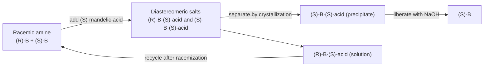

[6.5.4](/6.5.4) discussed the conformations that interconvert without breaking bonds; this chapter discusses the **configuration**, which can be changed only by breaking bonds. Configurational isomerism includes cis–trans isomerism of double bonds and rings, and the enantiomeric and diastereomeric isomerism that arises from chirality. [6.1.5](/6.1.5) already introduced **chirality**, **enantiomers**, **diastereomers** and **racemates** with coordination compounds, and here we put them on a systematic basis: first the language for describing configuration (the Cahn–Ingold–Prelog rules, E/Z, R/S, the Fischer projection and D/L), then molecules with several stereocenters, chiral molecules without stereocenters, optical activity, and the ways of obtaining a single enantiomer. The last section, on homotopic, enantiotopic and diastereotopic relationships and the Re/Si faces, is the basis for deciding NMR equivalence in [6.5.6](/6.5.6#sec-6.5.1) and for the stereochemistry of carbonyl addition discussed in [6.5.16](/6.5.16#sec-16.4).

Chirality is a central feature of the chemistry of life: proteins are built from L-amino acids, nucleic acids and polysaccharides from D-sugars, and enzymes and receptors are chiral, so the two enantiomers of a pair may act quite differently in the body. This is why [6.6](/6.6) (chemical biology) and [7.1](/7.1) (biochemistry) repeatedly use the content of this chapter.

## 5.1. Cis–Trans Isomerism and E/Z Nomenclature

### 5.1.1. Cis–Trans Isomerism

**Definition 5.1.1 (Cis–Trans Isomerism)** The stereoisomerism that arises because the groups on the two carbon atoms of a double bond (or on different carbon atoms of a ring) are arranged differently in space, owing to the lack of free rotation about the double bond (or the presence of the ring), is called **cis–trans isomerism**. Identical or similar groups on the same side of the double bond (or ring plane) are *cis*, and on opposite sides are *trans*.

The π bond of $\ce{C=C}$ breaks only when it is rotated by $90^\circ$, a barrier of about $260\,\mathrm{kJ\,mol^{-1}}$, and *cis* and *trans* isomers do not interconvert at room temperature. Besides $\ce{C=C}$, $\ce{C=N}$ (imines, oximes) and $\ce{N=N}$ (azo compounds) also show *cis*–*trans* isomerism. *Cis* and *trans* isomers are diastereomers and have different physical properties: *cis*-but-2-ene has a small dipole moment and boils at $3.7\,^\circ\mathrm{C}$; *trans*-but-2-ene has zero dipole moment and boils at $0.9\,^\circ\mathrm{C}$; the *trans* isomer is more symmetrical and packs better in the crystal, and its melting point ($-105.5\,^\circ\mathrm{C}$) is far higher than that of the *cis* isomer ($-138.9\,^\circ\mathrm{C}$).

```smiles
C/C=C\C cis
C/C=C/C trans
```

### 5.1.2. The CIP Priority Rules

*Cis*/*trans* applies only when each end of the double bond carries one identical group. Trisubstituted and tetrasubstituted alkenes, and the stereocenters treated later, require a rule that ranks any groups in order.

**Definition 5.1.2 (CIP Priority Rules)** The set of rules, adopted by convention for describing stereochemical configuration, for comparing the priority of the atoms or groups attached to the same atom is called the **Cahn–Ingold–Prelog priority rules** (CIP rules), or simply the priority rules. According to the IUPAC 2013 recommendations (P-92), the main rules are:

1. **Rule 1a**: of directly attached atoms, the one of higher atomic number has priority. A lone pair is treated as having atomic number 0 and ranks last.
2. **Rule 2**: when atomic numbers are equal, the atom of higher mass number has priority (D > H, $^{13}\mathrm{C}$ > $^{12}\mathrm{C}$).
3. **Rule 3**: seqcis (Z) has priority over seqtrans (E).
4. **Rule 4**: chiral units have priority over pseudoasymmetric units, which have priority over nonstereogenic units; of paired descriptors, a like pair (RR, SS) has priority over an unlike pair (RS); r has priority over s.
5. **Rule 5**: R has priority over S (and M over P).

Rules 3–5 are needed only between groups of identical constitution that differ only in stereochemistry (the pseudoasymmetric centers of 5.4.3); in the great majority of cases only Rule 1 is used.

Rule 1 is applied by comparing "layer by layer outward":

- First compare the first atoms directly attached.
- If they are the same, compare the sets of the three atoms attached to them: arrange each set in decreasing atomic number and compare one by one, deciding at the first difference. For example, the set of $\ce{-CH2OH}$ is $\{\mathrm{O}, \mathrm{H}, \mathrm{H}\}$ and that of $\ce{-C(CH3)3}$ is $\{\mathrm{C}, \mathrm{C}, \mathrm{C}\}$; since O > C, $\ce{-CH2OH}$ has priority: it is the largest atom of the set that is compared, not the sum of the atomic numbers.
- If they are still the same, continue one layer farther along the higher-ranking branches until a decision is reached.
- Atoms in double and triple bonds are counted repeatedly: $\ce{C=O}$ is treated as C carrying two O atoms and O carrying two C atoms, and $\ce{C#N}$ as C carrying three N atoms. A duplicated atom carries only phantom atoms of atomic number 0.

**Example 5.1.1** Compare the priorities of $\ce{-CH=CH2}$ and $\ce{-CH(CH3)2}$, of $\ce{-C#CH}$ and $\ce{-C(CH3)3}$, and of $\ce{-C6H5}$ and $\ce{-C#CH}$.

**Solution** The first carbon of vinyl carries $\{\mathrm{C}, \mathrm{C}_{\text{dup}}, \mathrm{H}\}$ and that of isopropyl carries $\{\mathrm{C}, \mathrm{C}, \mathrm{H}\}$, which are the same. One layer outward: the higher-ranking branch of vinyl is the carbon of $\ce{=CH2}$, which carries $\{\mathrm{C}_{\text{dup}}, \mathrm{H}, \mathrm{H}\}$; the branch of isopropyl is a methyl group, which carries $\{\mathrm{H}, \mathrm{H}, \mathrm{H}\}$. Since C > H, $\ce{-CH=CH2}$ > $\ce{-CH(CH3)2}$. Similarly, the first carbon of ethynyl carries $\{\mathrm{C}, \mathrm{C}_{\text{dup}}, \mathrm{C}_{\text{dup}}\}$, the same as the $\{\mathrm{C}, \mathrm{C}, \mathrm{C}\}$ of *tert*-butyl; one layer outward, the terminal carbon of ethynyl carries $\{\mathrm{C}_{\text{dup}}, \mathrm{C}_{\text{dup}}, \mathrm{H}\}$ and the methyl groups of *tert*-butyl carry $\{\mathrm{H}, \mathrm{H}, \mathrm{H}\}$, so ethynyl has priority. The *ipso* carbon of phenyl carries $\{\mathrm{C}, \mathrm{C}, \mathrm{C}_{\text{dup}}\}$; one layer outward, phenyl has two *ortho* carbons each carrying $\{\mathrm{C}, \mathrm{C}_{\text{dup}}, \mathrm{H}\}$ and a duplicated carbon carrying only phantom atoms, whereas ethynyl has only one branch carrying $\{\mathrm{C}, \mathrm{C}, \mathrm{H}\}$ and two duplicated carbons; for the second branch $\{\mathrm{C}, \mathrm{C}, \mathrm{H}\} > \{0, 0, 0\}$, so phenyl has priority.

The priority order of common groups (from highest to lowest):

$$
\begin{aligned}
&\ce{-I} > \ce{-Br} > \ce{-Cl} > \ce{-SO3H} > \ce{-SH} > \ce{-F} > \ce{-OCOR} > \ce{-OR} > \ce{-OH} > \ce{-NO2} > \ce{-NR2} > \ce{-NHR} > \ce{-NH2} \\
&> \ce{-CCl3} > \ce{-COCl} > \ce{-COOR} > \ce{-COOH} > \ce{-CONH2} > \ce{-COR} > \ce{-CHO} > \ce{-CH2OH} > \ce{-C#N} \\
&> \ce{-C6H5} > \ce{-C#CH} > \ce{-C(CH3)3} > \ce{-CH=CH2} > \ce{-CH(CH3)2} > \ce{-CH2CH3} > \ce{-CH3} > \ce{-D} > \ce{-H}
\end{aligned}
$$

### 5.1.3. E/Z Nomenclature

**Definition 5.1.3 (E–Z Notation)** The priorities of the two groups on each carbon atom of a double bond are determined by the CIP rules. The configuration in which the two higher-priority groups are on the same side of the double bond is denoted Z (German *zusammen*, together), and that in which they are on opposite sides is denoted E (*entgegen*, opposite). This method of naming configuration is called the **E–Z notation**.

The E/Z notation applies to every double bond that shows *cis*–*trans* isomerism and has a wider range of use than *cis*/*trans*. There is no fixed correspondence between the two: Z is not necessarily *cis* and E is not necessarily *trans*. For example, in 1-bromo-1,2-dichloroethene Br > Cl on the left carbon and Cl > H on the right carbon: the isomer with the two Cl atoms on opposite sides is (Z)-1-bromo-1,2-dichloroethene (Br and the right-hand Cl on the same side), although it would be called *trans* on the basis of the relation of the two Cl atoms.

```smiles
Cl/C(Br)=C/Cl (Z)
Cl/C(Br)=C\Cl (E)
```

When a molecule has several double bonds, each is labeled separately with its position number, as in (2Z,4E)-hexa-2,4-diene. A double bond in a ring of fewer than eight members can only be *cis* and need not be labeled; (E)-cyclooctene is the smallest *trans* cycloalkene that can be isolated, and it is also a chiral molecule because of planar chirality (5.5.2).

### 5.1.4. Applications of Cis–Trans Isomerism: Molecular Switches and Machines

*Cis* and *trans* isomers can be interconverted by light: after absorption of a photon the π bond is weakened or broken in the excited state, the molecule twists about the double bond, and on returning to the ground state a mixture of the *cis* and *trans* isomers is obtained (the photochemistry is detailed in [6.5.31](/6.5.31)). Azobenzene is the most widely used molecular photoswitch.


(E)-Azobenzene is nearly planar, and in (Z)-azobenzene the two benzene rings are twisted to one side, the distance between the ends shortens from about $0.9\,\mathrm{nm}$ to about $0.55\,\mathrm{nm}$, and the dipole moment changes from zero to about $1.0\times 10^{-29}\,\mathrm{C\,m}$. Irradiation with ultraviolet light of about $340\,\mathrm{nm}$ ($\pi\to\pi^*$) converts E to Z; irradiation with visible light of about $440\,\mathrm{nm}$ ($n\to\pi^*$) or heating returns Z to E. At room temperature the half-life of the thermal return of the Z form is several days. Because both directions can be controlled by light, attaching azobenzene to a peptide, a nucleic acid or an ion channel makes it possible to change the conformation and activity of the biomolecule reversibly with light ([6.5.31](/6.5.31), [6.6](/6.6)).

Light-driven *cis*–*trans* isomerization is also the basis of molecular machines. In 1999 Feringa reported the first light-driven unidirectional rotary molecular motor, in which a sterically crowded alkene rotates in only one direction through alternating photochemical E/Z isomerization and thermal helix inversion. Tour and coworkers built "nanocars" with fullerene "wheels" that roll on a metal surface. In 2016 Sauvage, Stoddart and Feringa received the Nobel Prize in Chemistry for the design and synthesis of molecular machines.

## 5.2. Chirality and Symmetry

### 5.2.1. Chirality and Enantiomers

**Definition 5.2.1 (Chirality)** The property of an object that it cannot be superposed on its mirror image is called **chirality**, and a molecule with chirality is called a chiral molecule.

The central carbon of lactic acid $\ce{CH3CH(OH)COOH}$ carries four different groups, and its two spatial arrangements are mirror images that cannot be superposed: they are a pair of **enantiomers**. In enantiomers the distance between any two atoms is the same, so energy, melting point, boiling point, solubility, spectra and so on are identical in an achiral environment; the two differ only in a chiral environment (interacting with a chiral reagent, a chiral catalyst, an enzyme or a receptor, or with circularly polarized light).

```smiles
C[C@@H](O)C(=O)O (R)
C[C@H](O)C(=O)O (S)
```

Chirality is a geometric property and **optical activity** is one of its observable consequences; they are not the same thing: a racemate of chiral molecules has no optical rotation; the specific rotation of some chiral molecules is too small to be measured (such as 5-ethyl-5-propylundecane, in which the four alkyl groups differ too little); and optical rotation can also arise from chiral crystals made of achiral units (such as quartz). One cannot therefore say "chirality is optical activity", and chirality must be judged from symmetry.

### 5.2.2. Symmetry Criteria

Whether a molecule is chiral can be judged from its symmetry elements: whether a molecule can be superposed on its mirror image depends on whether it has a symmetry operation that "turns a left hand into a right hand".

- Mirror plane $\sigma$: a plane through the molecule such that the atoms on its two sides are mirror images.
- Center of inversion $i$: on every line through the center of the molecule there are identical atoms at equal distances on both sides.
- Improper axis $S_n$ (rotation–reflection axis): the molecule is unchanged by rotation about the axis by $360^\circ/n$ followed by reflection in the plane perpendicular to the axis. $S_1 = \sigma$ and $S_2 = i$.

**Theorem 5.2.1** A molecule is chiral if and only if it has no improper axis $S_n$ (including mirror planes and centers of inversion).

A simple rotation axis $C_n$ does not affect chirality: *trans*-1,2-dimethylcyclopropane and $\ce{[Co(en)3]^3+}$ both have a $C_2$ axis and are both chiral. Conversely, a molecule with only an $S_4$ axis and neither a mirror plane nor a center of inversion is achiral; such examples are few, but they show that the criterion must be stated as "no improper axis" and not as "no mirror plane and no center of inversion". In everyday judgments, checking for a mirror plane and a center of inversion is almost always sufficient.

A rapidly flipping molecule is judged by its time-averaged structure. For example, each **chair conformation** of *cis*-1,2-dimethylcyclohexane has no mirror plane, but the two chairs are mirror images and interconvert rapidly by **ring flip**, so the compound is achiral (meso, 5.4.2). For cyclohexane derivatives, looking for a mirror plane by treating the ring as planar (planar analysis) gives the same conclusion as conformational analysis.

### 5.2.3. Stereocenters

**Definition 5.2.2 (Stereocenter)** A tetrahedral atom bearing four mutually different atoms or groups, such that interchanging any two of them gives another stereoisomer, is called a **stereocenter** (also called an asymmetric atom); the most common is the chiral carbon atom.

A molecule with one stereocenter is necessarily chiral; a molecule with several stereocenters is not necessarily so (5.4.2). Besides carbon, the following atoms can also be stereocenters:

| Atom | Example | Can the configuration be retained |
|---|---|---|
| Quaternary N, quaternary P | $\ce{[N(CH3)(C2H5)(C3H7)(C6H5)]+}$ | Yes |
| Tertiary amine N | $\ce{N(CH3)(C2H5)(C3H7)}$, the lone pair being the fourth "group" | No: the barrier of **nitrogen inversion** is only about $25\,\mathrm{kJ\,mol^{-1}}$ and the inversion occurs more than $10^{8}$ times per second at room temperature ([6.5.23](/6.5.23#sec-23.3.2)); it can when N is in a small ring or at a bridgehead (such as Tröger's base) |
| Phosphine P | $\ce{P(CH3)(C2H5)(C6H5)}$ | Yes: the inversion barrier is about $130\,\mathrm{kJ\,mol^{-1}}$, and chiral phosphines are important ligands (5.8) |
| Sulfoxide S | Methyl phenyl sulfoxide $\ce{CH3S(O)C6H5}$ | Yes: esomeprazole is the (S)-sulfoxide enantiomer of omeprazole |
| Silicon | $\ce{SiH(CH3)(C2H5)(C6H5)}$ | Yes |

Even an isotopic difference is enough to produce chirality: $\ce{CH3CHDOH}$ (1-deuterioethanol) is a chiral molecule, and R/S can be assigned by Rule 2 (D > H). In biochemistry, substrates with such "isotopic chirality" are often used to study the stereochemistry of enzymatic reactions (5.9).

## 5.3. Representing Configuration: R/S, the Fischer Projection and D/L

### 5.3.1. R/S Nomenclature

**Definition 5.3.1 (R/S Nomenclature)** Rank the four groups on a stereocenter by the CIP rules as $1 > 2 > 3 > 4$ and view the molecule from the side opposite the group of lowest priority, 4. The configuration in which $1\to 2\to 3$ is clockwise is denoted R (Latin *rectus*, right), and that in which it is counterclockwise is denoted S (*sinister*, left). A configuration labeled in this way, which reflects the actual spatial arrangement of the atoms, is called the absolute configuration.

When judging from a wedge formula: if the group of lowest priority is on a hashed wedge bond (pointing into the paper), read the direction of $1\to 2\to 3$ directly; if it is on a solid wedge bond (pointing toward the viewer), reverse the direction read; if it is in the plane of the paper, interchange any two groups so that 4 is on a hashed wedge bond, read the direction, and then reverse it (one interchange gives the enantiomer).

**Example 5.3.1** Determine the configuration of the enantiomers of 2-bromobutane: of $\ce{CH3CH2}$ and $\ce{CH3}$, the first carbon of ethyl carries $\{\mathrm{C}, \mathrm{H}, \mathrm{H}\}$ and methyl carries $\{\mathrm{H}, \mathrm{H}, \mathrm{H}\}$, so the order is $\ce{Br} > \ce{CH2CH3} > \ce{CH3} > \ce{H}$. The enantiomer in which Br → Et → Me is counterclockwise with H pointing to the rear is (S)-2-bromobutane, which is dextrorotatory and is written (S)-(+)-2-bromobutane.

R/S is a symbol defined by rules and has no necessary connection with the direction of optical rotation, (+)/(−); the R/S label of a given stereocenter can even change when a distant group changes, although the spatial arrangement has not changed. For example L-alanine is (S) while L-cysteine is (R), only because the S in $\ce{-CH2SH}$ gives it higher priority than $\ce{-COOH}$.

Before 1951 chemists could determine only the relative configurations of compounds and did not know the true spatial arrangement. Bijvoet determined the absolute configuration of crystals of sodium rubidium (+)-tartrate by X-ray anomalous scattering, which confirmed that the previous arbitrary convention was correct.

### 5.3.2. The Fischer Projection

**Definition 5.3.2 (Fischer Projection)** Place the stereocenter in the plane of the paper so that the two vertical bonds point behind the paper and the two horizontal bonds point in front of the paper, and then project onto the paper, representing the stereocenter by the crossing point of a cross. The planar drawing so obtained is called a **Fischer projection**. By custom the main carbon chain is arranged vertically, with the carbon of lowest number (highest oxidation state) at the top.


A Fischer projection contains implicit three-dimensional information, and only operations that preserve this meaning are allowed:

| Operation | Result |
|---|---|
| Rotation by $180^\circ$ in the plane of the paper | Configuration unchanged (horizontal bonds still in front) |
| Rotation by $90^\circ$ in the plane of the paper | Becomes the enantiomer (the front/back relation of horizontal and vertical bonds is reversed) |
| Interchange of any two groups | Becomes the enantiomer; two interchanges restore the configuration |
| Fix one group and cyclically permute the other three | Configuration unchanged (equivalent to two interchanges) |
| Flipping out of the plane of the paper | Becomes the enantiomer |


To read R/S from a Fischer projection: when the group of lowest priority (usually H) is on a vertical bond, read the direction of $1\to 2\to 3$ directly; when it is on a horizontal bond, reverse the direction read.

### 5.3.3. D/L Nomenclature

Before the R/S system was established (and still today in the chemistry of sugars and amino acids), configuration was expressed by D/L.

**Definition 5.3.3 (D/L Nomenclature)** With glyceraldehyde as the standard: in the Fischer projection with the aldehyde group at the top and the hydroxymethyl group at the bottom, the isomer with the OH on the stereocenter at the right is D-glyceraldehyde and that with the OH at the left is L-glyceraldehyde. Other compounds are related to glyceraldehyde by chemical transformations: for sugars, one looks at the position of the OH on the stereocenter of highest number (the one farthest from the carbonyl group) in the Fischer projection, D if at the right and L if at the left; for α-amino acids, with the carboxyl group at the top and the side chain at the bottom, the one with $\ce{NH2}$ at the left is L. This labeling of relative configuration with glyceraldehyde as the reference is called **D/L nomenclature**.

In 1906 Rosanoff arbitrarily assigned the D form to dextrorotatory glyceraldehyde, and Bijvoet's determination showed that this guess was correct: D-(+)-glyceraldehyde is (R)-glyceraldehyde. D/L describes only the relation to the reference compound and, like R/S, is unrelated to the direction of rotation: D-fructose is levorotatory, and the sodium salt of L-(+)-lactic acid is levorotatory. Natural sugars are almost all of the D form, and the amino acids in natural proteins are all of the L form ([6.5.32](/6.5.32), [6.5.33](/6.5.33)). Among the chiral L-amino acids (glycine is not chiral), the α carbon is S except in cysteine (and selenocysteine), which is R.

For open-chain compounds with two adjacent stereocenters, relative configuration is sometimes described by erythro/threo: when two similar groups are on the same side in the Fischer projection the compound is erythro (from erythrose), and when they are on opposite sides it is threo (from threose).

## 5.4. Compounds with Several Stereocenters

### 5.4.1. Enantiomers and Diastereomers

A molecule with $n$ stereocenters has at most $2^n$ **stereoisomers**, forming $2^{n-1}$ pairs of enantiomers. Take 3-chloro-2-hydroxybutanedioic acid as an example: each of the two stereocenters can be R or S, giving four isomers (2R,3R), (2S,3S), (2R,3S) and (2S,3R); (2R,3R) and (2S,3S) are enantiomers, (2R,3S) and (2S,3R) are enantiomers, and every other pair are diastereomers.

**Definition 5.4.1 (Diastereomers)** Stereoisomers that are not mirror images of each other are called **diastereomers**.

The rule is simple: two stereoisomers whose stereocenters all have opposite configurations are enantiomers; if some are opposite and some are the same, they are diastereomers. Diastereomers differ in physical properties (melting point, solubility, NMR spectra, chromatographic retention time) and in the rates of chemical reactions, and can be separated by ordinary methods, which is the basis for the resolution of racemates (5.7).

**Definition 5.4.2 (Epimers)** Two diastereomers with several stereocenters that differ in the configuration of only one stereocenter and are the same at all the others are called **epimers**; the interconversion between them is called epimerization.

For example D-glucose and D-mannose are C2 epimers, and D-glucose and D-galactose are C4 epimers. Epimers are always diastereomers.

### 5.4.2. Meso Compounds

When two stereocenters carry the same set of groups, the number of stereoisomers is less than $2^n$. The (2R,3S) and (2S,3R) forms of tartaric acid (2,3-dihydroxybutanedioic acid) are in fact the same molecule: in the fully eclipsed conformation it has a mirror plane perpendicular to the C2–C3 bond (a center of inversion in the staggered conformation), the molecule is superposable on its mirror image, and it has no optical activity.

**Definition 5.4.3 (Meso Compound)** An achiral compound that contains stereocenters but can be superposed on its mirror image because of a mirror plane or center of inversion (in general, an improper axis) in the molecule is called a **meso compound**, written *meso*-.


Tartaric acid therefore has only three stereoisomers: (+)-tartaric acid (2R,3R), (−)-tartaric acid (2S,3S) and *meso*-tartaric acid. The meso form is a single compound, different from a racemate (an equimolar mixture of two kinds of molecules); it is a diastereomer of the (+) and (−) forms, and its melting point and solubility differ from those of the (+) and (−) forms (melting point $171$–$174\,^\circ\mathrm{C}$).

To judge whether a compound is meso, one looks for a symmetry element in some conformation: a Fischer projection corresponds to the fully eclipsed conformation, in which a horizontal mirror plane can be looked for directly; in a staggered conformation the symmetry element may be a center of inversion. Converting among conformations with Newman projections shows that achiral conformations and chiral conformations interconvert rapidly and that the chiral conformations always occur in pairs of equal proportion, so there is no optical rotation macroscopically.

Cyclic compounds also have meso forms: *cis*-1,2-dimethylcyclohexane and *cis*-cyclohexane-1,2-diol have a mirror plane through the ring and are meso compounds; their *trans* isomers have no mirror plane and are a pair of enantiomers.

```smiles
C[C@@H]1CCCC[C@@H]1C cis (meso)
C[C@@H]1CCCC[C@H]1C trans (1R,2R)
```

### 5.4.3. Pseudoasymmetric Centers

**Definition 5.4.4 (Pseudoasymmetric Center)** A tetrahedral atom bearing two groups of the same constitution but opposite configuration (one R and one S) and two other different groups is called a **pseudoasymmetric center**. Its configuration is labeled with lowercase r or s, and by CIP Rule 5 the R group has priority over the S group.

A pseudoasymmetric center is characterized by the fact that interchanging two of its groups gives another stereoisomer (so it is a stereocenter), but the mirror operation does not change its own descriptor (the mirror image of r is still r, because the mirror operation changes the R group into an S group at the same time). 2,3,4-Trihydroxypentanedioic acid has three "possible" stereocenters but only 4 stereoisomers:

- When C2 and C4 have the same configuration (R,R or S,S), the two groups on C3 are identical and C3 is not a stereocenter; (2R,4R) and (2S,4S) are a pair of enantiomers, both optically active.
- When C2 and C4 have opposite configurations, C3 is a pseudoasymmetric center, and (2R,3r,4S) and (2R,3s,4S) are two different meso compounds, diastereomers of each other, both optically inactive.

## 5.5. Chiral Molecules Without Stereocenters

A stereocenter is only one way of producing chirality. By the type of chirality element, chiral molecules are classified as having central chirality, axial chirality, planar chirality, helical chirality and so on.

### 5.5.1. Axial Chirality

**Definition 5.5.1 (Axial Chirality)** The chirality of a molecule that has no stereocenter but has an axis (the chiral axis), such that the arrangement of groups at the two ends of the axis makes the molecule non-superposable on its mirror image, is called **axial chirality**.

Two common kinds of molecules with axial chirality:

- Allene type: $\ce{abC=C=Cab}$. The substituents on the two terminal carbons of an allene lie in two mutually perpendicular planes; as long as the two groups at each end are different (a ≠ b), the molecule has no mirror plane and is chiral. When either end carries two identical groups the molecule has a mirror plane and is not chiral. **Spiro compounds** (such as 2,6-disubstituted spiro[3.3]heptane) and alkylidenecyclohexanes also belong to this type.
- Biaryl type: when there are sufficiently large substituents at the 2,2′,6,6′ positions, the two aromatic rings cannot rotate into a common plane and cannot rotate freely about the connecting single bond, and the molecule exists in two twisted conformations that are mirror images.

**Definition 5.5.2 (Atropisomers)** Stereoisomers that can be separated because rotation about a single bond is hindered are called **atropisomers**.

Atropisomers lie between conformational and configurational isomers (Section 4.1 of [6.5.4](/6.5.4#sec-4.1)): they interconvert by rotation about a single bond, but the barrier is high enough for them to be separated. The barrier to racemization of 1,1′-binaphthalene-2,2′-diol (BINOL) is about $158\,\mathrm{kJ\,mol^{-1}}$, the half-life at room temperature is measured in millions of years, and it racemizes within hours only on heating above $200\,^\circ\mathrm{C}$. The bisphosphine ligand BINAP derived from BINOL is the source of chirality in Noyori asymmetric hydrogenation (5.8).

Labeling of axial chirality: view along the chiral axis (the result is the same from either end); the two near groups have priority over the two far groups, and within each end the groups are ordered by the CIP rules; this gives 1, 2 (near) and 3, 4 (far), and the direction of $1\to 2\to 3$ is judged as for R/S and denoted $R_{\mathrm{a}}$ or $S_{\mathrm{a}}$ (a for axis). A practical method is to write the near groups on the horizontal bonds and the far groups on the vertical bonds of a Fischer projection and read the configuration from the Fischer projection. Axial chirality can also be labeled P/M by the sense of the helix, with $R_{\mathrm{a}}$ corresponding to M and $S_{\mathrm{a}}$ to P.


### 5.5.2. Planar Chirality

**Definition 5.5.3 (Planar Chirality)** The chirality of a molecule that has no stereocenter and no chiral axis but has a chiral plane, such that the arrangement of the atoms in the plane and of the groups outside the plane makes the molecule non-superposable on its mirror image, is called **planar chirality**.

Typical examples:

- 1,2-Disubstituted ferrocenes (with different substituents): the plane of the cyclopentadienyl ring together with the two different substituents makes the mirror image non-superposable; chiral ferrocenyl phosphine ligands (such as Josiphos) are important in industrial asymmetric hydrogenation.
- Cyclophanes and ansa compounds: an aromatic ring is bridged by a carbon chain and carries one substituent; when the bridge is short enough the ring cannot flip and the enantiomers can be separated; when the chain is too long the ring can flip through the chain and the planar chirality disappears.
- (E)-Cyclooctene: the plane of the double bond together with the methylene chain passing around one side.

Labeling of planar chirality: choose the chiral plane (the plane containing as many atoms as possible, but not all); choose as the pilot atom P the atom that is directly attached to an atom of the plane, lies outside the plane and has the shortest path to the higher-priority groups; starting from the plane atom a attached to P, establish $a\to b\to c$ along the plane by the CIP order; viewed from P toward the plane, $a\to b\to c$ clockwise is denoted $R_{\mathrm{p}}$ and counterclockwise $S_{\mathrm{p}}$.

### 5.5.3. Helicity and Inherent Chirality

**Definition 5.5.4 (Helicity)** The chirality of a molecule that is non-superposable on its mirror image because the molecule as a whole has the shape of a helix is called **helicity** (helical chirality). A right-handed helix is denoted P (plus) and a left-handed helix M (minus).

Hexahelicene (six benzene rings ortho-fused) is twisted into a helix because the terminal rings overlap, and is a stable molecule with helical chirality. The helices of biological macromolecules are also chiral: the α helix of proteins and B-DNA are right-handed helices, and Z-DNA is a left-handed helix.

There are also molecules whose chirality cannot be attributed to a center, axis or plane but arises from the asymmetric arrangement of achiral groups on the whole three-dimensional skeleton, called inherent chirality (proposed by Böhmer in 1994 for calixarenes), for example the introduction of several different achiral groups on a calixarene skeleton so that only $C_1$ symmetry remains, and chiral fullerenes such as $\ce{C76}$.

## 5.6. Optical Activity

### 5.6.1. Optical Rotation and Specific Rotation

When **linearly polarized light** (plane-polarized light) passes through a solution of a chiral substance, the plane of vibration is rotated (**optical activity**; for the physical principle see [5.4.3](/5.4.3)). Looking toward the light, a substance that rotates the plane clockwise is dextrorotatory, written (+) (formerly d), and one that rotates it counterclockwise is levorotatory, written (−) (formerly l). The angle of rotation $\alpha$ is called the optical rotation and is measured with a polarimeter: the sample tube is placed between two polarizers and the analyzer is turned to find the extinction position.

**Definition 5.6.1 (Specific Rotation)** The ratio of the optical rotation to the length of the sample tube and the concentration,

$$
[\alpha]_\lambda^T = \frac{\alpha}{l\,\rho} \tag{5.1}
$$
is called the **specific rotation**. Here $l$ is the length of the sample tube (in $\mathrm{dm}$) and $\rho$ is the mass concentration (in $\mathrm{g\,mL^{-1}}$; the density for a pure liquid); $T$ is the temperature and $\lambda$ the wavelength, usually the sodium D line ($589.3\,\mathrm{nm}$) at $20\,^\circ\mathrm{C}$, written $[\alpha]_{\mathrm{D}}^{20}$, with the solvent and concentration stated.

By convention the specific rotation is written with its value and sign only, as for (S)-2-bromobutane $[\alpha]_{\mathrm{D}}^{20} = +23.1^\circ$ (neat) and L-(+)-tartaric acid $[\alpha]_{\mathrm{D}}^{20} = +12^\circ$ ($c = 20$, water); the enantiomer has the specific rotation of equal magnitude and opposite sign. The specific rotation varies with solvent, concentration, temperature and wavelength, and sometimes even changes sign, so it is a characteristic constant of a substance only under specified conditions. The variation of specific rotation with wavelength is called optical rotatory dispersion; the difference in the absorption of left and right circularly polarized light by a chiral molecule is **circular dichroism**, and the two are used together to determine absolute configuration and the secondary structure of proteins ([6.4.9](/6.4.9)).

### 5.6.2. Racemization

**Definition 5.6.2 (Racemization)** The process by which an optically active compound is converted by physical or chemical factors to an equilibrium mixture of the two enantiomers (a racemate) and thereby loses its optical activity is called **racemization**.

Racemization generally proceeds through an achiral intermediate or transition state: the $\ce{C-H}$ on the stereocenter loses a proton to form a planar **enolate** or **carbanion**, the leaving group departs to form a planar **carbocation** (the SN1 reaction of [6.5.8](/6.5.8#sec-8.4.2)), a planar radical forms, or, as for atropisomers, the process passes through a planar transition state. A stereocenter at the α position of a carbonyl group racemizes very easily in acid or base ([6.5.21](/6.5.21#sec-21.2.3)). Thermodynamically, the conversion of a single enantiomer into the racemate is spontaneous: the standard Gibbs energies of the two enantiomers are the same, and the driving force of the process comes entirely from the entropy of mixing, $\Delta G = -RT\ln 2 \approx -1.7\,\mathrm{kJ\,mol^{-1}}$ ($298\,\mathrm{K}$).


The rate of racemization can be used for dating. Amino acids are synthesized by enzymes in living organisms and are almost all of the L form; after the organism dies, the amino acids remaining in bone, teeth and shells slowly racemize. Treating $\ce{L <=> D}$ as opposing first-order reactions with the same rate constant $k$ ([6.3.15](/6.3.15)), the enantiomeric excess decays exponentially with time, $\mathrm{ee}(t) = \mathrm{e}^{-2kt}$, so that

$$
\ln\frac{1 + [\mathrm{D}]/[\mathrm{L}]}{1 - [\mathrm{D}]/[\mathrm{L}]} = 2kt. \tag{5.2}
$$
At $[\mathrm{D}]/[\mathrm{L}] = 1/3$ the ee has fallen to half, and the time needed is called the "half-racemization time"; as $t\to\infty$, $[\mathrm{D}]/[\mathrm{L}]\to 1$. The rate constant $k$ depends strongly on temperature (by the **Arrhenius equation**, with an activation energy of about $120$–$130\,\mathrm{kJ\,mol^{-1}}$), so the method is suitable for samples at a long-term stable temperature, such as fossils in cave sites and seafloor sediments, and can date thousands to millions of years. Isoleucine, the most commonly used amino acid, has two stereocenters, and the change of configuration at its C2 gives D-alloisoleucine; this is epimerization and not racemization, and at equilibrium $[\text{D-allo-Ile}]/[\text{L-Ile}] \approx 1.3$ and not 1; its "half-life" is about 110,000 years at $20\,^\circ\mathrm{C}$ and about 290,000 years at $15\,^\circ\mathrm{C}$. The same principle is used in forensic science: the extent of racemization of aspartic acid in dentin increases by about one part per thousand per year and can be used to estimate age.

## 5.7. Obtaining a Single Enantiomer

### 5.7.1. Why Single Enantiomers Are Needed

The two enantiomers of a chiral drug often have different efficacy or toxicity. Thalidomide was used in the late 1950s as a sedative and as a treatment for morning sickness and caused limb malformations in over ten thousand babies; the FDA reviewer Kelsey, by insisting on additional safety data, prevented its approval in the United States. It is generally believed that (R)-thalidomide is sedative and (S)-thalidomide is teratogenic, but this does not mean that taking the pure (R) enantiomer would be safe: the stereocenter of thalidomide is the $\ce{C-H}$ α to a carbonyl group, which racemizes in the body within hours, so both enantiomers are present. Similarly the efficacy of ibuprofen comes from the (S) enantiomer, and the inactive (R) enantiomer is converted unidirectionally to (S) in the body. Olfactory receptors can also distinguish enantiomers: (R)-(−)-carvone smells of spearmint and (S)-(+)-carvone of caraway.


```smiles
CC1=CC[C@H](CC1=O)C(C)=C (R)-carvone
CC1=CC[C@@H](CC1=O)C(C)=C (S)-carvone
O=C1CCC(N2C(=O)c3ccccc3C2=O)C(=O)N1 thalidomide
```

There are three routes to a single enantiomer: obtaining it from natural products (the chiral pool), resolution of a racemate, and asymmetric synthesis (5.8).

### 5.7.2. Resolution

**Definition 5.7.1 (Chiral Resolution)** The process of separating a racemate into two pure enantiomers is called **chiral resolution**.

Enantiomers have identical physical properties and cannot be separated directly by crystallization, distillation and so on. The common methods are:

1. Spontaneous resolution: in a few racemates the two enantiomers crystallize separately into crystals that are mirror images of each other (a conglomerate). In 1848 Pasteur separated the two kinds of crystals of racemic sodium ammonium tartrate with tweezers under a microscope, the first resolution in history.
2. Chemical resolution (through diastereomers): a pure chiral reagent (the resolving agent) reacts with the racemate to convert a pair of enantiomers into a pair of diastereomers, which are separated by differences in properties such as solubility, and the resolving agent is then removed. Chiral bases (brucine, quinine, (R)-1-phenylethanamine) are commonly used for resolving acids, and chiral acids (tartaric acid, mandelic acid, camphorsulfonic acid) for resolving bases.
3. Enzymatic resolution (kinetic resolution): the different reaction rates of an enzyme with the two enantiomers are used to convert only one of them. For example, a lipase in an organic solvent selectively acetylates one enantiomer of a racemic secondary alcohol, and the alcohol and the ester are then separated.
4. Chromatographic resolution: enantiomers are separated directly on a column for **chiral chromatography** (chiral stationary phase), or first derivatized to diastereomers and separated on an ordinary column ([6.4.14](/6.4.14)). It is the standard method for determining the composition of enantiomers.



The industrial synthesis of the antidepressant duloxetine uses this method: racemic 3-(methylamino)-1-(thiophen-2-yl)propan-1-ol is dissolved in toluene–methanol and (S)-mandelic acid is added; the (S)-alcohol forms the sparingly soluble diastereomeric salt, which crystallizes and is filtered, and the (S)-alcohol is liberated with NaOH; the (R)-alcohol remaining in the mother liquor is racemized by hydrochloric acid (it has only one stereocenter and is converted to the racemate through a benzylic carbocation) and recycled for resolution. This "resolution–racemization–recycling" practice converts almost all of the starting material to the required enantiomer.


**Definition 5.7.2 (Kinetic Resolution)** A resolution achieved by using the difference in the rates at which the two enantiomers react with a chiral reagent or chiral catalyst, so that one of them is converted preferentially, is called **kinetic resolution**.

The yield of a classical kinetic resolution does not exceed $50\%$ (only one enantiomer is taken). If the two enantiomers of the substrate can interconvert rapidly under the reaction conditions, so that the slow-reacting enantiomer racemizes continuously to the fast-reacting one, the theoretical yield can reach $100\%$; this is called dynamic kinetic resolution.

![Lipase-catalysed kinetic resolution of racemic 1-phenylethanol (for example with Candida antarctica lipase B). Top: the active-site serine (its proton is taken by the histidine of the catalytic triad, not drawn) adds to the carbonyl group of vinyl acetate, and the tetrahedral intermediate expels the enolate of vinyl alcohol, which tautomerizes to acetaldehyde, so acylation of the enzyme is irreversible. Bottom: the acyl-enzyme transfers the acetyl group to the alcohol; the large (phenyl) and medium (methyl) groups of the (R)-alcohol fit the two pockets of the active site and it reacts much faster, while the (S)-alcohol is left behind, and the two are separated as alcohol and ester](./plots/lipase-resolution.py)

### 5.7.3. Enantiomeric Excess and Diastereomeric Excess

**Definition 5.7.3 (Enantiomeric Excess)** The difference between the mole fractions of the two enantiomers in a mixture of enantiomers,

$$
\mathrm{ee} = \frac{n_R - n_S}{n_R + n_S}\times 100\% \tag{5.3}
$$
(taking R in excess), is called the **enantiomeric excess**.

The ee of a pure enantiomer is $100\%$ and that of a racemate is $0$. An $\mathrm{ee} = 60\%$ means that the mixture is $80\%$ R and $20\%$ S, and can be regarded as $60\%$ pure R plus $40\%$ racemate. If the specific rotation is proportional to the ee (usually approximately true), the optical purity $= [\alpha]_{\text{obs}}/[\alpha]_{\max} \approx \mathrm{ee}$. Today the ee is generally determined by chiral chromatography or by NMR with chiral shift reagents rather than by optical rotation. The enantiomer ratio er (such as $90 : 10$) is also often given directly.

**Definition 5.7.4 (Diastereomeric Excess)** The difference between the mole fractions of two diastereomers in a mixture, $\mathrm{de} = (n_1 - n_2)/(n_1 + n_2)\times 100\%$ ($n_1 > n_2$), is called the **diastereomeric excess**.

**Example 5.7.1** (a) A mixture contains $12.8\,\mathrm{mol}$ of (R)-2-bromobutane and $3.2\,\mathrm{mol}$ of (S)-2-bromobutane; find the ee. (b) A sample of 2-bromobutane has a measured $[\alpha]_{\mathrm{D}} = +18.5^\circ$, and pure (S)-(+)-2-bromobutane is known to be $+23.1^\circ$; find the ee and the contents of the two enantiomers.

**Solution** (a) $\mathrm{ee} = (12.8 - 3.2)/(12.8 + 3.2) = 60\%$ (R in excess). (b) $\mathrm{ee} = 18.5/23.1 = 80\%$ (S in excess), so S is $(100 + 80)/2 = 90\%$ and R is $10\%$.

## 5.8. Stereospecificity, Stereoselectivity and Asymmetric Synthesis

### 5.8.1. Stereospecificity and Stereoselectivity

**Definition 5.8.1 (Stereospecificity)** A reaction in which stereoisomeric reactants give stereoisomerically different products, the configuration of the reactant determining that of the product as dictated by the mechanism, is called a **stereospecific** reaction (**stereospecificity**).

**Definition 5.8.2 (Stereoselectivity)** A reaction that can give several stereoisomers but in which one (or one pair) predominates is called a **stereoselective** reaction (**stereoselectivity**); when the predominant ones are enantiomers it is called enantioselectivity, and when they are diastereomers, diastereoselectivity.

Examples of stereospecificity: the **SN2** reaction inverts the configuration of a stereocenter ([6.5.8](/6.5.8#sec-8.4.1)); in the *anti* addition of $\ce{Br2}$ to but-2-ene, (E)-but-2-ene gives only meso-2,3-dibromobutane and (Z)-but-2-ene gives only the racemate ([6.5.11](/6.5.11#sec-11.4.2)); the **E2** elimination requires **antiperiplanar** geometry ([6.5.9](/6.5.9#sec-9.4.2)). An example of stereoselectivity: the reduction of 4-*tert*-butylcyclohexanone with $\ce{LiAlH4}$ gives about $90\%$ of the *trans* alcohol with the hydroxyl group on an **equatorial bond** and about $10\%$ of the *cis* alcohol with the hydroxyl group axial (the small hydride reagent attacks preferentially from the axial direction); with the very bulky L-Selectride the selectivity is reversed and the *cis* alcohol is mainly obtained ([6.5.17](/6.5.17#sec-17.1.2)).


```smiles
CC(C)(C)C1CCC(=O)CC1>>CC(C)(C)[C@H]1CC[C@H](O)CC1 trans (90%)
```

A stereospecific reaction is necessarily stereoselective, but not the reverse.

### 5.8.2. Asymmetric Synthesis

**Definition 5.8.3 (Asymmetric Synthesis)** A reaction in which an achiral unit of the substrate molecule is converted by the action of a chiral factor into a chiral unit and the stereoisomeric products are formed in unequal amounts is called **asymmetric synthesis**.

Achiral reactants under achiral conditions can give only the racemate: for example, in the addition of HCl to but-2-ene the two faces of the **carbocation** are attacked with equal probability and equal amounts of (R)- and (S)-2-chlorobutane are obtained. To favor one face, chirality must be introduced, and there are three strategies according to the source of chirality:

1. Chiral substrate (substrate control): a stereocenter already present in the substrate controls the formation of the new stereocenter. For example, when a bulky *tert*-butyl group is at another position of a cyclohexene, $\ce{BH3}$ attacks mainly from the face opposite to the *tert*-butyl group, and **hydroboration**–oxidation gives mainly one diastereomer ([6.5.11](/6.5.11#sec-11.4.6)). A recoverable chiral group that is attached temporarily to the substrate and removed after the reaction is called a **chiral auxiliary**, such as Evans's oxazolidinones.
2. Chiral reagent: a stoichiometric chiral reagent provides the asymmetric environment, for example BINAL-H reported by Noyori in 1979 ($\ce{LiAlH4}$ modified with BINOL), which reduces aromatic ketones to alcohols with high ee.
3. *Asymmetric catalysis*: only a small amount of a chiral catalyst gives a large amount of chiral product, the most efficient strategy. Knowles used a chiral phosphine–rhodium complex in the asymmetric hydrogenation that synthesizes L-DOPA for Parkinson's disease (1970s, the first industrial asymmetric catalytic process); Noyori's BINAP–ruthenium catalysts hydrogenate alkenes and ketones with high selectivity, with turnover frequencies of tens per second and turnover numbers above a million; Sharpless used $\ce{Ti(O^{i}Pr)4}$, diethyl tartrate and *tert*-butyl hydroperoxide for the asymmetric epoxidation of allylic alcohols ([6.5.11](/6.5.11#sec-11.8.1)). The three shared the 2001 Nobel Prize in Chemistry. The 2021 Nobel Prize in Chemistry went to List and MacMillan for asymmetric **organocatalysis**: List discovered that proline can catalyze the asymmetric **aldol reaction** ([6.5.22](/6.5.22#sec-22.6.3)), and MacMillan designed chiral imidazolidinone catalysts that activate by iminium ions. **Enzyme catalysis** is nature's asymmetric catalysis, and its selectivity is usually extremely high.

An interesting new direction is deracemization: the direct conversion of a racemate into a single enantiomer. By microscopic reversibility, a catalyst that relies only on thermal motion cannot do this (it accelerates the forward and reverse reactions equally, and the end point is still the racemate; the process has $\Delta G = +RT\ln 2 > 0$); energy must be supplied, for example by driving the process with light (the principles of photoreactions are in [6.5.31](/6.5.31)).

## 5.9. Topic Relationships: Homotopic, Enantiotopic and Diastereotopic

### 5.9.1. Equivalence and Topicity

Whether two identical atoms or groups in a molecule (such as the two H atoms of a $\ce{CH2}$) are "really equivalent" can be tested by substitution: replace each in turn by a new group Y and compare the two molecules obtained.

**Definition 5.9.1 (Homotopic, Enantiotopic and Diastereotopic)** Two atoms or groups of the same constitution in a molecule are called **homotopic** if the two molecules obtained by replacing each in turn with another group are identical, **enantiotopic** if the two molecules obtained are a pair of enantiomers, and **diastereotopic** if they are a pair of diastereomers.

Relation to symmetry: groups that can be interchanged by a rotation axis $C_n$ are homotopic (such as the four H atoms of methane and the two H atoms of dichloromethane); groups that can be interchanged only by an improper axis (a mirror plane or center of inversion) are enantiotopic (such as the two H atoms of the $\ce{CH2}$ of ethanol and the two H atoms of bromochloromethane); groups that cannot be interchanged by any symmetry operation are diastereotopic, the typical case being two H atoms on the same carbon in a molecule that has another stereocenter, such as the two H atoms on C3 of (S)-2-chlorobutane: replacing each in turn by Br gives (2R,3S)- and (2S,3S)-2-bromo-3-chlorobutane (the original C2 is C3 in the new name), which are diastereomers.

The chemical consequences:

| Relationship | Achiral environment (ordinary reagents, NMR in ordinary solvents) | Chiral environment (enzymes, chiral reagents) |
|---|---|---|
| Homotopic | Identical | Identical |
| Enantiotopic | Identical | May differ |
| Diastereotopic | Different (chemical shifts and reaction rates generally both differ) | Different |

So the hydrogens of (S)-2-chlorobutane form not 4 but 5 sets: the two H atoms on C3 are diastereotopic and have different chemical shifts in the ¹H NMR spectrum ([6.5.6](/6.5.6#sec-6.5.1), [6.4.12](/6.4.12)).

### 5.9.2. Prochirality

**Definition 5.9.2 (Prochirality)** An achiral molecule (or an achiral part of a molecule) is called **prochiral** at a center (or face) if it becomes chiral when one of a pair of enantiotopic groups is replaced by a different group, or when a new group is added to one face of a trigonal planar atom.

The two identical groups a on a tetrahedral prochiral center $\ce{Caabc}$ are distinguished as pro-R and pro-S: suppose the priority of one of the a groups is raised (for example by replacing H with D) without changing its order relative to the other groups; if the resulting center is R, that a is pro-R, and the other is pro-S. For example, of the two H atoms on C1 of ethanol, the one whose replacement by D gives (R)-1-deuterioethanol is the pro-R hydrogen. Yeast alcohol dehydrogenase, in oxidizing ethanol, removes specifically the pro-R hydrogen and passes it to $\ce{NAD+}$, a classical piece of evidence that enzymes can distinguish enantiotopic groups. In the citric acid cycle the two $\ce{-CH2COOH}$ groups of citric acid are enantiotopic, and aconitase acts on only one of them; Ogston (1948) explained this result with a "three-point attachment" model, showing that an achiral molecule can undergo a definite chiral reaction in a chiral enzyme.


The two faces of a trigonal planar atom (a carbonyl carbon, an alkene carbon) can also be distinguished.

**Definition 5.9.3 (Re and Si Faces)** Viewed from a direction perpendicular to the plane of a trigonal planar atom, if the three groups attached to the atom are clockwise in decreasing CIP priority, the face toward the viewer is called the **Re face**; if counterclockwise, the **Si face**.


A **nucleophile** attacking from the Re face or the Si face gives a stereocenter of different configuration; but whether "addition to the Re face gives R or S" depends on the position of the new group in the CIP order and must be analyzed case by case. For example, when hydride adds to acetophenone from the Re face, the new H is on the side that originally faced the viewer, while the relative positions of OH, Ph and $\ce{CH3}$ are unchanged; with the order $\ce{OH} > \ce{Ph} > \ce{CH3} > \ce{H}$, $1\to 2\to 3$ is still clockwise viewed from the observer's side, but the H of lowest priority points toward the observer, so the product is (S)-1-phenylethanol. The **Felkin–Anh model** of [6.5.16](/6.5.16#sec-16.4.2) and the **CBS reduction** of [6.5.17](/6.5.17#sec-17.2.1) are about how to control which face is attacked.

## 5.10. The Origin of Homochirality

Life on Earth uses almost exclusively L-amino acids and D-sugars, and how this single handedness (homochirality) arose is an unsolved problem. To answer it, two things must be explained: where the first slight asymmetry came from, and how it was amplified. The hypotheses for the origin are: circularly polarized light in space selectively destroyed one enantiomer (L excesses of a few percent have been found for some amino acids in meteorites, and Breslow and others have modeled the enrichment starting from such a small excess); parity violation in the weak interaction makes a tiny difference in energy between the two enantiomers (estimates are of the order of $10^{-14}$–$10^{-11}\,\mathrm{J\,mol^{-1}}$); and random fluctuation. For amplification, the Soai reaction (an autocatalytic asymmetric alkylation) is known to amplify a very small ee to nearly $100\%$, and repeated crystallization and dissolution (Viedma ripening) can convert a conglomerate of racemic crystals completely into one enantiomer. Which mechanism played a role in the origin of life is at present undecided.

## Summary

| Topic | Main points |
|---|---|
| Cis–trans and E/Z | Cis–trans isomerism is diastereomerism; the CIP rules (Definition 5.1.2) compare by atomic number layer by layer, with multiple bonds counted repeatedly; E/Z (Definition 5.1.3) has no fixed correspondence with *cis*/*trans* |
| Criterion of chirality | A molecule with no improper axis $S_n$ is chiral (Theorem 5.2.1); stereocenters (Definition 5.2.2) can be C, N⁺, P, S, Si; chirality is not optical activity |
| Representing configuration | R/S (Definition 5.3.1); Fischer projection (Definition 5.3.2): rotation by $180^\circ$ leaves it unchanged, rotation by $90^\circ$ or interchange of two groups gives the enantiomer; D/L (Definition 5.3.3) uses glyceraldehyde as reference; R/S and D/L are unrelated to (+)/(−) |
| Several stereocenters | At most $2^n$ stereoisomers; epimers (Definition 5.4.2); meso compounds (Definition 5.4.3); pseudoasymmetric centers r/s (Definition 5.4.4) |
| Other chirality elements | Axial chirality (allenes, biaryls, atropisomers) $R_{\mathrm{a}}/S_{\mathrm{a}}$; planar chirality (ferrocenes, cyclophanes) $R_{\mathrm{p}}/S_{\mathrm{p}}$; helicity P/M |
| Optical activity | Specific rotation Eq. (5.1); racemization through planar intermediates; dating uses Eq. (5.2), and isoleucine undergoes epimerization |
| Single enantiomers | Chiral pool, resolution (through diastereomers, enzymatic, chiral chromatography, kinetic resolution), asymmetric synthesis (chiral substrate, chiral reagent, asymmetric catalysis); ee Eq. (5.3) |
| Topic relationships | Homotopic / enantiotopic / diastereotopic (Definition 5.9.1) determine NMR equivalence and enzyme selectivity; pro-R/pro-S; Re/Si faces (Definition 5.9.3) |

## Questions

1. Name the two geometric isomers of each of the following alkenes by both the *cis*/*trans* and the E/Z method, and say in which cases *cis*/*trans* does not apply: (a) pent-2-ene; (b) 1-bromo-1-chloropropene $\ce{BrClC=CHCH3}$; (c) 3-methylpent-2-ene.

   **Answer** (a) The isomer with the two H atoms on the same side is *cis*-pent-2-ene; here $\ce{CH3}$ and $\ce{C2H5}$ are also on the same side, which is (Z); the *trans* isomer is (E). (b) On C1, Br > Cl, and on C2, $\ce{CH3}$ > H; Br and $\ce{CH3}$ on the same side is (Z). C1 carries no group identical to one on C2, so *cis*/*trans* does not apply. (c) On C2, $\ce{CH3}$ > H, and on C3, $\ce{C2H5}$ > $\ce{CH3}$; the methyl group of C2 and the ethyl group of C3 on the same side is (Z). One could speak of *cis*/*trans* in terms of "the two methyl groups", but this is ambiguous and E/Z should be used.

2. Arrange the following groups in order of CIP priority: (a) $\ce{-CH2Br}$, $\ce{-CHCl2}$, $\ce{-CCl3}$; (b) $\ce{-COOH}$, $\ce{-CHO}$, $\ce{-CH2OH}$, $\ce{-OCH3}$; (c) $\ce{-C#N}$, $\ce{-CH2NH2}$, $\ce{-CONH2}$.

   **Answer** (a) $\ce{-CH2Br}$ $\{\mathrm{Br}, \mathrm{H}, \mathrm{H}\}$ > $\ce{-CCl3}$ $\{\mathrm{Cl}, \mathrm{Cl}, \mathrm{Cl}\}$ > $\ce{-CHCl2}$ $\{\mathrm{Cl}, \mathrm{Cl}, \mathrm{H}\}$: it is the first atom of the set that is compared, and Br > Cl. (b) $\ce{-OCH3}$ (the first atom is O) > $\ce{-COOH}$ $\{\mathrm{O}, \mathrm{O}, \mathrm{O}\}$ > $\ce{-CHO}$ $\{\mathrm{O}, \mathrm{O}, \mathrm{H}\}$ > $\ce{-CH2OH}$ $\{\mathrm{O}, \mathrm{H}, \mathrm{H}\}$. (c) $\ce{-CONH2}$ $\{\mathrm{O}, \mathrm{O}, \mathrm{N}\}$ > $\ce{-C#N}$ $\{\mathrm{N}, \mathrm{N}, \mathrm{N}\}$ > $\ce{-CH2NH2}$ $\{\mathrm{N}, \mathrm{H}, \mathrm{H}\}$.

3. Which of the following compounds contain stereocenters? Which are chiral molecules? (a) 1-ethyl-1-methylcyclohexane; (b) *N*,*N*-dimethylcyclopropanamine; (c) ethyl(methyl)phenylphosphane; (d) 2-chlorobicyclo[2.2.1]heptane (2-chloronorbornane); (e) 2-bromospiro[4.4]nonane; (f) the ethylene glycol ketal of cyclohex-2-en-1-one (1,4-dioxaspiro[4.5]dec-6-ene).

   **Answer** (c), (d) and (e). (a) C1 carries two identical ring paths and is not a stereocenter. (b) The two methyl groups on N are identical, and the amine nitrogen inverts rapidly. (c) P carries $\ce{CH3}$, $\ce{C2H5}$, $\ce{C6H5}$ and a lone pair, the inversion barrier is high, and it is a stable stereocenter. (d) C1, C2 and C4 are all stereocenters (C1 and C4 are bridgeheads) and the molecule is chiral. (e) C2 carries H, Br and two different ring paths (C1 is attached directly to the spiro atom, and C3 reaches the spiro atom only through C4), so it is a stereocenter and the molecule is chiral. (f) The two O atoms attached to the spiro carbon are in the same symmetrical dioxolane ring, the paths are identical, so it is not a stereocenter, and the molecule has a (time-averaged) mirror plane.

4. Draw the wedge formula and the Fischer projection of (S)-amphetamine $\ce{C6H5CH2CH(NH2)CH3}$, and draw its enantiomer.

   **Answer** The order is $\ce{NH2} > \ce{CH2C6H5} > \ce{CH3} > \ce{H}$. For the Fischer projection put $\ce{CH2C6H5}$ at the top and $\ce{CH3}$ at the bottom: H is on a horizontal bond, and if $\ce{NH2}$ is at the left and H at the right, then $1\,(\text{left})\to 2\,(\text{top})\to 3\,(\text{bottom})$ is clockwise, and since H is on a horizontal bond the direction is reversed, giving S. (S)-Amphetamine is therefore the one with $\ce{NH2}$ at the left; interchanging $\ce{NH2}$ and H gives (R)-amphetamine. SMILES: (S) is `C[C@H](N)Cc1ccccc1`.

   ```smiles
   C[C@H](N)Cc1ccccc1 (S)
   C[C@@H](N)Cc1ccccc1 (R)
   ```

5. Are 1-deuterioethanol $\ce{CH3CHDOH}$ and the molecule of 2,2-dimethoxybutane in which the oxygen of one methoxy group is $^{18}\mathrm{O}$, $\ce{CH3CH2C(CH3)(^{16}OCH3)(^{18}OCH3)}$, chiral? How are their configurations labeled?

   **Answer** Both are chiral. The four groups on the tetrahedral carbon differ because of the isotopes, and the molecule has no mirror plane. By CIP Rule 2 the higher mass number has priority: for the former $\ce{OH} > \ce{CH3} > \ce{D} > \ce{H}$; for the latter $\ce{^{18}OCH3} > \ce{^{16}OCH3} > \ce{C2H5} > \ce{CH3}$, and the configuration is then read off as for R/S. Their optical rotations are extremely small, but they can be distinguished with enzymes, NMR (in a chiral environment) or vibrational circular dichroism.

6. Write the Fischer projections of all stereoisomers of pentane-2,3,4-triol $\ce{CH3CH(OH)CH(OH)CH(OH)CH3}$, indicate which are meso forms, and label the configuration of each stereocenter and pseudoasymmetric center.

   **Answer** There are 4 in all, as for 2,3,4-trihydroxypentanedioic acid (5.4.3): when C2 and C4 are both R or both S, C3 is not a stereocenter and a pair of enantiomers (2R,4R) and (2S,4S) results; when C2 and C4 have opposite configurations, C3 is a pseudoasymmetric center and two meso compounds (2R,3r,4S) and (2R,3s,4S) result.

7. The barrier to racemization of 1,1′-binaphthalene-2,2′-diol is about $158\,\mathrm{kJ\,mol^{-1}}$. Use the Eyring equation to estimate the racemization half-life at $25\,^\circ\mathrm{C}$ and at $200\,^\circ\mathrm{C}$ (assume that $\Delta G^\ddagger$ does not vary with temperature). Atropisomers with a half-life above $1000\,\mathrm{s}$ at room temperature are generally considered separable; what is the corresponding barrier?

   **Answer** $k = \frac{k_{\mathrm{B}}T}{h}\mathrm{e}^{-\Delta G^\ddagger/RT}$ is the rate constant for conversion of one enantiomer into the other, and $t_{1/2} = \ln 2/k$ is used below to estimate the order of magnitude (the time for the ee to halve is half of it). At $25\,^\circ\mathrm{C}$: $k \approx 6.2\times 10^{12}\times \mathrm{e}^{-63.7} \approx 1.3\times 10^{-15}\,\mathrm{s^{-1}}$ and $t_{1/2}\approx 5\times 10^{14}\,\mathrm{s}$, about $2\times 10^7$ years. At $200\,^\circ\mathrm{C}$: $k\approx 3.6\times 10^{-5}\,\mathrm{s^{-1}}$ and $t_{1/2}$ is about $5\,\mathrm{h}$. Setting $t_{1/2} = 1000\,\mathrm{s}$ ($k = 6.9\times 10^{-4}\,\mathrm{s^{-1}}$), $\Delta G^\ddagger = RT\ln\frac{k_{\mathrm{B}}T}{hk} \approx 2.48\times\ln(9.0\times 10^{15})\,\mathrm{kJ\,mol^{-1}} \approx 91\,\mathrm{kJ\,mol^{-1}}$, that is, about $90\,\mathrm{kJ\,mol^{-1}}$ (Ōki's criterion).

8. How many sets of hydrogens in different chemical environments does (S)-2-chlorobutane have? Explain the relation of the two hydrogens on C3.

   **Answer** Five sets: the methyl group of C1, the H of C2, the two H atoms of C3 (one set each) and the methyl group of C4. Replacing each of the two H atoms on C3 by Br gives (2R,3S)- and (2S,3S)-2-bromo-3-chlorobutane, which are diastereomers, so the two H atoms are diastereotopic and have different chemical shifts; the stereocenter C2 already present in the molecule means that no symmetry operation in any conformation can interchange them.

9. Hydride attacks acetophenone from the Si face; which 1-phenylethanol is obtained? If the attacking species is a methyl anion (such as $\ce{CH3MgBr}$) and the substrate is benzaldehyde, which 1-phenylethanol does addition to the Re face give?

   **Answer** Addition of H to the Re face of acetophenone gives (S) (5.9.2), so addition to the Si face gives (R)-1-phenylethanol. On the carbonyl carbon of benzaldehyde O > Ph > H, and viewed from the Re face $\ce{O}\to\ce{Ph}\to\ce{H}$ is clockwise. After $\ce{CH3}$ adds from the viewer's side, the order in the product is $\ce{OH} > \ce{Ph} > \ce{CH3} > \ce{H}$, the H of lowest priority remains in the original plane (pushed toward the rear), and it is $\ce{CH3}$ that faces the viewer. Viewed from the side opposite H, $\ce{OH}\to\ce{Ph}\to\ce{CH3}$ is clockwise, and the product is (R)-1-phenylethanol. Although both are Re-face additions, acetophenone with hydride gives (S) and benzaldehyde with methyl gives (R): the R/S of the product depends on the position of the new group in the order.

10. Racemic 1-phenylethanol is acetylated with vinyl acetate under lipase catalysis; the (R)-alcohol reacts fast and the (S)-alcohol hardly reacts. What are the products if the reaction is stopped at $50\%$ conversion? What is the maximum amount of (R)-acetate that can be obtained? How can all of the starting material be converted to the (R)-acetate?

    **Answer** (R)-1-Phenylethyl acetate and unreacted (S)-1-phenylethanol are obtained, and the two can be separated by chromatography or distillation (they are not enantiomers and have different properties). This is a kinetic resolution, and the yield of (R)-acetate is at most $50\%$. If a catalyst that racemizes the alcohol rapidly (such as a ruthenium complex, through dehydrogenation–hydrogenation via the ketone) is added at the same time, the (S)-alcohol is continuously converted to the (R)-alcohol and consumed by the enzyme, giving a dynamic kinetic resolution with a theoretical yield of $100\%$.
