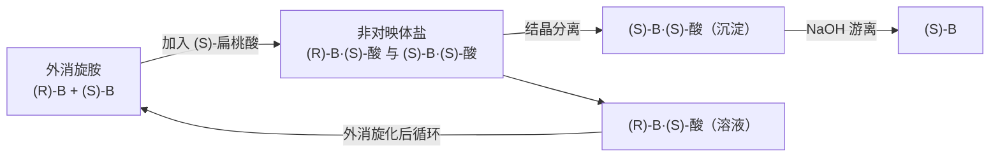

[6.5.4](/6.5.4) 讨论了不断键就能相互转化的构象；本章讨论必须断键才能改变的**构型**。构型异构包括双键与环的顺反异构，以及由手性产生的对映异构与非对映异构。[6.1.5](/6.1.5) 已经用配合物介绍了**手性**、**对映体**、**非对映体**与**外消旋体**，这里把它们系统化：先建立描述构型的语言（CIP 顺序规则、Z/E、R/S、Fischer 投影与 D/L），再讨论含多个手性中心的分子、没有手性中心的手性分子、旋光性，以及怎样得到单一对映体。最后一节的同位、对映异位、非对映异位与 Re/Si 面，是 [6.5.6](/6.5.6#sec-6.5.1) 判断 NMR 等价性和 [6.5.16](/6.5.16#sec-16.4) 讨论羰基加成立体化学的基础。

手性是生命化学的核心特征：蛋白质由 L-氨基酸构成，核酸与多糖由 D-糖构成，酶与受体都是手性的，因此一对对映体在体内的作用可能截然不同。这也是 [6.6](/6.6) 化学生物学与 [7.1](/7.1) 生物化学反复用到本章内容的原因。

## 5.1. 顺反异构与 Z/E 命名

### 5.1.1. 顺反异构

**定义 5.1.1（顺反异构）** 由于双键不能自由旋转（或环的存在），双键两端碳原子上（或环上不同碳原子上）的基团在空间的排列方式不同而产生的立体异构，称为**顺反异构**。相同或相似的基团在双键（或环平面）同侧的称为顺式（cis），异侧的称为反式（trans）。

$\ce{C=C}$ 的 π 键要旋转 $90^\circ$ 才会断开，能垒约 $260\,\mathrm{kJ\,mol^{-1}}$，室温下顺反异构体不会相互转化。除 $\ce{C=C}$ 外，$\ce{C=N}$（亚胺、肟）与 $\ce{N=N}$（偶氮化合物）也有顺反异构。顺反异构体是非对映体，物理性质不同：顺-2-丁烯有微小的偶极矩，沸点 $3.7\,^\circ\mathrm{C}$；反-2-丁烯的偶极矩为零，沸点 $0.9\,^\circ\mathrm{C}$；反式更对称、在晶体中堆积更好，熔点（$-105.5\,^\circ\mathrm{C}$）远高于顺式（$-138.9\,^\circ\mathrm{C}$）。

```smiles
C/C=C\C cis
C/C=C/C trans
```

### 5.1.2. CIP 顺序规则

顺/反只适用于双键两端各有一个相同基团的情形。三取代、四取代的烯烃，以及后面的手性中心，都需要一种给任意基团排定先后的规则。

**定义 5.1.2（CIP 顺序规则）** 为了描述立体构型而人为规定的、比较与同一原子相连的原子或基团优先次序的一组规则，称为 **CIP 顺序规则**（Cahn–Ingold–Prelog priority rules），简称顺序规则。按 IUPAC 2013 年建议（P-92），主要规则如下：

1. **规则 1a**：直接相连的原子，原子序数大者优先。孤对电子视为原子序数 0，排在最后。
2. **规则 2**：原子序数相同时，质量数大者优先（如 D > H，$^{13}\mathrm{C}$ > $^{12}\mathrm{C}$）。
3. **规则 3**：seqcis（Z）优先于 seqtrans（E）。
4. **规则 4**：手性单元优先于假不对称单元，再优先于非立体单元；成对的描述符中，相同的一对（RR、SS）优先于不同的一对（RS）；r 优先于 s。
5. **规则 5**：R 优先于 S（以及 M 优先于 P）。

规则 3–5 只在构造完全相同、仅立体化学不同的基团之间才需要（5.4.4 节的假不对称中心）；绝大多数情况只用规则 1。

应用规则 1 时，按"层层向外"的方式比较：

- 先比较直接相连的第一个原子。
- 若相同，比较与它们相连的三个原子组成的集合：把每个集合按原子序数从大到小排好，逐个比较，在第一个不同处分出先后。例如 $\ce{-CH2OH}$ 的集合是 $\{\mathrm{O}, \mathrm{H}, \mathrm{H}\}$，$\ce{-C(CH3)3}$ 是 $\{\mathrm{C}, \mathrm{C}, \mathrm{C}\}$，因为 O > C，$\ce{-CH2OH}$ 优先：比较的是集合中最大的原子，而不是原子序数之和。
- 若仍相同，沿优先的分支继续向外一层，直到分出先后。
- 双键、三键上的原子要重复计算：$\ce{C=O}$ 看作 C 上连两个 O、O 上连两个 C，$\ce{C#N}$ 看作 C 上连三个 N。重复的原子（复制原子）上只连原子序数为 0 的虚原子。

**例 5.1.1** 比较 $\ce{-CH=CH2}$ 与 $\ce{-CH(CH3)2}$、$\ce{-C#CH}$ 与 $\ce{-C(CH3)3}$、$\ce{-C6H5}$ 与 $\ce{-C#CH}$ 的优先次序。

**解** 乙烯基的第一个碳连 $\{\mathrm{C}, \mathrm{C}_{\text{dup}}, \mathrm{H}\}$，异丙基连 $\{\mathrm{C}, \mathrm{C}, \mathrm{H}\}$，相同。向外一层：乙烯基较优的分支是 $\ce{=CH2}$ 的碳，它连 $\{\mathrm{C}_{\text{dup}}, \mathrm{H}, \mathrm{H}\}$；异丙基的分支是甲基，连 $\{\mathrm{H}, \mathrm{H}, \mathrm{H}\}$。C > H，所以 $\ce{-CH=CH2}$ > $\ce{-CH(CH3)2}$。同理，乙炔基的第一个碳连 $\{\mathrm{C}, \mathrm{C}_{\text{dup}}, \mathrm{C}_{\text{dup}}\}$，与叔丁基的 $\{\mathrm{C}, \mathrm{C}, \mathrm{C}\}$ 相同；向外一层，乙炔基末端碳连 $\{\mathrm{C}_{\text{dup}}, \mathrm{C}_{\text{dup}}, \mathrm{H}\}$，叔丁基的甲基连 $\{\mathrm{H}, \mathrm{H}, \mathrm{H}\}$，乙炔基优先。苯基的 ipso 碳连 $\{\mathrm{C}, \mathrm{C}, \mathrm{C}_{\text{dup}}\}$；向外一层，苯基有两个邻位碳各连 $\{\mathrm{C}, \mathrm{C}_{\text{dup}}, \mathrm{H}\}$ 和一个只连虚原子的复制碳，乙炔基只有一个分支连 $\{\mathrm{C}, \mathrm{C}, \mathrm{H}\}$、两个复制碳；第二个分支 $\{\mathrm{C}, \mathrm{C}, \mathrm{H}\} > \{0, 0, 0\}$，苯基优先。

常见基团的优先次序（从高到低）：

$$
\begin{aligned}
&\ce{-I} > \ce{-Br} > \ce{-Cl} > \ce{-SO3H} > \ce{-SH} > \ce{-F} > \ce{-OCOR} > \ce{-OR} > \ce{-OH} > \ce{-NO2} > \ce{-NR2} > \ce{-NHR} > \ce{-NH2} \\
&> \ce{-CCl3} > \ce{-COCl} > \ce{-COOR} > \ce{-COOH} > \ce{-CONH2} > \ce{-COR} > \ce{-CHO} > \ce{-CH2OH} > \ce{-C#N} \\
&> \ce{-C6H5} > \ce{-C#CH} > \ce{-C(CH3)3} > \ce{-CH=CH2} > \ce{-CH(CH3)2} > \ce{-CH2CH3} > \ce{-CH3} > \ce{-D} > \ce{-H}
\end{aligned}
$$

### 5.1.3. Z/E 命名

**定义 5.1.3（Z/E 命名）** 按 CIP 顺序规则分别确定双键两端碳原子上两个基团的优先次序，两个优先基团在双键同侧的构型记为 Z（德文 zusammen，在一起），异侧的记为 E（entgegen，相对）。这种命名构型的方法称为 **Z/E 命名**（E–Z notation）。

Z/E 适用于一切顺反异构的双键，比顺/反的适用范围广。两者没有固定的对应关系：Z 不一定是顺式，E 也不一定是反式。例如 1-溴-1,2-二氯乙烯，左端碳上 Br > Cl，右端碳上 Cl > H：两个 Cl 在异侧的异构体是 (Z)-1-溴-1,2-二氯乙烯（Br 与右端的 Cl 同侧），按两个 Cl 的关系却称为反式。

```smiles
Cl/C(Br)=C/Cl (Z)
Cl/C(Br)=C\Cl (E)
```

分子中有多个双键时，每个双键分别标记，并写出位置编号，如 (2Z,4E)-2,4-己二烯。环内的双键在八元以下的环中只能是顺式，因此不必标出；(E)-环辛烯是可以分离的最小反式环烯烃，它还因为面手性而是手性分子（5.5.2）。

### 5.1.4. 顺反异构的应用：分子开关与分子机器

顺反异构体可以用光相互转化：吸收光子后，π 键在激发态中减弱或断开，分子绕双键扭转，再回到基态时得到顺、反两种异构体的混合物（光化学的细节见 [6.5.31](/6.5.31)）。偶氮苯是最常用的分子光开关。


(E)-偶氮苯近乎平面，(Z)-偶氮苯的两个苯环扭向一侧，两端距离从约 $0.9\,\mathrm{nm}$ 缩短到约 $0.55\,\mathrm{nm}$，偶极矩从零变为约 $1.0\times 10^{-29}\,\mathrm{C\,m}$。用约 $340\,\mathrm{nm}$ 的紫外光（$\pi\to\pi^*$）照射，E 式转变为 Z 式；用约 $440\,\mathrm{nm}$ 的可见光（$n\to\pi^*$）照射或加热，Z 式回到 E 式。室温下 Z 式热回复的半衰期为数天。因为正、逆两个方向都由光控制，把偶氮苯接到肽链、核酸或离子通道上，就可以用光可逆地改变生物分子的构象与活性（[6.5.31](/6.5.31)、[6.6](/6.6)）。

光驱动的顺反异构也是分子机器的基础。1999 年 Feringa 报道了第一个光驱动的单向旋转分子马达：一个位阻很大的烯烃在光致 E/Z 异构与热螺旋翻转的交替中只朝一个方向转动。Tour 等人则构建了以富勒烯为"轮子"的"纳米车"，在金属表面上滚动。2016 年 Sauvage、Stoddart 与 Feringa 因分子机器的设计与合成获得 Nobel 化学奖。

## 5.2. 手性与对称性

### 5.2.1. 手性与对映体

**定义 5.2.1（手性）** 物体与其镜像不能重合的性质称为**手性**，具有手性的分子称为手性分子。

乳酸 $\ce{CH3CH(OH)COOH}$ 的中心碳连有四个不同的基团，它的两种空间排列互为镜像而不能重合，是一对**对映体**。对映体分子中任意两个原子间的距离都相同，所以能量、熔点、沸点、溶解度、光谱等在非手性环境中完全相同；只有在手性环境中（与手性试剂、手性催化剂、酶或受体作用，或与圆偏振光作用）二者才表现出差异。

```smiles
C[C@@H](O)C(=O)O (R)
C[C@H](O)C(=O)O (S)
```

手性是几何性质，**旋光性**是它的一种可观测后果，二者不是一回事：手性分子组成的外消旋体没有旋光；有些手性分子的比旋光度小到测不出来（如 5-乙基-5-丙基十一烷，四个烷基相差太小）；而旋光也可以来自由非手性单元组成的手性晶体（如石英）。所以不能说"手性即旋光性"，判断手性要看对称性。

### 5.2.2. 对称性判据

分子是否手性，可以由它的对称元素判断：分子与其镜像能否重合，取决于它有没有某种"把左手变成右手"的对称操作。

- 对称面 $\sigma$：经过分子的一个平面，平面两侧的原子互为镜像。
- 对称中心 $i$：经过分子中心的每条直线上，两侧等距处都有相同的原子。
- 反轴 $S_n$（旋转反映轴）：绕轴旋转 $360^\circ/n$ 后再对垂直于轴的平面反映，分子不变。$S_1 = \sigma$，$S_2 = i$。

**定理 5.2.1** 分子是手性的，当且仅当它没有任何反轴 $S_n$（包括对称面与对称中心）。

单纯的旋转轴 $C_n$ 不影响手性：反-1,2-二甲基环丙烷与 $\ce{[Co(en)3]^3+}$ 都有 $C_2$ 轴，却都是手性的。反过来，只有 $S_4$ 轴而没有对称面与对称中心的分子是非手性的，这样的例子很少，但它们说明判据必须写成"没有反轴"，而不是"没有对称面与对称中心"。日常判断中，检查对称面与对称中心几乎总是够用的。

快速翻转的分子按时间平均的结构判断。例如顺-1,2-二甲基环己烷的每个**椅式构象**都没有对称面，但两种椅式互为镜像、通过**翻环**迅速相互转化，因此它是非手性的（内消旋，5.4.2）。对环己烷衍生物，把环当作平面来找对称面（平面分析）得到的结论与构象分析相同。

### 5.2.3. 手性中心

**定义 5.2.2（手性中心）** 连有四个互不相同的原子或基团、交换其中任意两个就得到另一个立体异构体的四面体原子，称为**手性中心**（stereocenter），也称不对称原子；最常见的是手性碳原子。

含一个手性中心的分子一定是手性的；含多个手性中心的分子不一定（5.4.2）。除碳外，以下原子也可以是手性中心：

| 原子 | 例子 | 构型能否保持 |
|---|---|---|
| 季铵 N、季鏻 P | $\ce{[N(CH3)(C2H5)(C3H7)(C6H5)]+}$ | 能 |
| 叔胺 N | $\ce{N(CH3)(C2H5)(C3H7)}$，孤对电子为第四个"基团" | 不能：**氮翻转**能垒仅约 $25\,\mathrm{kJ\,mol^{-1}}$，室温下每秒翻转 $10^{8}$ 次以上（[6.5.23](/6.5.23#sec-23.3.2)）；N 在小环或桥头（如 Tröger 碱）时可以 |
| 膦 P | $\ce{P(CH3)(C2H5)(C6H5)}$ | 能：翻转能垒约 $130\,\mathrm{kJ\,mol^{-1}}$，手性膦是重要的配体（5.8） |
| 亚砜 S | 甲基苯基亚砜 $\ce{CH3S(O)C6H5}$ | 能：埃索美拉唑就是奥美拉唑的 (S)-亚砜对映体 |
| 硅 | $\ce{SiH(CH3)(C2H5)(C6H5)}$ | 能 |

同位素的差别也足以产生手性：$\ce{CH3CHDOH}$（1-氘代乙醇）是手性分子，按规则 2（D > H）可以标出 R/S。生物化学中常用这种"同位素手性"的底物研究酶反应的立体化学（5.9）。

## 5.3. 构型的表示：R/S、Fischer 投影与 D/L

### 5.3.1. R/S 命名

**定义 5.3.1（R/S 命名）** 按 CIP 顺序规则排出手性中心上四个基团的次序 $1 > 2 > 3 > 4$，从最低优先的基团 4 的对面观察，$1\to 2\to 3$ 为顺时针的构型记为 R（拉丁文 rectus，右），逆时针的记为 S（sinister，左）。这样标记的、反映原子实际空间排列的构型称为绝对构型（absolute configuration）。

用楔形式判断时，最低优先的基团若在虚楔形键上（指向纸面内），直接读 $1\to 2\to 3$ 的方向；若在实楔形键上（指向观察者），读出的方向取反；若在纸面内，可以交换任意两个基团使 4 处于虚楔形键上，读出方向后再取反（交换一次就得到对映体）。

**例 5.3.1** 确定 2-溴丁烷对映体的构型：$\ce{CH3CH2}$ 与 $\ce{CH3}$ 中，乙基的第一个碳连 $\{\mathrm{C}, \mathrm{H}, \mathrm{H}\}$，甲基连 $\{\mathrm{H}, \mathrm{H}, \mathrm{H}\}$，所以次序为 $\ce{Br} > \ce{CH2CH3} > \ce{CH3} > \ce{H}$。H 指向后方时 Br → Et → Me 为逆时针的是 (S)-2-溴丁烷，它是右旋的，记作 (S)-(+)-2-溴丁烷。

R/S 是按规则定义的符号，与旋光方向 (+)/(−) 没有必然联系；同一个手性中心的 R/S 甚至可能因为远处基团的变化而改变，尽管空间排列没变。例如 L-丙氨酸是 (S)，而 L-半胱氨酸是 (R)：只因为 $\ce{-CH2SH}$ 中的 S 使它的优先次序超过了 $\ce{-COOH}$。

在 1951 年以前，化学家只能确定化合物之间的相对构型，而不知道真实的空间排列。Bijvoet 用 X 射线反常散射测定了 (+)-酒石酸铷钠晶体的绝对构型，恰好证实了此前任意约定的结果。

### 5.3.2. Fischer 投影式

**定义 5.3.2（Fischer 投影式）** 把手性中心放在纸面上，使竖直方向的两个键指向纸面后方、水平方向的两个键指向纸面前方，然后投影到纸面上，用十字交叉点表示手性中心。这样得到的平面图称为 **Fischer 投影式**（Fischer projection）。习惯上把主碳链竖直排列，编号最小（氧化态最高）的碳放在上方。


Fischer 投影式隐含了三维信息，只能做保持这一含义的操作：

| 操作 | 结果 |
|---|---|
| 在纸面内旋转 $180^\circ$ | 构型不变（水平键仍朝前） |
| 在纸面内旋转 $90^\circ$ | 变为对映体（水平键与竖直键的前后关系颠倒） |
| 交换任意两个基团 | 变为对映体；交换两次构型复原 |
| 固定一个基团，其余三个依次轮换 | 构型不变（相当于交换两次） |
| 离开纸面翻转 | 变为对映体 |


由 Fischer 投影式读 R/S：最低优先的基团（通常是 H）在竖直键上时，直接读 $1\to 2\to 3$ 的方向；在水平键上时，读出的方向取反。

### 5.3.3. D/L 命名

在 R/S 体系建立以前（以及今天的糖和氨基酸化学中），构型用 D/L 表示。

**定义 5.3.3（D/L 命名）** 以甘油醛为标准：Fischer 投影式中醛基在上、羟甲基在下，手性碳上的 OH 在右边的为 D-甘油醛，在左边的为 L-甘油醛。其他化合物通过化学转化与甘油醛关联：对糖，看 Fischer 投影式中编号最大的手性碳（离羰基最远者）上 OH 的位置，在右为 D、在左为 L；对 α-氨基酸，羧基在上、侧链在下时 $\ce{NH2}$ 在左的为 L。这种以甘油醛为参照的相对构型标记称为 **D/L 命名**。

1906 年 Rosanoff 任意规定右旋甘油醛为 D 型，Bijvoet 的测定证明这个猜测恰好正确：D-(+)-甘油醛就是 (R)-甘油醛。D/L 只描述与参照物的关系，同 R/S 一样与旋光方向无关：D-果糖是左旋的，L-(+)-乳酸的钠盐是左旋的。天然的糖几乎都是 D 型，天然蛋白质中的氨基酸都是 L 型（[6.5.32](/6.5.32)、[6.5.33](/6.5.33)）。在手性的 L-氨基酸中（甘氨酸没有手性），除半胱氨酸（以及硒代半胱氨酸）为 R 外，α 碳都是 S。

含两个相邻手性中心的开链化合物，有时用赤式（erythro）/苏式（threo）描述相对构型：Fischer 投影式中两个相似的基团在同侧的为赤式（来自赤藓糖），异侧的为苏式（来自苏阿糖）。

## 5.4. 含多个手性中心的化合物

### 5.4.1. 对映体与非对映体

含 $n$ 个手性中心的分子最多有 $2^n$ 个**立体异构体**，组成 $2^{n-1}$ 对对映体。以 3-氯-2-羟基丁二酸为例，两个手性中心各有 R、S 两种构型，得到 (2R,3R)、(2S,3S)、(2R,3S)、(2S,3R) 四个异构体：(2R,3R) 与 (2S,3S) 互为对映体，(2R,3S) 与 (2S,3R) 互为对映体，其余每两个之间互为非对映体。

**定义 5.4.1（非对映体）** 不互为镜像的立体异构体称为**非对映体**。

规律很简单：两个立体异构体的所有手性中心构型都相反，是对映体；部分相反、部分相同，是非对映体。非对映体的物理性质（熔点、溶解度、NMR 谱、色谱保留时间）和化学反应速率都不同，可以用普通方法分离，这是拆分外消旋体的基础（5.7）。

**定义 5.4.2（差向异构体）** 含多个手性中心的两个非对映体，若只有一个手性中心的构型相反、其余都相同，则互称**差向异构体**（epimers）；两者之间的相互转化称为差向异构化。

例如 D-葡萄糖与 D-甘露糖是 C2 差向异构体，D-葡萄糖与 D-半乳糖是 C4 差向异构体。差向异构体一定是非对映体。

### 5.4.2. 内消旋化合物

两个手性中心连有相同的一组基团时，立体异构体的数目少于 $2^n$。酒石酸（2,3-二羟基丁二酸）的 (2R,3S) 与 (2S,3R) 实际上是同一个分子：它在全重叠构象中有一个垂直于 C2–C3 键的对称面（交叉构象中有对称中心），分子与其镜像重合，没有旋光性。

**定义 5.4.3（内消旋化合物）** 含有手性中心、但因分子内存在对称面或对称中心（一般地，反轴）而能与其镜像重合的非手性化合物，称为**内消旋化合物**，记作 meso-。


所以酒石酸只有三个立体异构体：(+)-酒石酸 (2R,3R)、(−)-酒石酸 (2S,3S) 与内消旋酒石酸。内消旋体是单一化合物，与外消旋体（两种分子的等量混合物）不同；它与 (+)、(−) 体互为非对映体，熔点、溶解度都与 (+)、(−) 体（熔点 $171$–$174\,^\circ\mathrm{C}$）不同。

判断内消旋要在某一个构象中找到对称元素：Fischer 投影式对应全重叠构象，可以直接找水平的对称面；交叉构象中的对称元素可能是对称中心。用 Newman 投影在不同构象之间转换，会发现非手性的构象与手性的构象之间可以快速转化，而手性的构象总是成对出现、比例相等，因此宏观上不显旋光。

环状化合物也有内消旋体：顺-1,2-二甲基环己烷、顺-1,2-环己二醇有通过环的对称面，是内消旋化合物；它们的反式异构体没有对称面，是一对对映体。

```smiles
C[C@@H]1CCCC[C@@H]1C cis (meso)
C[C@@H]1CCCC[C@H]1C trans (1R,2R)
```

### 5.4.3. 假不对称中心

**定义 5.4.4（假不对称中心）** 连有两个构造相同、构型相反（一个 R、一个 S）的基团以及另外两个不同基团的四面体原子，称为**假不对称中心**（pseudoasymmetric center）。它的构型用小写的 r、s 标记，按 CIP 规则 5 规定 R 基团优先于 S 基团。

假不对称中心的特点是：交换它的两个基团得到另一个立体异构体（所以它是立体中心），但它的镜像操作不改变自身的描述符（r 的镜像仍然是 r，因为镜像同时把 R 基团变成 S 基团）。2,3,4-三羟基戊二酸有三个"可能的"手性中心，但只有 4 个立体异构体：

- C2、C4 构型相同（R,R 或 S,S）时，C3 所连的两个基团完全相同，C3 不是立体中心；(2R,4R) 与 (2S,4S) 是一对对映体，都有旋光性。
- C2、C4 构型相反时，C3 是假不对称中心，(2R,3r,4S) 与 (2R,3s,4S) 是两个不同的内消旋化合物，互为非对映体，都没有旋光性。

## 5.5. 没有手性中心的手性分子

手性中心只是产生手性的一种方式。按手性元素的类型，手性分子分为中心手性、轴手性、面手性和螺旋手性等。

### 5.5.1. 轴手性

**定义 5.5.1（轴手性）** 分子中没有手性中心，但有一根轴（手性轴），轴两端的基团排列方式使分子不能与其镜像重合，这种手性称为**轴手性**（axial chirality）。

两类常见的轴手性分子：

- 丙二烯型：$\ce{abC=C=Cab}$。丙二烯两端碳的取代基位于互相垂直的两个平面内；只要每一端的两个基团不同（a ≠ b），分子就没有对称面，是手性的。任何一端连有两个相同基团时，分子有对称面，不是手性的。**螺环化合物**（如 2,6-二取代螺[3.3]庚烷）与亚烷基环己烷也属此类。
- 联芳基型：2,2′,6,6′-位有足够大的取代基时，两个芳环不能转到共平面，也不能绕连接的单键自由旋转，分子以两种互为镜像的扭曲构象存在。

**定义 5.5.2（阻转异构体）** 因绕单键的旋转受阻而可以分离的立体异构体称为**阻转异构体**（atropisomers）。

阻转异构体介于构象异构与构型异构之间（[6.5.4](/6.5.4#sec-4.1) 4.1 节）：它们由单键旋转相互转化，但能垒高到可以分离。1,1′-联-2-萘酚（BINOL）消旋化的能垒约 $158\,\mathrm{kJ\,mol^{-1}}$，室温下半衰期以百万年计，加热到 $200\,^\circ\mathrm{C}$ 以上才在数小时内消旋。由 BINOL 衍生的双膦配体 BINAP 是 Noyori 不对称氢化的手性来源（5.8）。

轴手性的标记：沿手性轴观察（从哪一端看结果都相同），近端的两个基团优先于远端的两个基团，各端内部按 CIP 规则排序；于是得到 1、2（近端）和 3、4（远端），然后按 R/S 的方法判断 $1\to 2\to 3$ 的方向，记为 $R_{\mathrm{a}}$ 或 $S_{\mathrm{a}}$（a 表示轴）。实用的画法是把近端基团写在 Fischer 投影式的水平键上、远端基团写在竖直键上，再按 Fischer 投影读出构型。轴手性也可以按螺旋方向记为 P/M，$R_{\mathrm{a}}$ 对应 M，$S_{\mathrm{a}}$ 对应 P。


### 5.5.2. 面手性

**定义 5.5.3（面手性）** 分子中没有手性中心和手性轴，但有一个手性平面：平面上的原子与平面外的基团排列方式使分子不能与其镜像重合，这种手性称为**面手性**（planar chirality）。

典型的例子：

- 1,2-二取代（取代基不同）的二茂铁：茂环所在的平面加上两个不同的取代基，使镜像不能重合；手性二茂铁膦配体（如 Josiphos）在工业不对称氢化中有重要应用。
- 环蕃（cyclophane）与柄型（ansa）化合物：一个芳环被一条碳链跨接，芳环上有一个取代基；连接链足够短时芳环不能翻转，对映体可以分离；链过长时芳环可以从链中翻过去，面手性消失。
- (E)-环辛烯：双键所在的平面加上从一侧绕过的亚甲基链。

面手性的标记：选择手性平面（包含尽可能多、但不是全部原子的平面）；选与平面上原子直接相连、自身在平面外、且通往优先基团路径最短的原子为导向原子 P（pilot atom）；从与 P 相连的平面原子 a 开始，按 CIP 次序沿平面建立 $a\to b\to c$；从 P 向平面看，$a\to b\to c$ 顺时针记为 $R_{\mathrm{p}}$，逆时针记为 $S_{\mathrm{p}}$。

### 5.5.3. 螺旋手性与固有手性

**定义 5.5.4（螺旋手性）** 分子因整体呈螺旋形而不能与其镜像重合，这种手性称为**螺旋手性**（helicity）。右手螺旋记为 P（plus），左手螺旋记为 M（minus）。

六螺烯（六个苯环邻位稠合）因末端环相互重叠而扭成螺旋，是稳定的螺旋手性分子。生物大分子的螺旋也有手性：蛋白质的 α 螺旋与 B 型 DNA 都是右手螺旋，Z 型 DNA 是左手螺旋。

还有一些分子的手性不能归结为某个中心、轴或面，而来自整个三维骨架上非手性基团的不对称排列，称为固有手性（inherent chirality，Böhmer 于 1994 年针对杯芳烃提出），例如在杯芳烃骨架上引入几个不同的非手性基团使之只剩 $C_1$ 对称性，以及 $\ce{C76}$ 这样的手性富勒烯。

## 5.6. 旋光性

### 5.6.1. 旋光度与比旋光度

**线偏振光**（平面偏振光）通过手性物质的溶液时，振动面发生旋转（**旋光性**，物理原理见 [5.4.3](/5.4.3)）。迎着光看，使振动面顺时针旋转的物质为右旋，记作 (+)（旧称 d）；逆时针为左旋，记作 (−)（旧称 l）。旋转的角度 $\alpha$ 称为旋光度，用旋光仪测定：两个偏振片之间放样品管，转动检偏器找出消光位置。

**定义 5.6.1（比旋光度）** 旋光度与样品管长度和浓度的比值

$$
[\alpha]_\lambda^T = \frac{\alpha}{l\,\rho} \tag{5.1}
$$
称为**比旋光度**（specific rotation）。其中 $l$ 是样品管长度（以 $\mathrm{dm}$ 计），$\rho$ 是质量浓度（以 $\mathrm{g\,mL^{-1}}$ 计；纯液体用密度）；$T$ 为温度，$\lambda$ 为波长，通常用钠 D 线（$589.3\,\mathrm{nm}$）、$20\,^\circ\mathrm{C}$，记作 $[\alpha]_{\mathrm{D}}^{20}$，并注明溶剂和浓度。

按惯例，比旋光度只写数值与度数，如 (S)-2-溴丁烷 $[\alpha]_{\mathrm{D}}^{20} = +23.1^\circ$（纯液体），L-(+)-酒石酸 $[\alpha]_{\mathrm{D}}^{20} = +12^\circ$（$c = 20$，水），其对映体的比旋光度大小相等、符号相反。比旋光度随溶剂、浓度、温度和波长变化，有时甚至改变符号，所以只在规定条件下才是物质的特征常数。比旋光度随波长的变化称为旋光色散；手性分子对左、右圆偏振光吸收的差别即**圆二色谱**，二者共同用于测定绝对构型和蛋白质的二级结构（[6.4.9](/6.4.9)）。

### 5.6.2. 外消旋化

**定义 5.6.2（外消旋化）** 光学活性的化合物在物理或化学因素作用下转变为两种对映体的平衡混合物（外消旋体）、因而失去旋光性的过程，称为**外消旋化**（racemization）。

外消旋化一般经过一个非手性的中间体或过渡态：手性中心上的 $\ce{C-H}$ 失去质子形成平面的**烯醇负离子**或**碳负离子**、离去基离去形成平面的**碳正离子**（[6.5.8](/6.5.8#sec-8.4.2) 的 SN1）、形成平面的自由基，或者像阻转异构体那样经过平面的过渡态。羰基 α 位的手性中心在酸或碱中很容易外消旋（[6.5.21](/6.5.21#sec-21.2.3)）。从热力学看，单一对映体转化为外消旋体是自发的：两种对映体的标准 Gibbs 自由能相同，过程的推动力完全来自混合熵，$\Delta G = -RT\ln 2 \approx -1.7\,\mathrm{kJ\,mol^{-1}}$（$298\,\mathrm{K}$）。


外消旋化的速率可以用来测年。氨基酸在生物体内由酶合成，几乎全是 L 型；生物死亡后，残留在骨骼、牙齿、贝壳中的氨基酸缓慢地外消旋。把 $\ce{L <=> D}$ 看作两个速率常数都为 $k$ 的对峙一级反应（[6.3.15](/6.3.15)），对映体过量随时间指数衰减，$\mathrm{ee}(t) = \mathrm{e}^{-2kt}$，于是

$$
\ln\frac{1 + [\mathrm{D}]/[\mathrm{L}]}{1 - [\mathrm{D}]/[\mathrm{L}]} = 2kt. \tag{5.2}
$$
$[\mathrm{D}]/[\mathrm{L}] = 1/3$ 时 ee 降为一半，所需时间称为"半外消旋期"；$t\to\infty$ 时 $[\mathrm{D}]/[\mathrm{L}]\to 1$。$k$ 强烈依赖温度（由 **Arrhenius 方程**，活化能约 $120$–$130\,\mathrm{kJ\,mol^{-1}}$），所以这种方法适用于温度长期稳定的样品，如洞穴遗址和海底沉积中的化石，可测数千至数百万年。最常用的异亮氨酸有两个手性中心，它的 C2 构型改变得到的是 D-别异亮氨酸，这是差向异构化而不是外消旋化，平衡时 $[\text{D-allo-Ile}]/[\text{L-Ile}] \approx 1.3$ 而不是 1；它在 $20\,^\circ\mathrm{C}$ 下的"半衰期"约 11 万年，$15\,^\circ\mathrm{C}$ 下约 29 万年。同样的原理也用于法医学：牙本质中天冬氨酸的外消旋程度每年约增加千分之一，可以估计年龄。

## 5.7. 获得单一对映体

### 5.7.1. 为什么需要单一对映体

手性药物的两个对映体常有不同的药效或毒性。沙利度胺（反应停）在 1950 年代末作为镇静剂与止孕吐药使用，导致上万名婴儿肢体畸形；美国 FDA 的审查员 Kelsey 因坚持要求补充安全性数据而阻止了它在美国上市。通常认为 (R)-沙利度胺有镇静作用、(S)-沙利度胺致畸，但这并不意味着服用纯的 (R) 对映体就安全：沙利度胺的手性中心是羰基 α 位的 $\ce{C-H}$，在体内几小时内就外消旋，两种对映体都会存在。类似地，布洛芬的药效来自 (S) 对映体，而无效的 (R) 对映体在体内单向转化为 (S)。气味受体也能区分对映体：(R)-(−)-香芹酮有留兰香（薄荷）味，(S)-(+)-香芹酮有葛缕子味。


```smiles
CC1=CC[C@H](CC1=O)C(C)=C (R)-carvone
CC1=CC[C@@H](CC1=O)C(C)=C (S)-carvone
O=C1CCC(N2C(=O)c3ccccc3C2=O)C(=O)N1 thalidomide
```

获得单一对映体有三条途径：从天然产物中取得（手性源，chiral pool）；拆分外消旋体；不对称合成（5.8）。

### 5.7.2. 拆分

**定义 5.7.1（拆分）** 把外消旋体分离为两种纯对映体的过程称为**拆分**（chiral resolution）。

对映体的物理性质相同，不能直接用结晶、蒸馏等方法分离。常用的方法有：

1. 自发拆分：少数外消旋体结晶时两种对映体分别形成互为镜像的晶体（聚集体，conglomerate）。1848 年 Pasteur 在显微镜下用镊子把外消旋酒石酸钠铵的两种晶体分开，这是历史上第一次拆分。
2. 化学拆分（经非对映体）：用一种纯的手性试剂（拆分剂）与外消旋体反应，把一对对映体转化为一对非对映体，利用它们溶解度等性质的差别分离，再除去拆分剂。拆分酸常用手性碱（马钱子碱、奎宁、(R)-1-苯乙胺），拆分碱常用手性酸（酒石酸、扁桃酸、樟脑磺酸）。
3. 酶法拆分（动力学拆分）：利用酶对两种对映体的反应速率不同，只让其中一种转化。例如脂肪酶在有机溶剂中选择性地把外消旋仲醇的一种对映体乙酰化，再分离醇与酯。
4. 色谱拆分：用**手性色谱**柱（手性固定相）直接分离对映体，或先衍生为非对映体再用普通色谱柱分离（[6.4.14](/6.4.14)）。它是测定对映体组成的标准方法。



抗抑郁药度洛西汀的工业合成就用了这样的方法：外消旋的 3-(甲氨基)-1-(2-噻吩基)-1-丙醇溶于甲苯–甲醇，加入 (S)-扁桃酸，(S)-醇形成难溶的非对映体盐析出，过滤后用 NaOH 游离得到 (S)-醇；留在母液中的 (R)-醇在盐酸作用下外消旋（它只有一个手性中心，经苄位型碳正离子转化为外消旋体），再循环拆分。这种"拆分–外消旋化–循环"的做法使原料几乎全部转化为需要的对映体。


**定义 5.7.2（动力学拆分）** 利用两种对映体与手性试剂或手性催化剂反应速率的差别，使其中一种优先转化而实现的拆分，称为**动力学拆分**（kinetic resolution）。

经典动力学拆分的产率不超过 $50\%$（只取一种对映体）。如果在反应条件下底物的两种对映体可以快速相互转化，慢反应的对映体不断外消旋化为快反应的对映体，理论产率可达 $100\%$，称为动态动力学拆分（dynamic kinetic resolution）。


### 5.7.3. 对映体过量与非对映体过量

**定义 5.7.3（对映体过量）** 对映体混合物中，两种对映体的摩尔分数之差

$$
\mathrm{ee} = \frac{n_R - n_S}{n_R + n_S}\times 100\% \tag{5.3}
$$
（设 R 过量）称为**对映体过量**（enantiomeric excess）。

纯对映体的 ee 为 $100\%$，外消旋体为 $0$。$\mathrm{ee} = 60\%$ 意味着混合物中 $80\%$ 是 R、$20\%$ 是 S，可以看作 $60\%$ 的纯 R 加 $40\%$ 的外消旋体。若比旋光度与 ee 成正比（通常近似成立），则光学纯度 $= [\alpha]_{\text{obs}}/[\alpha]_{\max} \approx \mathrm{ee}$。现在 ee 一般用手性色谱或手性位移试剂 NMR 测定，而不用旋光。也常直接给出对映体比 er（如 $90 : 10$）。

**定义 5.7.4（非对映体过量）** 两种非对映体的混合物中，两者摩尔分数之差 $\mathrm{de} = (n_1 - n_2)/(n_1 + n_2)\times 100\%$（$n_1 > n_2$）称为**非对映体过量**（diastereomeric excess）。

**例 5.7.1** (a) 一个混合物含 $12.8\,\mathrm{mol}$ (R)-2-溴丁烷和 $3.2\,\mathrm{mol}$ (S)-2-溴丁烷，求 ee。(b) 某 2-溴丁烷样品测得 $[\alpha]_{\mathrm{D}} = +18.5^\circ$，已知纯 (S)-(+)-2-溴丁烷为 $+23.1^\circ$，求 ee 与两种对映体的含量。

**解** (a) $\mathrm{ee} = (12.8 - 3.2)/(12.8 + 3.2) = 60\%$（R 过量）。(b) $\mathrm{ee} = 18.5/23.1 = 80\%$（S 过量），所以 S 占 $(100 + 80)/2 = 90\%$，R 占 $10\%$。

## 5.8. 立体专一性、立体选择性与不对称合成

### 5.8.1. 立体专一性与立体选择性

**定义 5.8.1（立体专一性）** 立体异构的反应物分别生成立体异构的产物的反应称为**立体专一性**（stereospecificity）反应：反应物的构型决定产物的构型，由反应机理所规定。

**定义 5.8.2（立体选择性）** 一个反应可能生成几种立体异构体，但其中一种（或一对）占优势，这样的反应称为**立体选择性**（stereoselectivity）反应；占优的是对映体时称对映选择性，是非对映体时称非对映选择性。

立体专一性的例子：**SN2** 反应使手性中心构型翻转（[6.5.8](/6.5.8#sec-8.4.1)）；$\ce{Br2}$ 对 2-丁烯的反式加成，(E)-2-丁烯只生成内消旋的 2,3-二溴丁烷，(Z)-2-丁烯只生成外消旋体（[6.5.11](/6.5.11#sec-11.4.2)）；**E2** 消除要求**反式共平面**（[6.5.9](/6.5.9#sec-9.4.2)）。立体选择性的例子：$\ce{LiAlH4}$ 还原 4-叔丁基环己酮，约 $90\%$ 得到羟基处于**平伏键**的反式醇，约 $10\%$ 得到羟基直立的顺式醇（小的负氢试剂优先从直立方向进攻）；改用体积很大的 L-Selectride，选择性反转，主要得到顺式醇（[6.5.17](/6.5.17#sec-17.1.2)）。


```smiles
CC(C)(C)C1CCC(=O)CC1>>CC(C)(C)[C@H]1CC[C@H](O)CC1 trans (90%)
```

立体专一的反应一定有立体选择性，反之则不然。

### 5.8.2. 不对称合成

**定义 5.8.3（不对称合成）** 使底物分子中的非手性单元在手性因素的作用下转化为手性单元、并且不等量地生成立体异构产物的反应，称为**不对称合成**（asymmetric synthesis）。

非手性的反应物在非手性条件下只能得到外消旋体：例如 HCl 与 2-丁烯加成，**碳正离子**的两个面受到进攻的几率相等，得到等量的 (R)- 与 (S)-2-氯丁烷。要偏向一面，必须引入手性，按手性的来源有三种策略：

1. 手性底物（底物控制）：底物中已有的手性中心控制新手性中心的生成。例如在环己烯的另一位置上有体积大的叔丁基时，$\ce{BH3}$ 主要从叔丁基的对面进攻，**硼氢化–氧化**主要得到一种非对映体（[6.5.11](/6.5.11#sec-11.4.6)）。把可回收的手性基团临时连到底物上、反应后再去掉，这样的基团称为**手性助剂**，如 Evans 的噁唑烷酮。
2. 手性试剂：用化学计量的手性试剂提供不对称环境，例如 Noyori 1979 年报道的 BINAL-H（用 BINOL 修饰的 $\ce{LiAlH4}$）把芳香酮还原为高 ee 的醇。
3. 不对称催化（asymmetric catalysis）：只用少量手性催化剂就得到大量手性产物，效率最高。Knowles 用手性膦–铑配合物不对称氢化合成治疗帕金森病的 L-多巴（1970 年代，第一个工业化的不对称催化过程）；Noyori 的 BINAP–钌催化剂可以高选择性地氢化烯烃与酮，转换频率可达每秒数十次、转换数可达百万以上；Sharpless 用 $\ce{Ti(O^{i}Pr)4}$、酒石酸二乙酯与叔丁基过氧化氢实现烯丙醇的不对称环氧化（[6.5.11](/6.5.11#sec-11.8.1)）。三人获 2001 年 Nobel 化学奖。2021 年 Nobel 化学奖授予 List 与 MacMillan，表彰不对称**有机小分子催化**：List 发现脯氨酸可以催化不对称**羟醛反应**（[6.5.22](/6.5.22#sec-22.6.3)），MacMillan 设计了经亚胺离子活化的手性咪唑烷酮催化剂。**酶催化**是自然界的不对称催化，其选择性通常极高。

一个有意思的新方向是去消旋化：把外消旋体直接转化为单一对映体。由微观可逆性，一个只靠热运动的催化剂不能做到这一点（它同时加速正、逆反应，终点仍是外消旋体，过程 $\Delta G = +RT\ln 2 > 0$）；必须输入能量，例如用光驱动（光反应的原理见 [6.5.31](/6.5.31)）。

## 5.9. 拓扑关系：同位、对映异位与非对映异位

### 5.9.1. 等价与异位

分子中两个相同的原子或基团（如 $\ce{CH2}$ 的两个 H）是否"真的等同"，可以用取代检验：依次把其中一个换成一个新的基团 Y，比较得到的两个分子。

**定义 5.9.1（同位、对映异位与非对映异位）** 分子中两个构造上相同的原子或基团，若分别用另一基团取代后得到的两个分子相同，则称它们是**同位**的（homotopic）；得到一对对映体，称为**对映异位**的（enantiotopic）；得到一对非对映体，称为**非对映异位**的（diastereotopic）。

与对称性的关系：能通过旋转轴 $C_n$ 相互交换的基团是同位的（如甲烷的四个 H、二氯甲烷的两个 H）；只能通过反轴（对称面、对称中心）相互交换的是对映异位的（如乙醇 $\ce{CH2}$ 的两个 H、溴氯甲烷的两个 H）；不能通过任何对称操作交换的是非对映异位的，典型情形是同一个碳上的两个 H，而分子中另有手性中心，如 (S)-2-氯丁烷 C3 上的两个 H：分别换成 Br 得到 (2R,3S)- 与 (2S,3S)-2-溴-3-氯丁烷（原来的 C2 在新名称中是 C3），互为非对映体。

化学后果：

| 关系 | 非手性环境（普通试剂、普通溶剂中的 NMR） | 手性环境（酶、手性试剂） |
|---|---|---|
| 同位 | 相同 | 相同 |
| 对映异位 | 相同 | 可以不同 |
| 非对映异位 | 不同（化学位移、反应速率一般都不同） | 不同 |

所以 (S)-2-氯丁烷的氢不是 4 组而是 5 组：C3 的两个 H 是非对映异位的，在 ¹H NMR 中化学位移不同（[6.5.6](/6.5.6#sec-6.5.1)、[6.4.12](/6.4.12)）。

### 5.9.2. 前手性

**定义 5.9.2（前手性）** 一个非手性的分子（或分子中非手性的部分），若把它的一对对映异位的基团之一换成另一个不同的基团、或在一个平面三角形原子的某一面加上一个新基团后变为手性，则称该中心（或面）是**前手性**的（prochiral）。

四面体前手性中心 $\ce{Caabc}$ 上两个相同的基团 a 用 pro-R 和 pro-S 区分：假设把其中一个 a 的优先次序提高（如把 H 换成 D），但不改变它相对于其余基团的次序，若得到的中心为 R，这个 a 就是 pro-R，另一个是 pro-S。例如乙醇 C1 的两个 H 中，把哪一个换成 D 得到 (R)-1-氘代乙醇，它就是 pro-R 氢。酵母醇脱氢酶氧化乙醇时专一地移去 pro-R 氢交给 $\ce{NAD+}$，这是酶能区分对映异位基团的经典证据。三羧酸循环中，柠檬酸的两个 $\ce{-CH2COOH}$ 基团是对映异位的，乌头酸酶只作用于其中一个：Ogston（1948）用"三点结合"模型解释了这一结果，指出非手性分子在手性酶中可以有确定的手性反应。


平面三角形的原子（羰基碳、烯烃碳）的两个面也可以区分。

**定义 5.9.3（Re 面与 Si 面）** 从垂直于平面三角形原子所在平面的方向观察，若该原子所连的三个基团按 CIP 次序从高到低为顺时针，朝向观察者的这一面称为 **Re 面**（Re face）；为逆时针，称为 **Si 面**（Si face）。


**亲核试剂**从 Re 面或 Si 面进攻，生成的手性中心构型不同；但"Re 面加成得到 R 还是 S"取决于新基团在 CIP 次序中的位置，必须具体分析。例如负氢从 Re 面加到苯乙酮上：新的 H 位于原来朝向观察者的一侧，而 OH、Ph、$\ce{CH3}$ 的相对位置不变，次序 $\ce{OH} > \ce{Ph} > \ce{CH3} > \ce{H}$，从观察者一侧看 $1\to 2\to 3$ 仍为顺时针，但最低优先的 H 指向观察者，所以产物是 (S)-1-苯乙醇。[6.5.16](/6.5.16#sec-16.4.2) 的 **Felkin–Anh 模型**与 [6.5.17](/6.5.17#sec-17.2.1) 的 **CBS 还原**就是在讨论如何控制进攻哪一面。

## 5.10. 同手性的起源

地球上的生命几乎只用 L-氨基酸与 D-糖，这种单一手性（同手性，homochirality）是怎样产生的，是一个尚未解决的问题。要回答它，需要说明两件事：最初的微小不对称从哪里来，以及它怎样被放大。关于起源的假说有：宇宙中的圆偏振光选择性地分解了一种对映体（陨石中已发现某些氨基酸有百分之几的 L 过量，Breslow 等人模拟了由这种微小过量出发的富集过程）；弱相互作用的宇称不守恒使两种对映体的能量有极微小的差别（各种估计在 $10^{-14}$–$10^{-11}\,\mathrm{J\,mol^{-1}}$ 的量级）；以及随机涨落。关于放大，已知 Soai 反应（一种自催化的不对称烷基化）能把极小的 ee 放大到接近 $100\%$，而结晶与溶解的反复（Viedma 熟化）可以使聚集体的外消旋晶体完全转化为一种对映体。哪一种机制在生命起源中起了作用，目前没有定论。

## 小结

| 主题 | 要点 |
|---|---|
| 顺反与 Z/E | 顺反异构是非对映异构；CIP 顺序规则（定义 5.1.2）按原子序数层层比较，重键重复计算；Z/E（定义 5.1.3）与顺/反无固定对应 |
| 手性判据 | 没有任何反轴 $S_n$ 即手性（定理 5.2.1）；手性中心（定义 5.2.2）可以是 C、N⁺、P、S、Si；手性不等于旋光性 |
| 构型的表示 | R/S（定义 5.3.1）；Fischer 投影式（定义 5.3.2）：转 $180^\circ$ 不变、转 $90^\circ$ 或交换两基团得对映体；D/L（定义 5.3.3）以甘油醛为参照；R/S、D/L 都与 (+)/(−) 无关 |
| 多个手性中心 | 最多 $2^n$ 个立体异构体；差向异构体（定义 5.4.2）；内消旋化合物（定义 5.4.3）；假不对称中心 r/s（定义 5.4.4） |
| 其他手性元素 | 轴手性（丙二烯、联芳基、阻转异构）$R_{\mathrm{a}}/S_{\mathrm{a}}$；面手性（二茂铁、环蕃）$R_{\mathrm{p}}/S_{\mathrm{p}}$；螺旋手性 P/M |
| 旋光 | 比旋光度式 (5.1)；外消旋化经平面中间体；测年用式 (5.2)，异亮氨酸是差向异构化 |
| 单一对映体 | 手性源、拆分（经非对映体、酶法、手性色谱、动力学拆分）、不对称合成（手性底物、手性试剂、不对称催化）；ee 式 (5.3) |
| 拓扑关系 | 同位 / 对映异位 / 非对映异位（定义 5.9.1）决定 NMR 等价性与酶的选择；pro-R/pro-S；Re/Si 面（定义 5.9.3） |

## 思考题

1. 用顺/反和 Z/E 两种方法命名以下烯烃的两种几何异构体，并说明哪些情况下顺/反不适用：(a) 2-戊烯；(b) 1-溴-1-氯丙烯 $\ce{BrClC=CHCH3}$；(c) 3-甲基-2-戊烯。

   **答** (a) 两个 H 在同侧的为顺-2-戊烯，此时 $\ce{CH3}$ 与 $\ce{C2H5}$ 也在同侧，即 (Z)；反式即 (E)。(b) C1 上 Br > Cl，C2 上 $\ce{CH3}$ > H；Br 与 $\ce{CH3}$ 同侧为 (Z)。C1 上没有与 C2 相同的基团，顺/反不适用。(c) C2 上 $\ce{CH3}$ > H，C3 上 $\ce{C2H5}$ > $\ce{CH3}$；C2 的甲基与 C3 的乙基同侧为 (Z)。按"两个甲基"的关系可以称顺/反，但有歧义，应当用 Z/E。

2. 按 CIP 规则排出下列各组基团的优先次序：(a) $\ce{-CH2Br}$、$\ce{-CHCl2}$、$\ce{-CCl3}$；(b) $\ce{-COOH}$、$\ce{-CHO}$、$\ce{-CH2OH}$、$\ce{-OCH3}$；(c) $\ce{-C#N}$、$\ce{-CH2NH2}$、$\ce{-CONH2}$。

   **答** (a) $\ce{-CH2Br}$ $\{\mathrm{Br}, \mathrm{H}, \mathrm{H}\}$ > $\ce{-CCl3}$ $\{\mathrm{Cl}, \mathrm{Cl}, \mathrm{Cl}\}$ > $\ce{-CHCl2}$ $\{\mathrm{Cl}, \mathrm{Cl}, \mathrm{H}\}$：比较的是集合中的第一个原子，Br > Cl。(b) $\ce{-OCH3}$（第一个原子是 O）> $\ce{-COOH}$ $\{\mathrm{O}, \mathrm{O}, \mathrm{O}\}$ > $\ce{-CHO}$ $\{\mathrm{O}, \mathrm{O}, \mathrm{H}\}$ > $\ce{-CH2OH}$ $\{\mathrm{O}, \mathrm{H}, \mathrm{H}\}$。(c) $\ce{-CONH2}$ $\{\mathrm{O}, \mathrm{O}, \mathrm{N}\}$ > $\ce{-C#N}$ $\{\mathrm{N}, \mathrm{N}, \mathrm{N}\}$ > $\ce{-CH2NH2}$ $\{\mathrm{N}, \mathrm{H}, \mathrm{H}\}$。

3. 下列化合物中，哪些含有手性中心？哪些是手性分子？(a) 1-乙基-1-甲基环己烷；(b) N,N-二甲基环丙胺；(c) 甲基乙基苯基膦；(d) 2-氯降冰片烷（2-氯双环[2.2.1]庚烷）；(e) 2-溴螺[4.4]壬烷；(f) 环己-2-烯酮的乙二醇缩酮（1,4-二氧杂螺[4.5]癸-6-烯）。

   **答** (c)、(d)、(e)。(a) C1 连有两条相同的环路径，不是手性中心。(b) N 上两个甲基相同，且胺的氮会快速翻转。(c) P 连 $\ce{CH3}$、$\ce{C2H5}$、$\ce{C6H5}$ 与孤对电子，翻转能垒高，是稳定的手性中心。(d) C1、C2、C4 都是手性中心（C1 与 C4 是桥头），分子是手性的。(e) C2 连 H、Br 和两条不同的环路径（C1 直接连螺原子，C3 经 C4 才连到螺原子），是手性中心，分子是手性的。(f) 螺碳连的两个 O 处于同一个对称的二氧戊环中，路径相同，不是手性中心，分子有（时间平均的）对称面。

4. 画出 (S)-苯丙胺 $\ce{C6H5CH2CH(NH2)CH3}$ 的楔形式与 Fischer 投影式，并画出它的对映体。

   **答** 次序 $\ce{NH2} > \ce{CH2C6H5} > \ce{CH3} > \ce{H}$。Fischer 投影式取 $\ce{CH2C6H5}$ 在上、$\ce{CH3}$ 在下：H 在水平键上，若 $\ce{NH2}$ 在左、H 在右，则 $1\,(\text{左})\to 2\,(\text{上})\to 3\,(\text{下})$ 为顺时针，因 H 在水平键上取反，得 S。所以 (S)-苯丙胺是 $\ce{NH2}$ 在左的那一个；交换 $\ce{NH2}$ 与 H 就得到 (R)-苯丙胺。SMILES：(S) 为 `C[C@H](N)Cc1ccccc1`。

   ```smiles
   C[C@H](N)Cc1ccccc1 (S)
   C[C@@H](N)Cc1ccccc1 (R)
   ```

5. 1-氘代乙醇 $\ce{CH3CHDOH}$ 与 2,2-二甲氧基丁烷中一个甲氧基的氧为 $^{18}\mathrm{O}$ 的分子 $\ce{CH3CH2C(CH3)(^{16}OCH3)(^{18}OCH3)}$ 是否手性？怎样标记它们的构型？

   **答** 都是手性的。四面体碳上的四个基团因同位素不同而互不相同，分子没有对称面。按 CIP 规则 2，质量数大者优先：前者 $\ce{OH} > \ce{CH3} > \ce{D} > \ce{H}$；后者 $\ce{^{18}OCH3} > \ce{^{16}OCH3} > \ce{C2H5} > \ce{CH3}$，再按 R/S 的方法读出构型。它们的旋光极小，但可以用酶、NMR（手性环境）或振动圆二色谱区分。

6. 写出 2,3,4-戊三醇 $\ce{CH3CH(OH)CH(OH)CH(OH)CH3}$ 的全部立体异构体的 Fischer 投影式，指出哪些是内消旋体，并标出各手性中心与假不对称中心的构型。

   **答** 共 4 个，与 2,3,4-三羟基戊二酸相同（5.4.3）：C2、C4 同为 R 或同为 S 时 C3 不是立体中心，得一对对映体 (2R,4R) 与 (2S,4S)；C2、C4 构型相反时 C3 是假不对称中心，得两个内消旋体 (2R,3r,4S) 与 (2R,3s,4S)。

7. 1,1′-联-2-萘酚的消旋化能垒约 $158\,\mathrm{kJ\,mol^{-1}}$。用 Eyring 方程估算它在 $25\,^\circ\mathrm{C}$ 与 $200\,^\circ\mathrm{C}$ 下的消旋半衰期（设 $\Delta G^\ddagger$ 不随温度变化）。一般认为室温下半衰期超过 $1000\,\mathrm{s}$ 的阻转异构体可以分离，相应的能垒约为多少？

   **答** $k = \frac{k_{\mathrm{B}}T}{h}\mathrm{e}^{-\Delta G^\ddagger/RT}$ 是一种对映体转变为另一种的速率常数，下面用 $t_{1/2} = \ln 2/k$ 估算量级（ee 减半的时间是它的一半）。$25\,^\circ\mathrm{C}$：$k \approx 6.2\times 10^{12}\times \mathrm{e}^{-63.7} \approx 1.3\times 10^{-15}\,\mathrm{s^{-1}}$，$t_{1/2}\approx 5\times 10^{14}\,\mathrm{s}$，约 $2\times 10^7$ 年。$200\,^\circ\mathrm{C}$：$k\approx 3.6\times 10^{-5}\,\mathrm{s^{-1}}$，$t_{1/2}$ 约 $5\,\mathrm{h}$。令 $t_{1/2} = 1000\,\mathrm{s}$（$k = 6.9\times 10^{-4}\,\mathrm{s^{-1}}$），$\Delta G^\ddagger = RT\ln\frac{k_{\mathrm{B}}T}{hk} \approx 2.48\times\ln(9.0\times 10^{15})\,\mathrm{kJ\,mol^{-1}} \approx 91\,\mathrm{kJ\,mol^{-1}}$，即约 $90\,\mathrm{kJ\,mol^{-1}}$（Ōki 的判据）。

8. (S)-2-氯丁烷中有几组化学环境不同的氢？说明 C3 上两个氢的关系。

   **答** 5 组：C1 的甲基、C2 的 H、C3 的两个 H（各一组）、C4 的甲基。C3 的两个 H 分别被 Br 取代后得到 (2R,3S)- 与 (2S,3S)-2-溴-3-氯丁烷，两者互为非对映体，所以它们是非对映异位的，化学位移不同；分子中已有的手性中心 C2 使任何构象下都没有对称操作能交换它们。

9. 负氢从 Si 面进攻苯乙酮，得到哪一种 1-苯乙醇？如果进攻的是甲基负离子（如 $\ce{CH3MgBr}$）而底物是苯甲醛，Re 面加成得到哪一种 1-苯乙醇？

   **答** 苯乙酮的 Re 面加 H 得 (S)（5.9.2），所以 Si 面加 H 得 (R)-1-苯乙醇。苯甲醛的羰基碳上 O > Ph > H，从 Re 面看 $\ce{O}\to\ce{Ph}\to\ce{H}$ 为顺时针。$\ce{CH3}$ 从观察者一侧加上后，产物的次序为 $\ce{OH} > \ce{Ph} > \ce{CH3} > \ce{H}$，最低优先的 H 留在原来的平面内（被推向后方），朝向观察者的是 $\ce{CH3}$。从 H 的对面看，$\ce{OH}\to\ce{Ph}\to\ce{CH3}$ 为顺时针，产物是 (R)-1-苯乙醇。同样是 Re 面加成，苯乙酮加负氢得 (S)、苯甲醛加甲基得 (R)：产物的 R/S 取决于新基团在次序中的位置。

10. 外消旋的 1-苯乙醇在脂肪酶催化下用乙酸乙烯酯乙酰化，(R)-醇反应快、(S)-醇几乎不反应。反应到转化率 $50\%$ 时停止，产物是什么？最高能得到多少 (R)-乙酸酯？怎样才能把全部原料转化为 (R)-乙酸酯？

    **答** 得到 (R)-1-苯乙基乙酸酯与未反应的 (S)-1-苯乙醇，两者可用色谱或蒸馏分离（它们不是对映体，性质不同）。这是动力学拆分，(R)-乙酸酯的产率最高为 $50\%$。若同时加入一种能使醇快速外消旋化的催化剂（如钌配合物，经由酮的脱氢–加氢），(S)-醇不断转化为 (R)-醇被酶消耗，就成为动态动力学拆分，理论产率 $100\%$。
