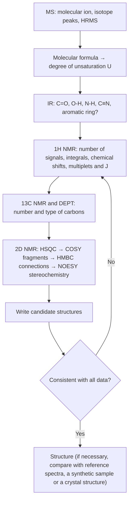

A new compound, whether the product of a reaction, a natural product isolated from a plant, or an unknown peak found in a metabolomics experiment, raises one question first: what is it? This chapter shows how to deduce the structure of an organic molecule from spectroscopic data. We first fix the molecular formula from mass spectrometry and elemental composition, then identify the **functional groups** by infrared spectroscopy, establish the order in which atoms are connected and their stereochemical relationships by nuclear magnetic resonance, identify conjugated systems by ultraviolet spectroscopy, and finally assemble all this information into a single structure that is consistent with every observation. The principles, instrumentation and characteristic features of the four methods were treated in analytical chemistry: UV–visible absorption ([6.4.9](/6.4.9)), infrared ([6.4.11](/6.4.11)), NMR ([6.4.12](/6.4.12)) and mass spectrometry ([6.4.15](/6.4.15)). Here we recall them in a sentence or two where needed and concentrate on interpretive strategy, the empirical data most useful in organic chemistry, and worked examples. Structure elucidation draws on the preceding chapters: functional groups and nomenclature ([6.5.1](/6.5.1)), conjugation and electronic effects ([6.5.2](/6.5.2)), conformation ([6.5.4](/6.5.4)) and configuration ([6.5.5](/6.5.5)). Conversely, every class of compounds in the later chapters is accompanied by its spectral features, and the methods of this chapter are used to identify the products of reactions.

## 6.1. The Logic of Structure Determination

### 6.1.1. From Chemical Degradation to Spectroscopy

Until the middle of the twentieth century, organic structures were determined entirely by chemical methods. Elemental analysis gave the mass fractions of C, H, O, N and S, and hence the empirical formula; colligative measurements such as freezing-point depression gave an approximate molar mass, and the two together gave the molecular formula. Functional groups were then detected one by one with characteristic reactions (a positive test with **Tollens' reagent** shows an aldehyde; acetylation shows a hydroxy group), the molecule was broken by degradation reactions into known fragments, and the original structure was reassembled from the pieces. For example, a compound containing C $79.2\%$, H $5.7\%$ and O $15.1\%$ with a molar mass of about $106$ has the molecular formula $\ce{C7H6O}$; it gives a silver mirror and is oxidized to benzoic acid, so it is benzaldehyde.

For complex natural products this approach was extraordinarily laborious. Morphine was isolated from opium by Sertürner in 1804–1806, and its molecular formula $\ce{C17H19NO3}$ was established in 1847. Over the following decades many chemists pieced its structure together by acetylation (counting hydroxy groups), methylation (distinguishing phenolic from alcoholic hydroxy groups), oxidation, catalytic hydrogenation (counting double bonds), Hofmann degradation (showing that the nitrogen is in a ring), and zinc-dust distillation (which gave phenanthrene and so revealed the skeleton). The correct structure was proposed by Gulland and Robinson only in 1925, Gates completed the total synthesis in 1952, and Hodgkin and co-workers confirmed it by X-ray crystallography in 1955 (structure below): a span of a century and a half. The structure of cholesterol likewise took decades of degradation studies; Wieland (bile acids) and Windaus (sterols) received the Nobel Prize in Chemistry in 1927 and 1928, yet the skeleton they proposed was still wrong and was corrected in 1932 by X-ray diffraction data.

```smiles
CN1CCC23c4c5ccc(O)c4OC2C(O)C=CC3C1C5
```

The shared drawbacks of chemical methods are that they consume large amounts of sample (grams), that every reaction may involve a rearrangement and so lead to a wrong conclusion, that they take a long time, and that they inevitably destroy the sample. From the 1950s and 1960s UV, IR, NMR and mass spectrometry successively became routine. They need only milligrams or even micrograms of sample, take minutes to hours, and mostly leave the sample intact. Today the structure of a new compound is usually settled within a day or two, and the final confirmation is single-crystal X-ray diffraction, which also gives the **absolute configuration**.

### 6.1.2. The Four Spectra and Their Time Scales

The "four major spectra" of organic chemistry provide information at different levels:

| Method | What is measured | Question answered | Sample amount |
|---|---|---|---|
| Mass spectrometry, MS ([6.4.15](/6.4.15)) | Mass-to-charge ratio of ions | Molar mass and molecular formula (high resolution); fragments reveal partial structures | ng–μg |
| Infrared, IR ([6.4.11](/6.4.11)) | Transitions between vibrational levels | Which functional groups are present ($\ce{C=O}$, $\ce{O-H}$, $\ce{N-H}$, $\ce{C#N}$, …) | mg |
| Nuclear magnetic resonance, NMR ([6.4.12](/6.4.12)) | Transitions between nuclear spin levels | Carbon skeleton, order of connection of atoms, relative configuration and conformation | mg |
| Ultraviolet–visible, UV–Vis ([6.4.9](/6.4.9)) | Transitions of valence electrons | Presence and size of a conjugated system | μg |

NMR provides the most information and is the core of structure elucidation; MS gives the molecular formula and is the starting point; IR rapidly identifies functional groups; UV is used today mainly for conjugated systems and for quantitative work.

The methods also differ in their "time scale", which determines whether they can distinguish species that interconvert. Suppose two species interconvert with rate constant $k$. If $k$ is much smaller than the difference $\Delta\nu$ between their signal frequencies in a given spectrum, two separate signals are seen; if $k \gg \Delta\nu$, only a single averaged signal appears. Even when two IR bands differ by only a few wavenumbers, the frequency difference is of the order of $10^{11}\,\mathrm{Hz}$, and almost every chemical process is slower than that, so **conformers** and **tautomers** each give their own peaks in IR. In NMR, by contrast, the frequency differences between different protons are only a few hertz to a few thousand hertz, and any process completed in milliseconds or less (rotation about a single bond, ring flipping of cyclohexane, exchange of alcohol OH protons) is averaged out. The **Eyring equation** ([6.3.16](/6.3.16#def-16.3.1)) converts an energy barrier into a half-life at $25\,^\circ\mathrm{C}$:

| $\Delta G^\ddagger$ / $(\mathrm{kJ\,mol^{-1}})$ | $40$ | $60$ | $80$ | $90$ | $100$ | $110$ |
|---|---|---|---|---|---|---|
| $t_{1/2}$ ($25\,^\circ\mathrm{C}$, unimolecular process) | $1\,\mu\mathrm{s}$ | $4\,\mathrm{ms}$ | $12\,\mathrm{s}$ | $11\,\mathrm{min}$ | $10\,\mathrm{h}$ | $24\,\mathrm{d}$ |

Processes with barriers below about $60\,\mathrm{kJ\,mol^{-1}}$ are usually averaged in room-temperature NMR; isomers separated by barriers above about $90\,\mathrm{kJ\,mol^{-1}}$ can be isolated at room temperature. Section 6.5.5 of this chapter uses this correlation to discuss dynamic processes in NMR, and the chapter on configuration and chirality ([6.5.5](/6.5.5#sec-5.5.1)) uses it to decide whether **atropisomers** can be separated by **chiral resolution**.

## 6.2. Molecular Formula and Degree of Unsaturation

The first step is to determine the molecular formula. It can be obtained directly from high-resolution mass spectrometry (Section 6.3.2), or from the mass fractions of elemental analysis together with the molar mass from low-resolution MS. Once the formula is known, we can calculate the **degree of unsaturation** ([6.4.11](/6.4.11#def-11.2.3)), the total number of rings and $\pi$ bonds:

$$
U = 1 + n_{\mathrm{C}} + \frac{n_{\mathrm{N}} - n_{\mathrm{H}} - n_{\mathrm{X}}}{2},
\tag{6.1}
$$
where X is a halogen; divalent O and S do not affect $U$. The degree of unsaturation is the first filter for narrowing the candidate structures:

| $U$ | Common possibilities |
|---|---|
| $0$ | Saturated and acyclic (alkanes, alcohols, ethers, amines, alkyl halides) |
| $1$ | One double bond ($\ce{C=C}$, $\ce{C=O}$, $\ce{C=N}$) or one ring |
| $2$ | One triple bond ($\ce{C#C}$, $\ce{C#N}$), or two double bonds, two rings, or one double bond plus one ring |
| $\ge 4$ | Consider a benzene ring first (three double bonds plus one ring, $U = 4$); benzene ring plus carbonyl, $U = 5$; naphthalene, $U = 7$ |

$U$ must be a non-negative integer; a half-integer means that the formula is wrong (or that the species is a radical or an ion). If only the molar mass is known, the "rule of 13" lists candidate formulas: divide the molar mass $M$ by 13 to obtain a quotient $n$ and a remainder $r$, which give the base formula $\ce{C_nH_{n+r}}$; each O added replaces a $\ce{CH4}$ (16), and each N added replaces a $\ce{CH2}$ (14). For $M = 86$, for instance, $86 = 13\times6 + 8$ gives the base formula $\ce{C6H14}$ ($U = 0$); with one O this becomes $\ce{C5H10O}$ ($U = 1$), and with two N, $\ce{C4H10N2}$ ($U = 1$). Which of these is correct must be decided from the isotope peaks and the exact mass (Example 6.3.1).

**Example 6.2.1** Calculate the degree of unsaturation of each of the following molecular formulas and give one possible structure for each: $\ce{C5H10O}$, $\ce{C4H7N}$, $\ce{C7H7Cl}$, $\ce{C8H8O2}$.

**Solution** $\ce{C5H10O}$: $U = 1 + 5 - 10/2 = 1$, for example pentan-2-one or cyclopentanol. $\ce{C4H7N}$: $U = 1 + 4 + (1 - 7)/2 = 2$, for example butanenitrile, $\ce{CH3CH2CH2C#N}$. $\ce{C7H7Cl}$: $U = 1 + 7 - (7 + 1)/2 = 4$, for example benzyl chloride or chlorotoluene. $\ce{C8H8O2}$: $U = 5$, a benzene ring plus one carbonyl group, for example methyl benzoate or phenyl acetate (Section 6.7 uses two-dimensional spectra to tell these two apart). $\square$

## 6.3. Interpreting Mass Spectra

In structure elucidation **mass spectrometry** ([6.4.15](/6.4.15)) is used first to determine the molar mass and molecular formula, and only secondarily to infer structural fragments from the fragmentation pattern. Ionization methods, mass analyzers and fragmentation rules were covered in 6.4.15; here we give the essentials of interpretation and some reference data.

### 6.3.1. The Molecular Ion and Isotope Peaks

In an electron ionization (EI) spectrum the molecule loses one electron to form the **molecular ion** $\mathrm{M}^{+\bullet}$, an odd-electron radical cation (it should not be written $\mathrm{M}^+$). The rules for recognizing the molecular-ion peak ([6.4.15](/6.4.15#sec-15.4.1)) are that it is usually the peak of largest $m/z$ apart from isotope peaks; that the mass differences to neighboring fragment peaks must be reasonable (losses of 4 to 14 or of 21 to 25 mass units are impossible); and that its mass obeys the **nitrogen rule** ([6.4.15](/6.4.15#def-15.4.2)): a compound containing no nitrogen or an even number of nitrogen atoms has an even molar mass. For alcohols, branched alkanes, acetals and similar compounds the molecular-ion peak is weak or even absent; in that case we switch to soft ionization such as ESI or CI and look for **quasi-molecular ions** such as $[\mathrm{M}+\mathrm{H}]^+$ and $[\mathrm{M}+\mathrm{Na}]^+$ (at $m/z$ $M + 1$ and $M + 23$, respectively).

**Isotope peaks** ([6.4.15](/6.4.15#sec-15.4.2)) are a powerful tool for determining elemental composition:

- The $M + 1$ peak comes mainly from $^{13}\mathrm{C}$ (natural abundance $1.07\%$); each carbon atom contributes about $1.1\%$, so $n_{\mathrm{C}} \approx \dfrac{I_{M+1}/I_M}{1.1\%}$. Nitrogen contributes $0.37\%$, and the contribution of hydrogen is very small.
- The $M + 2$ peak: one Cl contributes about $32\%$ ($M : M+2 \approx 3 : 1$), one Br about $97\%$ ($\approx 1 : 1$), one S about $4.4\%$; one O only $0.2\%$. For $n$ Cl or Br atoms the pattern follows the binomial expansion $(a + b)^n$: $9 : 6 : 1$ for $\ce{Cl2}$, $1 : 2 : 1$ for $\ce{Br2}$, and $3 : 4 : 1$ for $\ce{ClBr}$.
- F, P and I are monoisotopic and give no $M + 2$ peak; iodides are characterized by $m/z$ 127 ($\ce{I+}$) and by a large mass difference of $M - 127$.

**Example 6.3.1** In the EI spectrum of a compound the peaks at $m/z$ 86 and 87 have relative intensities of $20.9\%$ and $1.2\%$, and there is no significant $M + 2$ peak. Propose a molecular formula.

**Solution** The absence of an $M + 2$ peak rules out Cl, Br and S. $I_{M+1}/I_M = 1.2/20.9 = 5.7\%$, so the number of carbon atoms is about $5.7/1.1 \approx 5$. The molar mass is even, so by the nitrogen rule the compound contains 0 or 2 N. Among the candidates of nominal mass 86, the calculated $M + 1$ intensity is $5.6\%$ for $\ce{C5H10O}$, $5.2\%$ for $\ce{C4H10N2}$ and $6.7\%$ for $\ce{C6H14}$. $\ce{C5H10O}$ fits best, with $U = 1$ (one carbonyl group, or one $\ce{C=C}$ with a hydroxy group or ether linkage, or one ring). The measurement error of isotope-peak intensities is about $\pm 10\%$, so confirmation requires high-resolution data: the exact masses of the three are $86.0732$, $86.0844$ and $86.1096$. $\square$

### 6.3.2. High-Resolution Mass Spectrometry and Multiply Charged Ions

High-resolution mass spectrometry (HRMS) measures $m/z$ to the fourth decimal place (an error of a few ppm). It exploits the fact that the **exact masses** ([6.4.15](/6.4.15#def-15.1.3)) of the elements are not integers to distinguish molecular formulas of the same nominal mass: $^{1}\mathrm{H}$ $1.007825$, $^{12}\mathrm{C}$ $12.000000$, $^{14}\mathrm{N}$ $14.003074$, $^{16}\mathrm{O}$ $15.994915$.

**Example 6.3.2** A compound of molar mass 44 could be $\ce{C3H8}$, $\ce{C2H4O}$, $\ce{CO2}$ or $\ce{CH4N2}$. High-resolution MS gives a molecular mass (corrected for the mass of the electron) of $44.0262$. Which is it?

**Solution** The exact masses of the four are $44.0626$, $44.0262$, $43.9898$ and $44.0374$. The measured value differs from that of $\ce{C2H4O}$ by less than $1\,\mathrm{ppm}$ and from the other three by more than $250\,\mathrm{ppm}$, so the compound is $\ce{C2H4O}$ (acetaldehyde or oxirane). Note that the $m/z$ of $\mathrm{M}^{+\bullet}$ is smaller than the molecular mass by one electron mass ($0.00055$), which cannot be neglected at ppm accuracy; the software of modern instruments takes it into account automatically. $\square$

Electrospray ionization (ESI) readily puts several charges on large molecules, giving a series of peaks $[\mathrm{M} + n\mathrm{H}]^{n+}$. There are two ways to determine the charge of a peak: from the spacing of its own isotope peaks, which is $1/z$ (a spacing of $1/16$ means $z = 16$); or by solving simultaneously for two adjacent charge states from their $m/z$ values ([6.4.15](/6.4.15#sec-15.2.4)). The calculation that recovers the mass of the neutral molecule from a series of charge states is called deconvolution. The protein K-Ras, with a molar mass of about $21\,\mathrm{kDa}$, shows a group of peaks at $m/z$ 1000–2000 in its ESI spectrum; deconvolution gives a single peak at $21\,488\,\mathrm{Da}$, which differs by $6\,\mathrm{Da}$ from the value calculated from the sequence and so reveals whether the protein has been modified.

### 6.3.3. Fragments and Common Losses

The patterns of EI fragmentation ($\sigma$ cleavage, $\alpha$ cleavage, inductive cleavage, the **McLafferty rearrangement**, retro-Diels–Alder) were discussed in detail in [6.4.15](/6.4.15#sec-15.4.3). In interpretation the most useful approach is to start from the molecular ion, ask what has been lost, and look at a few diagnostic fragment ions:

| Loss | Possible neutral fragment | Suggests | Fragment ion $m/z$ | Possible structure |
|---|---|---|---|---|
| $M - 1$ | $\ce{H}$ | Aldehyde, alcohol, amine | $29$ | $\ce{C2H5+}$, $\ce{HCO+}$ |
| $M - 15$ | $\ce{CH3}$ | Methyl branch, methyl ketone | $30$ | $\ce{CH2=NH2+}$ (primary amine) |
| $M - 18$ | $\ce{H2O}$ | Alcohol | $31$ | $\ce{CH2=OH+}$ (primary alcohol, methyl ether) |
| $M - 28$ | $\ce{CO}$, $\ce{C2H4}$ | Phenol, quinone; McLafferty (ethyl side chain) | $43$ | $\ce{CH3CO+}$, $\ce{C3H7+}$ |
| $M - 29$ | $\ce{C2H5}$, $\ce{CHO}$ | Ethyl group, aldehyde | $57$ | $\ce{C4H9+}$, $\ce{C2H5CO+}$ |
| $M - 31$ | $\ce{OCH3}$ | Methyl ester, methyl ether | $77$ | $\ce{C6H5+}$ |
| $M - 42$ | $\ce{CH2=C=O}$, $\ce{C3H6}$ | Aryl acetate, acetamide; McLafferty | $91$ | $\ce{C7H7+}$ (tropylium ion, alkylbenzenes) |
| $M - 45$ | $\ce{OC2H5}$, $\ce{COOH}$ | Ethyl ester, carboxylic acid | $105$ | $\ce{C6H5CO+}$, $\ce{C8H9+}$ |

Straight-chain alkanes give a series of $\ce{C_nH_{2n+1}+}$ peaks differing by 14 ($\ce{CH2}$), strongest at 43 and 57; branched alkanes cleave at the branch point and have very weak molecular-ion peaks. The spectrum of pentane ($M = 72$) shows peaks at $m/z$ 57 ($M - 15$), 43 (base peak, $M - 29$) and 29 ($M - 43$), and a clear molecular-ion peak. Its isomer neopentane, $\ce{C(CH3)4}$, shows almost no molecular ion, and its base peak is at $m/z$ 57 (the *tert*-butyl cation, formed by loss of a methyl group).

**Example 6.3.3** Hexan-2-one and hexan-3-one both have molar mass 100. How can they be distinguished by their EI spectra?

**Solution** Their $\alpha$-cleavage products differ. Hexan-2-one, $\ce{CH3COC4H9}$, gives $\ce{CH3CO+}$ ($m/z$ 43, base peak) and $\ce{C4H9CO+}$ (85); hexan-3-one, $\ce{C2H5COC3H7}$, gives $\ce{C2H5CO+}$ (57) and $\ce{C3H7CO+}$ (71). The McLafferty rearrangements also differ. In hexan-2-one the butyl side has a $\gamma$ hydrogen, and loss of propene (42) gives $m/z$ 58; in hexan-3-one the propyl side has a $\gamma$ hydrogen, and loss of ethene (28) gives $m/z$ 72, while the ethyl side has no $\gamma$ hydrogen. Thus 43, 58 and 85 point to hexan-2-one, and 57, 71 and 72 to hexan-3-one. $\square$

![EI fragmentation of the hexan-2-one molecular ion (m/z 100), drawn with one-electron (fishhook) arrows. Top: α cleavage; the unpaired electron on oxygen pairs with one electron of the C2–C3 bond, giving the acylium ion CH₃CO⁺ (m/z 43, base peak) and a butyl radical; cleaving the other α bond loses CH₃ and gives C₄H₉CO⁺ (85). Bottom: McLafferty rearrangement; through a six-membered arrangement the γ hydrogen moves to oxygen and the α–β bond breaks, propene (42) is lost, and the enol radical cation m/z 58 remains (charge on O, radical on CH₂)](./plots/hexanone-ms.py)

## 6.4. Interpreting Infrared Spectra

The table of characteristic absorption frequencies and the factors that influence **group frequencies** are given in [6.4.11](/6.4.11#sec-11.2.2) in the treatment of **infrared spectroscopy**. This section explains how to read an IR spectrum systematically and how to subdivide the carbonyl region, which is the most important one in organic chemistry.

### 6.4.1. Order of Interpretation

An IR spectrum has many peaks, but it is not necessary to assign every one. Asking the following questions in order leads to a rough picture of the functional groups within a few minutes:

1. Is there a strong peak between $1850$ and $1650\,\mathrm{cm^{-1}}$? If so, the compound contains $\ce{C=O}$; go to Section 6.4.2 to decide the type.
2. Is there absorption between $3600$ and $3200\,\mathrm{cm^{-1}}$? A broad, strong band is associated $\ce{O-H}$ (alcohol, phenol); an extremely broad band from $3300$ to $2500\,\mathrm{cm^{-1}}$ that overlaps the $\ce{C-H}$ stretches and is accompanied by a $\ce{C=O}$ band is a carboxylic acid; one or two sharper medium peaks are $\ce{N-H}$ (one for a secondary amine, two for a primary amine); a sharp peak near $3300\,\mathrm{cm^{-1}}$ with a weak peak at $2120\,\mathrm{cm^{-1}}$ is a terminal alkyne $\ce{\equiv C-H}$.
3. On either side of $3000\,\mathrm{cm^{-1}}$: $\ce{C-H}$ stretches above $3000$ come from alkenes or aromatic rings, and only absorption below $3000$ means a saturated compound; a pair of weak peaks at $2820$ and $2720\,\mathrm{cm^{-1}}$ is the aldehyde $\ce{C-H}$ (Fermi resonance).
4. $2260$–$2100\,\mathrm{cm^{-1}}$: $\ce{C#N}$ (medium, sharp) or $\ce{C#C}$ (weak). Few other groups absorb in this region, so a peak here is highly diagnostic.
5. $1680$–$1450\,\mathrm{cm^{-1}}$: $\ce{C=C}$ (about $1650$, medium to weak), aromatic ring skeletal vibrations (a pair at $1600$ and $1500$), nitro group (two strong peaks at $1550$ and $1350$).
6. In the fingerprint region look only at a few strong and useful peaks: the strong $\ce{C-O}$ stretch at $1300$–$1000\,\mathrm{cm^{-1}}$ (alcohols, ethers, esters) and the out-of-plane bending at $1000$–$650\,\mathrm{cm^{-1}}$ (substitution pattern of alkenes and benzene rings). A compound with no strong absorption in this region usually has no aromatic ring.

Conversely, the absence of a peak is often more reliable than its presence: no strong peak near $1700\,\mathrm{cm^{-1}}$ excludes carbonyl compounds, and no absorption near $3300\,\mathrm{cm^{-1}}$ excludes alcohols, amines and carboxylic acids.

Two frequent questions may be answered in passing. Homonuclear diatomic molecules such as $\ce{H2}$ do not absorb infrared light because their stretching vibration does not change the dipole moment (the condition for being **infrared active**, [6.4.11](/6.4.11#def-11.1.3)); likewise the symmetric stretch of $\ce{CO2}$ has no IR absorption, and only the antisymmetric stretch ($2349\,\mathrm{cm^{-1}}$) and the bend ($667\,\mathrm{cm^{-1}}$) give peaks.

### 6.4.2. Subdividing the Carbonyl Region

The position of a carbonyl band is determined by the groups attached to the carbonyl through inductive effects, resonance (conjugation), **ring strain** and hydrogen bonding ([6.4.11](/6.4.11#sec-11.2.3)). An electron-withdrawing **inductive effect** increases the double-bond character of $\ce{C=O}$ and raises the frequency; electron-donating resonance (conjugation of the lone pairs of $\ce{N}$ or $\ce{O}$ with the carbonyl) and conjugation with $\ce{C=C}$ or an aromatic ring decrease the double-bond character and lower the frequency. The following table adds several classes not covered in 6.4.11:

| Type | $\tilde\nu(\ce{C=O})$ / $\mathrm{cm^{-1}}$ | Remarks |
|---|---|---|
| Saturated aliphatic esters | $1750$–$1735$ | Also a strong $\ce{C-O}$ band at $1300$–$1150$ |
| $\alpha,\beta$-Unsaturated esters, aromatic esters | $1730$–$1715$ | Conjugation lowers the frequency (methyl benzoate $1724$) |
| Vinyl esters, phenyl esters | $1770$–$1760$ | The lone pair of the alkoxy oxygen is partly delocalized into the $\ce{C=C}$ or benzene ring, weakening its donor resonance to the carbonyl (phenyl acetate $1765$) |
| Lactones | $\beta$ about $1840$, $\gamma$ about $1770$, $\delta$ about $1735$ | The smaller the ring, the higher the frequency |
| Lactams | $\beta$ about $1745$, $\gamma$ about $1700$, $\delta$ about $1670$ | The $\beta$-lactam of penicillins is at about $1770$–$1780$ |
| Anhydrides | Two peaks at $1820$ and $1760$ | The high-frequency peak is stronger in acyclic anhydrides, the low-frequency peak in cyclic ones |
| Amides | $1690$–$1630$ (amide I band) | Secondary amides also show an amide II band near $1550$ ($\ce{N-H}$ bending and $\ce{C-N}$ stretching) |

Ring strain likewise raises the frequency of an exocyclic $\ce{C=C}$: for methylenecyclohexane, methylenecyclopentane, methylenecyclobutane and methylenecyclopropane the $\ce{C=C}$ stretches lie at $1651$, $1657$, $1678$ and $1781\,\mathrm{cm^{-1}}$, respectively. The reason is that the internal bond angle of a small ring is compressed, so the ring carbons use orbitals of greater p character for the endocyclic bonds, leaving orbitals of greater s character for the exocyclic bond, which becomes stronger (a redistribution of **hybrid orbitals**).

When group frequencies are estimated with the diatomic harmonic-oscillator model ([6.4.11](/6.4.11#sec-11.1.2)), the wavenumber is related to the force constant $k$ and the reduced mass $\mu$ by

$$
\tilde\nu = \frac{1}{2\pi c}\sqrt{\frac{k}{\mu}},
\tag{6.2}
$$
where $c$ is the speed of light; writing only $\frac{1}{2\pi}\sqrt{k/\mu}$ gives the frequency $\nu$, not the wavenumber.

## 6.5. Interpreting Proton NMR Spectra

A ${}^1$H NMR spectrum gives three kinds of information: the **chemical shift** (the chemical environment of the proton), the peak area (the number of protons of each kind), and the **coupling constants** and multiplet patterns (how many protons are adjacent and their geometric relationship). The principles are given in [6.4.12](/6.4.12); this section deals with the practical methods of interpretation.

### 6.5.1. Chemical Equivalence and Molecular Symmetry

The number of groups of peaks in a spectrum depends on the number of classes of **chemically equivalent** protons ([6.4.12](/6.4.12#def-12.3.3)). To decide, ask whether two protons can be interchanged by a symmetry operation of the molecule or by rapid conformational change. Equivalently, use the substitution test: replace each of the two protons in turn by a test group Z and compare the two resulting structures.

| Relationship of the two protons | Result of substitution test | Symmetry operation | In NMR |
|---|---|---|---|
| **Homotopic** | The two structures are identical | Rotation axis $C_n$ | Chemically equivalent |
| **Enantiotopic** | The two structures are **enantiomers** | Mirror plane (or inversion center) but no rotation axis | Equivalent in achiral solvents; may be nonequivalent in a chiral environment |
| **Diastereotopic** | The two structures are **diastereomers** | None | Chemically nonequivalent; chemical shifts generally differ, and the protons couple to each other geminally |

Enantiotopic and diastereotopic groups and **prochirality** are discussed in [6.5.5](/6.5.5#sec-5.9); here we are concerned with their consequences in NMR. A few examples: methane, ethane, ethene and benzene each have only one kind of hydrogen; propane has two; 2-methylpropene has two (the methyl groups and $\ce{=CH2}$); propene has four, because the two hydrogens of $\ce{=CH2}$, one cis and one trans to the methyl group, cannot be interchanged by any symmetry operation. The two hydrogens of dichloromethane and of bromochloromethane $\ce{CH2BrCl}$ each give a single peak, because they are homotopic in the first and enantiotopic in the second.

The two hydrogens of a methylene group adjacent to a **stereocenter** are diastereotopic. For example, in the $\ce{CH2}$ of butan-2-ol, $\ce{CH3CH(OH)CH2CH3}$, replacing one hydrogen by Z gives the (2R,3R) form and replacing the other gives the (2R,3S) form, and these are diastereomers. The two hydrogens therefore have slightly different chemical shifts; each couples to the neighboring methyl and methine protons and also to each other geminally, so the pattern is more complex than a simple quintet. Likewise, the two methyl groups of an isopropyl group in a chiral molecule are diastereotopic and often appear as two doublets (as in valine and menthol). Diastereotopicity does not require the molecule to contain a stereocenter: pentan-3-ol, $\ce{(CH3CH2)2CHOH}$, is itself achiral, but the two hydrogens of each $\ce{CH2}$ lie in different environments relative to the $\ce{OH}$ and are diastereotopic as well.

"Rapid" in "rapid conformational change" is meant relative to the NMR time scale (Section 6.1.2). The barrier to rotation of a methyl group about a $\ce{C-C}$ bond is only about $12\,\mathrm{kJ\,mol^{-1}}$, so at room temperature it rotates about $10^{10}$ times per second and the three hydrogens are fully averaged in NMR; a methyl group therefore always gives one signal. The axial and equatorial hydrogens of cyclohexane exchange places in every **ring flip** (barrier about $45\,\mathrm{kJ\,mol^{-1}}$, [6.5.4](/6.5.4#sec-4.5.3)); at room temperature the flip is very fast and only a singlet at $\delta = 1.43$ is seen, whereas on cooling below $-90\,^\circ\mathrm{C}$ the signal splits into two groups, with the equatorial hydrogen about $0.5\,\mathrm{ppm}$ downfield of the axial one (Section 6.5.5).

### 6.5.2. Empirical Estimation of Chemical Shifts

The ranges of chemical shifts of common protons are tabulated in [6.4.12](/6.4.12#sec-12.2.4). Remembering a few "anchor values" suffices to place most protons: saturated $\ce{CH3}$ $0.9$, $\ce{CH2}$ $1.3$, $\ce{CH}$ $1.5$; a $\ce{CH}$ next to $\ce{C=O}$, an aromatic ring or $\ce{C=C}$ shifts to $2$–$2.5$; next to $\ce{N}$, $2.5$–$3$; next to a halogen, $3$–$3.5$ (Br, Cl); next to $\ce{O}$, $3.3$–$4$, and next to the alkoxy oxygen of an ester, $4$–$4.3$; vinylic hydrogens $4.5$–$6.5$; aromatic hydrogens $6.5$–$8$; aldehyde hydrogens $9.5$–$10$; carboxylic acid hydrogens $10$–$13$.

Starting from these anchors, the effects of substituents are roughly additive: substituents at the $\alpha$ position contribute most, those at the $\beta$ position only about $0.2$–$0.5\,\mathrm{ppm}$, and more remote ones can be neglected. For a methylene group of the type $\ce{X-CH2-Y}$ there is a simple and useful additivity formula:

**Formula 6.5.1 (Shoolery's Rule)** The chemical shift of the protons of a methylene group $\ce{X-CH2-Y}$ (or of a methine or methyl group) is approximately

$$
\delta \approx 0.23 + \sum_i \sigma_i,
\tag{6.3}
$$
where $0.23$ is the chemical shift of methane and $\sigma_i$ are the empirical shielding constants of the substituents attached to that carbon:

| Substituent | $\sigma$ | Substituent | $\sigma$ | Substituent | $\sigma$ |
|---|---|---|---|---|---|
| $\ce{-CH3}$ | $0.47$ | $\ce{-Cl}$ | $2.53$ | $\ce{-COR}$ | $1.70$ |
| $\ce{-CH=CH2}$ | $1.32$ | $\ce{-Br}$ | $2.33$ | $\ce{-COOR}$ | $1.55$ |
| $\ce{-C#CH}$ | $1.44$ | $\ce{-I}$ | $1.82$ | $\ce{-CN}$ | $1.70$ |
| $\ce{-C6H5}$ | $1.85$ | $\ce{-OH}$, $\ce{-OR}$ | $2.56$, $2.36$ | $\ce{-NR2}$ | $1.57$ |
| $\ce{-CF3}$ | $1.14$ | $\ce{-OCOR}$ | $3.13$ | $\ce{-SR}$ | $1.64$ |

For example: $\ce{CH2Cl2}$ is estimated at $0.23 + 2\times2.53 = 5.29$ (observed $5.30$); benzyl chloride $\ce{C6H5CH2Cl}$ at $0.23 + 1.85 + 2.53 = 4.61$ (observed $4.57$); the $\ce{CH2}$ of diethyl malonate at $0.23 + 2\times1.55 = 3.33$ (observed $3.36$); and the $\ce{ClCH2}$ of ethyl chloroacetate at $0.23 + 2.53 + 1.55 = 4.31$ (observed $4.06$). The error of such empirical formulas is generally within $0.2$–$0.3\,\mathrm{ppm}$, enough to distinguish between candidate structures but no substitute for measured data. Software that predicts chemical shifts from large spectral databases is now widely used, and it rests on the same principle.

The aromatic hydrogens of substituted benzenes can also be estimated from substituent increments: $\delta \approx 7.26 + \sum Z_i$ ($7.26$ is the base value of this set of increments), where $Z_i$ depends on whether the substituent is ortho, meta or para to the hydrogen in question (commonly used values, accurate to about $\pm 0.1$):

| Substituent | $Z_{\text{ortho}}$ | $Z_{\text{meta}}$ | $Z_{\text{para}}$ | Substituent | $Z_{\text{ortho}}$ | $Z_{\text{meta}}$ | $Z_{\text{para}}$ |
|---|---|---|---|---|---|---|---|
| $\ce{-NO2}$ | $+0.95$ | $+0.26$ | $+0.38$ | $\ce{-CH3}$ | $-0.18$ | $-0.11$ | $-0.21$ |
| $\ce{-CHO}$ | $+0.56$ | $+0.22$ | $+0.29$ | $\ce{-Cl}$ | $+0.03$ | $-0.02$ | $-0.09$ |
| $\ce{-COCH3}$ | $+0.62$ | $+0.14$ | $+0.21$ | $\ce{-OCH3}$ | $-0.48$ | $-0.09$ | $-0.44$ |
| $\ce{-COOCH3}$ | $+0.71$ | $+0.11$ | $+0.21$ | $\ce{-OH}$ | $-0.56$ | $-0.12$ | $-0.45$ |
| $\ce{-OCOCH3}$ | $-0.25$ | $+0.03$ | $-0.13$ | $\ce{-NH2}$ | $-0.75$ | $-0.25$ | $-0.65$ |

This table is a direct reflection in the spectrum of the electronic effects ([6.5.2](/6.5.2#sec-2.5)). The lone pairs of $\ce{-OH}$, $\ce{-NH2}$ and $\ce{-OCH3}$ increase the electron density at the ortho and para positions by conjugation, so the protons there move upfield, while the meta position is hardly affected. The electron-withdrawing $\ce{-NO2}$ and carbonyl groups shift the ortho and para protons downfield, and the ortho proton is in addition deshielded by the magnetic anisotropy of the carbonyl or nitro group, so it moves farthest. In a para-disubstituted benzene whose substituents push and pull (for example 4-nitroanisole), the two groups of aromatic hydrogens are well separated and form the typical "two doublets" (actually an AA′BB′ system, Section 6.5.4).

Besides inductive and conjugative effects, magnetic anisotropy (the **ring-current effect**, [6.4.12](/6.4.12#def-12.2.3)) is also important: protons outside an aromatic ring are deshielded and protons above the ring are shielded. The methylene chain spanning the top of a benzene ring in a cyclophane is an example of the latter; the closer a $\ce{CH2}$ is to the middle of the chain (directly above the ring), the smaller its chemical shift, which may fall below $1\,\mathrm{ppm}$. The anisotropy of single bonds is weaker, but sufficient to place the equatorial hydrogen of cyclohexane about $0.5\,\mathrm{ppm}$ downfield of the axial one.

### 6.5.3. Integration

The area of each group of peaks is proportional to the number of protons giving rise to it ([6.4.12](/6.4.12#sec-12.3.6)). Integration gives only ratios; to convert them to absolute numbers we use the molecular formula: reduce the integral ratios to the simplest integers and scale them so that the total equals the number of hydrogens in the formula (or a divisor of it, in which case the molecule is symmetric). The integration error is usually about $\pm 5\%$; for broad peaks of labile hydrogens and for peaks overlapping residual solvent peaks it is larger.

### 6.5.4. Coupling and Multiplets

In a first-order spectrum, a group of chemically equivalent protons coupled to $n$ equivalent neighboring protons is split into an $n + 1$ multiplet with intensities in the ratio of binomial coefficients ([6.4.12](/6.4.12#sec-12.3.2)). Multiplets are abbreviated as s (singlet), d (doublet), t (triplet), q (quartet), quint (quintet), sext (sextet), sept (septet) and m (multiplet), with br for a broad peak; a proton coupled with different $J$ to two groups of nonequivalent protons is written as a combination, such as dd (doublet of doublets), dt, dq, ddd.

When a group of protons couples to two nonequivalent groups ($n$ and $n'$ protons, respectively), the pattern in principle has $(n + 1)(n' + 1)$ lines; if the two coupling constants are similar, some lines coincide and the pattern approximates an $n + n' + 1$ multiplet. In the figure below the central methylene group of 1-chloropropane couples to five protons in total, with $J$ values of $6.6$ and $7.4\,\mathrm{Hz}$, and the 12 lines are crowded into a "sextet" with slight shoulders:


The basis for deciding which protons are neighbors from coupling constants is that two mutually coupled groups of peaks have the same coupling constant ($J_{\mathrm{ab}} = J_{\mathrm{ba}}$). The size of $J$ also reflects geometry; the data most used in interpretation are (details in [6.4.12](/6.4.12#sec-12.3.3)):

| Coupling | $J$ / $\mathrm{Hz}$ | Use |
|---|---|---|
| Freely rotating $\ce{H-C-C-H}$ | $6$–$8$ (typically $7$) | Alkyl chains |
| Alkene, trans | $12$–$18$ (typically $16$) | Distinguishing $E$/$Z$ |
| Alkene, cis | $6$–$12$ (typically $10$) | |
| Geminal coupling of terminal $\ce{=CH2}$ | $0$–$3$ | |
| Benzene ring, ortho / meta / para | $7$–$9$ / $1$–$3$ / $0$–$1$ | Substitution pattern |
| Cyclohexane ax–ax / ax–eq, eq–eq | $8$–$13$ / $2$–$5$ | Conformation and relative configuration (**Karplus equation**) |
| Aldehyde $\ce{CHO-CH}$ | $1$–$3$ | |
| Geminal coupling of $\mathrm{sp}^3$ methylene | $-10$ to $-15$ (visible only when the two hydrogens are nonequivalent) | Diastereotopic protons |

When a proton couples to several groups with different $J$, the multiplet can be resolved stepwise, from the largest to the smallest coupling, with a "splitting tree". The vinyl group of styrene is a textbook example: $\mathrm{H_a}$ ($\ce{PhCH=}$) couples to the trans $\mathrm{H_b}$ ($J = 17.6\,\mathrm{Hz}$) and the cis $\mathrm{H_c}$ ($J = 10.9\,\mathrm{Hz}$) and appears as four lines of equal height (dd); the geminal coupling between $\mathrm{H_b}$ and $\mathrm{H_c}$ is only $0.9\,\mathrm{Hz}$. The $J$ values immediately settle the assignment of the three groups of peaks.


The $n + 1$ rule applies only to first-order spectra ($\Delta\nu/J$ larger than about 10). Coupled protons with similar chemical shifts give second-order spectra: line intensities lean toward the inside (the roof effect, [6.4.12](/6.4.12#sec-12.3.5)), and the direction of the lean points to the group of peaks to which it is coupled, which is itself a clue for assignment. Protons that are chemically equivalent but not **magnetically equivalent** ([6.4.12](/6.4.12#def-12.3.4)) also give complex patterns: the four aromatic hydrogens of a para-disubstituted benzene form an AA′BB′ system, which on a low- or medium-field spectrometer looks like two "doublets", although extra small peaks can be seen on expansion. The statement that "equivalent protons show no coupling to one another" is strictly true only for magnetically equivalent protons.

### 6.5.5. Labile Hydrogens, Exchange and Dynamic Processes

Protons attached to O, N and S (labile hydrogens) have three characteristics: their chemical shifts vary greatly with concentration, temperature and solvent (because of differing degrees of **hydrogen bonding**); their peaks are often broad; and coupling to adjacent $\ce{C-H}$ is usually not seen. The last point results from proton exchange. Catalyzed by traces of acid or base, the hydroxy proton of $\ce{ROH}$ exchanges rapidly between molecules; on the NMR time scale the hydroxy proton on each molecule changes many times, the neighboring $\ce{CH}$ senses the average of its two spin states, and the coupling is averaged out (exchange decoupling). In dry $\ce{DMSO}$-$d_6$ the exchange is slower: the $\ce{OH}$ of methanol appears as a quartet and its $\ce{CH3}$ as a doublet, and the $\ce{OH}$ of primary, secondary and tertiary alcohols appears as a triplet, a doublet and a singlet, respectively, which can be used to determine the type of alcohol.

The simplest way to identify labile hydrogens is deuterium exchange: after recording the spectrum, add a drop of $\ce{D2O}$ to the sample tube, shake and record again; the peaks of $\ce{OH}$, $\ce{NH}$ and $\ce{COOH}$ disappear as D replaces H (and an HOD peak appears near $\delta \approx 4.8$). Amide $\ce{NH}$ exchanges more slowly and sometimes requires a longer time or heating.

Conformational exchange follows the same principles. Consider two equally populated sites exchanging with rate constant $k$ and a frequency difference $\Delta\nu$ (in Hz). The spectrum varies with $k$ as in the figure below: for $k \ll \Delta\nu$ there are two lines; as $k$ increases the two lines broaden and move together; at

$$
k_{\mathrm{c}} = \frac{\pi\Delta\nu}{\sqrt2}
\tag{6.4}
$$
they merge into a single flat-topped peak, and the corresponding temperature is called the *coalescence temperature*; for $k \gg \Delta\nu$ a single narrow line appears at the average position. From the coalescence temperature and $\Delta\nu$ one finds $k_{\mathrm{c}}$, and substituting into the Eyring equation gives the free energy of activation of the exchange process. This is the variable-temperature (dynamic) NMR method for measuring conformational and rotational barriers (for example, the $\ce{C-N}$ bond of amides, about $70$–$80\,\mathrm{kJ\,mol^{-1}}$). Because $\Delta\nu$ in Hz is proportional to the magnetic field, the coalescence temperature of the same process is higher on a higher-field spectrometer: the two kinds of hydrogens in cyclohexane differ by $0.48\,\mathrm{ppm}$, so $k_{\mathrm{c}} = 64\,\mathrm{s^{-1}}$ on a $60\,\mathrm{MHz}$ spectrometer, with coalescence at about $-56\,^\circ\mathrm{C}$, and $k_{\mathrm{c}} = 427\,\mathrm{s^{-1}}$ at $400\,\mathrm{MHz}$, at about $-39\,^\circ\mathrm{C}$.


### 6.5.6. Solvent and Residual Peaks

Routine ${}^1$H spectra are recorded in deuterated solvents, but deuteration is never complete, and the small amount of residual $^1\mathrm{H}$ gives a solvent peak; water dissolved in the solvent also gives a peak whose position depends on the solvent. These peaks are often mistaken for signals of the sample, and should be located before interpretation (data from Fulmer et al., 2010):

| Solvent | Residual $^1\mathrm{H}$ $\delta$ | Water peak $\delta$ | $^{13}\mathrm{C}$ $\delta$ |
|---|---|---|---|
| $\ce{CDCl3}$ | $7.26$ (s) | $1.56$ | $77.16$ (t) |
| $\ce{DMSO}$-$d_6$ | $2.50$ (quint) | $3.33$ | $39.52$ (sept) |
| $\ce{CD3OD}$ | $3.31$ (quint) | $4.87$ | $49.00$ (sept) |
| $\ce{D2O}$ | $4.79$ (HOD) | — | — |
| Acetone-$d_6$ | $2.05$ (quint) | $2.84$ | $29.84$, $206.26$ |
| $\ce{C6D6}$ | $7.16$ (s) | $0.40$ | $128.06$ (t) |
| $\ce{CD3CN}$ | $1.94$ (quint) | $2.13$ | $1.32$, $118.26$ |

The multiplicity of the residual peaks arises from coupling to deuterium: the $^1\mathrm{H}$ in a $\ce{CHD2}$ group couples to two D ($I = 1$) and, by $2nI + 1$, gives a quintet with intensity ratio $1:2:3:2:1$. The chemical shifts of the same compound in different solvents can differ by $0.1$–$0.5\,\mathrm{ppm}$ (benzene is at $7.36$ in $\ce{CDCl3}$ and at $7.16$ in $\ce{C6D6}$), so the solvent must always be stated when data are compared.

## 6.6. Carbon NMR and DEPT

In a broadband-decoupled $^{13}\mathrm{C}$ spectrum each chemically nonequivalent carbon gives one singlet ([6.4.12](/6.4.12#sec-12.5.1)). The main points of interpreting carbon spectra are:

1. Count the peaks. The number of peaks is the number of classes of nonequivalent carbons; fewer peaks than carbon atoms in the formula means that the molecule is symmetric. For example, among the alcohols $\ce{C4H10O}$, butan-1-ol and butan-2-ol each give 4 peaks, 2-methylpropan-1-ol gives 3, and *tert*-butyl alcohol gives 2.
2. Use the chemical shift to identify the type of carbon. The range of $^{13}\mathrm{C}$ is about $0$–$220\,\mathrm{ppm}$ and is clearly divided into regions:

| Type of carbon | $\delta$ | Type of carbon | $\delta$ |
|---|---|---|---|
| Alkyl $\ce{CH3}$, $\ce{CH2}$, $\ce{CH}$, $\ce{C}$ | $0$–$50$ | Aromatic and heteroaromatic rings | $110$–$160$ (benzene $128.4$) |
| $\ce{C-I}$ / $\ce{C-Br}$ / $\ce{C-Cl}$ | $-20$–$10$ / $10$–$40$ / $25$–$50$ | $\ce{C#N}$ | $115$–$125$ |
| $\ce{C-N}$ | $30$–$65$ | $\ce{C=O}$ of esters, amides, anhydrides | $160$–$175$ |
| $\ce{C-O}$ (alkoxy carbons of alcohols, ethers, esters) | $50$–$90$ ($\ce{OCH3}$ about $52$–$60$) | $\ce{C=O}$ of carboxylic acids | $170$–$185$ |
| $\ce{C#C}$ | $65$–$90$ | $\ce{C=O}$ of aldehydes | $190$–$205$ |
| $\ce{C=C}$ | $100$–$150$ | $\ce{C=O}$ of ketones | $195$–$220$ (conjugated ketones at the low end) |

  The alkyl halide entries contain an anomaly: iodine and bromine shift the attached carbon upfield (iodomethane $\delta = -21$). This is the spin–orbit coupling effect of heavy atoms, opposite to the trend of electronegativity.
3. Use DEPT to determine the number of hydrogens on each carbon (see below).
4. The peaks of quaternary carbons (carbons bearing no hydrogen) are usually weak: they have a small NOE enhancement and slow longitudinal relaxation. The peaks of carbonyl and substituted aromatic carbons are often very small and should not be missed.

**Definition 6.6.1 (Distortionless Enhancement by Polarization Transfer)** An experiment in which the polarization of $^1\mathrm{H}$ is transferred to the attached $^{13}\mathrm{C}$ through the $^1J_{\mathrm{CH}}$ coupling, and in which the sign and intensity of the signal vary with the flip angle $\theta$ of the last $^1\mathrm{H}$ pulse and with the number of hydrogens on the carbon, is called **distortionless enhancement by polarization transfer** (DEPT).

How to read DEPT (quaternary carbons give no peak in any DEPT spectrum):

| Spectrum | $\ce{CH3}$ | $\ce{CH2}$ | $\ce{CH}$ | $\ce{C}$ |
|---|---|---|---|---|
| Broadband-decoupled $^{13}\mathrm{C}$ | Positive | Positive | Positive | Positive (weak) |
| DEPT-135 | Positive | Negative | Positive | Absent |
| DEPT-90 | Absent | Absent | Positive | Absent |

Compare the ordinary carbon spectrum with DEPT-135 and DEPT-90: peaks in DEPT-90 are $\ce{CH}$; negative peaks in DEPT-135 are $\ce{CH2}$; positive peaks in DEPT-135 other than the $\ce{CH}$ peaks are $\ce{CH3}$; peaks present in the ordinary spectrum but absent from all DEPT spectra are quaternary carbons. The numbers of hydrogens on the various carbons, added up, should agree with the number of carbon-bound hydrogens in the molecular formula, and the difference is the number of labile hydrogens.

The chemical shifts of alkane carbons also follow an additivity rule (the Grant–Paul rule): $\delta \approx -2.3 + 9.1n_\alpha + 9.4n_\beta - 2.5n_\gamma$, where $n_\alpha$, $n_\beta$ and $n_\gamma$ are the numbers of carbon atoms one, two and three bonds away from the carbon in question (branched carbons need further corrections). For butane, for example, $\mathrm{C1}$ is $-2.3 + 9.1 + 9.4 - 2.5 = 13.7$ (observed $13.4$) and $\mathrm{C2}$ is $-2.3 + 2\times9.1 + 9.4 = 25.3$ (observed $25.2$). The upfield shift of a carbon caused by $\gamma$ substitution arises from steric compression in the gauche conformation. In cyclohexanes, an axial substituent moves the $\gamma$ ring carbons about $5\,\mathrm{ppm}$ upfield relative to an equatorial substituent, a commonly used criterion for the orientation of substituents.

**Example 6.6.1** The carbon spectrum of an alcohol $\ce{C4H10O}$ has 4 peaks, at about $\delta$ $69$, $32$, $23$ and $10$. In DEPT-135 the peak at $32$ is negative and the others are positive; in DEPT-90 only the peak at $69$ appears. Deduce the structure.

**Solution** Four peaks mean that all four carbons are nonequivalent, which excludes 2-methylpropan-1-ol (3 peaks) and *tert*-butyl alcohol (2 peaks). From DEPT, the peak at $69$ is a $\ce{CH}$, $32$ is a $\ce{CH2}$, and $23$ and $10$ are $\ce{CH3}$. The carbons carry $1 + 2 + 3 + 3 = 9$ hydrogens, and the tenth is the $\ce{OH}$. The $\ce{CH}$ at $\delta$ $69$ is attached to oxygen. The compound is therefore butan-2-ol, $\ce{CH3CH(OH)CH2CH3}$ (butan-1-ol would have a $\ce{CH2-O}$ at about $62$ and only one $\ce{CH3}$). $\square$

## 6.7. Reading Two-Dimensional Spectra

The overlapping peaks and complicated couplings of a one-dimensional spectrum are spread out onto a plane in a two-dimensional spectrum (**two-dimensional NMR**; principles in [6.4.12](/6.4.12#sec-12.5.2)). The four two-dimensional spectra most used in structure elucidation each answer one question:

| Spectrum | A cross peak indicates | Question answered |
|---|---|---|
| COSY | Two protons coupled to each other (mainly $^2J$, $^3J$) | Which hydrogens are adjacent? Strings together protons on the same carbon chain |
| HSQC | $\mathrm{H}$ and the $\mathrm{C}$ directly attached to it ($^1J_{\mathrm{CH}}$) | To which carbon is each hydrogen attached? |
| HMBC | $\mathrm{H}$ and a $\mathrm{C}$ two or three bonds away (occasionally four in conjugated systems) | How are the fragments connected? Especially across quaternary carbons, carbonyl groups and heteroatoms |
| NOESY | Two protons closer than about $0.5\,\mathrm{nm}$ in space | Relative configuration, double-bond geometry and conformation |

The usual order of interpretation is as follows. From the one-dimensional ${}^1$H and $^{13}$C spectra (with DEPT), list all $\ce{CH}_n$ groups and quaternary carbons. Use HSQC to match each proton with its carbon. Use COSY to link mutually coupled protons into spin systems (each system is interrupted by quaternary carbons or heteroatoms). Use HMBC to find the 2–3-bond correlations that cross the breaks and connect the fragments. Finally use NOESY (and coupling constants) to determine the stereochemistry. COSY differs from HMBC in that COSY cannot cross atoms that bear no hydrogen, whereas HMBC is designed precisely to cross them. In reading HMBC, remember that it contains both $^2J$ and $^3J$ correlations and that the intensity is only weakly related to the number of bonds, so a correlation peak shows only "two or three bonds apart" and several correlations usually have to corroborate one another.

**Example 6.7.1** Methyl benzoate (1) and phenyl acetate (2) are isomers ($\ce{C8H8O2}$). Explain how to distinguish them by one-dimensional spectra and HMBC.

```smiles
COC(=O)c1ccccc1 1
CC(=O)Oc1ccccc1 2
```

**Solution** One-dimensional spectra already suffice. In methyl benzoate the methyl group is attached to oxygen and is a singlet at $\delta$ $3.92$, and the ortho aromatic hydrogens are deshielded by the ester carbonyl and appear at $8.04$; in phenyl acetate the methyl group is attached to the carbonyl and is a singlet at $2.29$, and the ortho aromatic hydrogens are shielded by electron-donating resonance from oxygen and appear at $7.08$. In the IR, the former is a conjugated ester ($1724\,\mathrm{cm^{-1}}$) and the latter a phenyl ester ($1765\,\mathrm{cm^{-1}}$). HMBC gives the connectivity more directly. In methyl benzoate the $\ce{OCH3}$ protons correlate with the carbonyl carbon ($\delta_{\mathrm{C}}$ $167$; $\ce{H-C-O-C}$, three bonds), and the ortho aromatic hydrogens also correlate with the same carbonyl carbon ($\ce{H-C-C-C}$, three bonds), showing that the carbonyl is attached directly to the benzene ring. In phenyl acetate only the methyl protons correlate with the carbonyl carbon ($169.5$; two bonds); the ortho aromatic hydrogens are four bonds from the carbonyl carbon ($\ce{H-C-C-O-C}$) and show no correlation, but they correlate with the substituted aromatic carbon at $\delta_{\mathrm{C}}$ $150.8$ (the carbon bearing oxygen). $\square$

The cross-peak intensity in NOESY is proportional to the inverse sixth power of the distance (the **nuclear Overhauser effect**) and is significant only within $0.5\,\mathrm{nm}$. Its most common use is to determine the relative positions of substituents. For the geometry of a trisubstituted alkene $\ce{R1R2C=CHR3}$ we look at which substituent shows an NOE to the vinylic hydrogen; for the cis or trans relationship of two ring substituents we look for an NOE between the two methine hydrogens (the cis 1,3-diaxial hydrogens are about $0.25\,\mathrm{nm}$ apart and give a very strong NOE). An NOE can only prove "near", never "far": the absence of a cross peak may mean that the distance is large, but it may also be due to molecular motion or the acquisition parameters, so conclusions must be drawn with caution.

## 6.8. UV Spectra and the Woodward–Fieser Rules

### 6.8.1. Absorption by Conjugated Systems

The transitions in organic molecules that give absorption above $200\,\mathrm{nm}$ are $\pi\to\pi^*$ and $\mathrm{n}\to\pi^*$ ([6.4.9](/6.4.9#sec-9.2.1)). An isolated $\ce{C=C}$ (ethene, $171\,\mathrm{nm}$) and saturated compounds do not absorb in the conventional UV region; conjugation narrows the gap between the **frontier orbitals**, and the absorption shifts to longer wavelength and becomes stronger (buta-1,3-diene $217\,\mathrm{nm}$, hexa-1,3,5-triene $258\,\mathrm{nm}$, [6.4.9](/6.4.9#sec-9.2.3)). The question UV spectroscopy answers in structure elucidation is therefore whether a conjugated system is present, how large it is, and what substituents it carries.

Absorption bands are often classified by origin, and the band names are common in the older literature:

| Band | Transition | Position and intensity | Example |
|---|---|---|---|
| K band | $\pi\to\pi^*$ of a conjugated system | $> 210\,\mathrm{nm}$, $\varepsilon > 10^4$ | Conjugated dienes, $\alpha,\beta$-unsaturated carbonyl compounds |
| R band | $\mathrm{n}\to\pi^*$ | $270$–$350\,\mathrm{nm}$, $\varepsilon < 100$ | Weak band of saturated aldehydes and ketones |
| B band | Symmetry-forbidden $\pi\to\pi^*$ of an aromatic ring | $230$–$270\,\mathrm{nm}$, $\varepsilon$ about $10^2$, with vibrational fine structure | Benzene $256\,\mathrm{nm}$ |
| E band | Allowed $\pi\to\pi^*$ of an aromatic ring | $E_1$ about $184\,\mathrm{nm}$, $E_2$ about $204\,\mathrm{nm}$ | Benzene ($\varepsilon$ about $6\times10^4$ and $7900$, respectively) |

Attachment of a **chromophore** to an **auxochrome**, extension of conjugation, and push–pull systems all cause a **bathochromic shift**; steric hindrance that forces the conjugated system out of coplanarity causes a hypsochromic shift and a weaker band (ortho-disubstituted biphenyls). The intensity at $\lambda_{\max}$ is expressed by the molar absorption coefficient $\varepsilon$ (in $\mathrm{L\,mol^{-1}\,cm^{-1}}$), defined by the **Beer–Lambert law**, $A = \varepsilon bc$ ([6.4.9](/6.4.9#sec-9.3.1)).

### 6.8.2. The Woodward–Fieser Rules

In 1941 Woodward summarized a large body of data on conjugated dienes and unsaturated ketones and found that $\lambda_{\max}$ can be estimated from the structure by additive rules, later supplemented by the Fiesers. Before NMR became widespread, these rules were the main basis for locating conjugated systems in steroids and terpenes.

**Definition 6.8.1 (Woodward–Fieser Rules)** The empirical rules that estimate the $\lambda_{\max}$ of the $\pi\to\pi^*$ absorption of conjugated dienes, polyenes and $\alpha,\beta$-unsaturated carbonyl compounds by assigning a base value to the parent conjugated system and then adding increments for substituents, ring residues, exocyclic double bonds and extension of conjugation are called the **Woodward–Fieser rules**.

Conjugated dienes and polyenes (in ethanol or hexane):

| Item | Increment / nm |
|---|---|
| Base value: acyclic or heteroannular diene (two double bonds in two different rings) | $214$ |
| Base value: homoannular diene (two double bonds in the same ring, fixed s-cis) | $253$ |
| Each additional conjugated double bond | $+30$ |
| Each alkyl substituent or ring residue (ring carbon attached to a conjugated carbon) | $+5$ |
| Each exocyclic double bond (one end of the double bond belongs to a ring and the other lies outside that ring) | $+5$ |
| $\ce{-OCOR}$ / $\ce{-OR}$ / $\ce{-SR}$ / $\ce{-Cl}$, $\ce{-Br}$ / $\ce{-NR2}$ | $0$ / $+6$ / $+30$ / $+5$ / $+60$ |

$\alpha,\beta$-Unsaturated carbonyl compounds (in ethanol; in $\ce{C=C-C=O}$ the carbonyl carbon is 1, followed by $\alpha$, $\beta$, $\gamma$, $\delta$):

| Item | Increment / nm |
|---|---|
| Base value: acyclic or six-membered-ring $\alpha,\beta$-unsaturated ketone / five-membered-ring $\alpha,\beta$-unsaturated ketone / aldehyde / acid and ester | $215$ / $202$ / $210$ / $195$ |
| Each additional conjugated double bond; homoannular diene component | $+30$; $+39$ |
| Alkyl group or ring residue: $\alpha$ / $\beta$ / $\gamma$ and beyond | $+10$ / $+12$ / $+18$ |
| Exocyclic double bond | $+5$ |
| $\ce{-OH}$: $\alpha$ / $\beta$ / $\delta$; $\ce{-OR}$: $\alpha$ / $\beta$ | $+35$ / $+30$ / $+50$; $+35$ / $+30$ |
| $\ce{-Cl}$: $\alpha$ / $\beta$; $\ce{-Br}$: $\alpha$ / $\beta$; $\ce{-NR2}$: $\beta$ | $+15$ / $+12$; $+25$ / $+30$; $+95$ |
| Solvent correction: water / methanol / chloroform / diethyl ether / hexane | $-8$ / $0$ / $+1$ / $+7$ / $+11$ |

The most common errors in counting are ring residues and exocyclic double bonds. A ring residue is a ring-skeleton carbon attached to a carbon of the conjugated system (not counting the carbons of the conjugated system itself); exocyclic double bonds must be judged separately for each ring. Estimated and observed values usually agree to within $\pm 5\,\mathrm{nm}$.

**Example 6.8.1** Estimate $\lambda_{\max}$ for the following steroidal dienes and $\alpha,\beta$-unsaturated ketone: (a) cholesta-3,5-diene; (b) cholesta-5,7-diene (the skeleton of 7-dehydrocholesterol); (c) cholest-4-en-3-one.

```smiles
CC(C)CCCC(C)C1CCC2C3CC=C4C=CCCC4(C)C3CCC12C (a)
CC(C)CCCC(C)C1CCC2C3=CC=C4CCCCC4(C)C3CCC12C (b)
CC(C)CCCC(C)C1CCC2C3CCC4=CC(=O)CCC4(C)C3CCC12C (c)
```

**Solution** (a) $\Delta^3$ lies in ring A and $\Delta^5$ spans rings A and B, so this is a heteroannular diene with base value $214$. The ring residues on the conjugated carbons are C2 on C3, C10 on C5 and C7 on C6, three in all, giving $+15$; $\ce{C5=C6}$ is exocyclic with respect to ring A, $+5$. The estimate is $234\,\mathrm{nm}$ (observed $235\,\mathrm{nm}$).

(b) $\Delta^5$ and $\Delta^7$ are both in ring B, so this is a homoannular diene with base value $253$. The ring residues are C4 and C10 on C5 and C9 and C14 on C8, four in all, $+20$; $\ce{C5=C6}$ is exocyclic with respect to ring A and $\ce{C7=C8}$ with respect to ring C, $+10$. The estimate is $283\,\mathrm{nm}$ (observed $282\,\mathrm{nm}$).

(c) A six-membered-ring $\alpha,\beta$-unsaturated ketone has base value $215$; the $\alpha$ carbon C4 carries only hydrogen; the $\beta$ carbon C5 carries two ring residues (C6 and C10), $+24$; $\ce{C4=C5}$ is exocyclic with respect to ring B, $+5$. The estimate is $244\,\mathrm{nm}$ (observed $241\,\mathrm{nm}$; steroid hormones with a $\Delta^4$-3-ketone, such as testosterone, all absorb near $240\,\mathrm{nm}$). $\square$

The base values of homoannular and heteroannular dienes differ by almost $40\,\mathrm{nm}$, so UV spectroscopy easily distinguishes double-bond positional isomers such as (a) and (b); this was its main use in steroid chemistry in the 1940s and 1950s. 7-Dehydrocholesterol absorbs UV-B light ($280$–$315\,\mathrm{nm}$) in the skin and undergoes photochemical ring opening to the precursor of vitamin $\mathrm{D_3}$; its absorption wavelength falls in exactly this interval.

A simplified version also appears in the literature: base value $217$ for a conjugated diene, $+5$ for each alkyl group, $+5$ for an exocyclic double bond, $+39$ for a homoannular diene and $+30$ for extension of conjugation. It differs from the table above only in writing the homoannular diene as "$217 + 39 = 256$" and the heteroannular diene as "$217$", and gives similar results for most molecules; this wiki uses the commonly used version in the table above throughout.

### 6.8.3. Polyenes and the Free-Electron Model

For polyenes with more than four conjugated double bonds the Woodward–Fieser rules no longer apply, and the Fieser–Kuhn formula is used:

$$
\lambda_{\max}/\mathrm{nm} = 114 + 5M + n(48.0 - 1.7n) - 16.5R_{\mathrm{endo}} - 10R_{\mathrm{exo}},
\tag{6.5}
$$
where $n$ is the number of conjugated double bonds, $M$ the number of alkyl substituents and ring residues, and $R_{\mathrm{endo}}$ and $R_{\mathrm{exo}}$ the numbers of rings containing endocyclic and exocyclic double bonds, respectively. $\beta$-Carotene has 11 conjugated double bonds, 10 alkyl substituents and one ring with an endocyclic double bond at each end: $\lambda_{\max} = 114 + 50 + 11\times29.3 - 33 = 453\,\mathrm{nm}$ (observed $452\,\mathrm{nm}$ in hexane).

Why does the absorption wavelength increase with the length of conjugation? The simplest physical picture treats the $\pi$ electrons as free particles moving in a one-dimensional box (the **infinite square well**, [5.5.3](/5.5.3#def-3.2.1)). The box length $L$ is proportional to the length of the conjugated chain, the energy levels are $E_n = n^2h^2/(8m_{\mathrm{e}}L^2)$, and $N$ $\pi$ electrons fill the lowest $N/2$ levels; the HOMO–LUMO transition energy

$$
\Delta E = \frac{h^2}{8m_{\mathrm{e}}L^2}(N + 1),
\tag{6.6}
$$
decreases as $1/N$ when $L$ grows ($L \propto N$), and $\lambda_{\max}$ increases with the length of conjugation. The model is quite accurate for cyanine dyes, in which the bond lengths are averaged (positive and negative charge delocalized between the nitrogen atoms at the two ends). For polyenes it overestimates the red shift, because the single and double bonds of a polyene alternate in length and the energy gap approaches a finite value rather than zero in the long-chain limit, so the increment of $\lambda_{\max}$ decreases with increasing $n$; the $-1.7n^2$ term in the Fieser–Kuhn formula reflects this. A better treatment is the **Hückel molecular orbital method** ([6.5.2](/6.5.2#sec-2.2.3)).

## 6.9. Combined Interpretation

### 6.9.1. General Strategy



A few practical principles:

1. Start with the most certain information. The molecular formula, the degree of unsaturation, unambiguous strong peaks ($\ce{C=O}$, a broad $\ce{O-H}$) and isolated singlets ($\ce{OCH3}$, $\ce{COCH3}$, *tert*-butyl) are the most reliable; write the structural fragments they imply first.
2. Keep an account of the fragments. Each time a fragment is established, subtract its atoms and its unsaturation from the molecular formula; the remainder shrinks steadily, and only a few combinations are usually left at the end.
3. List all candidates that satisfy the conditions and exclude them one by one with the data; do not settle for the first structure that looks reasonable.
4. Finally, check back: every atom of the candidate structure should have a corresponding signal in the spectra, and every signal should be assigned.

### 6.9.2. Worked Examples

**Example 6.9.1** A compound $\ce{C9H10O2}$ has the following data. EI-MS: $m/z$ 150 ($19.6\%$), 151 ($2.0\%$), 94 (base peak), 57, 29. IR: a very strong peak at $1763\,\mathrm{cm^{-1}}$, a weak peak at $3100$–$3000\,\mathrm{cm^{-1}}$, no absorption at $3600$–$3200\,\mathrm{cm^{-1}}$. $^1\mathrm{H}$ NMR ($\ce{CDCl3}$): $\delta$ $7.38$ (2H, t), $7.23$ (1H, t), $7.08$ (2H, d), $2.59$ (2H, q, $J = 7.5\,\mathrm{Hz}$), $1.26$ (3H, t, $J = 7.5\,\mathrm{Hz}$). Deduce the structure.


**Solution** Molecular formula and degree of unsaturation: $I_{M+1}/I_M = 2.0/19.6 = 10.2\%$, corresponding to about 9 carbons, consistent with the formula; $U = 1 + 9 - 10/2 = 5$, suggesting a benzene ring plus one double bond.

IR: $1763\,\mathrm{cm^{-1}}$ is a carbonyl band; there is no $\ce{O-H}$, which excludes a carboxylic acid; this frequency is high for an ester and suggests a phenyl or vinyl ester (Section 6.4.2). The weak peaks at $3100$–$3000\,\mathrm{cm^{-1}}$ are aromatic $\ce{C-H}$.

${}^1$H NMR: the integrals $2:1:2:2:3$ total 10 hydrogens, consistent with the formula. The five hydrogens at $7.0$–$7.4$ belong to a monosubstituted benzene ring. The peaks at $2.59$ (q) and $1.26$ (t) have the same coupling constant and make up an ethyl group; the $\ce{CH2}$ is at $2.59$ rather than above $4.1$, so it is attached to a carbonyl and not to oxygen: $\ce{CH3CH2C(=O)-}$. The remaining fragments are $\ce{C6H5}$ and $\ce{C2H5CO}$ plus one $\ce{O}$, which can only combine to give $\ce{C2H5COOC6H5}$ (phenyl propanoate); the alternative, $\ce{C6H5COC2H5}$ plus an oxygen, has nowhere to put the oxygen. The ortho aromatic hydrogens ($7.08$) are upfield of benzene ($7.36$ in $\ce{CDCl3}$), exactly what is expected when an electron-donating oxygen is attached to the ring (substituent increment $Z_{\text{ortho}} = -0.25$ for $\ce{-OCOCH3}$, estimated $7.01$). The ortho hydrogens of ethyl benzoate would be near $8.0$ and its $\ce{OCH2}$ of the ethyl group at $4.4$, which does not fit the spectrum.

MS: $m/z$ 57 is $\ce{C2H5CO+}$ ($\alpha$ cleavage). The base peak at 94 is the phenol radical cation $\ce{C6H5OH^{+.}}$, formed from the molecular ion by hydrogen transfer through a four-membered transition state with loss of methylketene $\ce{CH3CH=C=O}$ (56), a characteristic fragmentation of aryl esters; 29 is $\ce{C2H5+}$.

![EI fragmentation of phenyl propanoate (m/z 150). Top: the loss of a ketene characteristic of aryl esters; through a four-membered arrangement (dashed) a hydrogen on the α carbon moves to the ester oxygen while the acyl C–O bond breaks, methylketene (56) is lost, and the phenol radical cation m/z 94 (base peak) remains. Bottom: starting from the molecular ion with the charge and the unpaired electron on the carbonyl oxygen, α cleavage of the acyl C–O bond gives the propanoyl cation m/z 57 and a phenoxy radical](./plots/phenyl-ester-ms.py)

The structure is phenyl propanoate:

```smiles
CCC(=O)Oc1ccccc1
```

$\square$

**Example 6.9.2** A hydrocarbon $\ce{C9H12}$ has the following $^1\mathrm{H}$ NMR data: $\delta$ $7.33$–$7.17$ (5H, m), $2.91$ (1H, septet, $J = 6.9\,\mathrm{Hz}$), $1.25$ (6H, d, $J = 6.9\,\mathrm{Hz}$). EI-MS: $m/z$ 120, 105 (base peak), 77. Deduce the structure.

**Solution** $U = 1 + 9 - 6 = 4$; together with the five hydrogens near $7.2$, this is a monosubstituted benzene. What remains is $\ce{C3H7}$. The six-hydrogen doublet shows two equivalent methyl groups, each adjacent to one hydrogen, and the one-hydrogen septet shows a hydrogen adjacent to six equivalent hydrogens; the two have the same $J$ and together make up an isopropyl group, with the methine at $2.91$ deshielded by the benzene ring. The structure is cumene (isopropylbenzene), $\ce{C6H5CH(CH3)2}$. In the mass spectrum $m/z$ 105 is the 1-phenylethyl cation formed by loss of a methyl group (benzylic and stable), confirming that the carbon on the ring is a methine bearing two methyl groups. Propylbenzene, $\ce{C6H5CH2CH2CH3}$, would show $2.6$ (t, 2H), $1.6$ (sext, 2H) and $0.9$ (t, 3H), and a base peak at $m/z$ 91. $\square$


```smiles
CC(C)c1ccccc1
```

**Example 6.9.3** A compound shows molecular-ion peaks at $m/z$ 122 and 124 in an intensity ratio of about $3:1$. IR: $1750\,\mathrm{cm^{-1}}$ (strong), $1300$–$1150\,\mathrm{cm^{-1}}$ (strong). $^1\mathrm{H}$ NMR: $\delta$ $4.24$ (2H, q, $J = 7.1\,\mathrm{Hz}$), $4.06$ (2H, s), $1.30$ (3H, t, $J = 7.1\,\mathrm{Hz}$). Deduce the structure.

**Solution** An $M$/$M+2$ ratio of $3:1$ shows one Cl. The two strong IR peaks at $1750$ and $1300$–$1150\,\mathrm{cm^{-1}}$ indicate an ester. In the NMR spectrum $4.24$ (q) and $1.30$ (t) are an ethyl group attached to oxygen, $\ce{OCH2CH3}$; the 2H singlet at $4.06$ has no neighboring hydrogens, and its large chemical shift shows that it is a methylene group between two electron-withdrawing groups; by Shoolery's rule, $\ce{Cl-CH2-COOR}$ is estimated at $4.31$. For the molar mass, $\ce{ClCH2COOC2H5}$ is $\ce{C4H7ClO2}$ with $M = 122$ ($^{35}\mathrm{Cl}$), as observed. The structure is ethyl chloroacetate. $\square$

```smiles
ClCC(=O)OCC
```

**Example 6.9.4** A compound $\ce{C6H10O2}$ shows strong IR peaks at $1720$ and $1655\,\mathrm{cm^{-1}}$. $^1\mathrm{H}$ NMR: $\delta$ $6.97$ (1H, dq, $J = 15.6$, $6.9\,\mathrm{Hz}$), $5.84$ (1H, dq, $J = 15.6$, $1.7\,\mathrm{Hz}$), $4.18$ (2H, q, $J = 7.1\,\mathrm{Hz}$), $1.88$ (3H, dd, $J = 6.9$, $1.7\,\mathrm{Hz}$), $1.28$ (3H, t, $J = 7.1\,\mathrm{Hz}$). Deduce the structure and the geometry of the double bond.

**Solution** $U = 2$. The band at $1720\,\mathrm{cm^{-1}}$ is the $\ce{C=O}$ of a conjugated ester and that at $1655\,\mathrm{cm^{-1}}$ is the conjugated $\ce{C=C}$. The peaks at $4.18$ (q) and $1.28$ (t) are $\ce{OCH2CH3}$. The coupling between the two vinylic hydrogens is $J = 15.6\,\mathrm{Hz}$, so they are trans. The vinylic hydrogen at $6.97$ also couples to the methyl group ($J = 6.9\,\mathrm{Hz}$) and is the $\beta$-H (deshielded by the carbonyl in the conjugated system and so downfield of the $\alpha$-H; the **resonance structure** $\ce{^{+}C_\beta-C_\alpha=C-O^-}$ in [6.5.2](/6.5.2#sec-2.5.1) explains why); the $\alpha$-H at $5.84$ shows a $1.7\,\mathrm{Hz}$ long-range allylic coupling to the methyl group, which is therefore a dd. The structure is ethyl (*E*)-but-2-enoate (ethyl crotonate), $\ce{CH3CH=CHCOOC2H5}$. The $J$ between the vinylic hydrogens of the $Z$ isomer would be about $11.5\,\mathrm{Hz}$. By the Woodward–Fieser rules, its $\lambda_{\max}$ is estimated as $195 + 12 = 207\,\mathrm{nm}$. $\square$

```smiles
C/C=C/C(=O)OCC
```

## Summary

| Step | Method | Key data and rules |
|---|---|---|
| Molecular formula | Elemental analysis, MS, HRMS | Isotope peaks: $n_{\mathrm{C}} \approx (I_{M+1}/I_M)/1.1\%$; Cl $3:1$, Br $1:1$; nitrogen rule; exact mass |
| Degree of unsaturation | Eq. (6.1) | Consider a benzene ring for $U \ge 4$ |
| Functional groups | IR | First $\ce{C=O}$ and $\ce{O-H}$/$\ce{N-H}$, then both sides of $3000\,\mathrm{cm^{-1}}$; carbonyl region: acyl chloride > anhydride > phenyl ester > ester > aldehyde > ketone > amide |
| Type and number of hydrogens | $^1\mathrm{H}$ NMR | Chemical equivalence (homotopic and enantiotopic equivalent; diastereotopic nonequivalent); Shoolery's rule (Formula 6.5.1) and aromatic increments; integration |
| Order of connection | $^1\mathrm{H}$ NMR coupling, COSY | $n + 1$ rule; peaks with the same $J$ are coupled to each other; trans alkene $12$–$18$, cis $6$–$12\,\mathrm{Hz}$ |
| Dynamic processes | Variable-temperature NMR | $k_{\mathrm{c}} = \pi\Delta\nu/\sqrt2$, combined with the Eyring equation to give $\Delta G^\ddagger$ |
| Carbon skeleton | $^{13}\mathrm{C}$, DEPT (Definition 6.6.1), HSQC | DEPT-135: $\ce{CH}$/$\ce{CH3}$ positive, $\ce{CH2}$ negative, quaternary carbons absent |
| Connection of fragments | HMBC | H to C two or three bonds away, across quaternary carbons and heteroatoms |
| Stereochemistry | NOESY, $J$ | NOE within $0.5\,\mathrm{nm}$; Karplus equation |
| Conjugated systems | UV | Woodward–Fieser rules (Definition 6.8.1): dienes $214$/$253$, $\alpha,\beta$-unsaturated ketones $215$; polyenes use Eq. (6.5) |

## Questions

1. State how many classes of chemically nonequivalent protons each of the following compounds has: (a) 2-methylpropene; (b) propene; (c) 1,1-dichloroethane; (d) 2-chlorobutane; (e) *p*-xylene; (f) cyclohexene.

   **Answer** (a) 2 classes (the two methyl groups, $\ce{=CH2}$); (b) 4 classes ($\ce{CH3}$, $\ce{=CH-}$, and the two hydrogens of $\ce{=CH2}$ cis and trans to the methyl group); (c) 2 classes; (d) 5 classes (the C1 methyl, the C2 methine, the two diastereotopic hydrogens on C3, and the C4 methyl); (e) 2 classes; (f) 3 classes (vinylic hydrogens, allylic $\ce{CH2}$, and the other two $\ce{CH2}$ groups; at room temperature the half-chair conformation flips rapidly, so the two hydrogens on each $\ce{CH2}$ average to one class).
2. Arrange the four groups of protons in ethyl propanoate $\ce{CH3^aCH2^bCOOCH2^cCH3^d}$ in order of decreasing chemical shift. What is the multiplicity of each?

   **Answer** $\delta_{\mathrm{c}}$ ($4.12$, q) > $\delta_{\mathrm{b}}$ ($2.32$, q) > $\delta_{\mathrm{d}}$ ($1.25$, t) > $\delta_{\mathrm{a}}$ ($1.14$, t). The $\ce{CH2}$ attached to oxygen is farthest downfield, the $\ce{CH2}$ attached to the carbonyl is next, and both methyl groups are near $1$; the methyl of $\ce{OCH2CH3}$ is slightly downfield because of the $\beta$ oxygen.
3. Predict the ${}^1$H NMR spectra of 2-methoxypropane $\ce{(CH3)2CHOCH3}$ and 2,2-dimethylbutane (number of peaks, approximate chemical shifts, integrals and multiplicities).

   **Answer** 2-Methoxypropane: $\ce{OCH3}$ at about $3.3$ (3H, s), $\ce{OCH}$ at about $3.5$ (1H, sept), $\ce{(CH3)2}$ at about $1.1$ (6H, d). 2,2-Dimethylbutane: *tert*-butyl near $0.85$ (9H, s), $\ce{CH2}$ at about $1.2$ (2H, q), $\ce{CH3}$ at about $0.8$ (3H, t); the last two groups partly overlap the *tert*-butyl peak.
4. A compound $\ce{C4H8O}$ has a strong IR peak at $1715\,\mathrm{cm^{-1}}$, no absorption at $2720\,\mathrm{cm^{-1}}$ and none at $3600$–$3200\,\mathrm{cm^{-1}}$. What are its possible structures? What if the IR spectrum instead shows $3350\,\mathrm{cm^{-1}}$ (broad), $3080$, $1640$, $990$ and $910\,\mathrm{cm^{-1}}$? And what if there is no carbonyl, hydroxy or $\ce{C=C}$ absorption and only a strong peak at $1070\,\mathrm{cm^{-1}}$?

   **Answer** First case: a ketone, and necessarily butan-2-one (an aldehyde would show the aldehyde $\ce{C-H}$ bands at $2720$/$2820$). Second case: an $\ce{O-H}$ and a monosubstituted alkene ($3080$, $1640$, $990$/$910$), for example but-3-en-1-ol $\ce{CH2=CHCH2CH2OH}$ (or but-3-en-2-ol, 2-methylprop-2-en-1-ol, etc., to be distinguished by NMR). Third case: $U = 1$ without a double bond requires a ring; $1070\,\mathrm{cm^{-1}}$ is $\ce{C-O-C}$, as in tetrahydrofuran (two groups of peaks in the ${}^1$H spectrum, at $3.7$ and $1.8$).
5. The mass spectrum of an unknown shows two peaks of nearly equal intensity at $m/z$ 156 and 158, a strong peak at $m/z$ 77, and weak peaks at $m/z$ 157 and 159 (about $6.6\%$ of the first two). Propose a molecular formula and structure.

   **Answer** Equal heights of $M$ and $M + 2$ show one Br; an $M + 1$ peak of about $6.6\%$ shows six carbons; $156 - 79 = 77$ is $\ce{C6H5}$. The formula is $\ce{C6H5Br}$, bromobenzene; $m/z$ 77 is the phenyl cation formed by loss of Br.
6. The ${}^1$H spectrum of a compound $\ce{C3H7Cl}$ has three groups of peaks, two triplets and a multiplet, with integrals $2:2:3$. Write the structure and sketch the expected spectrum. How does the spectrum of its isomer differ?

   **Answer** 1-Chloropropane $\ce{CH3CH2CH2Cl}$: $3.52$ (2H, t), $1.81$ (2H, approximately a sextet), $1.04$ (3H, t); see the figure in Section 6.5.4. Its isomer 2-chloropropane has only two groups of peaks: $4.16$ (1H, septet) and $1.53$ (6H, d).
7. Using the multiplicity of the residual peaks of deuterated solvents, explain why the residual $^1\mathrm{H}$ peak of $\ce{DMSO}$-$d_6$ is a quintet whereas its $^{13}\mathrm{C}$ peak is a septet. Why is the $^{13}\mathrm{C}$ peak of $\ce{CDCl3}$ a $1:1:1$ triplet?

   **Answer** The residual $^1\mathrm{H}$ comes from $\ce{CHD2}$ groups, in which $^1\mathrm{H}$ couples to two D ($I = 1$), giving $2nI + 1 = 5$ lines. The $^{13}\mathrm{C}$ signal comes mainly from $\ce{CD3}$, which couples to three D, giving $2\times3\times1 + 1 = 7$ lines. The carbon of $\ce{CDCl3}$ couples to one D and gives $3$ lines, with intensities $1:1:1$ equal to the populations of the three spin states of D.
8. Estimate $\lambda_{\max}$ with the Woodward–Fieser rules for: (a) 2,4-dimethylpenta-1,3-diene $\ce{CH2=C(CH3)CH=C(CH3)2}$; (b) mesityl oxide (4-methylpent-3-en-2-one) $\ce{(CH3)2C=CHCOCH3}$; (c) cyclohex-2-en-1-one.

   **Answer** (a) Acyclic diene $214$ + 3 alkyl groups $15$ = $229\,\mathrm{nm}$ (one methyl on C2 and two on C4). (b) Acyclic $\alpha,\beta$-unsaturated ketone $215$ + 2 $\beta$ alkyl groups $24$ = $239\,\mathrm{nm}$ (observed about $236\,\mathrm{nm}$). (c) Six-membered-ring $\alpha,\beta$-unsaturated ketone $215$ + one ring residue at the $\beta$ position $12$ = $227\,\mathrm{nm}$ (observed $225\,\mathrm{nm}$); the $\alpha$ carbon C2 carries only hydrogen, and C4 is the ring residue of the $\beta$ carbon C3.
9. A compound $\ce{C10H12O}$ has a strong IR peak at $1685\,\mathrm{cm^{-1}}$ and the following ${}^1$H NMR data: $\delta$ $7.92$ (2H, d, $J = 8.2\,\mathrm{Hz}$), $7.26$ (2H, d, $J = 8.2\,\mathrm{Hz}$), $2.97$ (2H, q, $J = 7.2\,\mathrm{Hz}$), $2.41$ (3H, s), $1.22$ (3H, t, $J = 7.2\,\mathrm{Hz}$). Deduce the structure.

   **Answer** $U = 5$: a benzene ring plus one carbonyl. $1685\,\mathrm{cm^{-1}}$ is an aryl ketone (conjugation lowers the frequency below $1715$). The two 2H "doublets" are a para-disubstituted benzene (AA′BB′); the downfield group ($7.92$) is ortho to the carbonyl. The peaks at $2.97$ (q) and $1.22$ (t) are an ethyl group attached to the carbonyl ($\ce{COCH2CH3}$, the $\ce{CH2}$ being deshielded by both the carbonyl and the ring); $2.41$ (s) is a methyl group on the ring. The structure is 1-(4-methylphenyl)propan-1-one, $\ce{CH3C6H4COCH2CH3}$.
10. Is the coalescence temperature of cyclohexane higher or lower on a $500\,\mathrm{MHz}$ spectrometer than on a $60\,\mathrm{MHz}$ one? Estimate it using Eq. (6.4) and the Eyring equation ($\Delta G^\ddagger = 45\,\mathrm{kJ\,mol^{-1}}$, the two kinds of protons differing by $0.48\,\mathrm{ppm}$).

    **Answer** Higher. At $500\,\mathrm{MHz}$, $\Delta\nu = 240\,\mathrm{Hz}$ and $k_{\mathrm{c}} = \pi\times240/\sqrt2 = 533\,\mathrm{s^{-1}}$; solving $k_{\mathrm{c}} = \frac{k_{\mathrm{B}}T}{h}\exp\left(-\frac{\Delta G^\ddagger}{RT}\right)$ gives $T \approx 236\,\mathrm{K}$ ($-37\,^\circ\mathrm{C}$), about $20\,\mathrm{K}$ higher than at $60\,\mathrm{MHz}$ (about $-56\,^\circ\mathrm{C}$). The higher the field, the shorter the "NMR time scale", and the earlier the same exchange process shows two groups of peaks.
