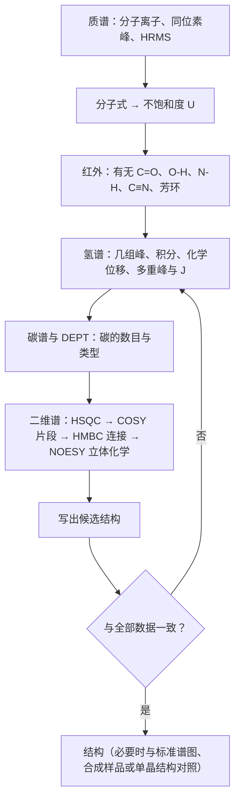

一个新化合物——反应的产物、从植物中分离出的天然产物、代谢组学中检出的未知峰——首先要回答"它是什么"。本章讲怎样从波谱数据推断有机分子的结构：先由质谱与元素组成定出分子式，再由红外判断**官能团**，由核磁共振确定原子的连接次序与立体关系，由紫外判断共轭体系，最后把各种信息拼成一个与全部数据自洽的结构。四种谱学方法的原理、仪器与谱图特征已在分析化学中讲过：紫外–可见吸收光谱（[6.4.9](/6.4.9)）、红外光谱（[6.4.11](/6.4.11)）、核磁共振（[6.4.12](/6.4.12)）与质谱（[6.4.15](/6.4.15)），本章只在需要时回顾一两句并链接过去，重点放在解析的策略、有机化学中常用的经验数据和大量例题上。解析结构要用到前几章的知识：官能团与命名（[6.5.1](/6.5.1)）、共轭与电子效应（[6.5.2](/6.5.2)）、构象（[6.5.4](/6.5.4)）与构型（[6.5.5](/6.5.5)）；反过来，后面各章讲到的每一类化合物，都会给出它的波谱特征，并用本章的方法鉴定反应产物。

## 6.1. 结构解析的思路

### 6.1.1. 从化学降解到波谱

20 世纪中叶以前，测定有机结构完全靠化学方法：元素分析给出 C、H、O、N、S 的质量分数，由此得到最简式；凝固点降低等依数性测定给出近似的分子量，两者结合得到分子式；再用特征反应逐一检出官能团（与 **Tollens 试剂**反应说明有醛基，能乙酰化说明有羟基），用降解反应把分子拆成已知的碎片，最后由碎片拼回原来的结构。例如某化合物含 C $79.2\%$、H $5.7\%$、O $15.1\%$，分子量约 $106$，则分子式为 $\ce{C7H6O}$；它能发生银镜反应、氧化得到苯甲酸，所以是苯甲醛。

对复杂的天然产物，这种方法极其艰难。吗啡在 1804–1806 年由 Sertürner 从鸦片中分离出来，1847 年确定分子式 $\ce{C17H19NO3}$；此后几十年里，许多化学家用乙酰化（数出羟基）、甲基化（区分酚羟基与醇羟基）、氧化、催化氢化（数出双键）、Hofmann 降解（说明氮在环上）、锌粉蒸馏（得到菲，说明骨架）等方法一点点拼凑，直到 1925 年 Gulland 与 Robinson 才提出正确的结构，1952 年 Gates 完成全合成，1955 年 Hodgkin 等用 X 射线晶体学最终确认（结构见下图）——前后一百五十年。胆固醇的结构同样经过几十年的降解研究，Wieland（胆酸）与 Windaus（甾醇）分别获得 1927、1928 年诺贝尔化学奖，而他们提出的骨架仍有错误，1932 年由 X 射线衍射数据纠正。

```smiles
CN1CCC23c4c5ccc(O)c4OC2C(O)C=CC3C1C5
```

化学方法的共同缺点是：样品用量大（克量级），每一步反应都可能引起重排而给出错误的结论，耗时长，并且必然破坏样品。20 世纪 50–60 年代起，紫外、红外、核磁共振与质谱相继成为常规手段，它们只需毫克甚至微克量级的样品，几分钟到几小时就能完成测定，多数还不破坏样品。今天一个新化合物的结构通常在一两天内就能确定，最终的确证则是单晶 X 射线衍射（它同时给出**绝对构型**）。

### 6.1.2. 四大谱的分工与时间尺度

有机化学中所说的"四大谱"提供不同层次的信息：

| 方法 | 测量的是什么 | 回答的问题 | 样品量 |
|---|---|---|---|
| 质谱 MS（[6.4.15](/6.4.15)） | 离子的质荷比 | 分子量与分子式（高分辨）；碎片给出部分结构 | ng–μg |
| 红外 IR（[6.4.11](/6.4.11)） | 振动能级跃迁 | 有哪些官能团（$\ce{C=O}$、$\ce{O-H}$、$\ce{N-H}$、$\ce{C#N}$…） | mg |
| 核磁共振 NMR（[6.4.12](/6.4.12)） | 核自旋能级跃迁 | 碳骨架、原子的连接次序、相对构型与构象 | mg |
| 紫外–可见 UV–Vis（[6.4.9](/6.4.9)） | 价电子跃迁 | 有无共轭体系及其大小 | μg |

其中 NMR 提供的信息最多，是结构解析的核心；MS 提供分子式，是解析的起点；IR 快速判断官能团；UV 在今天主要用于共轭体系与定量。

各种谱学方法还有不同的"时间尺度"，这决定了它们能否分辨相互转化的物种。两个物种以速率常数 $k$ 相互转化时，如果 $k$ 远小于它们在某种谱中的信号频率差 $\Delta\nu$，谱图上看到两个分开的信号；如果 $k \gg \Delta\nu$，只看到一个平均信号。两个物种的红外谱带即使只相差几个波数，频率差也有 $10^{11}\,\mathrm{Hz}$ 的量级，几乎所有化学过程都比它慢，所以**构象异构体**、**互变异构体**在 IR 中各自出峰；NMR 中不同质子的频率差只有几赫兹到几千赫兹，凡是在毫秒或更短时间内完成的过程（单键的旋转、环己烷的翻环、醇羟基质子的交换）都被平均掉。用 **Eyring 方程**（[6.3.16](/6.3.16#def-16.3.1)）可以把能垒换算成 $25\,^\circ\mathrm{C}$ 下的半衰期：

| $\Delta G^\ddagger$ / $(\mathrm{kJ\,mol^{-1}})$ | $40$ | $60$ | $80$ | $90$ | $100$ | $110$ |
|---|---|---|---|---|---|---|
| $t_{1/2}$（$25\,^\circ\mathrm{C}$，单分子过程） | $1\,\mu\mathrm{s}$ | $4\,\mathrm{ms}$ | $12\,\mathrm{s}$ | $11\,\mathrm{min}$ | $10\,\mathrm{h}$ | $24\,\mathrm{d}$ |

能垒低于约 $60\,\mathrm{kJ\,mol^{-1}}$ 的过程在室温 NMR 中通常已被平均；约 $90\,\mathrm{kJ\,mol^{-1}}$ 以上的异构体在室温下可以分离。本章的 6.5.5 节用它讨论 NMR 中的动态过程，构型与手性一章（[6.5.5](/6.5.5#sec-5.5.1)）用它判断**阻转异构体**能否**拆分**。

## 6.2. 分子式与不饱和度

解析的第一步是确定分子式。分子式可以由高分辨质谱直接得到（6.3.2），也可以由元素分析的质量分数加上低分辨质谱的分子量得到。有了分子式就能算出**不饱和度**（[6.4.11](/6.4.11#def-11.2.3)），即环与 $\pi$ 键的总数：

$$
U = 1 + n_{\mathrm{C}} + \frac{n_{\mathrm{N}} - n_{\mathrm{H}} - n_{\mathrm{X}}}{2},
\tag{6.1}
$$
其中 X 为卤素；二价的 O、S 不影响 $U$。不饱和度是缩小候选结构范围的第一道筛子：

| $U$ | 常见的可能 |
|---|---|
| $0$ | 饱和无环（烷烃、醇、醚、胺、卤代烷） |
| $1$ | 一个双键（$\ce{C=C}$、$\ce{C=O}$、$\ce{C=N}$）或一个环 |
| $2$ | 一个叁键（$\ce{C#C}$、$\ce{C#N}$），或两个双键、两个环、一个双键加一个环 |
| $\ge 4$ | 优先考虑苯环（三个双键加一个环，$U = 4$）；苯环加羰基 $U = 5$，萘 $U = 7$ |

$U$ 必须是非负整数；算出半整数说明分子式写错了（或者它是自由基、离子）。只由分子量推测分子式时，可以用"13 规则"列出候选：分子量 $M$ 除以 13，商 $n$ 与余数 $r$ 给出基本式 $\ce{C_nH_{n+r}}$；每加一个 O 就减去一个 $\ce{CH4}$（16），每加一个 N 减去一个 $\ce{CH2}$（14）。例如 $M = 86$：$86 = 13\times6 + 8$，基本式 $\ce{C6H14}$（$U = 0$）；含一个 O 为 $\ce{C5H10O}$（$U = 1$），含两个 N 为 $\ce{C4H10N2}$（$U = 1$）。究竟是哪一个，要靠同位素峰与精确质量判断（例 6.3.1）。

**例 6.2.1** 计算下列分子式的不饱和度，并各举一个可能的结构：$\ce{C5H10O}$，$\ce{C4H7N}$，$\ce{C7H7Cl}$，$\ce{C8H8O2}$。

**解** $\ce{C5H10O}$：$U = 1 + 5 - 10/2 = 1$，如 2-戊酮或环戊醇。$\ce{C4H7N}$：$U = 1 + 4 + (1 - 7)/2 = 2$，如丁腈 $\ce{CH3CH2CH2C#N}$。$\ce{C7H7Cl}$：$U = 1 + 7 - (7 + 1)/2 = 4$，如苄氯或氯甲苯。$\ce{C8H8O2}$：$U = 5$，苯环加一个羰基，如苯甲酸甲酯或乙酸苯酯（6.7 用二维谱区分这两者）。$\square$

## 6.3. 质谱解析

**质谱法**（[6.4.15](/6.4.15)）在结构解析中首先用来确定分子量与分子式，其次才是由碎片推断结构片段。电离方法、质量分析器与碎裂规律在 6.4.15 中已经讲过，这里给出解析的要点与速查数据。

### 6.3.1. 分子离子与同位素峰

电子电离（EI）谱中，分子失去一个电子形成**分子离子** $\mathrm{M}^{+\bullet}$，它是奇电子的自由基正离子（不应写作 $\mathrm{M}^+$）。识别分子离子峰的规则（[6.4.15](/6.4.15#sec-15.4.1)）：它通常是同位素峰之外 $m/z$ 最大的峰；与相邻碎片的质量差必须合理（$M - 4$ 到 $M - 14$、$M - 21$ 到 $M - 25$ 不可能）；质量符合**氮规则**（[6.4.15](/6.4.15#def-15.4.2)）：不含氮或含偶数个氮的化合物分子量为偶数。醇、支链烷烃、缩醛等的分子离子峰很弱甚至看不到，这时改用 ESI、CI 等软电离方法，看 $[\mathrm{M}+\mathrm{H}]^+$、$[\mathrm{M}+\mathrm{Na}]^+$ 等**准分子离子**（$m/z$ 分别为 $M + 1$、$M + 23$）。

**同位素峰**（[6.4.15](/6.4.15#sec-15.4.2)）是确定元素组成的有力工具：

- $M + 1$ 峰主要来自 $^{13}\mathrm{C}$（天然丰度 $1.07\%$），每个碳原子贡献约 $1.1\%$，所以 $n_{\mathrm{C}} \approx \dfrac{I_{M+1}/I_M}{1.1\%}$；氮贡献 $0.37\%$，氢的贡献很小。
- $M + 2$ 峰：一个 Cl 约 $32\%$（$M : M+2 \approx 3 : 1$），一个 Br 约 $97\%$（$\approx 1 : 1$），一个 S 约 $4.4\%$；一个 O 只有 $0.2\%$。含 $n$ 个 Cl 或 Br 时，峰型按二项式 $(a + b)^n$ 展开：$\ce{Cl2}$ 为 $9 : 6 : 1$，$\ce{Br2}$ 为 $1 : 2 : 1$，$\ce{ClBr}$ 为 $3 : 4 : 1$。
- F、P、I 是单同位素元素，不产生 $M + 2$ 峰；碘代物的特征是 $m/z$ 127（$\ce{I+}$）与 $M - 127$ 的大质量差。

**例 6.3.1** 某化合物的 EI 谱中，$m/z$ 86 与 87 的相对强度分别为 $20.9\%$ 与 $1.2\%$，没有明显的 $M + 2$ 峰。推测分子式。

**解** 没有 $M + 2$ 峰，排除 Cl、Br、S。$I_{M+1}/I_M = 1.2/20.9 = 5.7\%$，碳原子数约 $5.7/1.1 \approx 5$。分子量为偶数，按氮规则含 0 或 2 个 N。名义质量 86 的候选中，$\ce{C5H10O}$ 的 $M + 1$ 计算值为 $5.6\%$，$\ce{C4H10N2}$ 为 $5.2\%$，$\ce{C6H14}$ 为 $6.7\%$。$\ce{C5H10O}$ 最符合，$U = 1$（一个羰基或一个 $\ce{C=C}$ 加一个羟基、醚键，或一个环）。同位素峰强度的测量误差约 $\pm 10\%$，要确认还需高分辨数据：三者的精确质量分别为 $86.0732$、$86.0844$、$86.1096$。$\square$

### 6.3.2. 高分辨质谱与多电荷离子

高分辨质谱（HRMS）把 $m/z$ 测到小数点后第四位（误差几个 ppm），利用各元素的**精确质量**（[6.4.15](/6.4.15#def-15.1.3)）不是整数这一事实区分名义质量相同的分子式：$^{1}\mathrm{H}$ $1.007825$，$^{12}\mathrm{C}$ $12.000000$，$^{14}\mathrm{N}$ $14.003074$，$^{16}\mathrm{O}$ $15.994915$。

**例 6.3.2** 一个分子量为 44 的化合物，可能是 $\ce{C3H8}$、$\ce{C2H4O}$、$\ce{CO2}$ 或 $\ce{CH4N2}$。高分辨质谱测得（已扣除电子质量的）分子质量为 $44.0262$。它是哪一个？

**解** 四者的精确质量分别为 $44.0626$、$44.0262$、$43.9898$、$44.0374$。实测值与 $\ce{C2H4O}$ 相差不到 $1\,\mathrm{ppm}$，与其他三者相差 $250\,\mathrm{ppm}$ 以上，所以是 $\ce{C2H4O}$（乙醛或环氧乙烷）。注意 $\mathrm{M}^{+\bullet}$ 的 $m/z$ 比分子质量小一个电子的质量（$0.00055$），在 ppm 精度下不能忽略，现代仪器的软件会自动计入。$\square$

电喷雾电离（ESI）容易使大分子带上多个电荷，形成 $[\mathrm{M} + n\mathrm{H}]^{n+}$ 的一系列峰。判断一个峰所带的电荷数有两种方法：一是看它自己的同位素峰间隔，间隔为 $1/z$（例如间隔 $1/16$ 说明 $z = 16$）；二是用相邻两个电荷态的 $m/z$ 联立求解（[6.4.15](/6.4.15#sec-15.2.4)）。由一系列电荷态还原出中性分子质量的计算称为去卷积：分子量约 $21\,\mathrm{kDa}$ 的蛋白质 K-Ras 在 ESI 谱中出现 $m/z$ 1000–2000 的一组峰，去卷积后得到 $21\,488\,\mathrm{Da}$ 的单峰，与序列计算值相差 $6\,\mathrm{Da}$，可以据此判断蛋白质有没有被修饰。

### 6.3.3. 碎片与常见丢失

EI 碎片的规律（$\sigma$ 断裂、$\alpha$ 断裂、诱导断裂、**McLafferty 重排**、逆 Diels–Alder）已在 [6.4.15](/6.4.15#sec-15.4.3) 中详细讲过。解析时最常用的是从分子离子出发看丢失了什么，以及几个诊断性的碎片离子：

| 丢失 | 可能的中性碎片 | 提示 | 碎片离子 $m/z$ | 可能的结构 |
|---|---|---|---|---|
| $M - 1$ | $\ce{H}$ | 醛、醇、胺 | $29$ | $\ce{C2H5+}$、$\ce{HCO+}$ |
| $M - 15$ | $\ce{CH3}$ | 甲基支链、甲基酮 | $30$ | $\ce{CH2=NH2+}$（伯胺） |
| $M - 18$ | $\ce{H2O}$ | 醇 | $31$ | $\ce{CH2=OH+}$（伯醇、甲基醚） |
| $M - 28$ | $\ce{CO}$、$\ce{C2H4}$ | 酚、醌；McLafferty（乙基侧链） | $43$ | $\ce{CH3CO+}$、$\ce{C3H7+}$ |
| $M - 29$ | $\ce{C2H5}$、$\ce{CHO}$ | 乙基、醛 | $57$ | $\ce{C4H9+}$、$\ce{C2H5CO+}$ |
| $M - 31$ | $\ce{OCH3}$ | 甲酯、甲基醚 | $77$ | $\ce{C6H5+}$ |
| $M - 42$ | $\ce{CH2=C=O}$、$\ce{C3H6}$ | 乙酸酯（芳基）、乙酰胺；McLafferty | $91$ | $\ce{C7H7+}$（䓬鎓离子，烷基苯） |
| $M - 45$ | $\ce{OC2H5}$、$\ce{COOH}$ | 乙酯、羧酸 | $105$ | $\ce{C6H5CO+}$、$\ce{C8H9+}$ |

正构烷烃给出一系列相差 14（$\ce{CH2}$）的 $\ce{C_nH_{2n+1}+}$ 峰，以 43、57 最强；支链烷烃在分支处断裂，分子离子峰很弱。正戊烷（$M = 72$）的谱中有 $m/z$ 57（$M - 15$）、43（基峰，$M - 29$）、29（$M - 43$），分子离子峰清晰；它的异构体新戊烷 $\ce{C(CH3)4}$ 几乎看不到分子离子，基峰是 $m/z$ 57（叔丁基正离子，失去甲基）。

**例 6.3.3** 2-己酮与 3-己酮的分子量都是 100。怎样用 EI 谱区分它们？

**解** 两者的 $\alpha$ 断裂产物不同：2-己酮 $\ce{CH3COC4H9}$ 给出 $\ce{CH3CO+}$（$m/z$ 43，基峰）与 $\ce{C4H9CO+}$（85）；3-己酮 $\ce{C2H5COC3H7}$ 给出 $\ce{C2H5CO+}$（57）与 $\ce{C3H7CO+}$（71）。McLafferty 重排也不同：2-己酮的丁基一侧有 $\gamma$ 氢，失去丙烯（42）得到 $m/z$ 58；3-己酮的丙基一侧有 $\gamma$ 氢，失去乙烯（28）得到 $m/z$ 72，乙基一侧没有 $\gamma$ 氢。所以 43、58、85 指向 2-己酮，57、71、72 指向 3-己酮。$\square$

## 6.4. 红外光谱的解析

**红外吸收光谱法**的特征吸收频率表与影响**基团频率**的因素见 [6.4.11](/6.4.11#sec-11.2.2)。这一节讲怎样有条理地读一张红外谱，以及有机化学中最重要的羰基区的细分。

### 6.4.1. 解析的顺序

红外谱中的峰很多，但并不需要逐一归属。按下面的顺序提问，几分钟就能得出官能团的大致结论：

1. $1850$–$1650\,\mathrm{cm^{-1}}$ 有没有强峰？有则含 $\ce{C=O}$，进入 6.4.2 判断类型。
2. $3600$–$3200\,\mathrm{cm^{-1}}$ 有没有吸收？宽而强的是缔合的 $\ce{O-H}$（醇、酚）；$3300$–$2500\,\mathrm{cm^{-1}}$ 极宽、与 $\ce{C-H}$ 重叠、同时有 $\ce{C=O}$ 的是羧酸；较尖的一个或两个中等峰是 $\ce{N-H}$（仲胺一个，伯胺两个）；约 $3300\,\mathrm{cm^{-1}}$ 的尖峰并有 $2120\,\mathrm{cm^{-1}}$ 的弱峰是端炔 $\ce{\equiv C-H}$。
3. $3000\,\mathrm{cm^{-1}}$ 两侧：高于 $3000$ 的 $\ce{C-H}$ 来自烯烃或芳环，只有低于 $3000$ 的说明是饱和化合物；$2820$ 与 $2720\,\mathrm{cm^{-1}}$ 的一对弱峰是醛基 $\ce{C-H}$（Fermi 共振）。
4. $2260$–$2100\,\mathrm{cm^{-1}}$：$\ce{C#N}$（中等，尖）或 $\ce{C#C}$（弱）；这一区域别的基团很少出峰，有峰就很有诊断意义。
5. $1680$–$1450\,\mathrm{cm^{-1}}$：$\ce{C=C}$（约 $1650$，中等偏弱）、芳环骨架（$1600$、$1500$ 一对）、硝基（$1550$ 与 $1350$ 两个强峰）。
6. 指纹区只看几个强而有用的峰：$1300$–$1000\,\mathrm{cm^{-1}}$ 的 $\ce{C-O}$ 强峰（醇、醚、酯）；$1000$–$650\,\mathrm{cm^{-1}}$ 的面外弯曲（烯烃与苯环的取代方式）。在这一区域没有强吸收的化合物通常不含芳环。

反过来，"没有某个峰"往往比"有某个峰"更可靠：没有 $1700\,\mathrm{cm^{-1}}$ 附近的强峰就可以排除羰基化合物，没有 $3300\,\mathrm{cm^{-1}}$ 附近的吸收就可以排除醇、胺与羧酸。

两个常见的问题顺便回答：$\ce{H2}$ 等同核双原子分子不吸收红外光，因为它的伸缩振动不改变偶极矩（**红外活性**的条件，[6.4.11](/6.4.11#def-11.1.3)）；同理 $\ce{CO2}$ 的对称伸缩振动没有红外吸收，只有反对称伸缩（$2349\,\mathrm{cm^{-1}}$）与弯曲振动（$667\,\mathrm{cm^{-1}}$）出峰。

### 6.4.2. 羰基区的细分

羰基峰的位置由与羰基相连的基团通过诱导、共振（共轭）、**环张力**和氢键决定（[6.4.11](/6.4.11#sec-11.2.3)）：吸电子的**诱导效应**使 $\ce{C=O}$ 的双键性增强、频率升高；给电子的共振（$\ce{N}$、$\ce{O}$ 的孤对电子与羰基共轭）与 $\ce{C=C}$、芳环的共轭使双键性减弱、频率降低。下表补充 6.4.11 中没有的几类：

| 类型 | $\tilde\nu(\ce{C=O})$ / $\mathrm{cm^{-1}}$ | 说明 |
|---|---|---|
| 饱和脂肪酯 | $1750$–$1735$ | 另有 $1300$–$1150$ 的 $\ce{C-O}$ 强峰 |
| $\alpha,\beta$-不饱和酯、芳酸酯 | $1730$–$1715$ | 共轭使频率降低（苯甲酸甲酯 $1724$） |
| 乙烯酯、苯酯 | $1770$–$1760$ | 烷氧基氧的孤对电子部分离域到 $\ce{C=C}$ 或苯环，对羰基的给电子共振减弱（乙酸苯酯 $1765$） |
| 内酯 | $\beta$ 约 $1840$，$\gamma$ 约 $1770$，$\delta$ 约 $1735$ | 环越小频率越高 |
| 内酰胺 | $\beta$ 约 $1745$，$\gamma$ 约 $1700$，$\delta$ 约 $1670$ | 青霉素类的 $\beta$-内酰胺约 $1770$–$1780$ |
| 酸酐 | $1820$ 与 $1760$ 两个峰 | 链状酸酐高频峰较强，环状酸酐低频峰较强 |
| 酰胺 | $1690$–$1630$（酰胺 I 带） | 仲酰胺另有 $1550$ 附近的酰胺 II 带（$\ce{N-H}$ 弯曲与 $\ce{C-N}$ 伸缩） |

环张力同样使环外 $\ce{C=C}$ 的频率升高：亚甲基环己烷、亚甲基环戊烷、亚甲基环丁烷、亚甲基环丙烷的 $\ce{C=C}$ 依次在 $1651$、$1657$、$1678$、$1781\,\mathrm{cm^{-1}}$。原因是小环的环内键角被压缩，环碳用 p 成分更多的轨道形成环内键，留给环外键的轨道 s 成分增加，环外键变强（**杂化轨道**的再分配）。

用双原子谐振子模型估算基团频率时（[6.4.11](/6.4.11#sec-11.1.2)），波数与力常数 $k$、约化质量 $\mu$ 的关系是

$$
\tilde\nu = \frac{1}{2\pi c}\sqrt{\frac{k}{\mu}},
\tag{6.2}
$$
其中 $c$ 是光速；只写 $\frac{1}{2\pi}\sqrt{k/\mu}$ 得到的是频率 $\nu$，不是波数。

## 6.5. 氢谱的解析

氢谱给出三类信息：**化学位移**（质子处在什么化学环境中）、峰面积（每类质子的数目）与**耦合常数**及多重峰形（相邻有几个质子、它们的几何关系）。原理见 [6.4.12](/6.4.12)，这一节讲解析时的具体方法。

### 6.5.1. 化学等价与分子对称性

谱图中有几组峰，取决于分子中有几类**化学等价**（[6.4.12](/6.4.12#def-12.3.3)）的质子。判断方法是看质子能否通过分子的对称操作或快速的构象变化相互交换，或者等价地用"取代检验"：把待比较的两个质子分别换成一个检验基团 Z，比较得到的两个结构。

| 两个质子的关系 | 取代检验的结果 | 对称操作 | 在 NMR 中 |
|---|---|---|---|
| **同位** | 两个结构完全相同 | 旋转轴 $C_n$ | 化学等价 |
| **对映异位** | 两个结构互为**对映体** | 镜面（或反演中心），但无旋转轴 | 在非手性溶剂中化学等价，在手性环境中可以不等价 |
| **非对映异位** | 两个结构互为**非对映体** | 无 | 化学不等价，化学位移一般不同，彼此有偕偶 |

对映异位、非对映异位与**前手性**的概念在 [6.5.5](/6.5.5#sec-5.9) 中讲；这里关心的是它们在 NMR 中的后果。几个例子：甲烷、乙烷、乙烯、苯都只有一类氢；丙烷两类；2-甲基丙烯两类（甲基与 $\ce{=CH2}$）；丙烯有四类，因为 $\ce{=CH2}$ 上的两个氢一个与甲基同侧、一个与甲基异侧，不能通过任何对称操作交换。二氯甲烷、溴氯甲烷 $\ce{CH2BrCl}$ 的两个氢都只出一个峰：前者同位，后者对映异位。

与**手性中心**相邻的亚甲基上的两个氢是非对映异位的。例如 2-丁醇 $\ce{CH3CH(OH)CH2CH3}$ 的 $\ce{CH2}$：把其中一个氢换成 Z 得到 (2R,3R) 型，换另一个得到 (2R,3S) 型，两者互为非对映体。所以这两个氢的化学位移略有不同，各自既与邻近的甲基、次甲基耦合，又相互偕偶，峰形比简单的五重峰复杂。同样，手性分子中异丙基的两个甲基是非对映异位的，常出现两组双峰（如缬氨酸、薄荷醇）。非对映异位不要求分子有手性中心：3-戊醇 $\ce{(CH3CH2)2CHOH}$ 本身没有手性，但每个 $\ce{CH2}$ 上的两个氢分别处在与 $\ce{OH}$ 相对的不同环境中，也是非对映异位的。

"快速的构象变化"中的"快"是相对于 NMR 的时间尺度（6.1.2）说的。甲基绕 $\ce{C-C}$ 键的旋转能垒只有约 $12\,\mathrm{kJ\,mol^{-1}}$，室温下每秒旋转约 $10^{10}$ 次，三个氢在 NMR 中完全平均，所以甲基总是一个信号。环己烷的直立氢与平伏氢在每次**翻环**时互换位置（能垒约 $45\,\mathrm{kJ\,mol^{-1}}$，[6.5.4](/6.5.4#sec-4.5.3)），室温下翻环极快，只看到 $\delta = 1.43$ 的单峰；冷却到 $-90\,^\circ\mathrm{C}$ 以下则分裂为两组峰，平伏氢比直立氢在低场约 $0.5\,\mathrm{ppm}$（6.5.5）。

### 6.5.2. 化学位移的经验估算

常见质子的化学位移范围见 [6.4.12](/6.4.12#sec-12.2.4) 的表。记住几个"锚点"就能估出大多数质子的位置：饱和 $\ce{CH3}$ $0.9$、$\ce{CH2}$ $1.3$、$\ce{CH}$ $1.5$；与 $\ce{C=O}$、芳环、$\ce{C=C}$ 相邻的 $\ce{CH}$ 移到 $2$–$2.5$；与 $\ce{N}$ 相邻 $2.5$–$3$；与卤素相邻 $3$–$3.5$（Br、Cl）；与 $\ce{O}$ 相邻 $3.3$–$4$，与酯的烷氧基氧相邻 $4$–$4.3$；烯氢 $4.5$–$6.5$；芳氢 $6.5$–$8$；醛基 $9.5$–$10$；羧酸 $10$–$13$。

从这些锚点出发，取代基的影响大致可以相加：$\alpha$ 位的取代基贡献最大，$\beta$ 位只有约 $0.2$–$0.5\,\mathrm{ppm}$，更远可以忽略。对 $\ce{X-CH2-Y}$ 型亚甲基，有一个简单而好用的加和式：

**公式 6.5.1（Shoolery 规则）** 亚甲基 $\ce{X-CH2-Y}$（或次甲基、甲基）质子的化学位移近似为

$$
\delta \approx 0.23 + \sum_i \sigma_i,
\tag{6.3}
$$
其中 $0.23$ 是甲烷的化学位移，$\sigma_i$ 是与该碳相连的各取代基的屏蔽常数（经验值）：

| 取代基 | $\sigma$ | 取代基 | $\sigma$ | 取代基 | $\sigma$ |
|---|---|---|---|---|---|
| $\ce{-CH3}$ | $0.47$ | $\ce{-Cl}$ | $2.53$ | $\ce{-COR}$ | $1.70$ |
| $\ce{-CH=CH2}$ | $1.32$ | $\ce{-Br}$ | $2.33$ | $\ce{-COOR}$ | $1.55$ |
| $\ce{-C#CH}$ | $1.44$ | $\ce{-I}$ | $1.82$ | $\ce{-CN}$ | $1.70$ |
| $\ce{-C6H5}$ | $1.85$ | $\ce{-OH}$、$\ce{-OR}$ | $2.56$、$2.36$ | $\ce{-NR2}$ | $1.57$ |
| $\ce{-CF3}$ | $1.14$ | $\ce{-OCOR}$ | $3.13$ | $\ce{-SR}$ | $1.64$ |

例如：$\ce{CH2Cl2}$ 估计为 $0.23 + 2\times2.53 = 5.29$（实测 $5.30$）；苄氯 $\ce{C6H5CH2Cl}$ 为 $0.23 + 1.85 + 2.53 = 4.61$（实测 $4.57$）；丙二酸二乙酯的 $\ce{CH2}$ 为 $0.23 + 2\times1.55 = 3.33$（实测 $3.36$）；氯乙酸乙酯的 $\ce{ClCH2}$ 为 $0.23 + 2.53 + 1.55 = 4.31$（实测 $4.06$）。这类经验式的误差一般在 $0.2$–$0.3\,\mathrm{ppm}$ 以内，足以区分候选结构，但不能代替实测数据；今天常用软件（基于大量谱图数据库）预测化学位移，原理与此相同。

取代苯的芳氢也可以用取代基增量估算：$\delta \approx 7.26 + \sum Z_i$（$7.26$ 是这套增量的基值），$Z_i$ 按取代基相对于该氢在邻、间、对位取值（常用值，误差约 $\pm 0.1$）：

| 取代基 | $Z_{\text{邻}}$ | $Z_{\text{间}}$ | $Z_{\text{对}}$ | 取代基 | $Z_{\text{邻}}$ | $Z_{\text{间}}$ | $Z_{\text{对}}$ |
|---|---|---|---|---|---|---|---|
| $\ce{-NO2}$ | $+0.95$ | $+0.26$ | $+0.38$ | $\ce{-CH3}$ | $-0.18$ | $-0.11$ | $-0.21$ |
| $\ce{-CHO}$ | $+0.56$ | $+0.22$ | $+0.29$ | $\ce{-Cl}$ | $+0.03$ | $-0.02$ | $-0.09$ |
| $\ce{-COCH3}$ | $+0.62$ | $+0.14$ | $+0.21$ | $\ce{-OCH3}$ | $-0.48$ | $-0.09$ | $-0.44$ |
| $\ce{-COOCH3}$ | $+0.71$ | $+0.11$ | $+0.21$ | $\ce{-OH}$ | $-0.56$ | $-0.12$ | $-0.45$ |
| $\ce{-OCOCH3}$ | $-0.25$ | $+0.03$ | $-0.13$ | $\ce{-NH2}$ | $-0.75$ | $-0.25$ | $-0.65$ |

这张表就是电子效应（[6.5.2](/6.5.2#sec-2.5)）在谱图上的直接体现：$\ce{-OH}$、$\ce{-NH2}$、$\ce{-OCH3}$ 的孤对电子通过共轭使邻、对位电子云密度增大，这两个位置的质子移向高场，间位几乎不受影响；$\ce{-NO2}$、羰基吸电子，邻、对位移向低场，邻位还受羰基或硝基的磁各向异性去屏蔽，移得最多。对二取代苯中两种取代基一推一拉时（如对硝基苯甲醚），两组芳氢分得很开，形成典型的"两组双峰"（实为 AA′BB′ 体系，6.5.4）。

除了诱导与共轭效应，磁各向异性（**环电流效应**，[6.4.12](/6.4.12#def-12.2.3)）也很重要：芳环外侧的质子去屏蔽，位于芳环上方的质子屏蔽。对环芳烷中横跨苯环上方的亚甲基链就是后一种情况，越靠近链中部（越接近苯环正上方）的 $\ce{CH2}$ 化学位移越小，可以低于 $1\,\mathrm{ppm}$。单键的各向异性较弱，但足以使环己烷中平伏氢比直立氢在低场约 $0.5\,\mathrm{ppm}$。

### 6.5.3. 积分

每组峰的面积与产生它的质子数成正比（[6.4.12](/6.4.12#sec-12.3.6)）。积分给出的是比例，换算成绝对数目时要用分子式：把各组峰的积分比化成最简整数比，使总数等于分子式中的氢数（或其约数，此时分子有对称性）。积分误差一般为 $\pm 5\%$ 左右；活泼氢的宽峰、与溶剂残留峰重叠的峰误差更大。

### 6.5.4. 耦合与多重峰

一级谱中，一组化学等价的质子与 $n$ 个等价的相邻质子耦合时分裂为 $n + 1$ 重峰，强度比为二项式系数（[6.4.12](/6.4.12#sec-12.3.2)）。多重峰的写法：s（单峰）、d（双峰）、t（三重峰）、q（四重峰）、quint（五重峰）、sext（六重峰）、sept（七重峰）、m（多重峰），br 表示宽峰；与两组不等价的质子以不同的 $J$ 耦合时写成组合，如 dd（双二重峰）、dt、dq、ddd。

一组质子与两组不等价的质子（分别 $n$ 个与 $n'$ 个）耦合时，理论上分裂为 $(n + 1)(n' + 1)$ 条线；两个耦合常数相近时，部分谱线重合，近似为 $n + n' + 1$ 重峰。下图中 1-氯丙烷的中间亚甲基与两侧共 5 个质子耦合，$J$ 分别为 $6.6$ 与 $7.4\,\mathrm{Hz}$，12 条线挤成一个略有肩峰的"六重峰"：


由耦合常数判断哪些质子彼此相邻的依据是：相互耦合的两组峰，耦合常数相同（$J_{\mathrm{ab}} = J_{\mathrm{ba}}$）。$J$ 的大小还反映几何关系，解析中最常用的数据（详见 [6.4.12](/6.4.12#sec-12.3.3)）：

| 耦合 | $J$ / $\mathrm{Hz}$ | 用途 |
|---|---|---|
| 自由旋转的 $\ce{H-C-C-H}$ | $6$–$8$（典型 $7$） | 烷基链 |
| 烯烃，反式 | $12$–$18$（典型 $16$） | 区分 $E$/$Z$ |
| 烯烃，顺式 | $6$–$12$（典型 $10$） | |
| 末端烯烃偕偶 $\ce{=CH2}$ | $0$–$3$ | |
| 苯环邻位 / 间位 / 对位 | $7$–$9$ / $1$–$3$ / $0$–$1$ | 判断取代方式 |
| 环己烷 ax–ax / ax–eq、eq–eq | $8$–$13$ / $2$–$5$ | 构象与相对构型（**Karplus 关系**） |
| 醛基 $\ce{CHO-CH}$ | $1$–$3$ | |
| $\mathrm{sp}^3$ 亚甲基偕偶 | $-10$ 到 $-15$（只在两个氢不等价时可见） | 非对映异位质子 |

与几组质子以不同的 $J$ 耦合时，多重峰可以用"分裂树"从大到小逐级分解。苯乙烯的乙烯基是一个教科书式的例子：$\mathrm{H_a}$（$\ce{PhCH=}$）分别与反式的 $\mathrm{H_b}$（$J = 17.6\,\mathrm{Hz}$）、顺式的 $\mathrm{H_c}$（$J = 10.9\,\mathrm{Hz}$）耦合，是四条等高的线（dd）；$\mathrm{H_b}$ 与 $\mathrm{H_c}$ 之间的偕偶只有 $0.9\,\mathrm{Hz}$。由 $J$ 值立刻可以把三组峰归属清楚。


$n + 1$ 规律只适用于一级谱（$\Delta\nu/J$ 大于约 10）。化学位移接近的耦合质子给出二级谱：谱线强度向内侧倾斜（屋顶效应，[6.4.12](/6.4.12#sec-12.3.5)），倾斜的方向指向与之耦合的那组峰，这本身就是归属的线索。化学等价而不**磁等价**（[6.4.12](/6.4.12#def-12.3.4)）的质子也给出复杂峰形：对二取代苯的四个芳氢是 AA′BB′ 体系，在中低场谱仪上看起来像两组"双峰"，放大后可以看到额外的小峰。所谓"等价质子之间不显示耦合"，严格说只对磁等价的质子成立。

### 6.5.5. 活泼氢、交换与动态过程

与 O、N、S 相连的质子（活泼氢）有三个特点：化学位移随浓度、温度与溶剂变化很大（形成**氢键**的程度不同）；峰常常变宽；通常看不到它与相邻 $\ce{C-H}$ 的耦合。后一点来自质子交换：在痕量酸或碱催化下，$\ce{ROH}$ 的羟基质子在分子之间快速交换，每个分子上的羟基质子在 NMR 时间尺度内换了许多次，相邻 $\ce{CH}$ 感受到的是它两种自旋态的平均，耦合被平均掉（交换去耦）。在干燥的 $\ce{DMSO}$-$d_6$ 中交换变慢，甲醇的 $\ce{OH}$ 显示为四重峰、$\ce{CH3}$ 为双峰，伯醇、仲醇、叔醇的 $\ce{OH}$ 分别为三重峰、双峰、单峰，可以借此判断醇的类型。

指认活泼氢最简便的方法是重水交换：测完谱后在样品管中加一滴 $\ce{D2O}$ 振摇再测，$\ce{OH}$、$\ce{NH}$、$\ce{COOH}$ 的峰因被 D 取代而消失（在 $\delta \approx 4.8$ 附近出现 HOD 峰）。酰胺 $\ce{NH}$ 交换较慢，有时需要较长时间或加热。

构象交换遵循同样的规律。两个等布居的位置以速率常数 $k$ 交换、频率差为 $\Delta\nu$（以 Hz 计）时，谱图随 $k$ 的变化如下图：$k \ll \Delta\nu$ 时为两条线；随 $k$ 增大两线变宽、靠拢；在

$$
k_{\mathrm{c}} = \frac{\pi\Delta\nu}{\sqrt2}
\tag{6.4}
$$
时合并为一个平顶峰，对应的温度称为合并温度（coalescence temperature）；$k \gg \Delta\nu$ 时成为位于平均位置的一条窄线。由合并温度与 $\Delta\nu$ 求出 $k_{\mathrm{c}}$，再代入 Eyring 方程就得到交换过程的活化自由能，这就是变温（动态）NMR 测定构象能垒、旋转能垒（如酰胺 $\ce{C-N}$ 键约 $70$–$80\,\mathrm{kJ\,mol^{-1}}$）的方法。$\Delta\nu$ 以 Hz 计、与磁场成正比，所以同一过程在高场谱仪上的合并温度更高：环己烷的两类氢相差 $0.48\,\mathrm{ppm}$，在 $60\,\mathrm{MHz}$ 谱仪上 $k_{\mathrm{c}} = 64\,\mathrm{s^{-1}}$，合并温度约 $-56\,^\circ\mathrm{C}$，在 $400\,\mathrm{MHz}$ 上 $k_{\mathrm{c}} = 427\,\mathrm{s^{-1}}$，约 $-39\,^\circ\mathrm{C}$。


### 6.5.6. 溶剂与残留峰

常规氢谱用氘代溶剂，而氘代不可能完全，残留的少量 $^1\mathrm{H}$ 给出溶剂峰；溶剂中溶解的水也出峰，其位置随溶剂而变。这些峰常被误认为样品的信号，解析前应先把它们找出来（数据取 Fulmer 等，2010）：

| 溶剂 | 残留 $^1\mathrm{H}$ $\delta$ | 水峰 $\delta$ | $^{13}\mathrm{C}$ $\delta$ |
|---|---|---|---|
| $\ce{CDCl3}$ | $7.26$（s） | $1.56$ | $77.16$（t） |
| $\ce{DMSO}$-$d_6$ | $2.50$（quint） | $3.33$ | $39.52$（sept） |
| $\ce{CD3OD}$ | $3.31$（quint） | $4.87$ | $49.00$（sept） |
| $\ce{D2O}$ | $4.79$（HOD） | — | — |
| 丙酮-$d_6$ | $2.05$（quint） | $2.84$ | $29.84$、$206.26$ |
| $\ce{C6D6}$ | $7.16$（s） | $0.40$ | $128.06$（t） |
| $\ce{CD3CN}$ | $1.94$（quint） | $2.13$ | $1.32$、$118.26$ |

残留峰的多重性来自与氘的耦合：$\ce{CHD2}$ 基团中的 $^1\mathrm{H}$ 与两个 D（$I = 1$）耦合，按 $2nI + 1$ 得五重峰，强度比 $1:2:3:2:1$。同一化合物在不同溶剂中的化学位移可以相差 $0.1$–$0.5\,\mathrm{ppm}$（苯在 $\ce{CDCl3}$ 中为 $7.36$，在 $\ce{C6D6}$ 中为 $7.16$），比较数据时必须注明溶剂。

## 6.6. 碳谱与 DEPT

宽带去耦的 $^{13}\mathrm{C}$ 谱中，每一类化学不等价的碳各出一个单峰（[6.4.12](/6.4.12#sec-12.5.1)）。碳谱的解析要点：

1. 数峰。峰数就是不等价碳的类数；峰数少于分子式中的碳数说明分子有对称性。例如 $\ce{C4H10O}$ 的醇：1-丁醇与 2-丁醇各 4 个峰，2-甲基-1-丙醇 3 个，叔丁醇 2 个。
2. 看化学位移，判断碳的类型。$^{13}\mathrm{C}$ 的范围约 $0$–$220\,\mathrm{ppm}$，分区很清楚：

| 碳的类型 | $\delta$ | 碳的类型 | $\delta$ |
|---|---|---|---|
| 烷基 $\ce{CH3}$、$\ce{CH2}$、$\ce{CH}$、$\ce{C}$ | $0$–$50$ | 芳环、杂芳环 | $110$–$160$（苯 $128.4$） |
| $\ce{C-I}$ / $\ce{C-Br}$ / $\ce{C-Cl}$ | $-20$–$10$ / $10$–$40$ / $25$–$50$ | $\ce{C#N}$ | $115$–$125$ |
| $\ce{C-N}$ | $30$–$65$ | 酯、酰胺、酸酐的 $\ce{C=O}$ | $160$–$175$ |
| $\ce{C-O}$（醇、醚、酯的烷氧基） | $50$–$90$（$\ce{OCH3}$ 约 $52$–$60$） | 羧酸的 $\ce{C=O}$ | $170$–$185$ |
| $\ce{C#C}$ | $65$–$90$ | 醛的 $\ce{C=O}$ | $190$–$205$ |
| $\ce{C=C}$ | $100$–$150$ | 酮的 $\ce{C=O}$ | $195$–$220$（共轭酮在低端） |

  卤代烷一栏有一个反常：碘、溴使相连的碳移向高场（碘甲烷 $\delta = -21$），这是重原子的自旋–轨道耦合效应，与电负性的趋势相反。
3. 用 DEPT 判断每个碳上连几个氢（见下）。
4. 季碳（不连氢的碳）的峰通常较弱：它们的 NOE 增强小、纵向弛豫慢。羰基与取代芳碳的峰常常很矮，不要因此漏数。

**定义 6.6.1（无畸变极化转移增强）** 把 $^1\mathrm{H}$ 的极化通过 $^1J_{\mathrm{CH}}$ 耦合转移给相连的 $^{13}\mathrm{C}$、并使信号的符号与强度随最后一个 $^1\mathrm{H}$ 脉冲的翻转角 $\theta$ 和碳上的氢数而变的实验，称为**无畸变极化转移增强**（DEPT）。

DEPT 的读法（季碳在各种 DEPT 谱中都不出峰）：

| 谱 | $\ce{CH3}$ | $\ce{CH2}$ | $\ce{CH}$ | $\ce{C}$ |
|---|---|---|---|---|
| 宽带去耦 $^{13}\mathrm{C}$ | 正 | 正 | 正 | 正（弱） |
| DEPT-135 | 正 | 负 | 正 | 无 |
| DEPT-90 | 无 | 无 | 正 | 无 |

把常规碳谱、DEPT-135 与 DEPT-90 对照：DEPT-90 中出现的是 $\ce{CH}$；DEPT-135 中的负峰是 $\ce{CH2}$；DEPT-135 中的正峰去掉 $\ce{CH}$ 就是 $\ce{CH3}$；常规谱中有而 DEPT 中都没有的是季碳。把各类碳上的氢数加起来，应与分子式中连在碳上的氢数一致，差数就是活泼氢的数目。

烷烃碳的化学位移也有加和规律（Grant–Paul 规则）：$\delta \approx -2.3 + 9.1n_\alpha + 9.4n_\beta - 2.5n_\gamma$，其中 $n_\alpha$、$n_\beta$、$n_\gamma$ 是与该碳相隔一、二、三个键的碳原子数（支链碳另有校正）。例如丁烷：$\mathrm{C1}$ 为 $-2.3 + 9.1 + 9.4 - 2.5 = 13.7$（实测 $13.4$），$\mathrm{C2}$ 为 $-2.3 + 2\times9.1 + 9.4 = 25.3$（实测 $25.2$）。$\gamma$ 位取代使碳移向高场的效应来自邻位交叉构象中的空间压缩，在环己烷中直立的取代基使环上 $\gamma$ 位碳比平伏取代时在高场约 $5\,\mathrm{ppm}$，这是判断取代基取向的常用依据。

**例 6.6.1** 某醇 $\ce{C4H10O}$ 的碳谱有 4 个峰，约在 $\delta$ $69$、$32$、$23$、$10$。DEPT-135 中 $32$ 为负峰，其余为正峰；DEPT-90 中只有 $69$。推测结构。

**解** 4 个峰说明 4 个碳都不等价，排除 2-甲基-1-丙醇（3 个峰）与叔丁醇（2 个峰）。DEPT：$69$ 为 $\ce{CH}$，$32$ 为 $\ce{CH2}$，$23$ 与 $10$ 为 $\ce{CH3}$。碳上的氢共 $1 + 2 + 3 + 3 = 9$ 个，另一个是 $\ce{OH}$。$\delta$ $69$ 的 $\ce{CH}$ 与氧相连。所以是 2-丁醇 $\ce{CH3CH(OH)CH2CH3}$（1-丁醇应有一个 $\ce{CH2-O}$，约 $62$，且只有一个 $\ce{CH3}$）。$\square$

## 6.7. 二维谱的读法

一维谱中峰的重叠与复杂的耦合关系，在二维谱中被展开到平面上（**二维核磁共振**，原理见 [6.4.12](/6.4.12#sec-12.5.2)）。结构解析中最常用的四种二维谱各回答一个问题：

| 谱 | 交叉峰表示 | 回答的问题 |
|---|---|---|
| COSY | 两个质子相互耦合（主要是 $^2J$、$^3J$） | 哪些 H 相邻？把同一条碳链上的质子串起来 |
| HSQC | $\mathrm{H}$ 与直接相连的 $\mathrm{C}$（$^1J_{\mathrm{CH}}$） | 每个 H 连在哪个 C 上？ |
| HMBC | $\mathrm{H}$ 与相隔 2–3 个键的 $\mathrm{C}$（共轭体系中偶尔 4 个键） | 片段之间怎样连接？尤其是跨越季碳、羰基与杂原子 |
| NOESY | 空间距离小于约 $0.5\,\mathrm{nm}$ 的两个质子 | 相对构型、双键构型与构象 |

一般的解析顺序是：由一维氢谱与碳谱（加 DEPT）列出全部的 $\ce{CH}_n$ 与季碳；用 HSQC 把每个质子与它所在的碳对应起来；用 COSY 把相互耦合的质子连成若干个自旋体系（每个体系被季碳或杂原子隔断）；用 HMBC 找出跨越断点的 2–3 键相关，把这些片段连接起来；最后用 NOESY（以及耦合常数）确定立体化学。COSY 与 HMBC 的区别在于：COSY 不能越过没有氢的原子，而 HMBC 正是为跨越这些原子设计的。读 HMBC 时要记住它同时包含 $^2J$ 与 $^3J$ 相关、强度与键数关系不大，所以一个相关峰只说明"相隔 2 或 3 个键"，通常需要几个相关峰相互印证。

**例 6.7.1** 苯甲酸甲酯（1）与乙酸苯酯（2）互为异构体（$\ce{C8H8O2}$）。说明怎样用一维谱与 HMBC 区分它们。

```smiles
COC(=O)c1ccccc1 1
CC(=O)Oc1ccccc1 2
```

**解** 一维谱已经可以区分：苯甲酸甲酯的甲基连在氧上，是 $\delta$ $3.92$ 的单峰，邻位芳氢受酯羰基的去屏蔽在 $8.04$；乙酸苯酯的甲基连在羰基上，是 $2.29$ 的单峰，邻位芳氢受氧的给电子共振屏蔽，在 $7.08$。红外：前者是共轭酯（$1724\,\mathrm{cm^{-1}}$），后者是苯酯（$1765\,\mathrm{cm^{-1}}$）。HMBC 给出的连接关系更直接：苯甲酸甲酯中 $\ce{OCH3}$ 质子与羰基碳（$\delta_{\mathrm{C}}$ $167$）相关（$\ce{H-C-O-C}$，3 个键），邻位芳氢也与同一个羰基碳相关（$\ce{H-C-C-C}$，3 个键），说明羰基直接连在苯环上；乙酸苯酯中只有甲基质子与羰基碳（$169.5$）相关（2 个键），邻位芳氢到羰基碳相隔 4 个键（$\ce{H-C-C-O-C}$），没有相关峰，而它们与 $\delta_{\mathrm{C}}$ $150.8$ 的取代芳碳（连氧的碳）相关。$\square$

NOESY 的交叉峰强度与距离的 $-6$ 次方成正比（**核 Overhauser 效应**），只在 $0.5\,\mathrm{nm}$ 以内显著。它最常见的用途是判断取代基的相对位置：三取代烯烃 $\ce{R1R2C=CHR3}$ 的构型，看烯氢与哪一个取代基有 NOE；环上两个取代基的顺反，看两个次甲基氢之间有没有 NOE（顺式的 1,3-双直立氢相距约 $0.25\,\mathrm{nm}$，NOE 很强）。NOE 只能证明"近"，不能证明"远"：没有交叉峰可能是距离远，也可能是分子运动或谱图参数的原因，下结论时要谨慎。

## 6.8. 紫外光谱与 Woodward–Fieser 规则

### 6.8.1. 共轭体系的吸收

有机分子中能在 $200\,\mathrm{nm}$ 以上产生吸收的是 $\pi\to\pi^*$ 与 $\mathrm{n}\to\pi^*$ 跃迁（[6.4.9](/6.4.9#sec-9.2.1)）。孤立的 $\ce{C=C}$（乙烯 $171\,\mathrm{nm}$）与饱和化合物在常规紫外区没有吸收；共轭使**前线轨道**的能隙减小，吸收红移并增强（1,3-丁二烯 $217\,\mathrm{nm}$，1,3,5-己三烯 $258\,\mathrm{nm}$，[6.4.9](/6.4.9#sec-9.2.3)）。所以紫外光谱在结构解析中回答的问题是：有没有共轭体系，共轭体系多大、带有哪些取代基。

吸收带按来源常分为几类，谱带名称在旧文献中很常见：

| 谱带 | 跃迁 | 位置与强度 | 例子 |
|---|---|---|---|
| K 带 | 共轭体系的 $\pi\to\pi^*$ | $> 210\,\mathrm{nm}$，$\varepsilon > 10^4$ | 共轭二烯、$\alpha,\beta$-不饱和羰基 |
| R 带 | $\mathrm{n}\to\pi^*$ | $270$–$350\,\mathrm{nm}$，$\varepsilon < 100$ | 饱和醛酮的弱带 |
| B 带 | 芳环的对称性禁阻 $\pi\to\pi^*$ | $230$–$270\,\mathrm{nm}$，$\varepsilon$ 约 $10^2$，有振动精细结构 | 苯 $256\,\mathrm{nm}$ |
| E 带 | 芳环的允许 $\pi\to\pi^*$ | $E_1$ 约 $184\,\mathrm{nm}$，$E_2$ 约 $204\,\mathrm{nm}$ | 苯（$\varepsilon$ 分别约 $6\times10^4$、$7900$） |

**生色团**与**助色团**相连、共轭延长、推拉体系都引起**红移**；空间位阻使共轭体系偏离共平面，则使吸收蓝移、减弱（邻位二取代的联苯）。$\lambda_{\max}$ 处的强度用摩尔吸收系数 $\varepsilon$（单位 $\mathrm{L\,mol^{-1}\,cm^{-1}}$）表示，它由 **Lambert–Beer 定律** $A = \varepsilon bc$ 定义（[6.4.9](/6.4.9#sec-9.3.1)）。

### 6.8.2. Woodward–Fieser 规则

1941 年 Woodward 总结了大量共轭二烯与不饱和酮的数据，发现 $\lambda_{\max}$ 可以由结构按加和规则估算，后经 Fieser 夫妇补充。在 NMR 普及以前，它是判断甾体、萜类中共轭体系位置的主要依据。

**定义 6.8.1（Woodward–Fieser 规则）** 由共轭体系的基本骨架给出基值，再按取代基、环残基、环外双键与共轭延长逐项加上增量，估算共轭二烯、多烯与 $\alpha,\beta$-不饱和羰基化合物 $\pi\to\pi^*$ 吸收的 $\lambda_{\max}$ 的经验规则，称为 **Woodward–Fieser 规则**。

共轭二烯与多烯（乙醇或己烷溶液）：

| 项目 | 增量 / nm |
|---|---|
| 基值：开链或异环二烯（两个双键分属两个环） | $214$ |
| 基值：同环二烯（两个双键在同一个环中，固定为 s-顺式） | $253$ |
| 每增加一个共轭双键 | $+30$ |
| 每个烷基取代基或环残基（连在共轭碳上的环骨架碳） | $+5$ |
| 每个环外双键（双键的一端碳属于某个环，另一端在该环之外） | $+5$ |
| $\ce{-OCOR}$ / $\ce{-OR}$ / $\ce{-SR}$ / $\ce{-Cl}$、$\ce{-Br}$ / $\ce{-NR2}$ | $0$ / $+6$ / $+30$ / $+5$ / $+60$ |

$\alpha,\beta$-不饱和羰基化合物（乙醇溶液；$\ce{C=C-C=O}$ 中羰基碳为 1，依次为 $\alpha$、$\beta$、$\gamma$、$\delta$）：

| 项目 | 增量 / nm |
|---|---|
| 基值：开链或六元环 $\alpha,\beta$-不饱和酮 / 五元环 $\alpha,\beta$-不饱和酮 / 醛 / 酸与酯 | $215$ / $202$ / $210$ / $195$ |
| 每增加一个共轭双键；同环二烯组分 | $+30$；$+39$ |
| 烷基或环残基：$\alpha$ / $\beta$ / $\gamma$ 及更远 | $+10$ / $+12$ / $+18$ |
| 环外双键 | $+5$ |
| $\ce{-OH}$：$\alpha$ / $\beta$ / $\delta$；$\ce{-OR}$：$\alpha$ / $\beta$ | $+35$ / $+30$ / $+50$；$+35$ / $+30$ |
| $\ce{-Cl}$：$\alpha$ / $\beta$；$\ce{-Br}$：$\alpha$ / $\beta$；$\ce{-NR2}$：$\beta$ | $+15$ / $+12$；$+25$ / $+30$；$+95$ |
| 溶剂校正：水 / 甲醇 / 三氯甲烷 / 乙醚 / 己烷 | $-8$ / $0$ / $+1$ / $+7$ / $+11$ |

计数时最容易出错的是环残基与环外双键：环残基指连在共轭体系碳原子上、属于环骨架的碳（不含共轭体系自身的碳）；环外双键要对每个环分别判断。估算值与实测值一般相差 $\pm 5\,\mathrm{nm}$ 以内。

**例 6.8.1** 估算下列甾体二烯与 $\alpha,\beta$-不饱和酮的 $\lambda_{\max}$：(a) 胆甾-3,5-二烯；(b) 胆甾-5,7-二烯（7-脱氢胆固醇的骨架）；(c) 胆甾-4-烯-3-酮。

```smiles
CC(C)CCCC(C)C1CCC2C3CC=C4C=CCCC4(C)C3CCC12C (a)
CC(C)CCCC(C)C1CCC2C3=CC=C4CCCCC4(C)C3CCC12C (b)
CC(C)CCCC(C)C1CCC2C3CCC4=CC(=O)CCC4(C)C3CCC12C (c)
```

**解** (a) $\Delta^3$ 在 A 环、$\Delta^5$ 跨 A、B 环，是异环二烯，基值 $214$；共轭碳上的环残基：C3 上的 C2、C5 上的 C10、C6 上的 C7，共 3 个，$+15$；$\ce{C5=C6}$ 相对于 A 环是环外双键，$+5$。估算 $234\,\mathrm{nm}$，实测 $235\,\mathrm{nm}$。

(b) $\Delta^5$ 与 $\Delta^7$ 都在 B 环中，是同环二烯，基值 $253$；环残基：C5 上的 C4、C10，C8 上的 C9、C14，共 4 个，$+20$；$\ce{C5=C6}$ 相对于 A 环、$\ce{C7=C8}$ 相对于 C 环都是环外双键，$+10$。估算 $283\,\mathrm{nm}$，实测 $282\,\mathrm{nm}$。

(c) 六元环 $\alpha,\beta$-不饱和酮，基值 $215$；$\alpha$ 碳 C4 只连氢；$\beta$ 碳 C5 上有两个环残基（C6、C10），$+24$；$\ce{C4=C5}$ 相对于 B 环是环外双键，$+5$。估算 $244\,\mathrm{nm}$，实测 $241\,\mathrm{nm}$（睾酮等 $\Delta^4$-3-酮类甾体激素都在 $240\,\mathrm{nm}$ 附近）。$\square$

同环与异环二烯的基值相差近 $40\,\mathrm{nm}$，所以紫外光谱能轻易区分 (a) 与 (b) 这样的双键位置异构体——这正是 20 世纪 40–50 年代甾体化学中它的主要用途。7-脱氢胆固醇在皮肤中吸收紫外 B 段（$280$–$315\,\mathrm{nm}$）的光，经光化学开环生成维生素 $\mathrm{D_3}$ 的前体，它的吸收波长正好落在这一区间。

文献中也有一种简化的版本：共轭二烯基值 $217$，每个烷基 $+5$，环外双键 $+5$，同环二烯 $+39$，延长共轭 $+30$。它与上表的差别只是把同环二烯写成"$217 + 39 = 256$"、异环二烯写成"$217$"，对大多数分子给出相近的结果；本站统一使用上表的通行版本。

### 6.8.3. 多烯与自由电子模型

超过四个共轭双键的多烯，Woodward–Fieser 规则不再适用，常用 Fieser–Kuhn 公式：

$$
\lambda_{\max}/\mathrm{nm} = 114 + 5M + n(48.0 - 1.7n) - 16.5R_{\mathrm{endo}} - 10R_{\mathrm{exo}},
\tag{6.5}
$$
其中 $n$ 为共轭双键数，$M$ 为烷基取代基与环残基数，$R_{\mathrm{endo}}$、$R_{\mathrm{exo}}$ 为含环内、环外双键的环数。$\beta$-胡萝卜素有 11 个共轭双键、10 个烷基取代基、两端各一个含环内双键的环：$\lambda_{\max} = 114 + 50 + 11\times29.3 - 33 = 453\,\mathrm{nm}$，实测 $452\,\mathrm{nm}$（己烷）。

为什么共轭越长吸收波长越长？最简单的物理图像是把 $\pi$ 电子看作在一维盒子中运动的自由粒子（**无限深方势阱**，[5.5.3](/5.5.3#def-3.2.1)）：盒长 $L$ 正比于共轭链的长度，能级 $E_n = n^2h^2/(8m_{\mathrm{e}}L^2)$，$N$ 个 $\pi$ 电子填满前 $N/2$ 个能级，HOMO 到 LUMO 的跃迁能

$$
\Delta E = \frac{h^2}{8m_{\mathrm{e}}L^2}(N + 1),
\tag{6.6}
$$
随 $L$ 增大（$L \propto N$）而按 $1/N$ 减小，$\lambda_{\max}$ 随共轭长度增加。这个模型对键长平均化的菁染料（正、负电荷在两端氮原子之间离域）相当准确；对多烯，它高估了红移，因为多烯的单、双键长交替，能隙在长链极限下趋于一个有限值而不是零，$\lambda_{\max}$ 的增量随 $n$ 增大而减小——Fieser–Kuhn 公式中的 $-1.7n^2$ 项正反映这一点。更好的处理是 **Hückel 分子轨道法**（[6.5.2](/6.5.2#sec-2.2.3)）。

## 6.9. 综合解析

### 6.9.1. 一般流程



几条实用的原则：

1. 先用最确定的信息。分子式、不饱和度、明确的强峰（$\ce{C=O}$、宽的 $\ce{O-H}$）、孤立的单峰（$\ce{OCH3}$、$\ce{COCH3}$、叔丁基）最可靠，先由它们写出结构片段。
2. 把片段"记账"：每确定一个片段，就从分子式中减去它的原子和不饱和度，剩下的部分越来越少，最后的组合往往只剩几种。
3. 列出所有符合条件的候选，再逐一用数据排除；不要满足于第一个看起来合理的结构。
4. 最后回头检查：候选结构的每一个原子都应在谱图中有对应的信号，每一个信号都应有归属。

### 6.9.2. 例题

**例 6.9.1** 某化合物 $\ce{C9H10O2}$ 的 EI 质谱：$m/z$ 150（$19.6\%$）、151（$2.0\%$）、94（基峰）、57、29；红外在 $1763\,\mathrm{cm^{-1}}$ 有很强的峰，$3100$–$3000\,\mathrm{cm^{-1}}$ 有弱峰，$3600$–$3200\,\mathrm{cm^{-1}}$ 无吸收；$^1\mathrm{H}$ NMR（$\ce{CDCl3}$）：$\delta$ $7.38$（2H，t）、$7.23$（1H，t）、$7.08$（2H，d）、$2.59$（2H，q，$J = 7.5\,\mathrm{Hz}$）、$1.26$（3H，t，$J = 7.5\,\mathrm{Hz}$）。推断结构。


**解** 分子式与不饱和度：$I_{M+1}/I_M = 2.0/19.6 = 10.2\%$，约 9 个碳，与分子式一致；$U = 1 + 9 - 10/2 = 5$，提示苯环加一个双键。

红外：$1763\,\mathrm{cm^{-1}}$ 是羰基，没有 $\ce{O-H}$，排除羧酸；在酯中这个频率偏高，提示苯酯或乙烯酯（6.4.2）。$3100$–$3000\,\mathrm{cm^{-1}}$ 的弱峰是芳环 $\ce{C-H}$。

氢谱：积分 $2:1:2:2:3$，共 10 个氢，与分子式一致。$7.0$–$7.4$ 的 5 个氢是单取代苯环。$2.59$（q）与 $1.26$（t）耦合常数相同，组成一个乙基；$\ce{CH2}$ 在 $2.59$ 而不在 $4.1$ 以上，说明它连在羰基上而不是氧上：$\ce{CH3CH2C(=O)-}$。剩下的片段：$\ce{C6H5}$、$\ce{C2H5CO}$，再加一个 $\ce{O}$，只能组合成 $\ce{C2H5COOC6H5}$（丙酸苯酯）或 $\ce{C6H5COC2H5}$ 外加一个氧——后者（如苯丙酮上的氧）无处安放。邻位芳氢（$7.08$）比苯（$\ce{CDCl3}$ 中 $7.36$）在高场，正是苯环上连有给电子的氧原子的表现（取代基增量 $\ce{-OCOCH3}$ 的 $Z_{\text{邻}} = -0.25$，估算 $7.01$）；苯甲酸乙酯的邻位芳氢应在 $8.0$ 附近，乙基 $\ce{OCH2}$ 在 $4.4$，与谱图不符。

质谱：$m/z$ 57 是 $\ce{C2H5CO+}$（$\alpha$ 断裂）；基峰 94 是苯酚自由基正离子 $\ce{C6H5OH^{+.}}$，由分子离子经四元环过渡态转移一个氢、失去甲基乙烯酮 $\ce{CH3CH=C=O}$（56）生成，这是芳基酯的特征碎裂；29 是 $\ce{C2H5+}$。

结构为丙酸苯酯：

```smiles
CCC(=O)Oc1ccccc1
```

$\square$

**例 6.9.2** 某烃 $\ce{C9H12}$ 的 $^1\mathrm{H}$ NMR：$\delta$ $7.33$–$7.17$（5H，m）、$2.91$（1H，七重峰，$J = 6.9\,\mathrm{Hz}$）、$1.25$（6H，d，$J = 6.9\,\mathrm{Hz}$）。EI 质谱 $m/z$ 120、105（基峰）、77。推断结构。

**解** $U = 1 + 9 - 6 = 4$，结合 $7.2$ 附近的 5 个氢，是单取代苯。剩下 $\ce{C3H7}$：6 个氢的双峰说明两个等价的甲基各与一个氢相邻，1 个氢的七重峰说明它与 6 个等价的氢相邻，两者 $J$ 相同，组成异丙基；次甲基在 $2.91$，受苯环去屏蔽。结构为异丙苯 $\ce{C6H5CH(CH3)2}$。质谱中 $m/z$ 105 是失去甲基后的 1-苯乙基正离子（苄基型，稳定），印证了苯环上的碳是带两个甲基的次甲基。若是丙苯 $\ce{C6H5CH2CH2CH3}$，应看到 $2.6$（t，2H）、$1.6$（sext，2H）、$0.9$（t，3H），质谱基峰为 $m/z$ 91。$\square$

```smiles
CC(C)c1ccccc1
```

**例 6.9.3** 某化合物的分子离子峰为 $m/z$ 122 与 124，强度比约 $3:1$；红外 $1750\,\mathrm{cm^{-1}}$（强）、$1300$–$1150\,\mathrm{cm^{-1}}$（强）；$^1\mathrm{H}$ NMR：$\delta$ $4.24$（2H，q，$J = 7.1\,\mathrm{Hz}$）、$4.06$（2H，s）、$1.30$（3H，t，$J = 7.1\,\mathrm{Hz}$）。推断结构。

**解** $3:1$ 的 $M$/$M+2$ 说明含一个 Cl。红外 $1750$ 与 $1300$–$1150\,\mathrm{cm^{-1}}$ 两个强峰是酯。氢谱：$4.24$（q）与 $1.30$（t）是与氧相连的乙基 $\ce{OCH2CH3}$；$4.06$ 的 2H 单峰没有相邻的氢，化学位移大，是夹在两个吸电子基团之间的亚甲基，按 Shoolery 规则 $\ce{Cl-CH2-COOR}$ 估计为 $4.31$。分子量：$\ce{ClCH2COOC2H5}$ 为 $\ce{C4H7ClO2}$，$M = 122$（$^{35}\mathrm{Cl}$），符合。结构为氯乙酸乙酯。$\square$

```smiles
ClCC(=O)OCC
```

**例 6.9.4** 某化合物 $\ce{C6H10O2}$ 的红外在 $1720$、$1655\,\mathrm{cm^{-1}}$ 有强峰；$^1\mathrm{H}$ NMR：$\delta$ $6.97$（1H，dq，$J = 15.6$、$6.9\,\mathrm{Hz}$）、$5.84$（1H，dq，$J = 15.6$、$1.7\,\mathrm{Hz}$）、$4.18$（2H，q，$J = 7.1\,\mathrm{Hz}$）、$1.88$（3H，dd，$J = 6.9$、$1.7\,\mathrm{Hz}$）、$1.28$（3H，t，$J = 7.1\,\mathrm{Hz}$）。推断结构并确定双键构型。

**解** $U = 2$。$1720\,\mathrm{cm^{-1}}$ 是共轭酯的 $\ce{C=O}$，$1655\,\mathrm{cm^{-1}}$ 是与之共轭的 $\ce{C=C}$。$4.18$（q）与 $1.28$（t）是 $\ce{OCH2CH3}$。两个烯氢之间 $J = 15.6\,\mathrm{Hz}$，是反式；$6.97$ 的烯氢还与甲基耦合（$J = 6.9\,\mathrm{Hz}$），是 $\beta$-H（在共轭体系中被羰基去屏蔽，比 $\alpha$-H 在低场，[6.5.2](/6.5.2#sec-2.5.1) 中的**共振式** $\ce{^{+}C_\beta-C_\alpha=C-O^-}$ 说明了原因）；$5.84$ 的 $\alpha$-H 与甲基有 $1.7\,\mathrm{Hz}$ 的烯丙位远程耦合；甲基为 dd。结构为 (E)-2-丁烯酸乙酯（巴豆酸乙酯）$\ce{CH3CH=CHCOOC2H5}$。$Z$ 型异构体两个烯氢的 $J$ 约 $11.5\,\mathrm{Hz}$。按 Woodward–Fieser 规则，其 $\lambda_{\max}$ 估算为 $195 + 12 = 207\,\mathrm{nm}$。$\square$

```smiles
C/C=C/C(=O)OCC
```

## 小结

| 步骤 | 方法 | 关键数据与规则 |
|---|---|---|
| 分子式 | 元素分析、MS、HRMS | 同位素峰：$n_{\mathrm{C}} \approx (I_{M+1}/I_M)/1.1\%$；Cl $3:1$，Br $1:1$；氮规则；精确质量 |
| 不饱和度 | 式 (6.1) | $U \ge 4$ 考虑苯环 |
| 官能团 | IR | 先看 $\ce{C=O}$ 与 $\ce{O-H}$/$\ce{N-H}$，再看 $3000\,\mathrm{cm^{-1}}$ 两侧；羰基区：酰氯 > 酸酐 > 苯酯 > 酯 > 醛 > 酮 > 酰胺 |
| 氢的类型与数目 | $^1\mathrm{H}$ NMR | 化学等价（同位、对映异位等价；非对映异位不等价）；Shoolery 规则（公式 6.5.1）与芳环增量；积分 |
| 连接次序 | $^1\mathrm{H}$ NMR 耦合、COSY | $n + 1$ 规律，$J$ 相同的峰相互耦合；反式烯 $12$–$18$，顺式 $6$–$12\,\mathrm{Hz}$ |
| 动态过程 | 变温 NMR | $k_{\mathrm{c}} = \pi\Delta\nu/\sqrt2$，结合 Eyring 方程得 $\Delta G^\ddagger$ |
| 碳骨架 | $^{13}\mathrm{C}$、DEPT（定义 6.6.1）、HSQC | DEPT-135：$\ce{CH}$/$\ce{CH3}$ 正，$\ce{CH2}$ 负，季碳无 |
| 片段连接 | HMBC | H 与相隔 2–3 键的 C，跨越季碳与杂原子 |
| 立体化学 | NOESY、$J$ | NOE 在 $0.5\,\mathrm{nm}$ 内；Karplus 关系 |
| 共轭体系 | UV | Woodward–Fieser 规则（定义 6.8.1）：二烯 $214$/$253$，$\alpha,\beta$-不饱和酮 $215$；多烯用式 (6.5) |

## 思考题

1. 指出下列化合物各有几类化学不等价的质子：(a) 2-甲基丙烯；(b) 丙烯；(c) 1,1-二氯乙烷；(d) 2-氯丁烷；(e) 对二甲苯；(f) 环己烯。

   **答** (a) 2 类（两个甲基、$\ce{=CH2}$）；(b) 4 类（$\ce{CH3}$、$\ce{=CH-}$、$\ce{=CH2}$ 上与甲基同侧和异侧的两个氢）；(c) 2 类；(d) 5 类（C1 甲基、C2 次甲基、C3 上两个非对映异位的氢、C4 甲基）；(e) 2 类；(f) 3 类（烯氢、烯丙位 $\ce{CH2}$、另两个 $\ce{CH2}$；在室温下半椅式构象快速翻转，每个 $\ce{CH2}$ 上的两个氢平均为一类）。
2. 丙酸乙酯 $\ce{CH3^aCH2^bCOOCH2^cCH3^d}$ 中四组质子的化学位移由大到小的顺序是什么？各是什么峰形？

   **答** $\delta_{\mathrm{c}}$（$4.12$，q）> $\delta_{\mathrm{b}}$（$2.32$，q）> $\delta_{\mathrm{d}}$（$1.25$，t）> $\delta_{\mathrm{a}}$（$1.14$，t）。与氧相连的 $\ce{CH2}$ 最低场；与羰基相连的 $\ce{CH2}$ 次之；两个甲基都在 $1$ 附近，$\ce{OCH2CH3}$ 的甲基因 $\beta$ 位有氧而略在低场。
3. 预测 2-甲氧基丙烷 $\ce{(CH3)2CHOCH3}$ 与 2,2-二甲基丁烷的氢谱（峰的数目、大致化学位移、积分与多重性）。

   **答** 2-甲氧基丙烷：$\ce{OCH3}$ 约 $3.3$（3H，s），$\ce{OCH}$ 约 $3.5$（1H，sept），$\ce{(CH3)2}$ 约 $1.1$（6H，d）。2,2-二甲基丁烷：叔丁基 $0.85$ 附近（9H，s），$\ce{CH2}$ 约 $1.2$（2H，q），$\ce{CH3}$ 约 $0.8$（3H，t），后两组与叔丁基峰部分重叠。
4. 一个化合物 $\ce{C4H8O}$ 的红外谱在 $1715\,\mathrm{cm^{-1}}$ 有强峰，在 $2720\,\mathrm{cm^{-1}}$ 无吸收，在 $3600$–$3200\,\mathrm{cm^{-1}}$ 无吸收。它的可能结构是什么？如果红外谱改为 $3350\,\mathrm{cm^{-1}}$（宽）、$3080$、$1640$、$990$、$910\,\mathrm{cm^{-1}}$，又可能是什么？如果没有羰基、羟基与 $\ce{C=C}$ 的吸收，只有 $1070\,\mathrm{cm^{-1}}$ 的强峰呢？

   **答** 第一种：酮，且只能是丁酮（醛有 $2720$/$2820$ 的醛基 $\ce{C-H}$）。第二种：有 $\ce{O-H}$ 与单取代烯烃（$3080$、$1640$、$990$/$910$），如 3-丁烯-1-醇 $\ce{CH2=CHCH2CH2OH}$（或 3-丁烯-2-醇、2-甲基-2-丙烯-1-醇等，需 NMR 区分）。第三种：$U = 1$ 而无双键，必有一个环；$1070\,\mathrm{cm^{-1}}$ 是 $\ce{C-O-C}$，如四氢呋喃（氢谱两组峰 $3.7$、$1.8$）。
5. 一个未知物的质谱中 $m/z$ 156 与 158 两峰强度几乎相等，另有 $m/z$ 77 的强峰与 $m/z$ 157、159 的弱峰（约为前两者的 $6.6\%$）。推测分子式与结构。

   **答** $M$ 与 $M + 2$ 等高说明含一个 Br；$M + 1$ 约 $6.6\%$，含 6 个碳；$156 - 79 = 77$ 是 $\ce{C6H5}$。分子式 $\ce{C6H5Br}$，溴苯；$m/z$ 77 是失去 Br 的苯基正离子。
6. 某化合物 $\ce{C3H7Cl}$ 的氢谱有三组峰，两个三重峰与一个多重峰，积分 $2:2:3$。写出结构并画出预期谱图的大致样子；它的异构体的氢谱有什么不同？

   **答** 1-氯丙烷 $\ce{CH3CH2CH2Cl}$：$3.52$（2H，t）、$1.81$（2H，近似六重峰）、$1.04$（3H，t），见 6.5.4 的图。异构体 2-氯丙烷只有两组峰：$4.16$（1H，七重峰）与 $1.53$（6H，d）。
7. 由氘代溶剂残留峰的多重性说明：$\ce{DMSO}$-$d_6$ 的残留 $^1\mathrm{H}$ 峰为什么是五重峰，而它的 $^{13}\mathrm{C}$ 峰是七重峰？$\ce{CDCl3}$ 的 $^{13}\mathrm{C}$ 峰为什么是 $1:1:1$ 三重峰？

   **答** 残留 $^1\mathrm{H}$ 来自 $\ce{CHD2}$ 基团，$^1\mathrm{H}$ 与两个 D（$I = 1$）耦合，$2nI + 1 = 5$ 重峰。$^{13}\mathrm{C}$ 信号主要来自 $\ce{CD3}$，与三个 D 耦合得 $2\times3\times1 + 1 = 7$ 重峰。$\ce{CDCl3}$ 的碳与一个 D 耦合，得 $3$ 重峰，强度比为 D 的三个自旋态的布居比 $1:1:1$。
8. 用 Woodward–Fieser 规则估算下列化合物的 $\lambda_{\max}$：(a) 2,4-二甲基-1,3-戊二烯 $\ce{CH2=C(CH3)CH=C(CH3)2}$；(b) 异亚丙基丙酮（4-甲基-3-戊烯-2-酮）$\ce{(CH3)2C=CHCOCH3}$；(c) 环己-2-烯-1-酮。

   **答** (a) 开链二烯 $214$ + 3 个烷基 $15$ = $229\,\mathrm{nm}$（C2 上一个甲基，C4 上两个甲基）。(b) 开链 $\alpha,\beta$-不饱和酮 $215$ + 2 个 $\beta$ 烷基 $24$ = $239\,\mathrm{nm}$（实测约 $236\,\mathrm{nm}$）。(c) 六元环 $\alpha,\beta$-不饱和酮 $215$ + $\beta$ 位一个环残基 $12$ = $227\,\mathrm{nm}$（实测 $225\,\mathrm{nm}$）；$\alpha$ 碳 C2 只连氢，C4 属于 $\beta$ 碳 C3 的环残基。
9. 某化合物 $\ce{C10H12O}$ 的红外在 $1685\,\mathrm{cm^{-1}}$ 有强峰；氢谱：$\delta$ $7.92$（2H，d，$J = 8.2\,\mathrm{Hz}$）、$7.26$（2H，d，$J = 8.2\,\mathrm{Hz}$）、$2.97$（2H，q，$J = 7.2\,\mathrm{Hz}$）、$2.41$（3H，s）、$1.22$（3H，t，$J = 7.2\,\mathrm{Hz}$）。推断结构。

   **答** $U = 5$：苯环加一个羰基。$1685\,\mathrm{cm^{-1}}$ 是芳酮（共轭使频率低于 $1715$）。两组各 2H 的"双峰"是对二取代苯（AA′BB′）；低场的一组（$7.92$）在羰基邻位。$2.97$（q）与 $1.22$（t）是与羰基相连的乙基（$\ce{COCH2CH3}$，$\ce{CH2}$ 被羰基与芳环共同去屏蔽）；$2.41$（s）是芳环上的甲基。结构为 1-(4-甲基苯基)-1-丙酮 $\ce{CH3C6H4COCH2CH3}$。
10. 环己烷在 $500\,\mathrm{MHz}$ 谱仪上的合并温度比在 $60\,\mathrm{MHz}$ 上高还是低？用式 (6.4) 与 Eyring 方程估算（$\Delta G^\ddagger = 45\,\mathrm{kJ\,mol^{-1}}$，两类质子相差 $0.48\,\mathrm{ppm}$）。

    **答** 高。$500\,\mathrm{MHz}$ 下 $\Delta\nu = 240\,\mathrm{Hz}$，$k_{\mathrm{c}} = \pi\times240/\sqrt2 = 533\,\mathrm{s^{-1}}$；解 $k_{\mathrm{c}} = \frac{k_{\mathrm{B}}T}{h}\exp\left(-\frac{\Delta G^\ddagger}{RT}\right)$ 得 $T \approx 236\,\mathrm{K}$（$-37\,^\circ\mathrm{C}$），比 $60\,\mathrm{MHz}$ 时（约 $-56\,^\circ\mathrm{C}$）高约 $20\,\mathrm{K}$。场越高，"NMR 时间尺度"越短，同一个交换过程越早显出两组峰。
