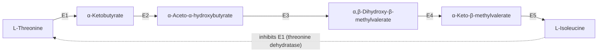

The previous chapter explained how an enzyme achieves its rate enhancement ([7.1.8](/7.1.8)); this one describes how fast it works under given conditions and how that rate is controlled. The core of the theory was developed in physical chemistry: the **Michaelis–Menten equation** $v_0 = v_{\max}[\ce{S}]/(K_{\mathrm{M}} + [\ce{S}])$, derived with the **steady-state approximation**, with its **Michaelis constant** $K_{\mathrm{M}}$, **catalytic constant** $k_{\mathrm{cat}} = v_{\max}/[\ce{E}]_{\mathrm{t}}$ and **specificity constant** $k_{\mathrm{cat}}/K_{\mathrm{M}}$, the **Lineweaver–Burk plot** and the case for fitting by **nonlinear regression**, all in [6.3.17](/6.3.17#sec-17.3.5). We do not derive them again. Here we use them as biochemists do: to interpret kinetic parameters, to distinguish mechanisms with two **substrates**, to classify inhibitors (most drugs are enzyme inhibitors), and to describe the regulatory **enzymes** that set the rates of **metabolic pathways**. The allosteric enzymes use the same **concerted model** as hemoglobin ([7.1.7](/7.1.7#sec-7.3.5)); covalent modification and cascades lead on to **signal transduction** ([7.1.14](/7.1.14), [7.1.15](/7.1.15)) and, quantitatively, to systems biology ([7.9](/7.9)). Every regulatory step in the pathways of Part II ([7.1.17](/7.1.17) onward) is an instance of the mechanisms in 9.5.

## 9.1. Using Steady-State Kinetics

### 9.1.1. Initial Velocity and Progress Curves

Kinetics measures how the rate of a reaction depends on experimental parameters: the concentrations of enzyme, substrates, products, inhibitors and modulators, the pH and the temperature. It is the oldest approach to enzyme mechanism and remains the way to determine the order of substrate binding, find effective inhibitors and understand regulation.

**Definition 9.1.1 (Initial Velocity)** The **initial velocity** $v_0$ of an enzyme-catalyzed reaction is the rate of product formation near $t = 0$, when the substrate concentration is still essentially $[\ce{S}]_0$ and the product concentration is too low for the reverse reaction or product inhibition to matter.

Measuring $v_0$ at several $[\ce{S}]$ with a fixed enzyme concentration gives the hyperbolic saturation curve of [6.3.17](/6.3.17#sec-17.3.5). Over a longer time the rate falls as substrate is used up, and the whole progress curve contains the same information.

**Formula 9.1.1 (Integrated Michaelis–Menten Equation)** If the Michaelis–Menten equation holds throughout the reaction ($-\mathrm{d}[\ce{S}]/\mathrm{d}t = v_{\max}[\ce{S}]/(K_{\mathrm{M}} + [\ce{S}])$, no product inhibition, irreversible reaction), then

$$
v_{\max}t = [\ce{S}]_0 - [\ce{S}] + K_{\mathrm{M}}\ln\frac{[\ce{S}]_0}{[\ce{S}]}, \qquad [\ce{S}](t) = K_{\mathrm{M}}\,W\!\left(\frac{[\ce{S}]_0}{K_{\mathrm{M}}}\exp\frac{[\ce{S}]_0 - v_{\max}t}{K_{\mathrm{M}}}\right),
$$
where $W$ is the Lambert $W$ function, the inverse of $x \mapsto x\mathrm{e}^{x}$ (Schnell and Mendoza, 1997).

The first form follows by separating variables, $\left(1 + K_{\mathrm{M}}/[\ce{S}]\right)\mathrm{d}[\ce{S}] = -v_{\max}\,\mathrm{d}t$; the second by writing $u = [\ce{S}]/K_{\mathrm{M}}$, so that $u\,\mathrm{e}^{u} = ([\ce{S}]_0/K_{\mathrm{M}})\,\mathrm{e}^{([\ce{S}]_0 - v_{\max}t)/K_{\mathrm{M}}}$. Fitting a progress curve to Formula 9.1.1 with `scipy.optimize.curve_fit` ([4.4.4](/4.4.4)) estimates $v_{\max}$ and $K_{\mathrm{M}}$ from a single experiment, provided its assumptions hold; in practice initial velocities are still the standard, measured while less than about 5–10% of the substrate has reacted.

![A: progress curves of a Michaelis–Menten enzyme from the integrated rate law (Formula 9.1.1) for [S]₀ = 0.5, 2 and 8 K_M; concentrations in units of K_M and time in units of K_M/v_max. The dashed tangents at t = 0 have the initial velocities as slopes; the curves bend away from them as substrate is consumed, more quickly at low [S]₀. B: two isozymes catalyzing the same reaction with the same v_max: a low-K_M form (like mitochondrial acetaldehyde dehydrogenase ALDH2, K_M taken as 0.2 µM) and a high-K_M form (like cytosolic ALDH1A1, 50 µM; illustrative values). At 1 µM acetaldehyde the first works at 83% of its capacity, the second at 2%](./plots/progress-curves.py)

### 9.1.2. What $K_{\mathrm{M}}$ and $k_{\mathrm{cat}}$ Mean

$K_{\mathrm{M}}$ is always the substrate concentration at which $v_0 = v_{\max}/2$, and when it is known the fraction of **active sites** filled is $f_{\mathrm{ES}} = [\ce{S}]/(K_{\mathrm{M}} + [\ce{S}])$. Its mechanistic meaning, however, depends on the mechanism. For the two-step scheme, $K_{\mathrm{M}} = (k_{-1} + k_2)/k_1$. When $k_2 \ll k_{-1}$ it reduces to the **dissociation constant** $K_{\mathrm{d}} = k_{-1}/k_1$ of ES (the **pre-equilibrium approximation**), and only then is it a measure of affinity; when $k_2 \gg k_{-1}$, $K_{\mathrm{M}} \approx k_2/k_1$; with more steps after ES it becomes a complicated function of many rate constants.

Likewise $k_{\mathrm{cat}}$ is the rate constant of the rate-limiting step at saturation. For $\ce{E + S <=> ES <=> EP -> E + P}$ with slow product release, most of the enzyme is EP at saturation and $k_{\mathrm{cat}} = k_3$; for chymotrypsin with an acyl-enzyme, $k_{\mathrm{cat}} = k_2k_3/(k_2 + k_3)$ (Formula 8.4.1); when several steps are partially rate-limiting, $k_{\mathrm{cat}}$ combines their rate constants. Typical values (Lehninger 8e, Tables 6-6 to 6-8):

| Enzyme | Substrate | $K_{\mathrm{M}}$ / mM | $k_{\mathrm{cat}}$ / $\mathrm{s^{-1}}$ | $k_{\mathrm{cat}}/K_{\mathrm{M}}$ / $\mathrm{M^{-1}\,s^{-1}}$ |
|---|---|---|---|---|
| Hexokinase (brain) | ATP / D-glucose / D-fructose | 0.4 / 0.05 / 1.5 | | |
| Chymotrypsin | glycyltyrosinylglycine / *N*-benzoyltyrosinamide | 108 / 2.5 | | |
| β-Galactosidase | D-lactose | 4.0 | | |
| Catalase | $\ce{H2O2}$ | 1100 | $4\times10^{7}$ | $4\times10^{7}$ |
| Carbonic anhydrase | $\ce{CO2}$ / $\ce{HCO3-}$ | 12 / 26 | $1\times10^{6}$ / $4\times10^{5}$ | $8.3\times10^{7}$ / $1.5\times10^{7}$ |
| Acetylcholinesterase | acetylcholine | 0.09 | $1.4\times10^{4}$ | $1.6\times10^{8}$ |
| β-Lactamase | benzylpenicillin | 0.02 | $2.0\times10^{3}$ | $1\times10^{8}$ |
| Fumarase | fumarate | 0.005 | $8\times10^{2}$ | $1.6\times10^{8}$ |
| RecA (an ATPase) | ATP | | 0.5 | |

Neither parameter alone measures catalytic efficiency. Two enzymes with the same $k_{\mathrm{cat}}$ may catalyze reactions whose uncatalyzed rates differ by orders of magnitude; and $K_{\mathrm{M}}$ tends to be similar to the cellular concentration of the substrate, low for enzymes acting on rare substrates. The best measure is $k_{\mathrm{cat}}/K_{\mathrm{M}}$, the apparent second-order rate constant of $\ce{E + S -> E + P}$ at low $[\ce{S}]$. It cannot exceed the rate of encounter of enzyme and substrate by diffusion, about $10^8$–$10^9\,\mathrm{M^{-1}\,s^{-1}}$ (a **diffusion-controlled reaction**, [6.3.17](/6.3.17#sec-17.1.3)), and enzymes that reach this limit (the last rows of the table, triose phosphate isomerase, crotonase) have attained catalytic perfection: they are limited only by how fast substrate arrives. Different combinations of $k_{\mathrm{cat}}$ and $K_{\mathrm{M}}$ give the same maximal ratio.

Under physiological conditions $[\ce{S}]/K_{\mathrm{M}}$ is typically between 0.01 and 1. Most enzymes therefore work well below $v_{\max}$, where the rate still responds almost proportionally to the substrate concentration; this is what lets a pathway's flux follow the supply of its substrates, and it is why $K_{\mathrm{M}}$ is a physiologically meaningful parameter.

### 9.1.3. Isozymes: Acetaldehyde Dehydrogenase and Alcohol Flushing

**Definition 9.1.2 (Isozyme)** **Isozymes** (isoenzymes) are different proteins, usually encoded by different genes, that catalyze the same reaction; they differ in kinetic parameters, regulation, tissue distribution or subcellular location.

Ethanol is oxidized in the liver to acetaldehyde, which at high concentration causes facial flushing, a rapid heart rate and nausea; acetaldehyde is normally oxidized at once to acetate by acetaldehyde dehydrogenase (ALDH). Humans have two main isozymes for this step: a mitochondrial form, ALDH2, with a $K_{\mathrm{M}}$ for acetaldehyde below $1\,\mu\mathrm{M}$, and a cytosolic form, ALDH1A1, with a $K_{\mathrm{M}}$ in the tens of micromolar or more. At the low acetaldehyde concentrations reached after moderate drinking, only ALDH2 works near capacity (figure in 9.1.1, panel B). About 8% of the world's population, most of them in East Asia, carry the *ALDH2\*2* allele (Glu504Lys), whose product is almost inactive and, because the enzyme is a tetramer, also poisons the normal **subunits** in heterozygotes. In these people acetaldehyde must accumulate until the high-$K_{\mathrm{M}}$ cytosolic form can remove it, hence the alcohol flush reaction; the accumulated acetaldehyde, a carcinogen, also raises their risk of esophageal cancer when they drink.

## 9.2. Bisubstrate Reactions

### 9.2.1. Sequential and Ping-Pong Mechanisms

Nearly two-thirds of enzymatic reactions have two substrates and two products ("bi bi" reactions), usually transferring a group from one substrate to the other or oxidizing one while reducing the other; hexokinase (ATP and glucose) is an example. Each substrate has its own $K_{\mathrm{M}}$ (table in 9.1.2), and the order in which substrates bind and products leave defines the kinetic mechanism.

**Definition 9.2.1 (Sequential and Ping-Pong Mechanisms)** In a **sequential mechanism** both substrates bind to the enzyme before any product is released, forming a ternary complex; binding can be ordered (substrate A must bind before B can bind productively, often because A induces the conformation that creates the site for B) or random. In a **ping-pong mechanism** (double-displacement mechanism) the first substrate reacts and its product leaves before the second substrate binds: a group is transferred from A to the enzyme, giving a modified enzyme form F, and then from F to B, so A and B never meet on the enzyme.

| Mechanism | Scheme (Cleland notation) | Examples |
|---|---|---|
| Ordered sequential | $\ce{E ->[A] EA ->[B] EAB <=> EPQ ->[-P] EQ ->[-Q] E}$ | lactate and alcohol dehydrogenases (**NADH** or $\ce{NAD+}$ binds first) |
| Random sequential | A and B bind in either order; P and Q leave in either order | creatine kinase, mammalian hexokinase |
| Ping-pong | $\ce{E ->[A] EA <=> FP ->[-P] F ->[B] FB <=> EQ ->[-Q] E}$ | **aminotransferases** (enzyme–pyridoxamine phosphate as F, [7.1.22](/7.1.22)), **nucleoside diphosphate kinase** (phospho-His), chymotrypsin with an ester and water |

In Cleland's notation, substrates are A, B, C in their order of binding, products P, Q, R in their order of release, and modified enzyme forms F, G.

### 9.2.2. Rate Equations and Diagnostic Plots

**Formula 9.2.1 (Bisubstrate Rate Laws)** At steady state, with initial velocities and no products present,

$$
\text{sequential:}\quad v_0 = \frac{v_{\max}[\ce{A}][\ce{B}]}{K_{\mathrm{iA}}K_{\mathrm{B}} + K_{\mathrm{B}}[\ce{A}] + K_{\mathrm{A}}[\ce{B}] + [\ce{A}][\ce{B}]}, \qquad \text{ping-pong:}\quad v_0 = \frac{v_{\max}[\ce{A}][\ce{B}]}{K_{\mathrm{B}}[\ce{A}] + K_{\mathrm{A}}[\ce{B}] + [\ce{A}][\ce{B}]},
$$
where $K_{\mathrm{A}}$, $K_{\mathrm{B}}$ are the Michaelis constants for A and B when the other substrate is saturating and $K_{\mathrm{iA}}$ is the dissociation constant of EA (the ordered and the rapid-equilibrium random mechanisms both give the sequential form).

Taking reciprocals at a fixed $[\ce{B}]$,

$$
\text{sequential:}\quad \frac{1}{v_0} = \frac{K_{\mathrm{A}}}{v_{\max}}\left(1 + \frac{K_{\mathrm{iA}}K_{\mathrm{B}}}{K_{\mathrm{A}}[\ce{B}]}\right)\frac{1}{[\ce{A}]} + \frac{1}{v_{\max}}\left(1 + \frac{K_{\mathrm{B}}}{[\ce{B}]}\right), \qquad \text{ping-pong:}\quad \frac{1}{v_0} = \frac{K_{\mathrm{A}}}{v_{\max}}\frac{1}{[\ce{A}]} + \frac{1}{v_{\max}}\left(1 + \frac{K_{\mathrm{B}}}{[\ce{B}]}\right).
$$
In a sequential mechanism the slope depends on $[\ce{B}]$, and the lines for different $[\ce{B}]$ intersect (at $1/[\ce{A}] = -1/K_{\mathrm{iA}}$); in a ping-pong mechanism the slope is independent of $[\ce{B}]$, and the lines are parallel. The double-reciprocal plot, a poor tool for estimating parameters, is a good one for displaying such patterns.

![Double-reciprocal plots of a bisubstrate reaction A + B → P + Q: 1/v₀ against 1/[A] at four fixed concentrations of B (Formula 9.2.1, with v_max = 1, K_A = 1 mM, K_B = 0.5 mM, K_iA = 2 mM). A: in a sequential mechanism, which forms a ternary complex, the slopes depend on [B] and the lines intersect, here at 1/[A] = −1/K_iA. B: in a ping-pong mechanism the slope K_A/v_max is the same for every [B], and the lines are parallel](./plots/bisubstrate-patterns.py)

Steady-state kinetics can also distinguish ordered from random binding, through inhibition patterns (9.4.1). Product inhibition is particularly informative: with only one product present, no reverse reaction occurs, but the product binds part of the active site and inhibits; whether it is competitive with respect to A or B depends on the order of binding and release.

## 9.3. Pre-Steady-State Kinetics

Steady-state kinetics gives $k_{\mathrm{cat}}$ and $K_{\mathrm{M}}$ but rarely the rate constants of the individual steps or the identity of the slow one. These are found in the pre-steady state, the first turnover before ES and the other intermediates reach their steady-state levels, which usually lasts milliseconds to seconds.

**Definition 9.3.1 (Pre-Steady-State Kinetics)** The **pre-steady-state kinetics** of an enzyme is the time course of the reaction before the steady state is established, measured by rapid mixing of enzyme and substrate (stopped-flow devices with optical detection, or quench-flow devices in which the reaction is stopped after a programmed time by a denaturing acid that releases all bound molecules).

If a step after the formation of the observed product is rate-limiting, the first turnover is fast and the product appears in a burst of about one molecule per active site, followed by the slower steady-state rate. The burst is quantified by Formula 8.4.1, derived for chymotrypsin, where the slow step is deacylation ([7.1.8](/7.1.8#sec-8.4.1)). Its amplitude, obtained by extrapolating the steady-state line to $t = 0$, measures the concentration of active sites; its rate gives the rate constant of the chemical step. For many enzymes product release is rate-limiting: the catalytic **RNA** **RNase P**, for example, shows a burst of about one cleaved product per enzyme molecule, so the release of the product is its slow step. A burst does not by itself say which later step is slow (product release, a conformational change or another chemical step); further experiments assign the rates of each step.

## 9.4. Enzyme Inhibition

### 9.4.1. Reversible Inhibition

**Definition 9.4.1 (Enzyme Inhibitor)** An **enzyme inhibitor** is a molecule that interferes with catalysis, slowing or halting the reaction. A reversible inhibitor binds and dissociates; an irreversible inhibitor (9.4.4) inactivates the enzyme permanently.

Enzymes catalyze virtually all cellular processes, so enzyme inhibitors are among the most important drugs (aspirin, for example, inhibits the first enzyme of **prostaglandin** synthesis), and they are tools for elucidating mechanisms and pathways.

**Definition 9.4.2 (Types of Reversible Inhibition)** A reversible inhibitor I can bind to the free enzyme E, to the complex ES, or to both; the corresponding dissociation constants are the **inhibition constants** $K_{\mathrm{I}} = [\ce{E}][\ce{I}]/[\ce{EI}]$ and $K_{\mathrm{I}}' = [\ce{ES}][\ce{I}]/[\ce{ESI}]$. The inhibition is

- **competitive inhibition** if I binds only to E, usually at the active site, so that I and S exclude each other;
- **uncompetitive inhibition** if I binds only to ES, at a site distinct from the active site;
- **mixed inhibition** if I binds to both E and ES, at a site distinct from the active site; the special case $K_{\mathrm{I}} = K_{\mathrm{I}}'$ is called **noncompetitive inhibition**.

EI and ESI are assumed to be catalytically inactive.

**Theorem 9.4.1 (General Rate Law for Reversible Inhibition)** Let inhibitor binding be at equilibrium and ES at steady state, and write $\alpha = 1 + [\ce{I}]/K_{\mathrm{I}}$, $\alpha' = 1 + [\ce{I}]/K_{\mathrm{I}}'$. Then

$$
v_0 = \frac{v_{\max}[\ce{S}]}{\alpha K_{\mathrm{M}} + \alpha'[\ce{S}]},
$$
which gives competitive ($\alpha' = 1$), uncompetitive ($\alpha = 1$) and mixed inhibition as special cases. The apparent parameters are $v_{\max}^{\mathrm{app}} = v_{\max}/\alpha'$ and $K_{\mathrm{M}}^{\mathrm{app}} = \alpha K_{\mathrm{M}}/\alpha'$.

**Proof** The steady state of ES, $k_1[\ce{E}][\ce{S}] = (k_{-1} + k_2)[\ce{ES}]$, gives $[\ce{E}] = K_{\mathrm{M}}[\ce{ES}]/[\ce{S}]$ whatever the inhibitor does, since EI and ESI form only by fast equilibria. The enzyme is distributed over four forms:

$$
[\ce{E}]_{\mathrm{t}} = [\ce{E}] + [\ce{EI}] + [\ce{ES}] + [\ce{ESI}] = [\ce{E}]\,\alpha + [\ce{ES}]\,\alpha' = [\ce{ES}]\left(\frac{\alpha K_{\mathrm{M}}}{[\ce{S}]} + \alpha'\right).
$$
With $v_0 = k_2[\ce{ES}]$ and $v_{\max} = k_2[\ce{E}]_{\mathrm{t}}$ the rate law follows. At $[\ce{S}] \to \infty$, $v_0 \to v_{\max}/\alpha'$; $v_0$ is half of this when $[\ce{S}] = \alpha K_{\mathrm{M}}/\alpha'$. $\square$

| Inhibitor | Binds | $v_{\max}^{\mathrm{app}}$ | $K_{\mathrm{M}}^{\mathrm{app}}$ | Lineweaver–Burk lines with increasing $[\ce{I}]$ |
|---|---|---|---|---|
| none | | $v_{\max}$ | $K_{\mathrm{M}}$ | |
| competitive | E | $v_{\max}$ | $\alpha K_{\mathrm{M}}$ | intersect on the $1/v_0$ axis |
| uncompetitive | ES | $v_{\max}/\alpha'$ | $K_{\mathrm{M}}/\alpha'$ | parallel |
| mixed | E and ES | $v_{\max}/\alpha'$ | $\alpha K_{\mathrm{M}}/\alpha'$ | intersect left of the $1/v_0$ axis, above the $1/[\ce{S}]$ axis if $K_{\mathrm{I}} < K_{\mathrm{I}}'$ ($\alpha > \alpha'$) and below it if $K_{\mathrm{I}} > K_{\mathrm{I}}'$ |
| noncompetitive | E and ES equally | $v_{\max}/\alpha$ | $K_{\mathrm{M}}$ | intersect on the $1/[\ce{S}]$ axis |

The intuition behind the table: a competitive inhibitor can be outcompeted by enough substrate, so $v_{\max}$ is unchanged while more substrate is needed to reach it. An uncompetitive inhibitor removes some ES, which lowers $v_{\max}$; because it binds only ES it also pulls $\ce{E + S <=> ES}$ to the right, and $K_{\mathrm{M}}$ falls by the same factor. A mixed inhibitor always lowers $v_{\max}$ and raises or lowers $K_{\mathrm{M}}$ depending on whether it prefers E or ES. For mixed inhibition the lines all pass through $1/[\ce{S}] = -K_{\mathrm{I}}/(K_{\mathrm{M}}K_{\mathrm{I}}')$; plotting the slopes or intercepts against $[\ce{I}]$ gives $K_{\mathrm{I}}$ and $K_{\mathrm{I}}'$. Today all parameters are better obtained by fitting the rate law of Theorem 9.4.1 directly to the data.

![Reversible inhibition from the general rate law (Theorem 9.4.1) with K_M = 1 and v_max = 1, at [I] = 0, 1 and 3 K_I. Top: v₀ against [S]; bottom: double-reciprocal plots (axes scaled by K_M and v_max). A: competitive inhibition: v_max unchanged, K_M increased; the lines meet on the 1/v₀ axis. B: uncompetitive inhibition (K_I′ = K_I): v_max and K_M both decrease by the factor α′; the lines are parallel. C: mixed inhibition with K_I′ = 3 K_I (the inhibitor prefers free enzyme): v_max decreases and K_M increases; the lines meet to the left of the 1/v₀ axis and above the horizontal axis](./plots/inhibition-kinetics.py)

Uncompetitive and mixed inhibition can be defined for one-substrate enzymes, but in practice they are seen with enzymes that have two or more substrates. An inhibitor that occupies the site of $\ce{S1}$ is competitive when $[\ce{S1}]$ is varied, but may be mixed or uncompetitive with respect to $\ce{S2}$, depending on whether binding is ordered or random; combined with product inhibition and pre-steady-state data, such patterns establish the mechanism of bisubstrate enzymes. Heterotropic allosteric modulators (9.5.2) should not be confused with uncompetitive or mixed inhibitors: those bind a second site but need not switch the enzyme between distinct conformations, and their kinetic effects are different.

### 9.4.2. $\mathrm{IC_{50}}$ and the Cheng–Prusoff Relation

In drug discovery inhibitors are often ranked by their $\mathrm{IC_{50}}$, the inhibitor concentration that halves the rate under the assay conditions. Unlike $K_{\mathrm{I}}$, it depends on the substrate concentration.

**Formula 9.4.1 (Cheng–Prusoff Relation)** Setting $v_0([\ce{I}])/v_0(0) = 1/2$ in Theorem 9.4.1 gives, when the free inhibitor concentration is close to the total,

$$
\mathrm{IC_{50}} = \frac{K_{\mathrm{M}} + [\ce{S}]}{K_{\mathrm{M}}/K_{\mathrm{I}} + [\ce{S}]/K_{\mathrm{I}}'}; \qquad \text{competitive:}\ \ \mathrm{IC_{50}} = K_{\mathrm{I}}\left(1 + \frac{[\ce{S}]}{K_{\mathrm{M}}}\right), \qquad \text{uncompetitive:}\ \ \mathrm{IC_{50}} = K_{\mathrm{I}}'\left(1 + \frac{K_{\mathrm{M}}}{[\ce{S}]}\right).
$$

The competitive form is the relation of Cheng and Prusoff (1973). A competitive inhibitor looks weaker in an assay run at high substrate concentration, an uncompetitive one stronger; comparing $\mathrm{IC_{50}}$ values is meaningful only at the same $[\ce{S}]/K_{\mathrm{M}}$. For very tight-binding inhibitors, whose $K_{\mathrm{I}}$ is comparable to the enzyme concentration, the free inhibitor concentration is no longer equal to the total, and the formulas above fail (the Morrison equation then applies): $\mathrm{IC_{50}}$ cannot fall below half the enzyme concentration.

### 9.4.3. Inhibitors as Drugs

| Drug | Target enzyme | Type | Use |
|---|---|---|---|
| Ethanol, fomepizole | alcohol dehydrogenase | competitive (ethanol is an alternative substrate) | methanol and ethylene glycol poisoning: slows formation of formaldehyde and other toxic products while the kidneys excrete the parent compound |
| **Statins** | **HMG-CoA reductase** | competitive with HMG-CoA, $K_{\mathrm{I}}$ in the nanomolar range | lowering blood **cholesterol** ([7.1.26](/7.1.26)) |
| Methotrexate | **dihydrofolate reductase** | competitive, tight-binding substrate analog | cancer chemotherapy, autoimmune diseases ([7.1.28](/7.1.28)) |
| Ibuprofen / aspirin | **cyclooxygenase** (prostaglandin H synthase) | reversible competitive / irreversible acetylation of an active-site Ser | pain, inflammation; low-dose aspirin as an antiplatelet drug (9.5.5) |
| Sildenafil | cGMP **phosphodiesterase** 5 | competitive with cGMP | erectile dysfunction, pulmonary hypertension ([7.1.14](/7.1.14)) |
| HIV protease inhibitors | HIV protease | **transition-state analogs**, very tight binding | HIV infection ([7.1.8](/7.1.8#sec-8.4.2)) |
| Penicillins | bacterial transpeptidase | irreversible acylation | bacterial infections ([7.1.8](/7.1.8#sec-8.4.5)) |
| Allopurinol | **xanthine oxidase** | mechanism-based: oxidized to oxypurinol, which binds the reduced molybdenum center tightly | **gout** ([7.1.28](/7.1.28)) |
| Eflornithine (DFMO) | ornithine decarboxylase | suicide inactivator | African sleeping sickness (below) |

### 9.4.4. Irreversible Inhibition

**Definition 9.4.3 (Irreversible Inhibitor and Suicide Inactivator)** An **irreversible inhibitor** binds covalently to, or destroys, a functional group of an enzyme essential for activity, or forms a noncovalent complex so stable that it practically never dissociates. A **suicide inactivator** (mechanism-based inactivator) is an irreversible inhibitor that is unreactive until it binds the active site of its target, where it undergoes the first steps of the normal reaction and is converted into a reactive compound that combines irreversibly with the enzyme.

Irreversible inhibitors identify catalytic **residues**. Diisopropylfluorophosphate (DIFP) inactivates chymotrypsin by phosphorylating a single residue, Ser195, which is how this Ser was identified as the nucleophile of the **catalytic triad** ([7.1.8](/7.1.8#sec-8.4.1)). Organophosphate nerve agents and insecticides inhibit acetylcholinesterase, another serine hydrolase, in the same way.

Because a suicide inactivator becomes reactive only inside the active site of one enzyme, drugs based on this principle can have few side effects, which makes them a goal of rational drug design. A classic example is the treatment of African sleeping sickness (African trypanosomiasis). The trypanosome escapes the immune system by repeatedly switching its single surface coat **protein**, so vaccines fail. It needs large amounts of the polyamines spermidine and spermine, whose synthesis begins with ornithine decarboxylase, a **pyridoxal phosphate** (PLP) enzyme ([7.1.17](/7.1.17)). PLP forms a Schiff base with ornithine and acts as an electron sink for the decarboxylation. Difluoromethylornithine (DFMO, eflornithine) is inert in solution, but on the enzyme its decarboxylation places a leaving fluoride next to the PLP adduct; instead of electrons flowing into the PLP ring, a fluorine is expelled, and the resulting reactive conjugated adduct is attacked by an active-site Cys, irreversibly. The drug is selective because mammalian ornithine decarboxylase is turned over rapidly and replaced, whereas the enzyme of *Trypanosoma brucei gambiense* is stable. Eflornithine is used today together with nifurtimox, and the oral drug fexinidazole (2018) has increasingly replaced injectable treatments. Clavulanic acid, the β-lactamase inactivator of [7.1.8](/7.1.8#sec-8.4.5), works on the same principle.

An inhibitor need not be covalent to be practically irreversible: transition-state analogs (Definition 8.3.2) and some natural protein inhibitors (9.5.4) bind so tightly that they rarely dissociate.

## 9.5. Regulatory Enzymes

### 9.5.1. Regulatory Enzymes and Feedback Inhibition

In **metabolism**, enzymes work in sequences in which the product of one is the substrate of the next. Most of them follow the kinetics of 9.1, but each pathway contains one or more enzymes that have a greater effect on the overall rate, often the first enzyme of the pathway or of a branch.

**Definition 9.5.1 (Regulatory Enzyme)** A **regulatory enzyme** is an enzyme whose catalytic activity increases or decreases in response to signals, thereby adjusting the rate of a metabolic sequence. In an **allosteric enzyme** the activity is modulated by the reversible, noncovalent binding of an **allosteric modulator** (allosteric effector), usually a small metabolite or cofactor, to a regulatory site; other regulatory enzymes are controlled by reversible covalent modification (9.5.3), by binding of separate regulatory proteins, or by irreversible proteolytic activation (9.5.4).

The vocabulary of allostery was introduced for hemoglobin in [7.1.7](/7.1.7#sec-7.3.4): the modulation is homotropic when the modulator is the substrate itself and heterotropic when it is a different molecule, and in most cases binding converts a less active **T state** into a more active **R state**. A modulator can be an **activator** or an inhibitor. In heterotropic enzymes each modulator has its own specific regulatory site, often on separate regulatory subunits (R) distinct from the catalytic subunits (C); in homotropic enzymes the active site is also the regulatory site. Regulatory enzymes are usually larger than other enzymes and have two or more subunits.

**Definition 9.5.2 (Feedback Inhibition)** **Feedback inhibition** is the inhibition of an enzyme early in a pathway, usually the first committed step, by the end product of that pathway.

In *Escherichia coli*, L-threonine is converted to L-isoleucine in five steps, and isoleucine is an allosteric inhibitor of the first enzyme, threonine dehydratase (E1). The cell thus synthesizes isoleucine only as fast as it is used, and the intermediates do not accumulate, the simplest form of the negative feedback that runs through all of Part II ([7.1.17](/7.1.17)).

### 9.5.2. Allosteric Kinetics and Aspartate Transcarbamoylase

Allosteric enzymes saturate at high substrate concentration, but $v_0$ against $[\ce{S}]$ is usually sigmoid rather than hyperbolic. The half-saturating concentration is written $K_{0.5}$ (or $[\ce{S}]_{0.5}$), not $K_{\mathrm{M}}$, since the curve is not of Michaelis–Menten form. Sigmoid kinetics reflects cooperative interactions between subunits, mediated by noncovalent contacts at their interfaces, exactly as in the oxygen binding of hemoglobin ([7.1.7](/7.1.7#sec-7.3.4)); an empirical description is the Hill form $v_0 = v_{\max}[\ce{S}]^{n}/(K_{0.5}^{n} + [\ce{S}]^{n})$. Its significance is sensitivity: going from 10% to 90% of $v_{\max}$ requires an 81-fold increase in $[\ce{S}]$ for a hyperbolic enzyme but only $81^{1/n}$-fold for a cooperative one (9-fold for $n = 2$, 4.3-fold for $n = 3$), so small changes in substrate or modulator concentration in the steep part of the curve produce large changes in activity.

The concerted (MWC) model of [7.1.7](/7.1.7#sec-7.3.5) describes allosteric enzymes with one addition: the two states can differ in substrate affinity, in catalytic rate constant, or both.

**Formula 9.5.1 (MWC Model of an Allosteric Enzyme)** For an enzyme with $n$ identical catalytic sites, states R and T in equilibrium with $L = [\mathrm{T_0}]/[\mathrm{R_0}]$, substrate dissociation constants $K_{\mathrm{R}}$ and $K_{\mathrm{T}} = K_{\mathrm{R}}/c$, catalytic constants $k_{\mathrm{R}}$ and $k_{\mathrm{T}}$, and $\alpha = [\ce{S}]/K_{\mathrm{R}}$,

$$
v_0 = n[\ce{E}]_{\mathrm{t}}\,\frac{k_{\mathrm{R}}\,\alpha(1 + \alpha)^{n-1} + k_{\mathrm{T}}\,Lc\alpha(1 + c\alpha)^{n-1}}{(1 + \alpha)^{n} + L(1 + c\alpha)^{n}}.
$$
A heterotropic activator A that binds only the R state and an inhibitor I that binds only the T state (dissociation constants $K_{\mathrm{A}}$, $K_{\mathrm{I}}$, one site per **protomer**) act by changing the apparent allosteric constant:

$$
L_{\mathrm{app}} = L\,\frac{(1 + [\ce{I}]/K_{\mathrm{I}})^{n}}{(1 + [\ce{A}]/K_{\mathrm{A}})^{n}}.
$$

Two limiting cases, named by Monod, correspond to the observed types of heterotropic regulation.

- K system ($k_{\mathrm{T}} = k_{\mathrm{R}}$, $c < 1$): the states differ in affinity; $v_0$ is proportional to the saturation function of [7.1.7](/7.1.7#sec-7.3.5), the curve is sigmoid, and modulators shift $K_{0.5}$ without changing $v_{\max}$. An activator makes the curve more nearly hyperbolic with a lower $K_{0.5}$; an inhibitor makes it more sigmoid with a higher $K_{0.5}$. This is the common type (ATCase, phosphofructokinase-1 in [7.1.18](/7.1.18)).
- V system ($c = 1$, $k_{\mathrm{T}} < k_{\mathrm{R}}$): both states bind substrate equally, so substrate binding does not shift the T ⇌ R equilibrium, the curve is hyperbolic with $K_{0.5} = K_{\mathrm{R}}$, and modulators change $v_{\max}$. This type is less common.

![Allosteric enzymes in the concerted (MWC) model with four catalytic sites (Formula 9.5.1). A: K system (c = 0.01, equal k_cat in both states): with L = 10³ the curve is sigmoid; an activator that binds R (here lowering L to 10) shifts it to lower [S] and makes it nearly hyperbolic, an inhibitor that binds T (L = 10⁵) shifts it to higher [S] and makes it more sigmoid; v_max is unchanged. The dashed hyperbola has the same K_0.5 as the unmodulated curve and is much less steep. B: V system (c = 1, k_T = 0.05 k_R): all curves are hyperbolas with K_0.5 = K_R, and the modulators change v_max by changing the fraction of enzyme in the R state](./plots/allosteric-kinetics.py)

Aspartate transcarbamoylase (ATCase) of *E. coli* is the classic allosteric enzyme. It catalyzes the first **committed step** of pyrimidine nucleotide synthesis ([7.1.28](/7.1.28)), the condensation of **carbamoyl phosphate** and aspartate to *N*-carbamoylaspartate and $\mathrm{P_i}$. It has 12 **polypeptide** chains, $\mathrm{c_6r_6}$: two catalytic trimers stacked on each other and three regulatory dimers around them. The catalytic subunits act cooperatively: aspartate and carbamoyl phosphate bind and progressively convert the enzyme from the T state to the R state, which expands along the threefold axis by about 1.1 nm, giving sigmoid kinetics (homotropic regulation). The regulatory subunits bind nucleotides (heterotropic regulation). CTP, an end product of the pathway, is a negative modulator: it raises $K_{0.5}$ and limits ATCase action when CTP is abundant, and UTP strengthens this inhibition. ATP, which signals a growing cell with a robust energy supply and balances purine with pyrimidine synthesis, is a positive modulator that lowers $K_{0.5}$. Both act on $K_{0.5}$ with little effect on $v_{\max}$: ATCase is a K system. The bisubstrate analog *N*-(phosphonacetyl)-L-aspartate (PALA), which resembles the transition state of the reaction (Definition 8.3.2), binds tightly and locks the enzyme in the R state; it was used to determine the structure of that state.

### 9.5.3. Reversible Covalent Modification

More than 500 types of covalent modification are known in proteins. Each modifying group is attached and removed by separate enzymes, so the two directions can be regulated independently. The modified residue is effectively a new amino acid: an added charge can change the local structure and conformation, an added hydrophobic group can anchor the protein to a membrane.

| Modification | Residues | Added and removed by | Examples |
|---|---|---|---|
| Phosphorylation | Ser, Thr, Tyr (His, Asp in bacteria) | protein kinases / protein phosphatases | **glycogen phosphorylase** and **glycogen synthase** ([7.1.19](/7.1.19)), signaling ([7.1.14](/7.1.14)) |
| Acetylation | Lys, N-terminus | acetyltransferases / deacetylases | about 80% of soluble eukaryotic proteins are N-terminally acetylated; **histones** ([7.2](/7.2)); metabolic enzymes ([7.1.29](/7.1.29)) |
| Methylation | Lys, Arg, Glu | methyltransferases (**S-adenosylmethionine** as donor) / demethylases | bacterial chemotaxis **receptors** (Glu), histones |
| Adenylylation, uridylylation | Tyr | adenylyltransferase / uridylyltransferase | bacterial **glutamine synthetase** and its regulator PII ([7.1.27](/7.1.27)) |
| ADP-ribosylation | Arg, Cys, others | ADP-ribosyltransferases (NAD as donor) | dinitrogenase reductase; cholera and diphtheria toxins inactivate host proteins |
| **Ubiquitination**, SUMOylation | Lys | E1–E2–E3 ligase cascades / deubiquitinases | targeting for proteasomal degradation, regulation of **transcription** and **DNA** repair ([7.2](/7.2)) |
| Lipidation (myristoylation, palmitoylation, prenylation) | N-terminal Gly, Cys | acyl- and prenyltransferases | membrane anchoring ([7.1.13](/7.1.13)) |

By far the most common regulatory modification is phosphorylation: about a third of the proteins of a eukaryotic cell are phosphorylated, and phosphorylation is part of virtually every regulatory process.

**Definition 9.5.3 (Protein Kinase and Protein Phosphatase)** A **protein kinase** transfers the γ-phosphoryl group of a nucleoside triphosphate (usually ATP) to a specific Ser, Thr or Tyr residue (occasionally His) of a target protein; a **protein phosphatase** (phosphoprotein phosphatase) hydrolyzes the phosphoester and releases $\mathrm{P_i}$.

The human **genome** encodes more than 500 protein kinases and about 200 protein phosphatases; the phosphatases are on the whole less specific. A phosphoryl group is bulky and carries two negative charges at physiological pH. It can accept hydrogen bonds from backbone amides at the N-terminus of an **α helix** or from Arg **side chains**, and it repels Asp and Glu; at a structurally important position this changes the conformation, and with it substrate binding and catalysis.

Glycogen phosphorylase illustrates the effect. It occurs as the more active phosphorylase *a*, phosphorylated on Ser14 of each of its two subunits, and the less active phosphorylase *b*. **Phosphorylase kinase** converts *b* to *a* ($\ce{2 ATP} + \text{phosphorylase } b \to \ce{2 ADP} + \text{phosphorylase } a$) and phosphoprotein phosphatase 1 (PP1) converts *a* back to *b*. In phosphorylase *b* the 20 N-terminal residues, which include several basic ones, lie against an acidic region of the protein; phosphorylation of Ser14 breaks this interaction and moves the N-terminal segment into a conformation in which the phospho-Ser interacts with Arg side chains, and the enzyme becomes much more active. Allosteric regulation and **hormones** also act on this enzyme ([7.1.19](/7.1.19)).

Kinases recognize their target residues within short **consensus sequences**; the three-dimensional structure further determines whether a residue is accessible.

| Kinase | **Consensus sequence** (phosphorylated residue S/T/Y) |
|---|---|
| **Protein kinase A** | `-x-R-[RK]-x-[ST]-B-` |
| **Protein kinase C** | `-[RK](2)-x-[ST]-B-[RK](2)-` |
| **Cyclin-dependent kinase** (cdc2) | `-x-[ST]-P-x-[KR]-` |
| ERK (a MAP kinase) | `-P-x-[ST]-P-` |
| Casein kinase II | `-x-[ST]-x(2)-[ED]-x-` |
| Casein kinase I | `-[SpTp]-x(2)-[ST]-B` (requires a prior phosphorylation) |
| EGF **receptor tyrosine kinase** | `-E(4)-Y-F-E-L-V-` |

x: any amino acid; B: hydrophobic; (n): n repeats; Sp, Tp: residues that must already be phosphorylated (source: Lehninger 8e, Table 6-10).

Multisite phosphorylation allows graded control. Glycogen synthase has at least nine sites in five regions, phosphorylated by several kinases with different effects, some cumulative. The phosphorylation is hierarchical: **glycogen synthase kinase 3** (GSK3) acts only after casein kinase II has phosphorylated a neighboring "priming" site. The result is not a binary switch but a fine tuning of activity over a wide range in response to several signals.

### 9.5.4. Proteolytic Activation of Zymogens

**Definition 9.5.4 (Zymogen)** A **zymogen** is an inactive precursor of an enzyme that is activated by proteolytic cleavage; precursors of other proteins activated in this way are called proproteins (or proenzymes).

Many proteases of the stomach and pancreas are made as zymogens, so that they do not digest the cells that make them. Chymotrypsinogen, a single chain of 245 residues, is activated by trypsin, which cleaves the Arg15–Ile16 bond to give the active π-chymotrypsin. π-Chymotrypsin then removes two dipeptides from other chymotrypsin molecules (Ser14–Arg15 and Thr147–Asn148), giving α-chymotrypsin, three chains (residues 1–13, 16–146 and 149–245) held together by disulfide bonds; this is why residues 14, 15, 147 and 148 are missing from the active enzyme. The new N-terminal Ile16 forms an ion pair with Asp194, which causes the conformational change that creates the **oxyanion hole** and the specificity pocket ([7.1.8](/7.1.8#sec-8.5)). Trypsinogen is activated in the small intestine by enteropeptidase (enterokinase), which removes the N-terminal hexapeptide Val–Asp–Asp–Asp–Asp–Lys; trypsin then activates more trypsinogen and the other pancreatic zymogens (chymotrypsinogen, proelastase, procarboxypeptidase), a self-amplifying step. Pepsinogen activates itself at the low pH of the stomach. Premature activation of trypsinogen within the pancreas causes acute pancreatitis.

Proteolytic activation is irreversible; an active protease is switched off by protein inhibitors that bind its active site very tightly. Pancreatic trypsin inhibitor ($M_{\mathrm{r}}$ 6000) protects the pancreas from trypsin activated there by mistake; $\alpha_1$-antiproteinase ($M_{\mathrm{r}}$ 53 000), the main inhibitor of the elastase of neutrophils, protects the lung, and its deficiency, inherited or caused by oxidation from cigarette smoke, leads to emphysema. Proteolytic activation is not limited to proteases: **collagen** is made as procollagen and **insulin** as proinsulin ([7.1.3](/7.1.3#sec-3.5.2)).

### 9.5.5. The Blood Coagulation Cascade

**Definition 9.5.5 (Regulatory Cascade)** In a **regulatory cascade** a signal activates enzyme X, which activates many molecules of enzyme Y, each of which activates many molecules of Z, and so on, so that the signal is amplified at every step. The activations may be irreversible (proteolysis) or reversible (phosphorylation).

Cascades govern blood coagulation, the detection of light by retinal rods ([7.1.14](/7.1.14)), **apoptosis** ([7.1.15](/7.1.15)), parts of development and the activation of glycogen phosphorylase by hormones ([7.1.19](/7.1.19)). Blood clotting combines proteolytic activation, regulatory proteins (**cofactors** that bind and activate particular proteases) and feedback.

A clot consists of aggregated platelets, cell fragments without nuclei, held together by fibers of fibrin. When a vessel is injured, platelets are activated mainly by collagen exposed beneath the endothelium; they present anionic phospholipids on their surface and release signals such as thromboxanes that recruit more platelets, forming a loose plug. Stabilizing it needs fibrin. Fibrinogen, $(\mathrm{A\alpha B\beta\gamma})_2$, the third most abundant plasma protein after albumins and globulins, is converted to fibrin by the **serine protease** thrombin, which removes 16 residues (fibrinopeptide A) from each α chain and 14 (fibrinopeptide B) from each β chain. The newly exposed N-termini fit **binding sites** on the C-terminal globular **domains** of neighboring molecules, which polymerize into a soft clot; factor XIIIa, a transglutaminase, then cross-links Lys and Gln side chains of adjacent fibrin molecules, making a hard clot.

Fibrinogen activation is the end of two interlinked cascades. Most factors are designated by Roman numerals (the zymogen) with "a" for the active form; most are chymotrypsin-like serine proteases or regulatory proteins, made in the liver.

1. Initiation (extrinsic or tissue factor pathway). Tissue damage exposes tissue factor (TF), a membrane protein of cells beneath the endothelium, to the plasma. A trace of factor VIIa always present in blood binds TF, and the TF–VIIa complex cleaves factor X to Xa; Xa in turn converts more VII to VIIa, a positive feedback loop. Xa, with its regulatory protein Va, cleaves prothrombin to a first burst of thrombin. TF–VIIa is soon shut off by tissue factor pathway inhibitor (TFPI).
2. Propagation (intrinsic or contact activation pathway, all of whose components are in plasma). TF–VIIa also cleaves IX to IXa, and thrombin activates XI to XIa (feedback), which makes more IXa. IXa with its cofactor VIIIa forms a stable alternative activator of X. Thrombin also activates the cofactors V and VIII and factor XIII, so its own production accelerates.
3. Termination. Thrombin bound to thrombomodulin on intact endothelium activates protein C; activated protein C with protein S cleaves and inactivates Va and VIIIa. Antithrombin, a serine protease inhibitor (serpin), forms a covalent 1:1 complex with the active-site Ser of thrombin and Xa. With TFPI, these systems set a threshold of tissue factor exposure below which no clot forms, and they confine clotting to the wound; genetic deficiency of protein C or antithrombin greatly increases the risk of thrombosis.

![The blood coagulation cascade and cascade amplification. A: SBGN process description of coagulation. Zymogens (gray) are converted to active proteases (green) in proteolytic processes (squares); catalysis arcs (open circles) show which protease cleaves which zymogen. Initiation: tissue factor with factor VIIa activates X and IX. Propagation: IXa with its cofactor VIIIa activates X, Xa with Va activates prothrombin, thrombin cleaves fibrinogen to fibrin, and XIIIa cross-links fibrin; thrombin feeds back to activate XI (dashed) and the cofactors V and VIII. Inhibition arcs (bars): TFPI on TF–VIIa and antithrombin, enhanced by heparin, on the thrombin-forming step; activated protein C with protein S inactivates Va and VIIIa. B: a model cascade of four stages (dxᵢ/dt = k x_{i−1} − d xᵢ, with gain k/d = 10), driven by a brief input pulse: each stage is about ten times larger than the previous one and reaches its peak later](./plots/coagulation-cascade.py)

Coagulation is a major target of medicine. Factors VII, IX, X, prothrombin and proteins C and S have Ca²⁺-binding sites formed by γ-carboxyglutamate (Gla) residues near their N-termini ([7.1.3](/7.1.3#sec-3.3.1)); the carboxylation needs **vitamin** K ([7.1.12](/7.1.12)), and bound $\ce{Ca^2+}$ attaches these factors to the anionic phospholipids of activated platelets, at the site of the wound. Vitamin K **antagonists** such as warfarin are therefore anticoagulants. Heparins, highly sulfated polysaccharides ([7.1.10](/7.1.10)), increase the affinity of antithrombin for thrombin and Xa. Aspirin inhibits cyclooxygenase, reducing the synthesis of thromboxanes and so platelet aggregation. Deficiency of most clotting factors causes bleeding disorders of varying severity, the hemophilias. Hemophilia A (factor VIII deficiency, about 1 in 5000 male births) and hemophilia B (factor IX deficiency, about 1 in 25 000) are X-linked ([7.4](/7.4)); Queen Victoria was a carrier of hemophilia B, which her descendants passed into several royal families of Europe, as DNA from the remains of the Russian imperial family confirmed in 2009.

### 9.5.6. Enzymes with Several Regulatory Mechanisms

Enzymes at metabolic crossroads often combine several mechanisms. Bacterial glutamine synthetase, which introduces reduced nitrogen into metabolism, is regulated allosterically by at least eight modulators, by reversible adenylylation and by regulatory proteins ([7.1.27](/7.1.27)); glycogen phosphorylase is controlled by allosteric effectors, phosphorylation and a hormonal cascade ([7.1.19](/7.1.19)). If all possible reactions were catalyzed at once, **macromolecules** and metabolites would be degraded to simple compounds; regulation lets cells catalyze only the reactions they need, store fuel when resources are plentiful and use it when they are scarce.

## 9.6. Quantitative Consequences of Regulation

### 9.6.1. Zero-Order Ultrasensitivity

A covalent modification cycle (a kinase that phosphorylates a protein W and a phosphatase that dephosphorylates it) can respond to a change in the kinase or phosphatase activity much more steeply than any single Michaelis–Menten enzyme, even though neither enzyme is cooperative. Goldbeter and Koshland (1981) showed that this happens when both enzymes are saturated with their protein substrate.

**Definition 9.6.1 (Zero-Order Ultrasensitivity)** **Zero-order ultrasensitivity** is the switch-like dependence of the steady-state fraction of a modified protein on the ratio of the activities of the modifying and demodifying enzymes, which arises when both enzymes operate near saturation (in the zero-order regime) with respect to the protein they modify.

**Formula 9.6.1 (Goldbeter–Koshland Steady State)** Let the kinase act on W with maximal rate $V_1$ and Michaelis constant $K_1$, the phosphatase on W–P with $V_2$ and $K_2$, let the total $W_{\mathrm{T}} = [\mathrm{W}] + [\mathrm{W{-}P}]$ be much larger than the enzyme concentrations, and write $w = [\mathrm{W{-}P}]/W_{\mathrm{T}}$, $J_1 = K_1/W_{\mathrm{T}}$, $J_2 = K_2/W_{\mathrm{T}}$. The steady state, $V_1(1 - w)/(J_1 + 1 - w) = V_2w/(J_2 + w)$, gives

$$
\frac{V_1}{V_2} = \frac{w\,(J_1 + 1 - w)}{(1 - w)(J_2 + w)}.
$$
For $J_1 = J_2 = J$, the ratio of $V_1/V_2$ needed to go from $w = 0.1$ to $w = 0.9$ (the response coefficient) is

$$
R = 81\left(\frac{J + 0.1}{J + 0.9}\right)^{2},
$$
which falls from 81 for $J \gg 1$ (hyperbolic, like a single Michaelis–Menten enzyme) towards 1 for $J \ll 1$ (a switch).

The steady-state equation can be solved for $w$ explicitly (the Goldbeter–Koshland function), but the inverse form above is all that is needed to plot the response. The mechanism is intuitive: when both enzymes are saturated, each works at its maximal rate almost independently of how much substrate it has. If $V_1 > V_2$ the kinase always wins and nearly all W ends up phosphorylated; if $V_1 < V_2$ nearly none; only in a narrow band around $V_1 = V_2$ are both forms present. The equivalent **Hill coefficient** is $\ln 81/\ln R$: about 3.7 already for $J = 0.1$ ($R = 3.24$) and about 26 for $J = 0.01$ ($R = 1.18$), far beyond what **cooperative binding** of a few **ligands** can give. The condition $W_{\mathrm{T}}$ much larger than the enzymes matters: if the enzymes sequester a significant fraction of their substrate, the switch is blunted.

![Zero-order ultrasensitivity in a modification cycle (Formula 9.6.1). A: a kinase (V₁, K₁) phosphorylates W using ATP, and a phosphatase (V₂, K₂) removes the phosphate; the total W_T = [W] + [W–P] is constant. B: steady-state fraction of W in the modified form against the ratio of maximal rates V₁/V₂, for J = K/W_T = 10, 1, 0.1 and 0.01 (both enzymes alike): when the enzymes are far from saturation (J = 10) the response is graded, when they are saturated (J = 0.01) it is a switch at V₁ = V₂. C: response coefficient R, the factor by which V₁/V₂ must change to go from 10% to 90% modification, against J; R = 81 for Michaelis–Menten behavior and approaches 1 for a perfect switch](./plots/zero-order-ultrasensitivity.py)

Modification cycles are everywhere in signaling, and their ultrasensitivity contributes, together with multisite phosphorylation and cooperativity, to the all-or-none responses of the **MAPK cascade** ([7.1.15](/7.1.15)) and to the switches and oscillators studied in systems biology ([7.9](/7.9)).

### 9.6.2. Cascade Amplification

In a cascade, the gain of each step is the number of downstream molecules activated by one upstream enzyme during its active lifetime; the overall gain is the product over all steps. In the simplest linear model, stage $i$ is activated by stage $i - 1$ with rate constant $k$ and inactivated with rate constant $d$:

$$
\frac{\mathrm{d}x_i}{\mathrm{d}t} = k\,x_{i-1} - d\,x_i,
$$
a linear system ([2.4](/2.4)) whose steady-state gain per stage is $x_i/x_{i-1} = k/d$. Four stages with $k/d = 10$ amplify the signal $10^4$-fold. The price is a delay: after a step of input, stage $n$ initially rises as $t^{n}$, so a deep cascade has a lag, then an explosive rise, which helps to suppress noise from brief, weak stimuli; inactivation ($d$, provided in coagulation by TFPI, antithrombin and protein C) keeps the response local and transient. Positive feedback, such as thrombin activating its own activators, sharpens the threshold further, so a cascade can turn a graded stimulus into an all-or-none event.

## Summary

| Structural feature | Chemical property | Function |
|---|---|---|
| Active site with one substrate | Michaelis–Menten kinetics: $K_{\mathrm{M}}$, $k_{\mathrm{cat}}$, $k_{\mathrm{cat}}/K_{\mathrm{M}}$ ([6.3.17](/6.3.17#sec-17.3.5)); integrated form (Formula 9.1.1) | rate responds to $[\ce{S}]$ in vivo ($[\ce{S}]/K_{\mathrm{M}}$ 0.01–1); catalytic perfection at the diffusion limit |
| Isozymes (Definition 9.1.2) | same reaction, different $K_{\mathrm{M}}$, regulation, location | tissue-specific behavior; ALDH2 and alcohol flushing |
| Two substrates (Definition 9.2.1) | ternary complex or modified enzyme F | intersecting or parallel double-reciprocal lines (Formula 9.2.1) |
| Rate-limiting step after product release | burst of one product per site (Formula 8.4.1) | pre-steady state: individual rate constants, active-site titration (Definition 9.3.1) |
| Reversible inhibitor binding E, ES or both (Definition 9.4.2) | $v_0 = v_{\max}[\ce{S}]/(\alpha K_{\mathrm{M}} + \alpha'[\ce{S}])$ (Theorem 9.4.1) | competitive: $K_{\mathrm{M}}$ ↑; uncompetitive: both ↓; mixed: $v_{\max}$ ↓; $\mathrm{IC_{50}}$ (Formula 9.4.1); drugs |
| Covalent or mechanism-based inactivation (Definition 9.4.3) | DIFP–Ser195, DFMO–PLP, penicillin–Ser | identification of catalytic groups, selective drugs |
| Several subunits, T and R states (Definition 9.5.1) | sigmoid kinetics, $K_{0.5}$; MWC with $L_{\mathrm{app}}$ (Formula 9.5.1) | K system (ATCase: CTP inhibits, ATP activates); V system; feedback inhibition (Definition 9.5.2) |
| Modifiable Ser, Thr, Tyr, Lys | phosphorylation by kinases and phosphatases (Definition 9.5.3), consensus sequences | reversible switching; multisite, hierarchical control (glycogen synthase) |
| Cleavable propeptide (Definition 9.5.4) | irreversible activation (chymotrypsinogen, trypsinogen) | digestion, coagulation; switched off by protein inhibitors |
| Proteases activating proteases (Definition 9.5.5) | gain per stage multiplied; feedback and inhibitors | coagulation: TF–VIIa → Xa → thrombin → fibrin |
| Saturated modification cycle (Definition 9.6.1) | $R = 81((J + 0.1)/(J + 0.9))^2$ (Formula 9.6.1) | switch-like response without cooperativity |

| Inhibition type | $v_{\max}^{\mathrm{app}}$ | $K_{\mathrm{M}}^{\mathrm{app}}$ | Double-reciprocal pattern |
|---|---|---|---|
| Competitive | $v_{\max}$ | $\alpha K_{\mathrm{M}}$ | meet on $1/v_0$ axis |
| Uncompetitive | $v_{\max}/\alpha'$ | $K_{\mathrm{M}}/\alpha'$ | parallel |
| Mixed | $v_{\max}/\alpha'$ | $\alpha K_{\mathrm{M}}/\alpha'$ | meet left of $1/v_0$ axis |
| Noncompetitive ($\alpha = \alpha'$) | $v_{\max}/\alpha$ | $K_{\mathrm{M}}$ | meet on $1/[\ce{S}]$ axis |

## Questions

1. An enzyme ($[\ce{E}]_{\mathrm{t}} = 1\,\mathrm{nM}$) has $v_{\max} = 2\,\mu\mathrm{M\,s^{-1}}$ and $K_{\mathrm{M}} = 4\,\mu\mathrm{M}$. (a) Calculate $k_{\mathrm{cat}}$ and $k_{\mathrm{cat}}/K_{\mathrm{M}}$. Is the enzyme catalytically perfect? (b) What are the apparent $v_{\max}$ and $K_{\mathrm{M}}$ with an uncompetitive inhibitor at a concentration giving $\alpha' = 2$?

   **Answer** (a) $k_{\mathrm{cat}} = v_{\max}/[\ce{E}]_{\mathrm{t}} = 2\times10^{-6}/10^{-9} = 2000\,\mathrm{s^{-1}}$; $k_{\mathrm{cat}}/K_{\mathrm{M}} = 2000/(4\times10^{-6}) = 5\times10^{8}\,\mathrm{M^{-1}\,s^{-1}}$, within the diffusion-controlled range, so it is catalytically perfect. (b) Both are divided by $\alpha'$: $v_{\max}^{\mathrm{app}} = 1\,\mu\mathrm{M\,s^{-1}}$, $K_{\mathrm{M}}^{\mathrm{app}} = 2\,\mu\mathrm{M}$.
2. A preparation of an enzyme was contaminated with a reversible inhibitor. After removing it, $v_{\max}$ rose from $1.6$ to $4.8\,\mu\mathrm{M\,s^{-1}}$ and $K_{\mathrm{M}}$ fell from $K_{\mathrm{M}}^{\mathrm{app}} = 30\,\mu\mathrm{M}$ to $15\,\mu\mathrm{M}$. Find $\alpha$ and $\alpha'$ and classify the inhibitor.

   **Answer** $\alpha' = 4.8/1.6 = 3$. From $K_{\mathrm{M}}^{\mathrm{app}} = \alpha K_{\mathrm{M}}/\alpha'$: $\alpha = 30 \times 3/15 = 6$. Both are greater than 1 and different, so the inhibitor is mixed; since $\alpha > \alpha'$, it binds free enzyme more tightly ($K_{\mathrm{I}} < K_{\mathrm{I}}'$, specifically $K_{\mathrm{I}}' / K_{\mathrm{I}} = (\alpha - 1)/(\alpha' - 1) = 2.5$).
3. A competitive inhibitor has $K_{\mathrm{I}} = 10\,\mathrm{nM}$. What $\mathrm{IC_{50}}$ will be measured at $[\ce{S}] = K_{\mathrm{M}}$ and at $[\ce{S}] = 10K_{\mathrm{M}}$? Why do pharmacologists report $K_{\mathrm{I}}$ rather than $\mathrm{IC_{50}}$?

   **Answer** By Formula 9.4.1, $\mathrm{IC_{50}} = K_{\mathrm{I}}(1 + [\ce{S}]/K_{\mathrm{M}})$: 20 nM and 110 nM. $\mathrm{IC_{50}}$ depends on the assay's substrate concentration (and, for tight binders, on the enzyme concentration), while $K_{\mathrm{I}}$ is a property of the inhibitor–enzyme pair; only $K_{\mathrm{I}}$ can be compared across laboratories or with the substrate concentrations expected in tissue.
4. In a bisubstrate reaction, 1/v₀ against 1/[A] at different fixed [B] gives parallel lines. What does this imply about the mechanism, and which kind of enzyme would you expect? What pattern would a sequential mechanism give?

   **Answer** Parallel lines mean the slope $K_{\mathrm{A}}/v_{\max}$ is independent of [B]: no ternary complex forms, and the first product leaves before B binds, a ping-pong mechanism with a covalently modified enzyme intermediate, as in aminotransferases (pyridoxamine phosphate form) or nucleoside diphosphate kinase (phospho-His). A sequential mechanism has a term $K_{\mathrm{iA}}K_{\mathrm{B}}/([\ce{A}][\ce{B}])$ in $1/v_0$, so its slope depends on [B] and the lines intersect (Formula 9.2.1).
5. For an enzyme following the Hill form with $n_{\mathrm{H}} = 3$, by what factor must $[\ce{S}]$ increase to raise $v_0$ from 10% to 90% of $v_{\max}$? Compare a Michaelis–Menten enzyme, and explain why regulatory enzymes are usually allosteric.

   **Answer** From $v_0/v_{\max} = [\ce{S}]^n/(K_{0.5}^n + [\ce{S}]^n)$, $[\ce{S}] = K_{0.5}(y/(1-y))^{1/n}$, so $[\ce{S}]_{0.9}/[\ce{S}]_{0.1} = 81^{1/n} = 81^{1/3} \approx 4.3$, against 81 for $n = 1$. A cooperative enzyme thus turns a modest change in substrate or modulator concentration into a large change in flux, and modulators that shift $K_{0.5}$ act strongly at the concentrations prevailing in the cell; a hyperbolic enzyme responds sluggishly over two orders of magnitude.
6. (Open question) Using Formula 9.6.1, explain why a kinase–phosphatase pair can act as a switch only if both enzymes are saturated, and why sequestration of the substrate by the enzymes would weaken the switch.

   **Answer** Outline: when $J \ll 1$, each enzyme runs at nearly its maximal rate whatever the amount of its substrate, so the net flux $V_1 - V_2$ has the same sign for almost all $w$ and drives the system to one extreme; only at $V_1 \approx V_2$ is an intermediate steady state possible, and the transition width is set by $J$ ($R = 81((J + 0.1)/(J + 0.9))^2$). If $J \gtrsim 1$, the rates are proportional to substrate and the response is hyperbolic. The derivation assumes that enzyme-bound W is negligible; if the enzymes are comparable in amount to W, much of W is held in enzyme complexes, the free substrate no longer saturates the enzymes, and the effective $J$ increases, so the curve becomes graded. A numerical check: integrate the full mass-action scheme with `solve_ivp` ([4.4.4](/4.4.4)) for increasing enzyme concentrations and compare the steady-state curves.
