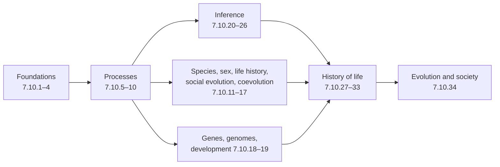

The thirty-four chapters of this course have asked two questions about the living world: what its history has been, and what has caused that history ([7.10.1](/7.10.1)). This chapter adds nothing new. It lays the answers side by side in three parts that correspond to the three parts of the course: the *processes* that change populations (mutation, selection, drift, gene flow and recombination), the *patterns* those processes leave at the level of species, clades and the history of life, and the methods of *inference* by which patterns are read back into processes and times. Every formula below is derived in the chapter that the reference (Theorem 6.3.1, Formula 10.5.2, Eq. (25.3)) leads to; the single-locus theory on which the course builds is in [7.4.22](/7.4.22) and [7.4.23](/7.4.23), the quantitative genetics in [7.4.24](/7.4.24), and the phylogenetic algorithms in [7.8.6](/7.8.6).

## 35.1. The Shape of the Course

The course falls into seven blocks, each of which uses the earlier ones.

| Block | Chapters | Central question | Main tools |
|---|---|---|---|
| Foundations | 7.10.1–7.10.4 | What is evolution, how is a tree read, what is an adaptation, where does variation come from? | the evidence for common descent; tree thinking; mutation rates and the DFE |
| Processes | 7.10.5–7.10.10 | How do selection, drift, migration and recombination change allele frequencies and traits? | deterministic recursions, diffusion, the coalescent, quantitative genetics |
| Adaptation in context | 7.10.11–7.10.17 | How do species form, and why sex, sex ratios, life histories, cooperation and coevolution? | game theory, Hamilton's rule, Leslie matrices, ESS |
| Genes, genomes and development | 7.10.18–7.10.19 | How do genes, genomes and developmental programs evolve? | duplication models, *cis*/*trans* tests, Fisher's geometric model |
| Inference | 7.10.20–7.10.26 | How are trees, rates, times, selection and gene flow estimated from sequences and traits? | Markov chains, likelihood, Bayesian MCMC, the multispecies coalescent, Brownian motion |
| History | 7.10.27–7.10.33 | What happened, from the origin of life to *Homo sapiens*? | fossils, radiometric dating, dated phylogenies, birth–death models, ancient DNA |
| Society | 7.10.34 | How is evolutionary biology used and misused? | all of the above |

The order reflects the logic of the subject. **Microevolution** and **macroevolution** (Definition 1.1.2) are scales, not different processes: the processes of the second block, acting over long times and many lineages, are meant to account for the patterns of the sixth, and the methods of the fifth are the bridge between them. Whether they do so completely is itself one of the questions of macroevolution (§35.6).

## 35.2. The Processes and Their Scaled Parameters

### 35.2.1. Five Processes

| Process | Parameter | Effect on variation within populations | Effect between populations | Key results |
|---|---|---|---|---|
| **Mutation** | $\mu$ per site, $U$ per genome | creates it | creates it independently | $U = \mu G$ (Formula 4.3.1); human $\mu \approx 1.2\times10^{-8}$ per bp per generation; DFE dominated by deleterious and nearly neutral effects (Definition 4.4.1) |
| **Natural selection** | $s$, $h$ | removes it (directional, purifying) or maintains it (balancing) | creates differences (divergent) or prevents them (uniform) | $\Delta p \approx spq$; establishment $\approx 2s$ (Theorem 5.3.1); $\Delta\bar w \approx V_A/\bar w$ (Theorem 5.7.1); $\Delta\bar z = V_A\beta$ (Theorem 9.4.1) |
| **Genetic drift** | $N_{\mathrm{e}}$ | removes it at rate $1/2N_{\mathrm{e}}$ per generation | creates differences | Wright–Fisher spectrum (Theorem 6.2.1); fixation probability (Theorem 6.3.1); neutral substitution rate $k = \mu$ |
| **Gene flow** | $m$, $\sigma^2$ | introduces it | removes differences | $F_{\mathrm{ST}} \approx 1/(1 + 4N_{\mathrm{e}}m)$ (Eq. (10.2)); cline width $\propto \sigma/\sqrt{s}$ (Formula 10.5.2); wave of advance $\sqrt{2s\sigma^2}$ (Formula 10.5.4) |
| Recombination | $r$, $\rho = 4N_{\mathrm{e}}r$ | creates new combinations, breaks down **linkage disequilibrium** | — | $D_{t+1} = (1 - r)D_t$; ARG (Definition 7.7.1); hitchhiking (Formula 5.4.1); Hill–Robertson effect (Definition 14.2.2) |

Mutation is the ultimate source of variation and is random with respect to fitness (§4.5); recombination rearranges existing variation and in sexual species produces most of the genetic differences between individuals (§4.1). Selection is the only one of these processes that produces adaptation, and the only one that is not random with respect to fitness (§3.2).

### 35.2.2. Three Scaled Parameters

What decides the outcome when processes act together is rarely the size of any one parameter; it is a product of the parameter with the **effective population size**. Three such products organize most of population genetics.

| Product | Compares | $\ll 1$ | $\gg 1$ | Reference |
|---|---|---|---|---|
| $N_{\mathrm{e}}s$ | selection with drift | the allele is effectively neutral; fixation probability $\approx$ neutral $1/2N$ | selection decides; beneficial alleles fix with probability $\approx 2s$, deleterious ones almost never | §6.5.1, Theorem 6.3.1 |
| $N_{\mathrm{e}}m$ | migration with drift | demes diverge, $F_{\mathrm{ST}} \to 1$ | the species is genetically one population | Eq. (10.2), Theorem 7.6.1 |
| $\theta = 4N_{\mathrm{e}}\mu$ | mutation with drift | most loci monomorphic, $H \approx \theta$ | most loci highly polymorphic | Formula 6.4.1, Theorem 7.3.1 |

![The three scaled parameters. A: fixation probability of a new mutation relative to that of a neutral one, against $N_{\mathrm{e}}s$ (Kimura's formula, genic selection, $N_{\mathrm{e}} = N = 1000$); within the shaded band $\lvert N_{\mathrm{e}}s\rvert < 1$ drift dominates, beyond it selection fixes beneficial and removes deleterious mutations. B: neutral differentiation in the island model, $F_{\mathrm{ST}} = 1/(1 + 4N_{\mathrm{e}}m)$, against the number of migrants per generation; one migrant per generation keeps $F_{\mathrm{ST}}$ near 0.2. C: expected heterozygosity under the infinite-alleles model, $\theta/(1 + \theta)$, and the expected number of segregating sites in a sample of ten, $\theta a_n$, against $\theta$. Dotted lines mark the scaled parameter equal to 1.](./plots/regimes.py)

These products explain results that would otherwise seem unrelated. The **nearly neutral theory** (Definition 6.5.1) is the statement that many mutations lie near $\lvert N_{\mathrm{e}}s\rvert \approx 1$, so that their fate depends on population size; the **drift-barrier hypothesis** (Definition 6.5.2) applies the same idea to the mutation rate itself; genome size and the spread of transposable elements depend on whether their small costs are visible to selection (§18.8); and the fraction of adaptive amino acid substitutions is higher in flies than in humans (§18.4.2). Lewontin's paradox (Definition 6.4.1) is the observation that diversity varies far less among species than $\theta = 4N_{\mathrm{e}}\mu$ with census sizes would predict, which **linked selection** helps to explain (§8.3). In space, the corresponding comparison of selection with dispersal sets a characteristic length $l = \sqrt{\sigma^2/2s}$ (Formula 10.5.2): patches smaller than $l$ cannot be adapted to, and **gene swamping** occurs when $m \gtrsim s$ (Definition 10.5.2).

### 35.2.3. Processes in Combination

| Combination | Result | Reference |
|---|---|---|
| mutation + selection | **mutation–selection balance**, $\hat q \approx \mu/hs$; load $1 - \mathrm{e}^{-U}$ independent of $s$ | [Theorem 23.4.1](/7.4.23#thm-23.4.1), Formula 5.8.1 |
| mutation + drift | equilibrium diversity $\pi \approx 4N_{\mathrm{e}}\mu$; neutral substitution rate $\mu$ independent of $N$ | Formula 6.4.1, §6.6 |
| selection + drift | substitution rate $k = 2N\mu\int u f$; peak shifts $\propto \mathrm{e}^{-N_{\mathrm{e}}s_{\mathrm{h}}}$ | Eq. (6.11), §6.5.4 |
| selection + migration | clines, tension zones, local adaptation, islands of divergence $m_{\mathrm{e}} = mr/(r + s)$ | Formulas 10.5.1–10.5.3, Formula 12.3.1 |
| selection + linkage | **selective sweeps** and **background selection** $B = \mathrm{e}^{-u/hs}$ reduce diversity at linked sites; interference between selected sites favors recombination | Formula 5.4.2, Formula 8.3.1, §14.2.2 |
| drift + migration + mutation | coalescence times in the structured coalescent; isolation by distance | Theorem 7.6.1, Definition 10.3.1 |
| selection on traits + genetic covariance | $\Delta\bar{\boldsymbol{z}} = G\boldsymbol{\beta}$; responses deflected toward $\boldsymbol{g}_{\max}$ | Theorem 9.6.1, Definition 9.6.4 |

## 35.3. Models and Formulas

### 35.3.1. A Table of Results

| Topic | Result | Reference |
|---|---|---|
| fitter type | ratio of frequencies multiplied by the ratio of fitnesses each generation | Formula 3.2.1 |
| allele frequency change | $\Delta p = pq(w_1 - w_2)/\bar w$; $10\,\% \to 90\,\%$ in $4.4/s$ generations | Eq. (5.3), Eq. (5.4) |
| establishment | $\pi \approx 2s/\sigma^2$; $\approx 2hs$ with dominance (Haldane's sieve) | Theorem 5.3.1, Definition 5.3.2 |
| rate of adaptation | $k_{\mathrm{a}} \approx 4N\mu_{\mathrm{b}}s$ | Formula 5.3.1 |
| balancing selection | Levene: arithmetic mean $> 1 >$ harmonic mean; fluctuating selection: geometric mean | Theorem 5.5.1, Formula 5.5.1 |
| fixation | $u(p) = \int_0^pG/\int_0^1G$; Kimura $u = (1 - \mathrm{e}^{-4N_{\mathrm{e}}sp})/(1 - \mathrm{e}^{-4N_{\mathrm{e}}s})$ | Theorem 6.3.1, [Theorem 23.6.1](/7.4.23#thm-23.6.1) |
| times | neutral new mutation fixed in $\approx 4N_{\mathrm{e}}$, lost in $\approx 2\ln 2N$ generations | Theorem 6.3.2 |
| stationary distribution | $\phi \propto p^{4N_{\mathrm{e}}\nu - 1}q^{4N_{\mathrm{e}}\mu - 1}\mathrm{e}^{4N_{\mathrm{e}}sp}$ | Formula 6.3.1 |
| coalescent | rate $\binom{k}{2}$ per $2N_{\mathrm{e}}$ generations; $\mathbb{E}[T_{\mathrm{MRCA}}] = 4N_{\mathrm{e}}(1 - 1/n)$ | Definition 7.2.1, Theorem 7.2.1 |
| neutral polymorphism | $\mathbb{E}[S] = \theta a_n$; $\mathbb{E}[\xi_i] = \theta/i$ | Theorem 7.3.2, Theorem 7.3.3 |
| neutrality tests | Tajima's $D$; MK test, $\alpha = 1 - \mathrm{NI}$ | Definition 8.2.2, Definition 8.2.4 |
| quantitative traits | $R = h^2S$; $\Delta\bar{\boldsymbol{z}} = G\boldsymbol{\beta}$; house of cards $V_A \approx 4n\mu V_s$ | [Theorem 24.5.1](/7.4.24#thm-24.5.1), Theorem 9.6.1, Formula 9.8.1 |
| evolutionary rescue | critical rate $b_{\mathrm{c}} = V_A\sqrt{2\ln W_0/V_s}$ | Formula 9.4.1 |
| space | $F_{\mathrm{ST}} \approx 1/(1 + 4N_{\mathrm{e}}m)$; cline width $2.5\sqrt{\sigma^2/s}$; tension zone $\sqrt{8\sigma^2/s^*}$ | Eq. (10.2), Formulas 10.5.2–10.5.3 |
| reproductive isolation | sequential barriers multiply; incompatibilities accumulate faster than linearly | Formula 11.2.1, Formula 11.4.1 |
| sexual selection | runaway iff $B/G > 1 + \nu^2/\omega^2$ | Theorem 13.2.1 |
| sex ratio | $x^* = \frac12$; local mate competition $x^* = (n - 1)/2n$ | Theorem 13.3.1, Theorem 13.3.2 |
| cost of sex | asexual frequency $p_{t+1} = 2p_t/(1 + p_t)$ | Theorem 14.1.1 |
| selfing | spreads iff inbreeding depression $\delta < \frac12$; $\hat F = S/(2 - S)$ | Theorem 14.4.1, Formula 14.4.1 |
| life history | $\sum\lambda^{-x}l_xm_x = 1$; force of selection $\propto \lambda^{-x}l_x$; Smith–Fretwell $f'(s^*) = f(s^*)/s^*$ | Eq. (15.1), Theorem 15.1.2, Theorem 15.3.2 |
| social evolution | Hamilton's rule $rb > c$; hawk–dove $p^* = V/C$; Price equation | Theorem 16.3.1, Theorem 16.2.2, Definition 16.5.1 |
| coevolution | optimal virulence $\beta'(\alpha^*) = \beta/(\alpha^* + \mu + \gamma)$ | Theorem 17.2.1 |
| duplicate genes | probability of subfunctionalization | Formula 18.2.1 |
| adaptive walks | probability that a mutation is beneficial falls with its size and the number of traits | Formula 19.7.1 |
| substitution models | $P(t) = \mathrm{e}^{Qt}$; reversibility $q_{ij} = r_{ij}\pi_j$ | Theorem 20.1.1, Theorem 20.1.2 |
| codon models | $d_{\mathrm{N}}/d_{\mathrm{S}} = \omega$; boundary LRT $\frac12\chi^2_0 + \frac12\chi^2_1$ | Theorem 23.2.1, Theorem 23.4.1 |
| divergence times | with infinite data, times lie on a line: the infinite-sites limit | Theorem 24.4.1 |
| gene trees | three species: $P_{\mathrm{SG}} = \frac23\mathrm{e}^{-T}$ | Eq. (25.3) |
| trait evolution | tips $\mathcal{N}_n(a\boldsymbol{1}, \sigma^2C)$; contrasts independent; OU $\mathrm{d}X = \alpha(\theta - X)\mathrm{d}t + \sigma\mathrm{d}B$ | Theorem 26.2.1, Theorem 26.3.1, Definition 26.5.1 |
| diversification | $D = S - E$; LTT plots | Definition 31.1.1, Definition 31.5.1 |
| geology | $t = \lambda^{-1}\ln(1 + D/N)$ | Formula 29.1.1 |

### 35.3.2. One Stochastic Mathematics

A few mathematical structures recur throughout the table. **Markov chains** describe allele numbers in the Wright–Fisher model (Theorem 6.2.1), nucleotides and codons along a branch (Definition 20.1.1, Definition 23.2.1), discrete characters on a tree (Definition 26.6.1) and the lineages of the coalescent, which is a Markov chain run backward in time (Definition 7.2.1). Their continuous limits are diffusions: the diffusion approximation of allele frequencies (Definition 6.3.1) solves equations of the same type as the **heat equation** ([2.5.7](/2.5.7)), and the **Brownian motion model** and **Ornstein–Uhlenbeck model** of trait evolution (Definition 26.2.1, Definition 26.5.1) are the simplest diffusions of a quantitative trait. Exponential waiting times appear in the coalescent, in substitution models, in the birth–death models of diversification (Definition 22.2.2, Definition 31.1.1) and in the fossilized birth–death process (Definition 24.5.1); a **branching process** gives the establishment probability of a beneficial mutation (Theorem 5.3.1). Optimization under trade-offs, finally, organizes the chapters on sex ratios, life histories, social behavior and virulence: the ESS (Definition 16.2.2), Fisher's principle, Cole's paradox and the trade-off hypothesis of virulence are all maxima of fitness under constraints.

![One stochastic mathematics. A: 20 Wright–Fisher populations of $N = 50$ starting at $p_0 = 0.5$; drift is a Markov chain with absorbing states, and the expected heterozygosity $2p_0q_0(1 - 1/2N)^t$ (dashed) decays at rate $1/2N$ per generation. B: a trait evolving by Brownian motion (orange) and by an Ornstein–Uhlenbeck process with a pull toward $\theta = 0$ (green), with $\pm 2$ standard deviations of each; the variance grows without bound under Brownian motion and approaches $\sigma^2/2\alpha$ under the OU model. C: the Jukes–Cantor chain: the proportion of differing sites $p$ saturates at $3/4$ as the distance $d$ grows (dots: simulated pairs of 500 sites), and the standard error of the estimated distance (dashed, right axis) increases steeply as $p$ approaches saturation.](./plots/processes.py)

The statistical tools are equally shared: likelihood ([3.2.3](/3.2.3)) for $\theta$ (Eq. (7.8)), distances (§20.3), trees (§21.4), $\omega$ (§23.2.3) and divergence times (§24.3); Bayesian inference ([3.7.1](/3.7.1)) with **Markov chain Monte Carlo** ([3.5.9](/3.5.9)) for genealogies, trees, times and species trees (Eq. (7.9), §22.3, §24.4, Eq. (25.4)); **likelihood ratio tests** with boundary corrections for nested models (Theorem 23.4.1); the **bootstrap** for trees (§21.7.1); and generalized least squares for comparative data (Definition 26.3.1).

## 35.4. From Populations to Species and Clades

The chapters after the processes ask how the same processes produce the large patterns of biology.

| Pattern | Process that explains it | Key idea | Chapters |
|---|---|---|---|
| species | divergent selection, mutation order, conflict, drift; gene flow opposes | reproductive isolation as a by-product; Dobzhansky–Muller incompatibilities; reinforcement | 7.10.11, 7.10.12 |
| two sexes, ornaments | **sexual selection** from anisogamy and the operational sex ratio | Bateman's principle; good genes, runaway, sensory bias | 7.10.13 |
| sex and recombination | selection at the level of genetic systems | twofold cost; Red Queen; Hill–Robertson effect; Muller's ratchet | 7.10.14 |
| life histories | selection under allocation trade-offs | the force of selection declines with age; $r$ and $K$ | 7.10.15 |
| cooperation | **kin selection**, reciprocity, multilevel selection | Hamilton's rule; Price equation; major transitions | 7.10.16 |
| interactions among species | **coevolution** | arms races, mimicry, virulence, character displacement | 7.10.17 |
| genome architecture | mutation, drift and selfish elements as much as selection | duplication and the DDC model; genome size and $N_{\mathrm{e}}$ | 7.10.18 |
| morphological change | regulatory change in developmental genes | *cis*-regulatory evolution; modularity; constraints | 7.10.19 |
| geographic distributions | dispersal, vicariance, extinction | dated phylogenies test vicariance; island biogeography | 7.10.30 |
| diversity through time | speciation and extinction rates | birth–death models; mass extinctions; key innovations | 7.10.31 |
| major forms and trends | microevolution over long times, with species selection and contingency | intermediate forms; stasis; passive and driven trends | 7.10.32 |

Three themes cross these chapters. The first is **levels of selection** (Definition 3.3.1): selfish genetic elements, kin selection, group and species selection and the major transitions (Definition 16.6.1) are all cases in which selection at one level conflicts with selection at another, and the Price equation (Theorem 16.5.1) partitions the change between them. The second is **trade-offs** (Definition 3.6.1), which appear as costs of resistance, costs of reproduction, the convexity of fitness sets (Theorem 15.4.1), germ–soma specialization (Formula 28.5.1) and the virulence–transmission trade-off. The third is **evolutionary constraint** (Definition 9.6.3): genetic covariances, pleiotropy, developmental bias and history limit what selection can reach, so that adaptations are imperfect (§3.6) and evolution is contingent (§32.5.4).

## 35.5. Inference: Problem, Model, Method

Inference reverses the processes: from present-day sequences, traits and fossils it estimates the parameters and histories that produced them. Almost every method in the course is a pair of a stochastic model and an estimator.

| Problem | Data | Model | Method | Reference |
|---|---|---|---|---|
| population history, $\theta$, $N_{\mathrm{e}}(t)$ | polymorphism in one species | coalescent with mutation, growth, structure, recombination | Watterson and $\pi$ estimators; likelihood over genealogies; skyline plots, PSMC | 7.10.7 |
| selection in genomes | polymorphism and divergence | neutral coalescent as the null | SFS tests, HKA, MK; sweep scans, $F_{\mathrm{ST}}$ outliers | 7.10.8 |
| genetic distance | two aligned sequences | JC69, K80, F81, GTR, $+\Gamma$, $+I$ | moments and likelihood; delta-method variances | 7.10.20 |
| tree topology | an alignment | substitution model on a tree | distance (NJ, ME), parsimony, ML; bootstrap, KH, SH, AU tests | 7.10.21, [7.8.6](/7.8.6) |
| tree with uncertainty | an alignment and priors | the same, with tree and branch-length priors | MCMC; posterior clade probabilities; marginal likelihoods | 7.10.22 |
| adaptive protein evolution | coding sequences on a tree | codon model with $\omega$ by branch and site | branch, site and branch-site LRTs; empirical Bayes | 7.10.23 |
| divergence times | sequences and fossils | strict, local or relaxed clock; calibration densities | penalized likelihood; Bayesian dating; tip dating | 7.10.24 |
| species tree, gene flow | many loci | multispecies coalescent, IM model, networks | concatenation, summary methods, full likelihood; $D$ statistic | 7.10.25 |
| correlated trait evolution | traits and a tree | BM, OU, Mk | independent contrasts, PGLS, Pagel's $\lambda$ | 7.10.26 |
| diversification | a dated tree, fossil counts | birth–death, trait-dependent models | LTT plots, BiSSE, sampling-corrected fossil diversity | 7.10.31 |
| biogeographic history | dated phylogenies, distributions | dispersal and vicariance | age of clade vs age of barrier; phylogeography | 7.10.30 |

The chapters on inference share four lessons. Models matter more than methods: when the model is wrong in the right way, every method fails together, as in the **Felsenstein zone** (§21.3), with **substitution saturation** (Definition 20.3.1), or when the **concatenation** of loci is inconsistent in the anomaly zone (Definition 25.2.3). Identifiability limits what data can say: the root is not identifiable under a reversible model without a clock (§21.4.4), and with infinite sequence data divergence times remain uncertain because they are confounded with rates (Theorem 24.4.1). Measures of support answer different questions: the bootstrap measures repeatability (§21.7.1), posterior probabilities can be high for a wrong tree (Definition 22.5.1). And processes leave similar patterns: demographic growth and sweeps both produce an excess of rare variants (§8.2.2), and phylogenetic signal is a pattern, not a process (§26.4).

Gene trees connect the population and the species levels. The coalescent of a single population (7.10.7) becomes the **multispecies coalescent** (Definition 25.2.1) when it runs within the branches of a species tree, and **incomplete lineage sorting** is simply coalescence that is deeper than the speciation event; the probability of concordance $1 - \frac23\mathrm{e}^{-T}$ (Eq. (7.14), Eq. (25.3)) is the same result seen from the two sides.

## 35.6. A Timeline of Life

![The history of life on a logarithmic time axis, with the dates given in the chapters on the origin of life (7.10.27), eukaryotes and multicellularity (7.10.28), the history of life (7.10.29), diversity (7.10.31) and human evolution (7.10.33): Earth forms about 4.54 Ga; the date of LUCA is a molecular estimate; life is securely documented by 3.4 Ga; the Great Oxidation Event about 2.4 Ga; the oldest eukaryote fossils 1.6–1.7 Ga and the multicellular red alga *Bangiomorpha* about 1.05 Ga; the Snowball Earth glaciations of the Cryogenian; the Ediacaran biota from about 575 Mya and the Cambrian explosion from about 539 Mya; vascular plants on land about 430 Mya, tetrapods about 370 Mya, angiosperms about 130 Mya; the human–chimpanzee split about 7 Mya, *Homo* about 2.8 Mya, *H. sapiens* about 300 000 years ago and its spread out of Africa about 60 000 years ago. Red triangles: the five mass extinctions.](./plots/timeline.py)

| Interval | Events | Chapters |
|---|---|---|
| Hadean–Archean | Earth formed about 4.54 Ga; prebiotic chemistry; RNA world; **LUCA** (Definition 27.3.1); Bacteria and Archaea diverge; stromatolites | 7.10.27 |
| Paleoproterozoic | oxygenic photosynthesis in cyanobacteria; the **Great Oxidation Event** (Definition 27.5.1) | 7.10.27, 7.10.29 |
| Proterozoic | eukaryogenesis from an Asgard archaeal host and an alphaproteobacterial symbiont; primary and secondary endosymbiosis; first multicellular eukaryotes | 7.10.28 |
| Neoproterozoic | Snowball Earth; the **Ediacaran biota** (Definition 29.3.1) | 7.10.29 |
| Paleozoic | the **Cambrian explosion** (Definition 29.4.1); Ordovician radiation; colonization of land; **Pangaea**; end-Permian extinction, the largest | 7.10.29, 7.10.31 |
| Mesozoic | breakup of Pangaea; dinosaurs, birds, mammals from synapsids; angiosperms; K/Pg impact 66.0 Mya | 7.10.29, 7.10.32 |
| Cenozoic | radiation of mammals and birds; cooling and grasslands; Pleistocene glacial cycles; hominins and *Homo sapiens* | 7.10.29, 7.10.33 |

The record is read with the methods of the course: radiometric dating (Formula 29.1.1) gives the absolute scale, fossils give minimum ages and calibrations (Definition 24.4.2), molecular clocks give dates for events without fossils, often older than the first fossils (§24.4.5), and dated phylogenies test biogeographic hypotheses (§30.4.2).

## 35.7. Open Problems

The chapters end with questions that the field has not settled.

- Why sex is maintained (§14.2). The Red Queen, selective interference and the deterministic mutation hypothesis are each supported in some systems; evidence for the synergistic epistasis required by the last is weak, and the relative importance of the mechanisms is unresolved.
- How much of molecular evolution is adaptive (§6.6.3, §8.6, §18.4.2). Estimates of the adaptive fraction of substitutions differ among species and depend on the treatment of slightly deleterious mutations and past changes of $N_{\mathrm{e}}$; Lewontin's paradox is only partly explained by linked selection.
- Levels of selection (§16.5.2). Kin selection and multilevel selection are formally equivalent in many models, and the debate about which description is more useful continues.
- The origin of life (§27.2). There is no consensus on the setting, on whether replicators or metabolism came first, or on how nucleotides and homochirality arose.
- The early tree of eukaryotes (§28.1–§28.4). The order of events in eukaryogenesis, the exact sister group of mitochondria and the root of the eukaryotic tree remain unresolved.
- Plasticity and evolution (§19.8.2). Whether plastic responses commonly lead genetic evolution, rather than following or opposing it, is still debated.
- Rates in deep time (§24.4.5, §31.5.1). Molecular and fossil dates of radiations disagree, partly for methodological reasons, and extinction rates cannot be reliably estimated from trees of living species alone.
- Diversity and its limits (§30.7.1, §31.6). Whether diversity is bounded by ecological limits or is still rising, and which cause of the latitudinal diversity gradient dominates, are open; time and area are supported by many phylogenetic studies.
- Tempo of morphological change (§32.4). Stasis is common, but why it prevails, and how often change is concentrated at speciation, are not settled.

## 35.8. Connections to Other Courses

| Course | What it provides or receives | Pages |
|---|---|---|
| Genetics (7.4) | Hardy–Weinberg, single-locus selection, drift, the neutral theory; quantitative genetics; transposable elements, rearrangements and polyploidy | [7.4.22](/7.4.22), [7.4.23](/7.4.23), [7.4.24](/7.4.24), [7.4.15](/7.4.15)–[7.4.17](/7.4.17) |
| Bioinformatics (7.8) | phylogenetic algorithms (NJ, parsimony, **Felsenstein's pruning algorithm**, bootstrap); population genomic data, $F_{\mathrm{ST}}$ scans, admixture | [7.8.6](/7.8.6), [7.8.13](/7.8.13) |
| Developmental biology (7.5) | developmental genetics behind evo-devo; aging | [7.5.39](/7.5.39), [7.5.37](/7.5.37) |
| Molecular and cell biology (7.2, 7.3) | the genome, the RNA world, cells; cancer as somatic evolution | [7.2.2](/7.2.2), [7.2.23](/7.2.23), [7.3.26](/7.3.26) |
| Biophysics (7.6) | sequence-space and fitness-landscape models, directed evolution | [7.6.41](/7.6.41), [7.6.15](/7.6.15) |
| Probability and statistics (3.1–3.7) | Markov chains, likelihood, the bootstrap, MCMC, Bayesian model comparison | [3.2.3](/3.2.3), [3.5.7](/3.5.7), [3.5.9](/3.5.9), [3.7.8](/3.7.8) |
| Differential equations (2.4, 2.5) | stability of equilibria in selection and game dynamics; diffusion | [2.4.11](/2.4.11), [2.5.7](/2.5.7) |

Evolution is in turn a prerequisite for most of the later biology: comparative genomics, the phylogenetic classification used in the organismal courses, and the evolutionary interpretation of physiology, behavior and ecology all rest on the processes and methods summarized here.

## Summary

- The course moved from processes (7.10.5–7.10.10) through their consequences for species, genetic systems, social life, interactions and genomes (7.10.11–7.10.19), to the methods of inference (7.10.20–7.10.26) and the history of life (7.10.27–7.10.33).
- Mutation, selection, drift, gene flow and recombination are compared through the scaled parameters $N_{\mathrm{e}}s$, $N_{\mathrm{e}}m$ and $\theta = 4N_{\mathrm{e}}\mu$; the regime $\lvert N_{\mathrm{e}}s\rvert \approx 1$ is that of the nearly neutral theory.
- Markov chains, diffusions, exponential waiting times and optimization under trade-offs are the mathematics of the whole course; likelihood and Bayesian MCMC are its statistics.
- Inference is a pair of model and estimator; misspecified models, unidentifiable parameters and similar patterns from different processes are the main sources of error.
- Open problems include the maintenance of sex, the adaptive fraction of molecular evolution, the levels of selection, the origin of life and of eukaryotes, and the dynamics of diversity.

## Questions

1. A new mutation has $s = 10^{-4}$. In which of two species, with $N_{\mathrm{e}} = 10^4$ and $N_{\mathrm{e}} = 10^6$, does selection determine its fate, and what does this imply for comparisons of $d_{\mathrm{N}}/d_{\mathrm{S}}$ between them?

   **Answer** $N_{\mathrm{e}}s = 1$ in the first species (both drift and selection matter) and $100$ in the second (selection dominates). Slightly deleterious amino acid replacements are fixed more often in the small species and beneficial ones more efficiently in the large one, so $\omega$ is expected to be higher in the small species for constrained genes and the adaptive fraction $\alpha$ higher in the large one (Definition 6.5.1, §18.4.2).

2. Explain why $F_{\mathrm{ST}}$ at a neutral locus depends on $N_{\mathrm{e}}m$ rather than on $m$, using both the forward model and the coalescent.

   **Answer** Forward: drift increases the variance among demes at rate $1/2N_{\mathrm{e}}$, migration reduces it at rate about $2m$; the balance gives $F_{\mathrm{ST}} \approx 1/(1 + 4N_{\mathrm{e}}m)$ (Eq. (10.2)). Backward: two genes from one deme coalesce after $\approx 2nN_{\mathrm{e}}$ generations, while genes from different demes need an extra $(n - 1)/2m$ generations (Theorem 7.6.1); $F_{\mathrm{ST}} = (\bar T - \bar T_0)/\bar T$ then depends on the ratio of $N_{\mathrm{e}}$ to $1/m$.

3. Name the parts of the course in which a Markov chain is the central model, and say in each what the states are and in which direction time runs.

   **Answer** Wright–Fisher drift: allele copy numbers, forward (Theorem 6.2.1). The coalescent: the number of ancestral lineages, backward (Definition 7.2.1). Substitution models: nucleotides or codons at a site, along branches (Definition 20.1.1, Definition 23.2.1); because the models are reversible, direction does not matter. The Mk model: states of a discrete character on a tree (Definition 26.6.1). MCMC: trees and parameters, in algorithmic rather than biological time (§22.3).

4. Molecular dates of the Cambrian radiation are older than the first animal fossils. List the explanations given in the course and the methods that address them.

   **Answer** Fossils give minimum ages, and early animals were small, soft-bodied and rarely preserved, so some gap is expected (§24.4.5, §29.2). Methodological causes: rate variation that is not captured by the clock model, poorly chosen calibration densities and the infinite-sites limit, which keeps time estimates uncertain however long the sequences (Theorem 24.4.1). Relaxed clocks with soft-bound calibrations (Definition 24.4.1, Definition 24.4.2) and tip dating with the fossilized birth–death process (Definition 24.5.1) use the fossil information more fully.

5. A clade of island lizards shows a negative Tajima's $D$ in many genes and an excess of a trait in species on small islands. Which process explanations must be distinguished, and which methods of the course would you use?

   **Answer** A negative $D$ at many loci points to population growth or a bottleneck rather than to selection, which would affect individual loci (§8.2.2); demography is estimated with the coalescent (§7.5), and sweeps are sought as outliers against it. The trait–island association may reflect shared ancestry rather than repeated adaptation, so it is tested with independent contrasts or PGLS (Definition 26.3.1) and with ancestral-state reconstruction (§26.6), and island colonization history with dated phylogenies (§30.4).
