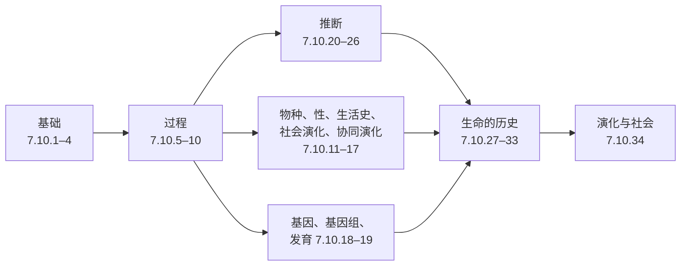

这门课程的三十四章围绕生物界提出了两个问题：它的历史是什么，以及是什么造成了这一历史（[7.10.1](/7.10.1)）。本章不增加任何新内容。它把答案分成三部分并排摆出，对应课程的三个部分：改变种群的*过程*（突变、选择、漂变、基因流与重组），这些过程在物种、演化支与生命史层次上留下的*格局*，以及把格局反推回过程与时间的*推断*方法。下面的每一个公式，都在其引用（定理 6.3.1、公式 10.5.2、式 (25.3)）所指向的那一章中推导；课程所依赖的单基因座理论见 [7.4.22](/7.4.22) 与 [7.4.23](/7.4.23)，数量遗传学见 [7.4.24](/7.4.24)，系统发生算法见 [7.8.6](/7.8.6)。

## 35.1. 课程的结构

课程分为七个板块，每个板块都使用前面的板块。

| 板块 | 章 | 核心问题 | 主要工具 |
|---|---|---|---|
| 基础 | 7.10.1–7.10.4 | 什么是演化，怎样读一棵树，什么是适应，变异从何而来？ | 共同祖先的证据；树式思维；突变率与适合度效应分布 |
| 过程 | 7.10.5–7.10.10 | 选择、漂变、迁移与重组如何改变等位基因频率与性状？ | 确定性递推、扩散、溯祖、数量遗传学 |
| 情境中的适应 | 7.10.11–7.10.17 | 物种如何形成，为什么有性别、性比、生活史、合作与协同演化？ | 博弈论、Hamilton 法则、Leslie 矩阵、演化稳定策略 |
| 基因、基因组与发育 | 7.10.18–7.10.19 | 基因、基因组与发育程序如何演化？ | 复制模型、*顺式*/*反式*检验、Fisher 几何模型 |
| 推断 | 7.10.20–7.10.26 | 如何由序列与性状估计树、速率、时间、选择与基因流？ | Markov 链、似然、Bayes MCMC、多物种溯祖、Brown 运动 |
| 历史 | 7.10.27–7.10.33 | 从生命起源到 *Homo sapiens*，发生了什么？ | 化石、放射性测年、有年代标定的系统发生树、生灭模型、古 DNA |
| 社会 | 7.10.34 | 演化生物学如何被使用与滥用？ | 以上全部 |

这一顺序反映了学科的逻辑。**微演化**与**宏演化**（定义 1.1.2）是尺度，而不是不同的过程：第二板块的过程在长时间与许多谱系上起作用，应当解释第六板块的格局，而第五板块的方法是两者之间的桥梁。它们是否完全做到了这一点，本身就是宏演化的问题之一（§35.6）。

## 35.2. 过程及其缩放参数

### 35.2.1. 五个过程

| 过程 | 参数 | 对种群内变异的影响 | 对种群间的影响 | 关键结果 |
|---|---|---|---|---|
| **突变** | 每位点 $\mu$，每基因组 $U$ | 产生变异 | 独立地产生差异 | $U = \mu G$（公式 4.3.1）；人类 $\mu \approx 1.2\times10^{-8}$ 每碱基对每代；适合度效应分布以有害和近中性效应为主（定义 4.4.1） |
| **自然选择** | $s$、$h$ | 去除变异（定向、纯化）或维持变异（平衡） | 产生差异（分歧的）或阻止差异（一致的） | $\Delta p \approx spq$；固定的建立概率 $\approx 2s$（定理 5.3.1）；$\Delta\bar w \approx V_A/\bar w$（定理 5.7.1）；$\Delta\bar z = V_A\beta$（定理 9.4.1） |
| **遗传漂变** | $N_{\mathrm{e}}$ | 以每代 $1/2N_{\mathrm{e}}$ 的速率去除变异 | 产生差异 | Wright–Fisher 谱（定理 6.2.1）；固定概率（定理 6.3.1）；中性替换率 $k = \mu$ |
| **基因流** | $m$、$\sigma^2$ | 引入变异 | 去除差异 | $F_{\mathrm{ST}} \approx 1/(1 + 4N_{\mathrm{e}}m)$（式 (10.2)）；渐变群宽度 $\propto \sigma/\sqrt{s}$（公式 10.5.2）；前进波速度 $\sqrt{2s\sigma^2}$（公式 10.5.4） |
| 重组 | $r$、$\rho = 4N_{\mathrm{e}}r$ | 产生新的组合，打破**连锁不平衡** | — | $D_{t+1} = (1 - r)D_t$；ARG（定义 7.7.1）；搭车（公式 5.4.1）；Hill–Robertson 效应（定义 14.2.2） |

突变是变异的最终来源，对适合度而言是随机的（§4.5）；重组重新排列现有的变异，在有性物种中产生个体之间的大部分遗传差异（§4.1）。选择是这些过程中唯一产生适应的，也是唯一对适合度而言不是随机的（§3.2）。

### 35.2.2. 三个缩放参数

当各过程共同起作用时，决定结果的很少是任何单个参数的大小，而是该参数与**有效群体大小**的乘积。三个这样的乘积组织了种群遗传学的大部分内容。

| 乘积 | 比较的对象 | $\ll 1$ | $\gg 1$ | 参考 |
|---|---|---|---|---|
| $N_{\mathrm{e}}s$ | 选择与漂变 | 等位基因实际上是中性的；固定概率 $\approx$ 中性的 $1/2N$ | 选择起决定作用；有利等位基因以约 $2s$ 的概率固定，有害的几乎从不固定 | §6.5.1，定理 6.3.1 |
| $N_{\mathrm{e}}m$ | 迁移与漂变 | 各亚群分化，$F_{\mathrm{ST}} \to 1$ | 物种在遗传上是一个种群 | 式 (10.2)，定理 7.6.1 |
| $\theta = 4N_{\mathrm{e}}\mu$ | 突变与漂变 | 大多数基因座是单态的，$H \approx \theta$ | 大多数基因座高度多态 | 公式 6.4.1，定理 7.3.1 |

这些乘积解释了本来似乎不相关的结果。**近中性理论**（定义 6.5.1）是说许多突变处于 $\lvert N_{\mathrm{e}}s\rvert \approx 1$ 附近，所以它们的命运取决于种群大小；**漂变屏障假说**（定义 6.5.2）把同样的思想应用于突变率本身；基因组大小与转座元件的扩散取决于它们的小代价是否能被选择看到（§18.8）；而适应性氨基酸替换的比例，果蝇比人类高（§18.4.2）。Lewontin 悖论（定义 6.4.1）是观察到物种间的多样性变化远小于按普查大小得出的 $\theta = 4N_{\mathrm{e}}\mu$ 所预测的，**连锁选择**有助于解释它（§8.3）。在空间上，相应的选择与扩散的比较给出一个特征长度 $l = \sqrt{\sigma^2/2s}$（公式 10.5.2）：小于 $l$ 的斑块不可能被适应，而当 $m \gtrsim s$ 时发生**基因淹没**（定义 10.5.2）。

### 35.2.3. 过程的组合

| 组合 | 结果 | 参考 |
|---|---|---|
| 突变 + 选择 | **突变–选择平衡**，$\hat q \approx \mu/hs$；负荷 $1 - \mathrm{e}^{-U}$ 与 $s$ 无关 | [定理 23.4.1](/7.4.23#thm-23.4.1)，公式 5.8.1 |
| 突变 + 漂变 | 平衡多样性 $\pi \approx 4N_{\mathrm{e}}\mu$；中性替换率 $\mu$ 与 $N$ 无关 | 公式 6.4.1，§6.6 |
| 选择 + 漂变 | 替换率 $k = 2N\mu\int u f$；峰转移 $\propto \mathrm{e}^{-N_{\mathrm{e}}s_{\mathrm{h}}}$ | 式 (6.11)，§6.5.4 |
| 选择 + 迁移 | 渐变群、张力带、局部适应、分化岛 $m_{\mathrm{e}} = mr/(r + s)$ | 公式 10.5.1–10.5.3，公式 12.3.1 |
| 选择 + 连锁 | **选择清除**与**背景选择** $B = \mathrm{e}^{-u/hs}$ 降低连锁位点上的多样性；被选择位点之间的干涉有利于重组 | 公式 5.4.2，公式 8.3.1，§14.2.2 |
| 漂变 + 迁移 + 突变 | 结构溯祖中的溯祖时间；距离隔离 | 定理 7.6.1，定义 10.3.1 |
| 对性状的选择 + 遗传协方差 | $\Delta\bar{\boldsymbol{z}} = G\boldsymbol{\beta}$；响应偏向 $\boldsymbol{g}_{\max}$ | 定理 9.6.1，定义 9.6.4 |

## 35.3. 模型与公式

### 35.3.1. 结果汇总表

| 主题 | 结果 | 参考 |
|---|---|---|
| 较适合的类型 | 频率之比每代乘以适合度之比 | 公式 3.2.1 |
| 等位基因频率变化 | $\Delta p = pq(w_1 - w_2)/\bar w$；$10\,\% \to 90\,\%$ 需 $4.4/s$ 代 | 式 (5.3)，式 (5.4) |
| 建立 | $\pi \approx 2s/\sigma^2$；有显性时 $\approx 2hs$（Haldane 筛） | 定理 5.3.1，定义 5.3.2 |
| 适应速率 | $k_{\mathrm{a}} \approx 4N\mu_{\mathrm{b}}s$ | 公式 5.3.1 |
| 平衡选择 | Levene：算术平均 $> 1 >$ 调和平均；波动选择：几何平均 | 定理 5.5.1，公式 5.5.1 |
| 固定 | $u(p) = \int_0^pG/\int_0^1G$；Kimura $u = (1 - \mathrm{e}^{-4N_{\mathrm{e}}sp})/(1 - \mathrm{e}^{-4N_{\mathrm{e}}s})$ | 定理 6.3.1，[定理 23.6.1](/7.4.23#thm-23.6.1) |
| 时间 | 中性新突变在约 $4N_{\mathrm{e}}$ 代内固定，在约 $2\ln 2N$ 代内丢失 | 定理 6.3.2 |
| 平稳分布 | $\phi \propto p^{4N_{\mathrm{e}}\nu - 1}q^{4N_{\mathrm{e}}\mu - 1}\mathrm{e}^{4N_{\mathrm{e}}sp}$ | 公式 6.3.1 |
| 溯祖 | 每 $2N_{\mathrm{e}}$ 代速率 $\binom{k}{2}$；$\mathbb{E}[T_{\mathrm{MRCA}}] = 4N_{\mathrm{e}}(1 - 1/n)$ | 定义 7.2.1，定理 7.2.1 |
| 中性多态 | $\mathbb{E}[S] = \theta a_n$；$\mathbb{E}[\xi_i] = \theta/i$ | 定理 7.3.2，定理 7.3.3 |
| 中性检验 | Tajima 的 $D$；MK 检验，$\alpha = 1 - \mathrm{NI}$ | 定义 8.2.2，定义 8.2.4 |
| 数量性状 | $R = h^2S$；$\Delta\bar{\boldsymbol{z}} = G\boldsymbol{\beta}$；纸牌屋模型 $V_A \approx 4n\mu V_s$ | [定理 24.5.1](/7.4.24#thm-24.5.1)，定理 9.6.1，公式 9.8.1 |
| 演化拯救 | 临界速率 $b_{\mathrm{c}} = V_A\sqrt{2\ln W_0/V_s}$ | 公式 9.4.1 |
| 空间 | $F_{\mathrm{ST}} \approx 1/(1 + 4N_{\mathrm{e}}m)$；渐变群宽度 $2.5\sqrt{\sigma^2/s}$；张力带 $\sqrt{8\sigma^2/s^*}$ | 式 (10.2)，公式 10.5.2–10.5.3 |
| 生殖隔离 | 相继的障碍相乘；不相容的积累快于线性 | 公式 11.2.1，公式 11.4.1 |
| 性选择 | 失控当且仅当 $B/G > 1 + \nu^2/\omega^2$ | 定理 13.2.1 |
| 性比 | $x^* = \frac12$；局部配偶竞争 $x^* = (n - 1)/2n$ | 定理 13.3.1，定理 13.3.2 |
| 有性生殖的代价 | 无性型频率 $p_{t+1} = 2p_t/(1 + p_t)$ | 定理 14.1.1 |
| 自交 | 当近交衰退 $\delta < \frac12$ 时扩散；$\hat F = S/(2 - S)$ | 定理 14.4.1，公式 14.4.1 |
| 生活史 | $\sum\lambda^{-x}l_xm_x = 1$；选择强度 $\propto \lambda^{-x}l_x$；Smith–Fretwell $f'(s^*) = f(s^*)/s^*$ | 式 (15.1)，定理 15.1.2，定理 15.3.2 |
| 社会演化 | Hamilton 法则 $rb > c$；鹰鸽博弈 $p^* = V/C$；Price 方程 | 定理 16.3.1，定理 16.2.2，定义 16.5.1 |
| 协同演化 | 最优毒力 $\beta'(\alpha^*) = \beta/(\alpha^* + \mu + \gamma)$ | 定理 17.2.1 |
| 重复基因 | 亚功能化的概率 | 公式 18.2.1 |
| 适应性行走 | 突变有利的概率随其大小与性状数增加而下降 | 公式 19.7.1 |
| 替换模型 | $P(t) = \mathrm{e}^{Qt}$；可逆性 $q_{ij} = r_{ij}\pi_j$ | 定理 20.1.1，定理 20.1.2 |
| 密码子模型 | $d_{\mathrm{N}}/d_{\mathrm{S}} = \omega$；边界 LRT $\frac12\chi^2_0 + \frac12\chi^2_1$ | 定理 23.2.1，定理 23.4.1 |
| 分歧时间 | 数据无限时，时间落在一条直线上：无穷位点极限 | 定理 24.4.1 |
| 基因树 | 三个物种：$P_{\mathrm{SG}} = \frac23\mathrm{e}^{-T}$ | 式 (25.3) |
| 性状演化 | 末端 $\mathcal{N}_n(a\boldsymbol{1}, \sigma^2C)$；对比独立；OU $\mathrm{d}X = \alpha(\theta - X)\mathrm{d}t + \sigma\mathrm{d}B$ | 定理 26.2.1，定理 26.3.1，定义 26.5.1 |
| 多样化 | $D = S - E$；LTT 图 | 定义 31.1.1，定义 31.5.1 |
| 地质学 | $t = \lambda^{-1}\ln(1 + D/N)$ | 公式 29.1.1 |

### 35.3.2. 同一套随机数学

表中反复出现几种数学结构。**Markov 链**描述 Wright–Fisher 模型中的等位基因数（定理 6.2.1）、沿一个分支的核苷酸与密码子（定义 20.1.1、定义 23.2.1）、树上的离散性状（定义 26.6.1），以及溯祖的谱系，它是沿时间向后运行的 Markov 链（定义 7.2.1）。它们的连续极限是扩散：等位基因频率的扩散近似（定义 6.3.1）求解与**热方程**（[2.5.7](/2.5.7)）同类型的方程，而性状演化的 **Brown 运动模型**与 **Ornstein–Uhlenbeck 模型**（定义 26.2.1、定义 26.5.1）是数量性状最简单的扩散。指数等待时间出现在溯祖、替换模型、多样化的生灭模型（定义 22.2.2、定义 31.1.1）以及化石化生灭过程（定义 24.5.1）中；**分支过程**给出有利突变的建立概率（定理 5.3.1）。最后，权衡之下的最优化组织了关于性比、生活史、社会行为与毒力的各章：演化稳定策略（定义 16.2.2）、Fisher 原理、Cole 悖论与毒力的权衡假说，都是约束之下适合度的极大值。

统计工具同样是共有的：似然（[3.2.3](/3.2.3)）用于 $\theta$（式 (7.8)）、距离（§20.3）、树（§21.4）、$\omega$（§23.2.3）与分歧时间（§24.3）；Bayes 推断（[3.7.1](/3.7.1)）与 **Markov 链 Monte Carlo**（[3.5.9](/3.5.9)）用于谱系、树、时间与物种树（式 (7.9)、§22.3、§24.4、式 (25.4)）；带边界校正的嵌套模型的**似然比检验**（定理 23.4.1）；树的**自助法**（§21.7.1）；以及比较数据的广义最小二乘（定义 26.3.1）。

## 35.4. 从种群到物种和演化支

过程之后的各章，问的是同样的过程如何产生生物学中的大格局。

| 格局 | 解释它的过程 | 关键思想 | 章 |
|---|---|---|---|
| 物种 | 分歧选择、突变次序、冲突、漂变；基因流对抗 | 生殖隔离是副产物；Dobzhansky–Muller 不相容；强化 | 7.10.11、7.10.12 |
| 两性、饰物 | 来自异配生殖与实际性比的**性选择** | Bateman 原理；优良基因、失控、感觉偏好 | 7.10.13 |
| 性与重组 | 遗传系统水平上的选择 | 两倍代价；红皇后；Hill–Robertson 效应；Muller 棘轮 | 7.10.14 |
| 生活史 | 分配权衡之下的选择 | 选择强度随年龄下降；$r$ 与 $K$ | 7.10.15 |
| 合作 | **亲缘选择**、互惠、多层次选择 | Hamilton 法则；Price 方程；重大转变 | 7.10.16 |
| 物种间的相互作用 | **协同演化** | 军备竞赛、拟态、毒力、性状替换 | 7.10.17 |
| 基因组结构 | 突变、漂变与自私元件，和选择一样重要 | 复制与 DDC 模型；基因组大小与 $N_{\mathrm{e}}$ | 7.10.18 |
| 形态变化 | 发育基因的调控变化 | 顺式调控演化；模块性；限制 | 7.10.19 |
| 地理分布 | 扩散、隔离分化、灭绝 | 有年代标定的系统发生树检验隔离分化；岛屿生物地理学 | 7.10.30 |
| 多样性随时间的变化 | 物种形成率与灭绝率 | 生灭模型；大灭绝；关键创新 | 7.10.31 |
| 主要形态与趋势 | 长时间的微演化，加上物种选择与偶然性 | 中间类型；停滞；被动与驱动趋势 | 7.10.32 |

三个主题贯穿这些章节。第一是**选择层次**（定义 3.3.1）：自私遗传元件、亲缘选择、群体与物种选择以及重大转变（定义 16.6.1）都是一个层次上的选择与另一个层次上的选择相冲突的情形，而 Price 方程（定理 16.5.1）划分了它们之间的变化。第二是**权衡**（定义 3.6.1），表现为抗性的代价、繁殖的代价、适合度集合的凸性（定理 15.4.1）、种系–体细胞特化（公式 28.5.1）以及毒力–传播权衡。第三是**演化约束**（定义 9.6.3）：遗传协方差、多效性、发育偏向与历史限制了选择能够达到的范围，所以适应是不完美的（§3.6），演化是偶然的（§32.5.4）。

## 35.5. 推断：问题、模型、方法

推断把过程倒转过来：由现今的序列、性状与化石，估计产生它们的参数与历史。课程中几乎每个方法都是一个随机模型与一个估计量的配对。

| 问题 | 数据 | 模型 | 方法 | 参考 |
|---|---|---|---|---|
| 种群历史、$\theta$、$N_{\mathrm{e}}(t)$ | 一个物种内的多态 | 带突变、增长、结构、重组的溯祖 | Watterson 与 $\pi$ 估计量；谱系上的似然；天际线图、PSMC | 7.10.7 |
| 基因组中的选择 | 多态与分歧 | 以中性溯祖为零假设 | SFS 检验、HKA、MK；清除扫描、$F_{\mathrm{ST}}$ 离群值 | 7.10.8 |
| 遗传距离 | 两条比对的序列 | JC69、K80、F81、GTR、$+\Gamma$、$+I$ | 矩与似然；delta 方法的方差 | 7.10.20 |
| 树的拓扑 | 一个比对 | 树上的替换模型 | 距离法（NJ、ME）、简约法、ML；自助法、KH、SH、AU 检验 | 7.10.21、[7.8.6](/7.8.6) |
| 带不确定性的树 | 一个比对与先验 | 同上，加树与分支长度先验 | MCMC；后验分支概率；边际似然 | 7.10.22 |
| 适应性蛋白质演化 | 树上的编码序列 | 按分支与位点区分 $\omega$ 的密码子模型 | 分支、位点与分支–位点 LRT；经验 Bayes | 7.10.23 |
| 分歧时间 | 序列与化石 | 严格、局部或宽松分子钟；校准密度 | 惩罚似然；Bayes 定年；末端定年 | 7.10.24 |
| 物种树、基因流 | 许多基因座 | 多物种溯祖、IM 模型、网络 | 串联分析、汇总方法、完全似然；$D$ 统计量 | 7.10.25 |
| 相关的性状演化 | 性状与一棵树 | BM、OU、Mk | 独立对比、PGLS、Pagel 的 $\lambda$ | 7.10.26 |
| 多样化 | 有年代标定的树、化石计数 | 生灭模型、性状依赖模型 | LTT 图、BiSSE、经取样校正的化石多样性 | 7.10.31 |
| 生物地理历史 | 有年代标定的系统发生树、分布 | 扩散与隔离分化 | 演化支的年龄对障碍的年龄；谱系地理学 | 7.10.30 |

关于推断的各章有四条共同的教训。模型比方法重要：当模型以恰当的方式出错时，所有方法一起失败，如在 **Felsenstein 区**（§21.3），在**序列饱和**（定义 20.3.1）下，或当基因座的**串联分析**在异常区内不一致时（定义 25.2.3）。可识别性限制了数据能说什么：在没有分子钟的可逆模型下根不可识别（§21.4.4），而且即使序列数据无限多，分歧时间仍不确定，因为它与速率混杂（定理 24.4.1）。支持度的度量回答不同的问题：自助法度量可重复性（§21.7.1），后验概率对错误的树也可能很高（定义 22.5.1）。而且不同的过程留下相似的格局：种群增长与清除都产生稀有变体过剩（§8.2.2），而系统发生信号是格局，不是过程（§26.4）。

基因树把种群水平与物种水平联系起来。当单个种群的溯祖（7.10.7）在物种树的分支内进行时，就成为**多物种溯祖**（定义 25.2.1），而**不完全谱系分选**不过是比物种形成事件更深的溯祖；一致的概率 $1 - \frac23\mathrm{e}^{-T}$（式 (7.14)、式 (25.3)）是从两个方面看到的同一个结果。

## 35.6. 生命的时间线

| 阶段 | 事件 | 章 |
|---|---|---|
| 冥古宙–太古宙 | 地球约 45.4 亿年前形成；前生命化学；RNA 世界；**LUCA**（定义 27.3.1）；细菌与古菌分歧；叠层石 | 7.10.27 |
| 古元古代 | 蓝细菌的产氧光合作用；**大氧化事件**（定义 27.5.1） | 7.10.27、7.10.29 |
| 元古宙 | 由 Asgard 古菌宿主与一个 α-变形菌共生体产生的真核生物发生；初级与次级内共生；最早的多细胞真核生物 | 7.10.28 |
| 新元古代 | 雪球地球；**埃迪卡拉生物群**（定义 29.3.1） | 7.10.29 |
| 古生代 | **寒武纪大爆发**（定义 29.4.1）；奥陶纪辐射；登陆；**泛大陆**；二叠纪末灭绝，最大的一次 | 7.10.29、7.10.31 |
| 中生代 | 泛大陆解体；恐龙、鸟类、由合弓类产生的哺乳动物；被子植物；6600 万年前的 K/Pg 撞击 | 7.10.29、7.10.32 |
| 新生代 | 哺乳动物与鸟类的辐射；变冷与草原；更新世冰期旋回；人族与 *Homo sapiens* | 7.10.29、7.10.33 |

这一记录是用课程中的方法读出的：放射性测年（公式 29.1.1）给出绝对的标尺，化石给出最小年龄与校准（定义 24.4.2），分子钟给出没有化石的事件的年代，常常比最早的化石更古老（§24.4.5），而有年代标定的系统发生树检验生物地理假说（§30.4.2）。

## 35.7. 未解决的问题

各章都以该领域尚未解决的问题结束。

- 性为什么得以维持（§14.2）。红皇后、选择干涉与确定性突变假说在一些系统中各有支持；最后一种所需的协同上位的证据薄弱，各机制的相对重要性尚未解决。
- 分子演化中有多少是适应性的（§6.6.3、§8.6、§18.4.2）。对替换中适应性比例的估计在物种之间不同，并取决于对轻度有害突变和过去 $N_{\mathrm{e}}$ 变化的处理；Lewontin 悖论只被连锁选择部分解释。
- 选择的层次（§16.5.2）。亲缘选择与多层次选择在许多模型中形式上等价，关于哪种描述更有用的争论仍在继续。
- 生命的起源（§27.2）。对于背景环境、复制子与代谢谁先出现，或核苷酸与同手性如何产生，没有共识。
- 真核生物的早期树（§28.1–§28.4）。真核生物发生中事件的顺序、线粒体确切的姐妹群，以及真核生物树的根，仍未解决。
- 可塑性与演化（§19.8.2）。可塑性响应是否通常引领遗传演化，而不是跟随或对抗它，仍有争论。
- 深时中的速率（§24.4.5、§31.5.1）。辐射的分子年代与化石年代不一致，部分是由于方法学的原因，而灭绝率不能仅由现生物种的树可靠地估计。
- 多样性及其限度（§30.7.1、§31.6）。多样性是受生态限度限制，还是仍在上升，以及纬度多样性梯度的哪种原因占主导，都是开放的；时间与面积得到许多系统发生研究的支持。
- 形态变化的节奏（§32.4）。停滞是常见的，但它为何占主导，以及变化有多经常集中在物种形成时，没有定论。

## 35.8. 与其他课程的联系

| 课程 | 提供或接收什么 | 页面 |
|---|---|---|
| 遗传学（7.4） | Hardy–Weinberg、单基因座选择、漂变、中性理论；数量遗传学；转座元件、重排与多倍体 | [7.4.22](/7.4.22)、[7.4.23](/7.4.23)、[7.4.24](/7.4.24)、[7.4.15](/7.4.15)–[7.4.17](/7.4.17) |
| 生物信息学（7.8） | 系统发生算法（NJ、简约法、**Felsenstein 剪枝算法**、自助法）；群体基因组数据、$F_{\mathrm{ST}}$ 扫描、混合 | [7.8.6](/7.8.6)、[7.8.13](/7.8.13) |
| 发育生物学（7.5） | 演化发育生物学背后的发育遗传学；衰老 | [7.5.39](/7.5.39)、[7.5.37](/7.5.37) |
| 分子与细胞生物学（7.2、7.3） | 基因组、RNA 世界、细胞；作为体细胞演化的癌症 | [7.2.2](/7.2.2)、[7.2.23](/7.2.23)、[7.3.26](/7.3.26) |
| 生物物理学（7.6） | 序列空间与适合度景观模型、定向演化 | [7.6.41](/7.6.41)、[7.6.15](/7.6.15) |
| 概率与统计（3.1–3.7） | Markov 链、似然、自助法、MCMC、Bayes 模型比较 | [3.2.3](/3.2.3)、[3.5.7](/3.5.7)、[3.5.9](/3.5.9)、[3.7.8](/3.7.8) |
| 微分方程（2.4、2.5） | 选择与博弈动力学中平衡点的稳定性；扩散 | [2.4.11](/2.4.11)、[2.5.7](/2.5.7) |

演化反过来又是后续大部分生物学的先修内容：比较基因组学、生物体各门课程所使用的系统发生分类，以及对生理、行为与生态的演化解释，都以这里总结的过程与方法为基础。

## 小结

- 课程由过程（7.10.5–7.10.10），经过它们对物种、遗传系统、社会生活、相互作用与基因组的后果（7.10.11–7.10.19），进展到推断的方法（7.10.20–7.10.26）和生命的历史（7.10.27–7.10.33）。
- 突变、选择、漂变、基因流与重组通过缩放参数 $N_{\mathrm{e}}s$、$N_{\mathrm{e}}m$ 与 $\theta = 4N_{\mathrm{e}}\mu$ 进行比较；$\lvert N_{\mathrm{e}}s\rvert \approx 1$ 的区域是近中性理论的区域。
- Markov 链、扩散、指数等待时间与权衡之下的最优化是整个课程的数学；似然与 Bayes MCMC 是它的统计学。
- 推断是模型与估计量的配对；设定错误的模型、不可识别的参数以及不同过程产生的相似格局，是误差的主要来源。
- 未解决的问题包括性的维持、分子演化的适应性比例、选择的层次、生命与真核生物的起源，以及多样性的动态。

## 思考题

1. 一个新突变的 $s = 10^{-4}$。在 $N_{\mathrm{e}} = 10^4$ 与 $N_{\mathrm{e}} = 10^6$ 的两个物种中，哪一个里选择决定它的命运？这对它们之间 $d_{\mathrm{N}}/d_{\mathrm{S}}$ 的比较意味着什么？

   **答** 第一个物种中 $N_{\mathrm{e}}s = 1$（漂变与选择都起作用），第二个中为 $100$（选择占优势）。轻度有害的氨基酸替换在小种群的物种中更常固定，有利的替换在大种群的物种中被更有效地固定，所以对受约束的基因，预期小种群物种中的 $\omega$ 更高，而适应性比例 $\alpha$ 在大种群物种中更高（定义 6.5.1，§18.4.2）。

2. 用正向模型与溯祖两种方式，解释为什么中性基因座上的 $F_{\mathrm{ST}}$ 取决于 $N_{\mathrm{e}}m$ 而不是 $m$。

   **答** 正向：漂变以每代 $1/2N_{\mathrm{e}}$ 的速率增加亚群之间的方差，迁移以约 $2m$ 的速率减少它；平衡给出 $F_{\mathrm{ST}} \approx 1/(1 + 4N_{\mathrm{e}}m)$（式 (10.2)）。反向：来自同一亚群的两个基因在约 $2nN_{\mathrm{e}}$ 代之后溯祖，而来自不同亚群的基因需要额外的 $(n - 1)/2m$ 代（定理 7.6.1）；$F_{\mathrm{ST}} = (\bar T - \bar T_0)/\bar T$ 因而取决于 $N_{\mathrm{e}}$ 与 $1/m$ 之比。

3. 指出课程中以 Markov 链为核心模型的部分，并说明各自的状态是什么、时间朝哪个方向运行。

   **答** Wright–Fisher 漂变：等位基因拷贝数，正向（定理 6.2.1）。溯祖：祖先谱系的数目，反向（定义 7.2.1）。替换模型：一个位点上的核苷酸或密码子，沿分支（定义 20.1.1、定义 23.2.1）；因为模型是可逆的，方向无关紧要。Mk 模型：树上离散性状的状态（定义 26.6.1）。MCMC：树与参数，在算法时间而不是生物学时间中（§22.3）。

4. 寒武纪辐射的分子年代比最早的动物化石更古老。列出课程中给出的解释以及处理它们的方法。

   **答** 化石给出最小年龄，早期动物个体小、体软，很少保存，所以出现一些缺口是预期之中的（§24.4.5、§29.2）。方法学的原因：分子钟模型没有捕捉到的速率变异、校准密度选择不当，以及无穷位点极限（无论序列多长，它都使时间估计保持不确定，定理 24.4.1）。带有软界校准的宽松分子钟（定义 24.4.1、定义 24.4.2）以及用化石化生灭过程进行的末端定年（定义 24.5.1）更充分地利用了化石信息。

5. 一个岛屿蜥蜴演化支在许多基因中显示负的 Tajima $D$，并且在小岛上的物种中有某一性状过剩。必须区分哪些过程解释，你会使用课程中的哪些方法？

   **答** 许多基因座上的负 $D$ 指向种群增长或瓶颈，而不是选择（选择会影响个别基因座，§8.2.2）；用溯祖估计种群历史（§7.5），并把清除作为相对于它的离群值去寻找。性状与岛屿的关联可能反映共同祖先而不是重复的适应，所以用独立对比或 PGLS（定义 26.3.1）以及祖先状态重建（§26.6）来检验，岛屿拓殖历史则用有年代标定的系统发生树（§30.4）。
