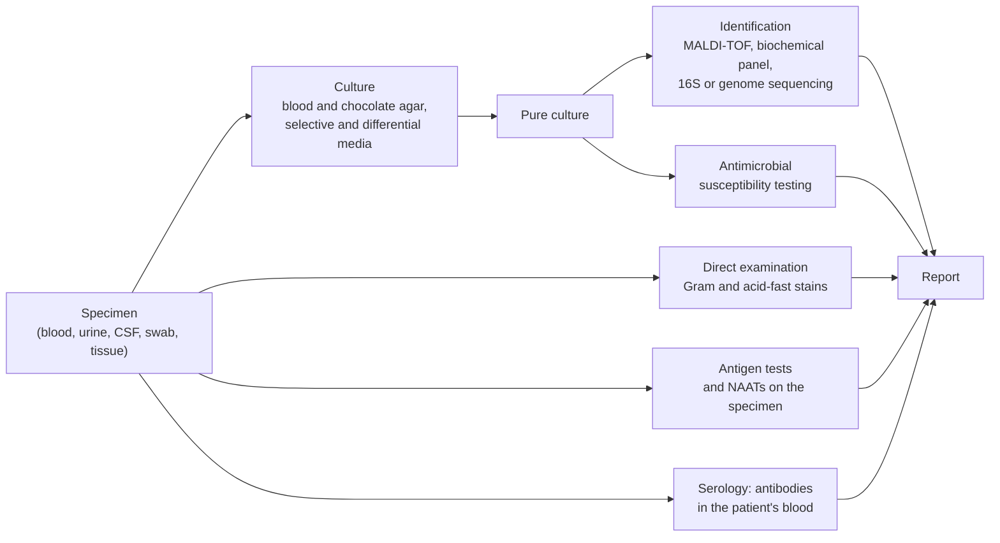

A microbiologist who isolates a bacterium from a patient, a soil sample or a fermenting vat must answer three questions: what is it, what is it related to, and what is it called? The answers belong to systematics. For plants and animals they rest on morphology, which is rich, and on the biological species concept, which works for sexual organisms. Bacteria and archaea have few morphological characters, reproduce asexually and exchange genes across species lines, so their systematics had to be rebuilt on molecular sequences, and it is still changing as genome sequences accumulate. This chapter treats the practice: how microbial populations evolve and how that shapes their genomes (Section 16.2), the molecular phylogeny of prokaryotes (Section 16.3), how prokaryotic species are delimited (Section 16.4), the methods of classification (Sections 16.5 and 16.6), the rules of naming (Section 16.7) and the identification of an isolate in the laboratory (Section 16.8). The tree of life, the three-domain and two-domain views and the origin of eukaryotes are treated in [7.10.2](/7.10.2), [7.10.27](/7.10.27) and [7.10.28](/7.10.28), the algorithms that build trees in [7.8.6](/7.8.6), and the sequence analysis of whole communities in [7.8.14](/7.8.14); here they are used, not repeated. The chapters that follow (7.11.17–7.11.21) survey the diversity that this framework organizes.

## 16.1. Systematics, Taxonomy and Identification

**Definition 16.1.1 (Systematics and Microbial Taxonomy)** **Systematics** is the study of the diversity of organisms and of the relationships among them; it links phylogeny with taxonomy. **Microbial taxonomy** is the science of characterizing, naming and arranging microorganisms in groups, and has three interrelated parts: **classification**, the arrangement of organisms into groups (taxa) on the basis of similarity or evolutionary relationship; **nomenclature**, the assignment of names to the taxa according to rules; and **identification**, the characterization of an isolate to decide to which established taxon it belongs.

The three parts serve different users. A clinical laboratory wants identification, fast: a few tests that separate the organisms that cause a given infection, and the name that tells the physician which drugs will work. A taxonomist describing a new species wants classification, a place in the phylogeny; nomenclature makes both communicable. Identification presupposes classification, since an isolate can only be assigned to taxa that have been defined, and the tests used for identification are chosen because they separate those taxa.

The history of bacterial classification is a search for characters that reflect relationship. In the 1870s Ferdinand Cohn grouped bacteria by shape, which proved too coarse; early in the twentieth century Sigurd Orla-Jensen used physiological properties, which gave conflicting groupings depending on the traits chosen. In the 1930s Albert Kluyver and Cornelis van Niel aimed at a natural, evolutionary classification but had no way to distinguish resemblance from relatedness. Classifications by phenotype therefore remained artificial, useful for identification but silent about evolution, until Carl Woese and George Fox compared ribosomal RNA sequences in 1977 ([7.10.27](/7.10.27#sec-27.4)); the succession of kingdom and domain systems is summarized in [7.10.2](/7.10.2#sec-2.7.3).

Before molecular data, the most systematic attempt to make phenotypic classification objective was *numerical taxonomy* (phenetics; Sneath and Sokal, 1960s), which scores many characters, gives them equal weight, computes the similarity of every pair of strains and clusters the strains by overall similarity.

**Formula 16.1.1 (Similarity Coefficients)** For two strains scored for $n$ binary characters, let $a$ be the number of characters positive in both, $d$ negative in both, and $b$, $c$ the numbers positive in only one of them ($a + b + c + d = n$). The *simple matching coefficient* and the *Jaccard coefficient* are

$$
S_{\mathrm{SM}} = \frac{a + d}{n}, \qquad S_{\mathrm{J}} = \frac{a}{a + b + c};
$$
the Jaccard coefficient ignores shared negatives, which may only reflect a common absence of information.

The matrix of similarities is clustered, usually by **UPGMA** ([7.8.6](/7.8.6#sec-6.3.2)), into a **dendrogram** (phenogram) in which strains joined above a chosen level, often 80 %, form a "phenon". Numerical taxonomy made classification reproducible, and its similarity matrices and clustering survive in genome-based methods, but a phenogram of phenotypes is not a phylogeny: similar phenotypes can evolve independently, and a single mutation can abolish a trait such as lactose fermentation.

## 16.2. Microbial Evolution

### 16.2.1. Variation, Selection and Drift in Microbial Populations

The forces of evolution are the same in microorganisms as in plants and animals (7.10.4–7.10.7): **mutation** and recombination create variation, **natural selection** and **genetic drift** change allele frequencies. Three features of bacteria and archaea give them a particular character. They are usually haploid, so every mutation is exposed to selection at once. They reproduce asexually, so a beneficial mutation drags its whole genome with it; recombination occurs only by **horizontal gene transfer**, which is one-way, piecemeal and uncoupled from reproduction (7.11.13). And their populations are huge, with generation times of hours, so evolution can be watched in the laboratory.

Two experiments show selection acting on standing and new variation. The purple bacterium *Rhodobacter capsulatus* makes bacteriochlorophyll and carotenoids whenever oxygen is absent, in the light or in the dark. Serially subcultured in the dark, where the pigments are useless, it is soon taken over by pigment-deficient mutants, which save the cost of making them; in the light the same mutations arise at the same rate but are eliminated (Madigan and colleagues 1982). Loss of unneeded functions is a common outcome of microbial evolution. In the long-term evolution experiment begun by Richard Lenski in 1988, twelve populations of *Escherichia coli* from one ancestor have been transferred daily in a glucose-limited minimal medium for tens of thousands of generations; their fitness relative to the frozen ancestor rose rapidly at first and has kept rising more slowly ([7.10.5](/7.10.5#sec-5.1.1), [7.6.39](/7.6.39#sec-39.5)). After about 31 500 generations one population evolved the ability to grow aerobically on citrate, which was present in the medium as a buffer and whose aerobic use had been a diagnostic trait separating *E. coli* from other enteric bacteria. Only one of the twelve populations did so: the trait required a rare combination of mutations. Genetic drift matters as well, especially in pathogens, where each new infection is founded by a few cells, a repeated population bottleneck.

### 16.2.2. Dynamic Genomes

Genome sequencing of several strains of one species showed how fluid prokaryotic genomes are. Genomes of *E. coli* contain on average about 4700 genes (individual strains from about 4100 to 5400), but only about 2000 of them are present in all strains; the remaining genes, together with the shared ones, make up a **pangenome** that grows with every new genome sequenced (Touchon and colleagues 2009, for 20 strains, found about 17 800 gene families). The shared genes form the **core genome**, the rest the **accessory genome** ([7.10.27](/7.10.27#sec-27.6.3)). Accessory genes are gained by horizontal transfer, often as **genomic islands**, and lost by deletion, which in bacteria is more frequent than insertion; selection keeps the genes that pay their way. Gene loss can even be favored when other members of a community supply a function, such as detoxification of hydrogen peroxide, as a shared good (the Black Queen hypothesis of Morris, Lenski and Zinser), which is one reason why many organisms grow only in co-culture. Two consequences matter for systematics: a species is a set of genomes with a common core rather than a fixed gene list, and a tree built from one gene may not be the tree of the organisms (Section 16.3.2).

### 16.2.3. Speciation Takes a Long Time

New traits can evolve in weeks, but divergence into species is slow. Using a **molecular clock** ([7.10.2](/7.10.2#sec-2.6.2), [7.10.24](/7.10.24)) calibrated with obligate endosymbionts of insects, whose hosts have a fossil record, the 16S rRNA gene of bacteria diverges at roughly 1 % per 50 million years (Ochman and Wilson 1987). On this calibration *E. coli* and *Salmonella enterica* diverged some 100–140 million years ago, and the harmless *E. coli* K-12 and the enterohemorrhagic O157:H7 a few million years ago. The clock is rough, because rates differ among lineages, but it shows that a bacterial species is an old entity, and that the large phenotypic differences between strains of one species, pathogenic or not, come mainly from accessory genes rather than from long divergence.

## 16.3. Molecular Phylogeny of Microorganisms

### 16.3.1. Ribosomal RNA as a Molecular Chronometer

**Definition 16.3.1 (16S rRNA Gene)** The **16S rRNA gene** is the gene for the RNA of the small ribosomal subunit of bacteria and archaea (about 1500 nucleotides; 1542 in *E. coli*); its eukaryotic counterpart is the 18S rRNA gene. Both are called small-subunit (SSU) rRNA genes.

Woese chose the SSU rRNA as the measure of relationship for reasons that still hold:

- it is present in every cell, including mitochondria and plastids, and has the same function in all;
- its function constrains it, so it changes slowly, but not uniformly: conserved regions alternate with nine variable regions V1–V9 ([7.8.14](/7.8.14#sec-14.1.2), with figure), so that the conserved positions resolve deep branches and the variable ones recent divergences;
- it is long enough to contain many informative positions but short enough to sequence, and universal primers in the conserved regions amplify it from almost any organism;
- it is rarely transferred horizontally, because it must work with the many proteins of the ribosome, so its tree largely agrees with trees of other information-processing genes.

Its limitations follow from the same properties. Slow evolution means poor resolution among close relatives (Section 16.4.3). Genomes carry 1 to about 15 copies of the rRNA operon, which can differ slightly within one genome. And rare transfers and recombination between rRNA genes do occur. The 16S sequences of mitochondria and chloroplasts place their ancestors among the alphaproteobacteria and cyanobacteria ([7.10.28](/7.10.28)).

### 16.3.2. From Sequences to Trees

A molecular phylogeny of microorganisms starts from DNA of a culture, or from DNA extracted directly from a habitat, a gene amplified by PCR or a genome sequenced, and proceeds as for any organisms: homologous sequences, preferably **orthologs**, are aligned so that each column holds positions descended from a common ancestral position; a tree is inferred by distance methods (**neighbor joining**), parsimony, maximum likelihood or Bayesian inference, under a substitution model that corrects for multiple substitutions at a site; and the support of each branch is assessed by the **bootstrap** ([7.8.6](/7.8.6)). Two cautions are particular to prokaryotes. Very deep divergences saturate the sequences with recurrent substitutions (homoplasy), so the deepest branches of the tree of life are the hardest to resolve. And because of horizontal gene transfer, the tree of one gene is a hypothesis about that gene: an organismal phylogeny requires genes that are inherited vertically, which is why genome-based phylogenies concatenate dozens of conserved single-copy proteins (Section 16.6), and why the "tree of life" of prokaryotes describes the vertical history of cell lineages overlaid by gene exchange ([7.10.27](/7.10.27#sec-27.6.3)).

### 16.3.3. The Tree of Prokaryotes

SSU rRNA trees revealed the archaea and organized the bacteria into phyla, most of which do not correspond to any phenotypic group: gram-positive bacteria fall into two phyla, the **Bacillota** (formerly Firmicutes, low G + C) and the **Actinomycetota** (formerly Actinobacteria, high G + C); the gram-negative **Pseudomonadota** (formerly Proteobacteria) contain phototrophs, chemolithotrophs, nitrogen fixers and enteric bacteria. Sequencing 16S genes amplified from environmental DNA showed that most lineages have never been cultured (the **great plate count anomaly**, [7.11.4](/7.11.4#sec-4.5.4)), and genome-resolved metagenomics then added whole phyla known only from **metagenome-assembled genomes**. A tree of 16 concatenated ribosomal proteins from more than 3000 genomes (Hug and colleagues 2016) showed a large part of bacterial diversity in one radiation of organisms with small genomes.

**Definition 16.3.2 (Candidate Phyla Radiation)** The **candidate phyla radiation** (CPR) is a large, monophyletic radiation of bacteria known almost entirely from metagenomes, comprising dozens of candidate phyla with very small cells, reduced genomes (often below $1\,\mathrm{Mb}$) and incomplete biosynthetic pathways; most are thought to live attached to and dependent on other bacteria. In the Genome Taxonomy Database the radiation is treated as a single phylum, Patescibacteria.

The CPR illustrates why classification of prokaryotes moved from single genes to genomes: many CPR bacteria have unusual rRNA genes with introns and insertions that escape standard primers, and their placement depends on the set of genes analyzed.

## 16.4. Species of Prokaryotes

### 16.4.1. The Problem

The **biological species concept** ([7.10.11](/7.10.11#sec-11.1.1)) defines species by reproductive isolation and cannot be applied to organisms without sex. Microbiologists have instead used a pragmatic definition, often called a **phylogenetic species concept**, which rests on measurable similarity rather than on a model of speciation; whether prokaryotic species are also natural units of evolution is a separate question ([7.10.27](/7.10.27#sec-27.6.4), Section 16.4.5).

**Definition 16.4.1 (Prokaryotic Species and Strain)** In current practice a prokaryotic species is a monophyletic group of **strains** that are genomically coherent, sharing a high degree of similarity in many independent traits and genes, and that differ from other such groups; it is delimited operationally by genome similarity (Sections 16.4.2–16.4.4) together with diagnostic phenotypic properties. A **strain** is a population of cells descended from a single isolate (in practice a pure culture) and distinguishable from other isolates of the species by some property, from a single phenotypic or genetic marker to its genome sequence.

Strains are named by designations such as *E. coli* K-12 or *Bacillus subtilis* 168; a species usually has many, and one of them is its type (Section 16.7.2). Over the past decades the thresholds used to delimit species have moved from the chemistry of DNA reassociation to genome sequences, and they have been calibrated against one another.

### 16.4.2. DNA–DNA Hybridization

**Definition 16.4.2 (DNA–DNA Hybridization)** **DNA–DNA hybridization** (DDH) measures the overall similarity of two genomes by the extent to which single-stranded, sheared DNA of one strain (labeled) reassociates with that of another, relative to its reassociation with itself (100 %). Strains with DDH values of 70 % or more, and a difference of at most $5\,^\circ\mathrm{C}$ in the **melting temperature** of the heteroduplex compared with the homoduplex, are considered the same species (Wayne and colleagues 1987).

DDH was the "gold standard" of species delimitation for 30 years. It is laborious, imprecise (errors of several percentage points), possible only between cultured strains and not cumulative: every new strain must be hybridized against every reference. It also showed how broad bacterial species are. *Escherichia coli* and the four "species" of *Shigella* have DDH values above 70 % and are one genomic species, kept apart in name for medical reasons; by the same criterion, human and chimpanzee DNA, which reassociate almost completely, would be one species.

### 16.4.3. 16S rRNA Gene Identity

Because 16S sequences are easy to obtain and cumulative in databases, their identity became the first screen for new species. Comparisons with DDH showed an asymmetric relation. Strains whose 16S genes differ by more than about 3 % never had 70 % DDH, so 97 % identity was proposed as a boundary (Stackebrandt and Goebel 1994); with more data the boundary was raised to 98.7–99 % (Stackebrandt and Ebers 2006; 98.65 % in a genome-based calibration by Kim and colleagues 2014). Below this value two strains are almost certainly different species. Above it they may be either: many well-separated species share nearly identical 16S genes, for instance *Bacillus anthracis*, *B. cereus* and *B. thuringiensis*, or *Streptococcus pneumoniae* and *S. mitis*. 16S identity is thus a necessary condition, not a sufficient one, for membership in a species, and genus boundaries are equally rough: a survey of type strains found that genera are usually separated by less than about 94.5 % identity (Yarza and colleagues 2014). Operational taxonomic units of 97 % in community surveys ([7.8.14](/7.8.14#sec-14.2.1)) are therefore not species.

### 16.4.4. Genome-Based Measures

**Definition 16.4.3 (Average Nucleotide Identity)** The **average nucleotide identity** (ANI) of two genomes is the mean nucleotide identity of the regions they share. In the original method (Goris and colleagues 2007), the query genome is cut into fragments of $1020\,\mathrm{nt}$, each fragment is aligned with the reference genome, fragments that align over at least 70 % of their length with at least 30 % identity are kept, and ANI is the mean identity of these matches; faster tools replace the alignments by $k$-mer-based approximate mapping (FastANI). The *alignment fraction*, the proportion of the genomes that is shared, is reported with it. Strains of one species have ANI of at least about 95–96 %.

ANI of 95–96 % corresponds to 70 % DDH (Goris and colleagues 2007; Richter and Rosselló-Móra 2009). It is precise, reproducible and computed from public sequences, including those of uncultured organisms. A comparison of about 90 000 genomes by k-mer-based ANI (Jain and colleagues 2018) found that almost all pairs of genomes have ANI either above 95 % or below about 83 %: the distribution has a gap at the species boundary, which suggests that species are real clusters of genomes rather than arbitrary cuts along a continuum (figure).

![Operational species boundaries for prokaryotes, illustrated with simulated pairs of genomes. Genome-wide identity and 16S rRNA gene identity both decline with divergence, the 16S gene about four times more slowly and with variation among lineages and sampling error over its 1500 nucleotides; pairs within a species are close, pairs from different species of related genera distant, as in real genome surveys. A: ANI against 16S identity. Pairs below 98.7 % 16S identity (dashed vertical line) are always different species, but above it pairs of the same species (blue) and of different species (red) both occur; only ANI separates them at about 95 % (dashed horizontal line). B: the distribution of ANI over all pairs has few values between about 83 and 95 %, the gap found among real genomes by Jain et al. (2018).](./plots/species-thresholds.py)

**Definition 16.4.4 (Digital DNA–DNA Hybridization)** **Digital DNA–DNA hybridization** (dDDH) estimates DDH from two genome sequences: the genomes are aligned into high-scoring segment pairs (HSPs), a distance such as $d = 1 - (\text{identical base pairs})/(\text{total HSP length})$ is computed, and a regression calibrated on wet-lab DDH data converts it into a DDH estimate with a confidence interval (the Genome-to-Genome Distance Calculator; Meier-Kolthoff and colleagues 2013). The species boundary is 70 % dDDH.

ANI and dDDH carry the same information in different units; for genera and higher ranks, where nucleotide identity saturates, comparisons use the *average amino acid identity* (AAI) of shared proteins or phylogenies of concatenated proteins (Section 16.6). Proposed minimal standards for the use of genome data in prokaryotic taxonomy (Chun and colleagues 2018) adopt ANI of 95–96 % and dDDH of 70 % as species boundaries and recommend that a new species be described with the genome sequence of its type strain, a 16S identity below 98.7 % to all described species being sufficient to skip the genome comparison. The G + C content of the genome adds a simple check: strains of one species differ by at most about one percentage point (Meier-Kolthoff and colleagues 2014).

### 16.4.5. Ecotypes and the Evolutionary Meaning of Species

If species are clusters, what holds them together? One answer, developed by Frederick Cohan, is ecological.

**Definition 16.4.5 (Ecotype)** In microbial evolution, an **ecotype** is a population of cells that occupy the same ecological niche, so that an adaptive mutant arising in it outcompetes and replaces the other members of the population but not the cells of other ecotypes. The replacement, which purges the genetic diversity of an ecotype genome-wide, is called *periodic selection*.

In this model periodic selection keeps each ecotype genetically homogeneous while ecotypes diverge, so that ecotypes rather than named species are the fundamental units; one named species may contain several. The marine cyanobacterium *Prochlorococcus* is an example: its high-light and low-light ecotypes occupy different depths of the ocean and differ in light-harvesting physiology although their 16S genes differ by less than 3 %. The alternative view emphasizes homologous recombination, which in many species is frequent enough to spread alleles among strains and to keep a species cohesive as long as its members are similar enough to recombine; recombination declines steeply with sequence divergence, which could explain why the ANI gap lies near 95 %. The two mechanisms are not exclusive, and their relative weight differs among species ([7.10.27](/7.10.27#sec-27.6.4)).

### 16.4.6. Below the Species: Typing Strains

Epidemiology, food safety and forensics need to distinguish strains within a species, for instance to tell whether infections in several cities come from one source. Traditional typing methods use phenotypes; current methods use sequences.

| Method | Basis | Designation | Note |
|---|---|---|---|
| Biochemical typing | pattern of biochemical reactions | *biovar* (biotype) | *Vibrio cholerae* biovar El Tor, cause of the seventh cholera pandemic since 1961 |
| Serotyping | antigens of LPS (O), flagella (H), capsule (K) | *serovar* (serotype) | *E. coli* O157:H7; the more than 2500 serovars of *Salmonella enterica* |
| Phage typing | lysis pattern by a set of phages | phage type | largely replaced by molecular typing |
| Antibiogram | susceptibility to a panel of antimicrobial drugs | resistance profile | cheap, but resistance genes move between strains |
| Restriction fragment patterns | **restriction fragment length polymorphism** of the genome (pulsed-field gel electrophoresis), or of rRNA operons (*ribotyping*) | pattern | PFGE was the basis of the PulseNet surveillance network for foodborne disease until it moved to genome sequencing |
| PCR fingerprints | rep-PCR (between repetitive elements), AFLP | band pattern | rapid, laboratory-specific |
| MLST | sequences of housekeeping genes | sequence type | Definition 16.4.6 |
| Genome sequencing | core-genome MLST, SNP distances | cgMLST type, SNP cluster | highest resolution; outbreak isolates differ by few SNPs |

**Definition 16.4.6 (Multilocus Sequence Typing)** **Multilocus sequence typing** (MLST) characterizes a strain by the sequences of internal fragments (about $450$–$500\,\mathrm{bp}$) of several, usually seven, chromosomal **housekeeping genes**. Each distinct sequence of a gene is an allele and receives a number; the combination of allele numbers is the allelic profile, and each profile is a *sequence type* (ST). Related sequence types that share most alleles form clonal complexes.

MLST (Maiden and colleagues 1998, for *Neisseria meningitidis*) made typing portable: allele numbers are exchanged between laboratories through public databases instead of gel images. A related approach, *multilocus sequence analysis* (MLSA), concatenates the sequences of several protein-coding genes (such as *gyrB*, *recA* and *rpoB*), which evolve faster than rRNA genes, and builds a phylogeny from them; it resolves closely related species that a 16S tree cannot separate, such as the luminous species of *Photobacterium*. Core-genome MLST extends the scheme to the roughly 1000–3000 genes of a species' core genome and is the current standard for outbreak investigation.

## 16.5. Phenotypic and Chemotaxonomic Methods

### 16.5.1. Phenotypic Characters

Genomes delimit species, but a species is described, and usually identified, by its phenotype. The characters routinely determined for a new isolate are:

| Category | Characters |
|---|---|
| Morphology | cell shape, size and arrangement; Gram reaction; flagellation; **endospores**; inclusions (PHB, polyphosphate, gas vesicles, magnetosomes); capsule, S-layer; stalks, appendages; colony morphology and pigment |
| Motility | swimming, swarming, gliding, buoyancy by gas vesicles |
| Metabolism | energy source (phototroph, chemoorganotroph, chemolithotroph); carbon, nitrogen and sulfur sources; fermentation of sugars; nitrogen fixation; growth factors |
| Physiology | temperature, pH and salt ranges; relation to oxygen; **catalase** and oxidase; extracellular enzymes |
| Chemotaxonomy | fatty acids, polar lipids, respiratory quinones, cell-wall composition, G + C content |
| Other | antibiotic susceptibility, serotype, pigments, luminescence, characteristic products |

Phenotypes depend on growth conditions, so they are determined under standardized conditions and compared with data for type strains obtained under the same conditions.

### 16.5.2. Chemotaxonomy

*Chemotaxonomy* uses the chemical composition of cells as taxonomic characters. Its markers are products of many genes and are therefore more stable than single enzyme activities.

- *Cellular fatty acids.* Bacteria contain more than 200 kinds of **fatty acids**, differing in chain length, double bonds, cyclopropane rings, methyl branches (iso and anteiso) and hydroxyl groups. In *fatty acid methyl ester* (FAME) analysis, lipids from cells grown on a standard medium at a standard temperature are saponified and methylated, and the methyl esters are separated by **gas chromatography**; the profile is compared with a database of reference strains grown in the same way. Branched-chain fatty acids are typical of many gram-positive bacteria, hydroxy fatty acids of the lipid A of gram-negative bacteria; archaea have no fatty-acid lipids at all ([7.11.2](/7.11.2#sec-2.2.2)).
- *Respiratory quinones.* The type and chain length of **quinones**: ubiquinones (Q-8 in *E. coli*) in alpha-, beta- and gammaproteobacteria, menaquinones of characteristic lengths (MK-7, MK-9 and so on) in gram-positive bacteria and many other groups.
- *Polar lipids* and, in mycobacteria and their relatives, **mycolic acids**.
- *Cell-wall chemistry.* Presence of **peptidoglycan**, the diamino acid at position 3 of the peptide (meso-diaminopimelic acid in gram-negative bacteria and *Bacillus*, L-lysine in most cocci) and the interbridge ([7.11.2](/7.11.2#sec-2.3.1)); teichoic acids; in archaea pseudomurein or S-layers.

**Definition 16.5.1 (G + C Content)** The *G + C content* of a genome is the percentage of its base pairs that are G·C pairs (mol% G + C). Among bacteria it ranges from below 20 % in some insect endosymbionts to about 75 %; it is constant within narrow limits in a species.

Before genome sequencing the G + C content was measured from the melting temperature of DNA, because G·C pairs, with three hydrogen bonds and stronger stacking, raise the temperature at which the double helix denatures ([7.1.11](/7.1.11)).

**Formula 16.5.1 (Marmur–Doty Relation)** In standard saline citrate ($0.15\,\mathrm{M}$ NaCl, $0.015\,\mathrm{M}$ sodium citrate), the melting temperature of DNA is

$$
T_{\mathrm{m}}/{}^\circ\mathrm{C} = 69.3 + 0.41\,(\mathrm{G} + \mathrm{C}),
$$
with G + C in mol%. DNA of 50 % G + C melts at about $90\,^\circ\mathrm{C}$.

The G + C content is an exclusion criterion only: strains whose G + C contents differ by more than a few percentage points cannot be closely related, but equal values say nothing, since unrelated genomes can have the same composition. It remains useful as a descriptive trait, as in the old names "low-G + C" and "high-G + C" gram-positive bacteria.

### 16.5.3. Polyphasic Taxonomy

**Definition 16.5.2 (Polyphasic Taxonomy)** **Polyphasic taxonomy** is the practice of classifying and describing prokaryotes by integrating phenotypic, chemotaxonomic, genotypic and phylogenetic information, so that a taxon is supported by several independent kinds of evidence (the term is due to Rita Colwell, 1970).

A typical description of a new species proceeds in three steps. The 16S rRNA gene (or, increasingly, the genome) places the isolate in a genus and identifies its closest described relatives. The genome is compared with the genomes of their type strains by ANI and dDDH, which decides whether the isolate is a new species. Phenotypic and chemotaxonomic properties are then determined to describe the species and to find the traits that distinguish it from its relatives, which will be used for its identification. Genomics has shifted the weight from phenotype to sequence, but not removed phenotype: a species is named so that others can recognize it, and its biology is what makes it worth naming.

## 16.6. Genome-Based Classification

Phylogenies of concatenated proteins from thousands of genomes made it possible to classify all prokaryotes, cultured or not, by a single explicit procedure. The most comprehensive result is the Genome Taxonomy Database.

**Definition 16.6.1 (Genome Taxonomy Database)** The *Genome Taxonomy Database* (GTDB; Parks and colleagues 2018) is a classification of bacteria and archaea based on phylogenies of concatenated conserved single-copy proteins (120 for bacteria; 53 for archaea in current releases) from genomes of cultured strains and from metagenome-assembled and single-cell genomes. Taxa are required to be monophyletic; ranks are normalized by relative evolutionary divergence; species are clusters of genomes with ANI of at least 95 % to a representative genome, preferably that of the type strain.

Rates of evolution differ among lineages, so the depth of a node in a phylogram is not a measure of rank. GTDB rescales depths so that every lineage runs from 0 at the root to 1 at its tips.

**Formula 16.6.1 (Relative Evolutionary Divergence)** In a rooted tree, the root has $\mathrm{RED} = 0$ and every tip $\mathrm{RED} = 1$. For an internal node $n$ with parent $p$,

$$
\mathrm{RED}(n) = \mathrm{RED}(p) + \frac{d}{u}\bigl(1 - \mathrm{RED}(p)\bigr),
$$
where $d$ is the length of the branch from $p$ to $n$ and $u$ is $d$ plus the mean distance from $n$ to the tips below it. Taxa of the same rank are delimited so that their RED values fall in a narrow interval around the median for that rank.

GTDB confirmed much of the existing classification but changed a great deal. Polyphyletic genera were split (with alphabetical suffixes, as in *Clostridium* and *Clostridium*_A until new names are proposed), the former Deltaproteobacteria were divided into several phyla, the Epsilonproteobacteria became the phylum Campylobacterota, and ranks were equalized: many former classes became phyla and the reverse. Uncultured lineages receive placeholder names of letters and numbers. GTDB is not a nomenclatural authority, but its taxonomy is used in most metagenomic studies ([7.8.14](/7.8.14#sec-14.3.4)), and many of its proposals have been adopted in valid names.

## 16.7. Nomenclature

### 16.7.1. Names and Ranks

**Definition 16.7.1 (Binomial Nomenclature)** **Binomial nomenclature**, introduced by Linnaeus, names each species with two Latin or latinized words: the name of the genus, capitalized, and the specific epithet, lowercase, both printed in italics (*Escherichia coli*). Names of higher taxa are single capitalized words in roman type.

The ranks used for prokaryotes, with the endings prescribed for them, are illustrated by *E. coli*:

| Rank | Ending | Example |
|---|---|---|
| Domain | | Bacteria |
| Phylum | -ota | Pseudomonadota |
| Class | | Gammaproteobacteria |
| Order | -ales | Enterobacterales |
| Family | -aceae | Enterobacteriaceae |
| Genus | | *Escherichia* |
| Species | | *Escherichia coli* |

Below the species, subspecies are named formally (*Salmonella enterica* subsp. *enterica*); strains, biovars, serovars and pathovars are informal designations. In writing, the full name is used at first mention and the genus abbreviated thereafter (*E. coli*); "sp." denotes an unidentified species of a genus (*Clostridium* sp. strain X), "spp." several species. After a name change the former name may be given in parentheses for a time, as in *Lactococcus* (*Streptococcus*) *lactis*. Many groups are also referred to informally by traits that do not define taxa: lactic acid bacteria, sulfate reducers, endospore formers, coliforms.

Names come from four main sources. Some honor people: *Escherichia* (Theodor Escherich), *Listeria* (Joseph Lister), *Yersinia pestis* (Alexandre Yersin), *Salmonella* (Daniel Salmon). Some describe the organism: *Staphylococcus aureus* (golden grape-like clusters of spheres), *Streptococcus* (twisted chains), *Helicobacter pylori* (a helical rod of the pylorus). Some name places: *Francisella tularensis* (Tulare County, California), *Mycobacterium genavense* (Geneva). Some name institutions or events: *Legionella pneumophila*, from the 1976 outbreak at a convention of the American Legion; *Afipia felis*, from the Armed Forces Institute of Pathology.

### 16.7.2. The Code, Types and Valid Names

**Definition 16.7.2 (International Code of Nomenclature of Prokaryotes)** The *International Code of Nomenclature of Prokaryotes* (ICNP, formerly the Bacteriological Code) is the set of rules that governs the scientific names of bacteria and archaea, overseen by the International Committee on Systematics of Prokaryotes. Its principles include priority (the earliest validly published name of a taxon is the correct one), the typification of every name, and the requirement of valid publication.

The starting date of prokaryotic nomenclature is 1 January 1980, when the Approved Lists of Bacterial Names were published: names on the lists kept their standing, all other older names lost it. Since then a name is validly published when it appears, with a description and the designation of a type, in the *International Journal of Systematic and Evolutionary Microbiology* (IJSEM), either in an original article or in a Validation List after effective publication elsewhere. Valid names are compiled in the List of Prokaryotic Names with Standing in Nomenclature (LPSN).

**Definition 16.7.3 (Type Strain)** The **type strain** of a species is the strain designated in the original description as the permanent reference for the name: the name applies to whatever species the type strain belongs to. For a name to be validly published, cultures of the type strain must be deposited in at least two public culture collections in two different countries, from which they are available without restriction. The type of a genus is a type species, and the type of a higher taxon its type genus.

Culture collections such as the ATCC (United States), DSMZ (Germany), JCM (Japan), NCIMB (United Kingdom), CIP (France) and CGMCC (China) keep strains alive, frozen or freeze-dried, so that every later study can compare its isolates with the same organism, as museums preserve the type specimens of animals and plants ([7.10.2](/7.10.2#sec-2.7.1)). In the descriptions and trees of taxonomic papers, type strains are marked with a superscript T (*E. coli* ATCC $11775^{\mathrm{T}}$).

Organisms that cannot be cultured, or not in pure culture, cannot be deposited and therefore cannot receive valid names under the ICNP.

**Definition 16.7.4 (Candidatus)** *Candidatus* is a provisional status for a well-characterized prokaryote, described from its sequence and other properties, that has not been obtained in pure culture and therefore cannot be validly named. The word *Candidatus* is italicized and the name that follows is in roman type, usually in quotation marks: "*Candidatus* Pelagibacter ubique", "*Ca.* Brocadia anammoxidans".

The gap between the uncultured majority and the culturable minority led to a second code, the SeqCode (2022), under which names can be validly published with a genome sequence as the type, so that metagenome-assembled genomes of sufficient quality can receive permanent names. The two codes coexist.

### 16.7.3. The Phylum Names of 2021

Until 2021 the ICNP did not regulate names above the rank of class, and phylum names such as Proteobacteria, Firmicutes and Actinobacteria were in use without standing. When the rank of phylum was brought under the Code, phylum names were required to be formed from the name of a type genus with the ending -ota, and in 2021 the names of 42 phyla were validly published on this basis (Oren and Garrity 2021). The new names replace the old ones; this wiki uses them throughout, giving the former name at first mention.

| Former name | Valid name (2021) | Type genus |
|---|---|---|
| Proteobacteria | **Pseudomonadota** | *Pseudomonas* |
| Firmicutes | **Bacillota** | *Bacillus* |
| Actinobacteria | **Actinomycetota** | *Actinomyces* |
| Bacteroidetes | **Bacteroidota** | *Bacteroides* |
| Crenarchaeota | Thermoproteota | *Thermoproteus* |
| Thaumarchaeota | **Nitrososphaerota** | *Nitrososphaera* |

The class names, such as Gammaproteobacteria, were not changed. Viruses have their own code, maintained by the International Committee on Taxonomy of Viruses (ICTV), which since 2021 also requires binomial species names (7.11.26).

### 16.7.4. Bergey's Manual

**Definition 16.7.5 (Bergey's Manual)** **Bergey's Manual** is the standard reference work describing all recognized taxa of bacteria and archaea, first published in 1923 as *Bergey's Manual of Determinative Bacteriology*, an identification manual. Its second branch, *Bergey's Manual of Systematic Bacteriology* (second edition in five volumes, 2001–2012), arranges the taxa phylogenetically; since 2015 it has been continued online as *Bergey's Manual of Systematics of Archaea and Bacteria*.

There is no "official" classification of prokaryotes: names are regulated by the Code, but the classification, the arrangement of taxa, is a matter of scientific judgment, and Bergey's Manual, GTDB and the NCBI taxonomy differ in places.

## 16.8. Identification

### 16.8.1. Strategy

Identification compares the properties of an isolate with those of described taxa. In a diagnostic laboratory it is guided by the specimen and the symptoms: urine from a patient with a urinary tract infection is examined for the few organisms that cause it, not for every possible bacterium. Most procedures begin with a pure culture ([7.11.1](/7.11.1#sec-1.4)), and proceed from quick, general characters to specific ones: microscopy and staining, growth on primary media, biochemical or protein-profile identification, and, when needed, nucleic-acid methods.

### 16.8.2. Microscopy and Culture

The **Gram stain** and the **acid-fast stain** ([7.11.2](/7.11.2#sec-2.5)), with cell shape and arrangement, narrow the possibilities within minutes and sometimes suffice for a presumptive diagnosis. Gram-positive diplococci with many neutrophils in sputum suggest *Streptococcus pneumoniae*; gram-negative diplococci inside neutrophils in a urethral discharge from a man are diagnostic of gonorrhea, since *Neisseria gonorrhoeae* is the only such organism found there; acid-fast rods in sputum indicate mycobacteria. Microscopy cannot separate many pathogens from harmless relatives: *Streptococcus pyogenes* looks like the streptococci of the normal throat, and *Salmonella* like *E. coli*.

Growth on primary media adds colony characters: pigments (red colonies of *Serratia marcescens* at room temperature; the diffusible green pigment and grape-like odor of *Pseudomonas aeruginosa*), hemolysis on blood agar, and the reactions on media that are at once a **selective medium** and a **differential medium**, such as MacConkey agar, on which lactose-fermenting *E. coli*, the commonest cause of urinary tract infections, forms pink colonies ([7.11.4](/7.11.4#sec-4.4.2)).

### 16.8.3. Biochemical Tests

Most biochemical tests detect an enzyme or a pathway with an indicator that changes color. A few detect enzymes already present in a colony and take seconds; most require growth for 18–48 h.

| Test | Principle | Positive reaction | Typical use |
|---|---|---|---|
| **Catalase** | $\ce{2H2O2 -> 2H2O + O2}$ | bubbles when $\ce{H2O2}$ is added to cells | staphylococci (+) versus streptococci and enterococci (–) |
| Oxidase | cytochrome $c$ oxidase oxidizes a redox dye (tetramethyl-$p$-phenylenediamine) | dark purple within seconds | *Pseudomonas*, *Neisseria*, *Vibrio* (+) versus Enterobacterales (–) |
| Sugar fermentation | acid (and gas) from a sugar | pH indicator changes; gas in an inverted Durham tube | species of Enterobacterales, streptococci |
| Methyl red (MR) | mixed-acid fermentation keeps the pH below about 4.4 | red with methyl red | *E. coli* (+) |
| Voges–Proskauer (VP) | acetoin, intermediate of the butanediol fermentation ([7.11.5](/7.11.5)) | red after adding α-naphthol and KOH | *Klebsiella*, *Enterobacter* (+) |
| Indole | tryptophanase: tryptophan → indole + pyruvate + $\ce{NH3}$ | red with Kovács reagent | *E. coli* (+) |
| Citrate | growth on citrate as sole carbon source | growth, indicator turns blue | *Klebsiella*, *Salmonella* (+), *E. coli* (–) |
| Urease | $\ce{CO(NH2)2 + H2O -> 2NH3 + CO2}$ | pH rises, indicator turns pink | *Proteus*, *Helicobacter pylori* (+) |
| $\ce{H2S}$ production | reduction of thiosulfate or degradation of cysteine | black iron sulfide | *Salmonella*, *Proteus* (+) |
| Lysine decarboxylase | lysine → cadaverine + $\ce{CO2}$ | pH rises | *Salmonella*, *E. coli* (+) |
| Coagulase | clotting of plasma | clot | *Staphylococcus aureus* (+) |

The indole, MR, VP and citrate tests together (IMViC) separate the coliforms: *E. coli* is typically + + – –, *Klebsiella* and *Enterobacter* – – + +. Some tests can be done without culture. *Helicobacter pylori*, which colonizes the stomach and causes most peptic ulcers, has a highly active urease; in the urea breath test the patient drinks urea labeled with $^{13}\mathrm{C}$ (or $^{14}\mathrm{C}$), and labeled $\ce{CO2}$ appears in the breath within about half an hour if the bacterium is present, which avoids a gastric biopsy.

**Definition 16.8.1 (Dichotomous Key)** A *dichotomous key* is an identification scheme made of successive couplets, each offering two mutually exclusive alternatives, usually the outcomes of one test, that lead either to the next couplet or to a name.

![A dichotomous key for common bacterial causes of urinary tract infection. The Gram stain separates gram-positive cocci from gram-negative rods. Among the cocci, catalase-negative isolates are enterococci (such as *Enterococcus faecalis*); catalase-positive staphylococci are divided by the coagulase test into *Staphylococcus aureus* and coagulase-negative staphylococci, among which *S. saprophyticus* causes urinary infections in young women. Among the rods, oxidase-positive isolates point to *Pseudomonas aeruginosa*; oxidase-negative Enterobacterales that ferment lactose are *Escherichia coli* or another coliform such as *Klebsiella*, and non-fermenters include *Proteus*, which is urease-positive and swarms over agar. The leaves (green) are presumptive identifications to be confirmed.](./plots/dichotomous-key.py)

A key that tests one character at a time is slow, since each step needs an incubation, and fragile, since a strain that has lost one enzyme is misrouted. Laboratories therefore inoculate many tests at once and compare the whole pattern with a table of the frequency of positive reactions in each taxon.

**Formula 16.8.1 (Probabilistic Identification)** Let $p_{ij}$ be the proportion of strains of taxon $j$ that are positive in test $i$ (limited to $[0.01, 0.99]$), and let an isolate give results $x_i \in \{0, 1\}$ in $m$ independent tests. The likelihood of the result pattern under taxon $j$ and its normalized likelihood over the $k$ taxa considered (equal prior probabilities) are

$$
L_j = \prod_{i=1}^{m} p_{ij}^{\,x_i}\,(1 - p_{ij})^{1 - x_i}, \qquad
\pi_j = \frac{L_j}{\sum_{l=1}^{k} L_l}.
$$
An identification is accepted when $\pi_j$ for the best taxon exceeds a threshold (such as 99.9 % for a species) and the pattern is also typical of that taxon (its $L_j$ not too small).

This is the naive Bayes classifier of statistics ([7.8.14](/7.8.14#sec-14.2.4)) applied to biochemical tests, and it is how commercial systems turn a test pattern into a "percentage identification".

![Probabilistic identification from eight biochemical tests. A: percentages of positive strains for five species of Enterobacterales (rounded typical values; illustrative, not a reference table) and, in the bottom row, the results of an unknown isolate: indole negative, methyl red positive, Voges–Proskauer negative, citrate positive, urease negative, $\ce{H2S}$ positive, lactose negative and lysine decarboxylase positive. B: normalized likelihoods (Formula 16.8.1) on a logarithmic scale. *Salmonella enterica* accounts for more than 99.99 %; the next candidate, *Proteus mirabilis*, is excluded mainly by its lack of lysine decarboxylase and its urease.](./plots/probabilistic-id.py)

Miniaturized and automated systems implement this. The API 20E strip for Enterobacterales holds 20 microtubes of dehydrated substrates that are rehydrated with a suspension of the isolate; after overnight incubation the reactions, with the oxidase test, are grouped in threes, each triplet coded as the sum of 1, 2 and 4 for its positive tests, and the resulting seven-digit profile number is looked up in a database. Biolog plates test the oxidation of about 95 carbon sources at once, and automated instruments such as VITEK 2, which grew out of a 1970s NASA program to detect microbes in spacecraft, read reaction cards optically and give identifications, and susceptibility results, within hours.

Antibodies identify organisms by their surface antigens: Lancefield grouping of β-hemolytic streptococci by their cell-wall carbohydrate (group A is *S. pyogenes*), serotyping of *Salmonella* and *E. coli* by slide agglutination, and rapid **ELISA** and lateral-flow tests for antigens in specimens. Their immunological basis is treated in 7.15.

### 16.8.4. MALDI-TOF Mass Spectrometry

Since about 2010, mass spectrometry of whole cells has replaced biochemical tests for most routine identifications in clinical laboratories. A small amount of a colony is smeared on a steel target, often treated with formic acid, and covered with a matrix solution (commonly α-cyano-4-hydroxycinnamic acid). A laser pulse desorbs and ionizes the proteins (**matrix-assisted laser desorption/ionization**, [7.9.9](/7.9.9#sec-9.3.1)); the ions, mostly singly charged, are accelerated through a potential $U$ and their flight times through a tube are measured (**time-of-flight mass spectrometry**). From $zeU = \tfrac12 mv^2$, an ion of mass $m$ and charge $ze$ crossing a field-free tube of length $L$ arrives after

$$
t = L\sqrt{\frac{m}{2zeU}},
$$
so the spectrum of intensity against $m/z$ is obtained from the arrival times. The spectrum of a bacterium in the range $2$–$20\,\mathrm{kDa}$ is dominated by abundant, conserved small proteins, many of them ribosomal, and is therefore characteristic of the species; software compares the peak list with a database of reference spectra and reports a score (for the most widely used system, a score of at least 2.0 for an identification to species).

![MALDI-TOF identification. A: cells from a colony are spotted with matrix on a target; a laser pulse desorbs and ionizes their proteins, an electric field accelerates the ions, and they separate by mass in the field-free flight tube, light ions arriving first, with flight times of tens of microseconds for $L = 1\,\mathrm{m}$ and $U = 20\,\mathrm{kV}$. B: simulated spectra. The peaks of the unknown isolate are found in reference species 1 at 90 % within a tolerance of 600 ppm, and only in small part in reference species 2.](./plots/maldi-tof.py)

Identification takes minutes per isolate at a very low cost of consumables, and works for bacteria, yeasts and, with extraction, mycobacteria and molds. Its limits are those of its database and of protein similarity: species missing from the database cannot be identified, and very close species give nearly identical spectra, so that *E. coli* is not separated from *Shigella*, nor *S. pneumoniae* reliably from *S. mitis*, by standard databases. It also normally needs a colony, although protocols exist for positive blood cultures and urine, and spectra can reveal some resistance mechanisms, such as the hydrolysis of a carbapenem by a carbapenemase.

### 16.8.5. Nucleic-Acid Methods

Nucleic-acid methods detect organisms by sequences specific to them, often without culture.

- *Nucleic acid probes*, labeled single-stranded DNA or RNA complementary to a sequence unique to a taxon, detect it by **hybridization**; probes against rRNA signature sequences need no amplification because growing cells contain thousands of ribosomes, and are used in **fluorescence in situ hybridization** to identify and count cells in samples.
- Nucleic-acid amplification tests (NAATs), above all **PCR** and **quantitative PCR**, detect pathogens present in small numbers or impossible to culture, and multiplex panels test a specimen for dozens of pathogens and resistance genes in one to two hours. Each primer set detects only what it was designed for, so the clinician must suspect the organism.
- Sequencing of the 16S rRNA gene identifies isolates that biochemical tests and MALDI-TOF cannot, by comparison with type-strain sequences (a common guideline accepts identity of at least 99 % for an identification to species, where 16S resolves species at all). The agent of Whipple's disease, *Tropheryma whipplei*, was identified in 1992 by 16S sequences amplified from infected tissue, years before it was cultured.
- Whole-genome sequencing gives the species, the strain (by cgMLST or SNP distances), resistance and virulence genes in one assay, and is the basis of current outbreak surveillance of foodborne pathogens and of tuberculosis.

### 16.8.6. The Clinical Laboratory Workflow

The paths an infection can take through a clinical laboratory are summarized below; they are pursued in parallel when speed matters.

Specimens must be taken aseptically from the site of infection, in sufficient amount, and transported so that the pathogens survive (anaerobes without air, for instance). For blood, 10–20 mL is inoculated into an aerobic and an anaerobic culture bottle that an automated instrument monitors for $\ce{CO2}$ production; most clinically significant bacteria are detected within two days, mycobacteria and some fungi take longer. A positive bottle is Gram stained at once, which already guides therapy, and subcultured for identification and for antimicrobial susceptibility testing, which determines the **minimum inhibitory concentration** of each drug or uses the **disk diffusion test** (7.11.14). Every test is judged by its **sensitivity**, the probability of a positive result when the pathogen is present, and its **specificity**, the probability of a negative result when it is absent: the Gram stain of urethral discharge is highly specific for gonorrhea in both sexes but much less sensitive in women, who must be tested by culture or NAAT. Epidemiological concepts and diagnostic strategies for individual diseases are treated in 7.11.35.

![Time to result for a blood culture by three routes (typical, rounded times; individual cases vary widely). In all routes the bottles are incubated until growth is detected (here 20 h) and the positive broth is Gram stained. Conventional: overnight subculture on plates, then biochemical identification and susceptibility testing (AST) in parallel; species identification and the full AST arrive after about 2.5 days. MALDI-TOF: identification within minutes of the first colonies, about 17 h earlier. Direct molecular: a multiplex PCR panel on the positive broth identifies common species and key resistance genes within about 1.5 h; phenotypic AST is still required for the complete antibiogram.](./plots/blood-culture-timeline.py)

### 16.8.7. Identification without Culture

Most microorganisms in nature have never been grown, so environmental microbiology identifies them from their DNA: amplicon sequencing of 16S genes, classified against reference databases ([7.8.14](/7.8.14#sec-14.2.4)); shotgun metagenomics, which assembles genomes of uncultured organisms and places them in the GTDB; single-cell genomics; and fluorescence in situ hybridization, which links a sequence to a cell under the microscope. In clinical microbiology, metagenomic sequencing of specimens is used when cultures and targeted tests fail ([7.8.14](/7.8.14#sec-14.6.1)). The organisms identified in this way are named as *Candidatus* taxa or under the SeqCode, and their ecology is the subject of 7.11.29.

## Summary

- Taxonomy comprises classification, nomenclature and identification; systematics links it with phylogeny (Definition 16.1.1). Phenotypic classification, made quantitative by numerical taxonomy (Formula 16.1.1), was replaced as a basis of classification by molecular phylogeny.
- Microbial populations evolve fast (pigment loss in *Rhodobacter*, citrate use in the LTEE), their genomes are dynamic (core and accessory genomes, an open pangenome in *E. coli*), but species diverge over tens of millions of years (16S clock about 1 % per 50 Myr).
- The 16S rRNA gene (Definition 16.3.1) is universal, functionally constant, mosaic in rate and rarely transferred; it organized prokaryotes into domains and phyla and revealed the uncultured majority, including the candidate phyla radiation (Definition 16.3.2).
- Operational species boundaries:

  | Measure | Same species | Note |
  |---|---|---|
  | DDH (Definition 16.4.2) | ≥ 70 %, $\Delta T_{\mathrm{m}} \le 5\,^\circ\mathrm{C}$ | historical standard, wet lab |
  | 16S rRNA identity | ≥ 98.7 % necessary, not sufficient | genera about < 94.5 % |
  | ANI (Definition 16.4.3) | ≥ 95–96 % | gap in ANI between about 83 and 95 % |
  | dDDH (Definition 16.4.4) | ≥ 70 % | from genome sequences |
  | G + C content (Definition 16.5.1) | differ by ≤ about 1 point | exclusion only |

- Species may be held together by periodic selection within ecotypes (Definition 16.4.5) or by recombination. Strains are typed by biovar, serovar, phage type, fingerprints, MLST (Definition 16.4.6) and core-genome sequences.
- Polyphasic taxonomy (Definition 16.5.2) combines genome comparisons with phenotypic and chemotaxonomic characters (FAME, quinones, polar lipids, wall chemistry, Formula 16.5.1 for G + C from $T_{\mathrm{m}}$). GTDB (Definition 16.6.1) classifies all genomes by concatenated proteins and normalizes ranks by RED (Formula 16.6.1).
- Names are binomials (Definition 16.7.1) governed by the ICNP (Definition 16.7.2): valid publication in IJSEM, priority from 1980, type strains in two culture collections (Definition 16.7.3); uncultured organisms are *Candidatus* (Definition 16.7.4) or named under the SeqCode; phyla end in -ota since 2021 (Pseudomonadota, Bacillota, Actinomycetota, Bacteroidota). Bergey's Manual (Definition 16.7.5) is the reference compendium.
- Identification proceeds from microscopy and culture to biochemical tests (dichotomous keys, Definition 16.8.1; probabilistic identification, Formula 16.8.1; API and automated systems), MALDI-TOF mass spectrometry, nucleic-acid probes, NAATs and sequencing; the clinical workflow runs culture, antigen, molecular and serological paths in parallel and ends with susceptibility testing.

## Questions

1. Two isolates from a hot spring have 16S rRNA genes that are 99.4 % identical, and their genomes have an ANI of 91 %. A third isolate is 97.9 % identical in 16S to the first. How many species are there, and which measurement was decisive in each case?

   **Answer** At least two, probably three. 16S identity of 99.4 % is compatible with one species but does not prove it; the ANI of 91 %, well below 95–96 %, shows that the first two are different species. The third differs from the first by more than 1.3 % in 16S (below 98.7 %), which already shows that it is a different species from the first; whether it belongs to the same species as the second needs an ANI (or dDDH) comparison with it.

2. Use Formula 16.8.1 to explain why a laboratory system that misses a single positive reaction (for example a weak lysine decarboxylase) can still identify *Salmonella* correctly, and why it can also fail.

   **Answer** The likelihood of each taxon is a product over all tests. If lysine decarboxylase is read negative, the *Salmonella* likelihood is multiplied by $1 - 0.98 = 0.02$ instead of $0.98$, a factor of about 50 lower, but the other seven tests still fit *Salmonella* much better than any other taxon (for *Proteus* the urease result alone costs a factor of about 50), so the normalized likelihood can stay highest. It fails when the erroneous test is the one that separates *Salmonella* from its closest competitor, or when the absolute likelihood becomes so small that the pattern is atypical of every taxon in the database; systems then report a low-discrimination or unacceptable profile and recommend further tests.

3. Why can "*Candidatus* Pelagibacter ubique" not be validly named under the ICNP, although its genome is known and it is among the most abundant organisms in the ocean? What would be needed, and what alternative now exists?

   **Answer** The ICNP requires valid publication with a type strain deposited as a living pure culture in two public collections in different countries; an organism without such a deposited culture cannot be named, so it receives the provisional status *Candidatus*. A validly named species would require a pure culture deposited in two collections and described in IJSEM (or validated there). Since 2022 the SeqCode allows names to be validly published with a high-quality genome sequence as the type, without a culture.

4. In a GTDB-style tree, a clade of endosymbionts with very fast-evolving genomes lies at a much greater distance from the root than its free-living relatives. Explain with Formula 16.6.1 why RED rather than distance is used to decide its rank, and give one limitation of RED.

   **Answer** Distance from the root mixes time with rate: fast-evolving lineages have long branches, so their clades would appear "deeper" and be given lower ranks. RED measures the position of a node relative to its own descendants, $d/u$ being the fraction of the path from the parent to the tips spent on the branch to $n$; rate acceleration in a clade lengthens both $d$ and the subtending tips, so it largely cancels. Limitations: RED assumes that rates are roughly constant within a lineage below a node; a rate change on part of a clade, or a wrong root, biases it, and the choice of RED intervals for ranks is a convention calibrated on the existing taxonomy.

5. A child has bloody diarrhea, and *E. coli* O157:H7 is suspected. Outline how the laboratory would identify it, and how investigators would decide whether cases in three states come from one source.

   **Answer** Stool is cultured on sorbitol–MacConkey agar, on which O157:H7, unlike most *E. coli*, does not ferment sorbitol and gives colorless colonies; these are confirmed as *E. coli* (MALDI-TOF or biochemical tests) and serotyped with O157 and H7 antisera, often together with a PCR for Shiga toxin genes, the direct cause of the disease. Isolates from the cases are then typed at high resolution, formerly by pulsed-field gel electrophoresis (PulseNet), now by genome sequencing (cgMLST or SNP distances): isolates differing by only a few SNPs are presumed to come from one source, which is traced by interviewing the patients and culturing the suspected food.
