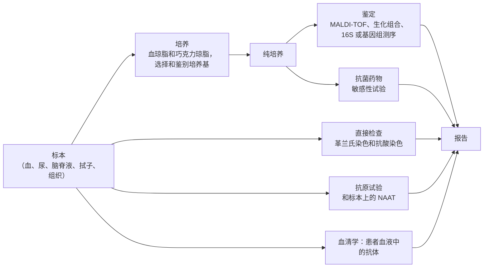

微生物学家从患者、土壤样品或发酵罐中分离出一种细菌，必须回答三个问题：它是什么，它与什么有亲缘关系，它叫什么名字？答案属于系统分类学。对植物和动物而言，这些答案建立在丰富的形态学和适用于有性生物的生物学物种概念之上。细菌和古菌的形态特征很少，进行无性繁殖，并且跨越物种界限交换基因，所以它们的系统分类学不得不以分子序列为基础重建，并且随着基因组序列的积累仍在变化。本章讲述实践：微生物群体如何演化以及这如何塑造它们的基因组（16.2 节），原核生物的分子系统发生（16.3 节），原核生物物种如何划界（16.4 节），分类的方法（16.5 和 16.6 节），命名规则（16.7 节），以及实验室中对分离株的鉴定（16.8 节）。生命之树、三域与二域观点以及真核生物的起源见 [7.10.2](/7.10.2)、[7.10.27](/7.10.27) 和 [7.10.28](/7.10.28)，构建树的算法见 [7.8.6](/7.8.6)，整个群落的序列分析见 [7.8.14](/7.8.14)；这里使用它们而不重复。后续各章（7.11.17–7.11.21）概览这一框架所组织的多样性。

## 16.1. 系统分类学、分类学与鉴定

**定义 16.1.1（系统分类学与微生物分类学）** **系统分类学**研究生物的多样性及其相互关系；它把系统发生与分类学联系起来。**微生物分类学**是对微生物进行特征描述、命名并按群组排列的科学，包含三个相互关联的部分：**分类**，即根据相似性或演化关系把生物安排成类群（分类单元）；**命名**，即依照规则给分类单元指派名称；以及**鉴定**，即对分离株进行特征描述，以确定它属于哪个已确立的分类单元。

这三个部分服务于不同的使用者。临床实验室需要鉴定，而且要快：用少数几项试验把引起某种感染的生物区分开来，并得到告诉医生哪些药物有效的名称。描述新物种的分类学家需要分类，即在系统发生中的位置；命名使二者都可以交流。鉴定以分类为前提，因为一个分离株只能被归入已经定义的分类单元，而用于鉴定的试验正是因为能区分这些分类单元才被选用的。

细菌分类的历史是对反映亲缘关系的特征的探寻。1870 年代 Ferdinand Cohn 按形状把细菌分组，结果太粗略；二十世纪初 Sigurd Orla-Jensen 使用生理特性，随所选性状不同会得到相互矛盾的分组。1930 年代 Albert Kluyver 和 Cornelis van Niel 以建立自然的、演化的分类为目标，却无法区分相似性与亲缘性。因此按表型的分类始终是人为的，对鉴定有用而对演化无言，直到 Carl Woese 和 George Fox 于 1977 年比较了核糖体 RNA 序列（[7.10.27](/7.10.27#sec-27.4)）；界与域系统的更替概括于 [7.10.2](/7.10.2#sec-2.7.3)。

在有分子数据之前，使表型分类客观化的最系统的尝试是数值分类学（numerical taxonomy），又称表征学，由 Sneath 和 Sokal 于 1960 年代创立，它对许多性状评分、给予同等权重、计算每对菌株的相似度，并按总体相似度对菌株聚类。

**公式 16.1.1（相似系数）** 对两个按 $n$ 个二元性状评分的菌株，设 $a$ 为两者都阳性的性状数，$d$ 为两者都阴性的性状数，$b$、$c$ 为只在其中一个中阳性的性状数（$a + b + c + d = n$）。*简单匹配系数*与 *Jaccard 系数*为

$$
S_{\mathrm{SM}} = \frac{a + d}{n}, \qquad S_{\mathrm{J}} = \frac{a}{a + b + c};
$$
Jaccard 系数忽略共同的阴性，因为共同阴性可能只反映共同缺乏信息。

相似度矩阵通常用 **UPGMA**（[7.8.6](/7.8.6#sec-6.3.2)）聚类成**树状图**（表征图），其中在选定水平（常为 80 %）之上相连的菌株构成一个"表征群"（phenon）。数值分类学使分类具有可重复性，其相似度矩阵和聚类方法在基于基因组的方法中依然存在，但表型的表征图并非系统发生：相似的表型可以独立演化，而单个突变就能使乳糖发酵等性状丧失。

## 16.2. 微生物的演化

### 16.2.1. 微生物群体中的变异、选择与漂变

演化的力量在微生物中与在动植物中相同（7.10.4–7.10.7）：**突变**和重组产生变异，**自然选择**和**遗传漂变**改变等位基因频率。细菌和古菌的三个特点赋予它们特殊的性格。它们通常是单倍体，所以每一个突变都立刻暴露于选择。它们进行无性繁殖，所以有益突变会拖着整个基因组一起走；重组只通过**水平基因转移**发生，而后者是单向的、零碎的，并与繁殖脱钩（7.11.13）。而且它们的群体巨大，世代时间以小时计，所以演化可以在实验室中观察。

有两个实验显示选择作用于已有的变异和新的变异。紫色细菌荚膜红细菌（*Rhodobacter capsulatus*）只要没有氧气就会产生细菌叶绿素和类胡萝卜素，无论在光下还是在黑暗中。在色素无用的黑暗中连续传代时，它很快被缺乏色素的突变体占领，这些突变体节省了制造色素的代价；在光下同样的突变以同样的速率产生，却被淘汰（Madigan 及其同事，1982）。丧失不需要的功能是微生物演化的常见结果。在 Richard Lenski 于 1988 年开始的长期演化实验中，来自同一祖先的十二个 *Escherichia coli* 群体在葡萄糖限制的基本培养基中每天传代，已有数万代；它们相对于冷冻祖先的适合度起初迅速上升，此后仍在缓慢上升（[7.10.5](/7.10.5#sec-5.1.1)，[7.6.39](/7.6.39#sec-39.5)）。大约 31 500 代之后，一个群体演化出在柠檬酸上需氧生长的能力，柠檬酸作为缓冲剂存在于培养基中，对它的需氧利用曾是区分 *E. coli* 与其他肠道细菌的诊断性状。十二个群体中只有一个做到了这一点：这一性状需要罕见的突变组合。遗传漂变同样重要，特别是在病原体中，每次新感染都由少数细胞建立，是反复发生的群体瓶颈。

### 16.2.2. 动态基因组

对同一物种的多个菌株的基因组测序，显示了原核生物基因组是多么流动。*E. coli* 的基因组平均含约 4700 个基因（各菌株约从 4100 到 5400），但其中只有约 2000 个存在于所有菌株中；其余的基因与共有基因合起来构成**泛基因组**，每测一个新基因组它就增大（Touchon 及其同事，2009，对 20 个菌株发现约 17 800 个基因家族）。共有的基因构成**核心基因组**，其余为**附属基因组**（[7.10.27](/7.10.27#sec-27.6.3)）。附属基因通过水平转移获得，常常以**基因组岛**的形式，并通过缺失而丢失，缺失在细菌中比插入更频繁；选择保留那些物有所值的基因。当群落中的其他成员作为公共物品提供某种功能（如过氧化氢的解毒）时，基因丢失甚至会受到青睐（Morris、Lenski 和 Zinser 的黑皇后假说），这是许多生物只能在共培养中生长的原因之一。有两个后果对系统分类学很重要：物种是一组具有共同核心的基因组，而不是固定的基因清单；由一个基因构建的树可能不是生物体的树（16.3.2 节）。

### 16.2.3. 物种形成需要很长时间

新性状可以在数周内演化出来，但分歧成物种是缓慢的。利用以昆虫专性内共生菌校准的**分子钟**（[7.10.2](/7.10.2#sec-2.6.2)，[7.10.24](/7.10.24)）（其宿主有化石记录），细菌的 16S rRNA 基因大约每 5000 万年分歧 1 %（Ochman 和 Wilson，1987）。按此校准，*E. coli* 与肠道沙门氏菌（*Salmonella enterica*）在 1 亿至 1.4 亿年前分歧，而无害的 *E. coli* K-12 与肠出血性的 O157:H7 则在几百万年前分歧。这一钟是粗略的，因为各谱系速率不同，但它表明细菌物种是一个古老的实体，同一物种菌株之间巨大的表型差异，无论是否致病，主要来自附属基因而不是长期的分歧。

## 16.3. 微生物的分子系统发生

### 16.3.1. 作为分子计时器的核糖体 RNA

**定义 16.3.1（16S rRNA 基因）** **16S rRNA 基因**是细菌和古菌小核糖体亚基 RNA 的基因（约 1500 个核苷酸；*E. coli* 中为 1542 个）；其真核对应物是 18S rRNA 基因。二者都称为小亚基（SSU）rRNA 基因。

Woese 选择 SSU rRNA 作为亲缘关系的度量，其理由至今依然成立：

- 它存在于每个细胞中，包括线粒体和质体，且在所有细胞中功能相同；
- 它的功能制约着它，所以变化缓慢，但并不均匀：保守区与九个可变区 V1–V9 交替出现（[7.8.14](/7.8.14#sec-14.1.2)，附图），所以保守位置解析深层分支，可变位置解析近期的分歧；
- 它长到足以含有许多信息位点，又短到可以测序，保守区中的通用引物几乎能从任何生物中扩增它；
- 它很少水平转移，因为它必须与核糖体的许多蛋白质协同工作，所以它的树与其他信息处理基因的树大体一致。

它的局限来自同样的性质。演化缓慢意味着对近缘种的分辨力差（16.4.3 节）。基因组携带 1 到约 15 个拷贝的 rRNA 操纵子，同一基因组内它们可能略有差异。而且 rRNA 基因之间确实发生罕见的转移和重组。线粒体和叶绿体的 16S 序列把它们的祖先置于 α-变形菌和蓝细菌之中（[7.10.28](/7.10.28)）。

### 16.3.2. 从序列到树

微生物的分子系统发生从培养物的 DNA 或直接从生境中提取的 DNA 出发，用 PCR 扩增一个基因或测定一个基因组，然后与对任何生物一样进行：把同源序列，最好是**直系同源物**，进行比对，使每一列含有源自共同祖先位置的位点；用距离法（**邻接法**）、简约法、最大似然法或贝叶斯推断，在校正位点多次替换的替换模型下推断一棵树；并用**自助法**（[7.8.6](/7.8.6)）评估每个分支的支持度。有两点提醒是原核生物所特有的。很深的分歧使序列被重复的替换（趋同）饱和，所以生命之树最深的分支最难解析。而且由于水平基因转移，一个基因的树只是关于该基因的假说：生物体的系统发生需要垂直遗传的基因，这就是为什么基于基因组的系统发生要串联数十个保守的单拷贝蛋白（16.6 节），也是原核生物的"生命之树"描述的是被基因交换所覆盖的细胞谱系的垂直历史的原因（[7.10.27](/7.10.27#sec-27.6.3)）。

### 16.3.3. 原核生物之树

SSU rRNA 树揭示了古菌，并把细菌组织成门，其中大多数门并不对应任何表型类群：革兰氏阳性菌分属两个门，即**芽孢杆菌门**（Bacillota，旧称 Firmicutes，低 G + C）和**放线菌门**（Actinomycetota，旧称 Actinobacteria，高 G + C）；革兰氏阴性的**假单胞菌门**（Pseudomonadota，旧称 Proteobacteria）包含光合生物、化能无机营养生物、固氮菌和肠道细菌。对从环境 DNA 扩增的 16S 基因测序表明，大多数谱系从未被培养过（**平板计数异常**，[7.11.4](/7.11.4#sec-4.5.4)），随后基因组解析的宏基因组学又增添了仅由**宏基因组组装基因组**而知的整个门。由来自 3000 多个基因组的 16 个串联核糖体蛋白构建的一棵树（Hug 及其同事，2016）显示，细菌多样性的很大一部分属于一个基因组很小的生物的辐射。

**定义 16.3.2（候选门辐射）** **候选门辐射**（CPR）是一个庞大的、单系的细菌辐射，几乎完全由宏基因组而知，包含数十个候选门，细胞非常小，基因组缩减（常小于 $1\,\mathrm{Mb}$），生物合成途径不完整；大多数被认为附着于其他细菌并依赖它们生活。在基因组分类数据库中，该辐射被视为单一的门，即 Patescibacteria。

CPR 说明了为什么原核生物的分类从单个基因转向基因组：许多 CPR 细菌有不寻常的 rRNA 基因，带有内含子和插入序列，逃脱了标准引物，它们的位置取决于所分析的基因集。

## 16.4. 原核生物的物种

### 16.4.1. 问题

**生物学物种概念**（[7.10.11](/7.10.11#sec-11.1.1)）以生殖隔离定义物种，不能应用于没有性的生物。微生物学家转而使用一个务实的定义，常称为**系统发生物种概念**，它基于可测量的相似性而不是物种形成模型；原核生物的物种是否也是演化的自然单位，是另一个问题（[7.10.27](/7.10.27#sec-27.6.4)，16.4.5 节）。

**定义 16.4.1（原核生物物种与菌株）** 在目前的实践中，原核生物物种是基因组上一致的**菌株**的单系类群，它们在许多独立的性状和基因上高度相似，且不同于其他此类类群；它在操作上由基因组相似度（16.4.2–16.4.4 节）连同诊断性的表型特性来划界。**菌株**是源自单个分离物（实际上是一个纯培养物）的细胞群体，可通过某种特性与该物种的其他分离物区分，这种特性从单个表型或遗传标记直到其基因组序列。

菌株用 *E. coli* K-12 或枯草芽孢杆菌（*Bacillus subtilis*）168 之类的名称来指称；一个物种通常有很多菌株，其中之一是它的模式（16.7.2 节）。过去几十年间，用来划分物种的阈值已从 DNA 复性的化学转向基因组序列，并相互校准。

### 16.4.2. DNA–DNA 杂交

**定义 16.4.2（DNA–DNA 杂交）** **DNA–DNA 杂交**（DDH）以一个菌株（带标记）的单链、剪切的 DNA 与另一个菌株的 DNA 复性的程度，相对于其自身复性（100 %）的比例，来测量两个基因组的总体相似度。DDH 值达 70 % 或更高，且异源双链的**解链温度**与同源双链相比相差至多 $5\,^\circ\mathrm{C}$ 的菌株，被认为是同一物种（Wayne 及其同事，1987）。

DDH 曾是物种划界的"金标准"达 30 年。它费力，不精确（误差几个百分点），只能在已培养的菌株之间进行，而且不可累积：每个新菌株都必须与每个参照菌株杂交。它也显示了细菌物种有多宽。*Escherichia coli* 与志贺氏菌（*Shigella*）的四个"种"的 DDH 值都高于 70 %，是同一个基因组种，只是出于医学原因在名称上保持分开；按同样的标准，几乎完全复性的人类与黑猩猩的 DNA 将是同一物种。

### 16.4.3. 16S rRNA 基因一致性

由于 16S 序列易于获得并且在数据库中可累积，它们的一致性成为新物种的第一道筛选。与 DDH 的比较显示了一种不对称的关系。16S 基因相差超过约 3 % 的菌株从未有过 70 % 的 DDH，所以提出 97 % 一致性作为界限（Stackebrandt 和 Goebel，1994）；随着数据增多，界限提高到 98.7–99 %（Stackebrandt 和 Ebers，2006；Kim 及其同事 2014 年基于基因组的校准为 98.65 %）。低于此值，两个菌株几乎肯定是不同的物种。高于此值，它们可能是任一种情形：许多分得很清楚的物种共有几乎相同的 16S 基因，例如炭疽芽孢杆菌（*Bacillus anthracis*）、蜡样芽孢杆菌（*B. cereus*）和苏云金芽孢杆菌（*B. thuringiensis*），或 *Streptococcus pneumoniae* 与缓症链球菌（*S. mitis*）。因此 16S 一致性是属于一个物种的必要条件而非充分条件，属的界限同样粗略：对模式菌株的一项调查发现，属之间的一致性通常低于约 94.5 %（Yarza 及其同事，2014）。因此群落调查中 97 % 的操作分类单元（[7.8.14](/7.8.14#sec-14.2.1)）不是物种。

### 16.4.4. 基于基因组的度量

**定义 16.4.3（平均核苷酸一致性）** 两个基因组的**平均核苷酸一致性**（ANI）是它们共有区域的核苷酸一致性的平均值。在原始方法（Goris 及其同事，2007）中，把查询基因组切成 $1020\,\mathrm{nt}$ 的片段，每个片段与参照基因组比对，保留比对长度达其长度至少 70 % 且一致性至少 30 % 的片段，ANI 即这些匹配的平均一致性；更快的工具用基于 $k$-mer 的近似映射取代比对（FastANI）。与之一同报告的还有*比对分数*，即基因组中被共享的比例。同一物种的菌株的 ANI 至少约为 95–96 %。

ANI 的 95–96 % 对应 70 % 的 DDH（Goris 及其同事，2007；Richter 和 Rosselló-Móra，2009）。它精确、可重复，由公共序列计算，包括未培养生物的序列。对约 90 000 个基因组用基于 k-mer 的 ANI 所作的比较（Jain 及其同事，2018）发现，几乎所有基因组对的 ANI 要么高于 95 %，要么低于约 83 %：分布在物种界限处有一个间隙，这表明物种是真实的基因组簇，而不是沿连续体任意切割（见图）。

**定义 16.4.4（数字 DNA–DNA 杂交）** **数字 DNA–DNA 杂交**（dDDH）由两个基因组序列估计 DDH：把基因组比对成高得分片段对（HSP），计算如 $d = 1 - (\text{相同碱基对})/(\text{HSP 总长})$ 的距离，再由以湿实验 DDH 数据校准的回归把它转换成带置信区间的 DDH 估计值（基因组间距离计算器；Meier-Kolthoff 及其同事，2013）。物种界限为 70 % dDDH。

ANI 和 dDDH 以不同单位携带同样的信息；对于属及更高等级，核苷酸一致性已饱和，比较使用共有蛋白质的平均氨基酸一致性（average amino acid identity），简称 AAI，或串联蛋白质的系统发生（16.6 节）。关于在原核生物分类学中使用基因组数据的最低标准的建议（Chun 及其同事，2018）采用 95–96 % 的 ANI 和 70 % 的 dDDH 作为物种界限，并建议用其模式菌株的基因组序列来描述新物种，若与所有已描述物种的 16S 一致性低于 98.7 %，就足以免去基因组比较。基因组的 G + C 含量增加一项简单检查：同一物种的菌株至多相差约一个百分点（Meier-Kolthoff 及其同事，2014）。

### 16.4.5. 生态型与物种的演化意义

如果物种是簇，是什么把它们聚在一起？Frederick Cohan 提出的一个回答是生态学的。

**定义 16.4.5（生态型）** 在微生物演化中，**生态型**是占据同一生态位的细胞群体，其中出现的适应性突变体会在竞争中胜过并取代群体的其他成员，但不会取代其他生态型的细胞。这种在全基因组范围内清除生态型遗传多样性的取代，称为周期选择（periodic selection）。

在这个模型中，周期选择使每个生态型保持遗传上的同质，而各生态型发生分歧，所以基本单位是生态型而不是有名称的物种；一个有名称的物种可以含有几个生态型。海洋蓝细菌原绿球藻（*Prochlorococcus*）是一个例子：它的强光和弱光生态型占据海洋的不同深度，捕光生理不同，尽管它们的 16S 基因相差不到 3 %。另一种观点强调**同源重组**，它在许多物种中足够频繁，能在菌株之间传播等位基因，只要成员足够相似而能重组，就使物种保持内聚；重组随序列分歧急剧下降，这可以解释为什么 ANI 间隙位于 95 % 附近。两种机制并不互斥，其相对权重因物种而异（[7.10.27](/7.10.27#sec-27.6.4)）。

### 16.4.6. 物种以下：菌株分型

流行病学、食品安全和法医学需要在物种内部区分菌株，例如判断几个城市的感染是否来自同一来源。传统分型方法使用表型；目前的方法使用序列。

| 方法 | 依据 | 名称 | 备注 |
|---|---|---|---|
| 生化分型 | 生化反应的模式 | 生物型（biovar） | 霍乱弧菌生物变种 El Tor，1961 年以来第七次霍乱大流行的病因 |
| 血清分型 | LPS（O）、鞭毛（H）、荚膜（K）的抗原 | 血清型（serovar） | *E. coli* O157:H7；*Salmonella enterica* 的 2500 多个血清变种 |
| 噬菌体分型 | 一组噬菌体的裂解模式 | 噬菌体型 | 已大多被分子分型取代 |
| 抗菌谱 | 对一组抗菌药物的敏感性 | 耐药谱 | 便宜，但耐药基因在菌株之间移动 |
| 限制性片段图谱 | 基因组（脉冲场凝胶电泳）或 rRNA 操纵子（*核糖体分型*）的**限制性片段长度多态性** | 图谱 | PFGE 曾是食源性疾病监测网络 PulseNet 的基础，直到它转向基因组测序 |
| PCR 指纹 | rep-PCR（重复元件之间）、AFLP | 条带图谱 | 快速，各实验室特异 |
| MLST | 管家基因的序列 | 序列型 | 定义 16.4.6 |
| 基因组测序 | 核心基因组 MLST、SNP 距离 | cgMLST 型、SNP 簇 | 分辨率最高；暴发分离株只相差少数 SNP |

**定义 16.4.6（多位点序列分型）** **多位点序列分型**（MLST）以数个（通常是七个）染色体**管家基因**的内部片段（约 $450$–$500\,\mathrm{bp}$）的序列来表征一个菌株。基因的每一种不同序列是一个等位基因并被赋予一个编号；等位基因编号的组合是等位基因谱，每个谱是一个序列型（sequence type），简称 ST。共享大部分等位基因的相关序列型构成克隆复合体。

MLST（Maiden 及其同事，1998，针对脑膜炎奈瑟氏菌 *Neisseria meningitidis*）使分型可以移植：实验室之间通过公共数据库交换等位基因编号，而不是凝胶图像。一个相关的方法，多位点序列分析（multilocus sequence analysis），简称 MLSA，串联数个蛋白质编码基因（如 *gyrB*、*recA* 和 *rpoB*）的序列，它们演化得比 rRNA 基因快，并由此构建系统发生；它解析 16S 树无法分开的近缘物种，如发光杆菌属（*Photobacterium*）的发光种。核心基因组 MLST 把这一方案扩展到物种核心基因组的约 1000–3000 个基因，是目前暴发调查的标准。

## 16.5. 表型与化学分类方法

### 16.5.1. 表型特征

基因组为物种划界，但物种是由其表型来描述的，通常也是由表型来鉴定的。对新分离株常规测定的特征有：

| 类别 | 特征 |
|---|---|
| 形态 | 细胞形状、大小和排列；革兰氏反应；鞭毛着生；**芽孢**；内含物（PHB、聚磷酸盐、气囊泡、磁小体）；荚膜、S 层；柄、附属物；菌落形态与色素 |
| 运动 | 游动、群集运动、滑行、气囊泡产生的浮力 |
| 代谢 | 能源（光合生物、化能有机营养生物、化能无机营养生物）；碳、氮和硫源；糖的发酵；固氮；生长因子 |
| 生理 | 温度、pH 和盐范围；与氧的关系；**过氧化氢酶**和氧化酶；胞外酶 |
| 化学分类 | 脂肪酸、极性脂、呼吸醌、细胞壁组成、G + C 含量 |
| 其他 | 抗生素敏感性、血清型、色素、发光、特征性产物 |

表型取决于生长条件，所以要在标准化条件下测定，并与在同样条件下获得的模式菌株的数据比较。

### 16.5.2. 化学分类

化学分类学（chemotaxonomy）用细胞的化学组成作为分类学特征。它的标志物是许多基因的产物，因此比单个酶活性更稳定。

- *细胞脂肪酸。* 细菌含有 200 多种**脂肪酸**，它们在链长、双键、环丙烷环、甲基支链（iso 和 anteiso）和羟基上各不相同。在*脂肪酸甲酯*（FAME）分析中，把在标准培养基上于标准温度下生长的细胞的脂质皂化并甲基化，甲酯用**气相色谱**分离；把谱图与以同样方式生长的参照菌株的数据库比较。支链脂肪酸是许多革兰氏阳性菌的典型特征，羟基脂肪酸是革兰氏阴性菌脂质 A 的典型特征；古菌完全没有脂肪酸脂质（[7.11.2](/7.11.2#sec-2.2.2)）。
- *呼吸醌。* **醌**的类型和链长：α、β 和 γ-变形菌中的泛醌（*E. coli* 中为 Q-8），革兰氏阳性菌和许多其他类群中长度有特征的甲基萘醌（MK-7、MK-9 等）。
- *极性脂*，以及在分枝杆菌及其近缘生物中的**分枝菌酸**。
- *细胞壁化学。* **肽聚糖**的有无，肽中第 3 位的二氨基酸（革兰氏阴性菌和 *Bacillus* 中为内消旋二氨基庚二酸，大多数球菌中为 L-赖氨酸）以及肽间桥（[7.11.2](/7.11.2#sec-2.3.1)）；**磷壁酸**；古菌中的假胞壁质或 S 层。

**定义 16.5.1（G + C 含量）** 基因组的 *G + C 含量*是其碱基对中 G·C 对所占的百分数（mol% G + C）。细菌中它从一些昆虫内共生菌的低于 20 % 到约 75 %；在一个物种内它在很窄的范围内保持不变。

在基因组测序之前，G + C 含量是由 DNA 的解链温度测定的，因为有三个氢键和更强堆积作用的 G·C 对升高双螺旋变性的温度（[7.1.11](/7.1.11)）。

**公式 16.5.1（Marmur–Doty 关系）** 在标准柠檬酸盐盐水（$0.15\,\mathrm{M}$ NaCl，$0.015\,\mathrm{M}$ 柠檬酸钠）中，DNA 的解链温度为

$$
T_{\mathrm{m}}/{}^\circ\mathrm{C} = 69.3 + 0.41\,(\mathrm{G} + \mathrm{C}),
$$
其中 G + C 以 mol% 计。G + C 为 50 % 的 DNA 约在 $90\,^\circ\mathrm{C}$ 解链。

G + C 含量只是一项排除标准：G + C 含量相差超过几个百分点的菌株不可能亲缘关系很近，但数值相等并不说明什么，因为不相关的基因组可以有相同的组成。它作为描述性状仍然有用，如革兰氏阳性菌旧称的"低 G + C"和"高 G + C"。

### 16.5.3. 多相分类学

**定义 16.5.2（多相分类学）** **多相分类学**是整合表型、化学分类、基因型和系统发生信息来分类和描述原核生物的做法，使一个分类单元得到几种独立证据的支持（该术语出自 Rita Colwell，1970 年）。

对新物种的典型描述分三步进行。16S rRNA 基因（或者越来越多地用基因组）把分离株置于一个属，并确定其最近的已描述近缘种。把基因组与它们模式菌株的基因组以 ANI 和 dDDH 比较，由此决定该分离株是否是新物种。然后测定表型和化学分类特性，以描述该物种，并找出把它与近缘种区分开来的性状，这些性状将用于其鉴定。基因组学已把重心从表型转向序列，但并没有消除表型：给物种命名是为了让别人能认出它，而它的生物学才使它值得命名。

## 16.6. 基于基因组的分类

由数千个基因组的串联蛋白质构建的系统发生，使得用单一的、明确的程序对所有原核生物，无论是否培养过，进行分类成为可能。最全面的结果是基因组分类数据库。

**定义 16.6.1（基因组分类数据库）** *基因组分类数据库*（GTDB；Parks 及其同事，2018）是基于串联的保守单拷贝蛋白（当前版本中细菌 120 个、古菌 53 个）系统发生的细菌和古菌分类，这些蛋白来自培养菌株的基因组以及宏基因组组装基因组和单细胞基因组。要求分类单元为单系；等级由相对演化分歧度规范化；物种是与某一代表基因组（最好是模式菌株的基因组）的 ANI 至少为 95 % 的基因组簇。

各谱系的演化速率不同，所以系统发生图中一个节点的深度不是等级的度量。GTDB 重新标度深度，使每个谱系从根处的 0 到末端的 1。

**公式 16.6.1（相对演化分歧度）** 在有根树中，根的 $\mathrm{RED} = 0$，每个末端的 $\mathrm{RED} = 1$。对于父节点为 $p$ 的内部节点 $n$，

$$
\mathrm{RED}(n) = \mathrm{RED}(p) + \frac{d}{u}\bigl(1 - \mathrm{RED}(p)\bigr),
$$
其中 $d$ 是从 $p$ 到 $n$ 的分支长度，$u$ 是 $d$ 加上从 $n$ 到其下各末端的平均距离。同一等级的分类单元被这样划界，使它们的 RED 值落在该等级中位数附近的窄区间内。

GTDB 证实了现有分类的大部分，但也改变了许多。多系的属被拆分（带字母后缀，如 *Clostridium* 和 *Clostridium*_A，直到提出新名称），原来的 δ-变形菌被划分为几个门，ε-变形菌成为弯曲杆菌门（Campylobacterota），等级也被拉平：许多原来的纲成为门，反之亦然。未培养的谱系得到由字母和数字组成的占位名称。GTDB 不是命名的权威，但它的分类被大多数宏基因组研究所使用（[7.8.14](/7.8.14#sec-14.3.4)），它的许多建议已被采纳为有效名称。

## 16.7. 命名

### 16.7.1. 名称与等级

**定义 16.7.1（双名法）** **双名法**由 Linnaeus 提出，用两个拉丁语或拉丁化的词给每个物种命名：属名（首字母大写）和种加词（小写），均用斜体印刷（*Escherichia coli*）。更高分类单元的名称是用正体的单个首字母大写的词。

用于原核生物的等级及为它们规定的词尾，以 *E. coli* 为例如下：

| 等级 | 词尾 | 例子 |
|---|---|---|
| 域 | | Bacteria |
| 门 | -ota | Pseudomonadota |
| 纲 | | Gammaproteobacteria |
| 目 | -ales | Enterobacterales |
| 科 | -aceae | Enterobacteriaceae |
| 属 | | *Escherichia* |
| 种 | | *Escherichia coli* |

种以下，亚种有正式的名称（*Salmonella enterica* subsp. *enterica*）；菌株、生物变种、血清变种和致病变种是非正式的称呼。书写时，第一次提到用全名，之后把属名缩写（*E. coli*）；"sp." 表示某个属中未鉴定的种（*Clostridium* sp. strain X），"spp." 表示几个种。名称变更之后，旧名称可以在一段时间内放在括号里，如 *Lactococcus*（*Streptococcus*）*lactis*。许多类群也按并不界定分类单元的性状非正式地称呼：乳酸菌、硫酸盐还原菌、芽孢形成菌、大肠菌群。

名称主要来自四个来源。有些纪念人物：*Escherichia*（Theodor Escherich）、*Listeria*（Joseph Lister）、*Yersinia pestis*（Alexandre Yersin）、*Salmonella*（Daniel Salmon）。有些描述生物：*Staphylococcus aureus*（金黄色的葡萄状球菌团）、*Streptococcus*（扭曲的链）、*Helicobacter pylori*（幽门的螺旋形杆菌）。有些以地名命名：*Francisella tularensis*（加利福尼亚州 Tulare 县）、*Mycobacterium genavense*（日内瓦）。有些以机构或事件命名：*Legionella pneumophila*，来自 1976 年美国退伍军人协会大会上的暴发；*Afipia felis*，来自武装部队病理学研究所。

### 16.7.2. 法规、模式与有效名称

**定义 16.7.2（国际原核生物命名法规）** *国际原核生物命名法规*（ICNP，旧称细菌学法规）是管辖细菌和古菌科学名称的规则，由国际原核生物系统学委员会监督。它的原则包括优先律（一个分类单元最早有效发表的名称是正确的）、每个名称的模式化，以及有效发表的要求。

原核生物命名的起始日期是 1980 年 1 月 1 日，那一天发表了《细菌名称认可名录》：名录上的名称保留其地位，所有其他较早的名称都丧失了地位。此后，一个名称在带着描述和模式指定、发表于《国际系统与演化微生物学杂志》（IJSEM）时即为有效发表，或者在原始论文中，或者在别处有效发表之后的有效化名录中。有效名称汇编于《命名中具有地位的原核生物名称表》（LPSN）。

**定义 16.7.3（模式菌株）** 一个物种的**模式菌株**是原始描述中指定为该名称永久参照的菌株：该名称适用于模式菌株所属的任何物种。要使一个名称有效发表，模式菌株的培养物必须保藏在两个不同国家的至少两个公共菌种保藏中心，并可从中无限制地获得。属的模式是模式种，更高分类单元的模式是其模式属。

ATCC（美国）、DSMZ（德国）、JCM（日本）、NCIMB（英国）、CIP（法国）和 CGMCC（中国）等菌种保藏中心使菌株保持存活，冷冻或冻干，使以后的每项研究都能把自己的分离株与同一生物比较，如同博物馆保存动植物的模式标本（[7.10.2](/7.10.2#sec-2.7.1)）。在分类学论文的描述和树中，模式菌株用上标 T 标记（*E. coli* ATCC $11775^{\mathrm{T}}$）。

不能培养、或不能获得纯培养的生物无法保藏，因此不能在 ICNP 下获得有效名称。

**定义 16.7.4（Candidatus）** *Candidatus* 是对已经充分表征的原核生物的一种暂定地位，这类生物由其序列和其他特性描述，但尚未获得纯培养，因此不能被有效命名。*Candidatus* 一词用斜体，其后的名称用正体，通常加引号："*Candidatus* Pelagibacter ubique"、"*Ca.* Brocadia anammoxidans"。

未培养的多数与可培养的少数之间的鸿沟，催生了第二部法规，即 SeqCode（2022 年），依据它，名称可以以基因组序列为模式而有效发表，使足够高质量的宏基因组组装基因组能够获得永久名称。两部法规并存。

### 16.7.3. 2021 年的门名

直到 2021 年，ICNP 并不规范纲以上等级的名称，Proteobacteria、Firmicutes 和 Actinobacteria 之类的门名是在没有地位的情况下使用的。当门这一等级被纳入法规后，门名被要求由模式属的名称加词尾 -ota 构成，2021 年有 42 个门的名称据此有效发表（Oren 和 Garrity，2021）。新名称取代旧名称；本站全部使用新名称，并在第一次提到时给出旧名称。

| 旧名 | 有效名称（2021） | 模式属 |
|---|---|---|
| Proteobacteria | **假单胞菌门**（Pseudomonadota） | *Pseudomonas* |
| Firmicutes | **芽孢杆菌门**（Bacillota） | *Bacillus* |
| Actinobacteria | **放线菌门**（Actinomycetota） | *Actinomyces* |
| Bacteroidetes | **拟杆菌门**（Bacteroidota） | *Bacteroides* |
| Crenarchaeota | Thermoproteota | *Thermoproteus* |
| Thaumarchaeota | **奇古菌门**（Nitrososphaerota） | *Nitrososphaera* |

纲名，如 Gammaproteobacteria，没有改变。病毒有它们自己的法规，由国际病毒分类学委员会（ICTV）维护，自 2021 年起它也要求使用双名法的种名（7.11.26）。

### 16.7.4. 伯杰氏手册

**定义 16.7.5（伯杰氏手册）** **伯杰氏手册**是描述所有已承认的细菌和古菌分类单元的标准参考著作，1923 年首次以*《伯杰氏鉴定细菌学手册》*出版，是一部鉴定手册。其第二个分支*《伯杰氏系统细菌学手册》*（第二版五卷，2001–2012 年）按系统发生排列分类单元；自 2015 年起它以*《伯杰氏古菌与细菌系统学手册》*之名在线延续。

原核生物没有"官方"分类：名称由法规管辖，但分类，即分类单元的排列，是科学判断的问题，伯杰氏手册、GTDB 和 NCBI 分类在某些地方各不相同。

## 16.8. 鉴定

### 16.8.1. 策略

鉴定是把分离株的特性与已描述的分类单元相比较。在诊断实验室中，它由标本和症状来指导：对泌尿道感染患者的尿液，检查的是引起它的少数生物，而不是每一种可能的细菌。大多数程序从纯培养（[7.11.1](/7.11.1#sec-1.4)）开始，从快速的、一般的特征逐步到特异的特征：显微镜检查与染色，在初级培养基上的生长，生化或蛋白质谱鉴定，必要时再用核酸方法。

### 16.8.2. 显微镜检查与培养

**革兰氏染色**和**抗酸染色**（[7.11.2](/7.11.2#sec-2.5)），连同细胞形状和排列，在几分钟内缩小可能性的范围，有时足以作出推定诊断。痰中有大量嗜中性粒细胞的革兰氏阳性双球菌提示 *Streptococcus pneumoniae*；男性尿道分泌物中嗜中性粒细胞内的革兰氏阴性双球菌可诊断淋病，因为那里只有淋病奈瑟氏菌（*Neisseria gonorrhoeae*）是这样的生物；痰中的抗酸杆菌提示分枝杆菌。显微镜检查无法把许多病原体与无害的近缘种区分开来：化脓性链球菌（*Streptococcus pyogenes*）看起来像正常咽部的链球菌，*Salmonella* 看起来像 *E. coli*。

在初级培养基上的生长增加了菌落特征：色素（粘质沙雷氏菌 *Serratia marcescens* 室温下的红色菌落；*Pseudomonas aeruginosa* 可扩散的绿色色素和葡萄般的气味），血琼脂上的溶血，以及在既是**选择培养基**又是**鉴别培养基**的培养基上的反应，如 MacConkey 琼脂，在其上发酵乳糖的 *E. coli*（泌尿道感染最常见的原因）形成粉红色菌落（[7.11.4](/7.11.4#sec-4.4.2)）。

### 16.8.3. 生化试验

大多数生化试验用改变颜色的指示剂检测某种酶或途径。少数检测菌落中已有的酶，只需几秒钟；多数则需要生长 18–48 小时。

| 试验 | 原理 | 阳性反应 | 典型用途 |
|---|---|---|---|
| **过氧化氢酶** | $\ce{2H2O2 -> 2H2O + O2}$ | 向细胞加 $\ce{H2O2}$ 时出现气泡 | 葡萄球菌（+）对链球菌和肠球菌（–） |
| 氧化酶 | 细胞色素 $c$ 氧化酶氧化氧化还原染料（四甲基对苯二胺） | 数秒内变深紫色 | *Pseudomonas*、*Neisseria*、*Vibrio*（+）对肠杆菌目（–） |
| 糖发酵 | 糖产酸（和气） | pH 指示剂变色；倒置 Durham 管中产气 | 肠杆菌目的种、链球菌 |
| 甲基红（MR） | 混合酸发酵使 pH 保持低于约 4.4 | 加甲基红后变红 | *E. coli*（+） |
| Voges–Proskauer（VP） | 乙偶姻，丁二醇发酵（[7.11.5](/7.11.5)）的中间产物 | 加 α-萘酚和 KOH 后变红 | *Klebsiella*、*Enterobacter*（+） |
| 吲哚 | 色氨酸酶：色氨酸 → 吲哚 + 丙酮酸 + $\ce{NH3}$ | 与 Kovács 试剂呈红色 | *E. coli*（+） |
| 柠檬酸盐 | 以柠檬酸盐为唯一碳源生长 | 生长，指示剂变蓝 | *Klebsiella*、*Salmonella*（+），*E. coli*（–） |
| 脲酶 | $\ce{CO(NH2)2 + H2O -> 2NH3 + CO2}$ | pH 升高，指示剂变粉红 | *Proteus*、*Helicobacter pylori*（+） |
| $\ce{H2S}$ 产生 | 硫代硫酸盐还原或半胱氨酸降解 | 黑色硫化铁 | *Salmonella*、*Proteus*（+） |
| 赖氨酸脱羧酶 | 赖氨酸 → 尸胺 + $\ce{CO2}$ | pH 升高 | *Salmonella*、*E. coli*（+） |
| 凝固酶 | 血浆凝固 | 凝块 | *Staphylococcus aureus*（+） |

吲哚、MR、VP 和柠檬酸盐试验合起来（IMViC）区分大肠菌群：*E. coli* 典型为 + + – –，*Klebsiella* 和 *Enterobacter* 为 – – + +。有些试验不需要培养就能做。定殖于胃并引起大多数消化性溃疡的幽门螺杆菌（*Helicobacter pylori*）有高活性的脲酶；在尿素呼气试验中，患者饮下用 $^{13}\mathrm{C}$（或 $^{14}\mathrm{C}$）标记的尿素，如果该细菌存在，约半小时内呼出的气体中就会出现标记的 $\ce{CO2}$，这样就避免了胃活检。

**定义 16.8.1（二歧检索表）** *二歧检索表*是由相继的偶对构成的鉴定方案，每个偶对提供两个互斥的选项，通常是一项试验的结果，把使用者引向下一个偶对或一个名称。

一次只检验一个特征的检索表很慢，因为每一步都需要培养，也很脆弱，因为丢失了一种酶的菌株会被误导。因此实验室一次接种许多试验，并把整个模式与表示每个分类单元中阳性反应频率的表比较。

**公式 16.8.1（概率鉴定）** 设 $p_{ij}$ 为分类单元 $j$ 的菌株中在试验 $i$ 中阳性的比例（限制在 $[0.01, 0.99]$），设一个分离株在 $m$ 个独立试验中给出结果 $x_i \in \{0, 1\}$。结果模式在分类单元 $j$ 下的似然，以及它在所考虑的 $k$ 个分类单元上的归一化似然（先验概率相等）为

$$
L_j = \prod_{i=1}^{m} p_{ij}^{\,x_i}\,(1 - p_{ij})^{1 - x_i}, \qquad
\pi_j = \frac{L_j}{\sum_{l=1}^{k} L_l}.
$$
当最佳分类单元的 $\pi_j$ 超过一个阈值（如种的 99.9 %）并且该模式也是该分类单元所典型的（其 $L_j$ 不太小）时，鉴定被接受。

这是统计学中的朴素贝叶斯分类器（[7.8.14](/7.8.14#sec-14.2.4)）应用于生化试验，商业系统就是这样把试验模式转化为"鉴定百分比"的。

微型化和自动化系统实现这一点。用于肠杆菌目的 API 20E 试条含有 20 个装有干燥底物的微管，用分离株的悬液使之复水；过夜培养后，各反应连同氧化酶试验每三个一组，每组按其阳性试验的 1、2 和 4 之和编码，所得七位数的谱号在数据库中查找。Biolog 板同时检测约 95 种碳源的氧化，而 VITEK 2 之类的自动化仪器（源于 1970 年代 NASA 检测航天器中微生物的项目）光学读取反应卡，数小时内给出鉴定和敏感性结果。

抗体通过表面抗原鉴定生物：按细胞壁碳水化合物对 β-溶血性链球菌作 Lancefield 分群（A 群是 *S. pyogenes*），用玻片凝集对 *Salmonella* 和 *E. coli* 作血清分型，以及检测标本中抗原的快速**酶联免疫吸附测定**（ELISA）和侧向流动试验。它们的免疫学基础见 7.15。

### 16.8.4. MALDI-TOF 质谱

大约从 2010 年起，全细胞质谱已在临床实验室取代生化试验，用于大多数常规鉴定。把少量菌落涂在钢靶上，常用甲酸处理，并覆盖基质溶液（常用 α-氰基-4-羟基肉桂酸）。激光脉冲使蛋白质解吸并电离（**基质辅助激光解吸电离**，[7.9.9](/7.9.9#sec-9.3.1)）；离子（大多带单电荷）经电势 $U$ 加速，测量它们飞过一根管的飞行时间（**飞行时间质谱**）。由 $zeU = \tfrac12 mv^2$，质量为 $m$、电荷为 $ze$ 的离子穿过长度为 $L$ 的无场管后到达的时间为

$$
t = L\sqrt{\frac{m}{2zeU}},
$$
所以强度对 $m/z$ 的谱由到达时间得到。细菌在 $2$–$20\,\mathrm{kDa}$ 范围内的谱以丰富而保守的小蛋白（其中许多是核糖体蛋白）为主，因此对物种具有特征性；软件把峰列表与参照谱数据库比较并报告得分（对使用最广的系统，得分至少 2.0 即鉴定到种）。

鉴定每个分离株只需几分钟，耗材成本很低，适用于细菌、酵母，以及经提取后适用于分枝杆菌和霉菌。它的局限是其数据库和蛋白质相似性的局限：数据库中没有的物种无法鉴定，非常近缘的物种给出几乎相同的谱，所以用标准数据库不能把 *E. coli* 与 *Shigella* 分开，也不能可靠地把 *S. pneumoniae* 与 *S. mitis* 分开。它通常还需要一个菌落，尽管已有适用于阳性血培养物和尿液的方案，而且谱图能揭示某些耐药机制，如碳青霉烯酶对碳青霉烯类的水解。

### 16.8.5. 核酸方法

核酸方法通过生物所特有的序列检测它们，通常不需要培养。

- 核酸探针（nucleic acid probes），即与分类单元独有序列互补的、带标记的单链 DNA 或 RNA，通过**杂交**检测它；针对 rRNA 特征序列的探针不需要扩增，因为生长的细胞含有数千个核糖体，用于**荧光原位杂交**，鉴定和计数样品中的细胞。
- 核酸扩增试验（NAAT），首先是 **PCR** 和**定量 PCR**，检测数量少或无法培养的病原体，多重组合在一到两小时内对一份标本检测数十种病原体和耐药基因。每组引物只检测它被设计用来检测的东西，所以临床医生必须怀疑到该生物。
- 16S rRNA 基因测序通过与模式菌株序列比较，鉴定生化试验和 MALDI-TOF 无法鉴定的分离株（一项常用指南接受至少 99 % 的一致性作为鉴定到种的依据，前提是 16S 能分辨该物种）。惠普尔病的病原体惠普尔养障体（*Tropheryma whipplei*）于 1992 年通过从感染组织中扩增的 16S 序列被鉴定，比它被培养出来早了好几年。
- 全基因组测序在一次检测中给出物种、菌株（通过 cgMLST 或 SNP 距离）、耐药和毒力基因，是目前对食源性病原体和结核病暴发监测的基础。

### 16.8.6. 临床实验室流程

感染在临床实验室中可以走的路径概括如下；在速度要紧时它们并行进行。

标本必须从感染部位无菌采集，数量足够，并以使病原体存活的方式运送（例如厌氧菌要隔绝空气）。对于血液，把 10–20 mL 接种到需氧和厌氧培养瓶中，由自动化仪器监测其 $\ce{CO2}$ 的产生；大多数有临床意义的细菌在两天内被检出，分枝杆菌和一些真菌需要更长时间。阳性瓶立即做革兰氏染色，这已能指导治疗，并传代培养用于鉴定和抗菌药物敏感性试验，后者测定每种药物的**最低抑菌浓度**或使用**纸片扩散法**（7.11.14）。每一项试验都用其**灵敏度**，即病原体存在时出现阳性结果的概率，和**特异度**，即病原体不存在时出现阴性结果的概率来评判：尿道分泌物的革兰氏染色对两性的淋病都有高度特异性，但在女性中灵敏度低得多，女性必须用培养或 NAAT 检测。各种疾病的流行病学概念和诊断策略见 7.11.35。

### 16.8.7. 不经培养的鉴定

自然界中的大多数微生物从未被培养过，所以环境微生物学从它们的 DNA 鉴定它们：16S 基因的扩增子测序，对照参考数据库分类（[7.8.14](/7.8.14#sec-14.2.4)）；鸟枪法宏基因组学，组装未培养生物的基因组并把它们置于 GTDB 中；单细胞基因组学；以及荧光原位杂交，在显微镜下把序列与细胞联系起来。在临床微生物学中，当培养和靶向试验失败时使用标本的宏基因组测序（[7.8.14](/7.8.14#sec-14.6.1)）。以这种方式鉴定的生物被命名为 *Candidatus* 分类单元或在 SeqCode 下命名，它们的生态学是 7.11.29 的主题。

## 小结

- 分类学包括分类、命名和鉴定；系统分类学把它与系统发生联系起来（定义 16.1.1）。由数值分类学（公式 16.1.1）定量化的表型分类，已被分子系统发生取代而不再作为分类的基础。
- 微生物群体演化很快（*Rhodobacter* 中的色素丧失，LTEE 中的柠檬酸利用），它们的基因组是动态的（核心和附属基因组，*E. coli* 的开放泛基因组），但物种的分歧经历数千万年（16S 钟约每 5000 万年 1 %）。
- 16S rRNA 基因（定义 16.3.1）是通用的，功能恒定，速率呈镶嵌式，很少转移；它把原核生物组织成域和门，并揭示了未培养的多数，包括候选门辐射（定义 16.3.2）。
- 操作性物种界限：

  | 度量 | 同一物种 | 备注 |
  |---|---|---|
  | DDH（定义 16.4.2） | ≥ 70 %，$\Delta T_{\mathrm{m}} \le 5\,^\circ\mathrm{C}$ | 历史标准，湿实验 |
  | 16S rRNA 一致性 | ≥ 98.7 % 必要而非充分 | 属约 < 94.5 % |
  | ANI（定义 16.4.3） | ≥ 95–96 % | ANI 在约 83 至 95 % 之间有间隙 |
  | dDDH（定义 16.4.4） | ≥ 70 % | 由基因组序列得到 |
  | G + C 含量（定义 16.5.1） | 相差 ≤ 约 1 个百分点 | 仅作排除 |

- 物种可能由生态型内的周期选择（定义 16.4.5）或由重组维系在一起。菌株用生物变种、血清变种、噬菌体型、指纹、MLST（定义 16.4.6）和核心基因组序列分型。
- 多相分类学（定义 16.5.2）把基因组比较与表型和化学分类特征结合起来（FAME、醌、极性脂、壁化学，由 $T_{\mathrm{m}}$ 得到 G + C 的公式 16.5.1）。GTDB（定义 16.6.1）按串联蛋白质对所有基因组分类，并用 RED（公式 16.6.1）使等级规范化。
- 名称是双名（定义 16.7.1），由 ICNP（定义 16.7.2）管辖：在 IJSEM 有效发表，优先律自 1980 年起，模式菌株保藏于两个菌种保藏中心（定义 16.7.3）；未培养的生物是 *Candidatus*（定义 16.7.4）或依 SeqCode 命名；自 2021 年起门以 -ota 结尾（Pseudomonadota、Bacillota、Actinomycetota、Bacteroidota）。伯杰氏手册（定义 16.7.5）是参考汇编。
- 鉴定从显微镜检查和培养进行到生化试验（二歧检索表，定义 16.8.1；概率鉴定，公式 16.8.1；API 和自动化系统）、MALDI-TOF 质谱、核酸探针、NAAT 和测序；临床流程并行运行培养、抗原、分子和血清学路径，并以敏感性试验结束。

## 思考题

1. 来自一处温泉的两个分离株的 16S rRNA 基因有 99.4 % 相同，其基因组的 ANI 为 91 %。第三个分离株的 16S 与第一个有 97.9 % 相同。共有几个物种？每种情形中起决定作用的是哪项测量？

   **答** 至少两个，可能三个。99.4 % 的 16S 一致性与一个物种相容，但不能证明；91 % 的 ANI，远低于 95–96 %，表明前两个是不同的物种。第三个与第一个的 16S 相差超过 1.3 %（低于 98.7 %），这已表明它与第一个是不同的物种；它是否与第二个属于同一物种，需要与它作 ANI（或 dDDH）比较。

2. 用公式 16.8.1 解释为什么漏掉单个阳性反应（例如微弱的赖氨酸脱羧酶）的实验室系统仍然能正确鉴定 *Salmonella*，以及为什么它也可能失败。

   **答** 每个分类单元的似然是对所有试验的乘积。如果赖氨酸脱羧酶被读为阴性，*Salmonella* 的似然乘以 $1 - 0.98 = 0.02$ 而不是 $0.98$，低了约 50 倍，但其余七项试验仍然比任何其他分类单元更符合 *Salmonella*（对 *Proteus* 而言，仅脲酶结果就要付出约 50 倍的代价），所以归一化似然仍可保持最高。当出错的试验恰是把 *Salmonella* 与其最接近的竞争者区分开来的那项，或者当绝对似然变得如此之小以致该模式对数据库中每个分类单元都不典型时，它就会失败；系统随后会报告低区分度或不可接受的谱，并建议进一步试验。

3. 尽管基因组已知，且是海洋中最丰富的生物之一，为什么"*Candidatus* Pelagibacter ubique"不能依 ICNP 有效命名？需要什么？现在有什么替代办法？

   **答** ICNP 要求有效发表时以活的纯培养物形式把模式菌株保藏在不同国家的两个公共保藏中心；没有这样保藏培养物的生物不能命名，所以它得到暂定地位 *Candidatus*。要有效命名一个物种，需要把纯培养物保藏在两个保藏中心，并在 IJSEM 中描述（或在那里有效化）。自 2022 年起，SeqCode 允许以高质量基因组序列为模式、不需要培养物而有效发表名称。

4. 在 GTDB 式的树中，一个基因组演化极快的内共生菌分支与根的距离，比其自由生活的近缘种大得多。用公式 16.6.1 解释为什么用 RED 而不是距离来决定它的等级，并给出 RED 的一项局限。

   **答** 到根的距离把时间与速率混在一起：快速演化的谱系有长分支，所以它们的分支会显得"更深"并被赋予较低的等级。RED 度量节点相对于其自身后代的位置，$d/u$ 是从父节点到末端的路径中花在通向 $n$ 的分支上的比例；一个分支中速率加快会同时拉长 $d$ 和其下的末端，所以大体上抵消。局限：RED 假定在一个节点之下的谱系内速率大致恒定；一个分支的一部分速率变化，或根位置错误，会使之产生偏差，而各等级 RED 区间的选择是以现有分类校准的一种约定。

5. 一名儿童有血性腹泻，怀疑是 *E. coli* O157:H7。概述实验室如何鉴定它，以及调查人员如何判断三个州的病例是否来自同一来源。

   **答** 把粪便在山梨醇–MacConkey 琼脂上培养，在其上 O157:H7 与大多数 *E. coli* 不同，不发酵山梨醇，给出无色菌落；这些菌落经确认为 *E. coli*（MALDI-TOF 或生化试验），并用 O157 和 H7 抗血清做血清分型，常常还同时做志贺毒素基因的 PCR，后者是疾病的直接原因。然后以高分辨率对病例的分离株分型，过去用脉冲场凝胶电泳（PulseNet），现在用基因组测序（cgMLST 或 SNP 距离）：只相差少数 SNP 的分离株被推定来自同一来源，通过访谈患者和培养可疑食物来追溯该来源。
