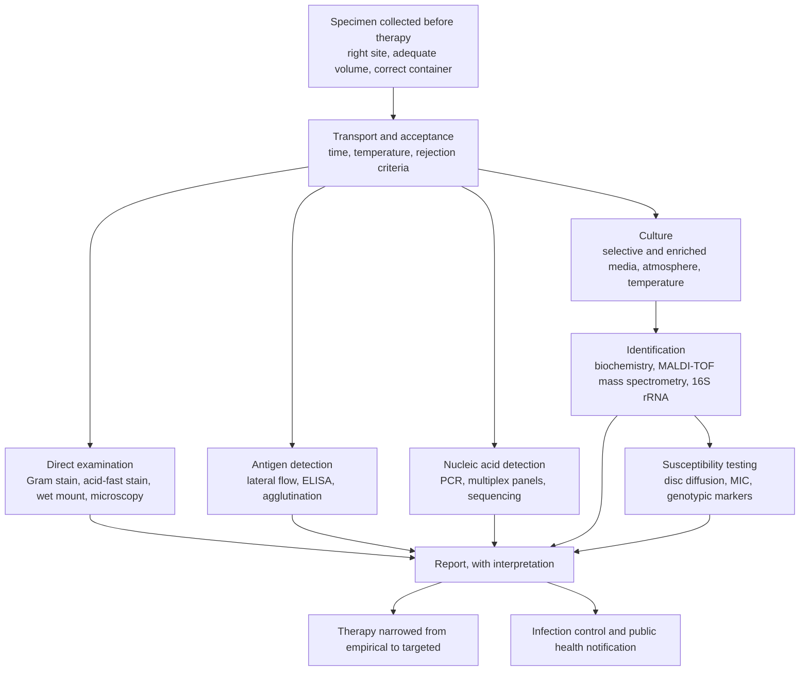

The preceding two chapters examined one host and one pathogen. An infectious disease, however, exists in a population: it is maintained by transmission between hosts, and the quantities that decide whether it persists, spreads or disappears are properties of the population, not of the bacterium. This chapter introduces that level — the vocabulary, the transmission routes, the simple dynamics, the investigation of an outbreak, and the laboratory work that identifies what is causing it.

The boundary with other chapters is deliberate. Immunity, including how vaccination protects an individual, belongs to [7.15](/7.15); the design and analysis of epidemiological studies are [7.7.13](/7.7.13) and [7.7.15](/7.7.15); the mathematics of epidemics on networks is [1.4.7](/1.4.7); identification and susceptibility testing in the laboratory are [7.11.16](/7.11.16) and [7.11.14](/7.11.14); vaccines and herd immunity as applied to viruses are [7.11.28](/7.11.28). Here these threads are drawn together around the question of how an infection moves through a population and how we find out that it is doing so.

## 35.1. The Language of Epidemiology

Epidemiology counts cases, and almost all of its terms are precise ways of counting.

- *Incidence* is the number of *new* cases arising in a population over a period: as a **cumulative incidence** (new cases divided by the population at risk) or an **incidence rate** (new cases per person-time). **Prevalence** is the number of *existing* cases at a point in time. For a disease at steady state the two are related by the duration $D$ of illness, $\text{prevalence} \approx \text{incidence rate} \times D$, which is why a rare but chronic infection can be more prevalent than a common but brief one.
- *Mortality rate* counts deaths in the whole population; *case fatality ratio* counts deaths among diagnosed cases, and *infection fatality ratio* among all infections including the undetected ones. The three differ by orders of magnitude for a disease with many mild cases, and conflating them is the commonest error in reporting a new epidemic.
- *Attack rate* is the cumulative incidence in a defined, usually short, exposure — everyone at a wedding dinner — and the *secondary attack rate* is the proportion of susceptible household contacts of a case who become infected. The latter is one of the few direct measurements of transmissibility.
- An infection is endemic when it is maintained at a roughly constant level in a population, *epidemic* when cases clearly exceed that expectation, and *pandemic* when an epidemic spreads across continents. An *outbreak* is a localized epidemic. The words are statements about a baseline, not about severity: a single case of smallpox would be an outbreak, while tuberculosis killing over a million people a year is endemic.

Several intervals matter, and they are distinct.

| Interval | Definition | Why it matters |
|---|---|---|
| Latent period | infection to the start of infectiousness | with the infectious period, sets the generation time |
| Incubation period | infection to the onset of symptoms | sets quarantine duration; its distribution shapes the epidemic curve |
| Infectious period | the time during which the host transmits | together with contact rate, determines $R_0$ |
| Generation interval | infection of a case to infection of the people it infects | converts $R_0$ into a growth rate |
| Serial interval | symptom onset in a case to onset in those it infects | the observable proxy for the generation interval |

When infectiousness begins *before* symptoms — as in measles, influenza and SARS-CoV-2 — isolation of symptomatic people cannot by itself stop transmission, and this single fact explains much of the difference in controllability between SARS (where infectiousness peaked after symptoms, and isolation worked) and COVID-19.

### 35.1.1. Reservoirs, Sources and Carriers

The *reservoir* is where the pathogen is maintained in nature: humans alone (measles, poliovirus, *Treponema pallidum*), other animals, or the environment (*Clostridium tetani* and *Legionella* in soil and water). The *source* is the immediate origin of a particular infection, which may differ from the reservoir — the reservoir of *Legionella* is biofilm in warm water systems, the source of an outbreak a particular cooling tower. A *carrier* harbors and sheds the organism without symptoms, and may be incubating the disease, convalescing from it, or chronically colonized. Chronic carriage of *Salmonella* Typhi in the gallbladder, which can last decades, is the classical instance.

An infection whose reservoir is non-human is a **zoonosis** ([7.11.27](/7.11.27#sec-27.9)), and that one fact has large consequences: a zoonosis cannot be eradicated by vaccinating people, and most new human pathogens are zoonotic in origin.

**Definition 35.1.1 (Emerging Infectious Disease)** An **emerging infectious disease** is one newly recognized in a population, or one whose incidence or geographical range is rising. The drivers are ecological and social rather than microbiological: changing land use that brings people into contact with new reservoirs, intensive animal production, travel and trade, urbanization, climate change, breakdown of public health infrastructure, and the loss of treatment options to antimicrobial resistance ([7.11.15](/7.11.15)). A *re-emerging* disease is an old one returning — diphtheria where vaccination coverage collapses, measles in the same circumstances, tuberculosis where treatment programs fail.

## 35.2. How Infections Are Transmitted

![Routes of transmission. Direct: person-to-person contact, including sexual contact, and vertical transmission from mother to child across the placenta, during birth or in milk. Respiratory: large droplets that fall within a short distance, and smaller aerosols that stay suspended and travel further — the distinction is a continuum of particle size rather than two categories. Vehicle-borne: water, food, blood products and contaminated objects (fomites). Vector-borne: an arthropod carries the agent, either mechanically on its body or — far more often for the important diseases — *biologically*, replicating in the vector, which then requires temperature and a vector population and makes the disease a problem of ecology and climate as well as of medicine. Each route predicts both the measures that interrupt it (clean water, ventilation, vector control, barrier precautions, sterile technique) and the kind of pathogen that uses it: environmentally fragile organisms travel by direct contact or vectors, robust spores and non-enveloped viruses by vehicles and surfaces](./plots/transmission-routes.py)

| Route | Examples | Interruption |
|---|---|---|
| Direct contact, including sexual | *Staphylococcus aureus*, *Neisseria gonorrhoeae*, *Treponema pallidum*, HIV | hygiene, barrier methods, treatment of partners |
| Vertical (placenta, birth, milk) | *T. pallidum*, *Streptococcus agalactiae*, HIV, cytomegalovirus | screening in pregnancy, antiretroviral therapy, prophylaxis |
| Droplet and aerosol | *Mycobacterium tuberculosis*, *Bordetella pertussis*, *Neisseria meningitidis*, influenza and SARS-CoV-2 | ventilation, masks, isolation, vaccination |
| Fecal–oral, water and food | *Vibrio cholerae*, *Salmonella*, *Campylobacter*, *Shigella*, hepatitis A, norovirus | sanitation, water treatment, food hygiene, handwashing |
| Vehicle: blood, products, fomites | hepatitis B and C, HIV; *Clostridioides difficile* spores on surfaces | screening of donations, single-use devices, sporicidal cleaning |
| Vector-borne | *Yersinia pestis* (fleas), *Borrelia burgdorferi* (ticks), the **rickettsias** (lice, ticks, mites), dengue and Zika viruses (mosquitoes) | vector control, repellents, bed nets, habitat management |
| Environmental, no host-to-host spread | *Clostridium tetani*, *Legionella pneumophila*, *Coccidioides* | wound care, vaccination, water system management |

Two points deserve emphasis. First, a pathogen's transmission route is a strong constraint on its biology: organisms transmitted by the fecal–oral route must survive stomach acid and desiccation, and those transmitted by vectors must survive in an invertebrate at ambient temperature and in a vertebrate at 37 °C, which is why they so often have temperature-regulated gene expression — *Y. pestis* makes its antiphagocytic F1 capsule at 37 °C and not in the flea.

Second, the quality of water is monitored not by looking for pathogens, which are sparse and varied, but by counting **indicator organisms** ([7.11.30](/7.11.30)) — *Escherichia coli* and the coliforms, whose presence shows that fecal contamination has occurred and therefore that enteric pathogens may be present. Food microbiology works on the same logic, with total counts and indicator species as indices of handling and storage rather than as a search for each possible agent.

## 35.3. Epidemics in Populations

### 35.3.1. The Reproduction Number

The **basic reproduction number** $R_0$ ([1.4.7](/1.4.7)) is the average number of secondary infections caused by one infectious individual in a wholly susceptible population; it is the product of the contact rate, the probability of transmission per contact and the duration of infectiousness, so it is as much a property of the society as of the pathogen. The *effective* reproduction number $R_t = R_0 s_t$, where $s_t$ is the susceptible fraction, is what determines whether cases grow at time $t$; an epidemic grows while $R_t > 1$ and declines when it falls below.

### 35.3.2. Why Epidemics End

The decline of an epidemic needs no change in the pathogen or in behavior: as susceptibles are consumed, $s_t$ falls, and when it reaches $1/R_0$ the incidence peaks. The standard SIR model ([1.4.7](/1.4.7)) makes this quantitative, and gives the *final size* equation

$$
1 - r_\infty = \mathrm{e}^{-R_0 r_\infty}, \tag{35.1}
$$

where $r_\infty$ is the fraction of the population eventually infected. Eq. (35.1) has two instructive consequences: the epidemic stops with susceptibles left over, because the last infectious people recover before meeting them; and the final size rises steeply with $R_0$ — about 80 % at $R_0 = 2$, nearly 90 % at $R_0 = 2.5$ and over 99 % at $R_0 = 6$ — so a modest reduction in transmission has a large effect on how many people are ever infected. The threshold for **herd immunity**, $p_{\mathrm{c}} = 1 - 1/R_0$ ([7.11.28](/7.11.28#sec-28.8)), is the same arithmetic read backward.

![Epidemic dynamics. A: SIR epidemics at several values of $R_0$ with the same infectious period. A larger $R_0$ gives an earlier and higher peak. The peak occurs when the susceptible fraction has fallen to $1/R_0$ — that is, at the herd immunity threshold — but transmission does not stop there: cases continue while infectious people remain, which is the overshoot that makes the final size exceed the threshold. B: the final size $r_\infty$ from Eq. (35.1) as a function of $R_0$, with the thresholds for several infections marked; above $R_0 \approx 4$ an uncontrolled epidemic reaches almost everyone. C: heterogeneity. If the number of secondary cases per infection follows a negative binomial distribution with the same mean $R_0 = 2$ but different dispersion $k$, the proportion of infections caused by the most infectious 10 % of cases varies from about a quarter ($k = 10$, nearly homogeneous) to about three quarters ($k = 0.1$, strongly superspreading). Superspreading makes outbreaks more likely to die out by chance after introduction, and makes measures aimed at the settings where transmission concentrates unusually effective](./plots/epidemic-dynamics.py)

### 35.3.3. Heterogeneity and Superspreading

The mean $R_0$ hides the variance. For many infections — SARS, MERS, SARS-CoV-2, tuberculosis — the distribution of secondary cases is strongly overdispersed: most infected people infect no one, and a small minority infect many, usually because of where they were rather than who they were (crowded, poorly ventilated indoor settings, hospital procedures, mass gatherings). Two consequences follow. An introduction into a new population often dies out by chance even when $R_0 > 1$, so successful invasion may require repeated introductions. And control is disproportionately effective when it targets the settings in which transmission concentrates — which is why ventilation and limits on crowding can achieve what the same effort spread uniformly cannot.

### 35.3.4. Network Structure

Contacts are not random. Sexual contact networks, hospital referral networks and air travel all have the heavy-tailed degree distributions treated in [1.4.7](/1.4.7), and on such networks the epidemic threshold is lower than the homogeneous theory predicts, while targeted intervention at highly connected nodes is correspondingly more powerful.

## 35.4. Investigating an Outbreak

Outbreak investigation is a standard procedure, and its logic is an applied form of the causal reasoning of [7.7.15](/7.7.15).

1. Confirm that there is an outbreak, by comparing observed cases with the expected baseline, and confirm the diagnosis.
2. Define a case explicitly, by clinical features, place, time and laboratory criteria; classify cases as suspected, probable or confirmed, and apply the definition consistently, since a definition that shifts during the investigation destroys the comparison.
3. Find cases and describe them by person, place and time: the epidemic curve, a map, and attack rates in subgroups.
4. Form a hypothesis about source and route from that description.
5. Test it analytically, usually by a retrospective cohort study in a defined group (a wedding, a ward) or a case–control study when the population at risk cannot be enumerated ([7.7.13](/7.7.13)).
6. Confirm the hypothesis in the laboratory and in the environment: isolate the organism from the suspected source, and show by typing that the isolates are the same.
7. Control the outbreak and communicate; then write it up, because the generalizable lesson is usually about a system, not about the particular wedding.

![Reading an epidemic curve. A: a common point source — everyone is exposed at one moment, and the distribution of onsets is simply the incubation-period distribution, here lognormal; the curve rises steeply, falls more gently and spans about one incubation period. Working backward from the peak by the median incubation period estimates the time of exposure. B: a propagated outbreak — successive generations of person-to-person transmission give a series of progressively broader peaks about one serial interval apart, which merge as the epidemic grows. C: a continuing common source, where exposure persists (a contaminated water supply) and the curve plateaus until the source is removed. D: the surveillance pyramid: only a fraction of infections produce symptoms, of those only some seek care, of those only some are tested, and only some positive tests are reported — so the reported curve is a scaled and delayed shadow of the true incidence, and the scaling factor changes whenever testing policy changes](./plots/outbreak-curves.py)

### 35.4.1. Molecular and Genomic Epidemiology

Typing turns "these cases look similar" into evidence. Serotyping, phage typing and pulsed-field gel electrophoresis have given way to whole-genome sequencing, which both identifies the organism and resolves transmission: isolates from a single chain of transmission differ by very few single-nucleotide variants, and the number accumulates at a measurable rate ([7.10.24](/7.10.24)), so genomes can date an introduction and order transmission events. Sequencing from clinical samples without culture ([7.8.14](/7.8.14#sec-14.6)) extends this to organisms that do not grow, and to the detection of genuinely unknown agents, which is how several outbreaks of the last decade were solved.

## 35.5. Surveillance, Control and Eradication

*Surveillance* is the continuous, systematic collection and use of health data. *Passive* surveillance relies on reports of notifiable diseases by clinicians and laboratories, is cheap and incomplete; *active* surveillance seeks cases deliberately and is used in elimination campaigns; sentinel surveillance monitors a defined subset intensively; *syndromic* surveillance counts presentations rather than diagnoses, trading specificity for speed; and *environmental* surveillance tests wastewater, which detects circulation of poliovirus or SARS-CoV-2 independently of who seeks care. Each has a characteristic bias, and the first question to ask of any epidemic curve is which of them produced it.

Control measures act at the three links of the chain of infection: the source (treatment, isolation, culling of animal reservoirs, removal of a contaminated source), the route (sanitation, water treatment, ventilation, vector control, sterile technique, barrier precautions) and the susceptible host (vaccination, prophylaxis, nutrition). *Elimination* means ending transmission in a defined geographical area; *eradication* means reducing the worldwide incidence to zero so that measures can stop.

The conditions for eradication are stringent: no non-human reservoir and no long-term environmental persistence, an effective and practical intervention, a reliable diagnostic test, lasting immunity after infection or vaccination, and sustained political and financial commitment. Smallpox met all of them and remains the only human disease eradicated, declared so in 1980; the campaign succeeded less by mass vaccination than by surveillance and ring vaccination around each detected case, which the unmistakable rash made possible. Rinderpest, a cattle disease, was eradicated in 2011. Poliomyelitis meets the biological conditions and has been eliminated from most of the world, but is slowed by asymptomatic transmission — most infections cause no paralysis, so cases are a small and lagging sample of circulation — and by the capacity of the oral vaccine strain to revert and circulate. Measles meets the conditions too, but has the highest herd immunity threshold of any human infection, so elimination is repeatedly lost wherever coverage dips.

## 35.6. Diagnosis: the Clinical Microbiology Laboratory

Clinical microbiology answers two questions: what is the organism, and what will treat it. The workflow is the same whatever the agent.

### 35.6.1. Specimen Quality

A blood culture taken after antibiotics, a sputum sample that is mostly saliva, or a swab transported for two days at room temperature cannot be rescued by any downstream technique. Specimens from normally sterile sites (blood, cerebrospinal fluid, joint fluid) are interpreted directly; specimens from colonized sites (sputum, wounds, stool, urine) require distinguishing the pathogen from the resident microbiota, which is why quantitative thresholds exist — significant bacteriuria is conventionally $\ge 10^5$ colony-forming units per milliliter of a single organism.

### 35.6.2. Methods

Direct microscopy is fast and sometimes decisive (Gram stain of cerebrospinal fluid, acid-fast stain of sputum). Culture remains the reference standard because it yields an isolate for susceptibility testing and typing, but it is slow, and it fails for organisms that will not grow. Identification is now usually by MALDI-TOF mass spectrometry, which matches a protein mass spectrum against a database in minutes, or by 16S rRNA sequencing for unusual isolates ([7.11.16](/7.11.16)). Immunological methods detect either antigen (rapid, specific, moderately sensitive — the basis of lateral-flow tests) or antibody (which reports exposure, needs a rising titre between paired sera to show recent infection, and lags the infection by one to three weeks). Nucleic acid amplification is the most sensitive, detects the unculturable and the already-treated, can be multiplexed into syndromic panels, and is increasingly deployed at the point of care; its weakness is that it detects nucleic acid, which may persist long after viable organisms are gone, and it gives no isolate.

![Reading a diagnostic test. A: sensitivity and specificity are properties of the test; the probability that a positive result is true is not. For a test with 99 % sensitivity and 98 % specificity, the positive predictive value falls below 50 % when the pre-test probability is under 2 %, so screening a low-prevalence population generates mostly false positives — the reason confirmatory algorithms exist. B: the same test used in a patient with a 30 % pre-test probability is informative in both directions. C: timing. Nucleic acid becomes detectable earliest, antigen a little later and only while the agent is abundant, and antibody last, after seroconversion, persisting long after recovery; a negative test taken too early means little, and a positive antibody test means exposure, not current infection. The statistics of predictive values and of comparing a test with a reference standard are in [7.7.3](/7.7.3)](./plots/diagnostic-performance.py)

### 35.6.3. Interpreting a Result

Sensitivity and specificity characterize the test; what a clinician needs is the probability of disease given the result, which also depends on the pre-test probability. The relation is Bayes' theorem ([3.1.2](/3.1.2#sec-2.6)): with sensitivity $\mathrm{Se}$, specificity $\mathrm{Sp}$ and prevalence $\pi$,

$$
\mathrm{PPV} = \frac{\mathrm{Se}\,\pi}{\mathrm{Se}\,\pi + (1 - \mathrm{Sp})(1 - \pi)}. \tag{35.2}
$$

Eq. (35.2) is why a highly specific test can still produce mostly false positives in a screening program, and why the result of a test performed without an indication is hard to act on.

## 35.7. Biosafety

**Definition 35.7.1 (Biosafety Level)** A **biosafety level** (BSL-1 to BSL-4) is a set of laboratory practices, safety equipment and facility design matched to the risk group of the agents handled. The levels are cumulative: each adds requirements to the one below.

| Level | Agents | Principal requirements |
|---|---|---|
| BSL-1 | agents not known to cause disease in healthy adults (*Bacillus subtilis*, laboratory *E. coli* K-12) | standard microbiological practice, open bench, handwashing, decontamination of waste |
| BSL-2 | agents causing treatable human disease, transmitted by ingestion or percutaneous exposure (*Salmonella*, *S. aureus*, hepatitis B virus) | restricted access, biological safety cabinet for aerosol-generating work, sharps rules, autoclaving, immunization where available |
| BSL-3 | agents transmissible by the respiratory route and causing serious disease (*M. tuberculosis*, *Coxiella burnetii*, SARS-CoV-2 culture) | controlled access, directional airflow into the laboratory, exhaust not recirculated, all work in a cabinet, respiratory protection, medical surveillance |
| BSL-4 | agents causing severe disease with no reliable treatment or vaccine (filoviruses) | a dedicated facility, positive-pressure suits or class III cabinets, airlocks, effluent treatment, strict entry and exit protocols |

Risk assessment, not the organism's name alone, sets the level: the volume, the concentration, the procedures and the immune status of the worker all enter. The principles are those of [7.11.10](/7.11.10) applied in reverse — containment rather than destruction — and the same sterilization and disinfection methods are used for decontamination. Comparable frameworks exist for animal and plant pathogens, and for the governance of work that could increase transmissibility or virulence, which is reviewed beyond the laboratory.

## 35.8. Healthcare-Associated Infection

**Definition 35.8.1 (Healthcare-Associated Infection)** A **healthcare-associated infection** is an infection acquired in the course of medical care and not present or incubating on admission.

Hospitals concentrate the three factors that infection needs. The patients are unusually susceptible — extremes of age, underlying disease, immunosuppression, surgery. The procedures breach the natural barriers: intravascular catheters, urinary catheters, ventilation, implanted devices, each of which gives organisms a surface to form a **biofilm** on ([7.11.12](/7.11.12)) and a direct route past the skin or mucosa. And the organisms present have been selected by heavy antimicrobial use, so they are disproportionately resistant ([7.11.15](/7.11.15)): methicillin-resistant *S. aureus*, vancomycin-resistant enterococci, extended-spectrum β-lactamase and carbapenemase producers among the Enterobacterales, *Acinetobacter baumannii*, *Pseudomonas aeruginosa*, and *Clostridioides difficile*, whose spores survive on surfaces and whose expansion follows the disruption of the gut microbiota by antibiotics ([7.11.32](/7.11.32)).

The main syndromes are catheter-associated urinary tract infection, central-line-associated bloodstream infection, ventilator-associated pneumonia, surgical site infection and *C. difficile* colitis. Control is unglamorous and effective: hand hygiene (the lesson of Semmelweis in 1847, resisted for a generation), aseptic insertion and prompt removal of devices, care bundles for each procedure, environmental cleaning with sporicidal agents where *C. difficile* circulates, isolation and cohorting, surveillance with feedback of infection rates to the units concerned, and antimicrobial stewardship to reduce the selective pressure that produced the resistant flora in the first place.

## 35.9. The Major Infectious Diseases, Grouped by Route

The table collects the agents discussed in this course, as a map rather than a clinical manual; the biology of each is in the chapters indicated.

| Route | Bacterial | Viral | Eukaryotic |
|---|---|---|---|
| Respiratory | streptococcal pharyngitis, diphtheria, pertussis, tuberculosis, meningococcal disease, pneumococcal pneumonia, legionellosis | influenza, common colds, measles, COVID-19 | *Pneumocystis*, *Histoplasma*, *Coccidioides* ([7.11.21](/7.11.21)) |
| Direct and sexual contact | staphylococcal skin infection, gonorrhea, syphilis, chlamydial infection, *Helicobacter pylori* gastritis | HIV, hepatitis B, herpes simplex, human papillomavirus | *Trichomonas* ([7.11.20](/7.11.20)) |
| Fecal–oral, water and food | cholera, typhoid, salmonellosis, shigellosis, campylobacteriosis, listeriosis, enterohemorrhagic *E. coli*, staphylococcal and clostridial food poisoning | hepatitis A, poliovirus, norovirus, rotavirus | *Giardia*, *Entamoeba*, *Cryptosporidium* ([7.11.20](/7.11.20)) |
| Vector-borne | plague, Lyme disease, rickettsioses | dengue, yellow fever, Zika, West Nile | malaria, leishmaniasis, trypanosomiasis ([7.11.20](/7.11.20)) |
| Soil, water and wounds | tetanus, gas gangrene, anthrax, melioidosis | — | *Aspergillus*, mycetoma ([7.11.21](/7.11.21)) |
| Zoonotic, animal contact | brucellosis, Q fever, leptospirosis, cat-scratch disease | rabies, hantavirus, avian influenza | toxoplasmosis |

Helminth infections, though a large part of the global infectious disease burden, are not microbiology and belong with the invertebrates ([7.17](/7.17)).

## Summary

- Epidemiology counts: incidence against **prevalence** (related by duration), mortality against case fatality against infection fatality, attack rates and secondary attack rates. Endemic, epidemic, pandemic and outbreak are statements about a baseline, not about severity.
- Latent, incubation, infectious, generation and serial intervals are distinct; infectiousness beginning before symptoms is what makes an infection hard to control by isolation.
- Reservoir, source and carrier are distinguished; a **zoonosis** cannot be eradicated by human vaccination. **Emerging infectious diseases** (Definition 35.1.1) arise mainly from ecological and social change.
- Transmission is by direct contact, vertically, by droplet and aerosol, by vehicles (water, food, blood, fomites), by vectors (usually biologically, with replication in the arthropod), or from the environment; the route constrains the pathogen's biology and dictates the control measure. Water and food are monitored with **indicator organisms**.
- $R_t = R_0 s_t$ governs growth; epidemics peak when $s_t = 1/R_0$ and end with susceptibles remaining, with final size given by $1 - r_\infty = \mathrm{e}^{-R_0 r_\infty}$ (Eq. 35.1). Overdispersed transmission (superspreading) makes introductions more likely to fail and setting-specific control more effective.
- Outbreak investigation follows a fixed sequence from case definition to analytical study to laboratory confirmation; whole-genome sequencing now resolves transmission chains directly.
- Surveillance may be passive, active, sentinel, syndromic or environmental, each with its own bias; eradication requires no non-human reservoir, lasting immunity, a good test and an effective intervention, which so far only smallpox has fully satisfied.
- Diagnosis depends first on specimen quality; microscopy, culture with MALDI-TOF identification, antigen and antibody detection, and nucleic acid amplification have complementary strengths. Predictive value depends on pre-test probability (Eq. 35.2), not on sensitivity and specificity alone.
- **Biosafety levels** (Definition 35.7.1) BSL-1 to BSL-4 combine practice, equipment and facility design by risk. **Healthcare-associated infections** (Definition 35.8.1) arise from susceptible hosts, barrier-breaching devices and a resistant flora, and are controlled by hand hygiene, device care bundles, cleaning, surveillance and stewardship.

## Questions

1. A chronic infection has an incidence rate of 50 new cases per 100 000 person-years and an average duration of 10 years; an acute one has 5000 new cases per 100 000 person-years and lasts a week. Compare their prevalences, and say which figure a hospital planner and which a vaccine trial designer should use.

   **Answer** Prevalence ≈ incidence rate × duration. Chronic: $50 \times 10^{-5} \times 10 = 5\times10^{-3}$, about 500 per 100 000. Acute: $5000 \times 10^{-5} \times (1/52) \approx 9.6\times10^{-4}$, about 96 per 100 000. The chronic disease is five times as prevalent though a hundred times rarer in new cases. A planner sizing a service needs prevalence (how many patients exist to care for); a trial designer needs incidence, since the trial's power comes from new events occurring during follow-up.

2. Two infections both have $R_0 = 2$, but one has a dispersion parameter $k = 10$ and the other $k = 0.1$. How will their epidemics differ after a single introduction, and what does this imply for control?

   **Answer** With $k = 10$ transmission is nearly homogeneous: most infected people infect about two others, so an introduction almost always takes off and the epidemic grows smoothly. With $k = 0.1$ most cases infect nobody and a few infect many, so most introductions die out by chance and establishment requires repeated introductions, after which growth is erratic and driven by superspreading events. Control of the overdispersed infection should target the settings where those events happen (crowding, poor ventilation, particular procedures), which removes a disproportionate share of transmission; uniform measures are comparatively wasteful.

3. An epidemic curve shows a single sharp peak spanning about five days, with cases from one village. What kind of source does this suggest, how would you estimate the exposure time, and what would a propagated outbreak look like instead?

   **Answer** A common point source: everyone exposed at one moment, so the onsets simply trace the incubation-period distribution — a rapid rise, a slower tail, spanning roughly one incubation period. Subtracting the median incubation period from the peak estimates the time of exposure (and the earliest and latest cases bracket it). A propagated outbreak would instead show successive waves about one serial interval apart, each broader and usually taller than the last, merging as the epidemic grows.

4. A test with 99 % sensitivity and 98 % specificity is used to screen a population in which the infection's prevalence is 0.5 %. What fraction of positives are true, and what should be done about it?

   **Answer** By Eq. (35.2), $\mathrm{PPV} = (0.99 \times 0.005) / (0.99 \times 0.005 + 0.02 \times 0.995) = 0.00495/0.02485 \approx 0.20$: only one positive in five is a true positive. The answer is not a better single test but an algorithm — confirm positives with a second, independent test of high specificity (as serological algorithms for HIV and syphilis do), restrict screening to groups with a higher pre-test probability, or report the result with its predictive value rather than as a bare positive.

5. Smallpox has been eradicated; measles, with an effective vaccine and no animal reservoir, has not. Give the biological and practical reasons, and say what each implies for a poliomyelitis campaign.

   **Answer** Smallpox had an unmistakable rash, so every case could be found and contacts vaccinated in a ring; infectiousness coincided with the rash, there were no subclinical transmitters, and one vaccine dose sufficed. Measles has $R_0 \approx 12$–18, requiring 92–95 % immunity sustained indefinitely, and is so transmissible that any local fall in coverage restores circulation. Polio lies between: it meets the biological conditions, but most infections are asymptomatic, so surveillance of paralytic cases detects only a small, delayed fraction of transmission — hence environmental surveillance of wastewater — and the live oral vaccine can revert and circulate, which is why inactivated vaccine takes over in the final stage.
