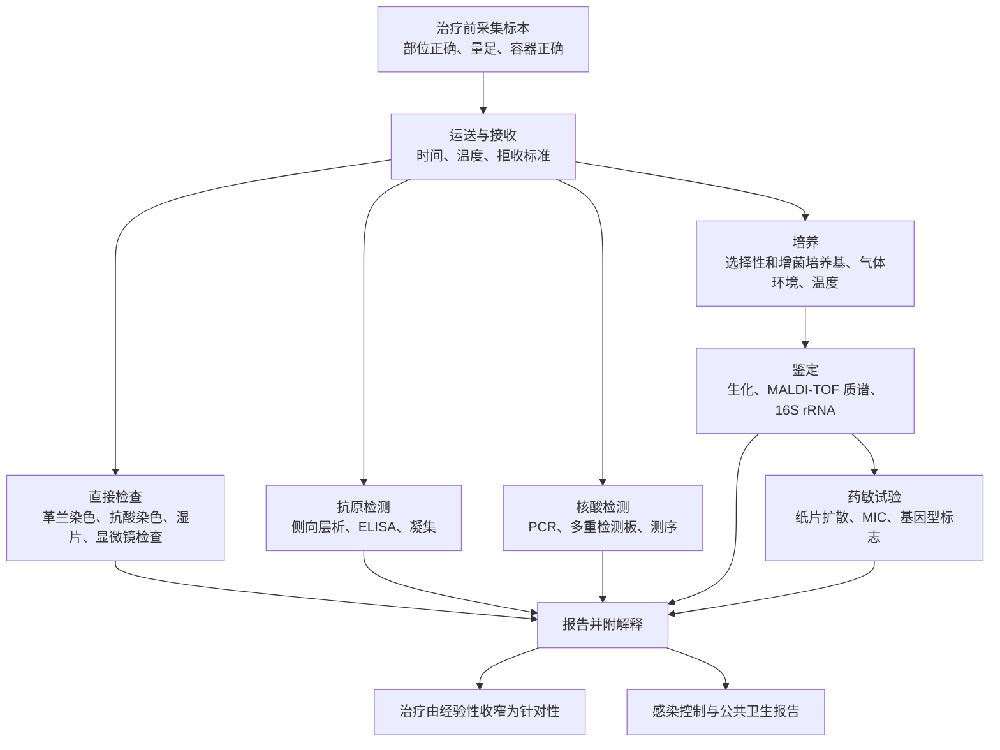

前两章考察的是一个宿主和一种病原体。然而传染病存在于种群之中：它靠宿主之间的传播来维持，决定它是持续、扩散还是消失的量是种群的属性，而不是细菌的属性。本章介绍这一层面——术语、传播途径、简单的动力学、暴发的调查，以及查明其病因的实验室工作。

与其他章的界线是有意划定的。免疫，包括疫苗如何保护个体，属于 [7.15](/7.15)；流行病学研究的设计与分析见 [7.7.13](/7.7.13) 和 [7.7.15](/7.7.15)；网络上流行的数学见 [1.4.7](/1.4.7)；实验室中的鉴定与药敏试验见 [7.11.16](/7.11.16) 和 [7.11.14](/7.11.14)；疫苗及其对病毒的群体免疫应用见 [7.11.28](/7.11.28)。这里把这些线索围绕一个问题收拢起来：感染如何在种群中传播，以及我们如何发现它正在传播。

## 35.1. 流行病学的语言

流行病学数病例，其几乎所有术语都是计数的精确方式。

- *发病率*是一段时间内种群中产生的*新*病例数：可表示为**累积发病率**（新病例数除以危险人群数）或**发病密度**（每人时的新病例数）。**患病率**是某一时间点的*现有*病例数。对于处于稳态的疾病，两者通过疾病持续时间 $D$ 联系起来：$\text{prevalence} \approx \text{incidence rate} \times D$，这就是为什么罕见但慢性的感染可能比常见但短暂的感染患病率更高。
- *死亡率*计算全人群中的死亡；*病死率*（case fatality ratio）计算确诊病例中的死亡，*感染病死率*（infection fatality ratio）计算包括未检出者在内的所有感染中的死亡。对于有许多轻症病例的疾病，三者相差几个数量级，混淆它们是报道新流行病时最常见的错误。
- *罹患率*（attack rate）是在确定的、通常较短的暴露中的累积发病率——婚宴上的所有人——*二代罹患率*（secondary attack rate）是病例的易感家庭接触者中被感染的比例。后者是传播力为数不多的直接测量之一。
- 感染在种群中以大致恒定的水平维持称为地方性流行，病例明显超过这一预期称为*流行*，流行跨越大陆称为*大流行*。*暴发*是局部的流行。这些词是关于基线的陈述，而不是关于严重程度：单个天花病例就是暴发，而每年夺去一百多万人生命的结核则是地方性流行。

有几个时间间隔很重要，而且各不相同。

| 间隔 | 定义 | 为什么重要 |
|---|---|---|
| 潜隐期（latent period） | 从感染到开始具有传染性 | 与传染期一起决定世代时间 |
| 潜伏期（incubation period） | 从感染到症状出现 | 决定隔离时长；其分布决定流行曲线的形状 |
| 传染期 | 宿主传播的时间 | 与接触率一起决定 $R_0$ |
| 世代间隔 | 从一个病例被感染到其所感染的人被感染 | 把 $R_0$ 转换为增长率 |
| 序列间隔 | 从一个病例发病到其所感染者发病 | 世代间隔的可观测替代量 |

当传染性在症状*之前*开始时——如麻疹、流感和 SARS-CoV-2——仅隔离有症状的人不能阻止传播，这一事实就解释了 SARS（传染性在症状之后达到高峰，隔离有效）与 COVID-19 在可控性上的大部分差别。

### 35.1.1. 储存宿主、传染源与携带者

*储存宿主*（reservoir）是病原体在自然界中得以维持之处：仅人类（麻疹、脊髓灰质炎病毒、*Treponema pallidum*）、其他动物，或环境（土壤和水中的 *Clostridium tetani* 和 *Legionella*）。*传染源*（source）是某一次感染的直接来源，可能与储存宿主不同——*Legionella* 的储存宿主是温水系统中的生物被膜，一次暴发的传染源则是某一座冷却塔。*携带者*无症状地带有并排出该生物，可能处于疾病的潜伏期、恢复期或慢性定殖。*Salmonella* Typhi 在胆囊中的慢性携带可持续数十年，是经典的例子。

储存宿主为非人类的感染是**人兽共患病**（[7.11.27](/7.11.27#sec-27.9)），这一事实有重大后果：人兽共患病不能靠给人接种疫苗来消灭，而且大多数新的人类病原体起源于动物。

**定义 35.1.1（新发传染病，Emerging Infectious Disease）** **新发传染病**是在某一人群中新被认识的疾病，或其发病率或地理范围正在上升的疾病。驱动因素是生态和社会的，而不是微生物学的：使人接触新储存宿主的土地利用变化、集约化动物生产、旅行与贸易、城市化、气候变化、公共卫生基础设施的崩溃，以及由于抗微生物药物耐药性而失去治疗选择（[7.11.15](/7.11.15)）。*再现*疾病是回归的旧疾病——疫苗接种覆盖率崩溃之处的白喉和麻疹，治疗计划失败之处的结核。

## 35.2. 感染如何传播

| 途径 | 例子 | 阻断 |
|---|---|---|
| 直接接触，包括性接触 | *Staphylococcus aureus*、*Neisseria gonorrhoeae*、*Treponema pallidum*、HIV | 卫生、屏障方法、治疗性伴侣 |
| 垂直（胎盘、分娩、乳汁） | *T. pallidum*、*Streptococcus agalactiae*、HIV、巨细胞病毒 | 孕期筛查、抗逆转录病毒治疗、预防用药 |
| 飞沫和气溶胶 | *Mycobacterium tuberculosis*、*Bordetella pertussis*、*Neisseria meningitidis*、流感和 SARS-CoV-2 | 通风、口罩、隔离、疫苗接种 |
| 粪–口、水和食物 | *Vibrio cholerae*、*Salmonella*、*Campylobacter*、*Shigella*、甲型肝炎、诺如病毒 | 卫生设施、水处理、食品卫生、洗手 |
| 媒介物：血液、制品、污染物 | 乙型和丙型肝炎、HIV；表面上的 *Clostridioides difficile* 芽孢 | 献血筛查、一次性器械、杀芽孢清洁 |
| 媒介生物传播 | *Yersinia pestis*（蚤）、*Borrelia burgdorferi*（蜱）、**立克次氏体**（虱、蜱、螨）、登革和寨卡病毒（蚊） | 媒介控制、驱避剂、蚊帐、生境管理 |
| 环境，无宿主间传播 | *Clostridium tetani*、*Legionella pneumophila*、*Coccidioides* | 伤口护理、疫苗接种、供水系统管理 |

有两点需要强调。第一，病原体的传播途径对其生物学是强约束：经粪–口途径传播的生物必须耐受胃酸和干燥，经媒介生物传播的生物必须既能在环境温度下存活于无脊椎动物体内，又能在 37 °C 下存活于脊椎动物体内，这就是它们常常具有温度调控的基因表达的原因——*Y. pestis* 在 37 °C 下产生抗吞噬的 F1 荚膜，在跳蚤体内则不产生。

第二，水质的监测不是通过寻找稀少而多样的病原体，而是通过计数**指示菌**（[7.11.30](/7.11.30)）——*Escherichia coli* 和大肠菌群，其存在表明发生了粪便污染，因而肠道病原体可能存在。食品微生物学基于同样的逻辑，以总菌数和指示菌作为处理和储存状况的指标，而不是搜寻每一种可能的病原。

## 35.3. 种群中的流行

### 35.3.1. 再生数

**基本再生数** $R_0$（[1.4.7](/1.4.7)）是一个传染性个体在完全易感的种群中引起的平均二代感染数；它是接触率、每次接触的传播概率和传染期长度的乘积，因此既是病原体的属性，也是社会的属性。*有效*再生数 $R_t = R_0 s_t$，其中 $s_t$ 是易感者比例，决定时刻 $t$ 病例是否增长；$R_t > 1$ 时流行增长，降到 1 以下时下降。

### 35.3.2. 流行为什么会结束

流行的下降无需病原体或行为发生任何改变：随着易感者被消耗，$s_t$ 下降，降到 $1/R_0$ 时发病率达到峰值。标准的 SIR 模型（[1.4.7](/1.4.7)）使之定量化，并给出*最终规模*方程

$$
1 - r_\infty = \mathrm{e}^{-R_0 r_\infty}, \tag{35.1}
$$

其中 $r_\infty$ 是最终被感染的人口比例。式 (35.1) 有两个有启发性的推论：流行停止时仍有易感者剩下，因为最后的传染性个体在遇到他们之前就康复了；最终规模随 $R_0$ 急剧上升——$R_0 = 2$ 时约 80 %，$R_0 = 2.5$ 时近 90 %，$R_0 = 6$ 时超过 99 %——因此传播的适度降低对最终有多少人被感染有很大影响。**群体免疫**的阈值 $p_{\mathrm{c}} = 1 - 1/R_0$（[7.11.28](/7.11.28#sec-28.8)）是同样的算术倒过来读。

### 35.3.3. 异质性与超级传播

均值 $R_0$ 掩盖了方差。对于许多感染——SARS、MERS、SARS-CoV-2、结核——二代病例的分布是强烈过度离散的：大多数感染者不传染任何人，少数人传染许多人，通常是因为他们所处的场合而不是他们是谁（拥挤、通风不良的室内场所、医院操作、群体聚集）。由此得出两个后果。即使 $R_0 > 1$，引入到新种群中的感染也常常偶然消亡，因此成功入侵可能需要反复引入。而当控制针对传播集中的场所时，效果不成比例地好——这就是为什么通风和限制拥挤能达到同样力度均匀分摊时达不到的效果。

### 35.3.4. 网络结构

接触不是随机的。性接触网络、医院转诊网络和航空旅行都具有 [1.4.7](/1.4.7) 中讨论的重尾度分布，在这样的网络上，流行阈值比均匀理论预测的更低，而针对高连接度节点的定向干预相应更有威力。

## 35.4. 调查暴发

暴发调查有标准程序，其逻辑是 [7.7.15](/7.7.15) 因果推理的应用形式。

1. 通过比较观察到的病例与预期基线，确认存在暴发，并确认诊断。
2. 明确定义病例，依据临床特征、地点、时间和实验室标准；把病例分为疑似、可能或确诊，并一致地应用该定义，因为调查过程中变动的定义会破坏比较。
3. 找出病例并按人、地、时描述：流行曲线、地图和亚组罹患率。
4. 根据该描述形成关于来源和途径的假设。
5. 通过分析检验它，通常是在确定的群体（婚宴、病房）中做回顾性队列研究，或在无法列举危险人群时做病例–对照研究（[7.7.13](/7.7.13)）。
6. 在实验室和环境中确认假设：从可疑来源分离出该生物，并通过分型表明分离株相同。
7. 控制暴发并沟通；然后写成报告，因为可推广的教训通常关乎一个系统，而不是那场特定的婚宴。

### 35.4.1. 分子与基因组流行病学

分型把"这些病例看起来相似"变成证据。血清分型、噬菌体分型和脉冲场凝胶电泳已让位于全基因组测序，后者既鉴定生物，又解析传播：来自同一条传播链的分离株只相差很少的单核苷酸变异，其数目以可测的速率累积（[7.10.24](/7.10.24)），因此基因组可以确定一次引入的时间并排列传播事件的顺序。不经培养直接对临床样本测序（[7.8.14](/7.8.14#sec-14.6)）把这一做法扩展到不能生长的生物，以及真正未知病原的检测，过去十年中有数次暴发就是这样查明的。

## 35.5. 监测、控制与消灭

*监测*是连续、系统地收集和使用健康数据。*被动*监测依赖临床医生和实验室对法定传染病的报告，成本低而不完整；*主动*监测有意寻找病例，用于消除运动；哨点监测对确定的子集进行密集监测；*症候群*监测计数就诊表现而不是诊断，以特异性换速度；*环境*监测检测废水，可不依赖谁去就医而检出脊髓灰质炎病毒或 SARS-CoV-2 的流行。每种监测都有特征性的偏倚，对任何流行曲线首先要问的是它由哪一种产生。

控制措施作用于感染链的三个环节：传染源（治疗、隔离、扑杀动物储存宿主、清除被污染的来源）、途径（卫生设施、水处理、通风、媒介控制、无菌技术、屏障预防）和易感宿主（疫苗接种、预防用药、营养）。*消除*指在确定的地理区域内终止传播；*消灭*指把全球发病率降为零，使措施得以停止。

消灭的条件很严格：没有非人类储存宿主且没有长期的环境持续存在，有有效而可行的干预，有可靠的诊断试验，感染或接种后有持久免疫，并有持续的政治和财政承诺。天花满足所有条件，至今仍是唯一被消灭的人类疾病，于 1980 年宣布；这场运动的成功与其说靠大规模接种，不如说靠监测和围绕每个发现的病例进行的环形接种，而这得益于皮疹的特征无可混淆。牛瘟是牛的疾病，于 2011 年被消灭。脊髓灰质炎满足生物学条件，已在世界大部分地区被消除，但受制于无症状传播——大多数感染不引起麻痹，病例只是流行的一个小而滞后的样本——以及口服疫苗株回复并传播的能力。麻疹也满足条件，但其群体免疫阈值在所有人类感染中最高，因此凡覆盖率下降之处，消除成果就一再丧失。

## 35.6. 诊断：临床微生物学实验室

临床微生物学回答两个问题：这是什么生物，什么能治疗它。无论病原是什么，工作流程都相同。

### 35.6.1. 标本质量

抗生素之后采集的血培养、主要是唾液的痰样本，或在室温下运送两天的拭子，都无法由任何下游技术挽救。来自正常无菌部位（血液、脑脊液、关节液）的标本直接解读；来自有定殖部位（痰、伤口、粪便、尿）的标本需要把病原体与常驻微生物群区分开，这就是为什么存在定量阈值——显著菌尿通常定义为单一生物 $\ge 10^5$ 菌落形成单位每毫升。

### 35.6.2. 方法

直接显微镜检查快速，有时具有决定性（脑脊液革兰染色、痰抗酸染色）。培养仍是参照标准，因为它得到用于药敏试验和分型的分离株，但它慢，而且对不生长的生物无效。鉴定现在通常用 MALDI-TOF 质谱，几分钟内把蛋白质质谱与数据库匹配，或对不常见的分离株用 16S rRNA 测序（[7.11.16](/7.11.16)）。免疫学方法检测抗原（快速、特异、灵敏度中等——侧向层析试验的基础）或抗体（反映暴露，需要双份血清间滴度上升才能表明近期感染，并比感染滞后一至三周）。核酸扩增最灵敏，能检出不可培养和已治疗的病原，可多重化为症候群检测板，并越来越多地部署在床旁；其弱点是检测的是核酸，它可能在活生物消失很久之后仍然存在，并且不给出分离株。

](./plots/diagnostic-performance.py)

### 35.6.3. 解读结果

灵敏度和特异度刻画试验；临床医生需要的是给定结果下患病的概率，它还取决于验前概率。其关系就是 Bayes 定理（[3.1.2](/3.1.2#sec-2.6)）：设灵敏度为 $\mathrm{Se}$，特异度为 $\mathrm{Sp}$，患病率为 $\pi$，则

$$
\mathrm{PPV} = \frac{\mathrm{Se}\,\pi}{\mathrm{Se}\,\pi + (1 - \mathrm{Sp})(1 - \pi)}. \tag{35.2}
$$

式 (35.2) 说明了为什么高度特异的试验在筛查项目中仍可能主要产生假阳性，也说明了为什么没有指征而做的试验结果很难据以行动。

## 35.7. 生物安全

**定义 35.7.1（生物安全等级，Biosafety Level）** **生物安全等级**（BSL-1 至 BSL-4）是与所处理病原体的风险组相匹配的一套实验室操作规程、安全设备和设施设计。各等级是累积的：每一级都在下一级的基础上增加要求。

| 等级 | 病原体 | 主要要求 |
|---|---|---|
| BSL-1 | 不知会在健康成人中致病的病原体（*Bacillus subtilis*、实验室 *E. coli* K-12） | 标准微生物学操作、开放实验台、洗手、废物去污 |
| BSL-2 | 引起可治疗的人类疾病、经摄入或经皮暴露传播的病原体（*Salmonella*、*S. aureus*、乙型肝炎病毒） | 限制进入、产气溶胶操作使用生物安全柜、锐器规定、高压灭菌、有条件时免疫接种 |
| BSL-3 | 可经呼吸道传播并引起严重疾病的病原体（*M. tuberculosis*、*Coxiella burnetii*、SARS-CoV-2 培养） | 受控进入、气流定向流入实验室、排气不循环、所有操作在安全柜中进行、呼吸防护、医学监护 |
| BSL-4 | 引起严重疾病、没有可靠治疗或疫苗的病原体（丝状病毒） | 专用设施、正压防护服或 III 级安全柜、气闸、污水处理、严格的进出规程 |

决定等级的是风险评估，而不仅是生物的名称：体积、浓度、操作和工作人员的免疫状态都要考虑。其原则是 [7.11.10](/7.11.10) 的反向应用——遏制而不是消灭——去污所用的灭菌和消毒方法也相同。动物和植物病原体也有可比的框架，对可能增加传播性或毒力的研究也有相应的治理，这类治理超出了实验室的范围。

## 35.8. 医院获得性感染

**定义 35.8.1（医院获得性感染，Healthcare-Associated Infection）** **医院获得性感染**是在医疗过程中获得的、入院时不存在也不在潜伏的感染。

医院集中了感染所需的三个因素。患者异常易感——年龄极端、基础疾病、免疫抑制、手术。操作突破自然屏障：血管内导管、导尿管、通气、植入器械，每一种都给生物提供形成**生物被膜**的表面（[7.11.12](/7.11.12)），并提供越过皮肤或黏膜的直接途径。而且存在的生物经过大量使用抗微生物药物的选择，因此不成比例地耐药（[7.11.15](/7.11.15)）：耐甲氧西林 *S. aureus*、耐万古霉素肠球菌、肠杆菌目中产超广谱 β-内酰胺酶和碳青霉烯酶的菌株、*Acinetobacter baumannii*、*Pseudomonas aeruginosa*，以及 *Clostridioides difficile*，其芽孢在表面存活，其扩张紧随抗生素对肠道微生物群的破坏（[7.11.32](/7.11.32)）。

主要的综合征有导管相关尿路感染、中心静脉导管相关血流感染、呼吸机相关肺炎、手术部位感染和 *C. difficile* 结肠炎。控制不起眼但有效：手卫生（1847 年 Semmelweis 的教训，被抵制了一代人）、无菌置入和及时拔除器械、各项操作的集束化护理、*C. difficile* 流行处用杀芽孢制剂清洁环境、隔离和同类患者集中安置、把感染率反馈给相关科室的监测，以及抗微生物药物管理，以减轻当初产生耐药菌群的选择压力。

## 35.9. 按途径分组的主要传染病

下表汇集本课程所讨论的病原体，是一张地图而不是临床手册；每一种的生物学见所指出的各章。

| 途径 | 细菌 | 病毒 | 真核生物 |
|---|---|---|---|
| 呼吸道 | 链球菌咽炎、白喉、百日咳、结核、脑膜炎球菌病、肺炎球菌肺炎、军团菌病 | 流感、普通感冒、麻疹、COVID-19 | *Pneumocystis*、*Histoplasma*、*Coccidioides*（[7.11.21](/7.11.21)） |
| 直接和性接触 | 葡萄球菌皮肤感染、淋病、梅毒、衣原体感染、*Helicobacter pylori* 胃炎 | HIV、乙型肝炎、单纯疱疹、人乳头瘤病毒 | *Trichomonas*（[7.11.20](/7.11.20)） |
| 粪–口、水和食物 | 霍乱、伤寒、沙门菌病、志贺菌病、弯曲菌病、李斯特菌病、肠出血性 *E. coli*、葡萄球菌和梭菌食物中毒 | 甲型肝炎、脊髓灰质炎病毒、诺如病毒、轮状病毒 | *Giardia*、*Entamoeba*、*Cryptosporidium*（[7.11.20](/7.11.20)） |
| 媒介生物传播 | 鼠疫、莱姆病、立克次体病 | 登革热、黄热病、寨卡、西尼罗 | 疟疾、利什曼病、锥虫病（[7.11.20](/7.11.20)） |
| 土壤、水和伤口 | 破伤风、气性坏疽、炭疽、类鼻疽 | — | *Aspergillus*、足菌肿（[7.11.21](/7.11.21)） |
| 人兽共患，接触动物 | 布鲁氏菌病、Q 热、钩端螺旋体病、猫抓病 | 狂犬病、汉坦病毒、禽流感 | 弓形虫病 |

蠕虫感染虽然占全球传染病负担的很大一部分，但不属于微生物学，而归入无脊椎动物（[7.17](/7.17)）。

## 小结

- 流行病学是计数：发病率与**患病率**（由持续时间联系）、死亡率与病死率与感染病死率、罹患率与二代罹患率。地方性流行、流行、大流行和暴发是关于基线的陈述，而不是关于严重程度。
- 潜隐期（latent）、潜伏期（incubation）、传染期、世代间隔和序列间隔各不相同；传染性在症状之前开始，使感染难以通过隔离控制。
- 储存宿主、传染源和携带者有所区别；**人兽共患病**不能靠给人接种疫苗来消灭。**新发传染病**（定义 35.1.1）主要源于生态和社会变化。
- 传播经直接接触、垂直、飞沫和气溶胶、媒介物（水、食物、血液、污染物）、媒介生物（通常是生物性的，在节肢动物体内复制）或来自环境；途径约束病原体的生物学，并决定控制措施。水和食物用**指示菌**监测。
- $R_t = R_0 s_t$ 决定增长；流行在 $s_t = 1/R_0$ 时达到峰值并在仍有易感者时结束，最终规模由 $1 - r_\infty = \mathrm{e}^{-R_0 r_\infty}$ 给出（式 35.1）。过度离散的传播（超级传播）使引入更易失败，使针对特定场所的控制更有效。
- 暴发调查遵循从病例定义到分析性研究再到实验室确认的固定顺序；全基因组测序现在可直接解析传播链。
- 监测可以是被动、主动、哨点、症候群或环境监测，各有其偏倚；消灭要求没有非人类储存宿主、有持久免疫、有好的试验和有效的干预，迄今只有天花完全满足。
- 诊断首先取决于标本质量；显微镜检查、带 MALDI-TOF 鉴定的培养、抗原和抗体检测以及核酸扩增各有互补的长处。预测值取决于验前概率（式 35.2），而不仅取决于灵敏度和特异度。
- **生物安全等级**（定义 35.7.1）BSL-1 至 BSL-4 按风险结合操作规程、设备和设施设计。**医院获得性感染**（定义 35.8.1）源于易感宿主、突破屏障的器械和耐药菌群，通过手卫生、器械集束化护理、清洁、监测和管理来控制。

## 思考题

1. 一种慢性感染的发病率为每 100 000 人年 50 例新病例，平均病程 10 年；一种急性感染为每 100 000 人年 5000 例新病例，病程一周。比较它们的患病率，并说明医院规划者和疫苗试验设计者各应使用哪个数字。

   **答** 患病率 ≈ 发病率 × 病程。慢性：$50 \times 10^{-5} \times 10 = 5\times10^{-3}$，约每 100 000 人 500 例。急性：$5000 \times 10^{-5} \times (1/52) \approx 9.6\times10^{-4}$，约每 100 000 人 96 例。慢性病的患病率是前者的五倍，尽管新病例数少一百倍。规划服务规模的人需要患病率（有多少患者需要照护）；试验设计者需要发病率，因为试验的效力来自随访期间发生的新事件。

2. 两种感染的 $R_0$ 都是 2，但一个的离散参数 $k = 10$，另一个 $k = 0.1$。单次引入后它们的流行会有何不同？这对控制意味着什么？

   **答** $k = 10$ 时传播近乎均匀：大多数感染者传染约两个人，因此一次引入几乎总会起势，流行平稳增长。$k = 0.1$ 时大多数病例不传染任何人，少数传染许多人，因此大多数引入偶然消亡，要建立需要反复引入，之后增长不稳定，由超级传播事件驱动。过度离散感染的控制应针对这些事件发生的场所（拥挤、通风不良、特定操作），这能去除不成比例的传播份额；均匀措施相对浪费。

3. 一条流行曲线显示单个尖锐的峰，跨度约五天，病例来自一个村庄。这提示什么类型的来源？如何估计暴露时间？传播型暴发看起来会是什么样？

   **答** 共同点源：所有人在同一时刻暴露，因此发病时间的分布恰好描绘潜伏期分布——快速上升、较慢的尾部，跨度大约一个潜伏期。从峰值减去中位潜伏期可估计暴露时间（最早和最晚的病例给出其范围）。传播型暴发则会显示相隔约一个序列间隔的相继波，每个波比上一个更宽，通常也更高，随着流行扩大而融合。

4. 一个灵敏度 99 %、特异度 98 % 的试验用于筛查感染患病率为 0.5 % 的人群。阳性中有多大比例是真的？应当怎么办？

   **答** 由式 (35.2)，$\mathrm{PPV} = (0.99 \times 0.005) / (0.99 \times 0.005 + 0.02 \times 0.995) = 0.00495/0.02485 \approx 0.20$：五个阳性中只有一个是真阳性。解决办法不是更好的单个试验，而是一套算法——用第二个独立的高特异度试验确证阳性（如 HIV 和梅毒的血清学算法），把筛查限于验前概率较高的群体，或者连同预测值一起报告结果而不是只报告单纯的阳性。

5. 天花已被消灭；麻疹有有效疫苗且没有动物储存宿主，却没有被消灭。给出生物学和实际方面的原因，并说明各自对脊髓灰质炎运动意味着什么。

   **答** 天花有无可混淆的皮疹，因此每个病例都能被发现，接触者可环形接种；传染性与皮疹同时出现，没有亚临床传播者，一剂疫苗就足够。麻疹的 $R_0 \approx 12$–18，需要 92–95 % 的免疫并无限期维持，传播性极强，任何局部覆盖率的下降都会使传播恢复。脊髓灰质炎介于两者之间：它满足生物学条件，但大多数感染无症状，因此对麻痹病例的监测只能检出传播中小而滞后的一部分——故需要对废水做环境监测——而且口服活疫苗可以回复并传播，这就是为什么最后阶段由灭活疫苗接替。
