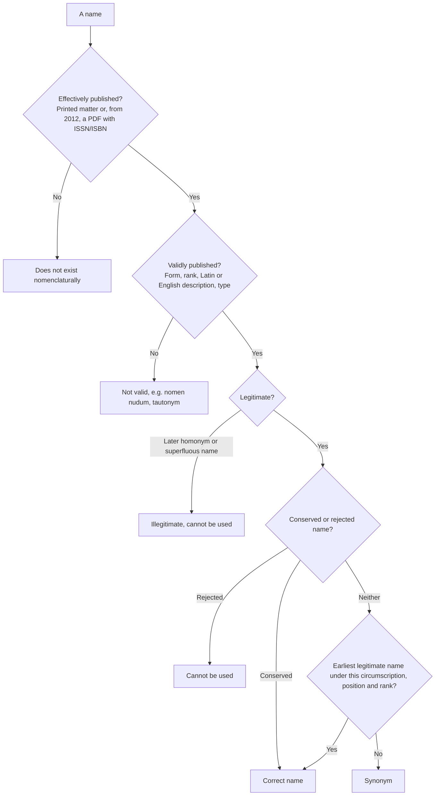

Taxonomy is the oldest branch of botany and the foundation of the others: to study a plant we must first know what it is, what it is called, and which plants are its closest relatives. This chapter presents the basic tools of plant taxonomy: taxonomic ranks and species, the structure of scientific names, the international code that governs the names of algae, fungi and plants, the methods of recognizing and identifying plants (observation, keys, reference works and herbaria), and the principles and methods of basing classification on phylogeny. How to read phylogenetic trees and how to infer them were treated in evolutionary biology and bioinformatics ([7.10.2](/7.10.2), [7.10.20](/7.10.20)–[7.10.22](/7.10.22), [7.8.6](/7.8.6)), so we only recall the concepts needed and concentrate on what is specific to botany. These tools run through the whole course from the next chapter on: the classification of algae and fungi and the floral formulas and keys of seed plants all rest on this chapter. The history of angiosperm classification systems and the taxonomic evidence are treated systematically in [7.12.33](/7.12.33), and floral formulas and floral diagrams in [7.12.27](/7.12.27).

## 2.1. The Tasks of Taxonomy

### 2.1.1. The Components of Taxonomy

The word taxonomy is formed from the Greek *taxis* (arrangement) and *nomos* (law); it was proposed by A. P. de Candolle in 1813 for the theory and practice of classification. **Systematics** has a wider scope: it studies the kinds and diversity of organisms and all the relationships among them (Simpson, 1961). In botany the two are often not distinguished and are together called plant taxonomy or plant systematics; the work has five components:

| Component | Content | Product |
|---|---|---|
| Description | Recording the characters of a plant in standard morphological terms | Descriptions, illustrations, data matrices |
| Identification | Determining which known taxon a specimen or individual belongs to | An identification |
| Nomenclature | Fixing the correct name of a taxon according to the nomenclatural code | Scientific names, synonymy |
| Classification | Placing taxa in a hierarchical system of groups | A classification system |
| **Phylogeny** | Reconstructing the evolutionary history among taxa | Phylogenetic trees |

The aims of taxonomy are to provide a common language for identification and communication; to compile checklists and floras of regions; to reconstruct the evolutionary history of plants and build classifications on it; and to integrate all information about plants as basic data for other disciplines and for the conservation of biodiversity. Microevolution, the study of the evolutionary process itself (variation within populations, population differentiation, reproductive isolation and speciation, hybridization), and macroevolution, the study of the origin and diversification of all groups, are both closely related to taxonomy ([7.10.11](/7.10.11), [7.10.12](/7.10.12)).

### 2.1.2. Phylogeny and Ontogeny

The term **phylogeny** denotes the history by which species or other taxa arise in succession from common ancestors ([7.10.2](/7.10.2#sec-2.1.1)); it is set against ontogeny, the development of an individual from zygote to adult. A phylogenetic tree is a diagram of this history, and "phylogenetic systematics" and "phylogenetic classification" mean systematics and classification based on it. In this course these terms are used consistently in this sense, and older literature that speaks of "phylogenetic development" of taxa is rewritten accordingly.

## 2.2. Taxonomic Ranks

### 2.2.1. Ranks and Endings

**Definition 2.2.1 (Taxonomic Rank)** A **taxonomic rank** (taxonomic category) is a level in a classification system that expresses the subordination of groups, such as kingdom, phylum, class, order, family, genus and species. A particular group at a given rank is a **taxon**: Rosaceae is a taxon at the rank of family.

The International Code of Nomenclature for algae, fungi, and plants (hereafter the Code; Art. 2.4) prescribes seven principal ranks, namely kingdom (regnum), phylum (divisio or phylum), class (classis), order (ordo), family (familia), genus (genus) and species (species), and the secondary ranks tribe (tribus), section (sectio), series (series), variety (varietas), forma (forma) and others; the prefix sub- before any rank forms an intermediate rank (subphylum, subclass, subfamily, subgenus, subspecies), and super- can be added above order (superorder). Names above the genus are single words (uninomials), names at and above the family are plural nouns, and each rank has a prescribed ending:

| Rank | Latin | Ending in plants | Ending in algae / fungi | Example |
|---|---|---|---|---|
| Phylum | divisio, phylum | -phyta | -phyta / -mycota | Magnoliophyta (angiosperms) |
| Subphylum | subdivisio | -phytina | -phytina / -mycotina | Pezizomycotina |
| Class | classis | -opsida | -phyceae / -mycetes | Magnoliopsida |
| Subclass | subclassis | -idae | -phycidae / -mycetidae | Rosidae |
| Superorder | superordo | -anae | | Rosanae |
| Order | ordo | -ales | | Rosales |
| Suborder | subordo | -ineae | | Rosineae |
| Family | familia | -aceae | | Rosaceae |
| Subfamily | subfamilia | -oideae | | Amygdaloideae (peach subfamily) |
| Tribe | tribus | -eae | | Maleae (apple tribe) |
| Subtribe | subtribus | -inae | | Malinae |
| Genus | genus | no fixed ending | | *Malus* (apple) |
| Section | sectio | genus name + sect. + sectional epithet | | *Rosa* sect. *Synstylae* |
| Species | species | binomial | | *Malus domestica* (apple) |

The names of families, subfamilies and tribes are formed from the name of their type genus plus the ending: Rosaceae from *Rosa*, Maleae from *Malus*. Names of phyla and classes may also be formed from a genus name (Magnoliophyta from *Magnolia*) but need not be, and traditional names such as Angiospermae are equally usable. Fig. 2.2.1 uses the apple as an example.

![The taxonomic ladder of the apple: the left columns give the ranks (the seven principal ranks of the Code in bold), the Latin terms and the standard endings; the right column gives the taxon of the apple at each rank, with the endings in red. Orders and families follow APG IV, subfamily, tribe and subtribe follow the current classification of Rosaceae (Amygdaloideae, Maleae, Malinae); kingdom, phylum, class and subclass use the traditional forms of the Chinese flora (Magnoliophyta, Magnoliopsida, Rosidae), since APG itself assigns no ranks above order](./plots/rank-ladder.py)

A rank only expresses nesting of groups and has no absolute biological meaning: one family need not be comparable with another in age, species number or degree of differentiation ([7.10.2](/7.10.2#sec-2.7.2)). What really exists are the groups themselves (monophyletic groups) and species; deciding whether a monophyletic group is a family or a subfamily is a convention that balances stability, convenience and information content (§2.6.6).

### 2.2.2. Species in Plants

The species is the basic unit of classification. The traditional botanical definition describes a species as a population with definite morphological and physiological characters, occupying a definite natural range, whose members interbreed to produce fertile offspring and are reproductively isolated from other species. This in fact combines several different **species** concepts ([7.10.11](/7.10.11)):

| Concept | Emphasis | Difficulty in plant taxonomy |
|---|---|---|
| **Biological species concept** | Reproductive isolation | Isolation is hard to test directly; many close relatives hybridize; not applicable to apomictic and self-fertilizing groups |
| Genetic species concept | Gene flow, genetic isolation | Essentially the same as the biological species concept, and likewise without an operational criterion |
| Evolutionary species concept, **general lineage concept** | Independently evolving lineages | No practical criterion for delimiting lineages |
| **Phylogenetic species concept** | Monophyly and diagnosable shared derived characters | Quantitative characters are hard to use; no standard for how many apomorphies are needed; tends to recognize more species |
| **Ecological species concept** | Niche differentiation | No clear measure of ecological difference |
| **Phenetic species concept** (morphological or taxonomic species) | Morphological discontinuity | Depends on subjective judgment, but it is the criterion actually used in describing the great majority of new plant species |

Plant species limits are especially difficult to draw, mainly for three reasons:

- *Hybridization and introgression.* Many closely related plant species hybridize frequently where their ranges overlap, as the oaks of North America do, yet remain distinct over most of the genome; botanists call such groups, which interbreed and yet stay distinct, syngameons. Hybridization can also give rise directly to new species (**hybrid speciation**, [7.10.12](/7.10.12)).
- *Polyploidization.* About 15% of speciation events in angiosperms are accompanied by the origin of **polyploidy** (Wood et al., 2009), and the ancestor of all seed plants underwent whole-genome duplication; an **allopolyploid** is often at once reproductively isolated from its parents yet morphologically intermediate between them.
- *Asexual seed formation.* In dandelions (*Taraxacum*), brambles (*Rubus*), hawkweeds (*Hieracium*) and others, **apomixis** yields genetically identical seeds and produces large numbers of slightly different "microspecies", which the biological species concept cannot handle.

For this reason the Chinese botanist Hong Deyuan (2016, 2020) proposed the genetic-morphological species concept: a species is a group composed of natural populations within which gene exchange is free and between which there is genetic isolation; its morphology varies continuously within the group, and between groups shows discontinuity (or statistical discontinuity) in at least two independent morphological characters. It combines the criterion of gene flow with an observable morphological criterion, and requires that morphological, molecular, breeding-system, flowering-time, pollination, ecological and distributional data be collected in the field before a conclusion is drawn.

**Example 2.2.1 (Delimiting Species in *Paeonia*)** The classification of the peonies (*Paeonia*) shows how species delimitation changes names. *P. californica* of western North America was treated successively as a separate species (Nuttall's original description), as a synonym of *P. brownii*, as a variety and subspecies of *P. brownii*, and finally again as a species: the same plants had four different names under four treatments. In the *P. delavayi* complex of southwestern China, several species and varieties formerly distinguished by flower color, presence of an involucre and width of leaf lobes were found in field studies of populations to vary strongly within populations and to be correlated neither with each other nor with geographic distribution, and were all merged into one variable species, *Paeonia delavayi* Franch., without infraspecific ranks (Hong et al., 1998); on the other hand, in southeastern Tibet, *P. lutea* var. *ludlowii* Stern & G. Taylor, originally published as a variety of the yellow tree peony, was raised to species rank because of stable differences such as its tall habit and usually solitary carpels, as *Paeonia ludlowii* (Stern & G. Taylor) D. Y. Hong.

### 2.2.3. Infraspecific Ranks and Cultivars

**Definition 2.2.2 (Subspecies, Variety and Forma)** A **subspecies** (subsp.) is a group within a species that differs morphologically and is somewhat isolated in distribution, ecology or season; it is often a geographic race. A **variety** (varietas, var.) is a group within a species with a relatively stable morphological variation but a distribution much smaller than that of a subspecies or overlapping that of the typical form. A **forma** (f.) is a morphological variant with no definite range that occurs only sporadically within populations of the typical form, such as individuals with white flowers.

The three ranks have no generally accepted strict biological boundaries, and authors use them differently: North American and European literature mostly uses subspecies, Chinese and East Asian floras mostly use variety. The name of an infraspecific taxon consists of the species name, the rank abbreviation and the infraspecific epithet (trinomial), for example smoke tree *Cotinus coggygria* Scop. var. *cinerea* Engl., purple-leaf plum *Prunus cerasifera* Ehrh. f. *atropurpurea* (Jacq.) Rehder, and *Fontanesia phillyreoides* Labill. subsp. *fortunei* (Carrière) Yalt. Once a species has been divided into infraspecific taxa, the infraspecific taxon that contains the type of the species automatically takes the specific epithet as its infraspecific epithet, without an author citation; this is an autonym. After *Rosa multiflora* var. *cathayensis* Rehder & E. H. Wilson was published, for example, the original multiflora rose became *Rosa multiflora* Thunb. var. *multiflora*.

Cultivated plants have a further set of ranks, governed by the International Code of Nomenclature for Cultivated Plants (ICNCP). A cultivar is a group of cultivated plants selected by humans, uniform and stable in its characters and able to be maintained in a prescribed way (vegetative or seed propagation); it is not a botanical variety or forma. The cultivar epithet is capitalized, put in single quotation marks, set in roman type and written after the botanical name, as in *Malus domestica* 'Fuji'; the formerly used cv. before the cultivar epithet is no longer used. One species can have cultivar groups of very different form, such as cabbage, cauliflower, broccoli, kohlrabi and kale in *Brassica oleracea*, or leaf lettuce and stem lettuce (celtuce) in *Lactuca sativa*.

## 2.3. Naming Plants

### 2.3.1. Scientific Names, Chinese Names and Vernacular Names

The same plant often has different names in different countries, peoples and regions: the tomato is called fanqie in southern China and xihongshi in the north, and the potato is also called tudou, yangyu or yangshanyu. This is one thing with several names. Conversely, more than ten plants in China are called baitouweng, belonging to different families such as Ranunculaceae, Rosaceae and Asteraceae: this is one name for several things. Inconsistent names cause confusion and hinder scientific communication, so a name used worldwide is needed.

**Definition 2.3.1 (Scientific Name)** A **scientific name** is a name published according to the rules of the International Code of Nomenclature for algae, fungi, and plants and formed from Latin or latinized words; a taxon, under a given circumscription, position and rank, has only one correct scientific name.

Corresponding to the scientific name is the Chinese name (the formal Chinese name) adopted by authoritative works such as *Flora Reipublicae Popularis Sinicae*, *Flora Sporophytarum Sinicorum* or *Flora of China*; a plant should have only one such name, and there are in addition other names, local names and vernacular names. A "Latin name" is not a synonym of a scientific name: a plant may have several Latin names, only one of which is the correct scientific name and the rest are synonyms (§2.4.4). Names of drugs in Chinese medicine and trade names also do not necessarily correspond to botanical names. The drug "qinghao" comes from the malaria remedy in Ge Hong's *Zhouhou Beiji Fang* of the Eastern Jin dynasty, "take a handful of qinghao, soak it in two sheng of water, wring out the juice and drink it all"; its authentic source plant is, botanically, sweet wormwood (*Artemisia annua* L.), and it is this plant from which artemisinin is extracted, whereas the plant that botanists call qinghao, *Artemisia caruifolia* Buch.-Ham. ex Roxb., contains almost no artemisinin (Tu Youyou, 1987). Only scientific names allow such information to be assigned to a species accurately.

### 2.3.2. Binomial Nomenclature and the Writing of Scientific Names

Before the mid-eighteenth century plants were called by a string of descriptive words (polynomials); for example Linnaeus himself in his early work called catnip *Nepeta floribus interrupte spicatis pedunculatis* ("Nepeta with interruptedly spiked, stalked flowers"). C. Bauhin already often used a genus name plus one word in 1623, and Rivinus proposed in 1690 that a name should not exceed two words, but it was only when Linnaeus consistently applied **binomial nomenclature** to all plants in *Species Plantarum* in 1753 that it became generally accepted: catnip became *Nepeta cataria*. The advantage of binomial nomenclature is that each plant has only one internationally used name and that the name contains the genus name, so the position of a species in the classification can be known from its name.

**Definition 2.3.2 (Specific Epithet and Author Citation)** The scientific name of a species consists of two parts, the genus name and the **specific epithet**; the genus name comes first and corresponds to a "surname", the specific epithet follows and corresponds to a "given name"; the specific epithet has no meaning by itself. The complete scientific name adds after the epithet the author who first validly published the name, the **author citation**, as in ginkgo *Ginkgo biloba* L.

The rules for writing scientific names are:

- Genus name and specific epithet are italicized (underlined when handwritten); the genus name is capitalized and the specific epithet is entirely lowercase (a recommendation of the Code, even when the epithet derives from a personal or place name); the author citation is in roman type. Names above the genus are in roman type with a capital initial.
- When a name recurs in the same passage, the genus name may be abbreviated to its initial: *G. biloba*; the epithet alone must not be written, because one epithet may be used in many genera, as *biennis* occurs in *Oenothera biennis* (evening primrose), *Artemisia biennis* and *Lactuca biennis*.
- The specific epithet must not be identical to the genus name; such a tautonym (for example *Linaria linaria*) is not validly published in plants, though the zoological code allows it (*Bufo bufo*).
- Plant names and animal names are independent of each other and may be identical: *Pieris* is both a genus of Ericaceae and a genus of white butterflies, but the Code discourages such naming.

### 2.3.3. Origins of Genus Names and Specific Epithets

A genus name is a Latin or latinized singular nominative noun with a capital initial and may come from any source:

| Source | Examples |
|---|---|
| Ancient Latin names | *Papaver* (poppy), *Rosa* (rose), *Piper* (pepper), *Morus* (mulberry), *Pinus* (pine) |
| Ancient Greek names | *Oryza* (rice), *Myrtus* (myrtle), *Colocasia* (taro), *Platanus* (plane tree), *Zingiber* (ginger) |
| Morphological characters | *Sagittaria* (arrowhead; *sagitta*, arrow: arrow-shaped leaves), *Polygonum* (knotweed; many knees: swollen stem nodes), *Rhizophora* (red mangrove; root-bearing: seeds germinate and root on the mother plant), *Helianthus* (sunflower; sun flower), *Lagenaria* (bottle gourd; long-necked flask) |
| Color, smell | *Leucobryum* (white moss), *Rubus* (bramble; red), *Osmanthus* (fragrant flower), *Meliosma* (honey scent) |
| Compounds contained | *Saccharum* (sugarcane; sugar), *Eucommia* (hardy rubber tree; good gum) |
| Use | *Sanguisorba* (burnet; stops bleeding), *Ormosia* (necklace tree; the seeds are used for necklaces) |
| Commemorating persons | *Linnaea* (twinflower; Linnaeus), *Davidia* (dove tree; A. David), *Tsoongia* (Zhong Guangguang) |
| Habit and habitat | *Dendrobium* (living on trees), *Actephila* (light-loving) |
| Place of origin | *Taiwania* (Taiwan), *Fokienia* (Fujian) |
| Mythology and anagrams | *Artemisia* (mugwort; the goddess Artemis), *Narcissus* (the beautiful youth of Greek myth); *Saruma* (the initial of *Asarum*, wild ginger, moved to the end), *Tapiscia* (formed by shifting the letters of *Pistacia*, pistachio) |
| Latinized dialect or vernacular names | *Litchi* (lychee; Cantonese), *Thea* (tea; Southern Min), *Ginkgo* (ginkgo; a misspelling of the Japanese reading of the characters for "silver apricot") |
| Prefix or suffix added | *Pseudolarix* (golden larch; false *Larix*), *Acanthopanax* (spiny *Panax*), *Gentianella* (small *Gentiana*), *Sequoiadendron* (giant sequoia; *Sequoia* tree) |

Specific epithets are mostly adjectives and a few are genitives or nouns in apposition. An adjective must agree with the genus name in gender, number and case: the genus name of Chinese chestnut *Castanea mollissima* Blume is a feminine singular nominative noun, and the epithet "very softly hairy" is also feminine singular nominative. The sources of epithets are:

| Source | Examples |
|---|---|
| Morphological characters | *Symplocos paniculata* (sapphire berry; with panicles), *Hydrilla verticillata* (hydrilla; whorled), *Populus alba* (white poplar; white) |
| Direction | *Typha orientalis* (oriental cattail), *Platanus occidentalis* (American sycamore; western) |
| Use | *Cornus officinalis* (Japanese cornel; medicinal), *Colocasia esculenta* (taro; edible) |
| Habit and season | *Humulus scandens* (Japanese hop; climbing), *Juncus alpinus* (alpine rush), *Triticum aestivum* (bread wheat; of summer) |
| Persons (adjectival form) | Names ending in a vowel or -er take -an-, those ending in a consonant take -ian-, plus an ending of the same gender as the genus: *Rosa webbiana* (Webb), *Senecio oldhamianus* (Oldham) |
| Persons (genitive form) | Masculine names ending in a consonant take -ii (*Acer davidii*, David), those ending in a vowel or -er take -i (*Achnatherum hookeri*, Hooker), feminine names take -ae (*Crataegus coleae*, Cole) |
| Latinized vernacular names | *Dimocarpus longan* (longan), *Panax ginseng* (ginseng) |
| Origin (adjective) | Commonly -ensis, -(a)nus, -inus, -icus: *Hevea brasiliensis* (rubber tree; Brazil), *Gmelina asiatica* (Asian beechwood) |
| Nouns in apposition | *Cinnamomum camphora* (camphor tree; *camphora*, camphor; a noun in apposition need agree with the genus name only in number and case, not in gender) |

### 2.3.4. Author Citations and Common Abbreviations

The author citation is appended to the scientific name; it completes the name, makes it easy to trace the date and literature of publication, and indicates that the author of the name bears scientific responsibility for it. The author is usually written as the standard abbreviation of the surname (the International Plant Names Index, IPNI, uses the standard forms fixed by Brummitt and Powell in 1992), followed by an abbreviation point:

| Form | Meaning | Example |
|---|---|---|
| L. | Linnaeus; a one-letter abbreviation is reserved for him alone | *Ginkgo biloba* L. |
| R.Br. and N.E.Br. | Authors of the same surname are distinguished by abbreviations of given names | Robert Brown and Nicholas Edward Brown |
| Hand.-Mazz. | Both parts of a compound surname are abbreviated | Handel-Mazzetti |
| et or & | Published jointly by two authors | dawn redwood *Metasequoia glyptostroboides* Hu & W. C. Cheng |
| et al. | Three or more authors, only the first written | |
| f. or fil. | Son or daughter (filius, filia), to distinguish from the father | Hook.f. (J. D. Hooker, whose father was Hook.) |
| ex | The name was proposed by the former without valid publication and validly published by the latter | lacebark pine *Pinus bungeana* Zucc. ex Endl. |
| in | The former published in a book or journal edited by the latter | *Populus tomentosa* Carrière in Rev. Hort. |
| (  ) | The author of the original name in parentheses, the author who made the new combination outside (§2.4.5) | Chinese pasqueflower *Pulsatilla chinensis* (Bunge) Regel |

Other common abbreviations in scientific names are:

| Abbreviation | Meaning |
|---|---|
| subsp. (ssp.), var., f. | Subspecies, variety, forma |
| × | Hybrid, as in London plane *Platanus* × *acerifolia* (Aiton) Willd. (*P.* × *hispanica* Mill. ex Münchh. in POWO) |
| 'Fuji' | Cultivar epithet |
| sp., spp. | One species, several species of a genus (species not identified): *Rosa* sp., *Rosa* spp. |
| sp. nov., var. nov., f. nov., subsp. nov. | New species, new variety, new forma, new subspecies, as in *Spiradiclis pauciflora* L. Wu & Q. R. Liu, sp. nov. |
| comb. nov., stat. nov. | New combination, new status |
| nom. nud. | Nomen nudum (§2.4.5) |
| nom. cons., nom. rej. | Conserved name, rejected name |
| auct. non | Misidentification: "used by some authors, but not the plant of the original author", as the Mongolian spiraea *Spiraea mongolica* Maxim. was misapplied as *S. hypericifolia* auct. non L. |
| s.l., s.s. | In the broad sense (sensu lato), in the strict sense (sensu stricto) |
| cf., aff. | Uncertain identification: compare with (confer) a species; related to a species but possibly different (affinis) |

## 2.4. The International Code of Nomenclature for Algae, Fungi, and Plants

### 2.4.1. History and Principles of the Code

**Definition 2.4.1 (International Code of Nomenclature for Algae, Fungi, and Plants)** The **International Code of Nomenclature for algae, fungi, and plants** (ICN) is the set of international rules for naming organisms (including fossils) traditionally treated as algae, fungi and plants; it is revised by the Nomenclature Section of the International Botanical Congress. Before 2011 it was called the International Code of Botanical Nomenclature (ICBN).

Its precursor was the *Lois de la nomenclature botanique* drafted by Alphonse de Candolle and adopted at the International Botanical Congress in Paris in 1867 (the Paris Code); the second International Botanical Congress in Vienna in 1905 drew up the first internationally accepted rules, supplemented by the Brussels Congress of 1910. Thereafter it was revised about every six years at the Congress, and each edition is named after the host city, such as the Tokyo Code (1994), the St Louis Code (2000), the Vienna Code (2006), the Melbourne Code (2012) and the Shenzhen Code (2018). The current one is the Madrid Code: the twentieth International Botanical Congress met in Madrid in July 2024, its Nomenclature Section discussed 447 proposals, and the revised Code appeared in 2025 (Turland et al., 2025, *Regnum Vegetabile* 162), replacing the Shenzhen Code. The special rules for fungal names (Chapter F) are revised by the International Mycological Congress; the present version was adopted at the Maastricht Congress in 2024 and incorporated into the Madrid Code.

The Code consists of principles, rules (articles) and recommendations. The six principles are:

1. Botanical nomenclature is independent of zoological and prokaryotic nomenclature; the Code applies to all organisms traditionally treated as algae, fungi or plants, wherever they belong phylogenetically (cyanobacteria are also governed by the prokaryotic code, see [7.11.16](/7.11.16#sec-16.7.2)).
2. The application of names of taxa is determined by means of nomenclatural types (§2.4.3).
3. The nomenclature of a taxon is based on priority of publication (§2.4.4).
4. Each taxon with a particular circumscription, position and rank can bear only one correct name, except in specified cases.
5. Scientific names are treated as Latin regardless of their derivation.
6. The rules of nomenclature are retroactive unless expressly limited.

The first principle echoes the conclusion of [7.12.1](/7.12.1#sec-1.1.3): oomycetes, slime molds, dinoflagellates and brown algae, though far removed from land plants, are still named under this Code; groups that also count as "protozoa", such as euglenoids and dinoflagellates, may at the same time have a name under the zoological code.

The main new provisions of the Madrid Code are:

- A voluntary registration mechanism for names and types of algae and plants (new fungal names have had to be registered in a recognized repository, such as MycoBank, Index Fungorum or Fungal Names, since 1 January 2013).
- Epithets containing the root caf[f][e]r- (a word with a seriously racist connotation in Africa) are abolished and all changed to af[e]r-, as *Erythrina caffra* became *Erythrina afra*, affecting more than 200 names; and a procedure is set up by which names published on or after 1 January 2026 that carry a derogatory meaning toward a group of people can be proposed for rejection.
- Clarification of the rules for naming fossil taxa and removal of obstacles to the designation of fossil types.
- A change in the institutional voting procedure of the Nomenclature Section so that institutions have equal votes.

### 2.4.2. Effective and Valid Publication

For a name to enter the competition for priority it must first be effectively published and then validly published.

**Definition 2.4.2 (Effective and Valid Publication)** **Effective publication** is the making public of a name in a manner recognized by the Code: distribution of printed matter through sale, exchange or gift to the public or at least to botanists generally through libraries accessible to them; or, on and after 1 January 2012, publication of a PDF file in an online publication with an International Standard Serial Number (ISSN) or International Standard Book Number (ISBN). **Valid publication** is effective publication that also meets all the conditions prescribed by the Code, so that the name is established nomenclaturally.

Names read at public meetings, written on specimen labels or in manuscripts, or published in seed catalogs, newspapers or e-mails are not effectively published. The main conditions of valid publication (for a species) are:

| Condition | Requirement |
|---|---|
| Form of the name | Conforms to the rules of formation; a species name is a binomial and does not duplicate an existing name |
| Rank | The rank of the name is clearly indicated |
| Description or diagnosis | For names published between 1 January 1935 and 31 December 2011, a Latin description or diagnosis must accompany the name (for algae from 1958, for fossils from 1996); from 1 January 2012 either Latin or English will do; a previously and validly published description may also be cited |
| Type | From 1 January 1958, new names at the rank of family and below must indicate a nomenclatural type: a type specimen for a new species, a type species for a new genus, a type genus for a new family |
| Place of deposit of the type | From 1 January 1990 the herbarium or institution where the holotype is kept must be stated; from 1 January 2007 the type of a species or infraspecific name must be a specimen (except for microscopic algae, minute fungi and the like that cannot be preserved, for which an illustration may be used) |
| Registration of fungal names | From 1 January 2013 the identifier issued by a recognized repository must be cited |

Valid publication only shows that a name is established nomenclaturally, not that it is the correct name: it may be a synonym of an earlier name (§2.4.4). Publishing a name under the Code is not difficult; the real difficulty is to delimit a species on adequate evidence (§2.2.2).

### 2.4.3. The Type Method and Type Specimens

Species limits change with research: one species may be split into several, and several may be merged. To fix to which group of plants a name applies, the Code uses the type method: every name is permanently associated with a nomenclatural type, and the name follows the type.

**Definition 2.4.3 (Type Specimen)** A **type specimen** (nomenclatural type) is the specimen or illustration to which a name is permanently attached, and on which names of species and infraspecific rank are based. By the way they are designated, there are the following kinds. The **holotype** is the one specimen designated by the author in the original publication as the type. An **isotype** is a duplicate of the holotype with the same collection number, collected by the same collector at the same time and place. A **syntype** is any of two or more specimens cited in the protologue when no holotype was designated, or any of two or more specimens simultaneously designated as types. A **paratype** is a specimen cited in the protologue that is neither the holotype, an isotype nor a syntype. A **lectotype** is a specimen or illustration selected from the original material by a later author as the type when no holotype was designated or the holotype has been lost. A **neotype** is a specimen selected from other material as the type when all the original material associated with the name is lost. An **epitype** is a specimen or illustration designated in addition, as an interpretative aid, when the holotype, lectotype or neotype is ambiguous and cannot be identified precisely.

The relationships among the kinds of types are shown in Fig. 2.4.1. There is an order of precedence in choosing a lectotype: if an isotype exists it must be chosen, then a syntype, then an isosyntype, and only then a paratype or other original material. A neotype may be designated only if all the original material is missing. The epitype was introduced by the Tokyo Code of 1994 and is often used when the type lacks key diagnostic characters (for example flowers or fruits) or consists only of an illustration. A type specimen must be preserved permanently, so it cannot be a living plant and is generally a dried herbarium specimen; a type specimen is not necessarily "typical", it is only the basis of the name and does not represent the variation of the species any better than other specimens.

The "topotype" often listed in Chinese textbooks, a specimen of the same species collected at the locality of the type, is not a term of the Code and has no nomenclatural status; only when formally designated as a neotype or epitype does it become a nomenclatural type.

![Kinds of nomenclatural types and how they arise (Code Arts. 8–10). The dashed frame is the original material, the specimens and illustrations cited or seen by the author of the name. If the author designates one specimen as the type, it is the holotype, duplicates with the same number are isotypes, and the other cited specimens are paratypes; if several are designated at once or none is designated, all cited specimens are syntypes and their duplicates are isosyntypes. When the holotype is missing, a lectotype is chosen from the original material (isotypes take precedence over syntypes, syntypes over paratypes); when all original material is lost, a neotype is chosen; when the type is ambiguous, an epitype may be designated in addition. A "topotype" has no status under the Code](./plots/type-specimens.py)

Names of genera and above are also determined by types. The type of a genus name is the type of a species name, often called simply the type species, as *Lyonia ferruginea* is the type of *Lyonia* (staggerbush); the type of a family name is a genus name, the type genus, as *Rosa* is the type genus of Rosaceae and *Aster* the type genus of Asteraceae. Names above the family are determined by a type only if they are based on a genus name (Rosales from *Rosa*); descriptive names such as Angiospermae have no type.

### 2.4.4. Priority and the Correct Name

**Definition 2.4.4 (Priority)** The **principle of priority** states that for a taxon with a particular circumscription, position and rank, the **correct name** is the earliest legitimate name that was validly published in accordance with the Code; all other names of the same taxon are its synonyms.

Priority is mandatory only at the ranks of family and below; names above the family are not subject to it. Priority is compared only within the same rank: a variety epithet, even if published earlier, has no priority at the rank of species. The starting points for the various groups are:

| Group | Starting point |
|---|---|
| Seed plants, ferns and lycophytes, liverworts, Sphagnaceae, lichens, fungi, most algae | 1 May 1753, Linnaeus, *Species Plantarum* |
| Mosses (except Sphagnaceae) | 1 January 1801, Hedwig, *Species Muscorum* |
| Nostocaceae among blue-green algae (heterocystous groups) | 1 January 1886, Bornet and Flahault |
| Nostocaceae among blue-green algae (non-heterocystous groups) | 1 January 1892, Gomont |
| Desmidiaceae, Oedogoniaceae | 1848 (Ralfs), 1900 (Hirn) |
| Fossil plants | 31 December 1820, Sternberg |

The genus names in *Species Plantarum* are associated with the genus descriptions in the fifth (1754) and sixth (1764) editions of Linnaeus's *Genera Plantarum*, so priority of genus names likewise counts from 1753; some Chinese textbooks give 1754 and 1764 as the starting points of genus names, a misunderstanding of this provision.

**Example 2.4.1 (Synonyms of a Chloranthus)** The species known in China as yinxiancao has been published under three names: *Chloranthus japonicus* Siebold (1829), *Chloranthus mandshuricus* Rupr. (1859) and *Tricercandra japonica* (Siebold) Nakai (1930). Under a classification that places it in *Chloranthus*, the earliest, *Chloranthus japonicus* Siebold, is the correct name and *C. mandshuricus* is its synonym. If someone considers that it belongs in *Tricercandra*, then under that classification *T. japonica* is the correct name: the correct name depends on taxonomic judgment, and priority operates only after the judgment has been made.

### 2.4.5. Changes of Names, Legitimacy and Conservation

**Definition 2.4.5 (Synonym, New Combination and Basionym)** Different names of the same taxon are **synonyms** of each other: those based on the same type are nomenclatural (homotypic) synonyms, those based on different types and regarded as the same taxon because of taxonomic opinion are taxonomic (heterotypic) synonyms. When a species is moved to another genus with its rank unchanged, the original specific epithet must be kept and combined with the new genus name to form a **new combination**; the original name is the **basionym**, whose author is written in parentheses within the new combination, and the author who made the combination is written outside the parentheses.

**Example 2.4.2 (The Scientific Name of the Chinese Fir)** The Chinese fir was first published by Lambert in 1803 as *Pinus lanceolata* Lamb.; in 1826 Robert Brown named it *Cunninghamia sinensis* R.Br. ex Rich. In 1827 Hooker studied the original literature, concluded that it belongs in *Cunninghamia*, and, following priority, kept the earliest epithet *lanceolata* and made the new combination *Cunninghamia lanceolata* (Lamb.) Hook. This is the correct name of the Chinese fir; *Pinus lanceolata* Lamb. is its basionym and *Cunninghamia sinensis* is a taxonomic synonym. The basionym of Chinese pasqueflower *Pulsatilla chinensis* (Bunge) Regel is *Anemone chinensis* Bunge, and the tomato *Solanum lycopersicum* L., during the period when it was placed in its own genus, was written *Lycopersicon esculentum* Mill.; both are examples of the same kind.

:::

A validly published name must also be legitimate to become the correct name.

**Definition 2.4.6 (Legitimate and Illegitimate Names)** A name that was validly published and complies with the rules of the Code is a **legitimate name**. A validly published name that violates certain rules is illegitimate, of two main kinds: a **later homonym**, a name spelled exactly like a name of another taxon at the same rank that was validly published earlier but based on a different type; and a **superfluous name**, a new name that was published when the author had already included in it the legitimate name that ought to have been adopted (or its type).

A later homonym cannot be used even if its earlier homonym has been rejected or has become a synonym. Within one genus, two subdivisions (such as two sections), or within one species, two infraspecific taxa (even of different rank), that use the same epithet but are based on different types are also treated as homonyms. A name without a description or diagnosis is a nomen nudum (nom. nud.); it has not been validly published and does not exist nomenclaturally.

Strict application of priority sometimes discards long-used names and causes confusion. For this reason the Code allows conserved names.

**Definition 2.4.7 (Conserved Name)** A **conserved name** (nomen conservandum) is a name approved by the International Botanical Congress and listed in an appendix of the Code that may be used as the correct name in violation of priority or other rules; the name it displaces is a rejected name.

Conservation is mainly used for family and genus names and for a few species names. The scientific name of the apple is a recent case: whether the plant to which the earlier *Malus pumila* Mill. refers (its type) is the cultivated apple has long been disputed, and in 2017 the Nomenclature Committee for Vascular Plants recommended by a narrow majority that the widely used *Malus domestica* (Suckow) Borkh. be conserved, and databases such as POWO and WFO followed; *Flora Reipublicae Popularis Sinicae* and *Flora of China*, published earlier, still use *Malus pumila* Mill.

Eight traditional family names that do not end in -aceae are by the Code treated as validly published and are used alongside the names formed from the type genus; Chinese textbooks often also call them conserved names:

| Family | Traditional name | Name formed from the type genus |
|---|---|---|
| Palm family | Palmae | Arecaceae |
| Grass family | Gramineae | Poaceae |
| Mustard family | Cruciferae | Brassicaceae |
| Legume family | Leguminosae | Fabaceae |
| Garcinia family | Guttiferae | Clusiaceae |
| Carrot family | Umbelliferae | Apiaceae |
| Mint family | Labiatae | Lamiaceae |
| Sunflower family | Compositae | Asteraceae |

In addition, the legume subfamily with butterfly-shaped flowers may be called Papilionoideae or Faboideae, and as a family Papilionaceae.

"One fungus, one name": the sexual stage (teleomorph) and asexual stage (anamorph) of many ascomycetes and basidiomycetes were formerly named separately, so one fungus could have two correct names (for example the teleomorph *Gibberella fujikuroi* and the anamorph *Fusarium fujikuroi*). The Melbourne Congress of 2011 abolished this dual nomenclature; from 1 January 2013 each fungus has only one correct name, and teleomorph and anamorph names compete by priority ([7.12.11](/7.12.11)).

## 2.5. Identification

### 2.5.1. Observation and Description

Identifying a plant starts with careful observation. The usual order of observation is habit, root, stem, leaf, inflorescence, flower, fruit and seed; identification to genus and above relies mainly on flowers and fruits, while for species the characters of stems and leaves are also important. The tools range from the naked eye, hand lens and dissecting microscope to the light microscope and scanning electron microscope. Flowers are dissected by peeling off the whorls from the outside inward and by longitudinal and transverse sections; flowers on herbarium specimens are first softened by soaking in water. The position of the ovary must be determined at both flowering and fruiting; the number of carpels is first judged from the number of styles and stigmas and the shape of the ovary, and then confirmed by cutting the ovary transversely to count locules, placentas and vascular bundles.

Descriptions in floras record characters in a fixed order: habit; root (rhizome); stem; leaf (position, number, phyllotaxis, blade shape, apex, base, margin, size, venation, texture, color, surface features, petiole, stipules); inflorescence; flower (bracts, calyx, corolla, filaments and anthers of the stamens, ovary, style and stigma of the pistil); fruit; seed; and finally flowering and fruiting time, distribution area, habitat, range and uses. For example the description of the beet *Beta vulgaris* L. begins with "biennial herb, root conical or fusiform, juicy", then covers the stem, basal and cauline leaves, the arrangement of the flowers, the perianth, the stamens and stigmas, the utricle and the seed, and ends with flowering time (May–June), fruiting time (July) and "native to Europe, widely cultivated in China, the root a raw material for sugar". To identify with a description and illustration, first observe or dissect carefully, summarize the main characters, and then check them one by one against the description and illustration. The parts of a flower can be summarized concisely by a floral formula and floral diagram ([7.12.27](/7.12.27)).

### 2.5.2. Identification Keys

**Definition 2.5.1 (Identification Key)** An **identification key** is a tool that, by successive dichotomies based on contrasting characters of plants, leads the user to assign an unknown specimen to a taxon. The two contrasting character statements (leads) at each step form a couplet; one of the two is chosen, and so on down until a name is reached. By arrangement there are the **indented key** (yoked key), in which the two leads of a couplet are written at the same indentation and the next step is indented further; and the **bracketed key**, in which the two leads of a couplet are written on adjacent lines and each ends with the number of the next couplet or the result.

A key is based on diagnostic characters that are easy to observe and has nothing to do with relationship: the two groups of a couplet are not necessarily the closest relatives. Taking seven genera of Oleaceae as an example, the structure of an indented key is clear at a glance, but when there are many groups the layout drifts to the right:

```text
1. Fruit a samara
  2. Leaves simple, entire; fruit winged all around ……………… Fontanesia
  2. Leaves pinnately compound; fruit winged only at the apex ……… Fraxinus (ash)
1. Fruit not a samara
  3. Capsule
    4. Flowers yellow; branches hollow or with chambered pith; leaves often toothed … Forsythia
    4. Flowers purple, white or red; branches with solid pith; leaves entire or lobed … Syringa (lilac)
  3. Drupe or berry
    5. Leaves simple, opposite; flowers in panicles, racemes or clusters
      6. Corolla lobes imbricate in bud; flowers clustered in leaf axils or in short panicles; drupe … Osmanthus
      6. Corolla lobes valvate in bud; flowers in terminal panicles or racemes; drupe-like berry … Ligustrum (privet)
    5. Leaves pinnately compound or trifoliolate, opposite or alternate, rarely simple; flowers in cymes or corymbs; berry … Jasminum (jasmine)
```

In a bracketed key all lines are flush left, which saves space but makes the hierarchy among the groups harder to see:

```text
1. Fruit a samara ……………………………………………………………… 2
1. Fruit not a samara …………………………………………………………… 3
2. Leaves simple, entire; fruit winged all around ………………… Fontanesia
2. Leaves pinnately compound; fruit winged only at the apex ……… Fraxinus (ash)
3. Capsule ………………………………………………………………………… 4
3. Drupe or berry ……………………………………………………………… 5
4. Flowers yellow; branches hollow or with chambered pith; leaves often toothed … Forsythia
4. Flowers purple, white or red; branches with solid pith; leaves entire or lobed … Syringa (lilac)
5. Leaves simple, opposite; flowers in panicles, racemes or clusters ………… 6
5. Leaves pinnately compound or trifoliolate, opposite or alternate, rarely simple; flowers in cymes or corymbs; berry … Jasminum (jasmine)
6. Corolla lobes imbricate in bud; flowers clustered in leaf axils or in short panicles; drupe … Osmanthus
6. Corolla lobes valvate in bud; flowers in terminal panicles or racemes; drupe-like berry … Ligustrum (privet)
```

The two forms correspond to the same decision tree (Fig. 2.5.1). After the genus is reached, a key to species is used; in *Forsythia*, for example, the plant with stems hollow in the internodes, leaves ovate and often 3-lobed or trifoliolate, and calyx lobes 5–7 mm long and as long as the corolla tube is weeping forsythia (*Forsythia suspensa*), whereas the one with stems with chambered pith in the internodes, leaves ovate-lanceolate and undivided, and calyx lobes 2.5–3.5 mm long and shorter than the corolla tube is *F. viridissima*.


In using a key: the specimen to be identified should be as complete as possible, above all with flowers and fruits; start at the first couplet and proceed lead by lead and step by step without skipping; always check both leads of a couplet completely before choosing one; when both leads are hard to decide or the specimen lacks the character required, follow both paths separately and compare the two results with descriptions and illustrations; finally compare the specimen thoroughly with the description and illustration in the flora, and the identification is correct only if they agree completely. Besides dichotomous keys there are multi-access keys (observable characters are chosen freely to eliminate candidates step by step, as in interactive online systems); image-recognition applications can quickly suggest candidate families and genera, but the result must be verified with keys and descriptions.

The general steps for recognizing an unfamiliar plant are: first determine the family (or a suspected family) as far as possible, which is the most important step; observe carefully the most obvious characters, such as the smell when crushed, latex, thorns, bark, the feel of the leaves, leaf margin, venation and phyllotaxis, and the characters of flowers and fruits; photograph the flower from the front and side, the fruit, both sides of the leaf, the twig, thorns and bark, and collect a flowering or fruiting branch if necessary; then choose a suitable regional flora and use the keys from family to genus to species, and finally check the description and pictures or consult an expert. Familiarity with morphological terms, knowledge of the salient characters of common families and genera, and frequent dissection of flowers and fruits are the basis of better recognition.

### 2.5.3. Reference Works and Online Resources

| Category | Resource | Remarks |
|---|---|---|
| National floras | *Flora Reipublicae Popularis Sinicae* (80 volumes, 126 parts, 1959–2004) | The most complete record of Chinese vascular plants, arranged by the Engler system |
| | *Flora of China* (1994–2013) | English revision of the former, a Sino-American collaboration, updated and condensed |
| | *Higher Plants of China* (13 volumes), *Iconographia Cormophytorum Sinicorum* (5 volumes + 2 supplements), keys to the families and genera of higher plants of China | Illustrated handbooks and keys |
| Regional floras | *Flora Tsinlingensis*, *Flora Herbacea Chinae Borealis-Orientalis*, *Flora of Beijing* and others | Regional keys and descriptions, often more usable than the national floras |
| Family and genus monographs | *Rhododendrons of China* and others | Monographs on one group |
| Online resources in China | iPlant, Plant Photo Bank of China (PPBC), Chinese Virtual Herbarium (CVH), Chinese Field Herbarium (CFH) | Species information, full text of floras, pictures and specimen images |
| International online resources | [POWO](https://powo.science.kew.org) (Kew), [WFO](https://www.worldfloraonline.org), [IPNI](https://www.ipni.org), [Tropicos](https://www.tropicos.org), [GBIF](https://www.gbif.org), [APweb](https://www.mobot.org/MOBOT/research/APweb/) | Accepted names and synonyms, publication of names, distribution records, families and orders of the APG system |

When looking up a scientific name, note that many names have changed with taxonomic revision since a flora was published; the accepted names given in online databases (POWO, WFO, iPlant) are more up to date, but the databases do not all treat taxa identically, so cite the source.

### 2.5.4. Collecting and Preparing Specimens; Herbaria

Dried herbarium specimens are the basic material for identification, for compiling floras and for studying species variation, and they carry the type specimens. Before collecting, fix the purpose, place, time and plan, and prepare a plant press, pruning shears, a trowel, collecting bags, small paper bags, number tags, field record slips, and positioning and photographic equipment. When collecting:

- The specimen should be complete, with flowers or fruits if possible; collect the whole plant (with roots) for herbs, and flowering or fruiting branches for trees, shrubs and tall herbs; where basal and cauline leaves differ, collect basal leaves; where young and old leaves or new and old shoots differ in leaf shape, collect both.
- For dioecious plants collect female and male plants separately; where the color and way of peeling of the bark are of diagnostic value (as in *Betula*), attach a piece of bark; collect parasitic plants together with the host and label them separately.
- Aquatic plants tangle into a mass when taken out of the water; lift them out on stiff paper and press them into the press together with the paper.
- Collect two or three duplicates of each number; the same species collected at the same place and time receives the same number, and parts of the same individual collected separately receive the same number; the tag is tied to the specimen, the number matches the field record, and the record should focus on information not visible on the specimen (height, flower color, smell, habitat, altitude, coordinates).

In pressing, arrange and flatten the specimens promptly, change the blotting paper on schedule, change the position of bulky parts often, and do not press specimens of different numbers on the same sheet; succulent plants are first killed with boiling water, and large leaves can be folded or pressed in sections. After drying, the specimen is mounted on herbarium paper with a collection label and an identification label, and stored in cabinets after treatment against insects, for example by deep freezing.

A *herbarium* is an institution that systematically preserves plant specimens and makes them available for research. Specimens in a herbarium are arranged by classification system, alphabetically or by region, and its uses are to keep type specimens safely, to provide reference specimens for identification, to serve as the basis for compiling floras and studying species variation, to provide historical records of species distribution, to serve as vouchers for research material and resource surveys, and to provide material for molecular studies such as DNA work. Each herbarium has an abbreviated code in *Index Herbariorum*, and the type specimens of scientific names cite the place of deposit by this code:

| Herbarium | Code | Holdings (approx.) |
|---|---|---|
| Institute of Botany, Chinese Academy of Sciences (Beijing) | PE | 2.65 million |
| Kunming Institute of Botany, Chinese Academy of Sciences | KUN | 1.6 million |
| South China Botanical Garden, Chinese Academy of Sciences (Guangzhou) | IBSC | 1.15 million |
| National Museum of Natural History (Paris) | P | 8 million |
| New York Botanical Garden | NY | 7.3 million |
| Komarov Botanical Institute, Russian Academy of Sciences (Saint Petersburg) | LE | 7.2 million |
| Royal Botanic Gardens, Kew | K | 7 million |
| Missouri Botanical Garden | MO | 5.9 million |
| Natural History Museum (London) | BM | 5.2 million |
| Harvard University | GH | 5.2 million |

In China there are also the herbaria of Northwest A&F University (WUK), Peking University (PEY), Beijing Normal University (BNU), Nanjing University (N), Wuhan University (WH) and others. The specimens of many large herbaria have been digitized, and images of type specimens can be viewed at CVH, JSTOR Global Plants or the websites of the herbaria themselves.

## 2.6. Phylogenetic Classification

### 2.6.1. Artificial, Natural and Phylogenetic Systems

The history of plant classification can be divided into several stages (details in [7.12.33](/7.12.33)): classification by use or habit (herbals, Theophrastus); artificial classification based on one or two characters without regard to relationships (Linnaeus's sexual system); natural classification based on the overall similarity of many characters (Jussieu, de Candolle, Bentham and Hooker); phylogenetic classification striving to reflect evolutionary relationships (the **Engler system**, the Hutchinson system, the **Cronquist system** and others); and, since the 1990s, the stage of molecular systematics with DNA sequences as the main evidence (the **APG system**). In the mid-twentieth century there also appeared **numerical taxonomy** (phenetics), which clusters by overall similarity alone without inferring evolutionary history.

Artificial systems are convenient for identification, but a group may mix in very distantly related plants; natural systems group by overall similarity, which may come from common ancestry or from convergence; a phylogenetic system requires every taxon to be a clade and therefore has predictive power: plants not yet studied in the same monophyletic group are likely to have the chemical constituents, chromosome features or embryological features already known for the group.

### 2.6.2. Basic Concepts of Phylogenetic Analysis

The methods of phylogenetic classification were treated in evolutionary biology, and only the main points are listed here ([7.10.2](/7.10.2)):

- A **phylogenetic tree** expresses the relationships among taxa, that is, the order of branching; relationship is not the same as overall similarity.
- By their relation to the tree, groups are **monophyletic groups** (one common ancestor and all its descendants), **paraphyletic groups** (one common ancestor and some of its descendants) and **polyphyletic groups** (groups that do not include the most recent common ancestor of their members). Modern classification recognizes only monophyletic groups (Fig. 2.6.1).
- Only **synapomorphies** are evidence for a monophyletic group; **symplesiomorphies** say nothing about relationship; similarity of characters may be **homology**, or **homoplasy** caused by **convergent evolution**, parallelism or reversal.
- The root of a tree is determined by an **outgroup**: an outgroup is a group known to lie outside the **ingroup**, preferably the **sister group** of the ingroup or one of its close relatives. An outgroup is not a group "less evolved than the ingroup": it has evolved for as long as the ingroup and merely lies outside it phylogenetically.
- Methods of inference are **maximum parsimony**, distance methods, maximum likelihood and Bayesian methods ([7.8.6](/7.8.6), [7.10.20](/7.10.20)–[7.10.22](/7.10.22)); parsimony takes the fewest evolutionary steps as optimal but is misled by **long-branch attraction** when branch lengths differ greatly.
- The degree of homoplasy is measured by the **consistency index** $\mathrm{CI} = m/s$ and the **retention index** $\mathrm{RI} = (g-s)/(g-m)$, where $m$ is the minimum possible number of changes of a character on any tree, $s$ is the number of changes on the given tree, and $g$ is the maximum number of changes on a completely unresolved tree; both equal 1 when there is no homoplasy ([7.10.21](/7.10.21)).
- The reliability of a branch is evaluated by **bootstrap support** (70% or more is usually regarded as fairly reliable), the decay index (Bremer support: how many extra steps are needed to obtain the most parsimonious tree lacking the branch) or Bayesian posterior probability (usually 0.95 or more is required). When the same data give several equally optimal trees, a consensus tree summarizes their common information: the strict consensus keeps only the branches shared by all trees, the majority-rule consensus keeps the branches that occur in more than half of the trees, and the semistrict consensus keeps the branches that conflict with none of the trees.

![Monophyletic, paraphyletic and polyphyletic groups on one angiosperm phylogenetic tree (cladogram, simplified from APG IV, branch lengths are meaningless). The eudicots (vertical bar) are a monophyletic group, one common ancestor and all its descendants, with tricolpate pollen (square) as the shared derived character; the traditional "dicots" (dots) are a paraphyletic group: their common ancestor is also the common ancestor of all angiosperms, but the group excludes the monocots among its descendants; the Cronquist system united water lilies and lotus as Nymphaeales (asterisks), but the relatives of the two are far apart on the tree, so this group is polyphyletic, and their similarity is convergence to an aquatic life](./plots/mono-para-poly.py)

### 2.6.3. "Primitive" and "Advanced" Characters

Traditional angiosperm systematics arranged groups by contrasting "primitive" and "advanced" (or "higher") characters, for example regarding woody as more primitive than herbaceous, bisexual flowers as more primitive than unisexual, spiral arrangement of floral parts as more primitive than whorled, free petals as more primitive than fused, a superior ovary as more primitive than an inferior, and numerous stamens as more primitive than a definite number (such criteria occur in the systems of Bessey, Cronquist and Takhtajan, see [7.12.33](/7.12.33)). In phylogenetic classification these statements are rewritten as the polarity of characters: whether a character state, relative to a given group, is a **plesiomorphy** or an **apomorphy**.

The rewriting makes two substantive changes. First, polarity is not a property of the character itself but is relative to a group and determined by outgroup comparison or by reconstruction of ancestral states on a phylogenetic tree; the same state is an apomorphy in one group and a plesiomorphy in its subgroups. Second, evolution is not unidirectional: herbs arose several times independently within the angiosperms, and woody forms have also re-evolved from herbaceous ancestors (as in some island Asteraceae and Campanulaceae); a "primitive" state can reappear late in evolution (reversal). One therefore cannot judge from a few "primitive characters" whether a group is basal, but only infer it on the tree. Early-diverging groups (such as *Amborella*) are also not ancestors; they are living plants as well, merely combining many plesiomorphies.

### 2.6.4. Molecular Markers and Phylogenomics

Molecular evidence has transformed plant systematics. Commonly used DNA markers are:

| Marker | Location | Features and use |
|---|---|---|
| *rbcL* | Chloroplast, gene of the Rubisco large subunit, about 1.4 kb | Slowly evolving and easy to amplify; Chase et al. (1993) used 499 *rbcL* sequences to build the first large-scale phylogenetic tree of seed plants, which is the basis of the APG system; used above the level of family and order |
| *matK* | Chloroplast, maturase gene within the *trnK* intron, about 1.5 kb | Evolves faster; used at the level of genus and family |
| *trnL–F* | Chloroplast, *trnL* intron and *trnL–trnF* spacer | Noncoding, fast-evolving; used within genera and among close genera |
| *atpB*, *ndhF* etc. | Chloroplast coding genes | Used in combination with *rbcL* (APG I was based on *rbcL*, *atpB* and nuclear 18S rDNA) |
| ITS | Internal transcribed spacers of ribosomal DNA (ITS1–5.8S–ITS2) | Biparentally inherited and fast-evolving; used between species and within genera; problems of multiple copies and incomplete concerted evolution |
| Chloroplast genome | About 120–160 kb overall, mostly quadripartite (two inverted repeats separating the large and small single-copy regions) | Maternally (angiosperms) or paternally (most gymnosperms) inherited, without recombination, equivalent to a single locus |
| Low-copy nuclear genes | Transcriptomes, targeted capture (such as the Angiosperms353 probe set for angiosperms, Johnson et al. 2019) | Hundreds to thousands of independent loci, allowing detection of hybridization and incomplete lineage sorting; the One Thousand Plant Transcriptomes Initiative (1KP, 2019) reconstructed the phylogeny of green plants in this way |

**DNA barcoding** identifies species with a short standard sequence: the Plant Working Group of the Consortium for the Barcode of Life (CBOL, 2009) recommended *rbcL* + *matK* as the core barcode for plants, and the China Plant BOL Group (2011) proposed adding ITS (or ITS2). Early molecular markers such as restriction fragment length polymorphism (RFLP), random amplified polymorphic DNA (RAPD), amplified fragment length polymorphism (AFLP), microsatellites and allozymes are now used mainly in studies of populations and close relatives.

Gene trees from different sources may conflict, owing to chloroplast capture and introgression, **incomplete lineage sorting** and ancient polyploidization. Plant phylogenetic studies therefore increasingly rely on many independent loci of the nuclear genome and on coalescent-based methods ([7.10.25](/7.10.25)).

### 2.6.5. Rank-Based Classification and the PhyloCode

Linnaean rank-based classification requires every species to belong to a genus and every genus to a family, and the form of a name is determined by its rank. When phylogenetics finds new branching relationships, the rank of a name often has to change (for example a family reduced to a subfamily), and the name changes with it. Phylogenetic nomenclature has been proposed for this reason: the International Code of Phylogenetic Nomenclature (PhyloCode) came into force in 2020 together with its companion volume of names, *Phylonyms*; it uses no ranks, and names are attached directly to clades through phylogenetic definitions, of which there are three kinds: the minimum-clade definition (the smallest clade containing two or more specified species, formerly the node-based definition), the maximum-clade definition (the largest clade that includes one specified species but not another, formerly the branch-based definition) and the apomorphy-based definition (the ancestor in which an apomorphy originated and all its descendants). The PhyloCode runs parallel to the ICN and does not replace it; species are still named by the binomial nomenclature of the rank-based code.

The debate between the two systems concerns stability: in the rank-based code names change with rank, but the name of a group (such as Rosaceae) tells the user its approximate extent; in the PhyloCode a name is fixed to a clade, but the species composition referred to by one name may change as the tree changes. In botanical practice the two are combined: the APG system uses formal ranked names at order and below and unranked clade names above order (such as magnoliids, monocots, eudicots, rosids and asterids).

### 2.6.6. Principles of the APG System

The Angiosperm Phylogeny Group (APG) is an international research collaboration which in 1998 published the first classification of angiosperm families and orders built on phylogenetic analyses of DNA sequences (APG I: 40 orders, 462 families), followed by APG II (2003), APG III (2009) and APG IV (2016: 64 orders, 416 families). This course adopts APG IV (the adoption of the later APG V in China is still disputed). Its principles are:

- Only monophyletic groups are recognized; paraphyletic traditional families (such as Liliaceae in the broad sense, Scrophulariaceae and Saxifragaceae) are either split or merged with the groups embedded in them.
- The formal classification goes only to the rank of order; above order informal unranked clade names are used ([7.12.33](/7.12.33)).
- Where possible, widely known and well-defined families are kept and renaming for details alone is avoided; provided they are monophyletic, larger families are preferred and small families of only one or two genera are reduced in number (the bracketed "optional" families were abolished from APG III on).
- A few families whose systematic position is still undetermined are provisionally not assigned to an order (incertae sedis).

The APG system gives the circumscription of families and orders; the diagnostic characters, floral formulas and economic importance of each family are treated one by one in [7.12.34](/7.12.34)–[7.12.49](/7.12.49), compared with the treatments of the Cronquist and Engler systems.

## Summary

Basic terms of naming:

| Term | Meaning | Example |
|---|---|---|
| Taxonomic rank (Definition 2.2.1) | Kingdom, phylum, class, order, family, genus, species and intermediate ranks | Family, familia, ending -aceae |
| Taxon | A particular group at a rank | Rosaceae |
| Scientific name (Definition 2.3.1) | Latin name validly published under the ICN | *Ginkgo biloba* L. |
| Binomial / trinomial | Genus name + specific epithet (+ author) / plus infraspecific rank and epithet | *Rosa multiflora* var. *cathayensis* Rehder & E. H. Wilson |
| Autonym | Infraspecific taxon containing the type of the species, repeating the specific epithet, without author | *Rosa multiflora* var. *multiflora* |
| Cultivar | Unit of cultivated plants, governed by the ICNCP | *Malus domestica* 'Fuji' |
| Effective / valid publication (Definition 2.4.2) | Public distribution / meeting all nomenclatural conditions | Online PDFs from 2012, English descriptions allowed |
| Correct name (Definition 2.4.4) | Earliest legitimate validly published name | *Chloranthus japonicus* Siebold |
| Synonym (Definition 2.4.5) | Another name of the same taxon | *C. mandshuricus* Rupr. |
| New combination / basionym | Epithet moved into a new genus / the original name | *Cunninghamia lanceolata* (Lamb.) Hook. / *Pinus lanceolata* Lamb. |
| Later homonym / superfluous name (Definition 2.4.6) | Same form as an existing name / an unnecessary new name | Illegitimate |
| Nomen nudum | No description, not valid | Cited with nom. nud. after the name |
| Conserved name (Definition 2.4.7) | Name approved by the Congress and used against priority | *Malus domestica*; 8 traditional family names used in parallel |
| Misidentification | Misapplied name of another species | *Spiraea hypericifolia* auct. non L. |

Kinds of type specimens (Definition 2.4.3, Fig. 2.4.1):

| Kind | When and by whom designated | Source | Status |
|---|---|---|---|
| Holotype | By the original author in the original publication | One specimen | Basis of the name |
| Isotype | none | Duplicate of the holotype with the same number | First choice for a lectotype |
| Syntype | Original author designated no holotype, or several | Several cited specimens | A lectotype may be chosen from them |
| Paratype | none | Other specimens cited in the original publication | Not a type; may be chosen as lectotype if there are no isotypes or syntypes |
| Lectotype | A later author, when the holotype is missing | Original material | Replaces the holotype |
| Neotype | A later author, when all original material is lost | Other material | Replaces the holotype |
| Epitype | A later author, when the type is ambiguous | Any specimen or illustration | Interpretative supplementary type |
| "Topotype" | none | Specimen of the same species from the type locality | Not a Code term, no nomenclatural status |

Judging whether a name can be the correct name:



- Ranks and species: seven principal ranks, names below family formed from the type genus; each species concept has its strengths, and hybridization, polyploidy and apomixis make species delimitation in plants especially difficult; subspecies, variety and forma are infraspecific ranks, and cultivars belong to the code for cultivated plants.
- The Code (Definition 2.4.1): the current one is the Madrid Code (2025); six principles: independence, types, priority, a single correct name, Latin treatment, retroactivity; the starting point of priority is 1 May 1753 (mosses 1801); one fungus, one name (from 2013).
- Identification: order of observation and of description; identification keys (Definition 2.5.1) are indented or bracketed; floras, online databases and herbaria.
- Phylogenetic classification: only monophyletic groups are recognized; "primitive/advanced characters" are rewritten as plesiomorphy/apomorphy relative to a group; molecular markers from *rbcL*, *matK* and ITS to chloroplast and nuclear genomes; APG IV goes to order, with clade names above.

## Questions

1. Explain the parts of the following names: *Pulsatilla chinensis* (Bunge) Regel; *Pinus bungeana* Zucc. ex Endl.; *Prunus cerasifera* Ehrh. f. *atropurpurea* (Jacq.) Rehder.

   **Answer** First: genus name *Pulsatilla* (pasqueflower) + specific epithet *chinensis* (Chinese); Bunge first published this epithet under *Anemone chinensis*, and Regel moved it into *Pulsatilla* and made the new combination. Second: the name was proposed by Zuccarini but not validly published, and was validly published by Endlicher. Third: a forma *atropurpurea* (dark purple) of cherry plum *Prunus cerasifera* Ehrh.; the epithet was first published by Jacquin (at another rank or under another name), and Rehder combined it into this forma.

2. An author in 1950 described a new species in Chinese in a botanical journal, without a Latin description and without designating a type. Was the name validly published? What difference would it make if in 2015 he described it in English and designated a holotype kept in PE?

   **Answer** The 1950 name is not valid: new names published from 1935 to 2011 must be accompanied by a Latin description or diagnosis, so it is not validly published and does not exist nomenclaturally (having a Chinese description, it is strictly not a nomen nudum but an invalid name) (though names published before 1958 are not required to indicate a type). The 2015 name, described in English in an effective publication and stating the herbarium holding the holotype, satisfies the requirements that English is allowed after 2012, that a type must be indicated after 1958, and that the place of deposit must be stated after 1990; the name is validly published, and priority counts from 2015.

3. The holotype of a species was destroyed in a war; the original publication also cited two duplicates with the same number and three specimens of other collection numbers, all of which survive. How should this be handled? What if these specimens had also all been lost?

   **Answer** A lectotype is designated from the original material, and an isotype must be preferred, that is, one of the two duplicates with the same number; the three specimens with other numbers are paratypes and may be chosen only if there are no isotypes or syntypes. Only if all the original material is lost may a neotype be selected from other material, often a specimen from the type locality, so as to fit the original description as closely as possible. If the chosen type lacks key diagnostic characters, an epitype may additionally be designated.

4. Chinese textbooks often say "woody is more primitive than herbaceous, free petals more primitive than fused petals". How should these statements be understood in phylogenetic classification? Give an example showing why the position of a group cannot be judged from "primitive characters".

   **Answer** These statements should be rewritten as the polarity of characters: in angiosperms, woody habit and free petals may be plesiomorphies, while the herbaceous habit and fused petals are apomorphies that evolved in one or more lineages; polarity is determined by outgroup comparison and ancestral-state reconstruction on the phylogenetic tree and is relative to a given group. Evolution is not unidirectional, and the same state may arise several times independently or be reversed. For example water lilies and lotus are both aquatic herbs with numerous free floral parts and were united in one order by the "primitive characters", but DNA evidence shows that water lilies belong to one of the earliest-diverging groups of angiosperms, whereas the lotus belongs to Proteales among the eudicots, and their similarity is convergence (Fig. 2.6.1).

5. Why does the APG system no longer recognize "dicots" but still recognize "eudicots"?

   **Answer** The traditional dicots are a paraphyletic group: the common ancestor of angiosperms is also the ancestor of the monocots, and the dicots contain some but not all descendants of this ancestor (they exclude the monocots); moreover "two cotyledons" is a plesiomorphy of angiosperms and cannot serve as evidence for a monophyletic group. The eudicots are a monophyletic group supported by the shared derived character of tricolpate pollen (or pollen types derived from it) and by molecular evidence, and include most of the former dicots; groups formerly in the dicots, such as Amborellales, Nymphaeales and the magnoliids, are excluded and treated separately as early-diverging groups.
