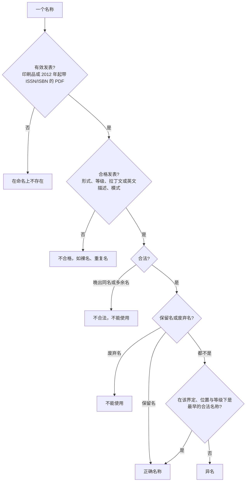

分类学是植物学中最古老的分支，也是其他分支的基础：研究一种植物，先要知道它是什么、叫什么，以及它与哪些植物最近缘。本章讲植物分类学的基本工具：分类阶元与物种，学名的构成，管辖藻类、真菌和植物名称的国际命名法规，识别与鉴定植物的方法（观察、检索表、工具书与标本馆），以及把分类建立在系统发生之上的原则与方法。系统发生树的读法与推断方法在演化生物学与生物信息学中已经讲过（[7.10.2](/7.10.2)、[7.10.20](/7.10.20)–[7.10.22](/7.10.22)、[7.8.6](/7.8.6)），这里只回顾要用到的概念，重点写植物学特有的部分。这些工具从下一章起贯穿全课程：藻类、真菌的分类系统，种子植物的花程式与检索，都以本章为基础。被子植物分类系统的历史与分类学证据在 [7.12.33](/7.12.33) 中系统地讲，花程式与花图式在 [7.12.27](/7.12.27) 中讲。

## 2.1. 分类学的任务

### 2.1.1. 分类学的组成

分类学（taxonomy）一词由希腊文 *taxis*（排列）与 *nomos*（法则）构成，A. P. de Candolle 在 1813 年提出，指关于分类的理论与实践；**系统分类学**的范围更广，研究生物的种类、多样性以及它们之间的一切关系（Simpson，1961）。在植物学中，二者常不加区分，统称植物分类学或植物系统学，其工作包括五个方面：

| 组成 | 内容 | 产出 |
|---|---|---|
| 描述（description） | 用规范的形态术语记载植物的特征 | 描述、插图、数据矩阵 |
| 鉴定（identification） | 确定一个标本或个体属于哪个已知的分类单元 | 鉴定结果 |
| 命名（nomenclature） | 按命名法规给分类单元确定正确的名称 | 学名、异名表 |
| 分类（classification） | 把分类单元归入有等级的类群体系 | 分类系统 |
| **系统发生** | 重建分类单元之间的演化历史 | 系统发生树 |

分类学的目的是：提供鉴定与交流的共同语言；编写各地区的植物名录与植物志；重建植物的演化历史，并据此建立分类系统；整合关于植物的一切信息，为其他学科与生物多样性保护提供基础资料。研究演化过程本身（居群内的变异、居群分化、生殖隔离与物种形成、杂交）的微演化，与研究所有类群的起源与分化的宏演化，都与分类学密切相关（[7.10.11](/7.10.11)、[7.10.12](/7.10.12)）。

### 2.1.2. "系统发生"与"系统发育"

英文 phylogeny 指物种或其他分类单元由共同祖先相继产生的历史（[7.10.2](/7.10.2#sec-2.1.1)）。中文植物学教材多译作"系统发育"，与"个体发育"（ontogeny）对举，系统发生树也常称"系统发育树"；演化生物学与本站统一写作**系统发生**。两种译名同义，本课程一律用"系统发生"，引用旧文献中的"系统发育系统学""系统发育分类"等也照此改写；"个体发育"保留。

## 2.2. 分类阶元

### 2.2.1. 阶元与词尾

**定义 2.2.1（分类阶元）** **分类阶元**（分类等级）是分类系统中表示类群从属关系的层级，如界、门、纲、目、科、属、种。一个分类阶元上的具体类群是一个**分类单元**：蔷薇科（Rosaceae）是科这一阶元上的分类单元。

《国际藻类、菌物和植物命名法规》（下称法规，§2.4）规定了 7 个主要阶元，即界（regnum）、门（divisio 或 phylum）、纲（classis）、目（ordo）、科（familia）、属（genus）、种（species），以及族（tribus）、组（sectio）、系（series）、变种（varietas）、变型（forma）等次要阶元；任何阶元前加 sub- 构成下一级的中间阶元（亚门、亚纲、亚科、亚属、亚种），目以上还可加 super-（总目）。属以上的名称是单个词（单名），科以上用复数名词，各阶元有规定的词尾：

| 阶元 | 拉丁文 | 植物的词尾 | 藻类 / 真菌的词尾 | 例 |
|---|---|---|---|---|
| 门 | divisio, phylum | -phyta | -phyta / -mycota | Magnoliophyta（被子植物门） |
| 亚门 | subdivisio | -phytina | -phytina / -mycotina | Pezizomycotina（盘菌亚门） |
| 纲 | classis | -opsida | -phyceae / -mycetes | Magnoliopsida（木兰纲） |
| 亚纲 | subclassis | -idae | -phycidae / -mycetidae | Rosidae（蔷薇亚纲） |
| 总目 | superordo | -anae | | Rosanae |
| 目 | ordo | -ales | | Rosales（蔷薇目） |
| 亚目 | subordo | -ineae | | Rosineae |
| 科 | familia | -aceae | | Rosaceae（蔷薇科） |
| 亚科 | subfamilia | -oideae | | Amygdaloideae（桃亚科） |
| 族 | tribus | -eae | | Maleae（苹果族） |
| 亚族 | subtribus | -inae | | Malinae（苹果亚族） |
| 属 | genus | 无固定词尾 | | *Malus*（苹果属） |
| 组 | sectio | 属名 + sect. + 组加词 | | *Rosa* sect. *Synstylae*（合柱组） |
| 种 | species | 双名 | | *Malus domestica*（苹果） |

科、亚科、族的名称由其模式属的名称加词尾构成：Rosaceae 来自 *Rosa*，Maleae 来自 *Malus*。门、纲的名称也可以由属名构成（Magnoliophyta 来自 *Magnolia*），但不受此限，传统名称如 Angiospermae（被子植物）同样可用。图 2.2.1 以苹果为例。


阶元只表示类群的嵌套关系，本身没有生物学的绝对意义：一个科与另一个科在年龄、物种数或分化程度上未必可比（[7.10.2](/7.10.2#sec-2.7.2)）。真正客观存在的是类群本身（单系群）以及物种；把一个单系群定为科还是亚科，是兼顾稳定、方便与信息量的约定（§2.6.6）。

### 2.2.2. 植物中的物种

种是分类的基本单位。传统的植物学定义把物种描述为：具有一定的形态与生理特征、占据一定的自然分布区、彼此能交配产生可育后代、与其他物种存在生殖隔离的居群。这实际上综合了几种不同的**物种**概念（[7.10.11](/7.10.11)）：

| 概念 | 强调 | 在植物分类中的困难 |
|---|---|---|
| **生物学物种概念** | 生殖隔离 | 生殖隔离难以直接检验；许多近缘种可以杂交；不适用于无融合生殖与自交的类群 |
| 遗传学物种概念 | 基因流、遗传隔离 | 与生物学物种概念本质相同，同样缺乏可操作的标准 |
| 演化物种概念、**一般谱系物种概念** | 独立演化的谱系 | 没有给出界定谱系的实践标准 |
| **系统发生物种概念** | 单系性与可诊断的共有衍征 | 定量性状难以利用；衍征需要多少没有标准；倾向于划分出更多的种 |
| **生态学物种概念** | 生态位分化 | 生态差异的度量标准不明确 |
| **表征种概念**（形态学物种、分类学物种） | 形态上的间断 | 依赖主观判断，但它是绝大多数植物新种描述实际使用的标准 |

植物的物种界线尤其难定，原因主要有三：

- *杂交与渐渗。* 许多近缘的植物种在分布区重叠处频繁杂交，如北美的栎属，却在大部分基因组上保持区别；植物学家把这类相互杂交而保持不同的类群称为复合交配群（syngameon）。杂交还可以直接产生新种（**杂交物种形成**，[7.10.12](/7.10.12)）。
- *多倍化。* 被子植物约 15% 的物种形成事件伴随**多倍性**的产生（Wood 等，2009），所有种子植物的祖先都经历过全基因组加倍；**异源多倍体**往往与亲本立即生殖隔离，却在形态上介于二者之间。
- *无融合生殖。* 蒲公英属（*Taraxacum*）、悬钩子属（*Rubus*）、山柳菊属（*Hieracium*）等通过**无融合生殖**产生遗传上一致的种子，形成大量形态上略有差别的"小种"（微种），按生物学物种概念无法处理。

为此，中国学者洪德元（2016、2020）提出了遗传–形态物种概念：物种是由自然居群组成的群体，群体内基因交流通畅、群体间遗传隔离；其形态在群体内连续变异，群体间至少在两个独立的形态性状上表现出间断（或统计上的间断）。它把基因流的标准与可观察的形态标准结合起来，并要求在野外收集形态、分子、繁育系统、花期、传粉、生态与分布的数据后再下结论。

**例 2.2.1（芍药属的物种划分）** 芍药属（*Paeonia*）的分类说明了物种界定如何改变名称。北美西部的 *P. californica* 先后被处理为独立的种（Nuttall 的原始描述）、*P. brownii* 的异名、*P. brownii* 的变种和亚种，最后又恢复为种：同一群植物在四种处理中有四个不同的名称。在中国西南的滇牡丹复合群中，过去依花色、总苞有无与叶裂片宽度区分的几个种与变种，经野外居群研究发现这些性状在居群内高度变异、彼此之间以及与地理分布之间都没有相关性，于是全部并入一个多变的种滇牡丹（*Paeonia delavayi* Franch.），不再划分种下等级（Hong 等，1998）；而西藏东南部原作为黄牡丹变种发表的 *P. lutea* var. *ludlowii* Stern & G. Taylor，因植株高大、心皮通常单生等稳定的区别而被提升为种，即大花黄牡丹 *Paeonia ludlowii* (Stern & G. Taylor) D. Y. Hong。

### 2.2.3. 种下等级与品种

**定义 2.2.2（亚种、变种与变型）** **亚种**（subspecies，subsp.）是种内在形态上有区别、并在分布上、生态上或季节上有一定隔离的类群，常是地理宗。**变种**（varietas，var.）是种内形态上有比较稳定的变异、但分布范围比亚种小得多或与原种重叠的类群。**变型**（forma，f.）是形态上有变异、但没有一定的分布区，只零星出现于原种居群中的个体，如开白花的个体。

三个等级的生物学含义并无公认的严格界线，不同作者的用法不尽相同：北美与欧洲的文献多用亚种，中国与东亚的植物志多用变种。种下分类单元的名称由种名加等级缩写与种下加词构成（三名法），例如红叶 *Cotinus coggygria* Scop. var. *cinerea* Engl.、紫叶李 *Prunus cerasifera* Ehrh. f. *atropurpurea* (Jacq.) Rehder、雪柳 *Fontanesia phillyreoides* Labill. subsp. *fortunei* (Carrière) Yalt.。一个种一旦划分出种下分类单元，包含该种模式的那个种下分类单元自动以种加词为种下加词，且不写命名人，称为自动名，如粉团蔷薇 *Rosa multiflora* var. *cathayensis* Rehder & E. H. Wilson 发表之后，原来的野蔷薇就成为 *Rosa multiflora* Thunb. var. *multiflora*。

栽培植物还有另一套等级，由《国际栽培植物命名法规》（ICNCP）管辖。品种（cultivar，栽培品种）是人工选择得到的、性状一致而稳定、能以规定的方式（营养繁殖或种子繁殖）保持下来的栽培植物类群，它不是植物学意义上的变种或变型。品种加词首字母大写、加单引号、用正体，写在植物学名称之后，如 *Malus domestica* 'Fuji'（富士苹果）；以前在品种加词前加 cv.，现已不用。同一个种可以有形态差别极大的品种群，如甘蓝 *Brassica oleracea* 的结球甘蓝、花椰菜、青花菜、球茎甘蓝、羽衣甘蓝，莴苣 *Lactuca sativa* 的叶用莴苣与茎用莴苣（莴笋）。

## 2.3. 植物的命名

### 2.3.1. 学名、中名与俗名

同一种植物在不同的国家、民族和地区往往有不同的名称：番茄在中国南方称番茄、北方称西红柿，英文称 tomato；马铃薯又叫土豆、洋芋、洋山芋。这是同物异名。反过来，叫"白头翁"的植物在中国有十多种，分属毛茛科、蔷薇科、菊科等不同的科，这是同名异物。名称不统一会造成混乱，妨碍科学交流，所以需要一个世界通用的名称。

**定义 2.3.1（学名）** **学名**是按照《国际藻类、菌物和植物命名法规》的规则发表、用拉丁文或拉丁化的词构成的科学名称；一个分类单元在一定的界定、位置与等级下只有一个正确的学名。

与学名相对应、经《中国植物志》《中国孢子植物志》或 Flora of China 等权威著作采用的中文名称是中名（正式中文名），一种植物应只有一个中名；此外还有别名、地方名与俗名。"拉丁名"与学名不是同义词：一种植物可以有多个拉丁名，其中只有一个是正确的学名，其余是异名（§2.4.4）。中药名、商品名与植物学名称也不一定对应。中药"青蒿"出自东晋葛洪《肘后备急方》中"青蒿一握，以水二升渍，绞取汁，尽服之"的治疟方，其正品原植物在植物学上是黄花蒿（*Artemisia annua* L.），提取青蒿素的正是它；植物学上称为青蒿的 *Artemisia caruifolia* Buch.-Ham. ex Roxb. 几乎不含青蒿素（屠呦呦，1987）。只有学名才能让这类信息准确地对应到物种。

### 2.3.2. 双名法与学名的书写

18 世纪中叶以前，植物用一串描述性的词来称呼（多名法），例如 Linnaeus 本人早期把猫薄荷称为 *Nepeta floribus interrupte spicatis pedunculatis*（花序间断穗状、具梗的荆芥）。C. Bauhin 在 1623 年已常用属名加一个词的写法，Rivinus 在 1690 年也提出名称不宜超过两个词，但直到 Linnaeus 在 1753 年的《植物种志》中对全部植物一贯地采用**双名法**，它才被普遍接受：猫薄荷成为 *Nepeta cataria*。双名法的优点在于每种植物只有一个国际通用的名称，而且名称中包含属名，由种名即可知道它在分类系统中的位置。

**定义 2.3.2（种加词与命名人）** 种的学名由属名与**种加词**两部分构成，属名在前，相当于"姓"，种加词在后，相当于"名"；种加词单独使用没有意义。完整的学名在种加词后附加最早合格发表这一名称的作者，即**命名人**，如银杏 *Ginkgo biloba* L.。

书写学名的规则：

- 属名与种加词用斜体（手写时加下划线），属名首字母大写，种加词全部小写（法规的建议，即使种加词来自人名或地名）；命名人用正体。属以上的名称用正体、首字母大写。
- 同一段文字中第二次出现时，属名可缩写为首字母：*G. biloba*；但不能只写种加词，因为同一个种加词可以用于许多属，如 *biennis* 见于 *Oenothera biennis*（月见草）、*Artemisia biennis*、*Lactuca biennis*。
- 种加词不能与属名完全相同，这种重复名（tautonym，如 *Linaria linaria*）在植物中不合格；动物命名法规则允许（*Bufo bufo*）。
- 植物名称与动物名称各自独立，可以相同：*Pieris* 既是杜鹃花科的马醉木属，也是粉蝶属；但法规不鼓励这样命名。

### 2.3.3. 属名与种加词的来源

属名是拉丁文或拉丁化的单数主格名词，首字母大写，来源不拘：

| 来源 | 例 |
|---|---|
| 古拉丁文名 | *Papaver* 罂粟属，*Rosa* 蔷薇属，*Piper* 胡椒属，*Morus* 桑属，*Pinus* 松属 |
| 古希腊文名 | *Oryza* 稻属，*Myrtus* 香桃木属，*Colocasia* 芋属，*Platanus* 悬铃木属，*Zingiber* 姜属 |
| 形态特征 | *Sagittaria* 慈姑属（*sagitta*，箭：叶箭形），*Polygonum* 蓼属（多膝：茎节膨大），*Rhizophora* 红树属（具根：种子在母体上萌发生根），*Helianthus* 向日葵属（太阳花），*Lagenaria* 葫芦属（长颈瓶） |
| 颜色、气味 | *Leucobryum* 白发藓属（白色的藓），*Rubus* 悬钩子属（红色），*Osmanthus* 木樨属（香花），*Meliosma* 泡花树属（蜜香） |
| 所含化合物 | *Saccharum* 甘蔗属（糖），*Eucommia* 杜仲属（良好的树胶） |
| 用途 | *Sanguisorba* 地榆属（止血），*Ormosia* 红豆属（项链：种子可作项链） |
| 纪念人名 | *Linnaea* 北极花属（Linnaeus），*Davidia* 珙桐属（A. David），*Tsoongia* 钟木属（钟观光） |
| 习性与生境 | *Dendrobium* 石斛属（生于树上），*Actephila* 喜光花属 |
| 产地 | *Taiwania* 台湾杉属，*Fokienia* 福建柏属 |
| 神话与字母游戏 | *Artemisia* 蒿属（女神 Artemis），*Narcissus* 水仙属（希腊神话中的美少年）；*Saruma* 马蹄香属（把 *Asarum* 细辛属的首字母移到词尾），*Tapiscia* 瘿椒树属（由 *Pistacia* 黄连木属的字母移位而成） |
| 方言、土名的拉丁化 | *Litchi* 荔枝属（粤语），*Thea* 茶（闽南语），*Ginkgo* 银杏属（日语"银杏"读音的误写） |
| 加前缀或后缀 | *Pseudolarix* 金钱松属（假的 *Larix*），*Acanthopanax* 五加属（有刺的 *Panax*），*Gentianella* 假龙胆属（小的 *Gentiana*），*Sequoiadendron* 巨杉属（*Sequoia* 树） |

种加词大多是形容词，少数是名词的属格或同位名词。用形容词时，其性、数、格必须与属名一致：栗（板栗）*Castanea mollissima* Blume 的属名是阴性单数主格名词，种加词"被极柔软毛的"也用阴性单数主格。种加词的来源有：

| 来源 | 例 |
|---|---|
| 形态特征 | 白檀 *Symplocos paniculata*（圆锥花序的），黑藻 *Hydrilla verticillata*（轮生的），银白杨 *Populus alba*（白色的） |
| 方位 | 东方香蒲 *Typha orientalis*，一球悬铃木 *Platanus occidentalis*（西方的） |
| 用途 | 山茱萸 *Cornus officinalis*（药用的），芋 *Colocasia esculenta*（可食的） |
| 习性与季节 | 葎草 *Humulus scandens*（攀援的），高山灯心草 *Juncus alpinus*，小麦 *Triticum aestivum*（夏季的） |
| 人名（形容词形式） | 以元音或 -er 结尾的人名加 -an-，以辅音结尾的加 -ian-，再加与属名同性的词尾：*Rosa webbiana*（Webb），*Senecio oldhamianus*（Oldham） |
| 人名（属格形式） | 以辅音结尾的男性人名加 -ii（*Acer davidii*，David），以元音或 -er 结尾的加 -i（*Achnatherum hookeri*，Hooker），女性加 -ae（*Crataegus coleae*，Cole） |
| 俗名的拉丁化 | 龙眼 *Dimocarpus longan*，人参 *Panax ginseng* |
| 原产地（形容词） | 常用 -ensis、-(a)nus、-inus、-icus：橡胶树 *Hevea brasiliensis*（巴西），亚洲石梓 *Gmelina asiatica* |
| 同位名词 | 樟 *Cinnamomum camphora*（*camphora*，樟脑；同位名词只需与属名同数同格，不必同性） |

### 2.3.4. 命名人与常用缩写

命名人附在学名之后，既使名称完整，也便于查考发表的时间与文献，并表示命名者对名称负科学责任。命名人通常写其姓氏的标准缩写（国际植物名称索引 IPNI 采用 Brummitt 与 Powell 1992 年制定的标准形式），缩写后加缩写点：

| 写法 | 含义 | 例 |
|---|---|---|
| L. | Linnaeus；单字母缩写只限于他一人 | *Ginkgo biloba* L. |
| R.Br. 与 N.E.Br. | 同姓的作者加名的缩写以区分 | Robert Brown 与 Nicholas Edward Brown |
| Hand.-Mazz. | 复姓两部分都缩写 | Handel-Mazzetti |
| et 或 & | 两位作者共同发表 | 水杉 *Metasequoia glyptostroboides* Hu & W. C. Cheng |
| et al. | 三位以上作者，只写第一位 | |
| f. 或 fil. | 儿子或女儿（filius, filia），与父亲区分 | Hook.f.（J. D. Hooker，其父为 Hook.） |
| ex | 名称由前者提出、未经合格发表，由后者合格发表 | 白皮松 *Pinus bungeana* Zucc. ex Endl. |
| in | 前者发表于后者编著的书刊中 | 毛白杨 *Populus tomentosa* Carrière in Rev. Hort. |
| (  ) | 括号内为原名称的命名人，括号外为作出新组合者（§2.4.5） | 白头翁 *Pulsatilla chinensis* (Bunge) Regel |

学名中其他常见的缩写有：

| 缩写 | 含义 |
|---|---|
| subsp.（ssp.）、var.、f. | 亚种、变种、变型 |
| × | 杂种，如二球悬铃木 *Platanus* × *acerifolia* (Aiton) Willd.（POWO 作 *P.* × *hispanica* Mill. ex Münchh.） |
| 'Fuji' | 品种（栽培品种）加词 |
| sp.、spp. | 某属的一种、几种（种未鉴定）：*Rosa* sp.、*Rosa* spp. |
| sp. nov.、var. nov.、f. nov.、subsp. nov. | 新种、新变种、新变型、新亚种，如 *Spiradiclis pauciflora* L. Wu & Q. R. Liu, sp. nov. |
| comb. nov.、stat. nov. | 新组合、新等级 |
| nom. nud. | 裸名（§2.4.5） |
| nom. cons.、nom. rej. | 保留名、废弃名 |
| auct. non | 错误鉴定："某些作者用此名，但不是原作者的植物"，如蒙古绣线菊 *Spiraea mongolica* Maxim. 曾被误用为 *S. hypericifolia* auct. non L. |
| s.l.、s.s. | 广义（sensu lato）、狭义（sensu stricto） |
| cf.、aff. | 鉴定不确定，接近于（confer）某种；与某种近缘但可能不同（affinis） |

## 2.4. 国际藻类、菌物和植物命名法规

### 2.4.1. 法规的沿革与原则

**定义 2.4.1（国际藻类、菌物和植物命名法规）** **国际藻类、菌物和植物命名法规**（ICN）是给传统上作为藻类、真菌和植物处理的生物（包括化石）命名的国际规则，由国际植物学大会的命名法分会修订；2011 年以前称《国际植物命名法规》（ICBN）。

它的前身是 1867 年在巴黎召开的国际植物学会议上通过、由 Alphonse de Candolle 起草的《植物命名法则》（巴黎法则）；1905 年维也纳第二届国际植物学大会制定了第一部国际通用的规则，1910 年布鲁塞尔大会补充；此后约每六年随国际植物学大会修订一次，每一版以大会所在地命名，如东京法规（1994）、圣路易斯法规（2000）、维也纳法规（2006）、墨尔本法规（2012）、深圳法规（2018）。现行的是马德里法规：2024 年 7 月第二十届国际植物学大会在马德里召开，命名法分会讨论了 447 项提案，修订后的法规于 2025 年出版（Turland 等，2025，*Regnum Vegetabile* 162），取代深圳法规。真菌名称的专门规则（F 章）由国际真菌学大会修订，现行的是 2024 年马斯特里赫特大会通过的版本，并入马德里法规。

法规由原则、规则（条款）与辅则（建议）组成。六条原则是：

1. 植物命名法与动物、原核生物的命名法相互独立；法规适用于传统上作为藻类、真菌或植物处理的一切生物，无论它们在系统发生上属于哪里（蓝细菌同时受原核生物法规管辖，见 [7.11.16](/7.11.16#sec-16.7.2)）。
2. 分类单元名称的应用由命名模式决定（§2.4.3）。
3. 分类单元的命名以发表的优先权为依据（§2.4.4）。
4. 每个具有一定界定、位置与等级的分类单元只能有一个正确名称，特定情况除外。
5. 学名一律作为拉丁文处理，不论其来源。
6. 命名规则有追溯效力，除非明确规定了限制。

第一条原则与 [7.12.1](/7.12.1#sec-1.1.3) 的结论相呼应：卵菌、黏菌、甲藻、褐藻虽与陆生植物相距甚远，名称仍按本法规命名；裸藻与甲藻等兼属"原生动物"的类群，可能同时有一个按动物命名法规的名称。

马德里法规的主要新规定有：

- 建立藻类与植物名称和模式的自愿登记机制（真菌的新名称自 2013 年 1 月 1 日起已必须在认可的登记库中登记，如 MycoBank、Index Fungorum、Fungal Names）。
- 废止含有词根 caf[f][e]r- 的加词（这一词在非洲带有严重的种族侮辱含义），一律改为 af[e]r-，如 *Erythrina caffra* 改为 *Erythrina afra*，涉及 200 多个名称；并设立程序，可以提议废弃 2026 年 1 月 1 日及以后发表的、对某一人群带有贬损含义的名称。
- 澄清化石分类单元的命名规则，消除化石模式指定的障碍。
- 改变命名法分会的机构投票办法，使各机构有平等的投票权。

### 2.4.2. 有效发表与合格发表

一个名称要参与优先权的竞争，必须先有效发表、再合格发表。

**定义 2.4.2（有效发表与合格发表）** **有效发表**是名称以法规认可的方式公之于众：发行印刷品，使公众或至少植物学家通常能利用的图书馆可以通过出售、交换或赠送获得；或在 2012 年 1 月 1 日及以后，以带有国际标准刊号（ISSN）或国际标准书号（ISBN）的在线出版物发表 PDF 文件。**合格发表**是有效发表的名称同时满足法规规定的全部条件，从而在命名上成立。

在公开集会上宣读、写在标本标签或手稿中、发表于种子目录、报纸或电子邮件中的名称，都不是有效发表。合格发表的主要条件（对种而言）是：

| 条件 | 要求 |
|---|---|
| 名称形式 | 符合法规的构词规则；种名为双名，不与已有的名称重复 |
| 等级 | 明确指出名称的等级 |
| 描述或特征集要 | 1935 年 1 月 1 日至 2011 年 12 月 31 日发表的，须附拉丁文描述或特征集要（藻类自 1958 年起，化石自 1996 年起）；2012 年 1 月 1 日起，拉丁文或英文均可；也可以引证此前合格发表的描述 |
| 模式 | 1958 年 1 月 1 日起，科及科以下的新名称须指明命名模式：新种指明模式标本，新属指明模式种，新科指明模式属 |
| 模式的保存地 | 1990 年 1 月 1 日起，须写明主模式标本保存的标本馆或机构；2007 年 1 月 1 日起，种及种下名称的模式须是标本（显微藻类与微小真菌等无法保存的除外，可用图） |
| 真菌名称的登记 | 2013 年 1 月 1 日起，须引用认可的登记库给出的登记号 |

合格发表只表明名称在命名上成立，不表明它就是正确名称：它可能是一个更早名称的异名（§2.4.4）。按命名法规发表名称并不难，真正困难的是有充分证据地界定一个物种（§2.2.2）。

### 2.4.3. 模式法与模式标本

物种的界线会随研究而改变：一个种可能被拆分为几个种，几个种也可能被合并。为了确定一个名称究竟用于哪一群植物，法规采用模式法：每个名称都与一个命名模式永久相联系，名称跟着模式走。

**定义 2.4.3（模式标本）** **模式标本**（命名模式）是一个名称永久依附的标本或图，种及种下等级的名称以它为准。按指定的方式分为：**主模式标本**（全模式、正模式），作者在原始发表中指定作为模式的那一份标本；**等模式标本**，与主模式同一采集者同时同地采集的同号复份标本；**合模式标本**，原始发表中没有指定主模式而引证的两份以上的标本，或同时被指定为模式的两份以上的标本中的任何一份；**副模式标本**，原始发表中除主模式、等模式或合模式以外同时引证的标本；**后选模式标本**，原始发表未指定主模式或主模式已遗失时，后来的作者从原始材料中选定作为模式的标本或图；**新模式标本**，与名称有关的全部原始材料都已遗失时，从其他材料中选定作为模式的标本；**附加模式标本**（epitype），主模式、后选模式或新模式在形态上含糊、不能准确鉴定时，另外指定作为解释依据的标本或图。

各种模式之间的关系见图 2.4.1。选定后选模式时有优先顺序：有等模式时必须选等模式，其次是合模式，再次是等合模式，然后才是副模式和其他原始材料。新模式只能在全部原始材料都不存在时指定。附加模式标本由 1994 年的东京法规引入，常用于模式标本缺少关键鉴别特征（如缺花、缺果）或只有一张图的情形。模式标本必须永久保存，所以不能是活植物，一般是标本馆中的腊叶标本；模式标本不一定"典型"，它只是命名的依据，不比其他标本更能代表物种的变异。

中文教材中常列出的"原产地模式标本"（topotype），即从模式标本产地采到的同种标本，不是法规中的术语，在命名上没有任何地位；只有被正式指定为新模式或附加模式标本时，它才成为命名模式。


属及属以上的名称也由模式决定。属名的模式是一个种名的模式，常直接说"模式种"，如 *Lyonia ferruginea* 是珍珠花属（*Lyonia*）的模式；科名的模式是一个属名，即模式属，如 *Rosa* 是蔷薇科的模式属，*Aster* 是菊科（Asteraceae）的模式属。科以上的名称只有以属名为基础时才由模式决定（Rosales 来自 *Rosa*），描述性的名称如 Angiospermae 没有模式。

### 2.4.4. 优先律与正确名称

**定义 2.4.4（优先律）** **优先律**是指一个分类单元在一定的界定、位置与等级下，其**正确名称**是符合法规的最早合格发表的合法名称；同一分类单元的其他名称都是它的异名。

优先律只在科及科以下的等级上强制执行，科以上的名称不受此限。优先权只在同一等级内比较：变种加词即使发表得更早，在种的等级上也不享有优先权。各类群的起点是：

| 类群 | 起点 |
|---|---|
| 种子植物、蕨类与石松类、苔类、泥炭藓科、地衣、真菌、大多数藻类 | 1753 年 5 月 1 日，Linnaeus《植物种志》 |
| 藓类（泥炭藓科除外） | 1801 年 1 月 1 日，Hedwig《藓类植物种志》 |
| 蓝藻中的念珠藻科（具异形胞类群） | 1886 年 1 月 1 日，Bornet 与 Flahault |
| 蓝藻中的念珠藻科（无异形胞类群） | 1892 年 1 月 1 日，Gomont |
| 鼓藻科、鞘藻科 | 1848 年（Ralfs）、1900 年（Hirn） |
| 化石植物 | 1820 年 12 月 31 日，Sternberg |

《植物种志》中的属名与 Linnaeus《植物属志》第 5 版（1754）与第 6 版（1764）中的属的描述相联系，所以属名的优先权同样从 1753 年算起；一些中文教材把属名的起点写成 1754 年与 1764 年，是对这一规定的误解。

**例 2.4.1（银线草的异名）** 银线草先后被发表过三个名称：*Chloranthus japonicus* Siebold（1829）、*Chloranthus mandshuricus* Rupr.（1859）、*Tricercandra japonica* (Siebold) Nakai（1930）。在把银线草放在金粟兰属（*Chloranthus*）中的分类下，最早的 *Chloranthus japonicus* Siebold 是正确名称，*C. mandshuricus* 是它的异名。若有人认为它应归入 *Tricercandra* 属，那么在那种分类下 *T. japonica* 就是正确名称：正确名称取决于分类学的判断，优先律只在判断确定之后起作用。

### 2.4.5. 名称的改变、合法性与保留

**定义 2.4.5（异名、新组合与基原异名）** 同一分类单元的不同名称互为**异名**：以同一模式为基础的是命名异名（同模式异名），基于不同模式、因分类学观点而被认为是同一分类单元的是分类学异名（异模式异名）。把一个种移到另一属时，若等级不变，原来的种加词须保留并与新属名组合，构成**新组合**；原来的名称称为**基原异名**，其命名人写在新组合的括号内，作出组合的作者写在括号外。

**例 2.4.2（杉木的学名）** 杉木最早由 Lambert 在 1803 年发表为 *Pinus lanceolata* Lamb.；1826 年 Robert Brown 又将它命名为 *Cunninghamia sinensis* R.Br. ex Rich.。1827 年 Hooker 研究了原始文献，认为它应属于杉木属（*Cunninghamia*），按优先律保留最早的种加词 *lanceolata*，作出新组合 *Cunninghamia lanceolata* (Lamb.) Hook.。这就是杉木的正确名称；*Pinus lanceolata* Lamb. 是其基原异名，*Cunninghamia sinensis* 是分类学异名。白头翁 *Pulsatilla chinensis* (Bunge) Regel 的基原异名是 *Anemone chinensis* Bunge，番茄 *Solanum lycopersicum* L. 在被放在番茄属时期写作 *Lycopersicon esculentum* Mill.，都是同类的例子。

:::

合格发表的名称还要合法，才能成为正确名称。

**定义 2.4.6（合法名称与不合法名称）** 合格发表并符合法规规则的名称是**合法名称**。合格发表但违反某些规则的名称不合法，主要有两类：**晚出同名**，与同等级的另一分类单元早已合格发表的名称拼写完全相同、却基于不同模式的名称；**多余名**，发表时作者已把应当采用的合法名称（或其模式）包括在内、却另起的新名称。

晚出同名即使其早出同名已被废弃或成为异名，也不能使用。在同一属内两个次级区分（如两个组），或同一种内两个种下分类单元（即使等级不同），使用相同的加词而基于不同模式，也作为同名处理。没有附描述或特征集要的名称是裸名（nom. nud.），它没有合格发表，在命名上不存在。

严格执行优先律，有时会废掉长期通用的名称，造成混乱。为此法规允许保留名。

**定义 2.4.7（保留名）** **保留名**（nomen conservandum）是经国际植物学大会批准、列入法规附录、可以违反优先律或其他规则而作为正确名称使用的名称；被它取代的名称是废弃名。

保留主要用于科名、属名，少数用于种名。苹果的学名是一个近例：较早发表的 *Malus pumila* Mill. 所指的植物（其模式）是否就是栽培苹果长期有争议，2017 年维管植物命名委员会以微弱多数建议把广泛使用的 *Malus domestica* (Suckow) Borkh. 作为保留名，POWO、WFO 等数据库随之采用；《中国植物志》与 Flora of China 出版较早，仍作 *Malus pumila* Mill.。

另有 8 个传统科名不以 -aceae 结尾，法规规定它们视为合格发表，与以模式属构成的名称并用，中文教材常把它们也称为保留名：

| 科 | 传统名称 | 以模式属构成的名称 |
|---|---|---|
| 棕榈科 | Palmae | Arecaceae |
| 禾本科 | Gramineae | Poaceae |
| 十字花科 | Cruciferae | Brassicaceae |
| 豆科 | Leguminosae | Fabaceae |
| 藤黄科 | Guttiferae | Clusiaceae |
| 伞形科 | Umbelliferae | Apiaceae |
| 唇形科 | Labiatae | Lamiaceae |
| 菊科 | Compositae | Asteraceae |

此外，豆科的蝶形花亚科可称 Papilionoideae 或 Faboideae，作为科时可称 Papilionaceae。

"一种真菌一个名称"：许多子囊菌和担子菌的有性阶段（有性型）与无性阶段（无性型）过去被分别命名，一种真菌可以有两个正确名称（如有性型 *Gibberella fujikuroi* 与无性型 *Fusarium fujikuroi*）。2011 年墨尔本大会废除了这种双重命名，2013 年 1 月 1 日起每种真菌只有一个正确名称，有性型与无性型名称按优先律竞争（[7.12.11](/7.12.11)）。

## 2.5. 鉴定

### 2.5.1. 观察与描述

鉴定植物从细致的观察开始。观察的一般顺序是：习性、根、茎、叶、花序、花、果实、种子；属及属以上的鉴定以花和果实为主，种的鉴定中茎、叶的特征也很重要。观察的工具从肉眼、放大镜、解剖镜到显微镜与扫描电镜。花的解剖用剥离法（由外向内依次取下各轮）和纵剖、横剖法；腊叶标本上的花要先用水浸泡软化。子房的位置要在花期和果期分别判定；心皮的数目从花柱、柱头的数目与子房的外形初步判断，再横切子房观察子房室、胎座与维管束的数目来确认。

植物志的描述按固定的顺序记载：习性；根（根状茎）；茎；叶（着生位置、数目、叶序、叶片形状、叶尖、叶基、叶缘、大小、脉序、质地、颜色、表面特征、叶柄、托叶）；花序；花（苞片、花萼、花冠、雄蕊的花丝与花药、雌蕊的子房、花柱与柱头）；果实；种子；最后是花果期、产地、生境、分布与用途。例如甜菜 *Beta vulgaris* L. 的描述从"二年生草本，根圆锥状或纺锤状，多汁"开始，依次写茎、基生叶与茎生叶、花的着生方式、花被、雄蕊与柱头、胞果与种子，最后是花期（5—6 月）、果期（7 月）与"原产欧洲，我国普遍栽培，根为制糖原料"。利用描述与插图鉴定时，先细致观察或解剖，归纳出主要特征，再逐项核对描述和插图。花的各部分组成可以用花程式和花图式简洁地表示（[7.12.27](/7.12.27)）。

### 2.5.2. 检索表

**定义 2.5.1（检索表）** **检索表**是根据植物特征的对立区别逐级二分、引导使用者把一个未知标本归入某一分类单元的工具。每一级的两个对立的特征描述（项）构成一个对偶，二者择一，逐级向下，直至得到一个名称。按排列方式分为**定距检索表**（等距检索表），对偶的两项写在同样的缩进位置、下一级再缩进；和**平行检索表**，对偶的两项写在相邻两行、项末注明下一步查的对偶号或结果。

检索表依据的是易于观察的诊断特征，与亲缘关系无关：一个对偶中的两个类群未必最近缘。以木犀科 7 个属为例，定距检索表结构一目了然，但类群多时版面向右偏移：

```text
1. 果实为翅果
  2. 单叶，全缘；果周围有翅 ………………………………… 雪柳属 Fontanesia
  2. 羽状复叶；果只顶端有翅 ……………………………… 白蜡树属 Fraxinus
1. 果实不为翅果
  3. 蒴果
    4. 花黄色；枝中空或具片状髓；叶常有锯齿 ………………… 连翘属 Forsythia
    4. 花紫色、白色或红色；枝具实髓；叶全缘或有裂 ………… 丁香属 Syringa
  3. 核果或浆果
    5. 单叶对生；花为圆锥花序、总状花序或簇生
      6. 花冠裂片在芽中覆瓦状排列；花簇生于叶腋或成短圆锥花序；核果 … 木樨属 Osmanthus
      6. 花冠裂片在芽中镊合状排列；花为顶生的圆锥花序或总状花序；核果状浆果 … 女贞属 Ligustrum
    5. 羽状复叶或三出复叶，对生或互生，稀单叶；花为聚伞花序或伞房花序；浆果 … 素馨属 Jasminum
```

平行检索表所有行都左对齐，节省版面，但不易看出类群之间的层次：

```text
1. 果实为翅果 ……………………………………………………………… 2
1. 果实不为翅果 …………………………………………………………… 3
2. 单叶，全缘；果周围有翅 ………………………………… 雪柳属 Fontanesia
2. 羽状复叶；果只顶端有翅 ……………………………… 白蜡树属 Fraxinus
3. 蒴果 ……………………………………………………………………… 4
3. 核果或浆果 ……………………………………………………………… 5
4. 花黄色；枝中空或具片状髓；叶常有锯齿 ………………… 连翘属 Forsythia
4. 花紫色、白色或红色；枝具实髓；叶全缘或有裂 ………… 丁香属 Syringa
5. 单叶对生；花为圆锥花序、总状花序或簇生 …………………………… 6
5. 羽状复叶或三出复叶，对生或互生，稀单叶；花为聚伞花序或伞房花序；浆果 … 素馨属 Jasminum
6. 花冠裂片在芽中覆瓦状排列；花簇生于叶腋或成短圆锥花序；核果 … 木樨属 Osmanthus
6. 花冠裂片在芽中镊合状排列；花为顶生的圆锥花序或总状花序；核果状浆果 … 女贞属 Ligustrum
```

两种写法对应同一棵决策树（图 2.5.1）。检索到属以后，再用种的检索表，如连翘属中：枝在节间中空、叶卵形常 3 裂或三出、萼裂片长 5—7 mm 与花冠管等长的是连翘（*Forsythia suspensa*）；枝在节间具片状髓、叶卵状披针形不分裂、萼裂片长 2.5—3.5 mm 短于花冠管的是金钟花（*F. viridissima*）。


使用检索表时：要鉴定的标本尽可能完整，尤其要有花和果；从第一个对偶开始逐项、逐级检索，不能跳过；每次都要完整核对对偶的两项，再择一；两项都难以决定或标本缺少所需的特征时，沿两条路分别检索，再把得到的两个结果与描述和插图比较；最后把标本与植物志的描述、插图全面核对，完全相符才算鉴定正确。除二歧检索表外，还有多入口检索表（任选可观察的性状逐步排除，如在线交互式检索系统）；图像识别的应用程序可以快速给出候选的科、属，但结果必须用检索表与描述核实。

识别陌生植物的一般步骤是：先尽可能定到科（或疑似的科），这一步最重要；认真观察最直观的特征，如揉搓后的气味、乳汁、刺、树皮、叶的手感、叶缘、叶脉与叶序，以及花、果的特征；拍摄花的正面与侧面、果实、叶的正反面、枝条、刺与树皮的照片，必要时采集带花果的枝条；然后选择合适的地方植物志，用检索表由科到属再到种，最后核对描述与图片，或请教专家。熟悉形态术语、掌握常见科属的突出特征、经常解剖观察花果，是提高识别能力的根本。

### 2.5.3. 工具书与在线资源

| 类别 | 资源 | 说明 |
|---|---|---|
| 全国性植物志 | 《中国植物志》（80 卷 126 册，1959—2004） | 中国维管植物最完整的记载，按恩格勒系统排列 |
| | Flora of China（1994—2013） | 《中国植物志》的英文修订版，中美合作，内容更新、篇幅压缩 |
| | 《中国高等植物》（13 卷）、《中国高等植物图鉴》（5 册 + 补编 2 册）、《中国高等植物科属检索表》 | 图鉴与检索 |
| 地方植物志 | 《秦岭植物志》《东北草本植物志》《北京植物志》等 | 地区性的检索与描述，常比全国志书好用 |
| 专科专属志 | 《中国杜鹃花》等 | 某一类群的专著 |
| 中国的在线资源 | 植物智（iPlant）、中国植物图像库（PPBC）、中国数字植物标本馆（CVH）、中国自然标本馆（CFH） | 物种信息、植物志全文、图片与标本图像 |
| 国际的在线资源 | [POWO](https://powo.science.kew.org)（邱园）、[WFO](https://www.worldfloraonline.org)、[IPNI](https://www.ipni.org)、[Tropicos](https://www.tropicos.org)、[GBIF](https://www.gbif.org)、[APweb](https://www.mobot.org/MOBOT/research/APweb/) | 接受名与异名、名称的发表文献、分布记录、APG 系统的科与目 |

查学名时应注意：植物志出版后，许多名称已因分类修订而改变，在线数据库（POWO、WFO、植物智）给出的接受名更新；但不同数据库的处理也不完全一致，引用时要注明依据。

### 2.5.4. 标本的采集、制作与标本馆

腊叶标本是鉴定、编写植物志和研究物种变异的基本材料，也是模式标本的载体。采集前要确定目的、地点、时间和计划，准备标本夹、枝剪、小铲、采集袋、小纸袋、号牌、野外记录签与定位、拍照设备。采集时：

- 标本要完整，尽量带花或果；草本植物采全株（含根），乔木、灌木和高大的草本采带花果的枝条；基生叶与茎生叶不同时要采基生叶；幼叶与老叶、新枝与老枝叶形不同时都要采。
- 雌雄异株的植物要分别采雌株和雄株；树皮的颜色与剥落方式有鉴定意义时（如桦木属）附一块树皮；寄生植物连同寄主一起采，并分别注明。
- 水生植物出水后易缠成一团，用硬纸板托出，连纸板一起压入标本夹。
- 每号采 2—3 份；同一地点同时采集的同一种植物编同一个号，同一植株分开采的部分编相同的号；号牌与标本系在一起，编号与野外记录一致；记录要侧重标本上看不到的信息（高度、花色、气味、生境、海拔、坐标）。

压制时要及时整理、展平，按时换吸水纸，粗大部分经常调换位置，不同号的标本不压在同一张纸上；肉质植物先用沸水烫死再压，大型叶可以折叠或分段压制。干燥后上台纸、贴采集签与鉴定签，经低温冷冻等方法杀虫后入柜保存。

标本馆（herbarium）是系统保存植物标本并供研究使用的机构。标本馆内的标本按分类系统、字母顺序或地区排列，其用途是：妥善保存模式标本，提供鉴定用的对照标本，作为编写植物志与研究物种变异的依据，提供物种分布的历史记录，作为研究材料与资源调查的凭证，以及提供 DNA 等分子研究的材料。每个标本馆在《国际标本馆索引》（Index Herbariorum）中有一个缩写代码，学名的模式标本即以代码注明保存地：

| 标本馆 | 代码 | 藏量（约） |
|---|---|---|
| 中国科学院植物研究所（北京） | PE | 265 万 |
| 中国科学院昆明植物研究所 | KUN | 160 万 |
| 中国科学院华南植物园（广州） | IBSC | 115 万 |
| 法国国家自然历史博物馆（巴黎） | P | 800 万 |
| 纽约植物园 | NY | 730 万 |
| 俄罗斯科学院科马洛夫植物研究所（圣彼得堡） | LE | 720 万 |
| 英国皇家植物园邱园 | K | 700 万 |
| 密苏里植物园 | MO | 590 万 |
| 英国自然历史博物馆（伦敦） | BM | 520 万 |
| 哈佛大学 | GH | 520 万 |

国内还有西北农林科技大学（WUK）、北京大学（PEY）、北京师范大学（BNU）、南京大学（N）、武汉大学（WH）等标本馆。许多大型标本馆的标本已数字化，可以在 CVH、JSTOR Global Plants 或各馆的网站上查看模式标本的图像。

## 2.6. 系统发生分类

### 2.6.1. 人为系统、自然系统与系统发生系统

植物分类的历史可以分为几个阶段（详见 [7.12.33](/7.12.33)）：根据用途或习性分类的阶段（本草、Theophrastus）；根据一两个特征分类、不考虑亲缘关系的人为分类阶段（Linnaeus 的性系统）；根据多个性状的综合相似性分类的自然分类阶段（Jussieu、de Candolle、Bentham 与 Hooker）；力求反映演化关系的系统发生分类阶段（**恩格勒系统**、Hutchinson 系统、**克朗奎斯特系统**等）；以及 1990 年代以来以 DNA 序列为主要证据的分子系统学阶段（**APG 系统**）。20 世纪中叶还出现过只按总体相似性聚类、不推断演化历史的**数值分类学**（表征分类）。

人为系统便于检索，但同一类群中会混入亲缘很远的植物；自然系统按总体相似性归类，相似性既可能来自共同祖先，也可能来自趋同；系统发生系统则要求每个分类单元都是一个演化支，因而能预测：同一单系群中尚未研究的植物，很可能具有该类群已知的化学成分、染色体特征或胚胎学特征。

### 2.6.2. 系统发生分析的基本概念

系统发生分类的方法在演化生物学中已经讲过，这里只列出要点（[7.10.2](/7.10.2)）：

- **系统发生树**表示分类单元之间的亲缘关系，即分支的顺序；亲缘关系不等于总体相似性。
- 类群按与树的关系分为**单系群**（一个共同祖先及其全部后代）、**并系群**（一个共同祖先及其部分后代）和**多系群**（不包括其成员最近共同祖先的类群）。现代分类只承认单系群（图 2.6.1）。
- 只有**共有衍征**才是单系群的证据；**共有祖征**不能说明亲缘关系；性状的相似可能是**同源性**，也可能是由**趋同演化**、平行演化或逆转造成的**同塑性**。
- 树的根由**外类群**确定：外类群是已知在**内类群**之外的类群，最好是内类群的**姐妹群**或其近缘类群。外类群不是"进化程度低于内类群"的类群：它与内类群演化的时间一样长，只是在系统发生上位于内类群之外。
- 推断方法有**最大简约法**、距离法、最大似然法与 Bayes 方法（[7.8.6](/7.8.6)、[7.10.20](/7.10.20)–[7.10.22](/7.10.22)）；简约法以最少的演化步数为最优，但在分支长度差异大时会受**长枝吸引**的误导。
- 同塑性的程度用**一致性指数** $\mathrm{CI} = m/s$ 与**保留指数** $\mathrm{RI} = (g-s)/(g-m)$ 衡量，其中 $m$ 是一个性状在任何树上可能的最少变化数，$s$ 是在给定树上的变化数，$g$ 是在完全无分辨的树上的最多变化数；二者都在没有同塑性时等于 1（[7.10.21](/7.10.21)）。
- 分支的可靠性用**自展支持度**（通常认为 70% 以上较可靠）、衰减指数（Bremer 支持度：要多走几步才能得到不含该分支的最简约树）或 Bayes 后验概率（通常要求 0.95 以上）评价。同一数据得到多棵同样最优的树时，用一致树概括它们的共同信息：严格一致树只保留所有树共有的分支，多数一致树保留出现在半数以上树中的分支，半严格一致树保留与所有树都不矛盾的分支。


### 2.6.3. "原始性状"与"进化性状"

传统的被子植物系统学用"原始性状"与"进化性状"（或"高级性状"）的对比来排列类群，例如认为木本比草本原始、两性花比单性花原始、花部螺旋排列比轮状排列原始、离瓣比合瓣原始、子房上位比下位原始、雄蕊多数比定数原始（这类准则在 Bessey、Cronquist 与 Takhtajan 的系统中都有，见 [7.12.33](/7.12.33)）。在系统发生分类中，这些说法要改写为性状的极性：一个性状状态相对于某个类群是**祖征**还是**衍征**。

这种改写有两点实质的变化。第一，极性不是性状本身的属性，而是相对于一个类群、由外类群比较或系统发生树上的祖先状态重建决定的；同一个状态在一个类群中是衍征，在其子类群中就成了祖征。第二，演化不是单向的：草本在被子植物中多次独立起源，也有从草本祖先重新变为木本的（如岛屿上的某些菊科、桔梗科植物）；"原始"的状态可以在演化后期重新出现（逆转）。因此不能根据几个"原始性状"判断一个类群是否基部，只能在树上推断。早期分化的类群（如无油樟 *Amborella*）也不是祖先，它们同样是现生植物，只是兼有许多祖征。

### 2.6.4. 分子标记与系统基因组学

分子证据改变了植物系统学。常用的 DNA 标记如下：

| 标记 | 位置 | 特点与用途 |
|---|---|---|
| *rbcL* | 叶绿体，Rubisco 大亚基基因，约 1.4 kb | 进化慢、易扩增；Chase 等（1993）用 499 条 *rbcL* 序列首次构建了种子植物的大尺度系统发生树，是 APG 系统的基础；用于科、目以上 |
| *matK* | 叶绿体，位于 *trnK* 内含子中的成熟酶基因，约 1.5 kb | 进化较快，用于属、科一级 |
| *trnL–F* | 叶绿体，*trnL* 内含子与 *trnL–trnF* 间隔区 | 非编码区，进化快，用于属内与近缘属之间 |
| *atpB*、*ndhF* 等 | 叶绿体编码基因 | 与 *rbcL* 联合使用（APG I 依据 *rbcL*、*atpB* 与核 18S rDNA） |
| ITS | 核糖体 DNA 的内转录间隔区（ITS1–5.8S–ITS2） | 双亲遗传、进化快，用于种间与属内；有多拷贝与协同进化不完全的问题 |
| 叶绿体基因组 | 全长约 120–160 kb，多为四分体结构（两个反向重复区隔开大、小单拷贝区） | 母系（被子植物）或父系（多数裸子植物）遗传，无重组，相当于一个基因座 |
| 核基因组的低拷贝基因 | 转录组、靶向捕获（如被子植物通用的 Angiosperms353 探针组，Johnson 等 2019） | 数百至数千个独立的基因座，可以检测杂交与不完全谱系分选；千种植物转录组计划（1KP，2019）据此重建了绿色植物的系统发生 |

**DNA 条形码**用一段标准序列鉴定物种：国际生命条形码联盟植物工作组（CBOL，2009）推荐 *rbcL* + *matK* 为植物的核心条形码，中国植物条形码研究组（2011）建议加入 ITS（或 ITS2）。限制性片段长度多态性（RFLP）、随机扩增多态性 DNA（RAPD）、扩增片段长度多态性（AFLP）、微卫星与等位酶等早期的分子标记现在主要用于居群与近缘种的研究。

不同来源的基因树可能互相矛盾，原因包括叶绿体捕获与杂交渐渗、**不完全谱系分选**和古老的多倍化。植物的系统发生研究因此越来越多地依赖核基因组的大量独立基因座和基于溯祖的方法（[7.10.25](/7.10.25)）。

### 2.6.5. 等级分类与 PhyloCode

Linnaeus 式的等级分类要求每个物种属于一个属、每个属属于一个科，名称的形式由阶元决定。系统发生发现新的分支关系时，往往需要改变名称的等级（如把一个科降为亚科），从而改变名称。为此有人提出系统发生命名法：《国际系统发生命名法规》（PhyloCode）于 2020 年随其配套的名称汇编 *Phylonyms* 一起生效，它不使用阶元，名称直接通过系统发生定义附着于演化支，定义的方式有三种：最小演化支定义（含两个或多个指定物种的最小演化支，旧称节点定义）、最大演化支定义（与一个指定物种的亲缘关系比与另一个更近的最大演化支，旧称分支定义）和衍征定义（由某一衍征起源的祖先及其全部后代）。PhyloCode 与 ICN 并行，不取代它；种名仍按等级法规的双名法命名。

两种体系的争论在于稳定性：等级法规中名称随分类等级而变，但一个类群的名称（如蔷薇科）告诉使用者它的大致范围；PhyloCode 中名称随演化支而定，但同一名称所指的物种组成可能随树的改变而变。植物学实践中二者结合使用：APG 系统在目及目以下用正式的等级名称，在目以上用不定等级的演化支名称（如木兰类、单子叶植物、真双子叶植物、蔷薇类、菊类）。

### 2.6.6. APG 系统的原则

被子植物系统发生研究组（APG）是一个国际合作的研究组，1998 年发表第一个按 DNA 序列的系统发生分析建立的被子植物科、目分类（APG I：40 目 462 科），此后发表了 APG II（2003）、APG III（2009）和 APG IV（2016：64 目 416 科）。本课程采用 APG IV（此后的 APG V 在中国的采用尚有争议）。它的原则是：

- 只承认单系群；并系的传统科（如广义的百合科、玄参科、虎耳草科）或被拆分，或与其中嵌入的类群合并。
- 正式的分类只到目一级，目以上用不定等级的非正式演化支名称（[7.12.33](/7.12.33)）。
- 在可能的情况下保留广为人知、界定清楚的科，避免只为细节而改名；在单系的前提下，倾向于承认较大的科，减少只含一两个属的小科（APG III 起取消了"可分可合"的括号科）。
- 少数系统位置尚未确定的科暂不归目（incertae sedis）。

APG 系统给出的是科与目的界定，各科的识别特征、花程式与经济意义在 [7.12.34](/7.12.34)–[7.12.49](/7.12.49) 中逐一讲述，并与克朗奎斯特、恩格勒系统的处理对照。

## 小结

命名的基本术语：

| 术语 | 含义 | 例 |
|---|---|---|
| 分类阶元（定义 2.2.1） | 界、门、纲、目、科、属、种及中间阶元 | 科 familia，词尾 -aceae |
| 分类单元 | 某一阶元上的具体类群 | 蔷薇科 Rosaceae |
| 学名（定义 2.3.1） | 按 ICN 合格发表的拉丁文名称 | *Ginkgo biloba* L. |
| 双名法 / 三名法 | 属名 + 种加词（+ 命名人）/ 再加种下等级与加词 | *Rosa multiflora* var. *cathayensis* Rehder & E. H. Wilson |
| 自动名 | 包含种的模式的种下分类单元，重复种加词，不写命名人 | *Rosa multiflora* var. *multiflora* |
| 品种 | 栽培植物的单位，由 ICNCP 管辖 | *Malus domestica* 'Fuji' |
| 有效发表 / 合格发表（定义 2.4.2） | 公开发行 / 满足全部命名条件 | 2012 年起可在线发表 PDF，可用英文描述 |
| 正确名称（定义 2.4.4） | 最早合格发表的合法名称 | *Chloranthus japonicus* Siebold |
| 异名（定义 2.4.5） | 同一分类单元的其他名称 | *C. mandshuricus* Rupr. |
| 新组合 / 基原异名 | 种加词移入新属 / 原来的名称 | *Cunninghamia lanceolata* (Lamb.) Hook. / *Pinus lanceolata* Lamb. |
| 晚出同名 / 多余名（定义 2.4.6） | 与已有名称同形 / 另起的多余名称 | 不合法 |
| 裸名 | 无描述，不合格 | 名称后注 nom. nud. |
| 保留名（定义 2.4.7） | 大会批准、违反优先律而使用的名称 | *Malus domestica*；8 个传统科名并用 |
| 错误鉴定 | 误用他种的名称 | *Spiraea hypericifolia* auct. non L. |

模式标本的类型（定义 2.4.3，图 2.4.1）：

| 类型 | 何时、由谁指定 | 来源 | 地位 |
|---|---|---|---|
| 主模式 | 原作者在原始发表中 | 一份标本 | 名称的依据 |
| 等模式 | — | 主模式的同号复份 | 后选模式的首选 |
| 合模式 | 原作者未指定主模式或指定多份 | 引证的多份标本 | 可从中选后选模式 |
| 副模式 | — | 原始发表中引证的其他标本 | 不是模式；无等模式、合模式时可选为后选模式 |
| 后选模式 | 后来的作者，主模式缺失时 | 原始材料 | 代替主模式 |
| 新模式 | 后来的作者，全部原始材料遗失时 | 其他材料 | 代替主模式 |
| 附加模式 | 后来的作者，模式含糊时 | 任何标本或图 | 解释性的补充模式 |
| "原产地模式" | — | 模式产地的同种标本 | 不是法规术语，无命名地位 |

判断一个名称能否作为正确名称：



- 阶元与物种：7 个主要阶元，科以下的名称由模式属构成；物种概念各有所长，植物的杂交、多倍化与无融合生殖使物种界定尤其困难；亚种、变种、变型是种下等级，品种属于栽培植物法规。
- 法规（定义 2.4.1）：现行为马德里法规（2025）；六条原则——独立、模式、优先、唯一正确名称、拉丁化、追溯；优先律的起点是 1753 年 5 月 1 日（藓类 1801 年）；一种真菌一个名称（2013 年起）。
- 鉴定：观察的顺序、描述的顺序；检索表（定义 2.5.1）分定距式与平行式；植物志、在线数据库与标本馆。
- 系统发生分类：只承认单系群；"原始/进化性状"改写为相对于类群的祖征/衍征；分子标记从 *rbcL*、*matK*、ITS 到叶绿体基因组与核基因组；APG IV 分到目，目以上用演化支名称。

## 思考题

1. 写出下列名称中各部分的含义：*Pulsatilla chinensis* (Bunge) Regel；*Pinus bungeana* Zucc. ex Endl.；*Prunus cerasifera* Ehrh. f. *atropurpurea* (Jacq.) Rehder。

   **答** 第一个：属名 *Pulsatilla*（白头翁属）+ 种加词 *chinensis*（中国的）；Bunge 最早以 *Anemone chinensis* 发表这一种加词，Regel 把它移入白头翁属作出新组合。第二个：名称由 Zuccarini 提出但未合格发表，由 Endlicher 合格发表。第三个：樱桃李 *Prunus cerasifera* Ehrh. 的一个变型 *atropurpurea*（深紫色的），这一加词最早由 Jacquin 发表（在另一等级或另一名称下），Rehder 把它组合为此变型。

2. 某作者 1950 年在一本植物学杂志上用中文描述了一个新种，但没有附拉丁文描述，也没有指定模式。这个名称合格发表了吗？若他在 2015 年用英文描述并指定了保存于 PE 的主模式标本，结论有何不同？

   **答** 1950 年的名称不合格：1935 年至 2011 年发表的新名称须附拉丁文描述或特征集要，它没有合格发表，在命名上不存在（它有中文描述，严格说不是裸名，而是不合格名称；1958 年以前发表的名称不要求指明模式，所以缺模式本身不是问题）。2015 年在有效出版物上用英文描述、并写明了保存主模式的标本馆，满足了 2012 年以后英文可用、1958 年以后须指明模式、1990 年以后须写明保存地的要求，名称合格发表，优先权从 2015 年算起。

3. 一个种的主模式标本在战争中被毁，原始发表中还引证了两份同号复份和另外三份不同采集号的标本，它们都还在。应该怎样处理？如果这些标本也都已遗失呢？

   **答** 从原始材料中指定后选模式，且必须优先选等模式，即两份同号复份中的一份；另外三份不同号的标本是副模式，只有在没有等模式与合模式时才能选。若全部原始材料都已遗失，才能从其他材料中选定新模式，常选模式产地的标本，以尽量符合原始描述。如果所选的模式缺少关键的鉴别特征，还可以另外指定附加模式标本。

4. 中文教材常说"木本比草本原始，离瓣比合瓣原始"。在系统发生分类中应怎样理解这些说法？举一个例子说明为什么不能根据"原始性状"判断一个类群的位置。

   **答** 这些说法应改写为性状的极性：在被子植物中，木本、离瓣可能是祖征，草本、合瓣是在一个或多个谱系中演化出的衍征；极性由外类群比较与系统发生树上的祖先状态重建确定，而且是相对于某个类群而言的。演化并非单向，同一状态可以多次独立出现或逆转。例如睡莲与莲都是花部多数、离生的水生草本，按"原始性状"曾被合为一个目，但 DNA 证据表明睡莲属于被子植物最早分化的类群之一，而莲属于真双子叶植物的山龙眼目，它们的相似是趋同（图 2.6.1）。

5. 为什么 APG 系统不再承认"双子叶植物"这个类群，却仍承认"真双子叶植物"？

   **答** 传统的双子叶植物是并系群：被子植物的共同祖先也是单子叶植物的祖先，双子叶植物包含这个祖先的部分而非全部后代（排除了单子叶植物），而且"两片子叶"是被子植物的祖征，不能作为单系群的证据。真双子叶植物是由三沟花粉（或由其衍生的花粉类型）这一共有衍征和分子证据支持的单系群，包括大多数原来的双子叶植物；而无油樟目、睡莲目、木兰类等原属双子叶植物的类群被排除在外，单独作为早期分化的类群处理。
