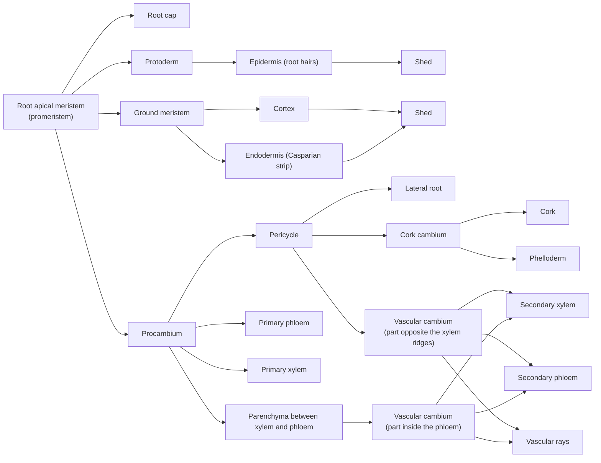

The root is the organ that vascular plants evolved in adapting to life on land. It generally grows underground, absorbs water and minerals from the soil, and anchors the plant in the soil. Its apex can grow downward indefinitely, and lateral roots arise internally, forming an extensive root system. This chapter first treats root morphology and root systems, then follows the root tip from its apex backward through the root cap, meristem, elongation zone and maturation zone, and then the primary structure of the maturation zone, the formation of lateral roots, and the secondary structure of roots that thicken. It ends with root nodules and mycorrhizas, the symbioses of roots with microorganisms. The primary structure of the root is the basis for understanding the primary structure of the stem ([7.12.21](/7.12.21)): both consist of epidermis, cortex and vascular cylinder, but the arrangement of the vascular tissues is entirely different, and the two are joined in the hypocotyl ([7.12.24](/7.12.24)). The origin of roots (roots arose independently in lycophytes and in euphyllophytes) is treated in [7.12.16](/7.12.16); modified roots (storage roots, aerial roots, parasitic roots) are treated in [7.12.24](/7.12.24). The absorption and transport of water and minerals and the mechanism of gravitropism belong to plant physiology; this chapter covers structure and the functions the structure suggests.

## 20.1. Functions and Form of the Root

### 20.1.1. Functions of the Root

The functions of the root are closely related to its structure:

- Absorption: the root takes up water, mineral salts (nitrate, phosphate, sulfate and ions such as potassium, calcium and magnesium) and dissolved carbon dioxide from the soil. Water is a component of protoplasm, a raw material of photosynthesis and the maintainer of cell turgor; apart from a small amount taken up from the air by leaves and young stems, most of the water and minerals the plant needs are obtained from the soil by the roots. Absorption takes place mainly in the elongation and maturation zones of the root tip.
- Anchorage and support: a large root system branching repeatedly and penetrating deep into the soil, together with firm mechanical and vascular tissues in the root, lets tall trees stand firm in wind, rain, ice and snow. Root systems also stabilize shifting sand, protect embankments and prevent soil erosion.
- Conduction: water and mineral salts absorbed by the root hairs and epidermis are carried to the aerial parts through the xylem of the root; organic matter made in the leaves is carried through the stem to the root and then distributed to all parts of the root through its phloem.
- Synthesis: roots can synthesize many amino acids, plant hormones (such as cytokinins) and alkaloids (the nicotine of tobacco is synthesized in the root and carried to the leaves), with a great influence on the growth and development of the aerial parts.
- Storage and propagation: the parenchyma in the root is generally well developed and often serves for storage (radish, sweet potato, ginseng); the roots of many plants can produce adventitious buds and are used for root cuttings in vegetative propagation.

Roots have wide economic uses: sweet potato, cassava, carrot, radish and sugar beet are used for food and fodder, sugar beet for making sugar, and sweet potato for making starch and alcohol; ginseng, rhubarb, angelica (*Angelica sinensis*), licorice, aconite, gentian and ipecac are used in medicine.

### 20.1.2. Primary, Lateral and Adventitious Roots

**Definition 20.1.1 (Primary Root, Lateral Root and Adventitious Root)** The root that develops from the radicle at seed germination and is the first to appear on the plant is called the *primary root*, also called the taproot. The branch roots that arise laterally from the interior of the primary root at certain positions are called *lateral roots*: those arising from the primary root are first-order lateral roots (secondary roots), those arising from first-order lateral roots are second-order lateral roots (tertiary roots), and so on. Roots that arise from parts of the plant other than the primary root and its lateral roots, such as the stem, leaf, old root or hypocotyl, are called **adventitious roots**.

The primary root and its lateral roots arise at definite positions and are together called determinate roots; adventitious roots arise at indefinite positions, but they too can branch to produce lateral roots. The primary root formed at seed germination in grasses is short-lived and later replaced by adventitious roots from the hypocotyl and from the nodes at the base of the stem ([7.12.19](/7.12.19#sec-19.6.2)). The aerial roots on ivy shoots, the roots on willow cuttings, the prop roots at the base of the maize stem, the roots on the nodes of bamboo rhizomes, and the roots of the plantlets at the leaf margin of *Kalanchoe* are all adventitious roots. Agriculture, forestry and horticulture exploit the habit of shoots, leaves and underground stems of producing adventitious roots in vegetative propagation by cuttings, layering and so on ([7.12.24](/7.12.24)). In agronomy the primary root formed from the radicle and the adventitious roots arising from the hypocotyl are often together called seminal roots (also called primary roots), and the adventitious roots at the nodes at the base of the stem are called secondary roots (nodal roots), which differs from the meaning of the botanical terms and should be noted when reading the literature.

### 20.1.3. Root Systems

**Definition 20.1.2 (Root System, Taproot System and Fibrous Root System)** The sum of all the roots of the underground part of a plant is called its **root system**. A root system in which the primary root is well developed and distinctly thicker and longer than the lateral roots is called a *taproot system*; a root system in which the primary root is poorly developed or dies early, and which consists mainly of many adventitious roots of similar thickness and their branches, giving it a fibrous appearance, is called a *fibrous root system*.

The root systems of gymnosperms and most dicots consist of a primary root and lateral roots of various orders and are taproot systems, as in pine, cypress, cotton, rape and dandelion. The root systems of monocots consist mainly of adventitious roots and their branches and are fibrous root systems, as in rice and wheat and in bulbous plants such as onion, leek, garlic and lily; a few dicots such as plantain (*Plantago*) also have fibrous root systems. A fibrous root system is one of the characteristics of monocots: monocot roots have no secondary growth, the primary root cannot thicken, and the root system can be enlarged only by continual production of new adventitious roots from the base of the stem. But not all woody plants have taproot systems; bamboos have fibrous root systems.

![The two basic types of root system (schematic). Right: taproot system, with one stout primary root developed from the radicle growing vertically downward and bearing thinner lateral roots in successive orders, found in gymnosperms and most dicots (such as carrot, dandelion, cotton). Left: fibrous root system, in which the primary root stops growing early and many adventitious roots of similar thickness arise from the base of the stem and branch independently, forming a fibrous, shallow and widely spreading root system, found in monocots (such as grasses and *Allium*). The horizontal line is the ground surface](./plots/root-systems.py)

The depth and breadth of the distribution of roots in the soil vary with plant species, stage of development, soil conditions and human influence, and root systems are generally divided into deep and shallow ones. In a deep root system the primary root is well developed and penetrates vertically into the soil, to 3–5 m or even more than 10 m, as in soybean, castor bean and Masson pine (*Pinus massoniana*); in a shallow root system the lateral or adventitious roots are better developed than the primary root and spread in all directions, mostly in the surface soil, as in plantain, London plane, maize and rice. Taproot systems are mostly deep and fibrous root systems mostly shallow, but not absolutely so. The depth of a root also changes with development: the primary root of a one-year-old Masson pine seedling is only a little over 20 cm deep, but may reach more than 5 m after the tree has grown. The deepest root system on record is that of the shepherd's tree (*Boscia albitrunca*, Capparaceae) in the Kalahari Desert of southern Africa, at 68 m; the mesquite (*Prosopis juliflora*) of Arizona has roots 53 m deep; the roots of alfalfa may reach more than 6 m; and the horizontal spread of tree roots is generally 4–7 times that of the crown.

When the water table is low, aeration is good and the soil is fertile, the root system is deep; otherwise it is shallower; root systems are deeper in arid regions and shallower in humid ones. Human measures can also change root depth: surface irrigation at the seedling stage, transplanting of seedlings, layering and cuttings tend to form shallow roots, whereas propagation by seed and deep tillage with heavy fertilization tend to form deep roots. The scale of a root system far exceeds common imagination: a classic measurement on a four-month-old rye plant (*Secale cereale*; Dittmer 1937) showed that its root system (including root hairs) had a total surface area of about $639\,\mathrm{m^2}$, 130 times the surface area of the aerial part, while occupying only about 6 L of soil. This large absorbing surface is provided mainly by fine roots and root hairs; fine roots mostly live only a few months and are continually dying and renewed, and a considerable part of the annual net primary production of terrestrial ecosystems goes to the production of fine roots.

A certain balance (the root-shoot ratio) is maintained between the aerial and underground parts: if the root system is damaged, the aerial part grows less because of shortage of water and nutrients, and if the aerial part is reduced, root growth is limited by a reduced supply of photosynthates. At transplanting most of the fine roots remain in the soil, so some branches and leaves are cut off and the plant is watered thoroughly to reduce transpiration and restore the balance.

## 20.2. Structure and Development of the Root Tip

**Definition 20.2.1 (Root Tip)** The segment from the apex of the root to the region bearing root hairs is called the root tip, generally about 4–6 mm long. From the apex backward the root tip is divided into four parts: the root cap, the meristematic zone, the elongation zone and the maturation zone.

Primary, lateral and adventitious roots all have root tips. Elongation of the root, absorption of water and nutrients, and the formation of tissues within the root take place mainly in the root tip, so damage to the root tip directly affects root growth and absorption (Figure 2).

![Zones of the root tip (schematic longitudinal section, root tip pointing down). The root cap is at the very front, covering the meristematic zone like a cap; its center consists of columnar cells arranged in files (containing amyloplasts that sense gravity), while the outer cells secrete mucilage and are continually shed as border cells. The meristematic zone (about 1–2 mm) is the apical meristem behind the root cap, with small, densely cytoplasmic cells with large nuclei arranged closely, and with a slowly dividing quiescent centre at its front; it replenishes the root cap in front and produces the protoderm, ground meristem and procambium behind. The cells of the elongation zone (about 2–5 mm) stop dividing, elongate rapidly along the root axis, and begin to differentiate the earliest sieve tubes and annular vessels. The cells of the maturation zone are differentiated and mature, and the outer walls of the epidermal cells protrude outward as root hairs, hence it is also called the root hair zone; further back, lateral roots arise from within and break through](./plots/root-tip.py)

### 20.2.1. The Root Cap

**Definition 20.2.2 (Root Cap)** The structure at the very front of the root, consisting of irregularly arranged parenchyma cells and covering the meristematic zone like a cap, is called the **root cap**.

The root cap is a structure peculiar to roots and is generally conical. Its cells are living parenchyma cells that often contain starch and are generally little differentiated, although the cells near the meristematic zone are smaller and the outer cells larger. The central part of the root cap consists of cells arranged in files, called the columella, surrounded by the lateral root cap. The root cap has the following functions:

- Protection: being in front, the root cap rubs continually against sand grains in the soil; its outer cells are injured, die and are shed, protecting the delicate meristematic zone behind; since the cells of the meristematic zone continually replenish it from behind, the root cap always keeps a certain shape and thickness.
- Lubrication and the rhizosphere: the Golgi bodies of the outer cells of the root cap secrete a large amount of mucilage (highly hydrated polysaccharides), reducing friction as the root tip moves between soil particles. The outermost cells of the root cap separate from each other and from the root cap in a programmed way and are called border cells; they remain alive for weeks in the **rhizosphere**, express genes different from those of the root cap, and secrete specific proteins and mucilage. The number of border cells shed per day varies with the plant, from about 10 in tobacco to about 10 000 in cotton; border cells and their secretions are thought to protect the meristem against infection by pathogens, maintain contact between root and soil, and attract or repel particular bacteria.
- Sensing gravity: the columella cells contain large, heavy amyloplasts that act as statoliths: when a root is placed horizontally, the amyloplasts sediment within minutes to the new lower side of the cells, causing asymmetric growth of the elongation zone so that the root bends downward and resumes vertical growth; a root whose cap has been removed temporarily loses gravitropism. Cells that sense gravity in this way are called statocytes. The transmission of the signal from perception to bending (redistribution of auxin) belongs to plant physiology. Columella cells also sense water potential gradients (hydrotropism).

Apart from some parasitic seed plants and some plants with mycorrhizas, the roots of all plants have a root cap. Environmental conditions also affect the structure of the root cap: a root that grows normally in soil may no longer produce a root cap after being grown in water; aquatic seed plants generally have a root cap, but its development and persistence vary with the species. In duckweed (*Lemna*) the root cap is specialized into a sheath-like "root pocket".

### 20.2.2. The Meristematic Zone and the Quiescent Centre

The meristematic zone lies behind the root cap; it is the apical meristem of the root, about 1–2 mm long. It continually divides and produces cells: some replenish the root cap in front, while most grow and differentiate behind it into the various structures of the root; because initial cells are present, the meristematic zone always keeps its original volume and function. The apical meristem of the root consists of a promeristem and primary meristems: the promeristem lies at the front and consists of the initial cells and their first derivatives, which are little differentiated; the primary meristems lie behind it and are already differentiated into three parts, protoderm, ground meristem and procambium, which develop into the epidermis, cortex and vascular cylinder respectively ([7.12.4](/7.12.4)).

The apical meristems of seed plant roots have two structural types ([7.12.4](/7.12.4) Figure 2C). In one, the vascular cylinder, cortex and root cap can each be traced to its own independent layer of initial cells in the apical meristem, with the epidermis homologous either with the cortex (grasses, such as maize) or with the root cap (most dicots, such as tobacco); this is called the closed type. In the other, all the zones, or at least the cortex and root cap, originate from a common group of initial cells; this is the open type, which is phylogenetically more primitive. This layered arrangement of the root tip can be described conveniently by the histogen theory: plerome, periblem and dermatogen (or dermatocalyptrogen).

**Definition 20.2.3 (Quiescent Centre)** The group of initial cells at the farthest end of the root apical meristem, behind the initials of the root cap, which divide very little, change little in volume and synthesize nucleic acids and proteins at a very low rate, is called the **quiescent centre**.

The quiescent centre was discovered in studies of normal root development, surgical treatment and labeling of DNA synthesis (Clowes 1956). Active mitosis does not occur at the very front of the root but outside the quiescent centre. The measured cell cycle durations are as follows:

| Region | Maize | Broad bean | White mustard |
|---|---|---|---|
| Root cap initials | 12 h | 44 h | 35 h |
| Quiescent centre | 174 h | 292 h | 520 h |
| Vascular cylinder immediately above the quiescent centre | 28 h | 37 h | 32 h |
| Vascular cylinder 200–250 μm from the quiescent centre | 29 h | 26 h | 25 h |

The cells of the quiescent centre divide 6–20 times more slowly than the surrounding cells. Its size is related to the size of the root: it is larger in large roots and smaller or absent in small roots (the quiescent centre of *Arabidopsis* has only four cells). The quiescent centre is not without function: when the root is damaged by radiation or surgery, the root cap is removed, or the root recovers from cold-induced dormancy, the cells of the quiescent centre resume division and replenish the damaged meristem; an isolated maize quiescent centre can regenerate a complete root in culture. The quiescent centre is now considered to be the "organizing centre" of the root stem cells: it maintains the undifferentiated state of the surrounding initial cells (stem cells) and is comparable in role to the organizing centre of the shoot apex (the WUS-CLV3 model of [7.12.4](/7.12.4); the corresponding gene in the root is *WOX5*, a mechanism belonging to plant developmental biology). The slow division of quiescent centre cells also protects the stem cell pool from the accumulation of mutations that frequent DNA replication would bring.

### 20.2.3. The Elongation Zone

The elongation zone lies a little behind the meristematic zone and is about 2–5 mm long. Here cell division gradually stops, vacuoles enlarge rapidly, and the cells elongate markedly along the long axis of the root. The lengthening of the root results from the division and enlargement of cells in the meristematic zone together with the elongation of cells in the elongation zone, of which the elongation of the elongation-zone cells contributes most; it drives the root tip forward through the soil and continually brings it into new regions of soil from which minerals are taken up. A short, thick elongation zone favors root advance in compact soil. The cells of the elongation zone also accelerate differentiation: the earliest sieve tubes and the earliest annular vessels often appear in this region, and the phloem matures first, supplying nutrients to the meristem in front of it. The root elongates only within a very short segment of the root tip, which allows it to advance between soil particles; if the whole root elongated, it would buckle in the soil and be unable to advance.

### 20.2.4. The Maturation Zone and Root Hairs

The maturation zone immediately follows the elongation zone; here the various cells of the root have stopped elongating and most are differentiated and mature. The epidermis of the maturation zone often produces root hairs, so it is also called the root hair zone.

**Definition 20.2.4 (Root Hair)** The tubular projection formed by the outward extension of the outer wall of an epidermal cell in the maturation zone of the root is called a **root hair**. A root hair is part of a single cell; it is unbranched, thin-walled, with an extremely thin cuticle, and the nucleus and most of the cytoplasm lie near its tip.

Root hairs are 5–17 μm in diameter and 0.08–1.5 mm long, and their number varies with the plant: maize has about 420 per square millimeter of epidermis, pea about 230. Root hairs grow at the tip (the wall expands only at the apex), like pollen tubes. During development root hairs bind closely to soil particles, and mucilage and pectic substances on their outer walls strengthen this contact, which favors absorption and anchorage and also makes root hairs more effective than other parts of the root in controlling soil erosion. A root hair is not an epidermal hair: it is an extension of the root epidermal cell itself, whereas a **trichome** is an appendage of the epidermis of the aerial parts ([7.12.4](/7.12.4)).

In the root epidermis of many plants only some of the cells (trichoblasts) produce root hairs, while the other cells (atrichoblasts) do not. The trichoblasts are distributed in three ways: at random; produced by an unequal division, the smaller daughter cell forming the root hair (grasses, *Commelina*); or determined by position, for example in *Arabidopsis*, epidermal cells lying between two cortical cells form root hairs and those in contact with only one cortical cell do not, so that the root hairs are arranged in neat longitudinal files. A few plants such as onion have no root hairs; on roots with ectomycorrhizas the root hairs often do not develop (Section 20.6.2).

Root hairs grow quickly but live only a short time, generally a few days, or at most 10–20 days before dying. As derivative cells of the meristematic zone enlarge and differentiate and the elongation zone extends, new root hairs continually appear behind the elongation zone to replace the dead ones, and the root hair zone moves forward with the growth of the root into new regions of soil. The elongation zone and the maturation zone bearing root hairs are the parts of the root with the strongest absorbing capacity; a maturation zone that has lost its root hairs mainly conducts and supports. Transplanting necessarily damages most root tips and root hairs and sharply reduces water uptake, so the plant must be watered thoroughly after transplanting and some branches pruned.

## 20.3. Primary Structure of the Root

**Definition 20.3.1 (Primary Growth and Primary Structure)** The growth by which an organ lengthens through the proliferation and maturation of derivative cells directly from the apical meristem is called **primary growth**; the various mature tissues produced in primary growth are called primary tissues, and the structure they form is called the *primary structure*.

A transverse section through the maturation zone of the root tip shows the whole primary structure of the root, which consists, from outside inward, of three parts: epidermis, cortex and vascular cylinder (Figure 3).

### 20.3.1. The Epidermis

The outermost layer of the maturation zone of the root, the epidermis, develops from the protoderm and generally consists of one layer of living cells. The epidermal cells are approximately rectangular columns, with their long axes parallel to the long axis of the root, arranged neatly and closely. Compared with the epidermis of other organs, root epidermal cells have thin walls and a thin cuticle and lack stomata, and the outer walls of some cells extend into root hairs; all these features are adapted to absorption, so the root epidermis is also called absorptive tissue.

In the aerial roots of tropical orchids and some epiphytic aroids the epidermis is multilayered, forming the so-called velamen: a sheath of tightly packed dead cells whose walls have band-like or reticulate thickenings and many primary pit fields. When the air is dry these cells are filled with air and look silvery white; in rain they quickly fill with water and look green. The main roles of the velamen are mechanical protection and prevention of water loss from the cortex; whether it can absorb water was formerly disputed, and it is now thought that the velamen quickly takes up and holds rain and dew, which is then absorbed slowly by the thin-walled passage cells in the exodermis beneath it.

### 20.3.2. The Cortex

The cortex develops from the ground meristem and occupies a considerable part of the root inside the epidermis; it consists of several layers of parenchyma cells arranged loosely, with conspicuous intercellular spaces that are necessary for aeration of the root cells. The cortex is the pathway for the lateral transport of water and solutes from the root hairs to the vascular cylinder, and also a storage tissue; in many roots the cortex is the largest part of the root.

The outermost one or several layers of the cortex, immediately beneath the epidermis, are often arranged closely without intercellular spaces and are called the **exodermis**. Most angiosperm roots have an exodermis; its cell walls also have structures similar to the Casparian strip, and after the root hairs die and the epidermis is destroyed, the walls of the exodermal cells thicken and become suberized, replacing the epidermis in protection. The exodermis of iris consists of several layers of cells.

**Definition 20.3.2 (Endodermis and Casparian Strip)** The innermost layer of the cortex, whose cells are arranged neatly and closely without intercellular spaces and whose radial and transverse walls bear a band-like structure encircling the cell completely, is called the **endodermis**; this band-like structure is called the **Casparian strip**, the part of the primary wall and middle lamella impregnated with hydrophobic substances (mainly lignin, often with suberin).

The Casparian strip is not an ordinary wall thickening but a segment of the primary wall and middle lamella in which the spaces originally occupied by water are filled with hydrophobic substances, and it is therefore impermeable to water and solutes. It was traditionally thought to consist of suberin and lignin; studies in *Arabidopsis* (Naseer et al. 2012) showed that its main component is lignin, and that suberin is deposited somewhat later on the whole inner surface of the wall. Once the Casparian strip has formed, there is an extremely strong attachment between the plasma membrane of the endodermis and the strip: in plasmolyzed cells observed with the electron microscope the plasma membrane remains tightly attached to the Casparian strip, and only the membrane outside the strip separates from the wall.

The role of the Casparian strip is to seal the transport pathway in the cell walls: transport between the walls of cortical cells can reach only as far as the Casparian strip and cannot cross it, so water and ions must pass through the plasma membrane of the endodermal cells to enter the vascular cylinder and are thereby subject to selection by the membrane; autoradiography and other studies have demonstrated this. In the younger parts of the root tip the Casparian strip has not yet formed, and transport between cell walls can still reach the xylem directly.

**Definition 20.3.3 (Apoplast and Symplast)** The continuous system outside the plasma membranes, formed by the cell walls, middle lamellae and intercellular spaces together with the lumina of dead cells (vessels, tracheids), is called the **apoplast**; the continuous system formed by the protoplasts of all cells connected by **plasmodesmata** is called the **symplast**.

Water and solutes have three pathways from the root hairs to the xylem: the apoplastic pathway (along cell walls and intercellular spaces), the symplastic pathway (from the cytoplasm of one cell into the next through plasmodesmata), and the transmembrane pathway (repeatedly crossing the plasma membrane and tonoplast). At the endodermis the Casparian strip interrupts the apoplastic pathway and forces water and solutes to cross a plasma membrane at least once (Figure 4). In this way the root can take up ions selectively, prevent harmful ions and pathogenic microorganisms from entering the vascular cylinder along the cell walls, and prevent ions that have entered the xylem from leaking back into the soil, which is the structural basis for the establishment of root pressure. The fluxes along each pathway, aquaporins and ion transport belong to plant physiology.

The development of the endodermis generally proceeds in three stages (Figure 4C):

1. Primary stage: only the Casparian strip is present, and the rest of the wall is still a thin primary wall.
2. Secondary stage: a suberin lamella is deposited on the whole inner surface of the wall, completely separating the protoplast from the wall.
3. Tertiary stage: a thick cellulose wall, often lignified, is deposited inside the suberin lamella.

In monocots and some dicots the endodermis develops to the tertiary stage: the radial walls, transverse walls and inner tangential walls (toward the vascular cylinder) are markedly thickened, and only the outer tangential wall remains thin, so that the cells look horseshoe-shaped in transverse section ("thickened on five sides"); the thickened inner tangential walls have pits through which some solutes can still pass. A few endodermal cells near the protoxylem remain in the primary stage, with only the Casparian strip and no wall thickening, and are called *passage cells*; they are the channels for exchange between cortex and vascular cylinder. The deposition of the suberin lamella restricts absorption further, so absorption by the root takes place mainly in the segment in which the Casparian strip has formed but the suberin lamella has not yet formed.

![The endodermis and the lateral transport of water (schematic). A: the three pathways from root hair to xylem (a sector of a root cross section): the apoplastic pathway (blue dashed line) advances along the cell walls and intercellular spaces and is interrupted at the endodermis by the Casparian strip (red), so that it can pass only into the cells; the symplastic pathway (orange) runs through the cytoplasm from the root hair cell via plasmodesmata; both finally enter the xylem vessels via the pericycle. B: three-dimensional sketch of two endodermal cells: the Casparian strip encircles each cell like a hoop on the radial and transverse walls and is absent from the tangential walls. C: the three stages of endodermal development (cross sections): in the primary stage only the Casparian strip is present; in the secondary stage the whole inner surface of the wall is covered by a suberin lamella; in the tertiary stage a thick, often lignified cellulose wall is deposited inside the suberin lamella, and in monocots the radial walls, transverse walls and inner tangential walls are thickened while the outer tangential wall remains thin (thickened on five sides, horseshoe-shaped in cross section), with passage cells opposite the protoxylem remaining in the primary stage](./plots/endodermis.py)

### 20.3.3. The Vascular Cylinder

The vascular cylinder is the part inside the endodermis; it includes the pericycle and the primary vascular tissues, and in the roots of some plants a pith.

**Definition 20.3.4 (Pericycle)** The outermost one or several layers of thin-walled cells of the vascular cylinder, lying against the endodermis, derived from the procambium and retaining potential meristematic capacity, are called the **pericycle**.

The pericycle usually consists of one layer of parenchyma cells; in the roots of gymnosperms and some monocots there are several layers, sometimes also containing thick-walled cells. The pericycle is a very active tissue in the root: lateral roots, part of the vascular cambium, the cork cambium, adventitious buds and adventitious roots may all arise from it.

The primary vascular tissues of the root include primary xylem and primary phloem; they are not side by side in bundles but each forms its own bundles, arranged alternately, that is, a radial vascular bundle arrangement ([7.12.5](/7.12.5)). The differentiation of the primary xylem of the root begins on the outside and matures progressively inward.

**Definition 20.3.5 (Exarch and Archetype)** The developmental pattern in which primary xylem (or phloem) differentiates and matures from the outside inward, so that the earliest maturing protoxylem lies on the outside, is called **exarch**. In transverse section the primary xylem of the root is radiate, with the protoxylem forming the radial arms (xylem ridges); according to the number of arms, roots are classified as diarch, triarch, tetrarch, pentarch, hexarch and polyarch.

The earliest maturing protoxylem lies outside, near the pericycle, and consists of annular or spiral vessels with small lumina; the later maturing metaxylem lies inside and consists of scalariform, reticulate or pitted vessels with larger lumina. Exarch development places the earliest-formed vessels near the cortex, which shortens the distance of water from the root hairs to the xylem and speeds the upward transport of absorbed substances.

The number of xylem ridges in the root is relatively constant within a plant species:

| Archetype | Examples |
|---|---|
| Diarch | Tobacco, rape, radish, carrot, mustard, beet |
| Triarch | Chinese milk vetch (*Astragalus sinicus*), pea |
| Tetrarch (sometimes pentarch) | Broad bean, peanut, cotton, sunflower, buttercup, castor bean |
| Pentarch | Tea, potato |
| Hexarch | Onion |
| Polyarch | Grape, sweet flag (*Acorus*), sorghum, palm, iris, maize, rice, wheat |

The number of ridges also varies: different cultivars of tea have 5, 6, 8 or even 12 strands; different roots of the same plant may show different numbers, for example the primary root of peanut has 4 strands whereas lateral roots sometimes have 2; in general thin lateral roots have fewer archetypes than thick primary roots. In roots cultured in vitro, the content of auxin (indoleacetic acid) in the medium can affect the number of xylem ridges, which shows that the number of arms is related to the diameter of the root and the size of the vascular cylinder. The roots of dicots are mostly diarch to hexarch and those of monocots mostly polyarch, which is one basis for distinguishing the two.

The development of the primary phloem is also exarch, with the protophloem outside and the metaphloem inside. The number of primary phloem strands equals the number of xylem ridges, and they lie between two xylem ridges. The primary phloem consists of sieve tubes and companion cells, and also contains phloem parenchyma and sometimes phloem fibers (Malvaceae, Fabaceae, Annonaceae). Between the primary xylem and primary phloem there is parenchyma, and in dicots these cells later take part in the formation of the vascular cambium (Section 20.5).

In the roots of typical dicots the center is occupied by metaxylem and there is no pith (as in buttercup; the center of the primary root of wheat is one large vessel); if the central part does not differentiate into xylem, a pith is formed of parenchyma or sclerenchyma. The roots of most monocots, of some herbaceous dicots (broad bean, peanut) and of most woody plants have a pith, around which the primary xylem and primary phloem are arranged alternately.

### 20.3.4. Primary Structure of Dicot and Monocot Roots

![Primary structure of the root (cross section of the maturation zone, drawn cell by cell). A: dicot root (such as buttercup): epidermis with root hairs; wide cortex with well-developed intercellular spaces; Casparian strips (red) on the radial walls of the endodermis; one layer of pericycle; the vascular cylinder is tetrarch, the tips of the four xylem ridges are protoxylem (exarch), the metaxylem joins in the center, and there is no pith; primary phloem strands lie between the ridges. B: monocot root (such as maize, iris): exodermis beneath the epidermis; endodermis thickened on five sides; the vascular cylinder is polyarch, with protoxylem and phloem strands alternating in a ring, large metaxylem vessels on the inner side, and a pith in the center](./plots/root-sections.py)

| | Dicot root | Monocot root |
|---|---|---|
| Examples | Buttercup, broad bean, cotton, sunflower | Maize, rice, wheat, iris |
| Epidermis | One layer, with root hairs | One layer, with root hairs; replaced by a suberized exodermis once destroyed |
| Exodermis | Present or inconspicuous | Often well developed, several layers in iris |
| Endodermis | Mostly remains at the Casparian strip stage | Often develops thickening on five sides, with passage cells |
| Pericycle | One layer; can produce vascular cambium and cork cambium | One or several layers, often lignified later |
| Archetype | Diarch to hexarch | Polyarch |
| Pith | Mostly absent (present in broad bean, peanut, etc.) | Present |
| Secondary growth | Present in most (may be absent in annual herbs) | Absent |

### 20.3.5. Differences between the Primary Structures of Root and Stem (Preview)

| | Root | Stem |
|---|---|---|
| Epidermis | Thin-walled, no stomata, with root hairs | With cuticle and stomata, with trichomes |
| Endodermis | Distinct, with Casparian strips | Mostly indistinct (present in aquatic plants and underground stems; sometimes a starch sheath) |
| Pericycle | Distinct | Mostly indistinct |
| Vascular tissue | Xylem and phloem alternating (radial vascular bundles) | Xylem and phloem side by side in bundles, one inside the other (collateral, bicollateral, etc.) |
| Primary xylem | Exarch | Endarch |
| Lateral organs | Lateral roots, endogenous | Leaves and axillary buds, exogenous |

The transition between the two takes place in the transition zone of the hypocotyl ([7.12.24](/7.12.24)); the primary structure of the stem is treated in detail in [7.12.21](/7.12.21).

## 20.4. Formation of Lateral Roots

Branch roots produced on primary, lateral or adventitious roots are collectively called lateral roots. Lateral roots branch repeatedly and together with the original parent root form the root system.

**Definition 20.4.1 (Endogenous Origin)** The mode of development in which an organ originates from deeper tissue inside the parent organ (such as the pericycle of the root) and must pass through the outer tissues to emerge is called **endogenous origin**; in contrast, origin from the surface of the parent (the one to three outermost layers of cells of the apical meristem) is called exogenous origin, and leaves and axillary buds on the stem are exogenous ([7.12.21](/7.12.21)).

The lateral roots of seed plants usually originate from the pericycle of the parent root, and the endodermis may also take part to varying degrees (Figure 5):

1. Certain cells of the pericycle (founder cells) begin to divide, the first few divisions being periclinal, which increases the number of cell layers, and the new tissue projects outward.
2. Later divisions include both periclinal and anticlinal divisions and occur in many directions; the projection continues to grow and forms a root primordium, the earliest stage of differentiation of the lateral root.
3. The root primordium gradually differentiates a growing point and a root cap and advances with the root cap in the lead; the mechanical pressure from the growth of the lateral root and the substances secreted by its root cap cause the cells of the endodermis, cortex and epidermis to separate or dissolve, and the lateral root passes through these tissues in turn, emerges from the parent root and enters the soil.

Lateral root development begins already in the root hair zone, but the root breaks through the epidermis and emerges from the parent root only in the part behind the root hair zone, so the formation of lateral roots does not damage root hairs and impair absorption. Because lateral roots originate from the pericycle, in close contact with the vascular tissue of the parent root, their vascular tissue later joins that of the parent root.

The position at which lateral roots arise on the parent root is often constant within a species, because it is related to the type of primary xylem (Figure 5): in diarch roots lateral roots arise between the primary phloem and primary xylem (or opposite the primary phloem) and are arranged in four rows on the surface of the parent root; in triarch, tetrarch and similar roots lateral roots arise directly opposite the primary xylem; in polyarch roots lateral roots arise opposite the primary phloem. Because the position is fixed, lateral roots are often arranged in fairly regular longitudinal rows on the parent root. This rule summarizes classical material and is not without exceptions: the root of *Arabidopsis* is diarch but lateral roots arise directly opposite the two protoxylem poles and are arranged in two rows (most modern literature takes "opposite the protoxylem" as the general case for seed plants).

The formation of lateral roots is promoted by regulators such as auxin and also controlled by endogenous inhibitors, so the distribution and number of lateral roots in the parent root are regulated. The primary root and lateral roots are closely linked: cutting the primary root promotes the production and growth of lateral roots. In agriculture, forestry and horticulture the primary root is often cut when seedlings are moved, to cause more lateral roots to arise, ensure vigorous development of the root system and make later transplanting easier. Adventitious roots are usually also endogenous: adventitious roots on stems mostly originate from parenchyma between vascular bundles or near the vascular cambium, and those on leaves from parenchyma near the veins.

![Origin of lateral roots (schematic). A–C: the origin of a lateral root from the pericycle (part of a cross section): pericycle cells first divide periclinally (A), forming an outward-projecting root primordium (B); the primordium differentiates a growing point and root cap, passes through the endodermis, cortex and epidermis and emerges from the parent root (C), its vascular tissue joining that of the parent. D–G: relation between the position of lateral root origin and the archetype (cross sections of the vascular cylinder; xylem blue, phloem orange, arrows show the sites of lateral root origin): in a diarch root, lateral roots arise between xylem and phloem (four rows); in triarch and tetrarch roots they arise opposite the protoxylem; in polyarch roots they arise opposite the phloem](./plots/lateral-roots.py)

## 20.5. Secondary Growth of the Root

The roots of annual dicots and most monocots complete their life through primary growth; the roots of most dicots and gymnosperms, however, thicken after primary growth has ended.

**Definition 20.5.1 (Secondary Growth and Secondary Structure)** The growth by which a root or stem thickens through the division, growth and differentiation of the lateral meristems (vascular cambium and cork cambium) is called **secondary growth**; the secondary vascular tissues (secondary xylem and secondary phloem) produced in secondary growth, together with the periderm, make up the *secondary structure*.

### 20.5.1. Initiation and Activity of the Vascular Cambium

The vascular cambium of the root arises as follows (Figure 6):

1. First, the parenchyma cells inside the primary phloem, that is, between two primary xylem ridges, begin to divide periclinally and become the first cambium; the initial cambium is therefore band-shaped, and the number of bands equals the number of primary phloem strands.
2. Each band of cambium gradually extends to both sides and shifts outward until it meets the pericycle at the xylem ridge; the pericycle cells directly opposite the xylem ridges then regain meristematic capacity and take part in forming the cambium. At this point the bands of cambium join each other and form a complete continuous cambial ring.
3. Because the parts arise at different times and divide at different rates, the initial cambial ring is uneven and wavy: spindle-shaped in diarch roots, triangular in triarch roots, quadrangular in tetrarch roots, and so on.
4. The parts that were originally band-shaped form earlier and begin tangential division earlier, and the amount of tissue they produce is greater, especially the secondary xylem produced inward, which pushes this part of the cambium farther outward; as a result the whole cambial ring becomes a rather regular circle in cross section. After that the cambium divides at an even rate and forms the secondary structure regularly, pushing the primary phloem outward.

The cambium divides mainly in tangential (periclinal) planes: cells produced inward form new xylem, added to the outside of the primary xylem and called secondary xylem; cells produced outward form new phloem, added to the inside of the primary phloem and called secondary phloem. In a root with secondary growth, cambium is always present between secondary xylem and secondary phloem. The composition of secondary xylem and secondary phloem is basically similar to that in the primary structure, but in the secondary phloem phloem parenchyma is better developed and phloem fibers are fewer.

The segment of cambium produced by the pericycle directly opposite the xylem ridges often forms wide rays; in addition, in the secondary xylem and secondary phloem there are groups of radially arranged parenchyma cells, called xylem rays and phloem rays respectively and together vascular rays ([7.12.22](/7.12.22)). Vascular rays are new tissue in the secondary structure that run from the cambium inward and outward through the secondary xylem and secondary phloem as structures for lateral transport and storage: water and mineral salts in the xylem can be carried through the vascular rays to the cambium and secondary phloem, and organic nutrients in the phloem can likewise be carried through them to the cambium and secondary xylem. The formation of vascular rays gives the vascular tissue of the root an axial system (vessels, tracheids, sieve tubes, companion cells, fibers, etc.) and a radial system (rays). The cellular composition and mode of division of the cambium (fusiform initials and ray initials, multiplicative division) are treated in detail for the stem ([7.12.22](/7.12.22)).

The secondary structure of the root has the following features:

1. In the secondary vascular tissue, secondary xylem lies inside and secondary phloem outside, opposite each other, quite unlike the alternate arrangement of xylem and phloem in the primary vascular tissue.
2. Each year the cambium adds new vascular tissue inward and outward, the diameter of the root increases, and the cambium also shifts outward and expands in circumference; the cambial cells therefore divide radially and in other directions in addition to tangentially.
3. The secondary structure consists mainly of secondary xylem, with secondary phloem making up a smaller proportion. New secondary phloem is always added inside the old phloem, and the farther out the old phloem lies the more it is compressed, until after a time it is destroyed, the primary phloem being crushed very early; new secondary xylem, on the other hand, is always added outside the old xylem, which is little affected, and the primary xylem is preserved in the center of the root. In a thick tree root almost all the tissue is therefore secondary xylem, and secondary phloem makes up only a small proportion.

### 20.5.2. Initiation and Activity of the Cork Cambium

In a root with secondary growth, new vascular tissue is added inside each year, and the epidermis and cortex outside are compressed, destroyed and sloughed off. At the same time the pericycle cells regain the ability to divide and form the **cork cambium**. The cork cambium is also a lateral meristem; it divides tangentially, mainly producing a large amount of cork outward, which covers the root surface and protects it, and a small amount of parenchyma inward, the phelloderm; the three together make up the **periderm** ([7.12.4](/7.12.4)), the secondary protective tissue of the thickened root. After the cork has formed, the endodermis, cortex and epidermis outside it die for lack of nutrients and are later decomposed by soil microorganisms and shed. A thickened root therefore has no cortex, which is one difference between the secondary structure of roots and that of stems: the first cork cambium of a stem mostly arises in the epidermis or the outer layer of the cortex, and the cortex can persist for a long time ([7.12.22](/7.12.22)).

The earliest cork cambium arises in the pericycle, and its activity ceases after a certain time; new cork cambia then arise progressively farther inward, as deep as outside the secondary phloem, and continue to form new cork, so the outside of the root is always covered with cork.

The whole course of tissue differentiation in a dicot root is summarized as follows:

![Secondary growth of the root (schematic cross sections of a tetrarch dicot root; xylem blue, phloem orange, cambium yellow). A: primary structure: four xylem ridges alternate with four primary phloem strands, with pericycle and endodermis outside. B: four band-shaped segments of cambium (yellow) appear in the parenchyma cells inside the primary phloem. C: pericycle cells opposite the xylem ridges also begin to divide, and the segments of cambium join into a wavy ring; the parts that formed earlier have already produced some secondary xylem inward; cork cambium appears in the pericycle. D: the cambial ring becomes circular and produces much secondary xylem inward and secondary phloem outward, the primary phloem being pushed outward; wide rays form opposite the xylem ridges; the periderm produced by the pericycle encloses the root, and the cortex outside the endodermis and the epidermis have been shed](./plots/root-secondary-growth.py)

Monocot roots generally have no vascular cambium and cannot thicken; the roots of the few monocots with secondary growth (*Dracaena*) produce only an anomalous secondary cambium in the cortex ([7.12.22](/7.12.22)). The thickening of storage roots such as radish, beet and sweet potato involves, besides the activity of the normal cambium, the activity of supernumerary cambia ([7.12.24](/7.12.24)).

## 20.6. Root Nodules and Mycorrhizas

The roots of seed plants are closely associated with microorganisms in the soil. Some microorganisms enter the root and obtain nutrients from its tissues while supplying the plant with substances it needs, forming a **mutualism**. The symbioses of roots with microorganisms are of two main kinds: root nodules formed with nitrogen-fixing bacteria, and mycorrhizas formed with fungi. The molecular mechanisms of signal exchange in symbiosis, nitrogen fixation and nutrient exchange were treated in [7.11.31](/7.11.31); this section covers only their morphology and anatomy.

### 20.6.1. Root Nodules

**Root nodules** are organs formed on the roots of legumes and other plants under the action of nitrogen-fixing bacteria ([7.11.31](/7.11.31#sec-31.2.1)). The roots of legumes often bear swellings of various shapes, which are the nodules. **Rhizobia** enter through the root hairs: the root hair curls and encloses the bacteria, forming an infection thread that extends along the root hair inward to the cortex; at the same time, stimulated by nodulation factors, cells of the endodermis or the outer cortex resume division and form a nodule primordium, and when the infection thread arrives, the bacteria are released into the cells of the primordium and differentiate into **bacteroids**, and the infected cells enlarge markedly. As a result part of the cortex swells and protrudes, forming the nodule. The large infected cells in the nodule contain **leghemoglobin**, which makes active nodules pink.

The anatomy of the nodule differs from that of the root itself:

- Vascular tissue at the periphery: in a legume nodule the center is the infected tissue containing bacteroids (interspersed with smaller uninfected cells), and the vascular bundles are distributed around it, connected to the vascular cylinder of the parent root, and carry photosynthates in and nitrogen-fixation products out; outside the vascular bundles is a layer of nodule endodermis.
- An oxygen barrier: outside the vascular bundles is a tightly packed nodule parenchyma (nodule cortex), which forms a barrier limiting oxygen diffusion, keeping the central tissue at low oxygen and protecting the oxygen-sensitive **nitrogenase**.
- Two developmental types (Figure 7): indeterminate nodules (pea, alfalfa, clover, Chinese milk vetch) have a persistently active meristem at the apex, are cylindrical, and from apex to base consist of a meristematic zone, an infection zone, a nitrogen-fixation zone and a senescence zone, so that the whole course of the bacteroids from invasion to senescence can be seen in one nodule; determinate nodules (soybean, common bean, *Lotus*) have no persistent meristem, are spherical, and all the infected cells develop roughly synchronously.

Besides legumes, woody plants in eight families, including alder, *Casuarina*, bayberry (*Myrica*) and sea buckthorn, form actinorhizal nodules with the actinomycete *Frankia*. An actinorhizal nodule is a modified lateral root: each lobe has a single vascular cylinder at its center surrounded by infected cortical cells, unlike the legume nodule with its peripheral vascular bundles; the lobes often branch repeatedly into coral-like clusters. *Parasponia*, a genus close to Ulmaceae (now in Cannabaceae), is the only non-legume that can be nodulated by rhizobia. In the *coralloid roots* on the roots of cycads the symbionts are cyanobacteria with **heterocysts** (*Nostoc*, *Anabaena*), located in a ring-shaped cavity in the cortex; in the small spherical "nodules" on the roots of Podocarpaceae the symbionts are arbuscular mycorrhizal fungi, and their role in nitrogen fixation is not settled. Older Chinese textbooks list these together with legume nodules, and the different origin of these structures should be noted.

Rhizobia provide the symbiotic legumes with nitrogen, and the nodules and root remains left in the soil also raise soil fertility, so legumes such as Chinese milk vetch, *Sesbania*, vetch, alfalfa and clover are used as green manure, and intercropping and rotation of legume crops with grass crops increase soil fertility. China as early as the first century BC discussed the intercropping of melon and bean in the *Fan Shengzhi shu*, and the sixth-century *Qimin yaoshu* set out the advantages of rotating legumes with cereals. Nitrogenase requires molybdenum, so legumes need much more molybdenum than other plants, and seed dressing or spraying with ammonium molybdate increases yield in production; when legume crops are sown in soils lacking the corresponding rhizobia, the seed is often dressed with a rhizobial inoculant.

### 20.6.2. Mycorrhizas

The roots of seed plants form **mycorrhizas** by symbiosis with fungi. Traditional Chinese textbooks divide mycorrhizas into three classes, ectomycorrhizas, endomycorrhizas and ectendomycorrhizas; they are now generally divided according to the fungus and structure into the following types ([7.11.31](/7.11.31#sec-31.3.1)), of which arbuscular mycorrhizas and ectomycorrhizas are the most important (Figure 7).

Ectomycorrhizas: the hyphae of the fungus interweave outside the young root into a dense mantle, sometimes tens of micrometers thick, and penetrate between the epidermal and cortical cells, branching in the intercellular spaces into a network called the Hartig net, but do not enter the cells. The Hartig net is the interface for exchange between plant and fungus. Roots with ectomycorrhizas often do not form root hairs; root elongation slows and branching increases, forming short, thick, dichotomously branched or coralloid short roots, and hyphae and rhizomorphs extend from the mantle into the soil and increase the absorbing surface in place of root hairs. The fungi of ectomycorrhizas are mainly basidiomycetes (boletes, *Amanita*, *Russula*, *Lactarius*) and some ascomycetes (truffles); although the hosts make up only about 2% of plant species, they are the dominant trees of temperate and boreal forests: Pinaceae (pine, spruce, fir, larch), Fagaceae (oak, beech, chestnut), Betulaceae (birch, hazel, hornbeam), Salicaceae, *Eucalyptus* of the Myrtaceae, and the tropical Dipterocarpaceae.

Arbuscular mycorrhizas: the fungal hyphae pass through the epidermis into the cortex and extend between or within cells, and in the cells of the inner cortex they branch repeatedly and dichotomously to form shrub-like arbuscules; although inside the cell wall, an arbuscule is surrounded by the plant plasma membrane (the periarbuscular membrane) and does not enter the protoplast, and it is the site of nutrient exchange; each arbuscule survives only a few days before it collapses. Some fungi also form swollen, lipid-storing vesicles between or within cells, so these were formerly called vesicular-arbuscular mycorrhizas (VA mycorrhizas). The hyphae outside the root extend several centimeters into the soil and form large, thick-walled spores in it. The roots with arbuscular mycorrhizas look no different from ordinary roots, and the fungus can be seen only under the microscope after staining. According to the course of the hyphae in the cortex there are two morphologies: the *Arum* type, in which hyphae extend mainly longitudinally between cells and side branches enter cells to form arbuscules (common in crops), and the *Paris* type, in which hyphae coil within cells and pass directly from one cell to the next. The fungi of arbuscular mycorrhizas belong to the Glomeromycota, and the hosts make up 70%–80% of land plants, including most crops and grasses and woody plants such as walnut, mulberry, grape, plum, strawberry, apple and citrus.

Other types:

- Ericoid mycorrhizas: in many species of Ericaceae (rhododendron, blueberry, heather) on acid, organic-rich soils, the hyphae of ascomycetes coil into masses within the epidermal cells of the fine hair-like roots and help the plant to obtain nitrogen from organic matter.
- Orchid mycorrhizas: hyphae of basidiomycetes coil into hyphal coils (pelotons) in cortical cells, which are later digested by the plant; orchid seeds have no endosperm, and germination and seedling growth depend on the fungus for carbon ([7.12.19](/7.12.19#sec-19.5.2)), and chlorophyll-free orchids such as *Gastrodia elata* depend on fungi for life.
- Arbutoid and monotropoid mycorrhizas: a mantle on the root surface, a Hartig net between cells and hyphae penetrating into cells, that is, the traditional "ectendomycorrhizas", found in *Arctostaphylos*, *Arbutus* and the Monotropoideae of the Ericaceae; similar ectendomycorrhizas also occur on seedlings of *Pinus* and *Larix*. Older textbooks gave strawberry as an example of ectendomycorrhiza, but strawberry in fact forms arbuscular mycorrhizas.

The relation of mycorrhizas to seed plants is this: the fungus supplies the plant with water, mineral salts (especially phosphate, which diffuses extremely slowly in soil) and transformed organic substances taken up from the soil, and the plant supplies the fungus with carbohydrates made in photosynthesis (and fatty acids in arbuscular mycorrhizas); mycorrhizas also promote the breakdown of stored substances in root cells, strengthen absorption and conduction by the root, produce plant hormones and vitamin B1 that promote root growth, and increase the resistance of the plant to drought and root pathogens. Many plants with mycorrhizas cannot grow normally in soils lacking the corresponding fungi: pines in soils lacking mycorrhizal fungi absorb few nutrients and grow slowly or even die; orchid seeds cannot germinate. In forestry, when afforesting barren land or grassland, the needed fungi are inoculated into the soil beforehand or seeds and seedlings are infected with the fungi, to ensure good growth of the trees. Some plants usually do not form mycorrhizas, such as Brassicaceae, Amaranthaceae (including the former Chenopodiaceae) and Proteaceae (the last absorb phosphorus from phosphorus-poor soils through dense clusters of proteoid roots).

Mycorrhizas are one of the oldest symbioses of land plants: arbuscule-like structures are already found in the fossils of early land plants in the Early Devonian Rhynie chert ([7.12.16](/7.12.16)), and the signaling pathway of arbuscular mycorrhizal symbiosis was later co-opted by nodule symbiosis ([7.11.31](/7.11.31#sec-31.2.2)).

![Anatomy of root nodules and mycorrhizas (schematic). A: longitudinal section of an indeterminate legume nodule (such as pea, alfalfa): the apex is the meristematic zone, followed in order by the infection zone (infection threads entering new cells), the nitrogen-fixation zone (large infected cells filled with bacteroids and containing leghemoglobin, alternating with smaller uninfected cells) and the senescence zone at the base; the vascular bundles lie at the periphery of the nodule, connected to the vascular cylinder of the parent root, with the nodule cortex outside. B: cross section of an ectomycorrhiza (such as pine): hyphae interweave outside the root into a mantle and extend between epidermal and cortical cells to form the Hartig net, without entering the cells; root hairs do not develop. C: longitudinal section of an arbuscular mycorrhiza (such as maize): hyphae outside the root enter the epidermis via appressoria, extend between cells in the cortex, form arbuscules (enclosed by the plant plasma membrane) in the inner cortical cells, and form lipid-storing vesicles; hyphae outside the root form spores in the soil](./plots/root-symbioses.py)

## Summary

Contents:

- Functions of the root: absorption, anchorage and support, conduction, synthesis, storage and propagation. Primary root, lateral roots (determinate roots) and adventitious roots (Definition 20.1.1); taproot system (gymnosperms, most dicots) and fibrous root system (monocots) (Definition 20.1.2); deep and shallow root systems, root-shoot ratio.
- The four zones of the root tip (Definition 20.2.1): root cap (Definition 20.2.2: protection, mucilage and border cells, statoliths in columella cells sensing gravity) → meristematic zone (apical meristem, quiescent centre, Definition 20.2.3: dividing 6–20 times more slowly, the organizing centre of the stem cells) → elongation zone (the main driver of elongation, earliest sieve tubes and annular vessels) → maturation zone (root hairs, Definition 20.2.4: extension of epidermal cells, lifespan of days, distribution of trichoblasts).
- Primary growth and primary structure (Definition 20.3.1): epidermis (absorptive tissue, velamen), cortex (exodermis; endodermis and Casparian strip, Definition 20.3.2, mainly lignin, tightly attached to the plasma membrane; three developmental stages, thickening on five sides, passage cells), vascular cylinder (pericycle, Definition 20.3.4; radial vascular bundles, exarch development and archetypes, Definition 20.3.5; pith present or absent).
- Apoplast and symplast (Definition 20.3.3): the Casparian strip interrupts the apoplastic pathway and forces solutes to cross a plasma membrane.
- Lateral roots: originate from the pericycle, endogenous origin (Definition 20.4.1); positions: between xylem and phloem in diarch roots, opposite xylem in triarch and tetrarch roots, opposite phloem in polyarch roots (*Arabidopsis* is an exception).
- Secondary growth and secondary structure (Definition 20.5.1): the vascular cambium arises from parenchyma inside the primary phloem and from the pericycle opposite the xylem ridges, passing from bands to a wavy ring to a circle; secondary xylem predominates; vascular rays; the cork cambium arises in the pericycle and later shifts inward, and the cortex is shed.
- Root nodules: legume nodules with peripheral vascular bundles, indeterminate (zoned) and determinate; actinorhizal nodules are modified lateral roots with a central vascular cylinder; cycad coralloid roots contain cyanobacteria. Mycorrhizas: ectomycorrhizas (mantle, Hartig net), arbuscular mycorrhizas (arbuscules, vesicles), ericoid, orchid (hyphal coils), arbutoid and monotropoid.

Distinguishing terms:

| Term | Meaning | Not to be confused with |
|---|---|---|
| Root hair | Extension of the outer wall of a root epidermal cell, single-celled, short-lived | Trichome (appendage of the aerial parts), velamen (multilayered dead cells) |
| Exodermis | Outermost one to several layers of the cortex, compact, may become suberized | Exarch (direction of xylem development) |
| Endodermis | Innermost layer of the cortex, with Casparian strips | Pericycle (outermost layer of the vascular cylinder, meristematic) |
| Casparian strip | Hydrophobic band on the radial and transverse walls, primary stage | Suberin lamella (secondary stage, covering the whole wall), thickening on five sides (tertiary stage) |
| Passage cell | Unthickened endodermal cell near the protoxylem | Transfer cell (parenchyma cell with wall ingrowths) |
| Quiescent centre | Group of initial cells at the farthest end of the meristematic zone, dividing extremely slowly | Root cap initials (dividing rapidly) |
| Determinate and adventitious roots | From the radicle and its branches / from other organs | Seminal and secondary roots (agronomic usage) |
| Lateral and adventitious roots | Both endogenous | Leaves and axillary buds (exogenous) |

Root nodules and mycorrhizas:

| | Legume nodule | Actinorhizal nodule | Ectomycorrhiza | Arbuscular mycorrhiza |
|---|---|---|---|---|
| Symbiont | Rhizobia (alpha- and beta-proteobacteria) | *Frankia* (actinomycete) | Basidiomycetes, ascomycetes | Glomeromycota |
| Host | Fabaceae (and *Parasponia*) | Alder, *Casuarina*, bayberry, sea buckthorn, etc. | Trees of Pinaceae, Fagaceae, Betulaceae, etc. | 70%–80% of land plants |
| Mode of entry | Root hair → infection thread → inside cortical cells | Root hair or between cells → inside cortical cells | Only outside the root and between cells | Enters cortical cells (outside the plasma membrane) |
| Characteristic structure | Peripheral vascular bundles; indeterminate type zoned | Modified lateral root with central vascular cylinder | Mantle, Hartig net, no root hairs | Arbuscules, vesicles, appearance unchanged |
| Main exchange | $\ce{N2} \to \ce{NH4+}$ to the plant, dicarboxylates to the bacteria | Same | Nitrogen and phosphorus to the plant, sugars to the fungus | Phosphorus to the plant, sugars and fatty acids to the fungus |

## Questions

1. Why is the primary xylem of the root exarch but that of the stem endarch, and how do these suit the functions of root and stem?

   **Answer** One of the main functions of the root is absorption. Exarch development places the earliest-differentiated protoxylem, the first able to conduct water, at the periphery of the vascular cylinder, next to the pericycle and endodermis, so that the distance water travels from the root hairs through the cortex to the vessels is shortest; moreover, xylem ridges and phloem alternate and both lie at the periphery, which makes lateral exchange easy. In the stem the primary xylem and phloem are side by side in bundles, with the protoxylem of endarch development near the pith and the metaxylem on the outside adjoining the phloem, and the cambium lies between the two, which facilitates later secondary growth and also allows smooth connection of the vascular bundles with the leaf traces entering the leaves. The two change gradually into each other in the transition zone of the hypocotyl.

2. A plant often wilts after transplanting. Why, and how is this reduced in horticulture?

   **Answer** Absorption takes place mainly in the elongation zone and the root hair zone, which extend only from a few millimeters to a few centimeters behind the root tip; at transplanting most root tips and root hairs are torn off and left in the soil, the absorbing surface drops abruptly, while transpiration from the leaves continues as before, so the plant loses water and wilts. Ways to reduce this are: transplanting with a ball of soil and injuring few roots; watering thoroughly after transplanting; pruning some branches and leaves and shading to reduce transpiration; and cutting the primary root at the seedling stage to promote lateral roots, forming a compact root system with many fibrous roots that is easy to transplant.

3. A dye that can move only along cell walls and cannot cross the plasma membrane is applied to a young root. Where can the dye reach in the root tip and in the maturation zone, respectively? Explain.

   **Answer** In the younger part of the root tip, where the Casparian strip has not yet formed, the dye can diffuse along the cell walls and intercellular spaces of the epidermis and cortex all the way into the cell walls of the vascular cylinder. In the maturation zone the dye can enter the walls of the epidermis and cortex (and where there is an exodermis with Casparian strips it is stopped at the exodermis), but it is blocked at the Casparian strip of the endodermis and cannot enter the apoplast of the vascular cylinder. This shows that the Casparian strip interrupts the apoplastic pathway, and that substances entering the vascular cylinder must first cross the plasma membrane of endodermal (or exodermal) cells.

4. In a cross section of an old tetrarch root, how can you tell that it is a root and not a stem? How can you tell the position of the primary xylem?

   **Answer** In an old root with secondary growth the secondary structure resembles that of a stem, but the center gives it away: the center of a root retains the primary xylem, which forms a four-armed star (exarch: the tips are small vessels and the center large vessels), and mostly has no pith; the center of a stem is pith, and the small vessels of the primary xylem lie near the pith (endarch), scattered on the inner side of the individual vascular bundles. In addition, the periderm of the root arises from the pericycle and there is no cortex outside it, and there are wider rays opposite the primary xylem ridges, whereas in a stem the cortex is often retained inside the periderm.

5. How do ectomycorrhizas and arbuscular mycorrhizas differ in morphology? Why are arbuscular mycorrhizas especially important to plants in phosphorus-poor soil?

   **Answer** An ectomycorrhiza has a dense mantle outside the root, with hyphae forming the Hartig net between epidermal and cortical cells without entering the cells, and the roots are short, thick, branched and without root hairs, visible to the naked eye; the roots of an arbuscular mycorrhiza look the same as ordinary roots, and the fungus enters the cortical cells to form arbuscules (surrounded by the plant plasma membrane) and vesicles, which must be observed under the microscope after staining. Phosphate in soil is bound to calcium, iron and aluminum and diffuses extremely slowly, so a phosphorus depletion zone quickly forms around the root; hyphae are much thinner than roots, extend several centimeters beyond the depletion zone, and take up and transport phosphorus efficiently (as polyphosphate), delivering phosphorus to the plant in exchange for photosynthates, so the dependence of the plant on arbuscular mycorrhizas is greatest when phosphorus is scarce, and heavy phosphorus fertilization suppresses the formation of mycorrhizas.
