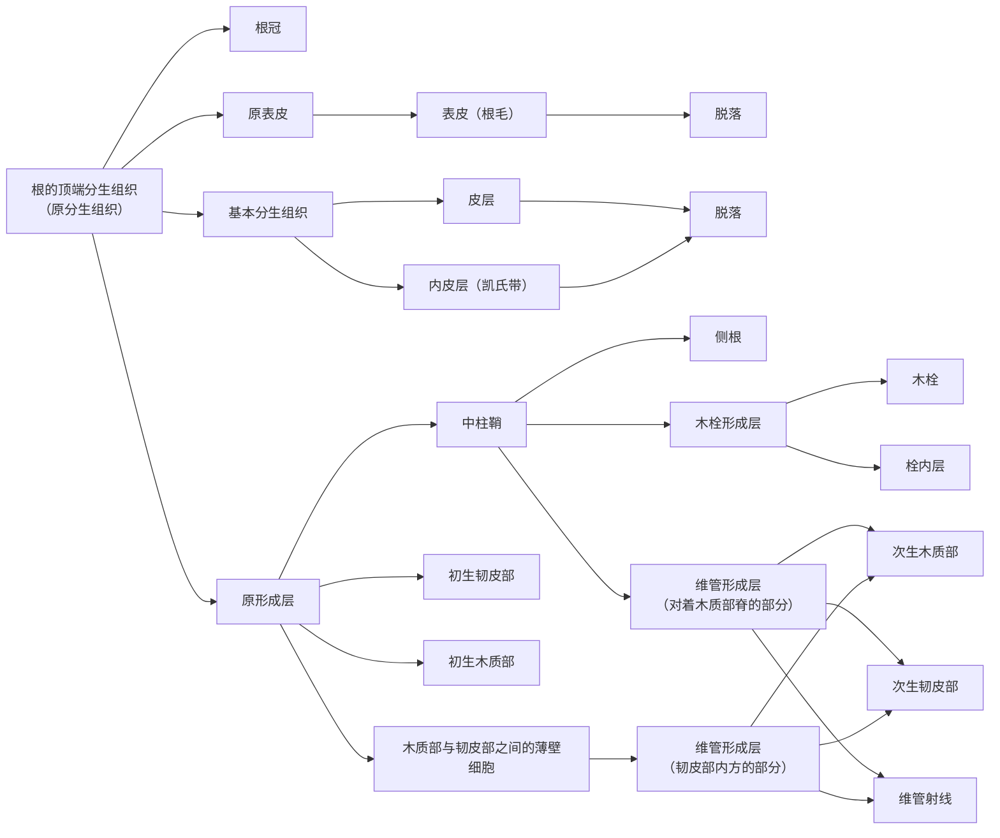

根是维管植物适应陆地生活而形成的器官，一般生长在地下，从土壤中吸收水分与矿质，并把植株固着在土壤中。它的顶端能无限地向下生长，并在内部发生侧根，形成庞大的根系。本章先讲根的形态与根系，再沿根尖从先端向后讲根冠、分生区、伸长区和成熟区，然后讲成熟区的初生结构、侧根的发生和有加粗生长的根的次生结构，最后讲根与微生物共生形成的根瘤和菌根。根的初生结构是理解茎的初生结构（[7.12.21](/7.12.21)）的基础：二者都由表皮、皮层和维管柱组成，但维管组织的排列方式完全不同，二者在下胚轴中衔接（[7.12.24](/7.12.24)）。根的起源（根在石松类与真叶植物中各自独立起源）见 [7.12.16](/7.12.16)；变态根（贮藏根、气生根、寄生根）见 [7.12.24](/7.12.24)。水分与矿质的吸收和运输、向重力性的机制属于植物生理学，本章只写结构以及结构所提示的功能。

## 20.1. 根的功能与形态

### 20.1.1. 根的功能

根的功能与它的结构密切相关：

- 吸收：根从土壤中吸收水分、无机盐（硝酸盐、磷酸盐、硫酸盐以及钾、钙、镁等离子）和溶解的二氧化碳。水是原生质的组分、光合作用的原料、细胞膨压的维持者；植物体所需的水分和矿质，除少量由叶和幼茎从空气中吸收外，大部分由根自土壤中取得。吸收主要在根尖的伸长区和成熟区进行。
- 固着与支持：庞大的根系反复分枝、深入土壤，加上根内牢固的机械组织和维管组织，使高大的树木在风雨冰雪中屹立不倒。根系还能固定流沙、保护堤岸、防止水土流失。
- 输导：根毛和表皮吸收的水分与无机盐经根的木质部运往地上部分；叶制造的有机物经茎运到根，再经根的韧皮部输送到根的各部分。
- 合成：根能合成多种氨基酸、植物激素（如细胞分裂素）和生物碱（烟草的烟碱在根中合成后运往叶），对地上部分的生长发育有很大影响。
- 贮藏与繁殖：根内的薄壁组织一般较发达，常为贮藏之所（萝卜、甘薯、人参）；不少植物的根能产生不定芽，在营养繁殖中用于根插。

根在经济上用途很广：甘薯、木薯、胡萝卜、萝卜、甜菜供食用和饲料，甜菜制糖，甘薯制淀粉和酒精；人参、大黄、当归、甘草、乌头、龙胆、吐根等入药。

### 20.1.2. 主根、侧根与不定根

**定义 20.1.1（主根、侧根与不定根）** 种子萌发时由胚根发育成的、植物体上最早出现的根称为主根（primary root），也称直根（taproot）或初生根；主根在一定部位从内部侧向生出的支根称为侧根（lateral root），由主根生出的为一级侧根（次生根），由一级侧根生出的为二级侧根（三生根），依此类推；在主根及其侧根以外的部位，如茎、叶、老根或胚轴上生出的根，称为**不定根**（adventitious root）。

主根及其侧根发生在一定的部位，统称定根；不定根发生的位置不定，但它也能分枝产生侧根。禾本科植物种子萌发时形成的主根存活期不长，以后由胚轴上和茎基部各节上产生的不定根所代替（[7.12.19](/7.12.19#sec-19.6.2)）。常春藤枝上的气生根、柳枝插条上长出的根、玉米茎基部的支柱根、竹鞭节上的根、落地生根叶缘小植株的根，都是不定根。农、林、园艺上利用枝条、叶、地下茎产生不定根的习性，进行扦插、压条等营养繁殖（[7.12.24](/7.12.24)）。农学上常把胚根形成的主根和胚轴上生出的不定根统称种子根（seminal root，也称初生根），而把茎基部节上的不定根称为次生根（节根），与植物学名词的含义不同，阅读文献时应注意。

### 20.1.3. 根系

**定义 20.1.2（根系、直根系与须根系）** 一株植物地下部分全部根的总和称为**根系**（root system）。主根发达、明显粗长于侧根的根系称为直根系（taproot system）；主根不发达或早期死亡、根系主要由许多粗细相近的不定根及其分枝组成而呈须状的根系，称为须根系（fibrous root system）。

裸子植物和大多数双子叶植物的根系由主根和各级侧根组成，是直根系，如松、柏、棉、油菜、蒲公英；单子叶植物的根系主要由不定根和它们的分枝组成，是须根系，如稻、麦以及葱、韭、蒜、百合等鳞茎植物；少数双子叶植物如车前也是须根系。须根系是单子叶植物的特征之一：单子叶植物的根没有次生生长，主根不能增粗，只能不断由茎基部产生新的不定根来扩大根系。但木本植物不全是直根系，竹类就是须根系。

根在土壤中分布的深度和广度，因植物种类、发育阶段、土壤条件和人为影响而异，一般分为深根系和浅根系。深根系的主根发达，垂直向下深入土层，可达 3–5 m 甚至 10 m 以上，如大豆、蓖麻、马尾松；浅根系的侧根或不定根比主根发达，向四周扩展，根系主要分布在土壤表层，如车前、悬铃木、玉米、水稻。直根系多为深根系，须根系多为浅根系，但并非绝对。根的深度也随发育而变化：马尾松一年生苗的主根仅深 20 余 cm，成长后可深达 5 m 以上。已知根系最深的记录是南部非洲卡拉哈里沙漠中的白干山柑（*Boscia albitrunca*，山柑科），达 68 m；美国亚利桑那州的牧豆树（*Prosopis juliflora*）根深 53 m；苜蓿的根可深达 6 m 以上；树木根系的水平扩展一般是树冠的 4–7 倍。

地下水位较低、通气良好、土壤肥沃时，根系分布较深，反之较浅；干旱地区的根系较深，潮湿地区较浅。人为措施也能改变根系的深度：幼苗期的表面灌溉、苗木移植、压条和扦插易形成浅根，种子繁殖、深耕多肥易形成深根。根系的规模远超过一般的想象：对一株生长四个月的黑麦（*Secale cereale*）的经典测定（Dittmer 1937）表明，它的根系（包括根毛）总表面积约 $639\,\mathrm{m^2}$，是地上部分表面积的 130 倍，却只占据约 0.05 m³ 的土壤。这样大的吸收面积主要由细根与根毛提供；细根寿命多只有几个月，不断死亡和更新，陆地生态系统年净初级生产量中有相当大的一部分用于生产细根。

地上部分与地下部分之间保持着一定的平衡（根冠比）：根系受损则地上部分因缺水缺肥而生长减弱，地上部分减小则根系因光合产物供应减少而生长受限。移栽时大部分细根留在土中，所以要剪去部分枝叶并充分灌溉，以减少蒸腾、恢复平衡。

## 20.2. 根尖的结构与发育

**定义 20.2.1（根尖）** 从根的顶端到着生根毛部分的一段，称为根尖（root tip），通常长约 4–6 mm。根尖从先端向后依次分为根冠、分生区、伸长区和成熟区四部分。

不论主根、侧根或不定根都有根尖。根的伸长、对水分和养料的吸收、根内组织的形成，主要在根尖进行，所以根尖的损伤会直接影响根的生长和吸收（见下图）。

### 20.2.1. 根冠

**定义 20.2.2（根冠）** 位于根的最先端、由排列不规则的薄壁细胞组成、像帽子一样套在分生区外方的结构，称为**根冠**（root cap）。

根冠是根特有的结构，一般呈圆锥形。组成根冠的细胞是生活的薄壁细胞，常含淀粉，一般没有多大分化，只是靠近分生区的细胞较小，外方的细胞较大。根冠的中央部分由排成纵列的细胞组成，称为柱状细胞区（columella），周围是侧根冠（lateral root cap）。根冠有以下作用：

- 保护：根冠在前，与土壤中的沙砾不断摩擦，外层细胞受伤、死亡、脱落，保护了后面幼嫩的分生区；由于分生区的细胞不断向前补充，根冠始终保持一定的形状和厚度。
- 润滑与根际作用：根冠外层细胞的高尔基体分泌大量黏液（高度水合的多糖），使根尖在土粒间穿行时减少摩擦。根冠最外层的细胞按程序彼此分离、从根冠脱落，称为边缘细胞（border cell）；它们在**根际**中还能存活数周，表达与根冠不同的基因，分泌特定的蛋白质与黏液。每天脱落的边缘细胞数量随植物而异，从烟草的约 10 个到棉的约 10 000 个；边缘细胞及其分泌物被认为能保护分生组织免受病原侵染、维持根与土壤的接触、吸引或排斥特定的细菌。
- 感受重力：柱状细胞中含有大而重的淀粉体，起平衡石（statolith）的作用：根被水平放置时，淀粉体在几分钟内沉降到细胞的新下侧，引起根的伸长区不对称生长，使根向下弯曲，恢复垂直生长；切除根冠的根暂时失去向重力性。这样感受重力的细胞称为平衡细胞（statocyte）。从感受到弯曲的信号传递（生长素的再分配）属于植物生理学。根冠曾被认为也感受水势梯度（向水性），但近年的研究表明，向水性的弯曲主要取决于伸长区皮层细胞中 MIZ1 与脱落酸信号的作用（Dietrich 等 2017），根冠在其中的作用尚有争议。

除了一些寄生的种子植物和某些具菌根的植物以外，所有植物的根都有根冠。环境条件也影响根冠的结构：在土壤中正常生长的根，水培后可能不再产生根冠；水生的种子植物一般有根冠，但发达程度和存活时间因种而异。浮萍的根冠特化成套状的"根套"。

### 20.2.2. 分生区与静止中心

分生区位于根冠内方，是根的顶端分生组织，长约 1–2 mm。它不断分裂增生细胞：一部分向前方补充根冠，大部分向后方经生长、分化逐渐形成根的各种结构；由于原始细胞的存在，分生区始终保持原有的体积和作用。根的顶端分生组织包括原分生组织和初生分生组织：原分生组织位于前端，由原始细胞及其最初的衍生细胞构成，细胞较少分化；初生分生组织位于其后，已分化为原表皮、基本分生组织和原形成层三部分，分别发育成表皮、皮层和维管柱（[7.12.4](/7.12.4)）。

种子植物根的顶端分生组织在结构上有两种类型（见 [7.12.4](/7.12.4) 顶端分生组织图的 C 栏）：一种是维管柱、皮层和根冠都可追溯到顶端分生组织中各自独立的三层原始细胞，表皮或与皮层同源（禾本科，如玉米），或与根冠同源（多数双子叶植物，如烟草），称为封闭型（closed type）；另一种是所有各区、或至少皮层和根冠，都起源于一群共同的原始细胞，称为开放型（open type），在系统上较为原始。根尖的这种分层排列可以用组织原学说方便地描述：中柱原、皮层原和表皮原（或表皮–根冠原）。

**定义 20.2.3（静止中心）** 根的顶端分生组织最远端、位于根冠原始细胞之后的一群原始细胞，分裂极少、体积变化很小、合成核酸和蛋白质的速率也很低，称为**静止中心**（quiescent center，又称不活动中心）。

静止中心是在研究根的正常发育、手术处理和 DNA 合成的标记示踪时发现的（Clowes 1956）。旺盛的有丝分裂活动并不在根的最先端，而是在静止中心以外进行。实测的细胞周期时长如下：

| 部位 | 玉米 | 蚕豆 | 白芥 |
|---|---|---|---|
| 根冠原始细胞 | 12 h | 44 h | 35 h |
| 静止中心 | 174 h | 292 h | 520 h |
| 紧接静止中心上方的维管柱 | 28 h | 37 h | 32 h |
| 距静止中心 200–250 μm 的维管柱 | 29 h | 26 h | 25 h |

静止中心的细胞分裂速率比周围慢 6–20 倍。它的大小与根的大小有关：大的根中静止中心较大，小的根中较小或不存在（拟南芥的静止中心只有 4 个细胞）。静止中心并不是没有作用：根被辐射或手术损伤、除去根冠、或因冷冻诱导休眠后恢复时，静止中心的细胞会重新开始分裂，补充受损的分生组织；离体的玉米静止中心在培养中能再生出完整的根。现在认为静止中心是根的干细胞的"组织中心"，它维持周围原始细胞（干细胞）的未分化状态，与茎端组织中心的作用相当（[7.12.4](/7.12.4) 的 WUS–CLV3 模型；根中对应的基因是 *WOX5*，机制属于植物发育生物学）。静止中心细胞分裂缓慢，也使干细胞库避免了频繁 DNA 复制带来的突变积累。

### 20.2.3. 伸长区

伸长区位于分生区稍后方，长约 2–5 mm。这里的细胞分裂逐渐停止，液泡迅速增大，细胞显著沿根的长轴方向延伸。根的长度生长是分生区细胞的分裂、增大和伸长区细胞的延伸共同作用的结果，其中伸长区细胞的延伸贡献最大，使根尖在土壤中向前推进，不断进入新的土壤区域吸取矿质。短而粗的伸长区在坚实的土层中更利于根的推进。伸长区的细胞也加速了分化：最早的筛管和最早的环纹导管往往出现在这一区域；最早成熟的是韧皮部，它为前方的分生组织输送养料。根只在根尖很短的一段内伸长，这使它能够在土壤颗粒之间推进：如果整条根都在伸长，根就会在土中弯曲而无法前进。

### 20.2.4. 成熟区与根毛

成熟区紧接伸长区，这里根的各种细胞已停止伸长，大多已分化成熟。成熟区的表皮常产生根毛，所以又称根毛区（root hair zone）。

**定义 20.2.4（根毛）** 根成熟区的表皮细胞外壁向外延伸形成的管状突起，称为**根毛**（root hair）。根毛是一个细胞的一部分，不分枝，壁薄，角质层极薄，细胞核与大部分细胞质位于其先端。

根毛直径 5–17 μm，长 0.08–1.5 mm，数目因植物而异：玉米每平方毫米表皮约有 420 根，豌豆约 230 根。根毛的先端生长（只在顶端扩展细胞壁）类似花粉管。根毛在发育中与土壤颗粒密切结合，它的外壁上有黏液和果胶质，加强了这种接触，有利于吸收和固着，也使根毛在控制土壤侵蚀上比根的其他部分更为有效。根毛不是表皮毛：它是根表皮细胞本身的延伸，而**表皮毛**是地上部分表皮的附属物（[7.12.4](/7.12.4)）。

许多植物的根表皮中，只有部分细胞（生毛细胞，trichoblast）产生根毛，其他细胞（非生毛细胞）不产生。生毛细胞的分布有三种方式：随机分布；由一次不等分裂产生，较小的子细胞形成根毛（禾本科、鸭跖草）；按位置决定，例如拟南芥中位于两个皮层细胞之间的表皮细胞形成根毛，只与一个皮层细胞相接的不形成根毛，结果根毛排成整齐的纵列。少数植物如洋葱没有根毛；具外生菌根的根上根毛常不发育（20.6.2 节）。

根毛生长很快，但寿命很短，一般只有几天，多的 10–20 天即死亡。随着分生区衍生细胞的增大分化和伸长区的延伸，新的根毛不断在伸长区之后出现，代替枯死的根毛，根毛区也随着根的生长向前推移，进入新的土壤区域。伸长区和具根毛的成熟区是根吸收能力最强的部分；失去根毛的成熟区主要进行输导和支持。移栽植物时必然损伤大部分根尖和根毛，使吸水能力急剧下降，所以移栽后要充分灌溉并修剪部分枝叶。

## 20.3. 根的初生结构

**定义 20.3.1（初生生长与初生结构）** 直接来自顶端分生组织的衍生细胞的增生和成熟、使器官伸长的生长过程，称为**初生生长**（primary growth）；初生生长过程中产生的各种成熟组织称为初生组织，由它们组成的结构称为初生结构（primary structure）。

在根尖的成熟区作一横切面，就能看到根的全部初生结构，由外至内为表皮、皮层和维管柱三部分（见 20.3.4 节的初生结构图）。

### 20.3.1. 表皮

根成熟区最外面的表皮由原表皮发育而成，一般由一层活细胞组成。表皮细胞近似长方柱形，长轴与根的纵轴平行，排列整齐紧密。与其他器官的表皮相比，根的表皮细胞壁薄、角质层薄、不具气孔，部分细胞的外壁延伸成根毛，这些特征都与吸收作用相适应，所以根的表皮也称为吸收组织。

热带兰科植物和一些附生天南星科植物的气生根中，表皮是多层的，形成所谓根被（velamen）：由紧密排列的死细胞组成的鞘，细胞壁有带状或网状的加厚，壁上有许多初生纹孔场。空气干燥时这些细胞充满空气，呈银白色；降雨时迅速充满水，呈绿色。根被的主要作用是机械保护和防止皮层失水；它能否吸收水分，过去有争议，现在认为根被能迅速吸持雨水和露水，再由其下的外皮层中有薄壁的通道细胞缓慢吸收。

### 20.3.2. 皮层

皮层由基本分生组织发育而成，在表皮内方占根的相当大部分，由多层薄壁细胞组成，细胞排列疏松，有显著的细胞间隙，这些间隙是根细胞通气所必需的。皮层是水分和溶质从根毛到维管柱的横向运输途径，也是贮藏组织；在许多根中，皮层是根中体积最大的部分。

皮层最外的一层或几层细胞，即紧接表皮的细胞，往往排列紧密、没有间隙，称为外皮层（exodermis）。大多数被子植物的根有外皮层；它的细胞壁上也有类似凯氏带的结构，在根毛枯死、表皮破坏后，外皮层细胞的壁增厚并栓化，代替表皮起保护作用。鸢尾的外皮层由多层细胞组成。

**定义 20.3.2（内皮层与凯氏带）** 皮层最内的一层细胞，排列整齐紧密，没有细胞间隙，其径向壁和横向壁上有一条环绕细胞一整圈的带状结构，称为**内皮层**（endodermis）；这条带状结构称为**凯氏带**（Casparian strip），它是初生壁和胞间层中被疏水物质（主要是木质素，常伴有栓质）浸渍的部分。

凯氏带不是一般的壁加厚，而是初生壁与胞间层中原来由水占据的空隙被疏水物质填充的一段，因而对水和溶质不通透。传统上认为凯氏带由栓质和木质素组成；对拟南芥的研究（Naseer et al. 2012）表明凯氏带的主要成分是木质素，栓质在稍后才沉积在整个壁的内表面。凯氏带形成后，内皮层的质膜与凯氏带之间有极强的结合：在电子显微镜下观察质壁分离的细胞，质膜仍紧贴凯氏带，只有凯氏带以外的质膜与壁分离。

凯氏带的作用是封闭细胞壁中的运输途径：皮层细胞壁间的运输只能到达凯氏带，不能越过，水和离子必须穿过内皮层细胞的质膜才能进入维管柱，从而受到质膜的选择；放射自显影等研究证明了这一点。根尖较幼嫩的部分凯氏带尚未形成，细胞壁间的运输仍可直接到达木质部。

**定义 20.3.3（质外体与共质体）** 植物体内细胞壁、胞间层与细胞间隙以及死细胞（导管、管胞）的腔连成的、质膜以外的连续系统，称为质外体（apoplast）；由**胞间连丝**连接的所有细胞的原生质体组成的连续系统，称为共质体（symplast）。

水和溶质从根毛到木质部有三条途径：质外体途径（沿细胞壁与胞间隙）、共质体途径（经胞间连丝由一个细胞的细胞质进入下一个）和跨膜途径（反复穿过质膜与液泡膜）。凯氏带在内皮层处截断了质外体途径，迫使水和溶质至少穿过一次质膜（见下方内皮层图的 A、B 栏）。这样，根能够选择吸收的离子、阻止有害离子和病原微生物沿细胞壁进入维管柱，并防止已进入木质部的离子倒流回土壤，这是根压得以建立的结构基础。各途径的通量、水通道蛋白与离子转运的机制属于植物生理学。

内皮层的发育一般分三个阶段（见下图的 C 栏）：

1. 初生阶段：只有凯氏带，其余壁仍是薄的初生壁；
2. 次生阶段：在整个壁的内表面沉积一层栓质层（suberin lamella），把原生质体与壁完全隔开；
3. 三生阶段：在栓质层内方再沉积厚的纤维素壁，常木质化。

单子叶植物与一些双子叶植物的内皮层发展到三生阶段：径向壁、横向壁与内切向壁（向维管柱的一面）都显著增厚，只有外切向壁仍保持薄壁，横切面上呈马蹄形（"五面加厚"）；增厚的内切向壁上有孔，使部分溶质仍能穿越。少数位于原生木质部附近的内皮层细胞仍停留在初生阶段，只有凯氏带而壁不增厚，称为通道细胞（passage cell），它们是皮层与维管柱之间物质交流的通道。栓质层的沉积进一步限制了吸收，所以根的吸收主要在凯氏带已形成而栓质层尚未形成的一段进行。

### 20.3.3. 维管柱

维管柱是内皮层以内的部分，包括中柱鞘和初生维管组织，有些植物的根还有髓。

**定义 20.3.4（中柱鞘）** 维管柱最外的一层或几层薄壁细胞，紧贴内皮层，由原形成层发育而成并保持潜在的分生能力，称为**中柱鞘**。

中柱鞘通常由一层薄壁细胞组成，裸子植物和某些单子叶植物的根中有多层，有时也含厚壁细胞。中柱鞘是根中非常活跃的组织：侧根、部分维管形成层、木栓形成层、不定芽和不定根都可能由它产生。

根的初生维管组织包括初生木质部和初生韧皮部，它们不并列成束，而是各自成束、相间排列，即辐射维管束（[7.12.5](/7.12.5)）。根的初生木质部的分化是从外方开始、向内方逐渐成熟的。

**定义 20.3.5（外始式与原型）** 初生木质部（或韧皮部）从外方向内方逐渐分化成熟、最早成熟的原生木质部位于外侧的发育方式，称为**外始式**。根的初生木质部在横切面上呈辐射状，原生木质部构成辐射角（木质部脊），按辐射角的数目，根分为二原型（diarch）、三原型（triarch）、四原型（tetrarch）、五原型、六原型和多原型（polyarch）。

最早成熟的原生木质部在外方、靠近中柱鞘，由管腔较小的环纹导管或螺纹导管组成；成熟较迟的后生木质部在内方，由管腔较大的梯纹、网纹或孔纹导管组成。外始式的发育使最早形成的导管靠近皮层，缩短了水分从根毛到木质部的距离，加速了吸收的物质向上运输。

不同植物根中的木质部脊数是相对稳定的：

| 原型 | 例 |
|---|---|
| 二原型 | 烟草、油菜、萝卜、胡萝卜、芥菜、甜菜 |
| 三原型 | 紫云英、豌豆 |
| 四原型（有时五原型） | 蚕豆、落花生、棉、向日葵、毛茛、蓖麻 |
| 五原型 | 茶、马铃薯 |
| 六原型 | 葱 |
| 多原型 | 葡萄、菖蒲、高粱、棕榈、鸢尾、玉米、水稻、小麦 |

脊数也会变化：茶的不同品种有 5、6、8 甚至 12 束；同一株植物的不同根中可以出现不同束数，如落花生主根为 4 束，侧根有时为 2 束；一般细的侧根原型数少于粗的主根。离体培养的根中，培养基里生长素（吲哚乙酸）的含量能影响木质部脊数，这说明原型数与根的直径和维管柱的大小有关。双子叶植物的根多为二至六原型，单子叶植物的根多为多原型，这是区分二者的依据之一。

初生韧皮部的发育也是外始式，原生韧皮部（protophloem）在外方，后生韧皮部（metaphloem）在内方。初生韧皮部束与木质部脊数相等，位于两个木质部脊之间。初生韧皮部由筛管和伴胞组成，也有韧皮薄壁组织，有时还有韧皮纤维（锦葵科、豆科、番荔枝科）。初生木质部与初生韧皮部之间有薄壁组织，双子叶植物中这些细胞以后参与形成维管形成层（20.5 节）。

一般双子叶植物根的中央由后生木质部占据，没有髓（如毛茛、小麦初生根的中央是一个大导管）；如果中央部分不分化成木质部，就由薄壁组织或厚壁组织形成髓。多数单子叶植物、双子叶植物中的一些草本植物（蚕豆、落花生）以及多数木本植物的根有髓，它们的初生木质部和初生韧皮部在髓的外围相间排列。

### 20.3.4. 双子叶植物与单子叶植物根的初生结构

| | 双子叶植物的根 | 单子叶植物的根 |
|---|---|---|
| 例 | 毛茛、蚕豆、棉、向日葵 | 玉米、水稻、小麦、鸢尾 |
| 表皮 | 一层，有根毛 | 一层，有根毛；表皮破坏后外皮层栓化代替 |
| 外皮层 | 有或不明显 | 常发达，鸢尾为多层 |
| 内皮层 | 多停留在凯氏带阶段 | 常发展为五面加厚，有通道细胞 |
| 中柱鞘 | 一层，能产生维管形成层与木栓形成层 | 一层或多层，后期常木质化 |
| 原型 | 二至六原型 | 多原型 |
| 髓 | 多无（蚕豆、落花生等有） | 有 |
| 次生生长 | 多数有（一年生草本可无） | 无 |

### 20.3.5. 根与茎初生结构的差别（预告）

| | 根 | 茎 |
|---|---|---|
| 表皮 | 薄壁，无气孔，有根毛 | 有角质层与气孔，有表皮毛 |
| 内皮层 | 明显，有凯氏带 | 多不明显（水生植物、地下茎中有；有时为淀粉鞘） |
| 中柱鞘 | 明显 | 多不明显 |
| 维管组织 | 木质部与韧皮部相间排列（辐射维管束） | 木质部与韧皮部内外并列成束（外韧、双韧等） |
| 初生木质部 | 外始式 | 内始式 |
| 侧生器官 | 侧根，内起源 | 叶与腋芽，外起源 |

二者的转变发生在下胚轴的过渡区（[7.12.24](/7.12.24)）；茎的初生结构在 [7.12.21](/7.12.21) 详述。

## 20.4. 侧根的形成

不论主根、侧根或不定根上产生的支根统称侧根。侧根反复分枝，连同原来的母根共同形成根系。

**定义 20.4.1（内起源）** 器官起源于母体器官内部较深的组织（如根的中柱鞘），须穿过外方的组织才能露出的发生方式，称为**内起源**（endogenous origin）；与之相对，起源于母体表层（顶端分生组织表面一至三层细胞）的方式称为外起源（exogenous origin），茎上的叶和腋芽是外起源的（[7.12.21](/7.12.21)）。

种子植物的侧根通常起源于母根的中柱鞘，内皮层也可能不同程度地参与（见下方侧根发生图的 A–C）：

1. 中柱鞘的某些细胞（创始细胞）开始分裂，最初几次是平周分裂，使细胞层数增加，新生的组织向外突起；
2. 以后的分裂包括平周分裂和垂周分裂，是多方向的，突起继续生长，形成侧根原基（root primordium），这是侧根最早的分化阶段；
3. 根原基逐渐分化出生长点和根冠，以根冠为先导向前推进；侧根生长产生的机械压力和根冠分泌的物质使内皮层、皮层和表皮的细胞分离或溶解，侧根依次穿越这些组织，露出母根以外，进入土壤。

侧根的发生在根毛区就已开始，但突破表皮、露出母根却在根毛区以后的部分，这样侧根的产生不会破坏根毛而影响吸收。侧根起源于中柱鞘，与母根的维管组织紧密相邻，侧根的维管组织以后就与母根的维管组织连接起来。

侧根在母根上发生的位置在同一种植物中常较稳定，因为它与初生木质部的类型有关（见下图）：二原型的根上，侧根发生在初生韧皮部与初生木质部之间（或对着初生韧皮部），在母根表面排成四列；三原型、四原型等的根上，侧根正对着初生木质部发生；多原型的根上，侧根对着初生韧皮部发生。由于位置一定，侧根在母根表面常较规则地纵列成行。这一规律是对经典材料的总结，并非没有例外：拟南芥的根是二原型，但侧根正对着两个原生木质部极发生，排成两列（多数现代文献把"对着原生木质部"作为种子植物的一般情况）。

侧根的发生受生长素等调节物质的促进，也受内源抑制物的控制，所以母根内侧根的分布和数量是受调节的。主根与侧根有密切的联系：切断主根能促进侧根的产生和生长。农林园艺上移苗时常切断主根，以引起更多侧根的发生，保证根系的旺盛发育，也便于以后移植。不定根通常也是内起源的：茎上的不定根多起源于维管束之间的薄壁组织或维管形成层附近，叶上的不定根起源于叶脉附近的薄壁组织。

## 20.5. 根的次生生长

一年生双子叶植物和大多数单子叶植物的根由初生生长完成它们的一生；大多数双子叶植物和裸子植物的根却在初生生长结束后进行加粗生长。

**定义 20.5.1（次生生长与次生结构）** 由侧生分生组织（维管形成层与木栓形成层）的分裂、生长和分化使根或茎加粗的生长过程，称为**次生生长**（secondary growth）；次生生长中产生的次生维管组织（次生木质部与次生韧皮部）和周皮共同组成次生结构（secondary structure）。

### 20.5.1. 维管形成层的发生与活动

根的维管形成层的发生过程如下（见 20.5.2 节的次生生长图）：

1. 首先，初生韧皮部内方、即两个初生木质部脊之间的薄壁细胞开始平周分裂，成为最初的形成层；因此最初的形成层是条状的，条数与初生韧皮部束数相等。
2. 各条形成层逐渐向两侧扩展，并向外推移，直到初生木质部脊处与中柱鞘相接；这时正对木质部脊的中柱鞘细胞恢复分生能力，参与形成层的形成。至此，条状的形成层彼此衔接，成为一个完整连续的形成层环。
3. 由于各部分发生有先后，分裂的速度也不相等，最初的形成层环呈凹凸不平的波状：二原型根中呈梭形，三原型中呈三角形，四原型中呈四角形，依此类推。
4. 原来条状的部分较早形成，切向分裂开始也早，所产生的组织量较多，特别是向内产生的次生木质部较多，把这部分形成层向外推得较远；结果整个形成层环在横切面上成为较整齐的圆形。此后形成层的分裂等速进行，有规律地形成次生结构，并把初生韧皮部推向外方。

形成层主要进行切向（平周）分裂：向内产生的细胞形成新的木质部，加在初生木质部的外方，称为次生木质部；向外产生的细胞形成新的韧皮部，加在初生韧皮部的内方，称为次生韧皮部。在有次生生长的根中，次生木质部与次生韧皮部之间始终存在形成层。次生木质部和次生韧皮部的组成基本上与初生结构中的相似，但次生韧皮部中韧皮薄壁组织较发达，韧皮纤维较少。

由正对木质部脊的中柱鞘产生的那一段形成层，常形成宽的射线；此外，在次生木质部和次生韧皮部内还有一些径向排列的薄壁细胞群，分别称为木射线和韧皮射线，总称维管射线（[7.12.22](/7.12.22)）。维管射线是次生结构中新产生的组织，从形成层处向内外贯穿次生木质部和次生韧皮部，作为横向运输与贮藏的结构：木质部中的水分和无机盐可经维管射线运到形成层和次生韧皮部，韧皮部中的有机养料也可经它运到形成层和次生木质部。维管射线的形成，使根的维管组织有了轴向系统（导管、管胞、筛管、伴胞、纤维等）和径向系统（射线）之分。形成层的细胞组成与分裂方式（纺锤状原始细胞与射线原始细胞、增殖分裂）在茎中详述（[7.12.22](/7.12.22)）。

根的次生结构有以下特点：

1. 次生维管组织中，次生木质部居内、次生韧皮部居外，相对排列，与初生维管组织中二者相间排列的方式完全不同。
2. 形成层每年向内外增生新的维管组织，根的直径不断增大，形成层也随着外移，周径扩大；所以形成层细胞除切向分裂外，还有径向和其他方向的分裂。
3. 次生结构以次生木质部为主，次生韧皮部所占比例较小。新的次生韧皮部总是加在老韧皮部的内方，越是外方的老韧皮部受到的挤压越大，到相当时候就被破坏，初生韧皮部很早就被挤毁；而新的次生木质部总是加在老木质部的外方，老木质部受影响很小，初生木质部也能在根的中央保存下来。所以在粗大的树根中，几乎全部是次生木质部，次生韧皮部只占很小的比例。

### 20.5.2. 木栓形成层的发生与活动

有次生生长的根，由于内部每年增生新的维管组织，外方的表皮和皮层受压破坏、剥落。与此同时，中柱鞘细胞恢复分裂能力，形成**木栓形成层**。木栓形成层也是侧生分生组织，进行切向分裂，主要向外产生大量木栓，覆盖在根表面起保护作用，向内产生少量薄壁组织即栓内层；三者合称**周皮**（[7.12.4](/7.12.4)），是根加粗后的次生保护组织。木栓形成后，它外方的内皮层、皮层和表皮因营养断绝而死亡，以后被土壤微生物分解而剥落。所以加粗的根没有皮层，这是根与茎的次生结构的一个区别：茎的第一个木栓形成层多在表皮或皮层的外层发生，皮层可以保留较长时间（[7.12.22](/7.12.22)）。

最早的木栓形成层产生在中柱鞘，它的活动到一定时期就终止了；以后新的木栓形成层逐渐向内发生，可深达次生韧皮部的外方，并继续形成新的木栓，所以根的外面始终有木栓覆盖。

双子叶植物根中组织分化的全过程概括如下：

单子叶植物的根一般没有维管形成层，不能加粗；少数有次生生长的单子叶植物（龙血树属）的根也只在皮层中产生异常的次生形成层（[7.12.22](/7.12.22)）。萝卜、甜菜、甘薯等贮藏根的增粗，在正常的形成层活动之外还有额外形成层的活动（[7.12.24](/7.12.24)）。

## 20.6. 根瘤与菌根

种子植物的根与土壤中的微生物关系密切。一些微生物进入根内，从根的组织中取得营养，同时为植物提供它所需要的物质，形成**互利共生**。根与微生物的共生主要有两类：与固氮细菌形成的根瘤，与真菌形成的菌根。共生的信号交换、固氮与养分交换的分子机制在 [7.11.31](/7.11.31) 中已经讲过，本节只写它们的形态与解剖。

### 20.6.1. 根瘤

**根瘤**是豆科等植物的根在固氮细菌作用下形成的器官（[7.11.31](/7.11.31#sec-31.2.1)）。豆科植物的根上常生有各种形状的瘤状突起，就是根瘤。**根瘤菌**从根毛侵入：根毛卷曲包住细菌，形成侵染线，沿根毛向内延伸到皮层；同时受结瘤因子的刺激，皮层内层（无限型根瘤）或外层（有限型根瘤）的细胞恢复分裂，形成根瘤原基，侵染线到达后，细菌被释放到原基的细胞中，分化成**类菌体**，被侵染的细胞体积显著增大。结果皮层部分膨大凸出，形成根瘤。根瘤中被侵染的大型细胞含有**豆血红蛋白**，使活跃的根瘤呈粉红色。

根瘤的解剖结构与根本身不同：

- 维管组织在外周：豆科根瘤中央是含类菌体的被侵染组织（夹杂着未被侵染的较小细胞），维管束分布在它的周围，与母根的维管柱相连，负责运入光合产物、运出固氮产物；维管束外有一层根瘤内皮层。
- 氧的屏障：维管束以外是排列紧密的根瘤薄壁组织（根瘤皮层），构成限制氧气扩散的屏障，使中央组织保持低氧，保护对氧敏感的**固氮酶**。
- 两种发育类型（见 20.6.2 节根瘤与菌根图的 A 栏）：无限型根瘤（豌豆、苜蓿、三叶草、紫云英）的顶端有持续活动的分生组织，根瘤呈圆柱形，从顶端到基部依次为分生区、侵染区、固氮区和衰老区，一个根瘤中可以看到类菌体从侵入到衰老的全过程；有限型根瘤（大豆、菜豆、百脉根）没有持久的分生组织，呈球形，所有被侵染细胞大致同步发育。

除豆科外，桤木、木麻黄、杨梅、沙棘等八个科的木本植物与放线菌 *Frankia* 形成放线菌根瘤（actinorhizal nodule）。放线菌根瘤是变态的侧根：每个瘤瓣中央有一条维管柱，被侵染的皮层细胞在其周围，这与维管束在外周的豆科根瘤不同；瘤瓣常反复分枝成珊瑚状的瘤丛。大麻科（旧属榆科）的 *Parasponia*（与山黄麻属 *Trema* 近缘）是唯一能被根瘤菌结瘤的非豆科植物。苏铁根上的珊瑚状根（coralloid root）中共生的是有**异形胞**的蓝细菌（念珠藻、鱼腥藻），位于皮层中的一个环状腔隙内；罗汉松科根上的小球状"根瘤"中则是丛枝菌根真菌，固氮的作用尚无定论。中文旧教材把它们与豆科根瘤并列，应注意这些结构的不同来源。

根瘤菌使共生的豆科植物得到氮素，根瘤和残根遗留在土壤中也能提高土壤肥力，所以紫云英、田菁、苕子、苜蓿、三叶草等豆科植物用作绿肥，豆科作物与禾本科作物间作、轮作能增加土壤肥力。中国早在公元前 1 世纪的《氾胜之书》中就谈到瓜与豆的间作，6 世纪的《齐民要术》提出豆科与禾谷类作物轮作的优点。固氮酶需要钼，所以豆科植物对钼的需要量比其他植物高得多，生产上用钼酸铵拌种或喷施可以增产；在缺少相应根瘤菌的土壤中播种豆科作物时，常用根瘤菌剂拌种。

### 20.6.2. 菌根

种子植物的根与真菌共生形成**菌根**。中文传统教材把菌根分为外生菌根、内生菌根与内外生菌根三类；按真菌与结构，现在一般分为以下几类（[7.11.31](/7.11.31#sec-31.3.1)），其中以丛枝菌根和外生菌根最重要（见下图的 B、C 栏）。

**外生菌根**：真菌的菌丝在植物幼根的外面交织成一层致密的菌套（mantle），有时厚达几十微米，并侵入表皮和皮层细胞之间，在细胞间隙中分枝成网状，称为哈蒂氏网（Hartig net），但不侵入细胞内。哈蒂氏网是植物与真菌交换物质的界面。具外生菌根的根常不长根毛，根的伸长减慢而分枝增多，形成短粗、二叉分枝或珊瑚状的短根，菌丝和根状菌索从菌套伸入土壤，代替根毛增加了吸收面积。外生菌根的真菌主要是担子菌（牛肝菌、鹅膏菌、红菇、乳菇）和一些子囊菌（块菌），寄主虽然只占植物种数的约 2 %，却是温带和北方森林的优势树种：松科（松、云杉、冷杉、落叶松）、壳斗科（栎、山毛榉、栗）、桦木科（桦、榛、鹅耳枥）、杨柳科、桃金娘科的桉属以及热带的龙脑香科。

**丛枝菌根**：真菌的菌丝穿过表皮进入皮层，在细胞间或细胞内延伸，在内层皮层细胞内反复二叉分枝，形成灌木状的丛枝（arbuscule）；丛枝虽在细胞壁以内，却被植物的质膜（丛枝周膜）包围，并不进入原生质体，它是养分交换的场所，每个丛枝只存活几天就消解。有些真菌还在细胞间或细胞内形成膨大的、贮藏脂类的泡囊（vesicle），所以过去称为泡囊–丛枝菌根（VA 菌根）。根外的菌丝伸入土壤数厘米，在土中形成大而厚壁的孢子。丛枝菌根的根外观上与普通根没有区别，只有染色后在显微镜下才能看到真菌。按菌丝在皮层中的走向，丛枝菌根有两种形态：菌丝主要在细胞间纵向延伸、侧枝进入细胞形成丛枝的 *Arum* 型（多见于作物），以及菌丝在细胞内盘绕、由一个细胞直接进入下一个细胞的 *Paris* 型。丛枝菌根的真菌属于球囊菌类，寄主占陆生植物的 70 %–80 %，包括大多数农作物和禾草，以及胡桃、桑、葡萄、李、草莓、苹果、柑橘等木本植物。

其他类型：

- 杜鹃花类菌根（ericoid mycorrhiza）：杜鹃花科的许多种（杜鹃、越橘、帚石楠）在酸性、富含有机质的土壤上，子囊菌的菌丝在根毛状的细根表皮细胞内盘绕成团，帮助植物从有机物中获得氮。
- 兰科菌根（orchid mycorrhiza）：担子菌的菌丝在皮层细胞内盘绕成菌丝团（peloton），以后被植物消化；兰科的种子没有胚乳，萌发和幼苗生长必须依赖真菌提供碳源（[7.12.19](/7.12.19#sec-19.5.2)），天麻等无叶绿素的兰科植物终生依靠真菌。
- 浆果鹃类菌根与水晶兰类菌根：在根表面有菌套、细胞间有哈蒂氏网、细胞内又有菌丝侵入，即传统所说的"内外生菌根"，见于杜鹃花科的熊果属、草莓树属与水晶兰亚科；松属、落叶松属的幼苗上也有类似的内外生菌根。旧教材以草莓作为内外生菌根的例子，草莓实际上形成丛枝菌根。

菌根与种子植物的关系是：真菌把从土壤中吸收的水分、无机盐（特别是在土壤中扩散极慢的磷酸盐）和转化的有机物质供给植物，植物把光合作用制造的糖类（丛枝菌根中还有脂肪酸）供给真菌；菌根还能促进根细胞内贮藏物质的分解，增强根的吸收和输导，产生植物激素和维生素 B1 促进根的生长，并增强植物对干旱和根部病原菌的抵抗力。很多具菌根的植物在没有相应真菌的土壤中不能正常生长：松树在缺少菌根真菌的土壤中吸收养分很少，生长缓慢甚至死亡；兰科种子不能萌发。林业上在荒地或草原造林时，预先在土壤中接种需要的真菌，或让种子、苗木感染真菌，以保证树木良好生长。也有一些植物通常不形成菌根，如十字花科、苋科（含原藜科）和山龙眼科（后者以密集的簇生根从磷贫乏的土壤中吸收磷）。

菌根是陆生植物最古老的共生关系之一：早泥盆世莱尼燧石（Rhynie chert）的早期陆生植物化石中已有类似丛枝的结构（[7.12.16](/7.12.16)），丛枝菌根共生的信号通路也被后起的根瘤共生所借用（[7.11.31](/7.11.31#sec-31.2.2)）。

## 小结

条目：

- 根的功能：吸收、固着与支持、输导、合成、贮藏与繁殖。主根、侧根（定根）与不定根（定义 20.1.1）；直根系（裸子植物、多数双子叶植物）与须根系（单子叶植物）（定义 20.1.2）；深根系与浅根系，根冠比。
- 根尖（定义 20.2.1）四区：根冠（定义 20.2.2：保护、黏液与边缘细胞、柱状细胞中的平衡石感受重力）→ 分生区（顶端分生组织，静止中心，定义 20.2.3：分裂慢 6–20 倍，是干细胞的组织中心）→ 伸长区（伸长的主要动力，最早的筛管与环纹导管）→ 成熟区（根毛，定义 20.2.4：表皮细胞的延伸，寿命几天，生毛细胞的分布）。
- 初生生长与初生结构（定义 20.3.1）：表皮（吸收组织，根被）、皮层（外皮层；内皮层与凯氏带，定义 20.3.2，主要成分为木质素，与质膜紧密结合；三个发育阶段与五面加厚、通道细胞）、维管柱（中柱鞘，定义 20.3.4；辐射维管束，外始式与原型，定义 20.3.5；髓有或无）。
- 质外体与共质体（定义 20.3.3）：凯氏带截断质外体途径，迫使溶质穿过质膜。
- 侧根：起源于中柱鞘，内起源（定义 20.4.1）；位置：二原型在木韧之间，三原型、四原型对着木质部，多原型对着韧皮部（拟南芥例外）。
- 次生生长与次生结构（定义 20.5.1）：维管形成层起于初生韧皮部内方的薄壁细胞与对着木质部脊的中柱鞘，由条状 → 波状 → 圆环；次生木质部为主；维管射线；木栓形成层起于中柱鞘，以后内移，皮层脱落。
- 根瘤：豆科根瘤维管束在外周，无限型（分区）与有限型；放线菌根瘤是变态侧根，维管柱在中央；苏铁珊瑚状根含蓝细菌。菌根：外生菌根（菌套、哈蒂氏网）、丛枝菌根（丛枝、泡囊）、杜鹃花类、兰科（菌丝团）、浆果鹃类与水晶兰类。

辨析：

| 术语 | 含义 | 不要混淆 |
|---|---|---|
| 根毛 | 根表皮细胞外壁的延伸，单细胞，寿命短 | 表皮毛（地上部分的附属物）、根被（多层死细胞） |
| 外皮层 | 皮层最外一至数层，紧密，可栓化 | 外始式（木质部的发育方向） |
| 内皮层 | 皮层最内一层，有凯氏带 | 中柱鞘（维管柱最外层，有分生能力） |
| 凯氏带 | 径向壁与横向壁上的疏水带，初生阶段 | 栓质层（次生阶段，覆盖整个壁）、五面加厚（三生阶段） |
| 通道细胞 | 原生木质部附近未加厚的内皮层细胞 | 传递细胞（壁内突的薄壁细胞） |
| 静止中心 | 分生区最远端、分裂极慢的原始细胞群 | 根冠原始细胞（分裂很快） |
| 定根与不定根 | 来自胚根及其分枝 / 来自其他器官 | 种子根与次生根（农学用法） |
| 侧根与不定根 | 都是内起源 | 叶与腋芽（外起源） |

根瘤与菌根：

| | 豆科根瘤 | 放线菌根瘤 | 外生菌根 | 丛枝菌根 |
|---|---|---|---|---|
| 共生者 | 根瘤菌（α、β-变形菌） | *Frankia*（放线菌） | 担子菌、子囊菌 | 球囊菌类 |
| 宿主 | 豆科（及 *Parasponia*） | 桤木、木麻黄、杨梅、沙棘等 | 松科、壳斗科、桦木科等乔木 | 70 %–80 % 的陆生植物 |
| 侵入方式 | 根毛 → 侵染线 → 皮层细胞内 | 根毛或细胞间 → 皮层细胞内 | 只在根外与细胞间 | 进入皮层细胞（在质膜外） |
| 特征结构 | 维管束在外周；无限型分区 | 维管柱在中央的变态侧根 | 菌套、哈蒂氏网，无根毛 | 丛枝、泡囊，外观不变 |
| 主要交换 | $\ce{N2} \to \ce{NH4+}$ 给植物，二羧酸给细菌 | 同左 | 氮、磷给植物，糖给真菌 | 磷给植物，糖与脂肪酸给真菌 |

## 思考题

1. 为什么说根的初生木质部为外始式、而茎的为内始式，与根和茎的功能相适应？

   **答** 根的主要功能之一是吸收。外始式使最早分化、最先能输水的原生木质部位于维管柱的外周，紧靠中柱鞘与内皮层，水从根毛经皮层到达导管的距离最短；而且木质部脊与韧皮部相间、都位于外周，横向的物质交换便利。茎的初生木质部与韧皮部并列成束，内始式的原生木质部靠近髓，后生木质部在外侧与韧皮部相接，形成层位于二者之间，便于以后的次生生长，也使维管束与进入叶的叶迹顺畅连接。二者在下胚轴的过渡区中逐渐转变。

2. 一株植物移栽后常出现萎蔫，为什么？园艺上怎样减轻？

   **答** 吸收主要在伸长区和根毛区进行，而这一段只在根尖后数毫米到数厘米；移栽时大部分根尖与根毛被扯断留在土中，吸收面积骤减，而叶的蒸腾照常进行，于是失水萎蔫。减轻的方法：带土移栽，少伤根；移栽后充分灌溉；剪去部分枝叶、遮阴，减少蒸腾；苗期切断主根促进侧根，形成紧凑而须根多的根系，便于移栽。

3. 用一种只能沿细胞壁运动、不能穿过质膜的染料浸泡幼根，染料在根尖与在成熟区中分别能到达哪里？说明理由。

   **答** 在根尖较幼嫩、凯氏带尚未形成的部分，染料可沿表皮、皮层的细胞壁和胞间隙一直扩散到维管柱的细胞壁中；在成熟区，染料能进入表皮与皮层的细胞壁（如有外皮层的凯氏带则在外皮层处受阻），但在内皮层的凯氏带处被阻断，不能进入维管柱的质外体。这说明凯氏带截断了质外体途径，进入维管柱的物质必须先穿过内皮层（或外皮层）细胞的质膜。

4. 在一段四原型的老根横切面上，怎样判断它是根而不是茎？怎样判断初生木质部的位置？

   **答** 有次生生长的老根中，次生结构与茎相似，但可从中央判断：根的中央保留初生木质部，呈四个辐射角的星芒状（外始式，尖端是小导管，中央是大导管），多数没有髓；茎的中央是髓，初生木质部的小导管靠近髓（内始式），分散在各维管束内侧。此外，根的周皮由中柱鞘产生，外方没有皮层；对着初生木质部脊有较宽的射线；而茎在周皮内常保留皮层。

5. 外生菌根与丛枝菌根在形态上怎样区别？为什么在缺磷土壤中丛枝菌根对植物特别重要？

   **答** 外生菌根的根外有一层致密的菌套，菌丝在表皮与皮层细胞之间形成哈蒂氏网，不进入细胞，根短粗分枝、不长根毛，肉眼可见；丛枝菌根的根外观与普通根相同，真菌进入皮层细胞内形成丛枝（被植物质膜包围）和泡囊，需要染色后在显微镜下观察。磷酸盐在土壤中与钙、铁、铝结合，扩散极慢，根周围很快形成一个磷耗竭区；菌丝比根细得多、能伸出耗竭区数厘米，并能高效吸收和运输磷（以多聚磷酸形式），把磷交给植物，换取光合产物，所以缺磷时植物对丛枝菌根的依赖最大，施大量磷肥则会抑制菌根的形成。
