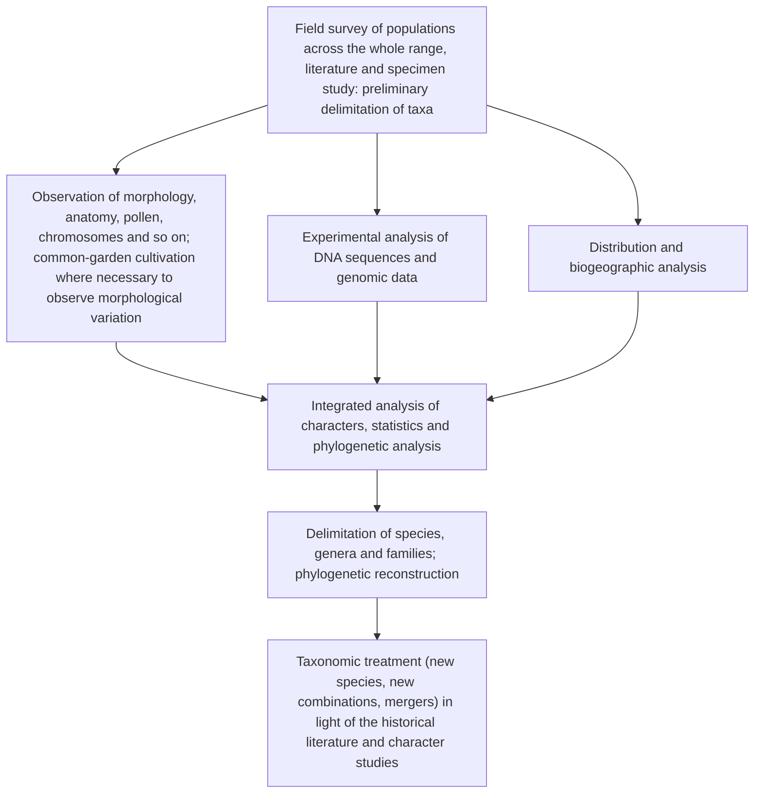

Angiosperms are the most species-rich, most widely distributed and structurally most complex group in the modern plant kingdom. The preceding chapters, from cells and tissues through the vegetative organs to the flower, ovule, pollination, fertilization and fruit, dealt almost entirely with the form and development of angiosperms ([7.12.19](/7.12.19)–[7.12.32](/7.12.32)); from this chapter on we turn to their systematics and classification. This chapter is the general introduction to the following seventeen chapters ([7.12.34](/7.12.34)–[7.12.49](/7.12.49)). We first summarize the characters that distinguish angiosperms from gymnosperms (§33.1), then discuss the criteria by which traditional textbooks judge characters "primitive" or "advanced" and how these are rewritten in phylogenetic classification (§33.2), then the kinds of evidence used in taxonomy (§33.3), the history of angiosperm classification from the herbals to APG IV (§33.4), and finally the backbone of APG IV and a table showing where the families of the Cronquist system have gone in APG IV (§33.5); each later chapter lists only the part of the table that concerns it. Taxonomic ranks, the codes of nomenclature, identification keys and the general methods of phylogenetic classification were covered in [7.12.2](/7.12.2), and methods of phylogenetic inference are treated in [7.10.2](/7.10.2) and [7.10.20](/7.10.20)–[7.10.22](/7.10.22), so they are not repeated here. The age of the angiosperms, their possible ancestors and the earliest-diverging lineages are left to the next chapter ([7.12.34](/7.12.34)).

## 33.1. Main Characters of Angiosperms

**Definition 33.1.1 (Angiosperm)** Seed plants whose ovules are enclosed in an ovary formed by closed carpels, whose ovary develops into a fruit after fertilization, and which use the flower as the reproductive organ and form the embryo and endosperm by double fertilization are called **angiosperms**, or flowering plants.

The word "angiosperm" comes from the Greek *angeion* (vessel) and *sperma* (seed). In his sexual system Linnaeus used Angiospermia for an order of the class Didynamia whose seeds are borne inside a capsule (for example the Scrophulariaceae), in contrast to Gymnospermia, in which the fruit splits into four nutlets so that the seeds seem naked (for example the Lamiaceae and Boraginaceae); the meaning was quite different from that of today. Only after Hofmeister clarified the alternation of generations in seed plants and ferns in 1851 were angiosperms recognized as a distinct group alongside gymnosperms, the two together being called phanerogams. The strobili of gymnosperms are not true flowers, so the "flowering plants" or "Anthophyta" of Hutchinson, Takhtajan, Cronquist and most other modern authors refer to angiosperms only. Because angiosperms possess a pistil, they were formerly called "pistil plants", in contrast to the other higher plants, which have archegonia.

Living angiosperms comprise about 13 000 genera and more than 300 000 species (published checklists give between 295 000 and 400 000 species); APG IV recognizes 64 orders and 416 families, and China has about 30 000 species. Since the Cenozoic they have dominated terrestrial vegetation, and they are the main source of human food, fiber, medicines and timber.

### 33.1.1. Five Main Characters

The characters that angiosperms share with gymnosperms (production of seeds, delivery of the male gametes by a pollen tube, dominance of the sporophyte, gametophytes dependent on the sporophyte) were compared in [7.12.25](/7.12.25#sec-25.7). Chinese textbooks usually list five characters peculiar to angiosperms:

| Character | Description | Comparison with gymnosperms | See |
|---|---|---|---|
| True flowers | A typical flower has four parts: calyx, corolla, androecium and gynoecium; the number, form and arrangement of the parts are adapted to insect, wind, bird or water pollination and vary enormously | Strobili are unisexual and lack a perianth (Gnetophyta have a perianth-like covering) | [7.12.27](/7.12.27) |
| A pistil | The **carpels** close to form the **ovary**, and the ovules are enclosed in it, protected from drying and from being eaten; after fertilization the ovary develops into a fruit, whose color, odor, mode of dehiscence, hooks, spines, wings and hairs aid seed dispersal | The ovules are exposed on the megasporophylls (ovuliferous scales, seed scales); there is no fruit | [7.12.31](/7.12.31) |
| Double fertilization | One sperm cell fuses with the egg to form the zygote, and the other fuses with the two polar nuclei of the central cell to form the triploid endosperm | The endosperm is haploid female gametophyte tissue formed before fertilization | [7.12.29](/7.12.29#sec-29.5) |
| A highly developed sporophyte | From trees over 100 m tall to watermeal (*Wolffia*), less than 1 mm long and rootless, the habit and habitat are extremely diverse; the secondary xylem has **vessels**, and the phloem has **sieve tubes** and **companion cells** | The xylem has only tracheids (Gnetophyta are an exception, with vessels), and the phloem has sieve cells and albuminous cells | [7.12.5](/7.12.5) |
| A further reduced gametophyte | A mature pollen grain has only 2 cells (vegetative and generative) or 3 cells (the generative cell has already divided into two sperm cells before pollination, as in Brassicaceae and Poaceae); the embryo sac usually has 7 cells and 8 nuclei, and there is no archegonium | The male gametophyte has prothallial cells; the female gametophyte has thousands of cells and usually archegonia | [7.12.28](/7.12.28) |

All five have exceptions, and their range of validity should be kept in mind. Among the earliest-diverging angiosperms, *Amborella* has no vessels in its xylem; in Nymphaeales and Austrobaileyales the embryo sac has only 4 cells and 4 nuclei and the endosperm is diploid ([7.12.34](/7.12.34)); *Trochodendron*, *Tetracentron* and Winteraceae were long thought to lack vessels (primitive vessels were later found in *Trochodendron*, while the absence of vessels in Winteraceae is a secondary loss, [7.12.35](/7.12.35)). Conversely, Gnetophyta have vessels, and *Ephedra* has a kind of "double fertilization" (the second sperm nucleus fuses with the ventral canal cell nucleus and no endosperm is formed); these similarities arose independently ([7.12.25](/7.12.25#sec-25.6.4)).

The extreme examples given in textbooks need updating. The tallest living angiosperms are the mountain ash (*Eucalyptus regnans*) of Tasmania and a *Shorea faguetiana* in Sabah, Borneo, both measured at about 100 m; the older textbook record of a 156 m almond eucalyptus rests on an unverified nineteenth-century report. The largest seed is that of the coco de mer (*Lodoicea maldivica*) of the Seychelles, which can weigh 15–30 kg, not that of the royal palm; the smallest seeds are the "dust seeds" of orchids, which weigh only micrograms each. Some ephemerals of the desert (for example certain Brassicaceae) complete their life cycle within a few weeks.

### 33.1.2. Monophyly and Synapomorphies of Angiosperms

The combination of these characters is so consistent that it is unlikely to have arisen twice, and most authors have long held that angiosperms originated once. Molecular phylogenetic analyses also agree that living angiosperms form a **monophyletic group**, the sister group of the living gymnosperms ([7.12.25](/7.12.25#sec-25.3.5)). The synapomorphies listed in modern textbooks (Judd et al. 2016; Soltis et al. 2018) are:

1. The flower: on a short axis bisexual, with perianth, stamens and carpels borne in that order from outside inward;
2. The carpel: the ovules are enclosed in the carpel, pollen germinates on the stigma at the tip of the carpel, and the pollen tube grows through the style into the ovary;
3. The stamen: a typical stamen has a filament and an anther, the anther has two pairs of pollen sacs, and the sac wall has a fibrous layer (endothecium);
4. The male gametophyte has only 3 nuclei (a vegetative nucleus and two sperm nuclei) and no prothallial cells;
5. The female gametophyte (embryo sac) usually has only 8 nuclei, and the pollen tube enters the embryo sac through a synergid;
6. Double fertilization and endosperm;
7. The phloem has sieve-tube elements and companion cells derived from the division of the same mother cell;
8. Ovules with two integuments (the anatropous ovule appeared after *Amborella*, [7.12.34](/7.12.34)).

Most of these synapomorphies concern reproduction, which is why the classification of angiosperms has always relied mainly on flowers and fruits.

### 33.1.3. Dicots and Monocots

Traditional systems divide angiosperms into the class Magnoliopsida (dicotyledons) and the class Liliopsida (monocotyledons):

| Organ | Dicotyledons (Magnoliopsida) | Monocotyledons (Liliopsida) |
|---|---|---|
| Embryo | 2 cotyledons (rarely 1, 3 or 4) | 1 cotyledon (sometimes the embryo is undifferentiated) |
| Root | Taproot well developed, mostly a taproot system | Primary root poorly developed, a fibrous root system of adventitious roots |
| Stem | Vascular bundles in a ring, with a cambium, so the stem thickens | Vascular bundles scattered, no cambium, usually no thickening |
| Leaf | Netted venation | Parallel or arcuate venation |
| Flower | Parts usually in fives or fours, rarely in threes | Parts often in threes, rarely in fours, never in fives |
| Pollen | Mostly with 3 apertures | With a single aperture |

These differences are only relative and combined, and each is crossed by exceptions. Nymphaeaceae, Ranunculaceae, Berberidaceae, Papaveraceae, Piperaceae, Apiaceae and Primulaceae include species with only one cotyledon; Ranunculaceae, Plantaginaceae, Rubiaceae and Asteraceae include many plants with fibrous root systems; Ranunculaceae, Nymphaeaceae and Caryophyllaceae have scattered vascular bundles, while the seedlings of some monocots have bundles in a ring; Araceae and Liliaceae (for example *Smilax*) have netted venation; Lauraceae, Magnoliaceae, Berberidaceae and Ranunculaceae have trimerous flowers, and Potamogetonaceae and Liliaceae have tetramerous flowers.

Phylogenetic analyses show that the monocots are a monophyletic group (synapomorphies include the single cotyledon, scattered vascular bundles, absence of vascular cambium, parallel venation and sieve-element plastids of type PII, [7.12.36](/7.12.36)), whereas the "dicots" are not: magnoliids, the ANA grade and Chloranthales all have two cotyledons but are more closely related to the monocots or to the eudicots, and only the **eudicots**, with tricolpate pollen, form a monophyletic group ([7.12.40](/7.12.40)). The traditional class of dicotyledons is therefore a **paraphyletic group**. The row "a single aperture in the pollen" in the preceding table illustrates this: monosulcate pollen is an ancestral character, found in the monocots and also in "dicots" such as the magnoliids and Nymphaeales, whereas tricolpate pollen is the synapomorphy of the eudicots.

## 33.2. Classification Principles: Primitive and Advanced Characters

### 33.2.1. The Traditional Criteria

Classifying angiosperms means not only placing several hundred thousand species in classes, orders, families, genera and species but also building a system that reflects relationships. This is particularly difficult: angiosperms radiated rapidly in the Cretaceous, so the ages of fossils do not tell us which lineage is more primitive, and fossil flowers, on which classification chiefly depends, are very rare. The traditional systems (Bessey, Hutchinson, Takhtajan, Cronquist) therefore relied mainly on the comparative morphology of living plants and derived a set of criteria for judging characters primitive or advanced. The table given in Guofang Wu's *Botany* (Vol. 2) is as follows ("primitive" means original, "advanced" means derived):

| Organ | Primitive characters | Advanced characters |
|---|---|---|
| Stem | Woody; erect; no vessels, only tracheids; annular and spiral vessels; evergreen | Herbaceous; twining; with vessels; scalariform and pitted vessels; deciduous |
| Leaf | Simple and entire; alternate (spiral) | Leaf form elaborated; opposite or whorled |
| Flower | Solitary flowers; determinate inflorescences; bisexual; monoecious; parts spirally arranged; parts numerous and indefinite in number; perianth undifferentiated, not divided into sepals and petals; parts free (free petals, free stamens, free carpels); actinomorphic (radially symmetrical); superior ovary; monosulcate pollen; many ovules; marginal and axile placentation | Flowers grouped into inflorescences; indeterminate inflorescences; unisexual; dioecious; parts whorled; parts few and definite in number (3, 4 or 5); perianth differentiated into sepals and petals, or reduced to a single whorl or absent; parts united (sympetalous corolla, stamens united in various ways, syncarpous gynoecium); zygomorphic (bilaterally symmetrical); inferior ovary; tricolpate or polyporate pollen; few ovules; parietal, free-central and basal placentation |
| Fruit | Simple fruits and aggregate fruits; true fruits | Multiple fruits; accessory fruits |
| Seed | Endosperm well developed; embryo small and straight, with 2 cotyledons | No endosperm, food reserves stored in the cotyledons; embryo curved or coiled, with 1 cotyledon |
| Life form | Perennial; green and autotrophic | Annual; parasitic or saprophytic |

The basis of this table is that the earliest angiosperm fossils are mostly evergreen woody plants; later the earth went through several great climatic changes, such as droughts and ice ages, which produced deciduous and herbaceous groups; and flowers and fruits evolved toward economy and efficiency, so that differentiation or reduction of the perianth, complex inflorescences and inferior ovaries are secondary. Wu also warns that the degree of advancement of a plant cannot be judged from one or two characters in isolation, because:

1. The same character has a different evolutionary meaning in different groups. Bisexual flowers, many ovules and a small embryo are primitive for plants in general, yet in the Orchidaceae they are marks of high specialization: each ovary contains thousands of minute ovules, the embryo of the seed is undifferentiated, and germination depends on a fungus for nutrients.
2. The organs evolve at different rates. One plant may be highly advanced in some characters and retain primitive states in others (mosaic evolution), so the lack of an advanced character does not prove a plant primitive; evergreen versus deciduous is an example.

### 33.2.2. Rewriting in Phylogenetic Classification

Phylogenetic classification rewrites these criteria as character polarities: whether a character state is a **plesiomorphy** or an **apomorphy** relative to a given group is judged by outgroup comparison or by ancestral-state reconstruction on a phylogenetic tree, not stipulated beforehand ([7.10.2](/7.10.2#sec-2.3), [7.12.2](/7.12.2#sec-2.6.3)). Re-testing the traditional criteria on the APG phylogeny gives roughly three kinds of result:

| Traditional criterion | Phylogenetic conclusion | Example |
|---|---|---|
| Free parts and free carpels are primitive | Valid: the common ancestor of living angiosperms had free carpels, and syncarpy arose many times independently | Magnoliaceae, Ranunculaceae and Cabombaceae (Nymphaeales) have free carpels; syncarpy appears separately in Nymphaeaceae, the monocots and the eudicots |
| Monosulcate pollen is primitive | Valid: monosulcate (single-aperture) pollen is an ancestral character, and tricolpate pollen is a synapomorphy of the eudicots | Magnoliaceae, Lauraceae (inaperturate) and monocots; Ranunculaceae and Rosaceae are tricolpate |
| Woody habit is primitive | Largely valid, but herbaceous habit arose independently many times in angiosperms, and there are also reversals from herbs back to woody plants (Asteraceae and Campanulaceae on islands) | Nymphaeales, Piperales, *Ceratophyllum* and most monocots are herbaceous |
| Large flowers with numerous parts in a spiral are primitive | Not valid: the "magnolia-type large flower" is derived; the earliest fossil flowers are all small (a few millimeters across), and the ancestral flower was probably of medium size, with an indefinite number of parts arranged in whorls or spirals ([7.12.34](/7.12.34)); the large flowers with many parts of *Nymphaea* and *Victoria* are secondarily increased in adaptation to beetle pollination | Magnoliaceae, Nymphaeaceae |
| Absence of vessels is primitive | Partly valid: the absence of vessels in *Amborella* is primitive, whereas in Winteraceae and *Sarcandra* it is a secondary loss | [7.12.34](/7.12.34), [7.12.35](/7.12.35) |
| Unisexual, wind-pollinated, naked flowers are primitive (Engler) or advanced (Bessey school) | The view that they are advanced is valid: the amentiferous groups (Fagales, Salicaceae, Juglandaceae and others) are derived groups of the rosids that adapted to wind pollination independently and are not closely related to one another | [7.12.42](/7.12.42), [7.12.43](/7.12.43) |
| Inferior ovary and sympetaly are advanced | Valid, but both arose many times and cannot be used to define groups | Inferior ovaries occur in Fagaceae, Cucurbitaceae, *Malus*, Apiaceae, Asteraceae, Orchidaceae, Iridaceae, Amaryllidaceae, Zingiberales and others |
| Monocots arose from "primitive herbaceous dicots" | Rewritten: the monocots are a branch that split off between the magnoliids, Chloranthales and the eudicots, and did not arise from any living "dicot" group | [7.12.34](/7.12.34#sec-34.2) |

Two conclusions follow. First, "primitive" and "advanced" can be said only of particular branches: calling a living family "primitive" means only that it diverged early and has retained more ancestral characters; early-diverging groups have likewise undergone a long evolution and have their own apomorphies (the unisexual flowers of *Amborella*, the aquatic habit of water lilies). Second, angiosperm characters show very high **homoplasy**: convergence, parallelism and reversal are all common, so many orders and subclasses of the traditional systems that were arranged by "level of advancement" (such as the Hamamelidae and Dilleniidae) are polyphyletic or paraphyletic. Molecular data provide a large number of characters independent of morphology, and only by placing morphological characters back on the phylogenetic tree can homology be distinguished from homoplasy.

## 33.3. Taxonomic Evidence

The evidence (characters) used in taxonomy may come from any aspect of the plant. Seed plant taxonomy usually lists morphology, anatomy, pollination biology, palynology, micromorphology, cytology (chromosomes), embryology, chemotaxonomy and molecular systematics; numerical taxonomy and ultrastructure are methods of processing and obtaining evidence. Different evidence suits different ranks: morphology suits all ranks; chromosome base numbers and chemical constituents are often used to delimit genera and families; conserved chloroplast genes are used above the family level; and fast-evolving sequences and micromorphology are used within genera and between species.

### 33.3.1. Morphological Evidence

Morphological characters are intuitive and easy to observe in the field and on specimens; they are the basis of keys and floras and remain the main basis of classification (for morphological terms see [7.12.19](/7.12.19)–[7.12.31](/7.12.31)). Commonly used characters are:

- Habit and life form: tree, shrub, herb, vine; annual or perennial.
- Roots and stems: the type of underground stem is often a generic character, such as the rhizome of *Iris* and the bulb of *Allium*; the branching pattern of aerial stems, and thorns and tendrils.
- Leaves: simple or compound (*Sorbus* has pinnate leaves and so differs from *Pyrus*; the pinnate leaves of *Sorbaria* contrast with the simple leaves of *Spiraea*); the presence and form of **stipules** (*Salix*, *Viola*; the interpetiolar stipules peculiar to Rubiaceae); venation (the pinnate veins of *Ulmus* and the palmate veins of *Tilia*); phyllotaxis.
- Flowers: the number, union and arrangement of sepals, petals, stamens and carpels are the main characters of families and genera, and are written as the **floral formula** and **floral diagram** ([7.12.27](/7.12.27#sec-27.6)).
- Fruits and seeds: the shape of the achene of Asteraceae with its calyx and the presence and form of the pappus; the ribs, oil ducts and mericarps of the cremocarp of Apiaceae; the number of valves or teeth of the capsule of Caryophyllaceae; the form of the seeds of *Veronica*.

Pollination biology also provides taxonomic characters. Pollination syndromes, dichogamy, heterostyly (the distylous flowers of *Primula* and *Forsythia*, the tristylous flowers of *Lythrum salicaria*), enantiostyly, the coiled styles of *Alpinia* and self-incompatibility systems (gametophytic and sporophytic) are all directly related to floral structure, and many are characters of families or genera ([7.12.29](/7.12.29)). But pollination mode is under strong selection and convergence is common (wind pollination arose dozens of times independently in angiosperms), so it is suitable only for comparison among close relatives.

### 33.3.2. Anatomical Evidence

- Wood anatomy: the form of tracheids, vessels and wood fibers in the secondary xylem; the length of vessel elements, perforation plates (scalariform or simple) and pit patterns ([7.12.5](/7.12.5), [7.12.22](/7.12.22)). The vessel evolution series established by Bailey and others in the mid-twentieth century (long, narrow vessel elements with oblique end walls and scalariform perforation plates are primitive) was an important basis for traditional systems in judging primitive groups.
- Nodal anatomy: when a leaf trace departs from a vascular bundle in the stem, a leaf gap filled with parenchyma is left above it ([7.12.21](/7.12.21#sec-21.6)). The number of leaf gaps at a node is classified as unilacunar, trilacunar or multilacunar; Laurales are mostly unilacunar and Magnoliales multilacunar.
- Trichomes: the type of epidermal hair is often characteristic of families and genera, such as the bladder hairs of Chenopodiaceae (now in Amaranthaceae), the stinging hairs of *Urtica*, the branched and stellate hairs of Brassicaceae and the T-shaped hairs of *Astragalus* (arms equal or unequal).
- Leaf anatomy: the number of layers, size and form of epidermal cells, cuticle and wax, the type of stomatal apparatus ([7.12.4](/7.12.4)), the differentiation of the mesophyll and its intercellular spaces, the arrangement of vascular tissue in the petiole and midrib (using serial sections), and the Kranz anatomy of C4 plants.
- Floral anatomy: the course of vascular bundles in floral parts shows the origin of organs (for example the relation of carpel bundles to receptacle bundles in an inferior ovary); the course of floral development is also a taxonomic character, as in some polypetalous flowers of Apiaceae and Ericaceae, which are sympetalous early in development.

The microstructure of the leaf surface also has taxonomic significance: the surface of a lotus leaf is covered with micrometer-scale papillae, which in turn are covered with nanometer-scale wax crystals, and this hierarchical structure gives the leaf surface **superhydrophobicity**, so that rolling water droplets carry away dust (the "lotus effect"). The form of the wax crystals (platelets, tubes, rods and so on) differs clearly among orders of monocots and has been used in classification.

### 33.3.3. Palynological Evidence

**Definition 33.3.1 (Palynology)** The discipline that studies the morphology, structure, development and classification of pollen grains and spores, and their applications in plant taxonomy, paleontology, stratigraphy, archaeology and medicine, is called **palynology**.

The outer wall of the pollen grain is made of the extremely stable sporopollenin and can be preserved in sediments for hundreds of millions of years, so pollen is both a taxonomic character of living plants and the earliest fossil evidence of angiosperms ([7.12.34](/7.12.34#sec-34.1)). The pollen characters used in classification are:

1. The number, type and position of apertures: monosulcate, tricolpate, tricolporate, pantoporate, inaperturate and so on ([7.12.28](/7.12.28#sec-28.3.3));
2. The layered structure of the outer wall (tectum, columellae, foot layer) and surface ornamentation (reticulate, echinate, granular, striate);
3. The size and shape of the pollen: most grains are 20–80 µm, those of forget-me-not (*Myosotis*, Boraginaceae) only about 5 µm, and those of pumpkin (*Cucurbita*, Cucurbitaceae) more than 200 µm;
4. The mode of aggregation: monads, tetrads (Ericaceae, Winteraceae) and pollinia (Orchidaceae, Asclepiadoideae of Apocynaceae);
5. The pollenkitt and the number of nuclei at germination (2 or 3).

A well-known example of palynological evidence is the lotus and the water lily. Both are large aquatic plants with numerous free floral parts and were traditionally placed in the same order, Nymphaeales (even the same family). But the pollen of Nymphaeaceae has a single sulcus or an annular aperture, located toward the distal face, whereas the pollen of the lotus has three colpi and a surface with short rod-like ornamentation, typical eudicot pollen. Palynology was the first to suggest on this basis that the lotus and the water lily are not closely related, and molecular systematics later confirmed that the lotus belongs to Proteales among the eudicots ([7.12.40](/7.12.40)).

### 33.3.4. Micromorphological Evidence

Micromorphology uses the scanning electron microscope to observe fine surface structure, commonly of pollen grains, of the surfaces of fruits and seeds (the arrangement and ornamentation of testa cells), and of the epidermis of leaves, petals and other organs. Epidermal ornamentation is divided into three levels by scale: primary ornamentation is the outline of the cells and the anticlinal walls, secondary ornamentation the cuticular striations and thickenings on the outer periclinal walls, and tertiary ornamentation the wax on the cuticle. These characters are often used to separate species within a genus: for example, of the similar *Corydalis* species *C. speciosa* and *C. pallida*, besides the differences in the width of the ultimate leaf segments and the density of the inflorescence, the ornamentation of the seed surface also differs; the arrangement of testa cells in Papaveraceae is broadly a character of the family; and the micromorphology of the testa in Cactaceae has provided new evidence for the delimitation of tribes and genera.

### 33.3.5. Cytological Evidence

Cytotaxonomy uses the number, form and behavior of chromosomes to study classification and evolution.

1. Chromosome number: fairly constant within a species. The somatic chromosome number in angiosperms ranges from $2n = 4$ in *Haplopappus gracilis* to about $2n = 500$ in *Kalanchoe*, and the great majority lie between $2n = 14$ and $24$; ferns generally have more, and $2n = 1260$ in the adder's-tongue fern *Ophioglossum reticulatum* is the highest known record for vascular plants.
2. Base number: the chromosome number of the diploid gametophyte in a genus or family, written $x$. *Festuca* has species with $2n = 14, 28, 42, 56, 70$, with base number $x = 7$, ranging from diploid to decaploid. When a group has several base numbers, the most primitive is called the original base number and the others derived base numbers. In Poaceae the bamboos (Bambusoideae) have $x = 12$ and the Pooideae (the wheat tribe and others) $x = 7$; *Paeonia* has large chromosomes and $x = 5$, unlike most genera of Ranunculaceae, which supports separating *Paeonia* from Ranunculaceae as the family Paeoniaceae (in APG IV Paeoniaceae lies in Saxifragales, [7.12.41](/7.12.41)).
3. Karyotype: the sum of the number, size and form (position of the centromere, secondary constrictions, satellites) of all the chromosomes of an individual or species is called the **karyotype** ([7.3.17](/7.3.17)), often refined by banding techniques. *Agave* and *Yucca* both have a "bimodal karyotype" of 5 large and 25 small chromosome pairs, a shared character that supports placing them in the same group (now the subfamily Agavoideae of Asparagaceae, [7.12.37](/7.12.37)); the chromosomes of Cyperaceae and Juncaceae are holocentric (with diffuse centromeres), which supports their close relationship (Poales, [7.12.39](/7.12.39)).
4. Chromosome behavior: whether chromosomes pair in meiosis helps determine the causes of hybridity, structural differences between chromosomes and sterility.
5. Ploidy: **polyploidy** is extremely common in angiosperms; **autopolyploids** and **allopolyploids**, and polyploid complexes in *Artemisia*, *Achillea*, *Campanula*, *Aegilops*, *Bromus* and others, often make species boundaries hard to draw ([7.10.12](/7.10.12)). Besides recent polyploidization, the genomes of all angiosperms have undergone ancient **whole-genome duplications**: the *Amborella* genome confirmed a duplication that predates all living angiosperms, and the eudicots underwent a further ancient hexaploidization after it ([7.12.34](/7.12.34#sec-34.3)).
6. B chromosomes: many plants have a variable number of **B chromosomes** in addition to the normal chromosome set, which are useful in studying relationships between species in groups such as *Narcissus*.

The DNA content of the nucleus (the C value, or **genome size**) varies about 2400-fold among angiosperms: from only about 60 Mbp in *Genlisea* (Lentibulariaceae) to about 149 000 Mbp in *Paris japonica* (Melanthiaceae, formerly Trilliaceae) (Figure 33.3.1). Genome size correlates with cell size, stomatal size and the length of the cell cycle and is usually measured by flow cytometry; the Plant DNA C-values Database at Kew holds data for over ten thousand species.

![Examples of angiosperm genome size (haploid nuclear DNA content, logarithmic scale). Gray points are several common model plants and crops; colored points are sequenced representatives of the early-diverging groups treated in Chapters 34–35 of this course; the two ends are the smallest (*Genlisea tuberosa*, about 61 Mbp) and largest (*Paris japonica*, about 1.49 × 10⁵ Mbp) known angiosperm genomes. Values are taken from the genome papers of the species and the Kew Plant DNA C-values Database, converted at 1 pg ≈ 978 Mbp, and indicate only orders of magnitude](./plots/genome-size.py)

Cytological data must be used together with other evidence: a genus often has several base numbers and polyploids of different levels, and chromosome differences can be used to separate genera or species only when they correlate with differences in morphology and geographic distribution.

### 33.3.6. Embryological Evidence

Embryological characters are generally conservative and suitable for classification above the family level ([7.12.28](/7.12.28), [7.12.30](/7.12.30)):

- The mode of cytokinesis in microsporogenesis: successive in most monocots (a cell plate forms immediately after each nuclear division) and simultaneous in most dicots;
- The type of anther wall development and of tapetum (secretory or amoeboid);
- The ovule: crassinucellate or tenuinucellate, bitegmic or unitegmic, anatropous or orthotropous; the asterid ovules are mostly unitegmic and tenuinucellate, with an integumentary tapetum;
- The type of embryo sac: in most plants the Polygonum type (monosporic, 7 cells and 8 nuclei); the Oenothera type (4 nuclei, only the 4 nuclei at the micropylar end) peculiar to Onagraceae; a 4-celled, 4-nucleate sac in Nymphaeales and Austrobaileyales;
- The type of endosperm: nuclear, cellular and helobial (the helobial endosperm is characteristic of Alismatales and others); the presence or absence of endosperm and perisperm in the seed (Caryophyllales have perisperm);
- The type of embryo development.

### 33.3.7. Chemical Evidence

**Chemotaxonomy** uses the chemical constituents of plants to study classification and phylogeny; it took shape as a discipline around the 1960s. Primary metabolites are widespread in the plant kingdom; those used in classification are mainly secondary metabolites of restricted distribution, and macromolecules such as proteins.

| Constituent | Distribution | Taxonomic significance |
|---|---|---|
| Betalains | Only most families of Caryophyllales (and a few basidiomycetes) | Biosynthetically mutually exclusive with anthocyanins; Cactaceae was placed in Caryophyllales because of its betalains; Caryophyllaceae and Molluginaceae contain anthocyanins and are exceptions within the order |
| Mustard oil glycosides (glucosinolates) and myrosinase | Brassicales: Brassicaceae, Cleomaceae, Capparaceae, Resedaceae, Moringaceae, Caricaceae, Tropaeolaceae and others; also arising independently in *Drypetes* (Euphorbiaceae, now Putranjivaceae) | Tropaeolaceae, Caricaceae and Moringaceae, placed by Cronquist in different subclasses, were therefore thought to be related to Brassicaceae, which molecular evidence confirmed |
| Benzylisoquinoline alkaloids (berberine, morphine, papaverine and others) | Magnoliids and Ranunculales | Moved Papaveraceae out of its position in the same order as Brassicaceae and placed it near the Ranunculales; aristolochic acid, peculiar to Aristolochiaceae, is biosynthetically related to them |
| *Iridoids* | Most orders of the asterids (Cornales, parts of Ericales, Gentianales, Lamiales, Dipsacales and others) | Cronquist already used them to define the Asteridae; the APG asterids largely agree with them |
| Polyacetylenes | Campanulids such as Asteraceae, Apiaceae, Araliaceae and Campanulaceae | A chemical character of the campanulids |
| Cyanogenic glycosides | Rosaceae (amygdalin), Fabaceae, Euphorbiaceae, Passifloraceae and others | Widely distributed; the different types of cyanogenic glycosides have taxonomic significance within families |
| Limonoid and quassinoid triterpenes | Rutaceae, Meliaceae, Simaroubaceae | Support placing these families in the same order, Sapindales |
| Flavonoids | Widespread | In Ulmaceae the Ulmoideae contain only flavonol glycosides and the Celtidoideae only C-glycosylflavones, and the two never occur together; molecular systematics later moved *Celtis* and its relatives into Cannabaceae |
| Terpenoid essential oils | Lauraceae (camphor, *Cinnamomum*), Lamiaceae (menthol, *Mentha*), Rutaceae, Myrtaceae | Aromatic oils in oil cells and oil cavities are a diagnostic character of the families |
| Other **alkaloids** | *Ephedra* (ephedrine), opium poppy (morphine), Solanaceae (hyoscyamine), Ranunculaceae (aconitine) | Characters of genera or families; the basis of many medicinal and poisonous plants |

Macromolecular evidence includes serology (immunizing an animal with the proteins of one plant and comparing the degree of similarity by precipitation reactions of the antiserum with the proteins of other plants), electrophoretic patterns of seed proteins and isozymes, and DNA sequences (§33.3.10). Chemical evidence, like morphological evidence, suffers from convergence: mustard oil glycosides arose once independently outside Brassicales, and cyanogenic glycosides occur in many unrelated families, so chemical characters also have to be interpreted within a phylogenetic framework.

### 33.3.8. Numerical Taxonomy

**Numerical taxonomy** ([7.11.16](/7.11.16)) uses mathematical methods to process a large number of characters and clusters operational taxonomic units (OTUs) by overall similarity. Its steps are: define the objects of study (OTUs); choose as many characters as possible (usually more than 50, equally weighted); code the characters as binary or multistate numerical values; transform and standardize the raw data; compute similarity coefficients or distances between OTUs (such as the simple matching coefficient, Euclidean distance or the correlation coefficient); and cluster by similarity (for example by the unweighted pair-group method with arithmetic mean, UPGMA) to obtain a phenogram. Wu's textbook (Vol. 2) lists it as one of the four directions in the development of taxonomy.

The contribution of numerical taxonomy is that the choice and treatment of characters become explicit and repeatable, and that it promoted the use of computers in taxonomy; its disadvantage is that it does not distinguish ancestral from derived characters or homology from homoplasy, so groups obtained by clustering on overall similarity are not necessarily monophyletic. Today angiosperm systematics relies mainly on cladistic analysis and model-based phylogenetic methods ([7.12.2](/7.12.2#sec-2.6.2)), and numerical methods are used chiefly in analyzing morphological variation within species and among close relatives.

### 33.3.9. Ultrastructural Evidence: Sieve-Element Plastids

Under the transmission electron microscope, the plastids in the sieve elements of angiosperms fall into stable types, unaffected by organ and environment, and have been important evidence for classification of families and orders since the 1970s and 1980s (the systematic studies of Behnke). By their inclusions they fall into two large classes:

**Definition 33.3.2 (P-Type and S-Type Sieve-Element Plastids)** A sieve-element plastid containing protein inclusions (protein crystals or protein filaments, with or without starch) is called a P-type sieve-element plastid; a plastid containing only starch grains and no protein inclusions is called an S-type sieve-element plastid.

The P type is further divided by the form of the protein inclusions into subtypes PI–PVI and so on, with more than twenty variants in all:

| Type | Inclusions | Distribution |
|---|---|---|
| S type | Starch grains | Most eudicots; Polygonaceae and Plumbaginaceae (unlike the other families of Caryophyllales) |
| PI type | One or more polygonal protein crystals, sometimes with filaments | Many families of the magnoliids (Aristolochiaceae and others) and some early-diverging eudicots |
| PII type | Several wedge-shaped protein crystals arranged in a ring | Monocots (almost all): one of the synapomorphies of the monocots |
| PIII type | Protein filaments arranged in a ring (often with a central crystal) | Most families of Caryophyllales (Amaranthaceae, Caryophyllaceae and others), on which basis Sarcobataceae, Gyrostemonaceae and others were excluded from Caryophyllales |
| PV, PVI and others | Various combinations of crystals and filaments | A few families (for example Erythroxylaceae, and some genera of Rhizophoraceae with PV) |

Other ultrastructural characters include the structure of P-protein, peculiar to the sieve elements of angiosperms ([7.12.5](/7.12.5)); protein crystals in the nucleus (found chiefly in Bignoniaceae, Scrophulariaceae, Lamiaceae, Verbenaceae, Apocynaceae, Oleaceae, Solanaceae and others, with 5 types); and dilated cisternae of the endoplasmic reticulum (concentrated in Brassicales).

### 33.3.10. Molecular Evidence and DNA Barcoding

Molecular systematics uses DNA and RNA sequences to infer the evolutionary relationships among groups and has been the main evidence in angiosperm systematics since the 1990s. The commonly used markers and the ranks to which they apply are given in [7.12.2](/7.12.2#sec-2.6.4): chloroplast *rbcL* is suited to levels above the family; *ndhF*, *rpl16*, *rps16*, *matK* and others to genera and species; noncoding spacers and ribosomal ITS to species and populations; mitochondrial genes evolve most slowly and are used for deep relationships. Large-scale sequencing of chloroplast genomes and phylogenomics of nuclear genomes (such as the Angiosperms353 probe set, [7.12.2](/7.12.2#sec-2.6.4)) have given strong support to the relationships among most orders and families, and the remaining difficulties are concentrated at short branches caused by rapid radiations, for example the relationships among the five main lineages of the Mesangiospermae and the position of Ceratophyllales ([7.12.34](/7.12.34#sec-34.5)).

**Definition 33.3.3 (DNA Barcoding)** The method of identifying species and discovering new ones using one or a few standard short DNA sequences (barcodes) from the genome is called **DNA barcoding**.

In animals the universal mitochondrial *COI* gene serves as the barcode, but plant mitochondrial genes evolve too slowly to distinguish species. The CBOL Plant Working Group (2009) recommended chloroplast *rbcL* + *matK* as the core barcode for land plants; the China Plant BOL Group (2011), after comparing 1757 species, proposed a "2 + X" scheme: choose two from the chloroplast *rbcL*, *matK* and *trnH–psbA*, and add the ribosomal ITS (or ITS2). Shallow sequencing of chloroplast and nuclear genomes ("super-barcodes") further improves the resolution among close relatives. DNA barcoding has been used in the identification of Chinese medicinal materials and foods, in plant quarantine and in community ecology (for example inferring underground species composition from root DNA).

### 33.3.11. The Workflow of Integrative Studies

Modern studies of angiosperm classification and phylogeny use all of the above evidence together, usually in the following workflow:

## 33.4. History of Classification Systems

The history of angiosperm classification can be divided into five periods: the period of habit and use, the artificial period, the natural period, the phylogenetic period and the period of molecular systematics ([7.12.2](/7.12.2#sec-2.6.1)).

### 33.4.1. The Period of Habit and Use

Ancient classification of plants served medicine and agriculture and was based on habit and use. The Han-dynasty *Shennong Bencao Jing* ranked drugs by their properties into upper, middle and lower grades, and its plants can roughly be placed in classes such as herbs, trees, grains and vegetables; the *Bencao Gangmu* of Shizhen Li (completed in 1578, Ming dynasty) divided plants into five sections: herbs, grains, vegetables, fruits and trees; the *Zhiwu Mingshi Tukao* of Qijun Wu (1848, Qing dynasty) divided them into twelve classes: grains, vegetables, mountain herbs, marsh herbs, rock herbs, aquatic herbs, vines, fragrant herbs, poisonous herbs, ornamentals, fruits and trees. Theophrastus of ancient Greece (about 371–287 BC), in his *Historia Plantarum*, divided plants into trees, shrubs, subshrubs and herbs, and already noticed determinate and indeterminate inflorescences, the position of the ovary and the difference between free and fused petals; he is called the "father of botany". In the Middle Ages Albertus Magnus (about 1200–1280) distinguished monocotyledons from dicotyledons; the Swiss Caspar Bauhin (1560–1624) in his *Pinax* (1623) often named plants by a generic name plus one adjective, a forerunner of binomial nomenclature.

### 33.4.2. The Artificial Period

From the sixteenth to the eighteenth century large numbers of new plants were brought to Europe from around the world, and the need in classification changed from "recognizing medicinal herbs" to "arranging catalogs". The systems of this period classified by one or two easily observed characters without regard to relationships and are called artificial systems. The most famous is the sexual system of the Swede Carl Linnaeus (1707–1778): in his *Systema Naturae* (1735) he divided plants into 24 classes by the number, length and union of the stamens (such as Monandria, Diandria, … Didynamia, Tetradynamia, Monadelphia, the 24th class being the cryptogams), and then into orders by the characters of the pistil. The sexual system is easy to use, but it puts distantly related plants together (for example plants with 5 stamens include Apiaceae, Solanaceae, Primulaceae …) and separates close relatives. Linnaeus's *Species Plantarum* (1753) uses binomial nomenclature throughout and is the starting point of the nomenclature of seed plants ([7.12.2](/7.12.2#sec-2.3.2)).

### 33.4.3. The Natural Period

From the end of the eighteenth century, taxonomists began to classify by the overall similarity of as many characters as possible, trying to reflect groups that exist objectively in nature; this is called the natural system. But they believed in the fixity of species, and the "natural groups" meant similarity of design by the Creator, not evolutionary relationship.

- The Frenchman A. L. de Jussieu (1748–1836), in his *Genera Plantarum secundum Ordines Naturales Disposita* (1789), divided plants by the absence or number of cotyledons into three great groups, acotyledons, monocotyledons and dicotyledons, with 100 "orders" (equivalent to today's families), many of whose names are still used.
- The Swiss A. P. de Candolle (1778–1841) coined the term "taxonomy" and, with his son Alphonse and others, compiled the *Prodromus Systematis Naturalis Regni Vegetabilis* (1824–1873). He considered dicotyledons more primitive than monocotyledons.
- The *Genera Plantarum* (1862–1883) of the Englishmen G. Bentham (1800–1884) and J. D. Hooker (1817–1911) described 7569 genera of seed plants in 200 families and is the most complete system of the natural period:

  | Group | Content |
  |---|---|
  | I. Dicotyledons | A. Polypetalae (3 subgroups); B. Gamopetalae (3 subgroups); C. Monochlamydeae (8 subgroups) |
  | II. Gymnosperms | Placed between dicotyledons and monocotyledons |
  | III. Monocotyledons | 7 subgroups |

  This system is based on actual observation and is convenient to use; the Kew herbarium and many floras of the Commonwealth were long arranged by it, and the Hutchinson system developed from it.

### 33.4.4. The Phylogenetic Period

After the publication of Darwin's *On the Origin of Species* (1859), taxonomists began to try to build systems by evolutionary relationship, that is, phylogenetic systems. The core of the debate in this period was how the flower of angiosperms arose and which living angiosperms are the most primitive. Two schools resulted.

**Definition 33.4.1 (Pseudanthial Theory)** The theory holds that the flower of angiosperms is homologous with the strobilus of gymnosperms and is equivalent to a highly reduced inflorescence: each stamen and each carpel corresponds to an extremely reduced male or female flower, derived from a unisexual strobilar inflorescence resembling that of Gnetophyta (such as *Ephedra*), the bracts of the male flowers becoming the perianth and the bracts of the female flowers becoming the carpels, so that the unisexual, naked or single-whorled, wind-pollinated amentiferous groups are the most primitive angiosperms. It is called the **pseudanthial theory**.

The pseudanthial theory was clearly stated by Wettstein (1907) and adopted by the Engler school. Its reasons are that fossil and living gymnosperms are all woody, as are most amentiferous plants; both are mostly unisexual and wind-pollinated; both have only one integument; both show chalazogamy (the pollen tube enters the ovule at the chalazal end); and the evolution of the perianth runs from a single whorl to two whorls and from wind to insect pollination. Opponents point out that the unisexual flowers and reduced perianth of the amentiferous plants are secondary adaptations to wind pollination, that a single integument arises by reduction from two, that chalazogamy also occurs in Solanaceae and Orchidaceae, and that the amentiferous plants have vessels and tricolpate pollen and are thus more advanced than the Magnoliales, which have only tracheids and monosulcate pollen.

**Definition 33.4.2 (Euanthial Theory)** The theory holds that the flower of angiosperms is a bisexual strobilus consisting of a shortened axis bearing spirally arranged sporophylls, derived from the bisexual strobilus of Bennettitales (such as *Cycadeoidea*): the bracts of the strobilus become the perianth, the microsporophylls become the stamens, the megasporophylls become the carpels and the axis of the strobilus shortens into the receptacle, so that bisexual, actinomorphic flowers with an elongated receptacle and numerous free stamens and carpels (the polycarpicae, above all the Magnoliales) are the most primitive angiosperms. It is called the **euanthial theory**.

The euanthial theory goes back to the "strobilus theory" of Arber and Parkin (1907), and the systems of Bessey, Hutchinson, Takhtajan and Cronquist are all based on it, so the euanthial school is also called the polycarpic school or the ranalean school. Its reasons are that the strobili of Bennettitales are mostly bisexual and have numerous sporophylls, and that the embryo has two cotyledons, as in Magnoliales; that the pollen of Bennettitales is boat-shaped with a single sulcus, like the monosulcate pollen of Magnoliaceae; and that the axes bearing the sporophylls are long in both. For the present assessment of the two theories see [7.12.34](/7.12.34#sec-34.2).

**Definition 33.4.3 (Engler System)** The plant classification system established by the German botanists A. Engler (1844–1930) and K. Prantl in *Die natürlichen Pflanzenfamilien* (1887–1915) and revised repeatedly in the *Syllabus der Pflanzenfamilien* is called the **Engler system**. It is based on the pseudanthial theory and regards the petalless, unisexual, woody, wind-pollinated amentiferous groups as the most primitive angiosperms; it divides the dicotyledons into the Archichlamydeae (polypetalous) and the Metachlamydeae or Sympetalae (sympetalous).

The Engler system was the first fairly complete system in the history of taxonomy and covered the whole plant kingdom: the early editions divided the plant kingdom into 13 divisions, with angiosperms a subdivision of the seed plants and monocotyledons placed before dicotyledons, being considered more primitive. The 12th edition of the *Syllabus* revised by Melchior in 1964 divided the plant kingdom into 17 divisions, made the angiosperms an independent division and moved the monocotyledons after the dicotyledons, correcting the view that monocotyledons are more primitive, but it still began with the amentiferous groups; the angiosperms were divided into 2 classes, 62 orders and 344 families (some sources count 343). Its main problems are that the sequence beginning with the amentiferous groups and placing Magnoliales and Ranunculales after them is the reverse of the modern evidence, that the Metachlamydeae are polyphyletic, and that many orders were assembled by the presence or absence and union of the perianth. Because it appeared early, covers everything and has families of moderate extent, the *Flora Reipublicae Popularis Sinicae* and many local floras and herbaria in China are arranged by the Engler system, so it still has to be known.

The Hutchinson system, established by the Englishman J. Hutchinson (1884–1972) in *The Families of Flowering Plants* (1926, 1934; 3rd edition 1973) on the basis of the systems of Bentham and Hooker and Bessey's euanthial theory, upholds the single origin of angiosperms. The 1973 edition has 111 orders and 411 families. Its main points are: bisexual flowers are more primitive than unisexual, free and numerous parts are more primitive than fused and definite ones, spiral arrangement is more primitive than whorled, and woody is more primitive than herbaceous; the dicotyledons start from Magnoliales and Ranunculales and are divided into two parallel lines of evolution, the Lignosae (woody) and the Herbaceae (herbaceous); naked and single-whorled flowers are later reductions; the amentiferous families come from Hamamelidales; the monocotyledons originate from Ranunculales and early on diverged into three lines of evolution, the Calyciferae, Corolliferae and Glumiflorae. The Hutchinson system laid the foundation of the polycarpic school, but its insistence on woody versus herbaceous as the first division of the dicotyledons widely separates many closely related families (such as the herbaceous Apiaceae from the woody Araliaceae and Cornaceae), which is why it is hard to accept.

The Takhtajan system, published by A. Takhtajan (1910–2009) of the Soviet Union (Armenia) in 1954 and revised several times since, likewise upholds the euanthial theory and single origin. He held that angiosperms arose from seed ferns through neoteny; that herbs evolved from woody plants; that Magnoliales are the most primitive, giving rise to Ranunculales and Nymphaeales; that the monocots originated from the aquatic Cabombaceae of Nymphaeales, with boat-shaped monosulcate pollen; and that the amentiferous groups originated from Hamamelidales. The 1980 edition divides the angiosperms into 2 classes, 10 subclasses, 28 superorders, 92 orders and 410 families: it was the first to break the tradition of dividing the dicotyledons into polypetalous and sympetalous subclasses, it added superorders between subclass and order, and on the evidence of anatomy and chromosomes it made *Paeonia* an independent family Paeoniaceae and Cercidiphyllaceae an independent order Cercidiphyllales. The 1997 *Diversity and Classification of Flowering Plants* subdivides further, to 592 families. Its drawback is that it has too many ranks and families, which makes it inconvenient for teaching.

**Definition 33.4.4 (Cronquist System)** The angiosperm classification system proposed by the American botanist A. Cronquist (1919–1992) in 1968 on the basis of the euanthial theory and single origin and completed in revised form in 1981 in *An Integrated System of Classification of Flowering Plants* is called the **Cronquist system**. It divides the angiosperms (Magnoliophyta) into the Magnoliopsida and Liliopsida: Magnoliopsida with 6 subclasses, 64 orders and 318 families, and Liliopsida with 5 subclasses, 19 orders and 65 families, in all 11 subclasses, 83 orders and 383 families.

The Cronquist system is close to the Takhtajan system but abolishes the superorders, merges the Magnoliidae and Ranunculidae, and compresses the number of families; its families are of moderate extent and convenient for teaching, and Wu's textbook (Vol. 2) is based on it. Its main views are: flowering plants arose from an extinct group of seed ferns; none of the living subclasses could have evolved from another living subclass; the Magnoliidae are the basal complex of the flowering plants, and Magnoliales are the primitive type of angiosperm; the amentiferous orders arose from Hamamelidales; the monocots came from an ancestor resembling the modern Nymphaeales, and the Alismatidae are a side branch near the base of the line of evolution of the Liliopsida. Compared with the Takhtajan system, it moved Rafflesiales from the Magnoliidae to the Rosidae after Santalales, moved Oleaceae from the Rosidae to Scrophulariales in the Asteridae, moved Euphorbiales from the Dilleniidae to the Rosidae after Celastrales, separated Zingiberales from the Liliidae as an independent subclass Zingiberidae, and moved Typhales from the Arecidae to the Commelinidae. The characters of the 11 subclasses are as follows:

| Class | Subclass | Orders, families, species | Main characters |
|---|---|---|---|
| Magnoliopsida | Magnoliidae | 8 orders, 39 families, about 12 000 species | Perianth often undifferentiated or a single whorl; stamens often numerous, developing centripetally, often laminar; pollen mostly monoaperturate or a derivative type; carpels free; seeds often with endosperm and a small embryo; often containing benzylisoquinoline or aporphine alkaloids, no iridoids; oil cells often in the parenchyma; sieve-element plastids of P or S type |
| | Hamamelidae | 11 orders, 24 families, about 3400 species | Flowers often unisexual, in catkins, often without petals or perianth, mostly wind-pollinated; often containing tannins and proanthocyanidins, rarely alkaloids; amentiferous groups often chalazogamous; S-type plastids |
| | Caryophyllidae | 3 orders, 14 families, about 11 000 species | Mostly herbs, often succulent or halophytic; stamens developing centrifugally; ovary often 1-locular, with free-central or basal placentation; seeds often with perisperm, embryo curved; containing betalains; Caryophyllales mostly with PIII-type plastids |
| | Dilleniidae | 13 orders, 78 families, about 25 000 species | Flowers mostly polypetalous; stamens developing centrifugally; carpels fused except in Dilleniales, with axile or parietal placentation; often containing tannins, occasionally mustard oils and iridoids; S-type plastids |
| | Rosidae | 18 orders, 118 families, about 58 000 species | Leaves simple or often pinnately compound; perianth clearly differentiated, with various nectar discs; stamens numerous or few, developing centripetally; carpels free or fused; often containing tannins, no betalains; S-type plastids |
| | Asteridae | 11 orders, 49 families, about 60 000 species | Corolla sympetalous, stamens equal to or fewer than the corolla lobes, often attached to the corolla tube and never opposite the lobes; carpels 2–5, often 2; ovules unitegmic and tenuinucellate; often containing iridoids and polyacetylenes |
| Liliopsida | Alismatidae | 4 orders, 16 families, nearly 500 species | Aquatic or wetland herbs; perianth trimerous in 2 whorls or reduced; carpels free or nearly free; pollen 3-nucleate; no endosperm; vessels only in the roots or absent; PII-type plastids |
| | Arecidae | 4 orders, 5 families, about 5600 species | Mostly palm-like trees; leaves broad, often plicate; flowers small and numerous, often in spathe-bearing spadices; raphides often present |
| | Commelinidae | 7 orders, 16 families, about 15 000 species | Herbs; perianth often conspicuous or reduced to membranous or scale-like structures; stamens often 3 or 6; ovary superior; endosperm starchy; fruit dry |
| | Zingiberidae | 2 orders, 9 families, about 3800 species | Terrestrial or epiphytic herbs; inflorescence with large colored bracts; stamens often specialized as petal-like staminodes; septal nectaries often present; silica cells |
| | Liliidae | 2 orders, 19 families, about 25 000 species | Terrestrial or epiphytic herbs, often strongly mycorrhizal; perianth often trimerous in 2 whorls, all petaloid; stamens 1, 3 or 6; carpels usually 3, fused; often containing alkaloids or steroidal saponins |

![Relationships among the 11 subclasses of the Cronquist system (redrawn after the "bubble diagram" of Cronquist 1981). Each bubble represents a subclass, with area proportional to the number of species; the lines between bubbles show the evolutionary origins inferred by Cronquist: the Magnoliidae lie at the base, the Hamamelidae, Caryophyllidae and Dilleniidae branch from them, the Rosidae and Dilleniidae share an origin, and the Asteridae come from the Rosidae; the Liliopsida branch from an ancestor resembling the Nymphaeales, and the Alismatidae are a side branch near the base](./plots/cronquist-subclasses.py)

The Chinese botanist Zhengyi Wu (1916–2013) and colleagues proposed the "eight-class system" of angiosperms in 1998 and in 2003 arranged the families and genera of China by it in *Zhongguo Beizi Zhiwu Ke Shu Zonglun* (A Comprehensive Account of the Families and Genera of Chinese Angiosperms). On the view of "polyphyly, polychrony and polytopy" he held that the angiosperms had already diverged into 8 main trunks at an early stage, each forming a class: Magnoliopsida, Lauropsida, Piperopsida, Caryophyllopsida, Liliopsida, Ranunculopsida, Hamamelidopsida and Rosopsida. This system stresses the many early-diverging lineages; its Lauropsida and Piperopsida partly agree with the APG magnoliids, but it regards angiosperms as of polyphyletic origin, which is inconsistent with the monophyly shown by molecular evidence, and the delimitation of the classes departs considerably from phylogenetic relationships.

There are also the systems of R. Dahlgren (1975, 1980, 1983) and R. F. Thorne (1968–2007), which introduced chemical and ultrastructural evidence early and used two-dimensional "dahlgrenograms" to show the relationships of the superorders; they were an inspiration for later molecular systematics.

### 33.4.5. The Molecular Period: the APG System

From the 1990s DNA sequences became the main evidence in angiosperm systematics. In 1993 Chase and 41 coauthors built the first large-scale phylogenetic tree of seed plants from the *rbcL* sequences of 499 species; later joint analyses with genes such as *atpB* and 18S rDNA gave highly consistent results ([7.12.2](/7.12.2#sec-2.6.4)). On this basis the Angiosperm Phylogeny Group (APG) published classifications in which families and orders are delimited phylogenetically.

**Definition 33.4.5 (APG System)** The angiosperm classification system established by the Angiosperm Phylogeny Group on the basis of molecular phylogenetic analyses (chiefly chloroplast and nuclear DNA sequences), which recognizes only monophyletic groups, uses formal ranks only down from order to family, and uses informal clade names above the order, is called the **APG system**.

| Version | Published | Orders and families | Main points |
|---|---|---|---|
| APG (APG I) | 1998, *Ann. Missouri Bot. Gard.* 85: 531–553 | 40 orders, 462 families | Based on two chloroplast genes (*rbcL*, *atpB*) and one ribosomal gene (18S rDNA); the first classification of a major group of organisms made entirely on DNA evidence |
| APG II | 2003, *Bot. J. Linn. Soc.* 141: 399–436 | 45 orders, 457 families | Introduced "bracketed families": some families may be recognized separately or merged |
| APG III | 2009, *Bot. J. Linn. Soc.* 161: 105–121 | 59 orders, 413 families | Abolished bracketed families and tended to recognize larger families; established new orders such as Amborellales, Nymphaeales, Chloranthales and Vitales |
| APG IV | 2016, *Bot. J. Linn. Soc.* 181: 1–20 | 64 orders, 416 families | Established five new orders: Boraginales, Dilleniales, Icacinales, Metteniusales and Vahliales; Lactoridaceae and Hydnoraceae merged into Aristolochiaceae; several new families recognized |

The principles of APG (recognizing only monophyletic groups, informal clade names above the order, keeping well-known families, and leaving a few families unplaced in orders) are given in [7.12.2](/7.12.2#sec-2.6.6). The number of families differs between versions because the treatment of the same monophyletic group as one large family or several small ones changed (for example the broad and narrow Schisandraceae), not because the phylogenetic relationships themselves changed much. Angiosperm systematics has continued to advance since the publication of APG IV, but this course uses APG IV throughout rather than the later APG V: the use of APG V in China is still disputed, whereas APG IV has fuller textbooks, floras and databases to compare with. APweb (the angiosperm phylogeny website maintained by Stevens) is updated continually and can be consulted for revisions after APG IV.

## 33.5. The Backbone of APG IV

### 33.5.1. Main Clades

The backbone of APG IV is as follows (Figure 33.5.1). The angiosperms first split off, in succession, Amborellales, Nymphaeales and Austrobaileyales, which together form the **ANA grade** ([7.12.34](/7.12.34)); the remaining angiosperms form the *Mesangiospermae*. The Mesangiospermae fall into five lineages: the **magnoliids** (Magnoliales, Laurales, Piperales, Canellales, [7.12.35](/7.12.35)), Chloranthales ([7.12.35](/7.12.35)), the **monocots** (11 orders, [7.12.36](/7.12.36)–[7.12.39](/7.12.39)), Ceratophyllales ([7.12.34](/7.12.34)) and the **eudicots**. The relationships among the five lineages are not fully settled: most chloroplast data support two large branches, (magnoliids + Chloranthales) and (monocots + (Ceratophyllales + eudicots)), while some nuclear gene data support other arrangements.

The eudicots, with tricolpate pollen as their synapomorphy, make up about 75% of angiosperm species. They first split off, in succession, Ranunculales, Proteales, Trochodendrales and Buxales (the early-diverging eudicots, [7.12.40](/7.12.40)); the rest are the *core eudicots* (Gunneridae): after Gunnerales ([7.12.40](/7.12.40)) branch off, the *Pentapetalae* consist of Dilleniales ([7.12.40](/7.12.40)), the superrosids and the superasterids. The superrosids comprise Saxifragales and the **rosids**; the rosids consist of Vitales ([7.12.41](/7.12.41)), the fabids (Zygophyllales, and in the COM clade Celastrales, Oxalidales and Malpighiales, and in the nitrogen-fixing clade Fabales, Rosales, Cucurbitales and Fagales, [7.12.42](/7.12.42)–[7.12.43](/7.12.43)) and the malvids (Geraniales, Myrtales, Crossosomatales, Picramniales, Huerteales, Sapindales, Malvales and Brassicales, [7.12.44](/7.12.44)). The superasterids comprise Berberidopsidales, Santalales, Caryophyllales ([7.12.45](/7.12.45)) and the **asterids**; the asterids consist of Cornales, Ericales ([7.12.46](/7.12.46)), the lamiids (Icacinales, Metteniusales, Garryales, Boraginales, Gentianales, Vahliales, Solanales, Lamiales, [7.12.47](/7.12.47)–[7.12.48](/7.12.48)) and the campanulids (Aquifoliales, Asterales, Escalloniales, Bruniales, Paracryphiales, Dipsacales, Apiales, [7.12.49](/7.12.49)).

| Clade | Orders | Which | This course |
|---|---|---|---|
| ANA grade | 3 | Amborellales, Nymphaeales, Austrobaileyales | 7.12.34 |
| Magnoliids | 4 | Canellales, Piperales, Magnoliales, Laurales | 7.12.35 |
| Chloranthales | 1 | Chloranthales | 7.12.35 |
| Monocots | 11 | Acorales, Alismatales, Petrosaviales, Dioscoreales, Pandanales, Liliales, Asparagales; commelinids: Arecales, Poales, Commelinales, Zingiberales | 7.12.36–7.12.39 |
| Ceratophyllales | 1 | Ceratophyllales | 7.12.34 |
| Early-diverging eudicots | 4 | Ranunculales, Proteales, Trochodendrales, Buxales | 7.12.40 |
| Base of the core eudicots | 2 | Gunnerales, Dilleniales | 7.12.40 |
| Superrosids | 18 | Saxifragales; Vitales; fabids 8 orders; malvids 8 orders | 7.12.41–7.12.44 |
| Superasterids | 20 | Berberidopsidales, Santalales, Caryophyllales; Cornales, Ericales; lamiids 8 orders; campanulids 7 orders | 7.12.45–7.12.49 |

### 33.5.2. From Cronquist to APG IV

Compared with the Cronquist system, the changes in APG IV fall into three groups. First, most of the traditional subclasses are not monophyletic: the Magnoliidae are split into the ANA grade, the magnoliids and the early-diverging eudicots; the amentiferous groups of the Hamamelidae are scattered into Fagales and Rosales of the rosids, Hamamelidaceae goes to Saxifragales and Platanaceae to Proteales; the Dilleniidae are scattered among Malpighiales, Malvales, Brassicales, Ericales, Cucurbitales and others; Apiales and Cornales of the Rosidae move into the asterids, and Santalales into the superasterids. Only the Caryophyllidae (enlarged to Caryophyllales) and the core of the Asteridae are largely retained. Second, many traditional large families are paraphyletic or polyphyletic and have been split or merged: Liliaceae is split into more than ten families, most genera of Scrophulariaceae move into Plantaginaceae, Orobanchaceae and others, and Saxifragaceae, Verbenaceae, Euphorbiaceae, Tiliaceae, Sterculiaceae and Bombacaceae are redefined. Third, some morphologically specialized families that were hard to place now have definite positions, for example the parasitic Rafflesiaceae (Malpighiales), the carnivorous Nepenthaceae and Droseraceae (Caryophyllales), and the aquatic Hydatellaceae (Nymphaeales).

The following tables give the positions, in the Cronquist system and in APG IV, of the roughly 130 families treated in this course, arranged by Cronquist's subclasses and orders; after the "→" the APG IV order and treatment are given, and the last column gives the chapter of this course that treats the family. Each later chapter lists only the part that concerns it.

Subclass Magnoliidae of the Cronquist system:

| Cronquist order | Family | APG IV | Chapter |
|---|---|---|---|
| Magnoliales | Winteraceae, Canellaceae | Canellales (magnoliids) | [35](/7.12.35) |
| | Magnoliaceae, Annonaceae, Myristicaceae | Magnoliales (magnoliids) | [35](/7.12.35) |
| | Austrobaileyaceae | Austrobaileyales (ANA grade) | [34](/7.12.34) |
| | Lactoridaceae | Piperales, merged into Aristolochiaceae | [35](/7.12.35) |
| Laurales | Amborellaceae | Amborellales (ANA grade) | [34](/7.12.34) |
| | Trimeniaceae | Austrobaileyales (ANA grade) | [34](/7.12.34) |
| | Lauraceae, Calycanthaceae (including Idiospermaceae), Hernandiaceae, Monimiaceae (in the narrow sense) | Laurales (magnoliids) | [35](/7.12.35) |
| Piperales | Piperaceae, Saururaceae | Piperales (magnoliids) | [35](/7.12.35) |
| | Chloranthaceae | Chloranthales | [35](/7.12.35) |
| Aristolochiales | Aristolochiaceae | Piperales (enlarged, including Lactoridaceae and Hydnoraceae) | [35](/7.12.35) |
| Illiciales | Illiciaceae, Schisandraceae | Austrobaileyales, merged as Schisandraceae in the broad sense | [34](/7.12.34) |
| Nymphaeales | Nymphaeaceae (including *Barclaya*), Cabombaceae | Nymphaeales (ANA grade) | [34](/7.12.34) |
| | Nelumbonaceae | Proteales (early-diverging eudicots) | [40](/7.12.40) |
| | Ceratophyllaceae | Ceratophyllales | [34](/7.12.34) |
| Ranunculales | Ranunculaceae, Berberidaceae, Lardizabalaceae (now including Sargentodoxaceae), Menispermaceae, Circaeasteraceae | Ranunculales (early-diverging eudicots) | [40](/7.12.40) |
| | Sabiaceae | Proteales | [40](/7.12.40) |
| | Coriariaceae | Cucurbitales (fabids) | [43](/7.12.43) |
| Papaverales | Papaveraceae, Fumariaceae | Ranunculales, merged as Papaveraceae in the broad sense (Fumarioideae) | [40](/7.12.40) |

Subclass Hamamelidae of the Cronquist system:

| Cronquist order | Family | APG IV | Chapter |
|---|---|---|---|
| Trochodendrales | Trochodendraceae, Tetracentraceae | Trochodendrales, merged as Trochodendraceae | [40](/7.12.40) |
| Hamamelidales | Platanaceae | Proteales | [40](/7.12.40) |
| | Eupteleaceae | Ranunculales | [40](/7.12.40) |
| | Cercidiphyllaceae, Hamamelidaceae (in the narrow sense; *Liquidambar* and relatives separated as Altingiaceae) | Saxifragales (superrosids) | [41](/7.12.41) |
| Daphniphyllales | Daphniphyllaceae | Saxifragales | [41](/7.12.41) |
| Eucommiales | Eucommiaceae | Garryales (also called Eucommiales; asterids: lamiids) | [47](/7.12.47) |
| Urticales | Ulmaceae (in the narrow sense), Moraceae, Urticaceae (including Cecropiaceae) | Rosales (fabids) | [43](/7.12.43) |
| | Cannabaceae | Rosales, enlarged: including *Celtis*, *Pteroceltis*, *Trema* and others formerly in Celtidoideae of Ulmaceae | [43](/7.12.43) |
| Juglandales | Juglandaceae, Rhoipteleaceae | Fagales, Rhoipteleaceae merged into Juglandaceae | [43](/7.12.43) |
| Myricales, Fagales, Casuarinales | Myricaceae, Fagaceae, Betulaceae, Casuarinaceae | Fagales (fabids: nitrogen-fixing clade) | [43](/7.12.43) |

Subclass Caryophyllidae of the Cronquist system:

| Cronquist order | Family | APG IV | Chapter |
|---|---|---|---|
| Caryophyllales | Caryophyllaceae, Amaranthaceae, Chenopodiaceae, Phytolaccaceae, Nyctaginaceae, Aizoaceae, Cactaceae, Portulacaceae (in the narrow sense), Basellaceae | Caryophyllales (superasterids); Chenopodiaceae merged into Amaranthaceae; Portulacaceae split, with *Talinum* and relatives separated as Talinaceae | [45](/7.12.45) |
| Polygonales | Polygonaceae | Caryophyllales | [45](/7.12.45) |
| Plumbaginales | Plumbaginaceae | Caryophyllales | [45](/7.12.45) |

Subclass Dilleniidae of the Cronquist system:

| Cronquist order | Family | APG IV | Chapter |
|---|---|---|---|
| Dilleniales | Dilleniaceae | Dilleniales (core eudicots) | [40](/7.12.40) |
| | Paeoniaceae | Saxifragales | [41](/7.12.41) |
| Theales | Theaceae (in the narrow sense), Actinidiaceae, Pentaphylacaceae (enlarged: including *Ternstroemia*, *Eurya* and others formerly in Theaceae) | Ericales (asterids) | [46](/7.12.46) |
| | Clusiaceae (*Hypericum* and relatives separated as Hypericaceae) | Malpighiales (fabids: COM clade) | [42](/7.12.42) |
| | Dipterocarpaceae | Malvales (malvids) | [44](/7.12.44) |
| Malvales | Malvaceae, Tiliaceae, Sterculiaceae, Bombacaceae | Malvales, the four families merged as Malvaceae in the broad sense (9 subfamilies) | [44](/7.12.44) |
| | Elaeocarpaceae | Oxalidales (COM clade) | [42](/7.12.42) |
| Lecythidales | Lecythidaceae | Ericales | [46](/7.12.46) |
| Nepenthales | Nepenthaceae, Droseraceae | Caryophyllales | [45](/7.12.45) |
| | Sarraceniaceae | Ericales | [46](/7.12.46) |
| Violales | Violaceae, Passifloraceae, Flacourtiaceae (most genera merged into Salicaceae, the rest in Achariaceae and others) | Malpighiales | [42](/7.12.42) |
| | Cucurbitaceae, Begoniaceae | Cucurbitales (fabids: nitrogen-fixing clade) | [43](/7.12.43) |
| | Tamaricaceae | Caryophyllales | [45](/7.12.45) |
| | Caricaceae | Brassicales (malvids) | [44](/7.12.44) |
| | Cistaceae, Bixaceae | Malvales | [44](/7.12.44) |
| | Stachyuraceae | Crossosomatales (malvids) | [44](/7.12.44) |
| Salicales | Salicaceae | Malpighiales, enlarged: including most genera of the former Flacourtiaceae | [42](/7.12.42) |
| Capparales | Brassicaceae, Moringaceae, Resedaceae | Brassicales | [44](/7.12.44) |
| | Capparaceae (in the broad sense) | Brassicales, split into Capparaceae and Cleomaceae | [44](/7.12.44) |
| Ericales | Ericaceae, Pyrolaceae, Monotropaceae, Empetraceae, Clethraceae | Ericales; Pyrolaceae, Monotropaceae and Empetraceae merged into Ericaceae | [46](/7.12.46) |
| Ebenales | Ebenaceae, Sapotaceae, Styracaceae, Symplocaceae | Ericales | [46](/7.12.46) |
| Primulales | Primulaceae, Myrsinaceae | Ericales, Myrsinaceae merged into Primulaceae in the broad sense | [46](/7.12.46) |

Subclass Rosidae of the Cronquist system:

| Cronquist order | Family | APG IV | Chapter |
|---|---|---|---|
| Rosales | Rosaceae | Rosales (fabids: nitrogen-fixing clade) | [43](/7.12.43) |
| | Crassulaceae, Saxifragaceae (in the narrow sense), Grossulariaceae | Saxifragales | [41](/7.12.41) |
| | Hydrangeaceae | Cornales (asterids) | [46](/7.12.46) |
| | Pittosporaceae | Apiales (asterids: campanulids) | [49](/7.12.49) |
| Fabales | Mimosaceae, Caesalpiniaceae, Fabaceae (in the narrow sense, Papilionoideae) | Fabales, merged as Fabaceae in the broad sense (6 subfamilies) | [42](/7.12.42) |
| Polygalales | Polygalaceae | Fabales | [42](/7.12.42) |
| Proteales | Proteaceae | Proteales (early-diverging eudicots) | [40](/7.12.40) |
| | Elaeagnaceae | Rosales | [43](/7.12.43) |
| Haloragales | Haloragaceae | Saxifragales | [41](/7.12.41) |
| | Gunneraceae | Gunnerales (core eudicots) | [40](/7.12.40) |
| Myrtales | Myrtaceae, Onagraceae, Melastomataceae, Combretaceae, Lythraceae (enlarged: including Sonneratiaceae, Trapaceae and Punicaceae) | Myrtales (malvids) | [44](/7.12.44) |
| | Thymelaeaceae | Malvales | [44](/7.12.44) |
| Rhizophorales | Rhizophoraceae | Malpighiales | [42](/7.12.42) |
| Cornales | Cornaceae (including Alangiaceae), Nyssaceae (including *Davidia*) | Cornales (asterids) | [46](/7.12.46) |
| Santalales | Santalaceae (including Viscaceae), Loranthaceae, Olacaceae (in the narrow sense), Balanophoraceae | Santalales (superasterids) | [45](/7.12.45) |
| Rafflesiales | Rafflesiaceae | Malpighiales | [42](/7.12.42) |
| Celastrales | Celastraceae (including Hippocrateaceae) | Celastrales (COM clade) | [42](/7.12.42) |
| | Aquifoliaceae | Aquifoliales (campanulids) | [49](/7.12.49) |
| Euphorbiales | Euphorbiaceae (in the narrow sense; Phyllanthaceae and others separated) | Malpighiales | [42](/7.12.42) |
| | Buxaceae | Buxales (early-diverging eudicots) | [40](/7.12.40) |
| Rhamnales | Rhamnaceae | Rosales | [43](/7.12.43) |
| | Vitaceae (including Leeaceae) | Vitales (rosids) | [41](/7.12.41) |
| Linales | Linaceae | Malpighiales | [42](/7.12.42) |
| Sapindales | Sapindaceae (enlarged: including Aceraceae and Hippocastanaceae), Rutaceae, Meliaceae, Anacardiaceae, Simaroubaceae, Burseraceae | Sapindales (malvids) | [44](/7.12.44) |
| | Zygophyllaceae | Zygophyllales (fabids) | [42](/7.12.42) |
| Geraniales | Geraniaceae | Geraniales (malvids) | [44](/7.12.44) |
| | Oxalidaceae | Oxalidales (COM clade) | [42](/7.12.42) |
| | Tropaeolaceae | Brassicales | [44](/7.12.44) |
| | Balsaminaceae | Ericales | [46](/7.12.46) |
| Apiales | Apiaceae, Araliaceae | Apiales (campanulids) | [49](/7.12.49) |

Subclass Asteridae of the Cronquist system:

| Cronquist order | Family | APG IV | Chapter |
|---|---|---|---|
| Gentianales | Gentianaceae, Loganiaceae (in the narrow sense), Apocynaceae, Asclepiadaceae | Gentianales (lamiids); Asclepiadaceae merged into Apocynaceae | [47](/7.12.47) |
| Rubiales | Rubiaceae | Gentianales | [47](/7.12.47) |
| Solanales | Solanaceae, Convolvulaceae (including Cuscutaceae) | Solanales (lamiids) | [47](/7.12.47) |
| | Menyanthaceae | Asterales (campanulids) | [49](/7.12.49) |
| | Polemoniaceae | Ericales | [46](/7.12.46) |
| Lamiales | Boraginaceae | Boraginales (lamiids) | [47](/7.12.47) |
| | Lamiaceae (enlarged: including *Vitex*, *Clerodendrum* and others formerly in Verbenaceae), Verbenaceae (in the narrow sense) | Lamiales (lamiids) | [48](/7.12.48) |
| Plantaginales | Plantaginaceae (enlarged: including *Veronica*, *Digitalis*, *Antirrhinum* and others formerly in Scrophulariaceae) | Lamiales | [48](/7.12.48) |
| Scrophulariales | Scrophulariaceae (in the narrow sense; most genera moved to Plantaginaceae, Orobanchaceae, Linderniaceae, Mazaceae, Paulowniaceae and others), Orobanchaceae (enlarged: including the hemiparasitic genera formerly in Scrophulariaceae), Oleaceae, Bignoniaceae, Acanthaceae, Gesneriaceae, Lentibulariaceae, Pedaliaceae | Lamiales | [48](/7.12.48) |
| Campanulales | Campanulaceae (including Lobelioideae) | Asterales (campanulids) | [49](/7.12.49) |
| Dipsacales | Caprifoliaceae (enlarged: including Dipsacaceae and Valerianaceae), Adoxaceae (including *Sambucus* and *Viburnum*) | Dipsacales (campanulids) | [49](/7.12.49) |
| Asterales | Asteraceae | Asterales | [49](/7.12.49) |

Class Liliopsida of the Cronquist system:

| Cronquist subclass and order | Family | APG IV | Chapter |
|---|---|---|---|
| Alismatidae: Alismatales, Hydrocharitales, Najadales | Alismataceae, Butomaceae, Hydrocharitaceae (enlarged: including Najadaceae), Potamogetonaceae, Zosteraceae | Alismatales | [36](/7.12.36) |
| Alismatidae: Triuridales | Triuridaceae | Pandanales | [36](/7.12.36) |
| Arecidae: Arales | Araceae (enlarged: including Lemnaceae; *Acorus* separated as Acoraceae) | Alismatales; Acoraceae in Acorales | [36](/7.12.36) |
| Arecidae: Arecales | Arecaceae | Arecales (commelinids) | [38](/7.12.38) |
| Arecidae: Pandanales, Cyclanthales | Pandanaceae, Cyclanthaceae | Pandanales | [36](/7.12.36) |
| Commelinidae: Commelinales | Commelinaceae | Commelinales | [38](/7.12.38) |
| Commelinidae: Eriocaulales, Juncales, Cyperales, Typhales | Eriocaulaceae, Juncaceae, Cyperaceae, Poaceae, Typhaceae (including Sparganiaceae) | Poales | [39](/7.12.39) |
| Commelinidae: Hydatellales | Hydatellaceae | Nymphaeales (ANA grade) | [34](/7.12.34) |
| Zingiberidae: Bromeliales | Bromeliaceae | Poales | [39](/7.12.39) |
| Zingiberidae: Zingiberales | Zingiberaceae, Musaceae, Cannaceae, Marantaceae, Costaceae | Zingiberales | [38](/7.12.38) |
| Liliidae: Liliales | Liliaceae (in the broad sense) | Split: Liliaceae (in the narrow sense), Colchicaceae, Smilacaceae, Melanthiaceae and others belong to Liliales; Asparagaceae (including Agavaceae, Hyacinthaceae and others), Amaryllidaceae (including *Allium*), Asphodelaceae (including *Hemerocallis*) and others belong to Asparagales | [36](/7.12.36), [37](/7.12.37) |
| | Iridaceae | Asparagales | [37](/7.12.37) |
| | Dioscoreaceae | Dioscoreales | [36](/7.12.36) |
| | Stemonaceae | Pandanales | [36](/7.12.36) |
| | Pontederiaceae | Commelinales | [38](/7.12.38) |
| Liliidae: Orchidales | Orchidaceae | Asparagales | [37](/7.12.37) |

## Summary

Angiosperms are characterized by true flowers, a pistil formed by closed carpels and the fruit, double fertilization and triploid endosperm, vessels and companion cells, and a highly reduced gametophyte, and they form a monophyletic group. The traditional "primitive and advanced characters" are rewritten in phylogenetic classification as plesiomorphies and apomorphies relative to a group: free carpels, monosulcate pollen and the woody habit are largely plesiomorphic, whereas the primitiveness of the "magnolia-type large flower" and of the amentiferous groups is rejected; apomorphies such as the inferior ovary, sympetaly and the herbaceous habit have each arisen many times, and homoplasy is high.

Comparison of the classification systems:

| System | Year | Origin of the flower | View of origin | Main classes and subclasses | Orders, families | Features |
|---|---|---|---|---|---|---|
| Linnaean sexual system | 1735 | — | Species fixed | 24 classes (by stamens) | — | Artificial system, convenient for identification; binomial nomenclature |
| Jussieu | 1789 | — | Species fixed | Acotyledons, monocotyledons, dicotyledons | 100 "orders" (families) | The first natural system, which established many families |
| Bentham and Hooker | 1862–1883 | — | Species fixed | Dicotyledons (Polypetalae, Gamopetalae, Monochlamydeae), gymnosperms, monocotyledons | 200 families | The peak of the natural systems; gymnosperms placed in the middle |
| Engler (12th edition) | 1964 | Pseudanthial theory | Dual origin | Dicotyledons (Archichlamydeae, Metachlamydeae), monocotyledons | 62 orders, 344 families | Amentiferous groups most primitive; adopted by the *Flora Reipublicae Popularis Sinicae* |
| Hutchinson | 1926, 1973 | Euanthial theory | Single origin | Woody and herbaceous lines; 3 groups of monocotyledons | 111 orders, 411 families | Magnoliales and Ranunculales as the starting points; the error of separating woody from herbaceous |
| Takhtajan | 1954, 1980, 1997 | Euanthial theory | Single origin | 2 classes, 10 subclasses, 28 superorders | 92 orders, 410 families (1980) | Introduced superorders; broke the polypetalous–sympetalous division; monocots from Cabombaceae-like ancestors |
| Cronquist | 1968, 1981 | Euanthial theory | Single origin | Magnoliopsida with 6 subclasses, Liliopsida with 5 | 83 orders, 383 families | No superorders, families of moderate extent; adopted by Wu's textbook (Vol. 2) |
| Zhengyi Wu | 1998, 2003 | — | Polyphyly, polychrony, polytopy | 8 classes | — | Stresses the many early-diverging lineages |
| APG IV | 2016 | (Molecular evidence) | Monophyly | No classes; above the order, clades: ANA grade, magnoliids, monocots, eudicots and others | 64 orders, 416 families | Recognizes only monophyletic groups; adopted in this course |

Taxonomic evidence:

| Evidence | Main characters | Rank | Examples |
|---|---|---|---|
| Morphology | Habit, root, stem and leaf, flower (floral formula and diagram), fruit and seed | All ranks | *Sorbus* and *Pyrus* (compound leaves); the pappus of Asteraceae; the cremocarp of Apiaceae |
| Pollination biology | Pollination syndromes, heterostyly, self-incompatibility | Genus, species | The distylous flowers of *Primula* and *Forsythia* |
| Anatomy | Vessels and perforation plates, nodal leaf gaps, trichomes, stomata, internal structure of the leaf, floral vascular bundles | Family, genus | The T-shaped hairs of *Astragalus*; the superhydrophobic structure of the lotus leaf |
| Palynology | Apertures, wall structure and ornamentation, size, aggregation | Above family to species | Lotus (tricolpate) and water lily (monosulcate); tricolpate pollen as the synapomorphy of the eudicots |
| Micromorphology | Ornamentation and wax of testa, pericarp and epidermis | Genus, species | The testa of *Corydalis* and Cactaceae |
| Cytology | Chromosome number, base number, karyotype, ploidy, B chromosomes, C value | Family, genus, species | *Paeonia* $x = 5$; bamboos $x = 12$ and Pooideae $x = 7$; the bimodal karyotype of *Agave* |
| Embryology | Types of microsporogenesis, ovule, embryo sac and endosperm | Above family | The Oenothera-type embryo sac (Onagraceae); the 4-nucleate embryo sac of Nymphaeales |
| Chemotaxonomy | Betalains, glucosinolates, alkaloids, iridoids, polyacetylenes, flavonoids, terpenoids | Family, order | Caryophyllales (betalains); Brassicales (glucosinolates) |
| Numerical taxonomy | Many equally weighted characters, clustering by overall similarity | Below species to genus | Phenogram |
| Ultrastructure | Type of sieve-element plastid, P-protein, nuclear protein crystals | Family, order | Monocots PII type; Caryophyllales PIII type |
| Molecular systematics | *rbcL*, *matK*, ITS, chloroplast genome, nuclear genome | All ranks | The APG system; the DNA barcode "2 + X" |

The backbone of APG IV: the ANA grade (Amborellales, Nymphaeales, Austrobaileyales) → the five lineages of the Mesangiospermae (magnoliids, Chloranthales, monocots, Ceratophyllales, eudicots); the eudicots → the early-diverging groups (Ranunculales, Proteales, Trochodendrales, Buxales) and the core eudicots (Gunnerales, Dilleniales, superrosids, superasterids). Of the Cronquist subclasses, the Magnoliidae, Hamamelidae, Dilleniidae and Rosidae are not monophyletic; for the destination of each family see the table in §33.5.2.

## Questions

1. Why is the class of "dicotyledons" said to be a paraphyletic group, while the monocots and the eudicots are monophyletic groups? Which character shows this best?

   **Answer** The monocots and the eudicots each have synapomorphies (a single cotyledon, scattered vascular bundles and PII-type plastids; tricolpate pollen) and each forms one branch of the molecular phylogenetic tree. The traditional dicotyledons also include the ANA grade, the magnoliids, Chloranthales and Ceratophyllales, which branch off from the base of the Mesangiospermae separately from the monocots and the eudicots, so the class Magnoliopsida contains part of the descendants of the common ancestor but not all (the monocots are excluded) and is paraphyletic. Pollen shows it best: monosulcate pollen is an ancestral character, found in the monocots and in "dicots" such as the magnoliids, whereas tricolpate pollen occurs only in the eudicots.

2. Wu's table of primitive characters lists "numerous parts, spirally arranged, large flowers" as primitive and "unisexual flowers, naked flowers, wind pollination" as advanced. How should each of these two statements be assessed in light of modern phylogenetic evidence?

   **Answer** The second is largely valid: the unisexual, naked, wind-pollinated flowers of the amentiferous groups are apomorphies that arose independently in several branches of the rosids as adaptations to wind pollination, and it was wrong of the pseudanthial theory to treat them as primitive groups. The first needs correction: the earliest angiosperm flower fossils are all small, and the flower of *Amborella*, the earliest-diverging living lineage, is small with an indefinite number of parts; ancestral-state reconstruction shows that the common ancestor of living angiosperms had an undifferentiated perianth and free carpels, but the number and arrangement of the parts are uncertain; the large flowers with many parts of Magnoliaceae, *Nymphaea* and *Victoria* are secondary (adaptations to beetle pollination). So "free" can serve as a plesiomorphy, but "large and numerous" cannot.

3. Give three kinds of chemical constituents and explain how chemical evidence helped (or foreshadowed) the family-level treatments in the APG system.

   **Answer** (1) Betalains: found only in Caryophyllales; they led to placing Cactaceae in Caryophyllales and to excluding Bataceae and Gyrostemonaceae, which lack betalains (they were later shown to belong to Brassicales). (2) Glucosinolates: Brassicaceae, Capparaceae, Moringaceae, Caricaceae and Tropaeolaceae, which Cronquist placed in different orders, all contain glucosinolates, and APG confirmed that they belong to the same order, Brassicales. (3) Flavonoids: in Ulmaceae the Celtidoideae contain only C-glycosylflavones and the Ulmoideae only flavonols, suggesting that they should not be in the same family; molecular systematics moved *Celtis* and its relatives into Cannabaceae. In addition, benzylisoquinoline alkaloids moved Papaveraceae from near Brassicaceae to near the ranunculids.

4. DNA barcoding and molecular systematics both use DNA sequences. How do their aims and their requirements for the sequences differ? Why do plants not use mitochondrial *COI* as the barcode, as animals do?

   **Answer** Molecular systematics infers evolutionary relationships among groups and needs many independent loci, with sequence evolution rates matched to the taxonomic rank studied; DNA barcoding aims to identify species quickly with as few standard fragments as possible, and requires fragments that are short, easily amplified, and highly variable between species but little variable within species. The plant mitochondrial genome recombines frequently and its coding regions evolve extremely slowly, so *COI* shows almost no difference between close relatives and cannot distinguish species; plants therefore use the faster-evolving chloroplast *rbcL*, *matK* and *trnH–psbA* and the ribosomal ITS (the "2 + X" scheme of the China Plant BOL Group).

5. The *Flora Reipublicae Popularis Sinicae* is arranged by the Engler system, Wu's textbook (Vol. 2) by the Cronquist system, and this course by APG IV. When consulting the literature, how can one quickly determine the position of a traditional family in APG IV? Use Scrophulariaceae, Liliaceae and Nelumbonaceae as examples to explain what to watch for.

   **Answer** First look up the family in the family list of APweb or of the original APG IV paper to confirm whether the family is still recognized in APG IV and whether its circumscription has changed; then check genus by genus, because many traditional families have been split and the genera of one family may have gone to different families or even different orders. Scrophulariaceae: the narrow Scrophulariaceae retains only *Scrophularia*, *Buddleja* and a few others; *Veronica* and *Digitalis* moved to Plantaginaceae, hemiparasitic genera such as *Pedicularis* to Orobanchaceae, and *Paulownia* became the independent Paulowniaceae, all in Lamiales. Liliaceae: the narrow Liliaceae (*Lilium*, *Tulipa*, *Fritillaria*) lies in Liliales, whereas *Allium* is in Amaryllidaceae, *Asparagus* and *Hosta* in Asparagaceae, and *Hemerocallis* in Asphodelaceae, all in Asparagales. Nelumbonaceae: traditionally in the same order as Nymphaeaceae, in APG IV it belongs to Proteales among the eudicots, far from Nymphaeaceae.
