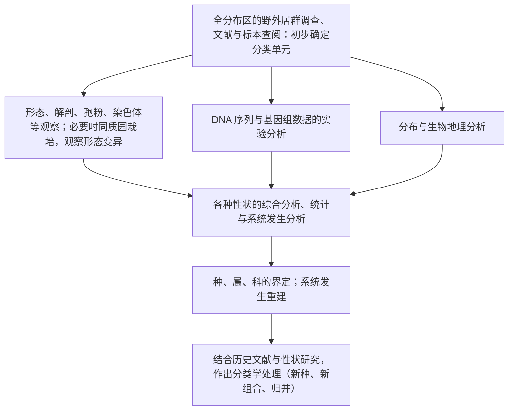

被子植物是现代植物界中种类最多、分布最广、结构最复杂的一个类群。前面各章从细胞、组织、营养器官到花、胚珠、传粉受精和果实，讲的几乎都是被子植物的形态与发育（[7.12.19](/7.12.19)–[7.12.32](/7.12.32)）；从本章起转入被子植物的系统与分类。本章是后面十七章（[7.12.34](/7.12.34)–[7.12.49](/7.12.49)）的总论：先概括被子植物区别于裸子植物的特征（§33.1），再讨论传统教材判断"原始"与"进化"的准则以及它们在系统发生分类中的改写（§33.2），然后依次讲分类学使用的各类证据（§33.3）、被子植物分类系统从本草到 APG IV 的历史（§33.4），最后给出 APG IV 的骨架和克朗奎斯特系统各科在 APG IV 中去向的总表（§33.5），后续各章只列出本章节涉及的部分。分类阶元、命名法规、检索表和系统发生分类的一般方法已在 [7.12.2](/7.12.2) 讲过，系统发生树的推断方法见 [7.10.2](/7.10.2) 与 [7.10.20](/7.10.20)–[7.10.22](/7.10.22)，这里不再重复。被子植物的起源时间、可能的祖先与最早分化的类群放在下一章（[7.12.34](/7.12.34)）。

## 33.1. 被子植物的主要特征

**定义 33.1.1（被子植物）** 胚珠包藏在由心皮闭合形成的子房之内、受精后子房发育为果实，并以花为繁殖器官、经双受精形成胚与胚乳的种子植物，称为**被子植物**（angiosperms），又称有花植物（flowering plants）。

"被子植物"一词来自希腊文 *angeion*（容器）与 *sperma*（种子）。Linnaeus 在性系统中用 Angiospermia 指二强雄蕊纲中种子生于蒴果内的一个目（如玄参科），以区别于果实分成四个小坚果、种子似乎裸露的 Gymnospermia（如唇形科、紫草科），含义与现在全然不同。1851 年 Hofmeister 阐明了种子植物与蕨类的世代交替之后，被子植物才作为一个独立的类群与裸子植物并列，二者合称显花植物（phanerogams）；裸子植物的孢子叶球并不是真正的花，所以 Hutchinson、Takhtajan、Cronquist 等多数现代学者所说的有花植物、显花植物（Anthophyta）都只指被子植物。被子植物有雌蕊，旧称雌蕊植物，与具有颈卵器的其他高等植物（颈卵器植物）相对。

现存被子植物约 1.3 万属、30 余万种（不同名录的统计在 29.5 万至 40 万种之间），APG IV 承认 64 目 416 科，我国约有 3 万种。新生代以来它们在陆地植被中占绝对优势，也是人类粮食、纤维、药材和木材的主要来源。

### 33.1.1. 五个主要特征

被子植物与裸子植物共有的特征（产生种子、花粉管输送雄配子、孢子体占优势、配子体寄生在孢子体上）在 [7.12.25](/7.12.25#sec-25.7) 已经比较过。中文教材通常列出被子植物特有的五个特征：

| 特征 | 内容 | 与裸子植物比较 | 参见 |
|---|---|---|---|
| 具有真正的花 | 典型的花由花萼、花冠、雄蕊群、雌蕊群四部分组成；各部分的数目、形态与排列适应虫媒、风媒、鸟媒或水媒，变化极大 | 孢子叶球单性、无花被（买麻藤类有类似花被的盖被） | [7.12.27](/7.12.27) |
| 具有雌蕊 | **心皮**闭合成**子房**，胚珠包在子房内，免受干燥与咬食；受精后子房发育为果实，果实的颜色、气味、开裂方式与钩、刺、翅、毛帮助种子散布 | 胚珠裸露在大孢子叶（珠鳞、种鳞）上，无果实 | [7.12.31](/7.12.31) |
| 双受精 | 一个精细胞与卵结合成合子，另一个与中央细胞的两个极核结合，发育为三倍体的胚乳 | 胚乳是单倍体的雌配子体组织，在受精前形成 | [7.12.29](/7.12.29#sec-29.5) |
| 孢子体高度发达 | 从高逾百米的乔木到不足 1 mm 的无根萍（*Wolffia*），习性与生境极其多样；次生木质部有**导管**，韧皮部有**筛管**与**伴胞** | 木质部只有管胞（买麻藤类例外，有导管），韧皮部为筛胞与蛋白细胞 | [7.12.5](/7.12.5) |
| 配子体进一步简化 | 成熟花粉粒只有 2 个细胞（营养细胞与生殖细胞）或 3 个细胞（生殖细胞在传粉前已分裂为两个精细胞，如十字花科、禾本科）；胚囊通常 7 个细胞 8 个核，无颈卵器 | 雄配子体有原叶细胞；雌配子体有数千个细胞，多有颈卵器 | [7.12.28](/7.12.28) |

这五条都有例外，需要注意它们的适用范围。最早分化的被子植物中，无油樟（*Amborella*）木质部没有导管；睡莲目与木兰藤目的胚囊只有 4 个细胞 4 个核，胚乳是二倍体（[7.12.34](/7.12.34)）；昆栏树、水青树和林仙科长期被认为无导管（后来在昆栏树中发现了原始的导管，林仙科的无导管则是次生丢失，[7.12.35](/7.12.35)）。另一方面，买麻藤类有导管、麻黄属也有一种"双受精"（第二个精核与腹沟细胞核融合，不形成胚乳），这些相似是独立演化的结果（[7.12.25](/7.12.25#sec-25.6.4)）。

教材的极端例子需要更新。现存最高的被子植物是澳大利亚塔斯马尼亚的王桉（*Eucalyptus regnans*）和婆罗洲沙巴的一株娑罗双属植物（*Shorea faguetiana*），实测都在 100 m 左右；旧教材中"杏仁桉高达 156 m"的记录来自 19 世纪未经核实的报告。最大的种子是塞舌尔的海椰子（复椰子，*Lodoicea maldivica*），种子重可达 15–30 kg，而不是王棕；最小的种子是兰科植物的"粉尘种子"，每粒只有微克级。荒漠中的一些短命植物（如某些十字花科）在几周内就完成生活史。

### 33.1.2. 被子植物的单系性与共衍征

被子植物的这些特征组合高度一致，不大可能独立出现两次，所以多数学者早就主张被子植物是单元起源的。分子系统发生分析也一致表明，现存被子植物是一个**单系群**，是现存裸子植物的姐妹群（[7.12.25](/7.12.25#sec-25.3.5)）。现代教材（Judd 等 2016；Soltis 等 2018）列出的共衍征有：

1. 花：两性的短轴上由外向内依次着生花被、雄蕊与心皮；
2. 心皮：胚珠包在心皮之内，花粉落在心皮顶端的柱头上萌发，由花粉管经花柱进入子房；
3. 雄蕊：典型的雄蕊有花丝与花药，花药有两对花粉囊，囊壁有纤维层（药室内壁）；
4. 雄配子体只有 3 个核（营养核与两个精核），没有原叶细胞；
5. 雌配子体（胚囊）大多只有 8 个核，花粉管经一个助细胞进入胚囊；
6. 双受精与胚乳；
7. 韧皮部有由同一母细胞分裂而来的筛管分子与伴胞；
8. 双层珠被的胚珠（倒生胚珠在无油樟之后出现，[7.12.34](/7.12.34)）。

这些共衍征多数与繁殖有关，所以被子植物的分类历来以花和果实为主要依据。

### 33.1.3. 双子叶植物与单子叶植物

传统系统把被子植物分为双子叶植物纲（木兰纲，Magnoliopsida）与单子叶植物纲（百合纲，Liliopsida）：

| 器官 | 双子叶植物纲 | 单子叶植物纲 |
|---|---|---|
| 胚 | 2 片子叶（极少 1、3 或 4） | 1 片子叶（有时胚不分化） |
| 根 | 主根发达，多为直根系 | 主根不发达，由不定根组成须根系 |
| 茎 | 维管束环状排列，有形成层，能加粗 | 维管束散生，无形成层，通常不能加粗 |
| 叶 | 网状脉 | 平行脉或弧形脉 |
| 花 | 花部通常 5 或 4 基数，极少 3 基数 | 花部常 3 基数，极少 4 基数，绝无 5 基数 |
| 花粉 | 多具 3 个萌发孔 | 具单个萌发孔 |

这些区别只是相对的、综合的，每一条都有交错：睡莲科、毛茛科、小檗科、罂粟科、胡椒科、伞形科、报春花科中有只具 1 片子叶的种类；毛茛科、车前科、茜草科、菊科中有许多须根系植物；毛茛科、睡莲科、石竹科有散生的维管束，而一些单子叶植物的幼期有环状排列的维管束；天南星科、百合科（如菝葜）有网状脉；樟科、木兰科、小檗科、毛茛科有 3 基数的花，眼子菜科、百合科有 4 基数的花。

系统发生分析表明，单子叶植物是一个单系群（共衍征包括单片子叶、散生的维管束、无维管形成层、平行脉、P2 型筛分子质体等，[7.12.36](/7.12.36)），"双子叶植物"则不是：木兰类、ANA 演化阶和金粟兰目都有两片子叶，却分别与单子叶植物或真双子叶植物关系更近，只有三沟花粉的**真双子叶植物**是单系群（[7.12.40](/7.12.40)）。传统的双子叶植物纲因而是一个**并系群**。前一张表里"单萌发孔花粉"一条恰恰说明了这一点：单沟花粉是被子植物的祖征，见于单子叶植物，也见于木兰类、睡莲目等"双子叶植物"；三沟花粉才是真双子叶植物的共衍征。

## 33.2. 分类原则：原始性状与进化性状

### 33.2.1. 传统的准则

被子植物分类不仅要把几十万种植物安置在纲、目、科、属、种中，还要建立能反映亲缘关系的分类系统。这件事格外困难：被子植物在白垩纪迅速辐射，化石年代难以告诉我们谁比谁更原始；花的化石又极少，而花恰恰是分类的主要依据。传统系统（Bessey、Hutchinson、Takhtajan、Cronquist）因此主要依靠现存植物的比较形态学，归纳出一套判断性状"原始"与"进化"的准则。吴国芳《植物学》下册列出的对照表如下（"原始"即初生的性状，"进化"即次生的性状）：

| 器官 | 原始性状 | 进化性状 |
|---|---|---|
| 茎 | 木本；直立；无导管，只有管胞；具环纹、螺纹导管；常绿 | 草本；缠绕；有导管；具网纹、孔纹导管；落叶 |
| 叶 | 单叶全缘；互生（螺旋状排列） | 叶形复杂化；对生或轮生 |
| 花 | 花单生；有限花序；两性花；雌雄同株；花部螺旋状排列；花各部多数而不固定；花被同形，不分化为萼片与花瓣；花部离生（离瓣、离生雄蕊、离生心皮）；整齐花（辐射对称）；子房上位；花粉粒具单沟；胚珠多数；边缘胎座、中轴胎座 | 花形成花序；无限花序；单性花；雌雄异株；花部轮状排列；花各部数目少而有定数（3、4 或 5）；花被分化为萼片与花瓣，或退化为单被花、无被花；花部合生（合瓣花、各种形式结合的雄蕊、合生心皮）；不整齐花（两侧对称）；子房下位；花粉粒具 3 沟或多孔；胚珠少数；侧膜胎座、特立中央胎座、基生胎座 |
| 果实 | 单果、聚合果；真果 | 聚花果；假果 |
| 种子 | 有发育的胚乳；胚小，直伸，子叶 2 | 无胚乳，养料贮藏在子叶中；胚弯曲或卷曲，子叶 1 |
| 生活型 | 多年生；绿色自养 | 一年生；寄生、腐生 |

这张表的根据是：最早的被子植物化石多为常绿木本；此后地球经历了干旱、冰期等几次大的气候变化，产生了落叶的、草本的类群；花和果实的演化趋向经济、高效，因而花被分化或退化、花序复杂化、子房下位等是次生的。吴国芳同时提醒，不能孤立地根据一两个性状判断一种植物的进化程度，因为：

1. 同一性状在不同类群中的演化意义不同。两性花、胚珠多数、胚小对一般植物而言是原始的，在兰科却是高度特化的标志：兰科每个子房有成千上万的微小胚珠，种子的胚未分化，依靠真菌供应养分萌发。
2. 各器官的演化不同步。同一植物可能一些性状很进化、另一些保留原始状态（镶嵌演化），因此不能因为缺少某个进化性状就判定它原始，常绿与落叶就是一例。

### 33.2.2. 系统发生分类中的改写

系统发生分类把这些准则改写为性状的极性：一个性状状态相对于某一类群是**祖征**还是**衍征**，要由外类群比较或系统发生树上的祖先状态重建来判断，而不是事先规定（[7.10.2](/7.10.2#sec-2.3)、[7.12.2](/7.12.2#sec-2.6.3)）。按 APG 的系统发生树重新检验传统准则，结果大致分为三类：

| 传统准则 | 系统发生的结论 | 例 |
|---|---|---|
| 花部离生、心皮离生原始 | 成立：现存被子植物的共同祖先心皮离生，合生心皮多次独立起源 | 木兰科、毛茛科、睡莲目中的莼菜科均为离生心皮；合生心皮在睡莲科、单子叶植物、真双子叶植物中分别出现 |
| 单沟花粉原始 | 成立：单沟（单萌发孔）是祖征，三沟是真双子叶植物的共衍征 | 木兰科、樟科（无萌发孔）、单子叶植物；毛茛科、蔷薇科等三沟 |
| 木本原始 | 大体成立，但草本在被子植物中独立起源了许多次，也有从草本重新变为木本的（岛屿上的菊科、桔梗科） | 睡莲目、胡椒目、金鱼藻、单子叶植物大多草本 |
| 花大、花部多数、螺旋排列原始 | 不成立："木兰型大花"是衍生的：最早的花化石都很小（直径几毫米），祖先花可能是中等大小、花部数目不定、轮状或螺旋状排列的花（[7.12.34](/7.12.34)）；睡莲属、王莲属的大花和众多花部是适应甲虫传粉而次生增加的 | 木兰科、睡莲科 |
| 无导管原始 | 部分成立：无油樟的无导管是原始的，林仙科、草珊瑚属的无导管是次生丢失 | [7.12.34](/7.12.34)、[7.12.35](/7.12.35) |
| 单性花、风媒、无被花是原始（恩格勒）或进化（Bessey 学派） | 进化的观点成立：柔荑花序类（壳斗目、杨柳科、胡桃科等）是蔷薇类中各自适应风媒的衍生类群，彼此并不近缘 | [7.12.42](/7.12.42)、[7.12.43](/7.12.43) |
| 子房下位、合瓣进化 | 成立，但都起源了许多次，不能用来定义类群 | 子房下位见于壳斗科、葫芦科、苹果属、伞形科、菊科、兰科、鸢尾科、石蒜科、姜目等 |
| 单子叶植物来自"原始的草本双子叶植物" | 改写：单子叶植物是木兰类、金粟兰目与真双子叶植物之间分出的一支，不来自任何现存的"双子叶"类群 | [7.12.34](/7.12.34#sec-34.2) |

由此可以得到两点认识。第一，"原始"与"进化"只能针对具体的分支说，说某个现存的科"原始"，意思只是它早分化、保留了较多的祖征；早分化的类群同样经历了漫长的演化，有自己的衍征（无油樟的单性花、睡莲的水生习性）。第二，被子植物的性状**同塑性**极高：趋同、平行与逆转都很普遍，所以传统系统中根据"进化水平"排列的许多目和亚纲（如金缕梅亚纲、五桠果亚纲）是多系群或并系群。分子数据提供了独立于形态的大量性状，把形态性状放回系统发生树上，才能区分同源与同塑。

## 33.3. 分类学证据

分类学使用的证据（性状）可以来自植物体的任何方面。种子植物分类学通常列出：形态学、解剖学、传粉生物学、孢粉学、微形态学、细胞学（染色体）、胚胎学、化学分类学与分子系统学；数值分类学与超微结构是处理和获取证据的两类方法。不同证据适用于不同的分类等级：形态学适用于各级，染色体基数与化学成分常用于属与科的划分，叶绿体的保守基因用于科以上，进化快的序列与微形态用于属内与种间。

### 33.3.1. 形态学证据

形态学性状直观、易于在野外与标本上观察，是检索表与植物志的基础，至今仍是分类的主要依据（形态术语见 [7.12.19](/7.12.19)–[7.12.31](/7.12.31)）。常用的性状有：

- 习性与生活型：乔木、灌木、草本、藤本；一年生或多年生。
- 根与茎：地下茎的类型常是属的特征，如鸢尾属的根状茎、葱属的鳞茎；地上茎的分枝方式与刺、卷须。
- 叶：单叶或复叶（花楸属有羽状复叶而与梨属区别，珍珠梅属的羽状复叶与绣线菊属的单叶）；**托叶**的有无与形态（柳属、堇菜属；茜草科特有的叶柄间托叶）；脉序（榆属的羽状脉与椴树属的掌状脉）；叶序。
- 花：花萼、花冠、雄蕊、心皮的数目、离合与排列，是科与属的主要特征，写成**花程式**与**花图式**（[7.12.27](/7.12.27#sec-27.6)）。
- 果实与种子：菊科连萼瘦果的形状与冠毛的有无、形态；伞形科双悬果的棱、油管与分果瓣；石竹科蒴果果瓣或齿裂的数目；婆婆纳属种子的形态。

传粉生物学也提供分类性状。传粉综合征、雌雄异熟、花柱异长（报春花属、连翘的二型花柱，千屈菜的三型花柱）、镜像花柱、山姜属的花柱卷曲以及自交不亲和系统（配子体型与孢子体型），都与花的结构直接相关，其中不少是科或属的特征（[7.12.29](/7.12.29)）。但传粉方式受选择作用强，趋同普遍（风媒在被子植物中独立起源了数十次），只适合在近缘类群之间比较。

### 33.3.2. 解剖学证据

- 木材解剖：次生木质部中管胞、导管与木纤维的形态；导管分子的长短、穿孔板（梯状或单穿孔）与纹孔式（[7.12.5](/7.12.5)、[7.12.22](/7.12.22)）。Bailey 等在 20 世纪中叶建立的导管演化系列（长而细、端壁倾斜、梯状穿孔板的导管分子较原始）是传统系统判断原始类群的重要依据。
- 节部解剖：茎内维管束分出叶迹之后，其上方留下由薄壁细胞填充的叶隙（[7.12.21](/7.12.21#sec-21.6)）。一个节上叶隙的数目分为单叶隙、三叶隙和多叶隙；樟目多为单叶隙，木兰目多为多叶隙。
- 毛状体：表皮毛的类型常是科属的特征，如藜科（广义苋科）的泡状毛、荨麻属的螫毛、十字花科的分枝毛与星状毛、黄耆属的丁字毛（两臂等长或不等长的 T 形毛）。
- 叶的解剖：表皮细胞的层数、大小与形态，角质层与蜡质，气孔器的类型（[7.12.4](/7.12.4)），叶肉的分化与细胞间隙，叶柄与中脉中维管组织的排列（借助连续切片），以及 C4 植物的花环结构。
- 花的解剖：花部的维管束走向可以说明器官的来源（如下位子房中心皮维管束与花托维管束的关系）；花器官的发育过程也是分类性状，如伞形科和杜鹃花科的一些离瓣花在发育早期是合瓣的。

叶表面的微结构也有分类意义：荷叶表面密布微米级的乳突，乳突上又覆盖纳米级的蜡质晶体，这种多级结构使叶面**超疏水**，水滴滚落时带走灰尘（"荷叶效应"）。蜡质晶体的形态（片状、管状、杆状等）在单子叶植物的不同目之间差别明显，已用于分类。

### 33.3.3. 孢粉学证据

**定义 33.3.1（孢粉学）** 研究植物的花粉粒和孢子的形态、结构、发生、分类及其在植物分类、古生物、地层、考古和医学等方面应用的学科，称为**孢粉学**（palynology）。

花粉粒的外壁由极其稳定的孢粉素构成，可以在沉积物中保存上亿年，所以花粉既是现存植物的分类性状，也是被子植物最早的化石证据（[7.12.34](/7.12.34#sec-34.1)）。用于分类的花粉性状有：

1. 萌发孔的数目、类型与位置：单沟、三沟、三孔沟、散孔、无萌发孔等（[7.12.28](/7.12.28#sec-28.3.3)）；
2. 外壁的层次结构（覆盖层、柱状层、基层）与表面纹饰（网状、刺状、颗粒状、条纹状）；
3. 花粉的大小与形状：多数在 20–80 µm 之间，紫草科的勿忘草属只有约 5 µm，葫芦科的南瓜属可达 200 µm 以上；
4. 花粉的组合方式：单粒、四合花粉（杜鹃花科、林仙科）、花粉块（兰科、夹竹桃科萝藦亚科）；
5. 花粉鞘与花粉的萌发核数（2 核或 3 核）。

孢粉学证据的一个著名例子是莲与睡莲。二者都是花部多数、离生的大型水生植物，传统上同属睡莲目（甚至同科）。但睡莲科的花粉具单沟或环状萌发孔，偏于远极面；莲的花粉具三沟，表面有短棒状纹饰，是典型的真双子叶植物花粉。孢粉学据此最早提出莲与睡莲并无近缘关系，后来的分子系统学证实莲属于真双子叶植物的山龙眼目（[7.12.40](/7.12.40)）。

### 33.3.4. 微形态学证据

微形态学用扫描电子显微镜观察器官表面的细微结构，常用的对象是花粉粒、果实与种子的表面（种皮细胞的排列与纹饰），以及叶、花瓣等器官的表皮。表皮的纹饰按尺度分为三级：初级纹饰是细胞的轮廓与垂周壁，次级纹饰是外切向壁上的角质条纹与加厚，三级纹饰是角质层上的蜡质。这些性状常用于区分属内的种：例如紫堇属中形态相近的珠果黄堇与黄堇，除了叶的末回裂片宽窄与花序疏密的差别外，种子表面的纹饰也不同；罂粟科种皮细胞的排列方式大体是科的特征；仙人掌科种皮的微形态为族与属的划分提供了新证据。

### 33.3.5. 细胞学证据

细胞分类学（cytotaxonomy）用染色体的数目、形态与行为研究植物的分类与演化。

1. 染色体数目：在种内相当恒定。被子植物体细胞的染色体数从纤细单冠菊（*Haplopappus gracilis*）的 $2n = 4$ 到伽蓝菜属的约 $2n = 500$ 不等，绝大多数在 $2n = 14$–$24$ 之间；蕨类普遍更高，瓶尔小草属的网脉瓶尔小草（*Ophioglossum reticulatum*）$2n = 1260$ 是已知的维管植物最高纪录。
2. 染色体基数：一个属或科中二倍体配子体的染色体数，记作 $x$。羊茅属有 $2n = 14、28、42、56、70$ 的种，基数 $x = 7$，分别是二倍体至十倍体。一个类群有几个基数时，最原始的称原始基数，其余为派生基数。禾本科竹亚科 $x = 12$，早熟禾亚科（小麦族等）$x = 7$；芍药属染色体大、$x = 5$，与毛茛科多数属不同，支持把芍药属从毛茛科中分出成立芍药科（APG IV 中芍药科在虎耳草目，[7.12.41](/7.12.41)）。
3. 核型：一个个体或种全部染色体的数目、大小、形态（着丝粒位置、副缢痕、随体）的总和，称为**核型**（[7.3.17](/7.3.17)），常用分带技术细化。龙舌兰属与丝兰属都有 5 对大染色体和 25 对小染色体组成的"二型核型"，这一共同特征支持把它们放在同一类群中（现在的天门冬科龙舌兰亚科，[7.12.37](/7.12.37)）；莎草科与灯心草科的染色体是全着丝粒（弥散着丝粒）的，支持二者近缘（禾本目，[7.12.39](/7.12.39)）。
4. 染色体行为：减数分裂中染色体能否配对，可以判断杂交、染色体结构差异与不育的原因。
5. 多倍性：**多倍性**在被子植物中极为普遍；**同源多倍体**与**异源多倍体**，以及蒿属、蓍属、风铃草属、山羊草属、雀麦属等的多倍体复合体，常使种的界限难以划定（[7.10.12](/7.10.12)）。除了近期的多倍化，所有被子植物的基因组都经历过古老的**全基因组加倍**：无油樟基因组证实了一次早于全部现存被子植物的加倍，真双子叶植物在此之后又有一次古六倍化（[7.12.34](/7.12.34#sec-34.3)）。
6. B 染色体：许多植物在正常染色体组之外有数目不定的 **B 染色体**，在水仙属等类群的种间关系研究中有用。

细胞核的 DNA 含量（C 值，即**基因组大小**）在被子植物中相差约 2400 倍：狸藻科的螺旋狸藻属（*Genlisea*）只有约 60 Mbp，延龄草科（现藜芦科）的重楼属 *Paris japonica* 约 149 000 Mbp（图 33.3.1）。基因组大小与细胞大小、气孔大小、细胞周期长短相关，常用流式细胞术测定；Kew 的植物 DNA C 值数据库收录了上万个种的数据。

细胞学资料需要和其他证据结合使用：一个属内常有几个基数和不同水平的多倍体，只有当染色体的差别与形态、地理分布的差别相关时，才能作为分属或分种的依据。

### 33.3.6. 胚胎学证据

胚胎学性状一般比较保守，适合科以上的分类（[7.12.28](/7.12.28)、[7.12.30](/7.12.30)）：

- 小孢子发生中胞质分裂的方式：单子叶植物多为连续型（每次核分裂后立即形成细胞板），双子叶植物多为同时型；
- 花药壁的发育类型与绒毡层的类型（分泌型或变形型）；
- 胚珠：厚珠心或薄珠心、双珠被或单珠被、倒生或直生；菊类多为单珠被、薄珠心的胚珠，有珠被绒毡层；
- 胚囊的类型：多数植物是蓼型（单孢子、7 细胞 8 核）；柳叶菜科特有月见草型胚囊（4 核，只有珠孔端的 4 个核）；睡莲目与木兰藤目为 4 细胞 4 核的胚囊；
- 胚乳的类型：核型、细胞型与沼生目型（沼生目型胚乳是泽泻目等的特征）；种子中胚乳与外胚乳的有无（石竹目有外胚乳）；
- 胚的发育类型。

### 33.3.7. 化学证据

**化学分类学**用植物的化学成分研究分类与系统发生，作为一门学科形成于 20 世纪 60 年代前后。初生代谢产物在植物界分布普遍，用于分类的主要是分布局限的次生代谢产物，以及蛋白质等大分子。

| 化学成分 | 分布 | 分类学意义 |
|---|---|---|
| 甜菜色素（甜菜拉因，betalains） | 只见于石竹目的大多数科（以及少数担子菌） | 与花青素在生物合成上互斥；仙人掌科因含甜菜色素归入石竹目；石竹科与粟米草科含花青素，是石竹目中的例外 |
| 芥子油苷（mustard oil glycosides，glucosinolates）与芥子酶 | 十字花目：十字花科、白花菜科、山柑科、木犀草科、辣木科、番木瓜科、旱金莲科等；另在大戟科的核果木属（现假黄杨科）独立出现 | 克朗奎斯特分在不同亚纲的旱金莲科、番木瓜科、辣木科因此被认为与十字花科近缘，分子证据证实了这一点 |
| 苄基异喹啉生物碱（小檗碱、吗啡、罂粟碱等） | 木兰类与毛茛目 | 把罂粟科从与十字花科同目的位置移出，放在毛茛类附近；马兜铃科特有的马兜铃酸在生物合成上与它相关 |
| 环烯醚萜（iridoids） | 菊类的大多数目（山茱萸目、杜鹃花目部分、龙胆目、唇形目、川续断目等） | 克朗奎斯特已用它界定菊亚纲；APG 的菊类与它大体吻合 |
| 聚炔类（polyacetylenes） | 菊科、伞形科、五加科、桔梗科等桔梗类 | 桔梗类的化学特征 |
| 生氰糖苷 | 蔷薇科（苦杏仁苷）、豆科、大戟科、西番莲科等 | 分布广，类型不同的生氰糖苷在科内有分类意义 |
| 柠檬苦素类与苦木素类三萜 | 芸香科、楝科、苦木科 | 支持这几个科同属无患子目（芸香目） |
| 黄酮类 | 广泛分布 | 榆科中榆亚科只含黄酮醇苷、朴亚科只含碳苷黄酮，二者从不同时出现；分子系统学后来把朴属等移入大麻科 |
| 萜类挥发油 | 樟科（樟脑，樟属）、唇形科（薄荷脑，薄荷属）、芸香科、桃金娘科 | 油细胞、油腔中的芳香油是科的识别特征 |
| 其他**生物碱** | 麻黄属（麻黄碱）、罂粟（吗啡）、茄科（莨菪碱）、毛茛科（乌头碱） | 属或科的特征；许多药用植物与有毒植物的依据 |

大分子证据包括血清学（用一种植物的蛋白质免疫动物，以抗血清与其他植物的蛋白质做沉淀反应，比较相似程度）、种子蛋白质与同工酶的电泳谱，以及 DNA 序列（§33.3.10）。化学证据与形态证据一样存在趋同：芥子油苷在十字花目之外独立出现过一次，生氰糖苷则在许多不相关的科中出现，所以化学性状也需要放在系统发生框架中解释。

### 33.3.8. 数值分类学

**数值分类学**（[7.11.16](/7.11.16)）用数学方法处理大量性状，按总体相似性对分类运算单位（OTU）聚类。它的步骤是：确定研究对象（OTU）；选择尽可能多的性状（通常 50 个以上，各性状等权）；把性状编码为二元或多态的数值；对原始数据做变换与标准化；计算 OTU 之间的相似系数或距离（如简单匹配系数、欧氏距离、相关系数）；按相似性聚类（如非加权组平均法 UPGMA），得到表征图（phenogram）。吴国芳下册把它列为分类学发展的四个方向之一。

数值分类学的贡献是使性状的选择与处理明确、可重复，并推动了计算机在分类学中的应用；它的缺点是不区分祖征与衍征、同源与同塑，按总体相似性聚类得到的类群不一定是单系群。今天被子植物的系统学以分支分析和基于模型的系统发生方法为主（[7.12.2](/7.12.2#sec-2.6.2)），数值方法主要用于种下与近缘种的形态变异分析。

### 33.3.9. 超微结构证据：筛分子质体

透射电子显微镜下，被子植物筛分子中的质体有稳定的类型，不受器官与环境的影响，是 20 世纪 70–80 年代以来科、目分类的重要证据（Behnke 的系统研究）。按内含物分为两大类：

**定义 33.3.2（P 型与 S 型筛分子质体）** 筛分子中含蛋白质内含物（蛋白质晶体或蛋白质丝状体，可同时含淀粉）的质体，称为 P 型筛分子质体（P-type sieve-element plastid）；只含淀粉粒、不含蛋白质内含物的质体，称为 S 型筛分子质体（S-type sieve-element plastid）。

P 型又按蛋白质内含物的形态分为 PI–PVI 等亚型，一共有二十余种变型：

| 类型 | 内含物 | 分布 |
|---|---|---|
| S 型 | 淀粉粒 | 大多数真双子叶植物；蓼科、白花丹科（与石竹目其他科不同） |
| PI 型 | 一个或多个多角形蛋白质晶体，有时有丝状体 | 木兰类的许多科（马兜铃科等）与一些早期分化的真双子叶植物 |
| PII 型 | 多个楔形蛋白质晶体，围成一圈 | 单子叶植物（几乎全部）：单子叶植物的共衍征之一 |
| PIII 型 | 环状排列的蛋白质丝状体（常伴有中央的晶体） | 石竹目的大多数科（苋科、石竹科等），据此把肉穗果科、环蕊科等排除出石竹目 |
| PV、PVI 等 | 各种晶体与丝状体的组合 | 少数科（如古柯科、红树科部分属有 PV 型） |

其他超微结构性状还有：被子植物筛分子特有的 P 蛋白（[7.12.5](/7.12.5)）的结构；细胞核中的蛋白质晶体（主要见于紫葳科、玄参科、唇形科、马鞭草科、夹竹桃科、木犀科、茄科等，有 5 种类型）；内质网的膨大贮囊（集中见于十字花目）。

### 33.3.10. 分子证据与 DNA 条形码

分子系统学用 DNA 与 RNA 序列推断类群之间的演化关系，是 1990 年代以来被子植物系统学的主要证据。常用的标记及其适用的分类等级见 [7.12.2](/7.12.2#sec-2.6.4)：叶绿体 *rbcL* 适用于科以上，*ndhF*、*rpl16*、*rps16*、*matK* 等适用于属与种，非编码的间隔区与核糖体 ITS 适用于种间与居群；线粒体基因进化最慢，用于深层关系。叶绿体基因组的大规模测序与核基因组的系统基因组学（如 Angiosperms353 探针组，[7.12.2](/7.12.2#sec-2.6.4)）使大多数目与科之间的关系得到了强支持，剩下的难题集中在快速辐射造成的短枝上，例如中被子植物五个主要分支之间的关系和金鱼藻目的位置（[7.12.34](/7.12.34#sec-34.5)）。

**定义 33.3.3（DNA 条形码）** 用基因组中一段或几段标准的短 DNA 序列（条形码）对物种进行鉴定和发现新种的方法，称为 **DNA 条形码**（DNA barcoding）。

动物通用线粒体 *COI* 基因作条形码，但植物线粒体基因进化太慢，不能区分物种。国际生命条形码联盟植物工作组（CBOL Plant Working Group，2009）推荐以叶绿体 *rbcL* + *matK* 为陆生植物的核心条形码；中国植物条形码研究组（China Plant BOL Group，2011）比较了 1757 种植物后提出 "2 + X" 的方案：从叶绿体的 *rbcL*、*matK* 与 *trnH–psbA* 中选两个，再加核糖体 ITS（或 ITS2）。叶绿体基因组与核基因组的浅层测序（"超级条形码"）进一步提高了近缘种的分辨率。DNA 条形码已用于中药材与食品的鉴定、植物检疫和群落生态研究（如用根的 DNA 推断地下的物种组成）。

### 33.3.11. 综合研究的流程

现代被子植物的分类与系统发生研究综合使用上述证据，一般流程如下：

## 33.4. 分类系统的历史

被子植物分类系统的历史可以分为五个时期：依据习性与用途的时期、人为分类时期、自然分类时期、系统发生分类时期与分子系统学时期（[7.12.2](/7.12.2#sec-2.6.1)）。

### 33.4.1. 依据习性与用途的时期

古代的植物分类服务于药用与农业，按习性和用途分类。我国汉代的《神农本草经》按药性把药物分为上、中、下三品，书中植物大体可归入草、木、谷、菜等类；明代李时珍的《本草纲目》（1578 年完稿）把植物分为草、谷、菜、果、木五部；清代吴其濬的《植物名实图考》（1848）分为谷、蔬、山草、隰草、石草、水草、蔓草、芳草、毒草、群芳、果、木十二类。古希腊的 Theophrastus（约前 371—前 287）在《植物志》（*Historia Plantarum*）中把植物分为乔木、灌木、亚灌木和草本，已经注意到有限与无限花序、子房的位置、离瓣与合瓣的区别，被称为"植物学之父"。中世纪的 Albertus Magnus（约 1200—1280）区分了单子叶与双子叶植物；瑞士的 Caspar Bauhin（1560—1624）在《植物图说》（*Pinax*，1623）中常用属名加一个形容词来称呼植物，是双名法的雏形。

### 33.4.2. 人为分类时期

16—18 世纪，大量新植物从世界各地运回欧洲，分类的需要从"认识药草"变为"编排目录"。这一时期的系统根据一两个容易观察的性状分类，不考虑亲缘关系，称为人为系统。最著名的是瑞典的 Carl Linnaeus（1707—1778）的性系统：他在《自然系统》（*Systema Naturae*，1735）中按雄蕊的数目、长短与离合，把植物分为 24 纲（如单雄蕊纲、二雄蕊纲……二强雄蕊纲、四强雄蕊纲、单体雄蕊纲，第 24 纲为隐花植物），再按雌蕊的特征分目。性系统容易使用，但把亲缘很远的植物放在一起（如雄蕊 5 枚的植物有伞形科、茄科、报春花科……），而把近缘的分开。Linnaeus 的《植物种志》（*Species Plantarum*，1753）全面使用双名法，是种子植物命名的起点（[7.12.2](/7.12.2#sec-2.3.2)）。

### 33.4.3. 自然分类时期

18 世纪末起，分类学家开始根据尽可能多的性状的综合相似性分类，力求反映自然界客观存在的类群，称为自然系统；但他们相信物种不变，"自然类群"指的是造物设计的相似，而不是演化关系。

- 法国的 A. L. de Jussieu（1748—1836）在《植物属志》（*Genera Plantarum secundum Ordines Naturales Disposita*，1789）中按子叶的有无与数目把植物分为无子叶、单子叶与双子叶植物三大类，共 100 个"目"（相当于现在的科），许多科名沿用至今。
- 瑞士的 A. P. de Candolle（1778—1841）提出"分类学"（taxonomy）一词，与儿子 Alphonse 等编著了《植物界自然系统先驱》（*Prodromus Systematis Naturalis Regni Vegetabilis*，1824—1873）。他认为双子叶植物比单子叶植物原始。
- 英国的 G. Bentham（1800—1884）与 J. D. Hooker（1817—1911）的《植物属志》（*Genera Plantarum*，1862—1883）描述了 200 科 7569 属的种子植物，是自然分类时期最完整的系统：

  | 类群 | 内容 |
  |---|---|
  | I. 双子叶植物 | A. 离瓣类（Polypetalae，3 亚类群）；B. 合瓣类（Gamopetalae，3 亚类群）；C. 单被类（Monochlamydeae，8 亚类群） |
  | II. 裸子植物 | 放在双子叶与单子叶植物之间 |
  | III. 单子叶植物 | 7 亚类群 |

  这个系统以实际观察为基础，便于使用，Kew 标本馆与英联邦的许多植物志长期按它排列；Hutchinson 系统由它发展而来。

### 33.4.4. 系统发生分类时期

Darwin 的《物种起源》（1859）发表以后，分类学家开始力求按演化关系建立系统，即系统发生系统（中文教材称"表现系统发育时期"）。这一时期争论的核心是：被子植物的花是怎样起源的，现存被子植物中哪些最原始。由此形成了两个学派。

**定义 33.4.1（假花说）** 认为被子植物的花与裸子植物的孢子叶球同源、相当于一个高度简化的花序：每枚雄蕊和每个心皮分别相当于一朵极端退化的雄花和雌花，由类似买麻藤类（如弯柄麻黄）的单性孢子叶球序演化而来，雄花的苞片变为花被、雌花的苞片变为心皮，因而单性、无被或单被、风媒的柔荑花序类是被子植物中最原始的类群的学说，称为**假花说**（pseudanthial theory）。

假花说由 Wettstein（1907）明确提出，恩格勒学派采用。它的理由是：化石与现存的裸子植物都是木本，柔荑花序类大多也是木本；二者多为单性花、风媒传粉；都只有一层珠被；都是合点受精（花粉管从合点端进入胚珠）；花被的演化是从单被到双被、从风媒到虫媒。反对者指出：柔荑花序类的单性花、花被简化是适应风媒的次生现象，单层珠被由双层退化而来，合点受精也见于茄科和兰科；而且柔荑花序类有导管和三沟花粉，比只有管胞和单沟花粉的木兰目更进化。

**定义 33.4.2（真花说）** 认为被子植物的花是一个两性的、由一个缩短的轴及其上螺旋排列的孢子叶组成的孢子叶球，由类似本内苏铁目（如拟苏铁 *Cycadeoidea*）的两性孢子叶球演化而来：孢子叶球的苞片变为花被，小孢子叶变为雄蕊，大孢子叶变为心皮，孢子叶球的轴缩短为花托，因而具有伸长的花托、多数离生雄蕊与心皮的两性整齐花（多心皮类，尤其是木兰目）是被子植物中最原始的类群的学说，称为**真花说**（euanthial theory）。

真花说的源头是 Arber 与 Parkin（1907）的"孢子叶球说"，Bessey、Hutchinson、Takhtajan 与 Cronquist 的系统都以它为基础，所以真花学派又称多心皮学派或毛茛学派。它的理由是：本内苏铁的孢子叶球多为两性、孢子叶多数，胚有两片子叶，与木兰目相似；本内苏铁的花粉舟状、有一条单沟，与木兰科的单沟花粉相似；二者着生孢子叶的轴都很长。两种学说在今天的评价见 [7.12.34](/7.12.34#sec-34.2)。

**定义 33.4.3（恩格勒系统）** 德国植物学家 A. Engler（1844—1930）与 K. Prantl 在《植物自然分科志》（*Die natürlichen Pflanzenfamilien*，1887—1915）中建立、后经《植物分科志要》（*Syllabus der Pflanzenfamilien*）历次修订的植物分类系统，称为**恩格勒系统**（Engler system）。它以假花说为基础，把无花瓣、单性、木本、风媒的柔荑花序类视为被子植物中最原始的类群，把双子叶植物分为原始花被亚纲（离瓣花亚纲，Archichlamydeae）与后生花被亚纲（合瓣花亚纲，Metachlamydeae 或 Sympetalae）。

恩格勒系统是分类学史上第一个比较完整的系统，覆盖整个植物界：早期版本把植物界分为 13 门，被子植物是种子植物门中的一个亚门，单子叶植物排在双子叶植物之前，认为单子叶植物较原始。1964 年由 Melchior 修订的《植物分科志要》第 12 版把植物界分为 17 门，被子植物独立为被子植物门，并把单子叶植物移到双子叶植物之后，修正了单子叶植物更原始的观点，但仍以柔荑花序类开头；被子植物分为 2 纲 62 目 344 科（有的资料统计为 343 科）。它的主要问题是：柔荑花序类开头、木兰目与毛茛目排在其后的顺序与现代证据相反；合瓣花亚纲是多系群；许多目是按花被的有无与离合拼凑的。由于它出现早、覆盖全、科的范围适中，《中国植物志》和我国的许多地方植物志与标本馆都按恩格勒系统排列，所以至今仍需熟悉。

英国的 J. Hutchinson（1884—1972）在《有花植物科志》（*The Families of Flowering Plants*，1926、1934，1973 年第 3 版）中建立的哈钦松系统以 Bentham 与 Hooker 的系统和 Bessey 的真花说为基础，主张被子植物单元起源。1973 年版分为 111 目 411 科。它的要点是：两性花比单性花原始，花部分离、多数比合生、定数原始，螺旋排列比轮状排列原始，木本比草本原始；双子叶植物以木兰目和毛茛目为起点，分为木本支（Lignosae）与草本支（Herbaceae）两条平行的演化线；无被花、单被花是后来退化的；柔荑花序类各科来自金缕梅目；单子叶植物起源于毛茛目，早期分化为萼花群（Calyciferae）、冠花群（Corolliferae）与颖花群（Glumiflorae）三条演化线。哈钦松系统奠定了多心皮学派的基础，但它坚持以木本、草本作为双子叶植物的第一级划分，把许多亲缘很近的科远远分开（如草本的伞形科与木本的五加科、山茱萸科），这是它难以被接受的原因。

苏联（亚美尼亚）的 A. Takhtajan（1910—2009）于 1954 年发表、此后多次修订的塔赫他间系统同样主张真花说与单元起源。他认为被子植物起源于种子蕨，通过幼态成熟演化而来；草本由木本演化而来；木兰目最原始，由它发展出毛茛目与睡莲目；单子叶植物起源于具单沟舟状花粉的水生睡莲目莼菜科；柔荑花序类起源于金缕梅目。1980 年版把被子植物分为 2 纲 10 亚纲 28 超目 92 目 410 科：首次打破了把双子叶植物分为离瓣花与合瓣花两个亚纲的传统，在亚纲与目之间增设超目，并根据解剖学与染色体证据把芍药属独立为芍药科、连香树科独立为连香树目等。1997 年的《有花植物的多样性与分类》（*Diversity and Classification of Flowering Plants*）进一步细分到 592 科。它的缺点是等级与科数过多，不便于教学使用。

**定义 33.4.4（克朗奎斯特系统）** 美国植物学家 A. Cronquist（1919—1992）以真花说和单元起源为基础，在 1968 年提出、1981 年在《有花植物分类的完整系统》（*An Integrated System of Classification of Flowering Plants*）中修订完成的被子植物分类系统，称为**克朗奎斯特系统**（Cronquist system）。它把被子植物（木兰植物门，Magnoliophyta）分为木兰纲与百合纲，木兰纲 6 亚纲 64 目 318 科，百合纲 5 亚纲 19 目 65 科，共 11 亚纲 83 目 383 科。

克朗奎斯特系统接近塔赫他间系统，但取消了超目，合并了木兰亚纲与毛茛亚纲，压缩了科的数目，科的范围适中，便于教学，吴国芳下册即以它为依据。它的主要观点是：有花植物起源于一类已经绝灭的种子蕨；现存的各亚纲都不可能从现存的其他亚纲演化而来；木兰亚纲是有花植物基础的复合群，木兰目是被子植物的原始类型；柔荑花序类各目起源于金缕梅目；单子叶植物来源于类似现代睡莲目的祖先，泽泻亚纲是百合纲演化线上近基部的一个侧枝。与塔赫他间系统相比，它把大花草目从木兰亚纲移到蔷薇亚纲檀香目之后，把木犀科从蔷薇亚纲移到菊亚纲玄参目，把大戟目从五桠果亚纲移到蔷薇亚纲卫矛目之后，把姜目从百合亚纲中分出独立为姜亚纲，把香蒲目从槟榔亚纲移到鸭跖草亚纲。11 个亚纲的特征如下：

| 纲 | 亚纲 | 目、科、种数 | 主要特征 |
|---|---|---|---|
| 木兰纲 | 木兰亚纲 Magnoliidae | 8 目 39 科，约 12 000 种 | 花被常不分化或单被；雄蕊常多数、向心发育，常片状；花粉多为单萌发孔或其衍生类型；心皮离生；种子常有胚乳与小胚；常含苄基异喹啉或阿朴啡生物碱，无环烯醚萜；薄壁组织常有油细胞；筛分子质体 P 型或 S 型 |
| | 金缕梅亚纲 Hamamelidae | 11 目 24 科，约 3400 种 | 花常单性，组成柔荑花序，常无花瓣或无花被，多风媒；常含鞣质与原花青素，少含生物碱；柔荑花序类常合点受精；S 型质体 |
| | 石竹亚纲 Caryophyllidae | 3 目 14 科，约 11 000 种 | 多草本，常肉质或盐生；雄蕊离心发育；子房常 1 室，特立中央胎座或基生胎座；种子常有外胚乳，胚弯曲；含甜菜色素；石竹目多为 PIII 型质体 |
| | 五桠果亚纲 Dilleniidae | 13 目 78 科，约 25 000 种 | 花多离瓣；雄蕊离心发育；除五桠果目外心皮合生，中轴或侧膜胎座；常含鞣质，偶含芥子油与环烯醚萜；S 型质体 |
| | 蔷薇亚纲 Rosidae | 18 目 118 科，约 58 000 种 | 单叶或常为羽状复叶；花被分化明显，有各种蜜腺盘；雄蕊多数或少数、向心发育；心皮离生或合生；常含鞣质，无甜菜色素；S 型质体 |
| | 菊亚纲 Asteridae | 11 目 49 科，约 60 000 种 | 花冠合瓣，雄蕊与花冠裂片同数或更少、常着生在花冠筒上，绝不与裂片对生；心皮 2–5，常 2；单珠被、薄珠心；常含环烯醚萜与聚炔类 |
| 百合纲 | 泽泻亚纲 Alismatidae | 4 目 16 科，近 500 种 | 水生或湿生草本；花被 3 数 2 轮或退化；心皮离生或近离生；花粉 3 核；无胚乳；导管只在根中或无；PII 型质体 |
| | 槟榔亚纲 Arecidae | 4 目 5 科，约 5600 种 | 多为棕榈型乔木；叶宽大，常折扇状；花小而多，常组成有佛焰苞的肉穗花序；常有针晶体 |
| | 鸭跖草亚纲 Commelinidae | 7 目 16 科，约 15 000 种 | 草本；花被常显著或退化为膜状、鳞片状；雄蕊常 3 或 6；子房上位；胚乳淀粉质；果实为干果 |
| | 姜亚纲 Zingiberidae | 2 目 9 科，约 3800 种 | 陆生或附生草本；花序有大型有色苞片；雄蕊常特化为花瓣状的退化雄蕊；常有分隔蜜腺；有硅质细胞 |
| | 百合亚纲 Liliidae | 2 目 19 科，约 25 000 种 | 陆生、附生草本，常强烈依赖菌根；花被常 3 数 2 轮，全为花冠状；雄蕊 1、3 或 6；心皮常 3，合生；常含生物碱或甾体皂苷 |

我国植物学家吴征镒（1916—2013）等在 1998 年提出被子植物的"八纲系统"，2003 年在《中国被子植物科属综论》中按此系统编排了中国的科属。他根据"多系—多期—多域"的观点，认为被子植物在早期就分化出 8 条主干，各成一纲：木兰纲、樟纲、胡椒纲、石竹纲、百合纲、毛茛纲、金缕梅纲与蔷薇纲。这个系统强调早期分化的多条谱系，其中樟纲、胡椒纲与 APG 的木兰类部分吻合，但它把被子植物看作多系起源，与分子证据所显示的单系性不符，各纲的界定也与系统发生关系有较大出入。

此外还有 R. Dahlgren（1975、1980、1983）与 R. F. Thorne（1968—2007）的系统，它们较早引入化学与超微结构证据，用"花图式"式的二维图表示各超目的关系，对后来的分子系统学有启发作用。

### 33.4.5. 分子系统学时期：APG 系统

1990 年代起，DNA 序列成为被子植物系统学的主要证据。1993 年 Chase 等 42 位研究者合作，用 499 种种子植物的 *rbcL* 序列构建了第一棵大尺度的种子植物系统发生树；此后 *atpB*、18S rDNA 等基因与之联合分析，得到了高度一致的结果（[7.12.2](/7.12.2#sec-2.6.4)）。在此基础上，被子植物系统发生研究组（Angiosperm Phylogeny Group，APG）发表了按系统发生界定科与目的分类。

**定义 33.4.5（APG 系统）** 被子植物系统发生研究组根据分子系统发生分析（主要是叶绿体与核 DNA 序列）建立、只承认单系类群、正式等级只用到目与科、目以上用不定等级的演化支名称的被子植物分类系统，称为 **APG 系统**（APG system）。

| 版本 | 发表 | 目与科 | 要点 |
|---|---|---|---|
| APG（APG I） | 1998，*Ann. Missouri Bot. Gard.* 85: 531–553 | 40 目 462 科 | 依据两个叶绿体基因（*rbcL*、*atpB*）和一个核糖体基因（18S rDNA）；第一次完全根据 DNA 证据对一个主要生物类群作出分类 |
| APG II | 2003，*Bot. J. Linn. Soc.* 141: 399–436 | 45 目 457 科 | 提出"括号科"：一些科既可单独承认，也可合并 |
| APG III | 2009，*Bot. J. Linn. Soc.* 161: 105–121 | 59 目 413 科 | 取消括号科，倾向承认较大的科；新设无油樟目、睡莲目、金粟兰目、葡萄目等目 |
| APG IV | 2016，*Bot. J. Linn. Soc.* 181: 1–20 | 64 目 416 科 | 新设紫草目、五桠果目、茶茱萸目、水螅花目、黄漆姑目 5 个目；囊粉花科、菌花科并入马兜铃科；承认若干新科 |

APG 的原则（只承认单系群、目以上用非正式的演化支名称、保留广为人知的科、少数科暂不归目）见 [7.12.2](/7.12.2#sec-2.6.6)。各版本之间的科数有所不同，是因为对同一单系群取大科还是小科的处理在变（如广义与狭义的五味子科），不是系统发生关系本身改变了多少。APG IV 发表之后，被子植物系统学仍在进展，但本课程统一采用 APG IV，不采用此后的 APG V：APG V 在我国的使用尚有争议，而 APG IV 已有较完整的教材、植物志与数据库可以对照。APweb（Stevens 维护的被子植物系统发生网站）随时更新，可以查阅 APG IV 以后的修订。

## 33.5. APG IV 的骨架

### 33.5.1. 主要演化支

APG IV 的骨架如下（图 33.5.1）。被子植物先依次分出无油樟目、睡莲目与木兰藤目，三者合称 **ANA 演化阶**（[7.12.34](/7.12.34)），其余的被子植物组成中被子植物（Mesangiospermae）。中被子植物分为五支：**木兰类**（木兰目、樟目、胡椒目、白樟目，[7.12.35](/7.12.35)）、金粟兰目（[7.12.35](/7.12.35)）、**单子叶植物**（11 目，[7.12.36](/7.12.36)–[7.12.39](/7.12.39)）、金鱼藻目（[7.12.34](/7.12.34)）与**真双子叶植物**。五支之间的关系尚未完全确定：多数叶绿体数据支持（木兰类 + 金粟兰目）与（单子叶植物 +（金鱼藻目 + 真双子叶植物））两大支，部分核基因数据支持其他排列。

真双子叶植物以三沟花粉为共衍征，约占被子植物种数的 75%。它们先依次分出毛茛目、山龙眼目、昆栏树目与黄杨目（基部真双子叶植物，[7.12.40](/7.12.40)），其余为核心真双子叶植物（Gunneridae）：大叶草目（[7.12.40](/7.12.40)）分出之后是五瓣花类（Pentapetalae），由五桠果目（[7.12.40](/7.12.40)）、超蔷薇类与超菊类组成。超蔷薇类包括虎耳草目与**蔷薇类**；蔷薇类由葡萄目（[7.12.41](/7.12.41)）、豆类（fabids：蒺藜目、COM 支的卫矛目、酢浆草目与金虎尾目，以及固氮支的豆目、蔷薇目、葫芦目与壳斗目，[7.12.42](/7.12.42)–[7.12.43](/7.12.43)）和锦葵类（malvids：牻牛儿苗目、桃金娘目、缨子木目、苦榄木目、腺椒树目、无患子目、锦葵目与十字花目，[7.12.44](/7.12.44)）组成。超菊类包括红珊藤目、檀香目、石竹目（[7.12.45](/7.12.45)）与**菊类**；菊类由山茱萸目、杜鹃花目（[7.12.46](/7.12.46)）、唇形类（茶茱萸目、水螅花目、丝缨花目、紫草目、龙胆目、黄漆姑目、茄目、唇形目，[7.12.47](/7.12.47)–[7.12.48](/7.12.48)）与桔梗类（冬青目、菊目、南鼠刺目、绒球花目、盔被花目、川续断目、伞形目，[7.12.49](/7.12.49)）组成。

| 演化支 | 目数 | 目 | 本课程 |
|---|---|---|---|
| ANA 演化阶 | 3 | 无油樟目、睡莲目、木兰藤目 | 7.12.34 |
| 木兰类 | 4 | 白樟目、胡椒目、木兰目、樟目 | 7.12.35 |
| 金粟兰目 | 1 | 金粟兰目 | 7.12.35 |
| 单子叶植物 | 11 | 菖蒲目、泽泻目、无叶莲目、薯蓣目、露兜树目、百合目、天门冬目；鸭跖草类：棕榈目、禾本目、鸭跖草目、姜目 | 7.12.36–7.12.39 |
| 金鱼藻目 | 1 | 金鱼藻目 | 7.12.34 |
| 基部真双子叶植物 | 4 | 毛茛目、山龙眼目、昆栏树目、黄杨目 | 7.12.40 |
| 核心真双子叶植物基部 | 2 | 大叶草目、五桠果目 | 7.12.40 |
| 超蔷薇类 | 18 | 虎耳草目；葡萄目；豆类 8 目；锦葵类 8 目 | 7.12.41–7.12.44 |
| 超菊类 | 20 | 红珊藤目、檀香目、石竹目；山茱萸目、杜鹃花目；唇形类 8 目；桔梗类 7 目 | 7.12.45–7.12.49 |

### 33.5.2. 从克朗奎斯特到 APG IV

与克朗奎斯特系统相比，APG IV 的变化集中在三方面。第一，传统的亚纲大多不是单系群：木兰亚纲被拆成 ANA 演化阶、木兰类和基部真双子叶植物三部分；金缕梅亚纲的柔荑花序类散到蔷薇类的壳斗目与蔷薇目，金缕梅科到了虎耳草目，悬铃木科到了山龙眼目；五桠果亚纲被拆散到金虎尾目、锦葵目、十字花目、杜鹃花目、葫芦目等；蔷薇亚纲的伞形目、山茱萸目移入菊类，檀香目移入超菊类。只有石竹亚纲（扩大为石竹目）和菊亚纲的核心部分大体保留。第二，许多传统的大科是并系或多系的，被拆分或合并：百合科被拆成十余个科，玄参科的多数属移入车前科、列当科等，虎耳草科、马鞭草科、大戟科、椴树科、梧桐科、木棉科被重新界定。第三，一些形态上特化、难以归类的科有了确定的位置，例如寄生的大花草科（金虎尾目）、食虫的猪笼草科与茅膏菜科（石竹目）、水生的独蕊草科（睡莲目）。

下表列出本课程讲到的约 130 个科在克朗奎斯特系统与 APG IV 中的位置，按克朗奎斯特的亚纲与目排列；科名后括注拉丁名，"→"后为 APG IV 的目与处理，最后一列为本课程讲述该科的章节。后续各章只列出本章节涉及的部分。

克朗奎斯特系统的木兰亚纲：

| 克朗奎斯特的目 | 科 | APG IV | 章 |
|---|---|---|---|
| 木兰目 | 林仙科（Winteraceae）、白桂皮科（Canellaceae） | 白樟目（木兰类） | [35](/7.12.35) |
| | 木兰科（Magnoliaceae）、番荔枝科（Annonaceae）、肉豆蔻科（Myristicaceae） | 木兰目（木兰类） | [35](/7.12.35) |
| | 木兰藤科（Austrobaileyaceae） | 木兰藤目（ANA 演化阶） | [34](/7.12.34) |
| | 囊粉花科（Lactoridaceae） | 胡椒目，并入马兜铃科 | [35](/7.12.35) |
| 樟目 | 无油樟科（Amborellaceae） | 无油樟目（ANA 演化阶） | [34](/7.12.34) |
| | 苞被木科（Trimeniaceae） | 木兰藤目（ANA 演化阶） | [34](/7.12.34) |
| | 樟科（Lauraceae）、蜡梅科（Calycanthaceae，含奇子树科）、莲叶桐科（Hernandiaceae）、玉盘桂科（Monimiaceae，狭义） | 樟目（木兰类） | [35](/7.12.35) |
| 胡椒目 | 胡椒科（Piperaceae）、三白草科（Saururaceae） | 胡椒目（木兰类） | [35](/7.12.35) |
| | 金粟兰科（Chloranthaceae） | 金粟兰目 | [35](/7.12.35) |
| 马兜铃目 | 马兜铃科（Aristolochiaceae） | 胡椒目（扩大，含囊粉花科、菌花科） | [35](/7.12.35) |
| 八角目 | 八角科（Illiciaceae）、五味子科（Schisandraceae） | 木兰藤目，合并为广义的五味子科 | [34](/7.12.34) |
| 睡莲目 | 睡莲科（Nymphaeaceae，含合瓣莲属）、莼菜科（Cabombaceae） | 睡莲目（ANA 演化阶） | [34](/7.12.34) |
| | 莲科（Nelumbonaceae） | 山龙眼目（基部真双子叶） | [40](/7.12.40) |
| | 金鱼藻科（Ceratophyllaceae） | 金鱼藻目 | [34](/7.12.34) |
| 毛茛目 | 毛茛科（Ranunculaceae）、小檗科（Berberidaceae）、木通科（Lardizabalaceae，含大血藤科）、防己科（Menispermaceae）、星叶草科（Circaeasteraceae） | 毛茛目（基部真双子叶） | [40](/7.12.40) |
| | 清风藤科（Sabiaceae） | 山龙眼目 | [40](/7.12.40) |
| | 马桑科（Coriariaceae） | 葫芦目（豆类） | [43](/7.12.43) |
| 罂粟目 | 罂粟科（Papaveraceae）、紫堇科（Fumariaceae） | 毛茛目，合并为广义的罂粟科（紫堇亚科） | [40](/7.12.40) |

克朗奎斯特系统的金缕梅亚纲：

| 克朗奎斯特的目 | 科 | APG IV | 章 |
|---|---|---|---|
| 昆栏树目 | 昆栏树科（Trochodendraceae）、水青树科（Tetracentraceae） | 昆栏树目，合并为昆栏树科 | [40](/7.12.40) |
| 金缕梅目 | 悬铃木科（Platanaceae） | 山龙眼目 | [40](/7.12.40) |
| | 领春木科（Eupteleaceae） | 毛茛目 | [40](/7.12.40) |
| | 连香树科（Cercidiphyllaceae）、金缕梅科（Hamamelidaceae，狭义；枫香树属等分出为蕈树科 Altingiaceae） | 虎耳草目（超蔷薇类） | [41](/7.12.41) |
| 交让木目 | 交让木科（Daphniphyllaceae） | 虎耳草目 | [41](/7.12.41) |
| 杜仲目 | 杜仲科（Eucommiaceae） | 丝缨花目（又称杜仲目；菊类：唇形类） | [47](/7.12.47) |
| 荨麻目 | 榆科（Ulmaceae，狭义）、桑科（Moraceae）、荨麻科（Urticaceae，含号角树科） | 蔷薇目（豆类） | [43](/7.12.43) |
| | 大麻科（Cannabaceae） | 蔷薇目，扩大：含原榆科朴亚科的朴属、青檀属、山黄麻属等 | [43](/7.12.43) |
| 胡桃目 | 胡桃科（Juglandaceae）、马尾树科（Rhoipteleaceae） | 壳斗目，马尾树科并入胡桃科 | [43](/7.12.43) |
| 杨梅目、壳斗目、木麻黄目 | 杨梅科（Myricaceae）、壳斗科（Fagaceae）、桦木科（Betulaceae）、木麻黄科（Casuarinaceae） | 壳斗目（豆类：固氮支） | [43](/7.12.43) |

克朗奎斯特系统的石竹亚纲：

| 克朗奎斯特的目 | 科 | APG IV | 章 |
|---|---|---|---|
| 石竹目 | 石竹科（Caryophyllaceae）、苋科（Amaranthaceae）、藜科（Chenopodiaceae）、商陆科（Phytolaccaceae）、紫茉莉科（Nyctaginaceae）、番杏科（Aizoaceae）、仙人掌科（Cactaceae）、马齿苋科（Portulacaceae，狭义）、落葵科（Basellaceae） | 石竹目（超菊类）；藜科并入苋科；马齿苋科拆分，土人参属等分出为土人参科 | [45](/7.12.45) |
| 蓼目 | 蓼科（Polygonaceae） | 石竹目 | [45](/7.12.45) |
| 白花丹目 | 白花丹科（Plumbaginaceae） | 石竹目 | [45](/7.12.45) |

克朗奎斯特系统的五桠果亚纲：

| 克朗奎斯特的目 | 科 | APG IV | 章 |
|---|---|---|---|
| 五桠果目 | 五桠果科（Dilleniaceae） | 五桠果目（核心真双子叶） | [40](/7.12.40) |
| | 芍药科（Paeoniaceae） | 虎耳草目 | [41](/7.12.41) |
| 山茶目 | 山茶科（Theaceae，狭义）、猕猴桃科（Actinidiaceae）、五列木科（Pentaphylacaceae，扩大：含原山茶科的厚皮香属、柃属等） | 杜鹃花目（菊类） | [46](/7.12.46) |
| | 藤黄科（Clusiaceae；金丝桃属等分出为金丝桃科 Hypericaceae） | 金虎尾目（豆类：COM 支） | [42](/7.12.42) |
| | 龙脑香科（Dipterocarpaceae） | 锦葵目（锦葵类） | [44](/7.12.44) |
| 锦葵目 | 锦葵科（Malvaceae）、椴树科（Tiliaceae）、梧桐科（Sterculiaceae）、木棉科（Bombacaceae） | 锦葵目，四科合并为广义的锦葵科（9 亚科） | [44](/7.12.44) |
| | 杜英科（Elaeocarpaceae） | 酢浆草目（COM 支） | [42](/7.12.42) |
| 玉蕊目 | 玉蕊科（Lecythidaceae） | 杜鹃花目 | [46](/7.12.46) |
| 猪笼草目 | 猪笼草科（Nepenthaceae）、茅膏菜科（Droseraceae） | 石竹目 | [45](/7.12.45) |
| | 瓶子草科（Sarraceniaceae） | 杜鹃花目 | [46](/7.12.46) |
| 堇菜目 | 堇菜科（Violaceae）、西番莲科（Passifloraceae）、大风子科（Flacourtiaceae，多数属并入杨柳科，余为青钟麻科等） | 金虎尾目 | [42](/7.12.42) |
| | 葫芦科（Cucurbitaceae）、秋海棠科（Begoniaceae） | 葫芦目（豆类：固氮支） | [43](/7.12.43) |
| | 柽柳科（Tamaricaceae） | 石竹目 | [45](/7.12.45) |
| | 番木瓜科（Caricaceae） | 十字花目（锦葵类） | [44](/7.12.44) |
| | 半日花科（Cistaceae）、红木科（Bixaceae） | 锦葵目 | [44](/7.12.44) |
| | 旌节花科（Stachyuraceae） | 缨子木目（锦葵类） | [44](/7.12.44) |
| 杨柳目 | 杨柳科（Salicaceae） | 金虎尾目，扩大：含原大风子科的多数属 | [42](/7.12.42) |
| 白花菜目 | 十字花科（Brassicaceae）、辣木科（Moringaceae）、木犀草科（Resedaceae） | 十字花目 | [44](/7.12.44) |
| | 白花菜科（Capparaceae，广义） | 十字花目，拆分为山柑科（Capparaceae）与白花菜科（Cleomaceae） | [44](/7.12.44) |
| 杜鹃花目 | 杜鹃花科（Ericaceae）、鹿蹄草科（Pyrolaceae）、水晶兰科（Monotropaceae）、岩高兰科（Empetraceae）、山柳科（Clethraceae） | 杜鹃花目；鹿蹄草科、水晶兰科、岩高兰科并入杜鹃花科 | [46](/7.12.46) |
| 柿树目 | 柿科（Ebenaceae）、山榄科（Sapotaceae）、安息香科（Styracaceae）、山矾科（Symplocaceae） | 杜鹃花目 | [46](/7.12.46) |
| 报春花目 | 报春花科（Primulaceae）、紫金牛科（Myrsinaceae） | 杜鹃花目，紫金牛科并入广义的报春花科 | [46](/7.12.46) |

克朗奎斯特系统的蔷薇亚纲：

| 克朗奎斯特的目 | 科 | APG IV | 章 |
|---|---|---|---|
| 蔷薇目 | 蔷薇科（Rosaceae） | 蔷薇目（豆类：固氮支） | [43](/7.12.43) |
| | 景天科（Crassulaceae）、虎耳草科（Saxifragaceae，狭义）、茶藨子科（Grossulariaceae） | 虎耳草目 | [41](/7.12.41) |
| | 绣球科（Hydrangeaceae，八仙花科） | 山茱萸目（菊类） | [46](/7.12.46) |
| | 海桐花科（Pittosporaceae） | 伞形目（菊类：桔梗类） | [49](/7.12.49) |
| 豆目 | 含羞草科（Mimosaceae）、云实科（苏木科，Caesalpiniaceae）、蝶形花科（豆科狭义，Fabaceae） | 豆目，合并为广义的豆科（6 亚科） | [42](/7.12.42) |
| 远志目 | 远志科（Polygalaceae） | 豆目 | [42](/7.12.42) |
| 山龙眼目 | 山龙眼科（Proteaceae） | 山龙眼目（基部真双子叶） | [40](/7.12.40) |
| | 胡颓子科（Elaeagnaceae） | 蔷薇目 | [43](/7.12.43) |
| 小二仙草目 | 小二仙草科（Haloragaceae） | 虎耳草目 | [41](/7.12.41) |
| | 大叶草科（Gunneraceae） | 大叶草目（核心真双子叶） | [40](/7.12.40) |
| 桃金娘目 | 桃金娘科（Myrtaceae）、柳叶菜科（Onagraceae）、野牡丹科（Melastomataceae）、使君子科（Combretaceae）、千屈菜科（Lythraceae，扩大：含海桑科、菱科、石榴科） | 桃金娘目（锦葵类） | [44](/7.12.44) |
| | 瑞香科（Thymelaeaceae） | 锦葵目 | [44](/7.12.44) |
| 红树目 | 红树科（Rhizophoraceae） | 金虎尾目 | [42](/7.12.42) |
| 山茱萸目 | 山茱萸科（Cornaceae，含八角枫科）、蓝果树科（Nyssaceae，含珙桐） | 山茱萸目（菊类） | [46](/7.12.46) |
| 檀香目 | 檀香科（Santalaceae，含槲寄生科）、桑寄生科（Loranthaceae）、铁青树科（Olacaceae，狭义）、蛇菰科（Balanophoraceae） | 檀香目（超菊类） | [45](/7.12.45) |
| 大花草目 | 大花草科（Rafflesiaceae） | 金虎尾目 | [42](/7.12.42) |
| 卫矛目 | 卫矛科（Celastraceae，含翅子藤科） | 卫矛目（COM 支） | [42](/7.12.42) |
| | 冬青科（Aquifoliaceae） | 冬青目（桔梗类） | [49](/7.12.49) |
| 大戟目 | 大戟科（Euphorbiaceae，狭义；叶下珠科等分出） | 金虎尾目 | [42](/7.12.42) |
| | 黄杨科（Buxaceae） | 黄杨目（基部真双子叶） | [40](/7.12.40) |
| 鼠李目 | 鼠李科（Rhamnaceae） | 蔷薇目 | [43](/7.12.43) |
| | 葡萄科（Vitaceae，含火筒树科） | 葡萄目（蔷薇类） | [41](/7.12.41) |
| 亚麻目 | 亚麻科（Linaceae） | 金虎尾目 | [42](/7.12.42) |
| 无患子目 | 无患子科（Sapindaceae，扩大：含槭树科、七叶树科）、芸香科（Rutaceae）、楝科（Meliaceae）、漆树科（Anacardiaceae）、苦木科（Simaroubaceae）、橄榄科（Burseraceae） | 无患子目（锦葵类） | [44](/7.12.44) |
| | 蒺藜科（Zygophyllaceae） | 蒺藜目（豆类） | [42](/7.12.42) |
| 牻牛儿苗目 | 牻牛儿苗科（Geraniaceae） | 牻牛儿苗目（锦葵类） | [44](/7.12.44) |
| | 酢浆草科（Oxalidaceae） | 酢浆草目（COM 支） | [42](/7.12.42) |
| | 旱金莲科（Tropaeolaceae） | 十字花目 | [44](/7.12.44) |
| | 凤仙花科（Balsaminaceae） | 杜鹃花目 | [46](/7.12.46) |
| 伞形目 | 伞形科（Apiaceae）、五加科（Araliaceae） | 伞形目（桔梗类） | [49](/7.12.49) |

克朗奎斯特系统的菊亚纲：

| 克朗奎斯特的目 | 科 | APG IV | 章 |
|---|---|---|---|
| 龙胆目 | 龙胆科（Gentianaceae）、马钱科（Loganiaceae，狭义）、夹竹桃科（Apocynaceae）、萝藦科（Asclepiadaceae） | 龙胆目（唇形类）；萝藦科并入夹竹桃科 | [47](/7.12.47) |
| 茜草目 | 茜草科（Rubiaceae） | 龙胆目 | [47](/7.12.47) |
| 茄目 | 茄科（Solanaceae）、旋花科（Convolvulaceae，含菟丝子科） | 茄目（唇形类） | [47](/7.12.47) |
| | 睡菜科（Menyanthaceae） | 菊目（桔梗类） | [49](/7.12.49) |
| | 花荵科（Polemoniaceae） | 杜鹃花目 | [46](/7.12.46) |
| 唇形目 | 紫草科（Boraginaceae） | 紫草目（唇形类） | [47](/7.12.47) |
| | 唇形科（Lamiaceae，扩大：含原马鞭草科的牡荆属、大青属等）、马鞭草科（Verbenaceae，狭义） | 唇形目（唇形类） | [48](/7.12.48) |
| 车前目 | 车前科（Plantaginaceae，扩大：含原玄参科的婆婆纳属、毛地黄属、金鱼草属等） | 唇形目 | [48](/7.12.48) |
| 玄参目 | 玄参科（Scrophulariaceae，狭义；多数属移入车前科、列当科、母草科、通泉草科、泡桐科等）、列当科（Orobanchaceae，扩大：含原玄参科的半寄生属）、木犀科（Oleaceae）、紫葳科（Bignoniaceae）、爵床科（Acanthaceae）、苦苣苔科（Gesneriaceae）、狸藻科（Lentibulariaceae）、胡麻科（Pedaliaceae） | 唇形目 | [48](/7.12.48) |
| 桔梗目 | 桔梗科（Campanulaceae，含半边莲亚科） | 菊目（桔梗类） | [49](/7.12.49) |
| 川续断目 | 忍冬科（Caprifoliaceae，扩大：含川续断科、败酱科）、五福花科（Adoxaceae，含接骨木属、荚蒾属） | 川续断目（桔梗类） | [49](/7.12.49) |
| 菊目 | 菊科（Asteraceae） | 菊目 | [49](/7.12.49) |

克朗奎斯特系统的百合纲：

| 克朗奎斯特的亚纲与目 | 科 | APG IV | 章 |
|---|---|---|---|
| 泽泻亚纲：泽泻目、水鳖目、茨藻目 | 泽泻科（Alismataceae）、花蔺科（Butomaceae）、水鳖科（Hydrocharitaceae，扩大：含茨藻科）、眼子菜科（Potamogetonaceae）、大叶藻科（Zosteraceae） | 泽泻目 | [36](/7.12.36) |
| 泽泻亚纲：霉草目 | 霉草科（Triuridaceae） | 露兜树目 | [36](/7.12.36) |
| 槟榔亚纲：天南星目 | 天南星科（Araceae，扩大：含浮萍科；菖蒲属分出为菖蒲科） | 泽泻目；菖蒲科为菖蒲目 | [36](/7.12.36) |
| 槟榔亚纲：槟榔目 | 棕榈科（Arecaceae） | 棕榈目（鸭跖草类） | [38](/7.12.38) |
| 槟榔亚纲：露兜树目、巴拿马草目 | 露兜树科（Pandanaceae）、巴拿马草科（Cyclanthaceae） | 露兜树目 | [36](/7.12.36) |
| 鸭跖草亚纲：鸭跖草目 | 鸭跖草科（Commelinaceae） | 鸭跖草目 | [38](/7.12.38) |
| 鸭跖草亚纲：谷精草目、灯心草目、莎草目、香蒲目 | 谷精草科（Eriocaulaceae）、灯心草科（Juncaceae）、莎草科（Cyperaceae）、禾本科（Poaceae）、香蒲科（Typhaceae，含黑三棱科） | 禾本目 | [39](/7.12.39) |
| 鸭跖草亚纲：独蕊草目 | 独蕊草科（Hydatellaceae） | 睡莲目（ANA 演化阶） | [34](/7.12.34) |
| 姜亚纲：凤梨目 | 凤梨科（Bromeliaceae） | 禾本目 | [39](/7.12.39) |
| 姜亚纲：姜目 | 姜科（Zingiberaceae）、芭蕉科（Musaceae）、美人蕉科（Cannaceae）、竹芋科（Marantaceae）、闭鞘姜科（Costaceae） | 姜目 | [38](/7.12.38) |
| 百合亚纲：百合目 | 百合科（Liliaceae，广义） | 拆分：百合科（狭义）、秋水仙科、菝葜科、藜芦科等属百合目；天门冬科（含龙舌兰科、风信子科等）、石蒜科（含葱属）、阿福花科（含萱草属）等属天门冬目 | [36](/7.12.36)、[37](/7.12.37) |
| | 鸢尾科（Iridaceae） | 天门冬目 | [37](/7.12.37) |
| | 薯蓣科（Dioscoreaceae） | 薯蓣目 | [36](/7.12.36) |
| | 百部科（Stemonaceae） | 露兜树目 | [36](/7.12.36) |
| | 雨久花科（Pontederiaceae） | 鸭跖草目 | [38](/7.12.38) |
| 百合亚纲：兰目 | 兰科（Orchidaceae） | 天门冬目 | [37](/7.12.37) |

## 小结

被子植物以真正的花、心皮闭合形成的雌蕊与果实、双受精与三倍体胚乳、导管与伴胞、高度简化的配子体为特征，是一个单系群。传统的"原始性状与进化性状"在系统发生分类中改写为相对于类群的祖征与衍征：离生心皮、单沟花粉、木本大体是祖征，"木兰型大花"、柔荑花序类的原始性则被否定；子房下位、合瓣、草本等衍征都起源过许多次，同塑性很高。

分类系统的比较：

| 系统 | 年代 | 花的起源 | 起源观 | 主要纲与亚纲 | 目、科数 | 特点 |
|---|---|---|---|---|---|---|
| Linnaeus 性系统 | 1735 | — | 物种不变 | 24 纲（按雄蕊） | — | 人为系统，便于检索；双名法 |
| Jussieu | 1789 | — | 物种不变 | 无子叶、单子叶、双子叶 | 100"目"（科） | 第一个自然系统，奠定许多科 |
| Bentham 与 Hooker | 1862–1883 | — | 物种不变 | 双子叶（离瓣、合瓣、单被）、裸子、单子叶 | 200 科 | 自然系统的顶点；裸子植物夹在中间 |
| 恩格勒（第 12 版） | 1964 | 假花说 | 二元起源 | 双子叶（原始花被、后生花被亚纲）、单子叶 | 62 目 344 科 | 柔荑花序类最原始；《中国植物志》采用 |
| 哈钦松 | 1926、1973 | 真花说 | 单元起源 | 木本支与草本支；单子叶 3 群 | 111 目 411 科 | 木兰目、毛茛目为起点；木本与草本分开的错误 |
| 塔赫他间 | 1954、1980、1997 | 真花说 | 单元起源 | 2 纲 10 亚纲 28 超目 | 92 目 410 科（1980） | 设超目；打破离瓣、合瓣的划分；单子叶来自莼菜类 |
| 克朗奎斯特 | 1968、1981 | 真花说 | 单元起源 | 木兰纲 6 亚纲、百合纲 5 亚纲 | 83 目 383 科 | 无超目，科的范围适中；吴国芳下册采用 |
| 吴征镒 | 1998、2003 | — | 多系—多期—多域 | 8 纲 | — | 强调早期分化的多条谱系 |
| APG IV | 2016 | （分子证据） | 单系 | 无纲，目以上为演化支：ANA 演化阶、木兰类、单子叶植物、真双子叶植物等 | 64 目 416 科 | 只承认单系群；本课程采用 |

分类学证据：

| 证据 | 主要性状 | 适用等级 | 例 |
|---|---|---|---|
| 形态学 | 习性、根茎叶、花（花程式与花图式）、果实与种子 | 各级 | 花楸属与梨属（复叶）；菊科冠毛；伞形科双悬果 |
| 传粉生物学 | 传粉综合征、花柱异长、自交不亲和 | 属、种 | 报春花属、连翘的二型花柱 |
| 解剖学 | 导管与穿孔板、节部叶隙、毛状体、气孔、叶的内部结构、花的维管束 | 科、属 | 黄耆属的丁字毛；荷叶的超疏水结构 |
| 孢粉学 | 萌发孔、外壁结构与纹饰、大小、组合方式 | 科以上至种 | 莲（三沟）与睡莲（单沟）；三沟花粉是真双子叶植物的共衍征 |
| 微形态学 | 种皮、果皮、表皮的纹饰与蜡质 | 属、种 | 紫堇属、仙人掌科的种皮 |
| 细胞学 | 染色体数目、基数、核型、多倍性、B 染色体、C 值 | 科、属、种 | 芍药属 $x = 5$；竹亚科 $x = 12$ 与早熟禾亚科 $x = 7$；龙舌兰属的二型核型 |
| 胚胎学 | 小孢子发生、胚珠、胚囊与胚乳的类型 | 科以上 | 月见草型胚囊（柳叶菜科）；睡莲目 4 核胚囊 |
| 化学分类学 | 甜菜色素、芥子油苷、生物碱、环烯醚萜、聚炔、黄酮、萜类 | 科、目 | 石竹目（甜菜色素）；十字花目（芥子油苷） |
| 数值分类学 | 多性状等权、总体相似性聚类 | 种下至属 | 表征图 |
| 超微结构 | 筛分子质体类型、P 蛋白、核内蛋白质晶体 | 科、目 | 单子叶植物 PII 型；石竹目 PIII 型 |
| 分子系统学 | *rbcL*、*matK*、ITS、叶绿体基因组、核基因组 | 各级 | APG 系统；DNA 条形码"2 + X" |

APG IV 的骨架：ANA 演化阶（无油樟目、睡莲目、木兰藤目）→ 中被子植物五支（木兰类、金粟兰目、单子叶植物、金鱼藻目、真双子叶植物）；真双子叶植物 → 基部类群（毛茛目、山龙眼目、昆栏树目、黄杨目）与核心真双子叶植物（大叶草目、五桠果目、超蔷薇类、超菊类）。克朗奎斯特的亚纲中，木兰亚纲、金缕梅亚纲、五桠果亚纲、蔷薇亚纲都不是单系群，各科的去向见 §33.5.2 的总表。

## 思考题

1. 为什么说"双子叶植物纲"是并系群，而单子叶植物与真双子叶植物是单系群？哪一个性状最能说明这一点？

   **答** 单子叶植物与真双子叶植物各自有共衍征（单片子叶、散生维管束、PII 型质体；三沟花粉），在分子系统发生树上各成一支。传统的双子叶植物还包括 ANA 演化阶、木兰类、金粟兰目与金鱼藻目，它们与单子叶植物、真双子叶植物分别从中被子植物的基部分出，所以双子叶植物纲包含了共同祖先的部分而非全部后代（不包括单子叶植物），是并系群。花粉最能说明：单沟花粉是祖征，见于单子叶植物与木兰类等"双子叶植物"；三沟花粉只见于真双子叶植物。

2. 吴国芳的原始性状表把"花部多数、螺旋排列、花大"列为原始性状，把"单性花、无被花、风媒"列为进化性状。按现代的系统发生证据，这两条各应怎样评价？

   **答** 后一条基本成立：柔荑花序类的单性、无被、风媒是蔷薇类中各支独立适应风媒的衍征，假花说把它们当作原始类群是错误的。前一条需要修正：最早的被子植物花化石都很小，现存最早分化的无油樟花小、花部数目不定；祖先状态重建表明现存被子植物的共同祖先花被未分化、心皮离生，但花部数目与排列方式并不确定；木兰科、睡莲属、王莲属的大花与众多花部是次生的（适应甲虫传粉）。所以"离生"可以作为祖征，"大而多数"不能。

3. 举出三类化学成分，说明化学证据怎样帮助（或预示了）APG 系统中的科级处理。

   **答** ① 甜菜色素：只见于石竹目，把仙人掌科放入石竹目，并把缺乏甜菜色素的肉穗果科、环蕊科排除在外（它们后来被证明属于十字花目）。② 芥子油苷：克朗奎斯特分在不同目的十字花科、白花菜科、辣木科、番木瓜科、旱金莲科都含芥子油苷，APG 证实它们同属十字花目。③ 黄酮类：榆科中朴亚科只含碳苷黄酮、榆亚科只含黄酮醇，提示二者不应同科；分子系统学把朴属等移入大麻科。此外，苄基异喹啉生物碱把罂粟科从十字花科附近移到毛茛类。

4. DNA 条形码与分子系统学都用 DNA 序列，二者的目的和对序列的要求有什么不同？为什么植物不像动物那样用线粒体 *COI* 作条形码？

   **答** 分子系统学推断类群之间的演化关系，需要大量独立的基因座，序列的进化速率要与研究的分类等级匹配；DNA 条形码的目的是用尽可能少的标准片段快速鉴定物种，要求片段短、易扩增、在种间差异大而种内差异小。植物线粒体基因组重组频繁而编码区进化极慢，*COI* 在近缘种之间几乎没有差别，不能区分物种，所以植物用进化较快的叶绿体 *rbcL*、*matK*、*trnH–psbA* 与核糖体 ITS（中国植物条形码研究组的"2 + X"方案）。

5. 《中国植物志》按恩格勒系统排列，吴国芳下册按克朗奎斯特系统，本课程按 APG IV。查阅资料时，怎样快速确定一个传统科在 APG IV 中的位置？以玄参科、百合科和莲科为例说明需要注意什么。

   **答** 先查 APweb 或 APG IV 原文的科名表，确认该科在 APG IV 中是否仍被承认、界定是否改变；再按属核对，因为许多传统科被拆分，同一科的属可能去了不同的科甚至不同的目。玄参科：狭义的玄参科只剩玄参属、醉鱼草属等，婆婆纳属、毛地黄属移入车前科，马先蒿属等半寄生属移入列当科，泡桐属独立为泡桐科，都在唇形目。百合科：狭义的百合科（百合、郁金香、贝母）在百合目，而葱属在石蒜科、天门冬属与玉簪属在天门冬科、萱草属在阿福花科，都在天门冬目。莲科：传统上与睡莲科同目，APG IV 中它属于真双子叶植物的山龙眼目，与睡莲科相距很远。
