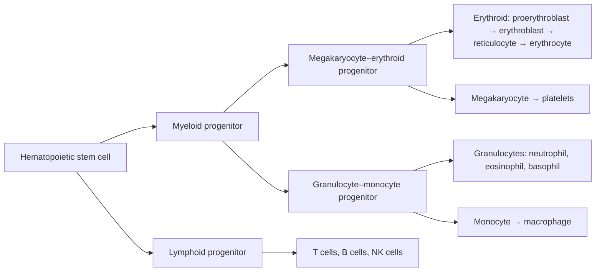

Blood is a connective tissue that flows inside closed vessels, and it is the medium carried by the body's largest "logistics system." It moves $\ce{O2}$, nutrients, hormones and heat from where they are produced or taken up to where they are consumed, and carries $\ce{CO2}$ and metabolic wastes to the lungs and kidneys. At the same time it buffers pH, maintains the osmotic pressure of the extracellular fluid, and seals leaks in its own container when a vessel is torn. Chapter 1 called the **extracellular fluid** the **internal environment** in which cells live; plasma is the part of it that moves fastest and exchanges most directly with the outside world, so the **homeostasis** of blood composition is a precondition for every other form of homeostasis. This chapter first treats the composition and physicochemical properties of blood (Section 11.1), then the three classes of blood cells: erythrocytes and hematopoiesis (Section 11.2), platelets and hemostasis (Sections 11.3–11.5), and leukocytes and inflammation (Section 11.7). Between them comes the blood group system of transfusion physiology (Section 11.6). The positive feedback and threshold of thrombin, and the trade-off between hematocrit and viscosity, are written as quantitative models. The mechanics of blood flow in vessels (viscosity, **Poiseuille's law**) is in Chapter 14, fluid exchange between plasma and **interstitial fluid** (**Starling forces**) is in Chapter 15, and the oxygen binding of hemoglobin and gas transport are in Chapter 19. The developmental origin of hematopoiesis is in [7.5.29](/7.5.29); immune recognition, lymphocytes, antibodies and the immunological mechanisms of blood groups belong to 7.15 Immunology.

## 11.1. Composition and Physicochemical Properties of Blood

### 11.1.1. Plasma and Blood Cells

Blood makes up about 7%–8% of body weight in an adult, that is, 70–80 mL per kilogram, or about 5 L in a person of 70 kg. When anticoagulated blood is centrifuged, the cells settle to the bottom. The lowest, dark red layer is the erythrocytes; above it is a thin grayish-white layer of leukocytes and platelets (the "buffy coat"); the upper, pale yellow and transparent layer is the *blood plasma*.

**Definition 11.1.1 (Hematocrit)** The percentage of the volume of whole blood occupied by blood cells is called the **hematocrit** (in practice almost entirely erythrocytes). It is about 40%–50% in normal adult men and 37%–48% in women, and can reach 55% in newborns.

The pale yellow fluid that separates out after blood clots is *serum*. It differs from plasma in that fibrinogen and several clotting factors have been consumed in clotting, while substances released by platelets during clotting have been added. Clinical biochemical tests mostly use serum; coagulation tests must use anticoagulated plasma.

Water makes up 91%–92% of plasma by mass (about 95% by volume); the rest is protein (60–80 g/L), electrolytes, nutrients, hormones, metabolic products and dissolved gases. The main functions of plasma are to serve as the external environment of the blood cells, to transport solutes, to store protein, and to maintain osmotic pressure and pH through its proteins and ions:

| Component | Content (reference value) | Main functions |
|---|---|---|
| Albumin | 40–50 g/L | Provides the bulk of the plasma colloid osmotic pressure; binds and transports fatty acids, bilirubin, calcium, drugs and **thyroid hormones**; synthesized in the liver |
| Globulins (α, β, γ) | 20–30 g/L | α and β globulins transport lipids, iron (transferrin), copper and so on; γ globulins are mainly antibodies |
| Fibrinogen | 2–4 g/L | Converted to fibrin in clotting |
| $\ce{Na+}$ / $\ce{K+}$ / $\ce{Ca^2+}$ | $140$ / $4$ / $2.5\,\mathrm{mmol\,L^{-1}}$ | Crystalloid osmotic pressure, membrane potential, excitability and clotting ($\ce{Ca^2+}$ is clotting factor IV) |
| $\ce{Cl-}$ / $\ce{HCO3-}$ | $103$ / $24\,\mathrm{mmol\,L^{-1}}$ | Osmotic pressure and acid–base buffering |
| Glucose | $3.9$–$6.1\,\mathrm{mmol\,L^{-1}}$ (fasting) | Energy source |

The albumin-to-globulin ratio (A/G) is normally 1.5–2.5; when liver function declines, albumin synthesis falls and the ratio decreases. The total plasma protein is a rapidly mobilizable reserve of whole-body protein, taken up and used by tissues during starvation.

### 11.1.2. Plasma Osmotic Pressure

The total osmolarity of plasma is about $290$–$300\,\mathrm{mOsm\,L^{-1}}$, and the overwhelming part comes from small crystalloid molecules such as $\ce{Na+}$ and $\ce{Cl-}$; proteins, despite their high mass concentration, have a very small molar concentration. The two components differ by two orders of magnitude in the pressure they generate, and they act at different places (Chapter 3 discussed osmosis and isosmotic and isotonic solutions):

**Definition 11.1.2 (Crystalloid and Colloid Osmotic Pressure)** The **osmotic pressure** produced by the small solutes in plasma (mainly electrolytes) is called the *crystalloid osmotic pressure* of plasma; the osmotic pressure produced by the plasma proteins (mainly albumin) is called the **colloid osmotic pressure**.

- The crystalloid osmotic pressure is about $5800\,\mathrm{mmHg}$ ($1\,\mathrm{mmHg} = 0.1333\,\mathrm{kPa}$, so about $770\,\mathrm{kPa}$). Small solutes can hardly cross the cell membrane freely, so the crystalloid osmotic pressure determines the distribution of water between the inside and outside of cells and maintains the shape and volume of blood cells; but they cross the capillary wall freely, so there is no osmotic pressure difference between plasma and interstitial fluid.
- The colloid osmotic pressure is only about $25\,\mathrm{mmHg}$ ($3.3\,\mathrm{kPa}$), but proteins do not readily cross the capillary wall, so the colloid osmotic pressure of plasma is higher than that of interstitial fluid and is the main force that "draws water back" from the interstitial fluid into the capillaries (the Starling forces of Chapter 15). When plasma protein falls (liver disease, nephrotic syndrome, malnutrition), the colloid osmotic pressure drops and fluid is retained in the interstitium, causing edema.

**Example 11.1.1 (Osmotic Pressure of Albumin)** The molar mass of albumin is about $66\,\mathrm{kg\,mol^{-1}}$ and its plasma concentration is $45\,\mathrm{g\,L^{-1}}$, that is, $0.68\,\mathrm{mmol\,L^{-1}}$. By the van 't Hoff equation $\pi = cRT$, at 37 °C $1\,\mathrm{mOsm\,L^{-1}}$ corresponds to $RT \times 1\,\mathrm{mol\,m^{-3}} = 8.314 \times 310\,\mathrm{Pa} \approx 2.58\,\mathrm{kPa} \approx 19.3\,\mathrm{mmHg}$, so the ideal osmotic pressure of albumin is about $0.68 \times 19.3 \approx 13\,\mathrm{mmHg}$. In the measured plasma colloid osmotic pressure, albumin contributes about $19$–$20\,\mathrm{mmHg}$ (75%–80% of the total), about half again as much as the ideal value. Albumin carries many negative charges, and by the **Donnan equilibrium** it attracts extra cations to the plasma side; these additional small ions also contribute osmotic pressure. The non-ideality of concentrated protein solutions (excluded volume) also raises the osmotic pressure above $cRT$. The same calculation for the crystalloid part gives $295 \times 19.3 \approx 5700\,\mathrm{mmHg}$, consistent with the value above.

### 11.1.3. pH, Specific Gravity and Viscosity

- **pH**: The pH of arterial plasma is 7.35–7.45; venous blood is slightly lower because it contains more $\ce{CO2}$. The main buffer pair of plasma is $\ce{HCO3-}/\ce{H2CO3}$ (whose ratio of 20∶1 determines the pH; see Chapter 25), followed by sodium proteinate/protein and $\ce{HPO4^2-}/\ce{H2PO4-}$. Inside erythrocytes there is also the hemoglobin buffer pair, which accounts for a large share of the buffering capacity of whole blood. The chemistry of buffering is in [7.1.2](/7.1.2).
- Specific gravity: that of whole blood is 1.050–1.060 and depends mainly on the number of erythrocytes; that of plasma is 1.025–1.030 and depends mainly on plasma protein; that of erythrocytes is 1.090–1.092.
- **Viscosity**: Taking water at the same temperature as 1, the relative **viscosity** of whole blood at body temperature is about 4–5 (at high shear rates) and depends mainly on the hematocrit; that of plasma is about 1.6–2 and depends mainly on plasma protein. Whole blood is a non-Newtonian fluid: at low flow rates erythrocytes aggregate into stacks and the viscosity rises markedly. The quantitative relation between viscosity and hematocrit is in Section 11.2.5, and its effect on vascular resistance in Chapter 14.

## 11.2. Erythrocytes

### 11.2.1. Shape, Number and Oxygen-Carrying Capacity

Mature mammalian erythrocytes lack a nucleus and organelles and are biconcave disks: about $7.5\,\mathrm{\mu m}$ in diameter, about $2.5\,\mathrm{\mu m}$ thick at the thickest part of the rim, about $1\,\mathrm{\mu m}$ thick at the thinnest part in the center, with a volume of about $90\,\mathrm{\mu m^3}$. A normal adult man has about $(4.0$–$5.5) \times 10^{12}$ erythrocytes per liter of blood (mean $5.2 \times 10^{12}\,\mathrm{L^{-1}}$, that is, about 5.2 million per microliter), and a woman about $(3.5$–$5.0) \times 10^{12}\,\mathrm{L^{-1}}$ (mean $4.7 \times 10^{12}\,\mathrm{L^{-1}}$).

The main component of the erythrocyte is hemoglobin. The hemoglobin concentration inside the cell is as high as about $340\,\mathrm{g\,L^{-1}}$ (close to its solubility limit); in whole blood it is 120–160 g/L in men and 110–150 g/L in women. Erythrocytes have three functions: transporting $\ce{O2}$ (bound to hemoglobin), transporting $\ce{CO2}$ (the cells are rich in **carbonic anhydrase**, which rapidly converts $\ce{CO2}$ to $\ce{HCO3-}$; see Chapter 19), and buffering $\ce{H+}$ with hemoglobin. The cooperativity of oxygen binding by hemoglobin and the molecular mechanism of the **Bohr effect** are in [7.1.7](/7.1.7#sec-7.3).

**Example 11.2.1 (Why Hemoglobin Is Needed)** Each gram of fully saturated hemoglobin binds about $1.34\,\mathrm{mL}$ of $\ce{O2}$ (theoretical value $1.39\,\mathrm{mL}$; the measured value is slightly lower because of a little methemoglobin and so on). Arterial blood with hemoglobin at $150\,\mathrm{g\,L^{-1}}$ carries about $150 \times 1.34 \times 0.97 \approx 195\,\mathrm{mL\,L^{-1}}$ of oxygen (arterial saturation about 97%). The solubility of $\ce{O2}$ in plasma is only $0.03\,\mathrm{mL\,L^{-1}\,mmHg^{-1}}$, so at $P_{\ce{O2}} = 100\,\mathrm{mmHg}$ about $3\,\mathrm{mL\,L^{-1}}$ dissolves. Hemoglobin raises the oxygen-carrying capacity of blood about 65-fold: without it, at a resting oxygen consumption of $250\,\mathrm{mL\,min^{-1}}$, even if all the oxygen in the arterial blood were extracted, the **cardiac output** would have to exceed $80\,\mathrm{L\,min^{-1}}$.

Packaging hemoglobin in cells rather than dissolving it in plasma has two advantages. The same amount of hemoglobin dissolved in plasma would raise the colloid osmotic pressure of plasma to about three times its normal value (tetramer $64.5\,\mathrm{kDa}$, so $150\,\mathrm{g\,L^{-1}}$ is $2.3\,\mathrm{mmol\,L^{-1}}$, about 3.4 times the molar concentration of albumin) and greatly increase the viscosity, and free hemoglobin would also be filtered by the glomerulus and scavenge nitric oxide. Inside the cell, regulatory molecules such as **2,3-bisphosphoglycerate** and carbonic anhydrase can be kept at high local concentration, and a reducing system prevents oxidation of the heme iron.

### 11.2.2. Physiological Properties of Erythrocytes

The biconcave disk shape gives the erythrocyte a surplus of surface area.

**Example 11.2.2 (Surplus Surface Area)** A sphere of volume $90\,\mathrm{\mu m^3}$ has a surface area of $(36\pi)^{1/3} V^{2/3} \approx 97\,\mathrm{\mu m^2}$; the actual surface area of an erythrocyte is about $135\,\mathrm{\mu m^2}$, about 40% more. The area of the erythrocyte membrane can hardly be stretched (it ruptures when the area increases by 3%–4%) but it bends and shears easily, so as long as the cell does not become spherical it can change shape greatly with both volume and area unchanged. An erythrocyte $7.5\,\mathrm{\mu m}$ in diameter can therefore squeeze through capillaries of $3\,\mathrm{\mu m}$ inner diameter and through the slits of the splenic sinuses.

Three physiological properties of erythrocytes all derive from this geometry and membrane mechanics:

- Deformability: erythrocytes deform when passing through vessels narrower than their own diameter and recover their shape afterward. Deformability depends on the surface-area-to-volume ratio, the viscosity of the intracellular fluid (hemoglobin concentration) and the elasticity of the membrane skeleton (the spectrin network). The deformability of senescent erythrocytes, of the erythrocytes in hereditary spherocytosis (a membrane skeleton defect causes loss of membrane and the cell becomes spherical) and of **sickle cell anemia** is reduced, and these cells are trapped and destroyed in the spleen.
- Osmotic fragility: in hypotonic solution erythrocytes take up water, swell and eventually burst (Definition 11.2.1). Normal erythrocytes begin to hemolyze in 0.42%–0.46% NaCl and hemolyze completely in 0.32%–0.34%; the surplus surface area lets the cell swell to about 1.6 times its original volume (becoming a sphere) without bursting. Senescent erythrocytes and spherocytes have high osmotic fragility.
- Suspension stability: erythrocytes are denser than plasma, yet remain suspended in it fairly stably and sediment very slowly (Definition 11.2.2).

**Definition 11.2.1 (Osmotic Fragility)** The tendency of erythrocytes to swell and burst in hypotonic saline is called **osmotic fragility**, expressed by the NaCl concentrations at which hemolysis begins and is complete.

**Definition 11.2.2 (Erythrocyte Sedimentation Rate)** When anticoagulated blood stands in a vertical sedimentation tube, the distance the erythrocytes fall by the end of the first hour is called the **erythrocyte sedimentation rate** (ESR); it measures the suspension stability of erythrocytes. It is normally 0–15 mm/h in men and 0–20 mm/h in women.

Friction with the plasma opposes the sinking of the erythrocytes. By **Stokes' law**, the sedimentation velocity of a spherical particle is proportional to the square of its radius, so a single erythrocyte sediments extremely slowly. When erythrocytes stack with their concave faces together in "rouleaux," the volume of the aggregate increases and its surface-area-to-volume ratio decreases, so sedimentation accelerates. Rouleaux formation is determined mainly by the plasma rather than by the erythrocytes themselves: when fibrinogen, globulins and cholesterol increase (as in inflammation, pregnancy, active tuberculosis and rheumatic disease), stacking is faster and the ESR rises; when albumin and lecithin increase, the ESR falls. If erythrocytes from a normal person are placed in the plasma of a person with a high ESR, their ESR also rises.

### 11.2.3. Hematopoiesis and Erythrocyte Production

Sites and timing of hematopoiesis: in the human embryo, blood formation occurs successively at three sites. In the early embryo (from week 3), primitive erythrocytes arise in the **blood islands** of the yolk sac; they are nucleated, large and contain embryonic globins, and supply oxygen to the early embryo. In mid-gestation (from month 2) hematopoiesis shifts to the liver (and spleen) and produces enucleated erythrocytes. From late gestation through birth, the bone marrow becomes the main hematopoietic organ. The "waves" of hematopoiesis, the migration of **hematopoietic stem cells** produced in the **hemogenic endothelium**, and the molecular mechanism of **globin switching** are in [7.5.29](/7.5.29#sec-29.7).

In infants and young children almost all the marrow throughout the body is hematopoietic red marrow. By about age 18 the marrow in the shafts of the long bones of the limbs has been replaced by fat and has become yellow marrow, and adult hematopoiesis occurs only in the flat bones (sternum, ribs, vertebrae, ilium, skull) and in the proximal epiphyses of long bones. Yellow marrow can resume blood formation when needed; if marrow production is inadequate in adults, the liver and spleen can resume hematopoiesis (extramedullary hematopoiesis).

The hematopoietic hierarchy: all blood cells arise from the **hematopoietic stem cells** of the bone marrow, which can self-renew and differentiate into every blood cell type. Hematopoiesis passes through the stages of hematopoietic stem cell, committed progenitors (myeloid and lymphoid lineages, further divided into erythroid, granulocyte–monocyte and megakaryocyte lineages and so on), morphologically recognizable precursor cells and mature blood cells; proliferative capacity declines and the direction of differentiation becomes more fixed at each later stage. Hematopoiesis takes place in the "hematopoietic microenvironment" of the marrow and is regulated jointly by stromal cells, microvessels, nerves and many hematopoietic growth factors (such as stem cell factor, interleukins, colony-stimulating factors, erythropoietin and thrombopoietin).



Erythrocyte development: erythroid committed progenitors pass through the proerythroblast and the early, intermediate and late erythroblast stages, becoming progressively smaller while hemoglobin accumulates; the late erythroblast extrudes its nucleus and becomes a reticulocyte (which still contains a few ribosomes and mitochondria, and shows a reticular structure with basic dyes). Reticulocytes enter the blood and mature within 1–2 days by losing their remaining organelles. Reticulocytes make up 0.5%–1.5% of the erythrocytes in peripheral blood, and their proportion reflects the rate at which the marrow produces erythrocytes: it rises within a few days after acute blood loss or after hematopoietic raw materials are supplied.

**Example 11.2.3 (Production Rate)** A person of 70 kg has 5 L of blood, so the erythrocytes number about $5 \times 10^{12}\,\mathrm{L^{-1}} \times 5\,\mathrm{L} = 2.5 \times 10^{13}$, with a mean lifespan of 120 days ($1.04 \times 10^7\,\mathrm{s}$). In the steady state the marrow must produce $2.5 \times 10^{13} / 1.04 \times 10^7 \approx 2.4 \times 10^6$ erythrocytes per second, about $2 \times 10^{11}$ per day, that is, about 0.8% of the erythrocytes are renewed each day. The hemoglobin synthesized each day is about $750\,\mathrm{g} \times 0.8\% \approx 6\,\mathrm{g}$, which requires about $20\,\mathrm{mg}$ of iron.

Raw materials of hematopoiesis: hemoglobin synthesis requires iron and protein, and erythrocyte proliferation requires DNA synthesis.

- Iron: an adult has about 3–4 g of iron in the body, about two thirds of it in hemoglobin. Of the 20–25 mg of iron needed daily for hematopoiesis, the great majority is recovered by macrophages when they break down senescent erythrocytes (endogenous); only 1–2 mg is absorbed from food, exactly offsetting the daily losses in shed intestinal epithelium, skin and blood loss. Dietary $\ce{Fe^3+}$ is reduced to $\ce{Fe^2+}$ in the duodenum and then absorbed; iron in plasma is carried by transferrin and stored in ferritin in the liver and elsewhere. Hepcidin, secreted by the liver, reduces iron absorption and release by degrading the iron exporter ferroportin on intestinal epithelium and macrophages. Inadequate iron intake or chronic blood loss causes iron-deficiency anemia, in which the erythrocytes are small and poor in hemoglobin (microcytic hypochromic anemia).
- Vitamin B12 and folate: both are cofactors required for DNA synthesis (folate takes part in thymidylate synthesis in the form of tetrahydrofolate, and vitamin B12 regenerates tetrahydrofolate from methyltetrahydrofolate). When they are lacking, erythroblast division is delayed and nuclear development lags behind cytoplasmic development, producing large megaloblasts and causing megaloblastic anemia. A person needs 1–3 µg of vitamin B12 per day, and the hepatic store lasts for years; its absorption requires intrinsic factor secreted by gastric parietal cells (which protects vitamin B12 from digestive juices and mediates its receptor-dependent absorption in the terminal ileum). Subtotal gastrectomy or autoimmune gastritis (pernicious anemia) causes vitamin B12 deficiency through lack of intrinsic factor. Folate is needed at 50–100 µg per day (more in pregnancy), and the stores last only a few months.

Regulation of erythrocyte production: the number of erythrocytes is maintained by a **negative feedback** loop whose regulated variable is tissue oxygen supply.

**Definition 11.2.3 (Erythropoietin)** A glycoprotein hormone (EPO, about $30\,\mathrm{kDa}$) synthesized and secreted mainly by the peritubular interstitial cells (fibroblast-like cells) of the renal cortex in response to hypoxia, which promotes the survival, proliferation and differentiation of erythroid progenitors, is called **erythropoietin**. About 90% of adult EPO comes from the kidney and the rest mainly from the liver (in the fetus mainly from the liver).

```mermaid
flowchart LR
  A[Tissue O₂ supply falls<br/>(blood loss, altitude, anemia, lung disease)] --> B[Renal interstitial cells become hypoxic<br/>HIF-2α stabilized]
  B --> C[EPO secretion increases]
  C --> D[Bone marrow erythroid progenitors<br/>survive, proliferate, differentiate]
  D --> E[Erythrocytes and hemoglobin increase]
  E --> F[Blood oxygen content and tissue oxygen supply restored]
  F -. negative feedback .-> B
```

The kidney senses the oxygen tension of the tissue, not the erythrocyte count or hemoglobin concentration itself. Under hypoxia, hypoxia-inducible factor (HIF-2α) is no longer hydroxylated by prolyl hydroxylase and degraded, and it then initiates transcription of the EPO gene (the molecular details of this oxygen-sensing mechanism won the 2019 Nobel Prize in Physiology or Medicine). EPO rises within hours of hypoxia, but new erythrocytes enter the blood in large numbers only after 3–5 days, and full recovery of the hematocrit takes weeks. In renal failure EPO is deficient, causing renal anemia, which can be treated with recombinant EPO. Androgens directly stimulate erythroid progenitors and promote EPO production, which is one reason why adult men have higher erythrocyte counts and hemoglobin than women.

### 11.2.4. Destruction of Erythrocytes

The mean lifespan of an erythrocyte is about 120 days. Mature erythrocytes have no nucleus or ribosomes and cannot renew their proteins; with age, glycolytic enzyme activity declines, the membrane becomes rigid, osmotic fragility increases, and recognition markers appear on the membrane surface (such as externalized phosphatidylserine and clustered band 3 protein that binds antibodies). About 90% of senescent erythrocytes are phagocytosed and destroyed by macrophages in the spleen and liver (extravascular destruction). In the red pulp of the spleen, erythrocytes must squeeze through slits about $3\,\mathrm{\mu m}$ wide between the splenic cords and sinuses, and cells with poor deformability are retained and phagocytosed. The other 10% or so rupture within the vessels, and the hemoglobin released binds haptoglobin in plasma and is taken up by the liver.

The phagocytosed hemoglobin is broken down into globin (hydrolyzed to amino acids and reused), iron (returned to transferrin or stored as ferritin, and reused for hematopoiesis) and **heme**. Heme oxygenase opens the porphyrin ring of heme, producing biliverdin and releasing CO, and biliverdin is reduced to **bilirubin**. Bilirubin is carried to the liver bound to albumin, glucuronidated, and excreted in the bile into the intestine, where gut bacteria convert it to urobilinogen; most of it leaves in the feces (stercobilin makes feces brown), and a little is reabsorbed and excreted by the kidney. When too many erythrocytes are destroyed (hemolysis) or the liver cannot handle bilirubin adequately, blood bilirubin rises and the skin and sclerae turn yellow: jaundice.

### 11.2.5. Hematocrit, Viscosity and Oxygen Transport

The higher the hematocrit, the more $\ce{O2}$ each liter of blood carries, but the greater the viscosity of the blood and the smaller the flow under the same driving pressure. Oxygen delivery (flow × oxygen content) has an optimum between the two.

Treat blood as a fluid flowing in a rigid tube. At a given pressure difference, the flow is inversely proportional to the apparent viscosity $\eta(H)$ (the **Hagen–Poiseuille law**, [7.6.22](/7.6.22)), and the oxygen content per liter of blood is proportional to the hematocrit $H$, so

$$
\dot Q_{\ce{O2}} \propto \frac{H}{\eta(H)}.
$$

The dependence of the apparent viscosity of blood on hematocrit can be fitted by an empirical formula (measurements in glass tubes by Pries et al., 1992). In large tubes, $\eta$ grows from the plasma viscosity at $H = 0$ to about 3.2 times that value at $H = 0.45$ and about 4.9 times at $H = 0.6$, far faster than linearly (interactions between erythrocytes strengthen sharply with concentration). The resulting $H/\eta$ is maximal at $H \approx 0.39$ in large vessels, but the optimum is very flat: oxygen delivery changes by only a few percent for $H$ between 0.3 and 0.5. In narrow tubes the apparent viscosity is smaller because of the **Fåhræus–Lindqvist effect** (Chapter 14), and the optimum shifts to higher $H$.

![Hematocrit, viscosity and oxygen delivery (empirical formula of Pries et al., 1992, high shear rate). A: the apparent viscosity (relative to plasma) rises steeply with hematocrit, and the smaller the tube diameter, the lower the apparent viscosity (Fåhræus–Lindqvist effect). B: at constant pressure difference, oxygen delivery is proportional to H/η (taking H = 0.45 as 1); the maximum for each diameter is marked with a dot, and the gray band is the range of normal hematocrit. The optimum is very flat, and normal hematocrit lies close to it](./plots/hematocrit-viscosity.py)

This simple model explains several facts. The normal hematocrit lies near the optimal region. In polycythemia (for example $H > 0.6$), although each liter of blood carries more oxygen, the increased viscosity slows blood flow, so tissue oxygen supply may actually fall, and thrombosis is more likely. Native highlanders (such as Tibetans) do not have much higher hemoglobin than lowlanders but rely mainly on respiratory and vascular adaptations, whereas the excessive erythrocytosis of long-term immigrants to high altitude is one cause of altitude sickness. The model ignores active regulation of vessels and the aggregation of erythrocytes at low shear rates, and serves only to show that a trade-off exists.

## 11.3. Platelets and Hemostasis

### 11.3.1. Platelets

Platelets are anucleate fragments shed from the cytoplasm of bone marrow megakaryocytes: a megakaryocyte, after repeated endoreplication (polyploid, up to 64N), extends long processes into the marrow sinuses, which break up into thousands of platelets. Platelet production is regulated by thrombopoietin (TPO) produced by the liver.

| Property | Value or feature |
|---|---|
| Size and shape | 1–4 µm in diameter, biconvex disks at rest |
| Number | $(150$–$350) \times 10^9\,\mathrm{L^{-1}}$ (150,000–350,000 per microliter); bleeding is likely below $50 \times 10^9\,\mathrm{L^{-1}}$ |
| Lifespan | 8–12 days; about one third is stored in the spleen; senescent platelets are phagocytosed in the spleen and liver |
| Structure | A glycocalyx on the surface; they do not bind intact endothelium but bind collagen beneath a damaged vessel wall; the cytoplasm contains mitochondria (producing ATP), an actin–myosin contractile system, dense granules (ADP, ATP, 5-hydroxytryptamine, $\ce{Ca^2+}$) and α granules (fibrinogen, von Willebrand factor, factor V, platelet-derived growth factor); an open canalicular system and a dense tubular system (storing $\ce{Ca^2+}$ and synthesizing prostaglandins) |
| Functions | Maintain the integrity of capillary endothelium (fill gaps left by detached endothelial cells, release growth factors); take part in hemostasis and clotting; release growth factors that promote repair of endothelium and smooth muscle |

The physiological properties of platelets are, in order, adhesion (sticking to a non-platelet surface), release (extrusion of granule contents), aggregation (platelets sticking to each other), contraction (contractile proteins make the clot retract) and adsorption (concentrating clotting factors at the surface).

### 11.3.2. The Four Steps of Hemostasis

**Definition 11.3.1 (Hemostasis)** The process by which bleeding from a small injured vessel stops by itself within a few minutes is called **hemostasis**. It comprises four overlapping steps in sequence: vasoconstriction, formation of a platelet plug (platelet thrombus), blood coagulation, and proliferation of fibrous tissue that closes the wound permanently. If an earlobe or fingertip is pricked with a needle, the duration of bleeding (bleeding time) is normally 1–3 min and mainly reflects platelet function.

1. **Vasoconstriction**: occurs immediately after injury. The vascular smooth muscle at the wound contracts directly in response to the injury (myogenic, immediate); vasoconstrictors released by platelets and damaged tissue (5-hydroxytryptamine, thromboxane $\mathrm{A}_2$, endothelin) strengthen the contraction (humoral, amplifying); and sensory nerve impulses such as pain cause reflex sympathetic vasoconstriction (neural, systemic). Constriction reduces the vessel caliber and blood flow, and in small arteries it can last from a few minutes to half an hour.
2. **Formation of the platelet plug**: when the vascular endothelium is damaged, the subendothelial collagen is exposed. Von Willebrand factor (vWF) in plasma first binds to the collagen, and platelets bind vWF through the membrane glycoprotein GPIb (especially important in high-shear arteries) and bind collagen directly through GPVI, adhering at the damaged site. Adhesion activates the platelets: the shape changes from disk to a sphere with pseudopods, contractile proteins contract, the granules release ADP and 5-hydroxytryptamine, and arachidonic acid released from membrane phospholipids is converted by cyclooxygenase to thromboxane $\mathrm{A}_2$. ADP and thromboxane $\mathrm{A}_2$ in turn activate nearby platelets, and the integrin $\alpha_{\mathrm{IIb}}\beta_3$ (GPIIb/IIIa) on the surface of activated platelets changes conformation and links platelets to one another through fibrinogen. This is a positive feedback: more and more platelets accumulate, and within minutes they plug a small breach. The initial platelet plug is loose and is subsequently reinforced by the fibrin produced by coagulation.
3. **Blood coagulation**: vascular injury simultaneously initiates the coagulation cascade (Section 11.4), which forms a fibrin network on and around the platelet plug that traps blood cells in a clot. The platelets in the clot contract, causing the clot to retract and become firm and to squeeze out serum.
4. **Proliferation of fibrous tissue**: a few hours after the clot forms, fibroblasts begin to grow into it, and under the influence of platelet-derived growth factor and others they convert the clot into fibrous tissue within 1–2 weeks, closing the wound permanently; meanwhile the fibrinolytic system (Section 11.5) gradually dissolves fibrin that is no longer needed.

Normal vascular endothelium itself inhibits platelet activation: it releases prostacyclin ($\mathrm{PGI}_2$) and nitric oxide (which raise cAMP and cGMP in platelets), and its surface ADPase (CD39) hydrolyzes ADP. A platelet plug therefore forms only at the damaged site and does not extend along intact vessel. Aspirin irreversibly acetylates platelet cyclooxygenase-1; because platelets have no nucleus and cannot synthesize new enzyme, the effect of a single dose lasts until that population of platelets is replaced (about a week), which is the basis for the use of low-dose aspirin to prevent arterial thrombosis.

## 11.4. Blood Coagulation

**Definition 11.4.1 (Blood Coagulation)** The process by which blood changes from a flowing liquid state to a non-flowing gel state is called **blood coagulation**. Its essence is the conversion of soluble fibrinogen in plasma into insoluble fibrin, which interweaves into a network and traps blood cells and the other components of blood. The clotting time of blood in vitro is normally 4–12 min.

### 11.4.1. Clotting Factors

The substances in plasma and tissues that take part directly in clotting are called clotting factors. Twelve are numbered with Roman numerals under the international nomenclature (factor VI was shown to be activated factor V and has been abolished); there are also prekallikrein, high-molecular-weight kininogen, and platelet phospholipid.

| Factor | Name | Site of synthesis | Key points |
|---|---|---|---|
| I | Fibrinogen | Liver | Thrombin cleaves off 4 small peptides (2 fibrinopeptide A, 2 fibrinopeptide B), giving the fibrin monomer |
| II | Prothrombin | Liver, vitamin K dependent | Zymogen; thrombin when activated |
| III | Tissue factor (TF) | Extravascular cells (fibroblasts, smooth muscle and so on) | Transmembrane glycoprotein, cofactor of factor VIIa; the only factor that normally does not contact blood |
| IV | $\ce{Ca^2+}$ | — | Bridges the Gla-containing factors to phospholipid membranes |
| V | Proaccelerin | Liver, megakaryocytes | Cofactor, activated by thrombin |
| VII | Proconvertin | Liver, vitamin K dependent | About 1% is present in the activated form in blood |
| VIII | Antihemophilic factor | Liver sinusoidal endothelium and others | Cofactor, stabilized in plasma by binding to vWF; deficiency causes hemophilia A |
| IX | Plasma thromboplastin component (Christmas factor) | Liver, vitamin K dependent | Deficiency causes hemophilia B |
| X | Stuart–Prower factor | Liver, vitamin K dependent | Meeting point of the intrinsic and extrinsic pathways |
| XI | Plasma thromboplastin antecedent | Liver | Activated by thrombin or factor XIIa |
| XII | Contact factor (Hageman factor) | Liver | Activated on contact with negatively charged surfaces; people lacking it do not bleed |
| XIII | Fibrin-stabilizing factor | Liver, megakaryocytes | Transglutaminase, forms covalent cross-links between fibrin monomers |

These factors have several features in common. All except factors III and IV are made in the liver, so severe liver disease causes bleeding. Factors II, VII, IX, X, XI and XII are all **zymogens** of **serine proteases** (activated IIa is thrombin); factors V and VIII are cofactors without enzymatic activity; factor XIII is a transglutaminase. Synthesis of factors II, VII, IX and X (and of the anticoagulant proteins C and S) requires vitamin K: the vitamin K-dependent carboxylase in the endoplasmic reticulum of hepatocytes carboxylates glutamate residues in their N-terminal regions to γ-carboxyglutamate (Gla), and the Gla domain binds, through $\ce{Ca^2+}$, to phosphatidylserine externalized on the surface of activated platelets ([7.3.7](/7.3.7)). This concentrates the clotting reactions on the membrane surface at the damaged site rather than letting them diffuse in the flowing plasma. Vitamin K deficiency (newborns whose gut flora is not yet established, long-term antibiotic use, biliary obstruction impairing absorption of fat-soluble vitamins) and the vitamin K antagonist warfarin (which inhibits vitamin K epoxide reductase) both leave these four factors nonfunctional.

### 11.4.2. The Coagulation Cascade

The core of coagulation is a three-step process: formation of prothrombin activator (the factor Xa–Va complex); conversion of prothrombin to thrombin by prothrombin activator; and conversion of fibrinogen to fibrin by thrombin. According to the route by which factor X is activated, the first step is classically divided into two pathways:

- The extrinsic pathway (tissue factor pathway): vascular injury exposes blood to tissue factor on the surface of extravascular cells. Tissue factor forms a complex with factor VII/VIIa from plasma in the presence of $\ce{Ca^2+}$ and activates factor X (and also factor IX). Its initiating factor comes from outside the blood, hence the name extrinsic pathway; it has few steps and is fast, producing a small amount of thrombin within seconds to tens of seconds. It is the physiological starting point of clotting in the body.
- The intrinsic pathway: all the factors involved come from the blood itself. When blood contacts a negatively charged foreign surface (glass, collagen, bacterial polyphosphate), factor XII is activated (contact activation), factor XIIa activates factor XI, and factor XIa activates factor IX; factor IXa and its cofactor VIIIa assemble on phospholipid membrane with $\ce{Ca^2+}$ into the "intrinsic factor X-ase complex" (tenase), which activates factor X. It has many steps and is slower but yields much product and serves as an amplifier.

The two pathways converge at factor X. Factor Xa and its cofactor Va, on the phospholipid membrane of activated platelets in the presence of $\ce{Ca^2+}$, form the prothrombinase complex, which cleaves prothrombin (factor II) to thrombin (IIa). Thrombin cleaves fibrinopeptides A and B from fibrinogen; the binding sites thereby exposed allow fibrin monomers to polymerize end to end and side to side into fibers. Thrombin also activates factor XIII, and XIIIa forms covalent isopeptide cross-links between the fibers, making the fibrin network stable and insoluble in urea.

```mermaid
flowchart TB
  subgraph EXT[Extrinsic pathway (initiation)]
    TF[Tissue factor + VIIa] 
  end
  subgraph INT[Intrinsic pathway (amplification)]
    XII[XII → XIIa] --> XI[XI → XIa]
    XI --> IX[IX → IXa]
    IX --> TEN[IXa–VIIIa complex]
  end
  TF --> X
  TF --> IX
  TEN --> X[X → Xa]
  X --> PT[Xa–Va prothrombinase complex]
  PT --> TH[Prothrombin → thrombin]
  TH --> FB[Fibrinogen → fibrin]
  TH --> XIII[XIII → XIIIa: cross-linking]
  TH -. positive feedback .-> V5[V → Va]
  TH -. positive feedback .-> V8[VIII → VIIIa]
  TH -. positive feedback .-> XI
  TH -. positive feedback .-> PLT[Platelet activation]
  V5 --> PT
  V8 --> TEN
```

The division into two pathways comes from test-tube experiments and remains useful in clinical testing. The prothrombin time (PT; tissue factor and $\ce{Ca^2+}$ are added to plasma; normal 11–14 s) reflects the extrinsic and common pathways, is sensitive to reduction of the vitamin K-dependent factors, and is used to monitor warfarin therapy. The activated partial thromboplastin time (aPTT; a negatively charged activator and phospholipid are added; normal 25–35 s) reflects the intrinsic pathway and is prolonged in hemophilia. In vivo, however, the two pathways are not two parallel routes but successive stages of one reaction network (the "cell-based model" of coagulation):

1. Initiation: tissue factor–VIIa produces small amounts of factors Xa and IXa on the cell surface at the site of injury, and Xa produces a trace of thrombin (not enough to clot much fibrinogen). Tissue factor pathway inhibitor (TFPI) quickly binds Xa and inhibits tissue factor–VIIa, so the initiation phase is self-limiting.
2. Priming: this small amount of thrombin activates platelets and activates factors V, VIII and XI, assembling cofactors on the membrane surface of activated platelets.
3. Propagation: on the platelet surface, IXa–VIIIa produces Xa in large amounts and Xa–Va produces thrombin in large amounts, forming the "thrombin burst."

This model explains why people lacking factor XII do not bleed (contact activation is not required for hemostasis in vivo; in vivo it mainly participates in pathological thrombosis and inflammation) whereas hemophiliacs lacking factor VIII or IX bleed severely: although the extrinsic pathway of the initiation phase is intact, without amplification by IXa–VIIIa thrombin generation is insufficient. The effect of cofactors is of orders of magnitude: compared with Xa alone, the Xa–Va complex assembled on the membrane surface raises the rate of prothrombin activation by about $3 \times 10^5$-fold.

### 11.4.3. Positive Feedback and Threshold of Thrombin

Thrombin is central in the network: it is both a product and an activator of the upstream factors V, VIII and XI and of platelets, which is a **positive feedback**. Positive feedback together with inhibition (antithrombin clears thrombin, activated protein C inactivates Va and VIIIa, TFPI shuts down initiation) makes coagulation behave as a switch with a threshold. When the stimulus is below threshold, the small amount of thrombin produced is cleared by the inhibitory systems and no clot forms; above threshold, thrombin is produced explosively after a lag phase. The minute endothelial injuries that occur continually in normal vessels therefore do not cause clotting, while real bleeding can be sealed within minutes. The general theory of switch behavior arising from positive feedback and nonlinearity is in [7.9.16](/7.9.16).

A minimal model can express this mechanism. Let $T$ be the thrombin concentration, $a$ the fraction of cofactor and platelet surface activated by thrombin ($0 \le a \le 1$), and $p$ the fraction of prothrombin remaining:

$$
\begin{aligned}
\frac{\mathrm{d}T}{\mathrm{d}t} &= \bigl(s(t) + Va\bigr)p - k_{\mathrm{AT}}T, \\
\frac{\mathrm{d}a}{\mathrm{d}t} &= k_a\frac{T^2}{K^2 + T^2}(1 - a) - k_d a, \\
\frac{\mathrm{d}p}{\mathrm{d}t} &= -\frac{\bigl(s(t) + Va\bigr)p}{P_0}.
\end{aligned}
$$

Here $s(t) = s_0\mathrm{e}^{-t/\tau}$ is the initiation rate of the tissue factor pathway ($s_0$ increases with the amount of exposed tissue factor, and $\tau$ is the time constant for TFPI to shut down initiation), $V$ is the maximal amplification rate of the tenase and prothrombinase complexes on the platelet surface, $k_{\mathrm{AT}}$ is the rate constant of thrombin clearance by antithrombin (the half-life of thrombin in plasma is less than a minute), $k_a$ and $K$ describe the cooperative activation of cofactors and platelets by thrombin, $k_d$ is the rate of inactivation of cofactors by activated protein C, and $P_0 \approx 1.4\,\mathrm{\mu mol\,L^{-1}}$ is the plasma prothrombin concentration. When $T$ is small, the positive feedback term grows as $T^2$, more slowly than the linear clearance term $k_{\mathrm{AT}}T$, so the zero state is stable; once $T$ exceeds the threshold, positive feedback dominates and the system jumps onto the burst trajectory, until prothrombin is exhausted and inhibition prevails.

![Threshold of thrombin generation (minimal model, illustrative parameters: $k_{\mathrm{AT}} = 1\,\mathrm{min^{-1}}$, $k_a = 2\,\mathrm{min^{-1}}$, $K = 20\,\mathrm{nmol\,L^{-1}}$, $k_d = 1\,\mathrm{min^{-1}}$, $\tau = 1\,\mathrm{min}$, $V = 300\,\mathrm{nmol\,L^{-1}\,min^{-1}}$). A: when the initiation rate $s_0$ is below threshold (gray line), thrombin stays low throughout; above threshold a burst appears after a lag phase, and the stronger the stimulus the shorter the lag, while the peak is almost unchanged. B: peak thrombin jumps switch-like with $s_0$; when the amplification rate is reduced to 20% (as in deficiency of factor VIII or IX), the threshold rises about 6-fold and the peak is also greatly reduced](./plots/thrombin-burst.py)

The model reproduces several features of thrombin generation experiments (tissue factor is added to plasma and thrombin is measured continuously): the lag phase, the burst and the subsequent decay; the lag shortens as the tissue factor concentration increases while the peak changes little; the peak is markedly lower in hemophilic plasma. The parameters of the model are illustrative; quantitative coagulation models (such as the Hockin–Mann model) contain dozens of reactions with measured rate constants and reach the same conclusions.

### 11.4.4. Bleeding and Thrombosis

| Condition | Defect | Manifestation |
|---|---|---|
| Thrombocytopenia or platelet dysfunction | Platelet count below $50 \times 10^9\,\mathrm{L^{-1}}$; defects of GPIb or $\alpha_{\mathrm{IIb}}\beta_3$; aspirin | Petechial bleeding of skin and mucosa, prolonged bleeding time |
| von Willebrand disease | Reduced or abnormal vWF (the most common inherited bleeding disorder) | Mucosal bleeding; factor VIII, deprived of the protection of vWF, is also reduced |
| Hemophilia A / B | Deficiency of factor VIII / IX, X-linked recessive inheritance | Deep bleeding into joints and muscles; prolonged aPTT |
| Vitamin K deficiency, warfarin | Insufficient γ-carboxylation of factors II, VII, IX, X | Prolonged PT (factor VII has the shortest half-life and falls first) |
| Disseminated intravascular coagulation | Widespread activation of coagulation exhausts clotting factors and platelets | Microthrombi and bleeding coexist |

Conversely, excessive coagulation or inadequate anticoagulation causes thrombosis. In the middle of the 19th century Virchow pointed out the three elements of thrombus formation: injury of the vessel wall (rupture of an atherosclerotic plaque), abnormal blood flow (venous stasis during prolonged sitting or bed rest) and a hypercoagulable state of the blood (for example, the factor V Leiden mutation, which prevents factor Va from being inactivated by activated protein C).

## 11.5. Anticoagulation and Fibrinolysis

The clotting factors in blood are enough to clot all the blood in the body within minutes, yet in a normal person the blood stays fluid in the vessels. This depends on the anticoagulant action of the vascular endothelium, anticoagulant substances in plasma and the fibrinolytic system; coagulation and anticoagulation reach a local balance at the site of injury.

### 11.5.1. Anticoagulant Action of the Vascular Endothelium

- Physical barrier: intact endothelium separates blood from the subendothelial collagen and tissue factor. The endothelial surface is smooth, and its **glycocalyx** (a negatively charged layer of proteoglycans and **glycosaminoglycans**) repels platelets and clotting factors.
- Antiplatelet action: the endothelium releases prostacyclin and nitric oxide, and its surface ADPase hydrolyzes ADP (Section 11.3.2).
- Anticoagulation: heparan sulfate proteoglycan on the endothelial surface binds and accelerates antithrombin; the endothelium synthesizes TFPI; thrombomodulin on the endothelial surface binds thrombin, so that thrombin loses its ability to cleave fibrinogen and activate platelets and instead activates protein C.
- Profibrinolysis: the endothelium synthesizes and releases tissue plasminogen activator (tPA).

### 11.5.2. Physiological Anticoagulants

| Substance | Action |
|---|---|
| Antithrombin (formerly antithrombin III) | A serine protease inhibitor (serpin) synthesized in the liver; forms irreversible 1∶1 complexes with thrombin and factors IXa, Xa, XIa and XIIa; acts very slowly alone, but more than 1000-fold faster when bound to heparin |
| Heparin | A highly negatively charged sulfated polysaccharide produced by mast cells and basophils (first extracted from liver, hence the name); almost absent from plasma under physiological conditions, the active form in the body being mainly heparan sulfate on the endothelial surface; given intravenously as a drug, it is anticoagulant both in vivo and in vitro |
| Protein C system | The thrombin–thrombomodulin complex activates protein C; activated protein C, assisted by the cofactor protein S, hydrolyzes and inactivates factors Va and VIIIa. This is a negative feedback on thrombin: the more thrombin, the stronger the signal that shuts down its own generation, and it acts mainly on intact endothelium (where thrombomodulin is), confining the clot to the damaged site |
| TFPI | Binds factor Xa first and then forms a quaternary complex with tissue factor–VIIa, shutting down initiation of the extrinsic pathway |
| Fibrin itself | Adsorbs thrombin ("antithrombin I"), so that thrombin in an already formed clot does not diffuse outward |

The anticoagulation of blood in vitro is also based on the chemistry of clotting: sodium citrate or **EDTA** chelates $\ce{Ca^2+}$ (stored blood for transfusion and coagulation tests use citrate; after $\ce{Ca^2+}$ is added back the plasma clots), and heparin accelerates antithrombin; lowering the temperature slows enzymatic reactions; on smooth siliconized surfaces contact activation is weakened and clotting is delayed.

### 11.5.3. Fibrinolysis

**Definition 11.5.1 (Fibrinolysis)** The process by which fibrin in a clot is broken down and liquefied is called fibrin dissolution, or **fibrinolysis** for short. The fibrinolytic system consists of plasminogen, plasmin, plasminogen activators and fibrinolysis inhibitors.

Plasminogen in plasma (synthesized in the liver) is cleaved to plasmin by plasminogen activators. Plasmin is a serine protease that degrades fibrin and fibrinogen into soluble fragments (the degradation products of cross-linked fibrin include D-dimer, whose elevation indicates that a thrombus has formed and been dissolved in the body); it also hydrolyzes factors V, VIII and others. The main activators are tissue plasminogen activator (tPA), released by the vascular endothelium, and urokinase-type plasminogen activator (uPA), found in urine. tPA activates plasminogen efficiently only when bound to fibrin, so fibrinolysis is concentrated on the clot and does not consume the fibrinogen of the whole body.

Fibrinolysis is controlled by two classes of inhibitors: plasminogen activator inhibitor-1 (PAI-1, released by endothelium and platelets) inhibits tPA and uPA, and α2-antiplasmin rapidly inactivates plasmin free in plasma, and factor XIIIa also cross-links it to fibrin, so that a newly formed clot is not dissolved prematurely. After thrombus formation has stopped the bleeding, tissues and vascular endothelium slowly release tPA and dissolve the clot over a few days, reopening the small vessel. Thrombolysis with recombinant tPA in the early stage of acute myocardial infarction and ischemic stroke amplifies exactly this physiological mechanism.

## 11.6. Blood Groups and Transfusion

### 11.6.1. Blood Groups and Erythrocyte Agglutination

When the blood of two people with incompatible blood groups is mixed, erythrocytes agglutinate into clumps and are then lysed by complement. Landsteiner discovered in 1901 that this results from the binding of specific **antigens** (agglutinogens) on the erythrocyte membrane to the corresponding **antibodies** (agglutinins) in plasma.

**Definition 11.6.1 (Blood Group)** The type of specific antigens on the membrane of blood cells is called the **blood group**. What is usually meant by blood group is the erythrocyte blood group, that is, the type of antigens on the erythrocyte membrane. More than 40 blood group systems and hundreds of antigens are now known on human erythrocytes, and the two most closely related to transfusion are the ABO and Rh systems. Leukocytes and platelets also have their own antigen systems (the most important on leukocytes is the human leukocyte antigen HLA, which determines compatibility in organ transplantation and belongs to immunology).

### 11.6.2. The ABO Blood Group System

The ABO system divides blood into four types according to whether the A antigen and the B antigen are present on the erythrocyte membrane. The A and B antigens are oligosaccharide chains on glycolipids and glycoproteins of the erythrocyte membrane. The common precursor, the H antigen (terminal fucose), becomes the A antigen when N-acetylgalactosamine is added by the N-acetylgalactosaminyltransferase encoded by the $A$ gene, and becomes the B antigen when galactose is added by the galactosyltransferase encoded by the $B$ gene; a **frameshift mutation** in the $O$ allele inactivates the enzyme, so type O erythrocytes carry only the H antigen.

| Blood type | Antigens on erythrocytes | Antibodies in plasma | Frequency in the Han Chinese population (approx.) |
|---|---|---|---|
| A | A | Anti-B | 30% |
| B | B | Anti-A | 28% |
| AB | A and B | None | 10% |
| O | H (no A or B) | Anti-A and anti-B | 32% |

A characteristic of ABO blood groups is that plasma naturally contains antibodies against the antigen that the person lacks. Newborns have almost none of these antibodies at birth; they begin to be produced 2–8 months after birth and peak at 8–10 years. They are generally thought to arise in response to carbohydrate chains on gut bacteria and food that resemble the A and B antigens, and are mainly IgM, which cannot cross the placenta. Hence the first transfusion of ABO-incompatible blood causes an acute hemolytic reaction, while hemolytic disease of the newborn caused by ABO incompatibility between mother and infant is usually mild (a small amount of IgG anti-A and anti-B is found mainly in type O mothers). ABO frequencies differ greatly among populations: in European populations about 45% are type O, 40% type A, 10% type B and 5% type AB, and Native Americans are almost all type O.

### 11.6.3. The Rh Blood Group System

The antiserum obtained by injecting rhesus monkey erythrocytes into rabbits agglutinates the erythrocytes of most people, and the blood group system discovered in this way is called the Rh system (it was later shown that the antigen that actually reacts with monkey erythrocytes is a different one, but the name was kept). The Rh system has more than 50 antigens, and the one most closely related to clinical practice is the D antigen: erythrocytes with D antigen are called Rh-positive, those without it Rh-negative. In the Han Chinese population about 99.7% are Rh-positive and about 0.3% Rh-negative (higher in some ethnic minorities); in European populations about 15% are Rh-negative.

Unlike the ABO system, human plasma contains no natural anti-D antibody: an Rh-negative person produces anti-D antibody by an immune response only after Rh-positive blood or erythrocytes enter the body (pregnancy, delivery), and it is mainly IgG, which can cross the placenta. This has two clinical consequences:

- When an Rh-negative person is transfused with Rh-positive blood for the first time, a hemolytic reaction does not generally occur, but anti-D antibody is produced; on a second transfusion hemolysis occurs.
- When an Rh-negative mother carries an Rh-positive fetus, the first pregnancy is generally unaffected (fetal erythrocytes enter the mother mainly at delivery, and antibody production is slow). After the mother has been sensitized, in a subsequent pregnancy with an Rh-positive fetus IgG anti-D antibody crosses the placenta and lyses fetal erythrocytes, causing hemolytic disease of the newborn (in severe cases hydrops fetalis and death). Injecting the mother with anti-D immunoglobulin within 72 hours of delivery clears the fetal erythrocytes that have entered her circulation, prevents sensitization and prevents hemolysis in the next pregnancy.

### 11.6.4. Principles of Transfusion

The basic principle of transfusion is to avoid bringing antigens on donor erythrocytes together with antibodies in recipient plasma:

1. Insist on type-specific transfusion (same ABO and Rh); Rh-negative women of childbearing age in particular must avoid receiving Rh-positive blood.
2. Even when the ABO type is the same, a crossmatch must be done before transfusion: in the major side the donor's erythrocytes are mixed with the recipient's serum, and in the minor side the recipient's erythrocytes are mixed with the donor's serum. Transfusion is allowed only if neither side agglutinates; if the major side agglutinates, the blood must never be given; if the major side does not agglutinate but the minor side does, it may be given only in an emergency, in small amounts and slowly, with close observation.
3. The major side is more important than the minor side because the donor's plasma is rapidly diluted in the recipient, so its antibody concentration is too low to agglutinate the recipient's large mass of erythrocytes, whereas the transfused erythrocytes face the antibodies in the whole of the recipient's plasma. This is the basis of the old names "universal donor" for type O and "universal recipient" for type AB; but when the anti-A and anti-B titers in type O plasma are high, large transfusions can still cause hemolysis, so today only type O erythrocytes (with most of the plasma removed) are given, and only in emergencies.
4. Component therapy: erythrocytes, platelets, plasma or clotting factor concentrates are given separately as needed, which both conserves the blood supply and reduces adverse reactions; storing a patient's own blood before surgery (autologous transfusion) avoids immune reactions and infection.

## 11.7. Leukocytes and Inflammation

### 11.7.1. Types and Numbers of Leukocytes

Leukocytes are nucleated blood cells that are only passing through the blood: their functions are performed mainly in the tissues. The blood of a normal adult contains $(4$–$10) \times 10^9\,\mathrm{L^{-1}}$ leukocytes, which are divided by the presence of specific granules in the cytoplasm into granulocytes (neutrophils, eosinophils and basophils by the staining of the granules) and agranulocytes (monocytes and lymphocytes).

| Type | Proportion of leukocytes | Main functions |
|---|---|---|
| Neutrophils | 50%–70% | First to reach the site of infection; phagocytose and kill bacteria; each can engulf 3–20 bacteria and then dies; dead neutrophils, bacteria and tissue debris make up pus |
| Eosinophils | 0.5%–5% | Defense against parasitic (helminth) infection; limit allergic reactions caused by basophils and mast cells |
| Basophils | 0–1% | Granules contain heparin and histamine, whose release causes allergic reactions |
| Monocytes | 3%–8% | Differentiate into macrophages on entering tissue; strongly phagocytic, able to engulf more than 100 bacteria as well as large particles such as malaria parasites and senescent erythrocytes; process and present antigen |
| Lymphocytes | 20%–40% | T cells (cellular immunity), B cells (humoral immunity, differentiating into antibody-secreting plasma cells) and NK cells (killing infected cells and tumor cells); mechanisms in 7.15 Immunology |

The total leukocyte count fluctuates through the day (higher in the afternoon) and rises with eating, strenuous exercise, pregnancy and emotional stress, mainly because neutrophils move from the "marginal pool" attached to vessel walls into the circulating pool. Neutrophils increase in bacterial infection, eosinophils in parasitic infection and allergy, and lymphocytes are often relatively increased in viral infection. Leukocyte production is regulated by colony-stimulating factors (G-CSF, GM-CSF, M-CSF) and interleukins, and in infection these factors increase marrow production and release several-fold.

### 11.7.2. Lifespan and Diapedesis

Each class of leukocyte stays in the blood only briefly and survives longer in the tissues:

| Leukocyte | In blood | In tissue |
|---|---|---|
| Granulocytes | 4–8 h (the half-life of neutrophils is about 7 h) | 4–5 days; in infection they die within hours of phagocytosis |
| Monocytes | 10–20 h | Differentiate into macrophages, which can survive for months |
| Lymphocytes | Recirculate continually among blood, lymph and lymphoid organs | Weeks to years (memory cells) |

The marrow stores about 20 times as many mature neutrophils as are in the blood, and they can be released rapidly in infection.

**Definition 11.7.1 (Diapedesis)** The process by which leukocytes pass through the endothelium of capillaries and venules into the tissue is called **diapedesis** of leukocytes (blood cell extravasation).

Diapedesis occurs in the postcapillary venules at the site of inflammation and is a multistep process. Inflammatory mediators cause the endothelium to express **selectins**; sugar ligands on leukocytes bind them transiently and release again, and the leukocytes roll along the vessel wall and slow down. Chemokines on the endothelial surface activate the **integrins** of the leukocytes, which bind firmly to adhesion molecules on the endothelium (ICAM-1 and others), and the leukocytes stop and spread. The leukocytes then deform and squeeze out of the vessel between endothelial cells (a few pass through the endothelial cells). Once in the tissue, leukocytes move directionally along concentration gradients of bacterial products, complement fragments and chemokines, that is, **chemotaxis** (how cells sense gradients and migrate is in Chapter 2 and [7.6.35](/7.6.35)).

### 11.7.3. Phagocytosis and Tissue Macrophages

Neutrophils and macrophages remove bacteria and foreign material by **phagocytosis**. Phagocytosis is selective: particles with rough surfaces are easily phagocytosed; normal tissue surfaces have a protective protein coat whereas foreign particles and bacteria do not; and antibodies and complement produced by the immune system bind to the surface of the invader (opsonization), greatly increasing the efficiency of phagocytosis. After the phagosome fuses with lysosomes, the engulfed bacteria are killed by proteases, reactive oxygen species (superoxide, hydrogen peroxide and hypochlorous acid produced by the respiratory burst) and antimicrobial peptides.

After entering the tissue, monocytes differentiate into macrophages, which reside long term in the various organs and form a widely distributed phagocytic network (formerly called the mononuclear phagocyte system or reticuloendothelial system):

| Site | Macrophage | Role |
|---|---|---|
| Skin and subcutaneous tissue | Histiocytes | Clear bacteria entering through wounds |
| Lymph nodes | Macrophages in the lymph sinuses | Filter particles and pathogens brought by lymph |
| Alveoli | Alveolar macrophages | Clear inhaled particles |
| Liver | Kupffer cells (liver sinusoids) | Clear bacteria entering from the gut through the portal vein |
| Spleen and bone marrow | Macrophages of the red pulp and marrow | Clear senescent erythrocytes and pathogens from the blood |
| Brain | Microglia | Clear debris in nervous tissue |

### 11.7.4. Inflammation

**Definition 11.7.2 (Inflammation)** The series of complex local changes, centered on a vascular reaction and accompanied by leukocyte infiltration, that occurs when tissue is injured (physically, chemically, by heat or by infection) is called **inflammation**. The classical local signs are redness, heat, swelling, pain and loss of function.

The vascular reaction and tissue changes of inflammation occur in the following sequence:

1. Local arterioles dilate and blood flow increases (hyperemia), causing local redness and heat. The mediators are histamine, bradykinin, prostaglandins and nitric oxide released by damaged tissue and mast cells.
2. The permeability of capillaries and venules increases, and protein-rich fluid exudes into the interstitial space, causing swelling (inflammatory edema); the exuded fibrinogen and other clotting factors make the interstitial fluid clot locally, "walling off" the inflamed area and slowing the spread of bacteria and toxins.
3. Large numbers of granulocytes and monocytes move into the interstitial space (Section 11.7.2).
4. Tissue cells swell; inflammatory mediators stimulate **nociceptors** and cause pain. Necrotic tissue, dead and activated neutrophils, pathogenic microorganisms and a little exuded plasma make up pus.

The response of phagocytes is divided in time into four lines of defense. Macrophages already in the tissue begin the defense first (minutes to 1 hour); neutrophils enter the tissue in large numbers from the capillaries within hours, the second line of defense; monocytes then enter the tissue and mature gradually into macrophages after 8 hours, becoming the main force in the later phase; and meanwhile granulocyte and monocyte production in the marrow increases and rises markedly after 3–4 days. There is a positive feedback here: interleukin-1, tumor necrosis factor and colony-stimulating factors released by activated macrophages attract and mobilize more leukocytes, so that the response is rapidly amplified; as the pathogen is cleared, anti-inflammatory mediators resolve the inflammation and the tissue is repaired. The molecular mechanisms of pathogen recognition in inflammation (**pattern recognition receptors**, complement), the participation of lymphocytes and the systemic acute-phase response belong to 7.15 Immunology; the **fever** caused by inflammatory mediators is in Chapter 31.

## 11.8. Evolution and Comparative Biology

### 11.8.1. Blood, Lymph and Hemolymph

The circulating fluids of different animals fall into three kinds according to the type of circulatory system (Chapter 12):

| Feature | Blood | Lymph | Hemolymph |
|---|---|---|---|
| Found in | Vertebrates and animals with closed circulation such as annelids and cephalopods | Vertebrates | Animals with open circulation such as arthropods and most mollusks |
| System | Closed vascular system | Lymphatic vessels and lymph nodes | Vessels and blood cavities (hemocoelic sinuses) |
| Composition | Plasma (water, protein, nutrients) with erythrocytes, leukocytes and platelets | Fluid filtered from the capillaries, similar to plasma but low in protein; contains lymphocytes, no erythrocytes | Blood and interstitial fluid are not separate but a mixture of the two; contains blood cells (with immune and clotting functions); respiratory pigments are mostly dissolved in the fluid |
| Color | Red (hemoglobin) | Colorless or pale yellow (chyle from the small intestine is milky white) | Colorless, pale yellow or pale blue (hemocyanin when oxygenated) |
| Oxygen transport | Hemoglobin (iron-containing) in erythrocytes | None | Dissolved hemocyanin (copper-containing) or hemoglobin; insect hemolymph carries essentially no oxygen |
| Functions | Transport $\ce{O2}$, nutrients and metabolic wastes; regulate body temperature and pH; immunity and clotting | Recover interstitial fluid and protein; transport fat absorbed in the small intestine; filter pathogens in lymph nodes | Transport nutrients and metabolites (and $\ce{O2}$); immune defense; hydrostatic skeleton (for example insect molting, spider leg extension) |
| Propulsion | Heart | Intrinsic rhythmic contraction of the collecting lymphatics (the lymph pump), aided by compression by surrounding tissue | Tubular heart or contractile vessels, and body movement |

In open circulation, hemolymph and interstitial fluid are the same fluid, and the volume of hemolymph can be 20%–40% of body weight (vertebrate plasma is about 5%); it bathes the tissues directly and so must also perform the functions of interstitial fluid.

### 11.8.2. Respiratory Pigments and Erythrocytes

Diversity of respiratory pigments: proteins that bind $\ce{O2}$ reversibly have arisen independently in animals at least three times:

| Pigment | Metal binding oxygen | Color (oxygenated / deoxygenated) | Distribution | Location |
|---|---|---|---|---|
| Hemoglobin | $\ce{Fe^2+}$ in heme | Red / dark red | Vertebrates, many annelids (giant extracellular hemoglobin, or erythrocruorin), some insect larvae (chironomids), some mollusks and crustaceans | In erythrocytes in vertebrates; dissolved in plasma in many invertebrates |
| Hemocyanin | Two $\ce{Cu+}$ coordinated directly by histidines | Blue / colorless | Most mollusks (cephalopods, gastropods) and arthropods (crustaceans, horseshoe crabs, spiders) | Giant polymers dissolved in hemolymph |
| Hemerythrin | A non-heme di-iron center | Purple-red / colorless | Sipunculans, brachiopods, some polychaetes | Intracellular |
| Chlorocruorin | Iron of a special heme | Green (dilute solution) / red (concentrated solution) | Some polychaetes | Dissolved in plasma |

The hemocyanins of arthropods and mollusks are not homologous in structure and arose independently, in two separate origins. Respiratory pigments dissolved in plasma are all giant polymers (mollusk hemocyanin can reach millions of daltons); this provides many binding sites while keeping the molar concentration and colloid osmotic pressure very low (the reasoning of Example 11.1.1) and prevents filtration by excretory organs.

Nucleated and enucleated erythrocytes: the mature erythrocytes of fishes, amphibians, reptiles and birds have a nucleus and are mostly elliptical; only in mammals have mature erythrocytes extruded the nucleus (camelid erythrocytes are elliptical but likewise anucleate). Erythrocyte size varies greatly among vertebrates and correlates positively with genome size: amphibian erythrocytes are the largest (up to $70\,\mathrm{\mu m}$ in some salamanders and sirens), bird erythrocytes are about $12\,\mathrm{\mu m}$, and mammals have the smallest (only about $2$–$2.5\,\mathrm{\mu m}$ in the mouse deer *Tragulus*). Enucleation allows mammalian erythrocytes to be smaller, to pack more hemoglobin into the same volume, and to be biconcave so as to pass through finer capillaries, which suits the high metabolic rates of mammals; the cost is that the erythrocyte cannot repair itself and has a limited lifespan. Bird erythrocytes, although nucleated, have highly condensed chromatin in the nucleus with almost no transcriptional activity, and retain mitochondria (mammalian erythrocytes have no mitochondria and rely on glycolysis alone, so they do not consume the oxygen they carry).

Antarctic icefish: the icefishes of the Southern Ocean (Channichthyidae) are the only vertebrates whose adults have no hemoglobin and almost no erythrocytes; the blood is nearly transparent, with a hematocrit of about 1% (leukocytes only). Their $\beta$-globin gene is deleted, only a fragment of the $\alpha$-globin gene remains, and in many species even myoglobin has lost expression. Icefish live on $\ce{O2}$ dissolved in plasma, which gives only about one tenth of the oxygen-carrying capacity of red-blooded fishes. This is possible in the Antarctic under several conditions: the seawater temperature is $-1.9$ to $+2$ °C all year round, the solubility of $\ce{O2}$ in cold water is high, and metabolic rates are low. The blood volume of icefish is 2–4 times that of other teleosts, the heart and **stroke volume** are large, the capillaries are wide and dense, and the skin also takes part in gas exchange. The icefish case shows that the loss of hemoglobin is a degeneration that can be "tolerated" in an extremely stable cold environment, and that the various circulatory compensations accumulated afterward.

### 11.8.3. Clotting in Invertebrates

Animals with open circulation have no high-pressure closed vessels, but they face the same problem of large hemolymph loss after trauma. Their clotting is carried out by blood cells and hemolymph proteins, by mechanisms not homologous to those of vertebrates:

- Horseshoe crab: the hemolymph of the horseshoe crab contains almost only one type of blood cell, the amebocyte, which is full of granules. Bacterial endotoxin (the lipopolysaccharide of the cell wall of Gram-negative bacteria) or fungal β-glucan makes the amebocytes degranulate and release a serine protease cascade: endotoxin activates factor C, factor C activates factor B, factor B activates the proclotting enzyme, and the clotting enzyme cleaves soluble coagulogen, which polymerizes into a gel that entraps and immobilizes the bacteria. Clotting and defense are here one and the same thing. The reaction is extremely sensitive to endotoxin (picograms per milliliter), and the Limulus amebocyte lysate (LAL) reagent, made from lysate of horseshoe crab amebocytes, is used to test injectable drugs and medical devices for endotoxin; recombinant factor C has partly replaced bleeding of horseshoe crabs.
- Crustaceans: the hemolymph contains a soluble clotting protein (a large lipoprotein homologous to vitellogenin), and blood cells rupture at the wound and release a $\ce{Ca^2+}$-dependent transglutaminase, which forms covalent cross-links between the clotting protein molecules and makes the hemolymph gel. This step is chemically the same as the cross-linking of fibrin by factor XIIIa in vertebrates, but the substrate is entirely different.
- Insects: clotting of the hemolymph is combined with phenoloxidase-mediated melanization (deposition of melanin around wounds and invaders), again serving both hemostasis and immunity.

### 11.8.4. Evolution of the Coagulation Cascade

The vertebrate clotting factors VII, IX, X, protein C and prothrombin are structurally homologous to one another (all have a Gla domain and a serine protease domain), and factors V and VIII are homologous, which indicates that the coagulation cascade was lengthened step by step from a few ancestral genes through repeated duplication (including the two rounds of **whole-genome duplication** early in vertebrates), Doolittle's "one gene, duplicate, duplicate again." Jawless vertebrates (lampreys) already have tissue factor, prothrombin and fibrinogen, so the core extrinsic and common pathways appeared early in vertebrate evolution; the contact factor of the intrinsic pathway (factor XII) was added later: teleosts lack factor XII, and in some mammals (such as cetaceans) the factor XII gene has lost function again, consistent with the fact that people lacking factor XII do not bleed (Section 11.4.2). The anucleate platelet of mammals is also unique: in other vertebrates the cells that take part in hemostasis are nucleated thrombocytes, which differentiate directly from precursor cells in the blood.

## Summary

| Topic | Key points |
|---|---|
| Composition | Blood volume is about 7%–8% of body weight; hematocrit 40%–50% in men and 37%–48% in women (Definition 11.1.1); serum = plasma − fibrinogen and other clotting factors; plasma protein 60–80 g/L |
| Osmotic pressure | Crystalloid osmotic pressure about 5800 mmHg determines the distribution of water between the inside and outside of cells; colloid osmotic pressure about 25 mmHg determines the distribution of water between the inside and outside of vessels and comes mainly from albumin (Definition 11.1.2, Example 11.1.1) |
| Erythrocytes | 7.5 µm, 90 µm³, Hb 340 g/L; each gram of Hb binds 1.34 mL $\ce{O2}$, making the oxygen-carrying capacity 65 times that of dissolved oxygen (Example 11.2.1); 40% surplus surface area gives deformability and osmotic fragility (Example 11.2.2); the ESR is determined by the plasma (Definition 11.2.2) |
| Hematopoiesis | Yolk sac → liver, spleen → bone marrow; about $2.4 \times 10^6$ erythrocytes produced per second (Example 11.2.3); iron comes mainly from recycling, and deficiency of vitamin B12 and folate causes megaloblastic anemia; EPO is a negative feedback with tissue oxygen as the regulated variable (Definition 11.2.3) |
| Viscosity trade-off | Oxygen delivery $\propto H/\eta(H)$, optimum about 0.4 in large vessels, and the optimum is flat |
| Hemostasis | Vasoconstriction → platelet plug (positive feedback) → coagulation → fibrosis (Definition 11.3.1) |
| Coagulation | The extrinsic pathway initiates, the intrinsic pathway amplifies, and they converge at factor X; positive feedback and inhibition of thrombin make a threshold switch; vitamin K-dependent factors II, VII, IX, X (Definition 11.4.1) |
| Anticoagulation and fibrinolysis | Endothelium (prostacyclin, NO, heparan sulfate, thrombomodulin, tPA); antithrombin + heparin, the protein C system, TFPI; plasminogen → plasmin (Definition 11.5.1) |
| Blood groups | ABO: natural IgM antibodies; Rh: no natural antibody, IgG crosses the placenta, hemolytic disease of the newborn; type-specific transfusion + crossmatch (Definition 11.6.1) |
| Leukocytes | 4–10 × 10⁹ L⁻¹, neutrophils most numerous; hours in blood, days to months in tissue; diapedesis and chemotaxis (Definition 11.7.1); the vascular reaction of inflammation and the four lines of defense (Definition 11.7.2) |
| Evolution | Blood, lymph, hemolymph; three classes of respiratory pigment arose several times independently; anucleate erythrocytes of mammals; icefish without hemoglobin; clotting and immunity united in horseshoe crabs and crustaceans; the coagulation cascade lengthened by gene duplication |

## Questions

1. Large volumes of 5% glucose solution (isosmotic with plasma) and of 0.9% NaCl solution are infused intravenously. How do their effects on the volumes of the **intracellular fluid** and **extracellular fluid** differ? What if 1.9% urea solution is infused?

   **Answer** The 5% glucose solution is isosmotic with plasma, but glucose is metabolized once it enters cells, which amounts to infusing pure water; the water is distributed between the inside and outside of the cells according to the crystalloid osmotic pressure, about two thirds entering the intracellular fluid and the extracellular fluid increasing by only about one third. The 0.9% NaCl solution is isosmotic and isotonic, $\ce{Na+}$ stays essentially outside the cells, and the infused fluid remains almost entirely in the extracellular fluid (about three quarters of which enters the **interstitial fluid**, because the solution contains no protein and cannot maintain colloid osmotic pressure in the vessels). The 1.9% urea solution is isosmotic with plasma, but urea crosses the cell membrane freely and, once inside the erythrocytes, produces no effective osmotic gradient; water follows, and the erythrocytes swell and burst: it is an **isosmotic solution** but not an **isotonic solution**.

2. In a patient with cirrhosis the plasma albumin has fallen to 20 g/L. Estimate the change in plasma colloid osmotic pressure and explain why edema and ascites appear.

   **Answer** Albumin contributes about 19 mmHg of the normal colloid osmotic pressure (at 45 g/L). When the concentration falls to 20 g/L, proportionally and taking into account that the Donnan effect weakens with concentration, the albumin contribution falls to about 7–8 mmHg, and the total colloid osmotic pressure falls from about 25 mmHg to about 13–14 mmHg. The force that draws fluid back into the capillaries is reduced and filtration increases beyond the capacity of lymphatic return, so fluid accumulates in the interstitial space as edema. Cirrhosis also raises portal venous pressure and so the hydrostatic pressure in the capillaries of the abdominal organs, and together with increased hepatic lymph production, fluid accumulates in the peritoneal cavity as ascites (the quantitative Starling analysis is in Chapter 15).

3. Why is the hematocrit almost unchanged in the first few minutes after acute blood loss, falling only after a few hours, while the reticulocyte fraction rises after 3–5 days?

   **Answer** Hemorrhage loses whole blood, and erythrocytes and plasma decrease in their original proportion, so the hematocrit is unchanged just after the bleed. Capillary hydrostatic pressure then falls, interstitial fluid enters the vessels (and later the kidney conserves water), plasma volume recovers first, the blood is diluted, and the hematocrit falls within hours to a day or two. Hypoxia stimulates the kidney to secrete EPO (rising within hours), and EPO promotes the proliferation and differentiation of erythroid progenitors; it takes about 3–5 days from progenitor to release of reticulocytes, at which point the reticulocyte fraction rises, and the hematocrit takes weeks to recover.

4. Use the cell-based model of coagulation to explain why patients with hemophilia A have a normal PT and a prolonged aPTT, yet their bleeding is mainly deep bleeding into joints and muscles.

   **Answer** In the PT assay a large amount of tissue factor is added and factor X is activated directly through the extrinsic pathway, without passing through factor VIII, so the PT is normal; the aPTT proceeds through the intrinsic pathway by contact activation and needs the IXa–VIIIa complex, so it is prolonged. In vivo, tissue factor–VIIa produces only a small amount of initiating thrombin, and TFPI quickly shuts down initiation; the large amount of thrombin depends on amplification of factor X by IXa–VIIIa on the platelet surface. When factor VIII is lacking, amplification is insufficient (the curve in the figure with the amplification rate reduced to 20%), and the platelet plug cannot be adequately reinforced by fibrin. Small skin wounds are stopped mainly by the platelet plug, so the bleeding time is normal; joints and muscles have less tissue factor and are repeatedly stressed, and need a stable fibrin clot, so bleeding there does not stop.

5. In the model of Section 11.4.3, how does the threshold change if antithrombin is deficient ($k_{\mathrm{AT}}$ reduced)? How is this related to the tendency of patients with hereditary antithrombin deficiency to develop venous thrombosis?

   **Answer** The threshold is roughly determined by the balance between the generation rate of positive feedback and the rate of inhibition. At small $T$ the positive feedback term is about $V(k_a/k_d)T^2/K^2$ and the clearance term is $k_{\mathrm{AT}}T$; the critical thrombin concentration at which the two are equal is about $k_{\mathrm{AT}}k_dK^2/(Vk_a)$, proportional to $k_{\mathrm{AT}}$. Reduced antithrombin lowers the threshold, so that minor stimuli that would originally be insufficient to cause clotting (small amounts of clotting factors accumulating locally during venous stasis, slight endothelial injury) can also cross the threshold and produce a thrombin burst, and these patients therefore form venous thrombi easily. Heparin acts by accelerating antithrombin and is therefore less effective in them.

6. An Rh-negative, type O mother has an Rh-positive, type A child. Is the risk of hemolytic disease of the newborn in a second Rh-positive child higher or lower than when mother and child have the same ABO type? Why can ABO incompatibility between mother and child actually reduce Rh sensitization?

   **Answer** At the first delivery, Rh-positive fetal erythrocytes enter the mother, and if anti-D immunoglobulin is not given she may produce IgG anti-D antibody, so the risk of hemolytic disease of the newborn is high in a second Rh-positive pregnancy. But here mother and child are also ABO-incompatible: type A fetal erythrocytes entering the mother are rapidly agglutinated and cleared by the natural anti-A antibody in her plasma, before they can stimulate anti-D production, so ABO incompatibility partly protects the mother from Rh sensitization, and the risk in the second pregnancy is lower than when mother and child are ABO-compatible. The prophylactic action of anti-D immunoglobulin imitates exactly this: it clears fetal erythrocytes before they provoke an immune response.

7. (Open question) What physiological difficulties might Antarctic icefish face as seawater warms? Discuss using the quantitative relations of this chapter.

   **Answer** Outline: icefish depend on dissolved $\ce{O2}$, and oxygen content is proportional to the solubility of $\ce{O2}$ in plasma and to the ambient $P_{\ce{O2}}$. As temperature rises: (1) the solubility of $\ce{O2}$ falls (by about 20%–25% from 0 °C to 10 °C), and the oxygen content of the blood falls accordingly; (2) the metabolic rate of an **ectotherm** increases with $Q_{10} \approx 2$–$3$, raising oxygen demand; (3) the product of the two multiplies the required cardiac output, whereas the icefish heart is already large and has limited room to increase. There is no cooperative binding of hemoglobin and no help from the Bohr effect in unloading oxygen at the tissues. The upper thermal limit of icefish is therefore lower than that of Antarctic red-blooded fishes, and they are among the groups most sensitive to warming. An experiment could be designed to compare the critical thermal maximum and cardiac output of icefish and red-blooded relatives.
