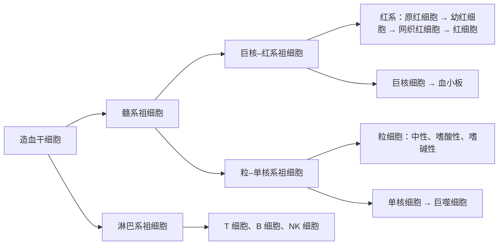
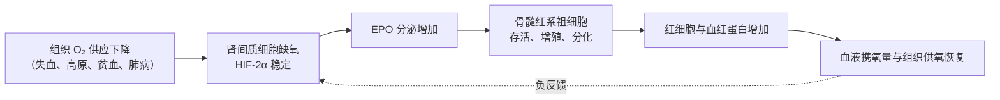
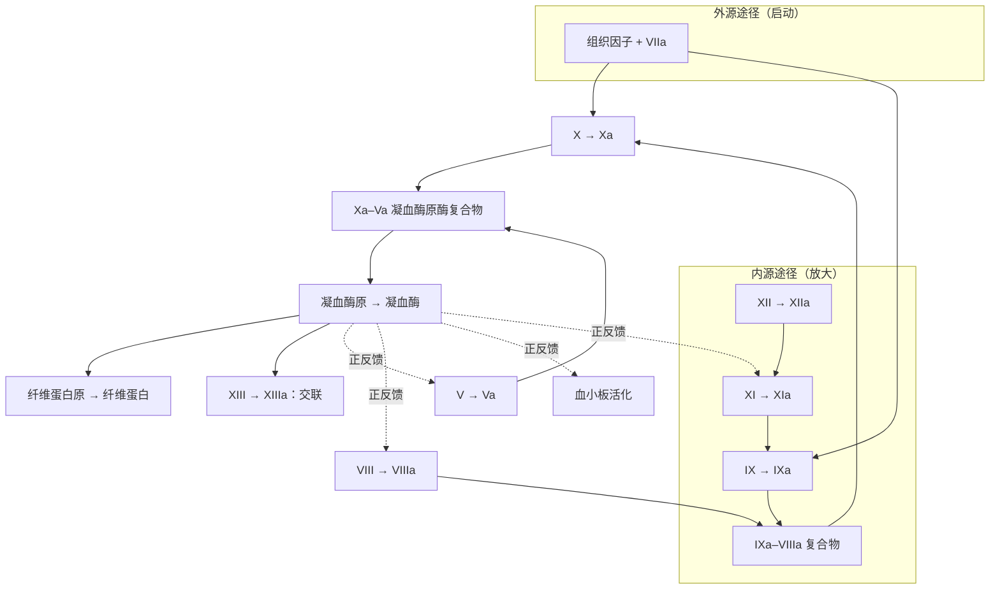

血液是在封闭的血管里流动的结缔组织，是机体最大的"物流系统"所运载的介质：它把 $\ce{O2}$、营养物、激素和热从产生或摄入的地方运到消耗的地方，把 $\ce{CO2}$ 和代谢产物运到肺与肾，同时缓冲 pH、维持细胞外液的渗透压，并在血管破损时自己封堵漏洞。第 1 章把**细胞外液**称为细胞生活的**内环境**，血浆是其中流动最快、与外界交换最直接的部分，血液成分的**稳态**因此是其他一切稳态的前提。本章先讲血液的组成与理化性质（11.1 节），再依次讲三类血细胞：红细胞与造血（11.2 节）、血小板与止血（11.3–11.5 节）、白细胞与炎症（11.7 节），中间是输血生理中的血型（11.6 节）。凝血酶的正反馈与阈值、血细胞比容与黏度的权衡写成定量模型。血液在血管中流动的力学（黏度、**Poiseuille 定律**）在第 14 章，血浆与**组织液**之间的液体交换（**Starling 力**）在第 15 章，血红蛋白的氧结合与气体运输在第 19 章；造血的发育起源在 [7.5.29](/7.5.29)，免疫识别、淋巴细胞、抗体与血型的免疫学机制在 7.15 免疫学。

## 11.1. 血液的组成与理化性质

### 11.1.1. 血浆与血细胞

成年人的血量约占体重的 7%–8%，即每千克体重 70–80 mL，70 kg 的人约 5 L。把加了抗凝剂的血液离心，血细胞沉到下面：最下层暗红的是红细胞，其上一薄层灰白色的是白细胞和血小板（"白膜层"），上层淡黄透明的是血浆（blood plasma）。

**定义 11.1.1（血细胞比容）** 血细胞在全血中所占的容积百分比称为**血细胞比容**（实际上几乎全是红细胞）。正常成年男性约 40%–50%，女性约 37%–48%，新生儿可达 55%。

血液凝固后析出的淡黄色液体是血清（serum）：它与血浆的区别在于纤维蛋白原和若干凝血因子已在凝血中消耗掉，同时多了凝血过程中血小板释放的物质。临床生化检测多用血清，凝血检测必须用抗凝血浆。

血浆的 91%–92%（按质量计；按体积计约 95%）是水，其余是蛋白质（60–80 g/L）、电解质、营养物、激素、代谢产物和溶解的气体。血浆的主要功能是作为血细胞的外环境、运输溶质、储存蛋白质，并通过其中的蛋白质与离子维持渗透压与 pH：

| 成分 | 含量（参考值） | 主要功能 |
|---|---|---|
| 白蛋白 | 40–50 g/L | 形成血浆胶体渗透压的主体；结合并运输脂肪酸、胆红素、钙、药物与**甲状腺激素**；肝合成 |
| 球蛋白（α、β、γ） | 20–30 g/L | α、β 球蛋白运输脂质、铁（转铁蛋白）、铜等；γ 球蛋白主要是抗体 |
| 纤维蛋白原 | 2–4 g/L | 凝血时转变为纤维蛋白 |
| $\ce{Na+}$ / $\ce{K+}$ / $\ce{Ca^2+}$ | $140$ / $4$ / $2.5\,\mathrm{mmol\,L^{-1}}$ | 晶体渗透压、膜电位、兴奋性与凝血（$\ce{Ca^2+}$ 是凝血因子 IV） |
| $\ce{Cl-}$ / $\ce{HCO3-}$ | $103$ / $24\,\mathrm{mmol\,L^{-1}}$ | 渗透压与酸碱缓冲 |
| 葡萄糖 | $3.9$–$6.1\,\mathrm{mmol\,L^{-1}}$（空腹） | 能源 |

白蛋白与球蛋白之比（A/G）正常为 1.5–2.5；肝功能下降时白蛋白合成减少，比值降低。血浆蛋白的总量相当于全身蛋白质的一个可以迅速动用的储库，饥饿时被组织摄取利用。

### 11.1.2. 血浆渗透压

血浆的总渗透浓度约 $290$–$300\,\mathrm{mOsm\,L^{-1}}$，其中绝大部分来自 $\ce{Na+}$、$\ce{Cl-}$ 等小分子晶体物质，蛋白质虽然质量浓度高，但摩尔浓度很小。两部分的渗透压大小相差两个数量级，作用的位置也不同（第 3 章讨论了渗透与等渗、等张溶液）：

**定义 11.1.2（晶体渗透压与胶体渗透压）** 血浆中的小分子溶质（主要是电解质）形成的**渗透压**称为血浆的晶体渗透压；血浆蛋白（主要是白蛋白）形成的渗透压称为**胶体渗透压**。

- 晶体渗透压约 $5800\,\mathrm{mmHg}$（$1\,\mathrm{mmHg} = 0.1333\,\mathrm{kPa}$，即约 $770\,\mathrm{kPa}$）。小分子溶质几乎不能自由通过细胞膜，所以晶体渗透压决定水在细胞内外之间的分配，维持血细胞的形态与体积；但它们能自由通过毛细血管壁，在血浆与组织液之间没有渗透压差。
- 胶体渗透压只有约 $25\,\mathrm{mmHg}$（$3.3\,\mathrm{kPa}$），但蛋白质不易通过毛细血管壁，血浆的胶体渗透压比组织液高，是把组织液中的水"吸回"毛细血管的主要力量（第 15 章的 Starling 力）。血浆蛋白减少（肝病、肾病综合征、营养不良）时，胶体渗透压下降，液体滞留在组织间隙，形成水肿。

**例 11.1.1（白蛋白的渗透压）** 白蛋白的摩尔质量约 $66\,\mathrm{kg\,mol^{-1}}$，血浆浓度 $45\,\mathrm{g\,L^{-1}}$，即 $0.68\,\mathrm{mmol\,L^{-1}}$。按 van 't Hoff 公式 $\pi = cRT$，37 °C 时 $1\,\mathrm{mOsm\,L^{-1}}$ 对应 $RT \times 1\,\mathrm{mol\,m^{-3}} = 8.314 \times 310\,\mathrm{Pa} \approx 2.58\,\mathrm{kPa} \approx 19.3\,\mathrm{mmHg}$，所以白蛋白的理想渗透压约 $0.68 \times 19.3 \approx 13\,\mathrm{mmHg}$。实测的血浆胶体渗透压中白蛋白贡献约 $19$–$20\,\mathrm{mmHg}$（总量的 75%–80%），比理想值高约一半：白蛋白带大量负电荷，按 **Donnan 平衡**在血浆一侧多吸引了阳离子，这些额外的小离子也贡献渗透压；高浓度蛋白质溶液的非理想性（排除体积）也使渗透压高于 $cRT$。同样的计算对晶体部分给出 $295 \times 19.3 \approx 5700\,\mathrm{mmHg}$，与上面的数值一致。

### 11.1.3. pH、比重与黏度

- **pH**：动脉血浆 pH 为 7.35–7.45，静脉血因含较多 $\ce{CO2}$ 略低。血浆的缓冲对主要是 $\ce{HCO3-}/\ce{H2CO3}$（其比值 20∶1 决定 pH，见第 25 章），其次是蛋白质钠盐/蛋白质和 $\ce{HPO4^2-}/\ce{H2PO4-}$；红细胞内还有血红蛋白缓冲对，其缓冲能力在全血中占很大比例。缓冲的化学原理见 [7.1.2](/7.1.2)。
- 比重：全血比重 1.050–1.060，主要取决于红细胞的数量；血浆比重 1.025–1.030，主要取决于血浆蛋白；红细胞比重 1.090–1.092。
- **黏度**：以水为 1，全血的相对**黏度**为 4–5，主要取决于血细胞比容；血浆为 1.6–2.4，主要取决于血浆蛋白。全血是非 Newton 流体：流速慢时红细胞聚集成串，黏度显著升高。黏度与血细胞比容的定量关系见 11.2.5 节，它对血流阻力的影响见第 14 章。

## 11.2. 红细胞

### 11.2.1. 形态、数量与携氧能力

哺乳动物成熟的红细胞没有细胞核和细胞器，呈双凹圆盘状：直径约 $7.5\,\mathrm{\mu m}$，边缘最厚处约 $2.5\,\mathrm{\mu m}$，中央最薄处约 $1\,\mathrm{\mu m}$，体积约 $90\,\mathrm{\mu m^3}$。正常成年男性每升血中约有 $(4.0$–$5.5) \times 10^{12}$ 个红细胞（平均 $5.2 \times 10^{12}\,\mathrm{L^{-1}}$，即每微升约 520 万个），女性约 $(3.5$–$5.0) \times 10^{12}\,\mathrm{L^{-1}}$（平均 $4.7 \times 10^{12}\,\mathrm{L^{-1}}$）。

红细胞的主要成分是血红蛋白：细胞内的血红蛋白浓度高达约 $340\,\mathrm{g\,L^{-1}}$（接近其溶解度的上限），全血中男性为 120–160 g/L，女性为 110–150 g/L。红细胞的功能有三：运输 $\ce{O2}$（结合在血红蛋白上），运输 $\ce{CO2}$（红细胞内含丰富的**碳酸酐酶**，把 $\ce{CO2}$ 迅速转化为 $\ce{HCO3-}$，见第 19 章），以及以血红蛋白缓冲 $\ce{H+}$。血红蛋白结合氧的协同性与 **Bohr 效应**的分子机制见 [7.1.7](/7.1.7#sec-7.3)。

**例 11.2.1（为什么需要血红蛋白）** 每克血红蛋白完全饱和时可结合约 $1.34\,\mathrm{mL}$ $\ce{O2}$（理论值 $1.39\,\mathrm{mL}$，实测值因少量高铁血红蛋白等而略低）。血红蛋白 $150\,\mathrm{g\,L^{-1}}$ 的动脉血携氧约 $150 \times 1.34 \times 0.97 \approx 195\,\mathrm{mL\,L^{-1}}$（动脉血饱和度约 97%）。$\ce{O2}$ 在血浆中的溶解度只有 $0.03\,\mathrm{mL\,L^{-1}\,mmHg^{-1}}$，在 $P_{\ce{O2}} = 100\,\mathrm{mmHg}$ 下溶解约 $3\,\mathrm{mL\,L^{-1}}$。血红蛋白使血液的携氧能力提高约 65 倍：没有它，在静息耗氧 $250\,\mathrm{mL\,min^{-1}}$ 时，即使把动脉血中的氧全部取尽，**心输出量**也要超过 $80\,\mathrm{L\,min^{-1}}$。

把血红蛋白装在细胞里而不是溶在血浆里，有两个好处：同样多的血红蛋白若溶在血浆中，会使血浆的胶体渗透压增至原来的约 3 倍（四聚体 $64.5\,\mathrm{kDa}$，$150\,\mathrm{g\,L^{-1}}$ 即 $2.3\,\mathrm{mmol\,L^{-1}}$，摩尔浓度是白蛋白的约 3.4 倍），黏度也大大增加，游离的血红蛋白还会被肾小球滤过并清除一氧化氮；细胞内则可以保持 **2,3-二磷酸甘油酸**、碳酸酐酶等调节分子的局部高浓度，并有一套防止血红素铁氧化的还原系统。

### 11.2.2. 红细胞的生理特性

双凹圆盘的形状给了红细胞富余的表面积。

**例 11.2.2（富余的表面积）** 体积 $90\,\mathrm{\mu m^3}$ 的球，表面积为 $(36\pi)^{1/3} V^{2/3} \approx 97\,\mathrm{\mu m^2}$；红细胞的实际表面积约 $135\,\mathrm{\mu m^2}$，多出约 40%。红细胞膜的面积几乎不能拉伸（面积增加 3%–4% 即破裂），但很容易弯曲和剪切，所以只要不变成球形，它就能在体积和面积都不变的情况下大幅改变形状。直径 $7.5\,\mathrm{\mu m}$ 的红细胞因此能挤过内径 $3\,\mathrm{\mu m}$ 的毛细血管和脾窦的裂隙。

红细胞的三种生理特性都源自这一几何与膜的力学：

- 可塑变形性：红细胞在通过小于自身直径的血管时变形，通过后恢复原状。变形能力取决于表面积与体积之比、细胞内液的黏度（血红蛋白浓度）和膜骨架（血影蛋白网络）的弹性。衰老的红细胞、遗传性球形红细胞增多症的红细胞（膜骨架缺陷使膜丢失、细胞变成球形）以及**镰状细胞贫血**的红细胞变形能力下降，被脾截留破坏。
- 渗透脆性：红细胞在低渗溶液中会吸水膨胀乃至破裂（定义 11.2.1）。正常红细胞在 0.42%–0.46% 的 NaCl 溶液中开始溶血，在 0.32%–0.34% 中完全溶血；富余的表面积使红细胞可以吸水膨胀到约原体积的 1.6 倍（变成球）而不破。衰老与球形红细胞的渗透脆性大。
- 悬浮稳定性：红细胞比重大于血浆，却能较稳定地悬浮在血浆中而沉降很慢（定义 11.2.2）。

**定义 11.2.1（渗透脆性）** 红细胞在低渗盐溶液中膨胀破裂的特性称为**渗透脆性**，用开始溶血与完全溶血时 NaCl 溶液的浓度表示。

**定义 11.2.2（红细胞沉降率）** 把抗凝血静置于垂直的沉降管中，第一小时末红细胞下沉的距离称为**红细胞沉降率**（血沉），它衡量红细胞的悬浮稳定性。正常男性为 0–15 mm/h，女性为 0–20 mm/h。

红细胞下沉时与血浆的摩擦阻碍下沉。按 **Stokes 定律**，球形颗粒的沉降速度正比于半径的平方，单个红细胞沉降极慢；红细胞以凹面相贴叠成"缗钱状"（rouleaux）时，团块的体积增大而表面积与体积之比减小，沉降加快。决定叠连的主要是血浆而不是红细胞本身：纤维蛋白原、球蛋白和胆固醇增多（如炎症、妊娠、活动性结核、风湿病）时叠连加速、血沉加快；白蛋白和卵磷脂增多时血沉减慢。把正常人的红细胞放进血沉快的人的血浆中，血沉也加快。

### 11.2.3. 造血与红细胞的生成

造血的部位与时序：在人的胚胎中，造血依次发生在三个部位。胚胎早期（第 3 周起）在卵黄囊的**血岛**中产生原始红细胞，它们有核、体积大、含胚胎型珠蛋白，为早期胚胎供氧；胚胎中期（第 2 个月起）造血转移到肝（以及脾），产生无核的红细胞；胚胎晚期起至出生后，骨髓成为主要的造血器官。造血的这几个"波次"、**生血内皮**中产生的**造血干细胞**如何迁移，以及**珠蛋白转换**的分子机制见 [7.5.29](/7.5.29#sec-29.7)。

婴幼儿几乎全身骨髓都是造血的红骨髓；到 18 岁左右，四肢长骨骨干的骨髓被脂肪取代成为黄骨髓，成年人的造血只在扁骨（胸骨、肋骨、椎骨、髂骨、颅骨）和长骨近端的骨骺中进行。黄骨髓在需要时可以重新造血；成年后若骨髓造血不足，肝、脾可重新出现造血（髓外造血）。

造血的层级：所有血细胞都来自骨髓中的**造血干细胞**，它能自我更新并分化成全部血细胞。造血过程分为造血干细胞、定向祖细胞（髓系与淋巴系，再分为红系、粒–单核系、巨核系等）、可以形态辨认的前体细胞和成熟血细胞几个阶段；越往后增殖能力越弱、分化方向越确定。造血在骨髓的"造血微环境"中进行，由基质细胞、微血管、神经和多种造血生长因子（如干细胞因子、白细胞介素、集落刺激因子、红细胞生成素、血小板生成素）共同调节。

红细胞的发育：红系定向祖细胞经原红细胞、早幼、中幼、晚幼红细胞逐渐变小，血红蛋白不断积累；晚幼红细胞排出细胞核，成为网织红细胞（仍含少量核糖体和线粒体，可用碱性染料染出网状结构）。网织红细胞进入血液，1–2 天内失去残余的细胞器而成熟。外周血中网织红细胞占红细胞总数的 0.5%–1.5%，它的比例反映骨髓生成红细胞的速度：急性失血或补充造血原料后几天内比例上升。

**例 11.2.3（生成速度）** 70 kg 的人血量 5 L，红细胞约 $5 \times 10^{12}\,\mathrm{L^{-1}} \times 5\,\mathrm{L} = 2.5 \times 10^{13}$ 个，平均寿命 120 天（$1.04 \times 10^7\,\mathrm{s}$）。在稳态下，骨髓每秒要生成 $2.5 \times 10^{13} / 1.04 \times 10^7 \approx 2.4 \times 10^6$ 个红细胞，每天约 $2 \times 10^{11}$ 个，即每天更新约 0.8% 的红细胞；每天合成的血红蛋白约 $750\,\mathrm{g} \times 0.8\% \approx 6\,\mathrm{g}$，需要约 $20\,\mathrm{mg}$ 铁。

造血原料：合成血红蛋白需要铁和蛋白质，红细胞的增殖需要合成 DNA。

- 铁：成年人体内约有 3–4 g 铁，约 2/3 在血红蛋白中。每天造血所需的 20–25 mg 铁绝大部分来自巨噬细胞分解衰老红细胞后回收的铁（内源性），从食物中吸收的只有 1–2 mg，恰好补偿每天从脱落的肠上皮、皮肤和失血中丢失的铁。食物中的 $\ce{Fe^3+}$ 在十二指肠被还原为 $\ce{Fe^2+}$ 后吸收，血浆中的铁由转铁蛋白运输，储存在肝等处的铁蛋白中；肝分泌的铁调素通过降解肠上皮与巨噬细胞上的铁输出蛋白（ferroportin）来减少铁的吸收和释放。铁的摄入不足或慢性失血导致缺铁性贫血，红细胞小而血红蛋白少（小细胞低色素性贫血）。
- 维生素 B12 与叶酸：二者是合成 DNA 所需的辅因子（叶酸以四氢叶酸形式参与胸苷酸合成，维生素 B12 使甲基四氢叶酸再生为四氢叶酸）。缺乏时幼红细胞的分裂延缓、细胞核发育落后于细胞质，形成体积大的巨幼红细胞，导致巨幼红细胞性贫血。人每天需维生素 B12 1–3 µg，肝中的储量可供数年；它的吸收需要胃壁细胞分泌的内因子（保护维生素 B12 不被消化液破坏，并在回肠末端经受体介导吸收）。胃大部切除或自身免疫性胃炎（恶性贫血）因缺乏内因子而发生维生素 B12 缺乏。叶酸每天需要 50–100 µg（孕期更多），储备只够几个月。

红细胞生成的调节：红细胞数量由一个以组织供氧为被调节量的**负反馈**维持。

**定义 11.2.3（红细胞生成素）** 主要由肾皮质中肾小管周围的间质细胞（成纤维细胞样细胞）在缺氧时合成分泌、促进红系祖细胞存活、增殖和分化的糖蛋白激素，称为**红细胞生成素**（EPO，约 $30\,\mathrm{kDa}$）。成年人的 EPO 约 90% 来自肾，其余主要来自肝（胎儿主要来自肝）。

肾感受的是组织的氧分压，而不是红细胞数或血红蛋白浓度本身：缺氧使缺氧诱导因子（HIF-2α）不再被脯氨酰羟化酶羟化和降解，进而启动 EPO 基因的转录（这一氧感受机制的分子细节获 2019 年诺贝尔生理学或医学奖）。EPO 在缺氧后数小时内上升，但新的红细胞要 3–5 天后才开始大量进入血液，完全恢复血细胞比容需要数周。肾衰竭时 EPO 缺乏，引起肾性贫血，可用重组 EPO 治疗。雄激素直接刺激红系祖细胞并促进 EPO 的生成，是成年男性红细胞数和血红蛋白高于女性的原因之一。

### 11.2.4. 红细胞的破坏

红细胞平均寿命约 120 天。成熟红细胞没有细胞核和核糖体，不能更新蛋白质，随着年龄增长，糖酵解的酶活性下降、膜变得僵硬、渗透脆性增大，膜表面出现被识别的标志（如磷脂酰丝氨酸外翻、带 3 蛋白聚集并结合抗体）。约 90% 的衰老红细胞在脾和肝中被巨噬细胞吞噬破坏（血管外破坏）：脾的红髓中，红细胞要挤过脾索与脾窦之间宽约 $3\,\mathrm{\mu m}$ 的裂隙，变形能力差的红细胞被滞留并吞噬。其余约 10% 在血管内破裂，释放的血红蛋白与血浆中的结合珠蛋白结合后被肝摄取。

被吞噬的血红蛋白分解为珠蛋白（水解为氨基酸再利用）、铁（回到转铁蛋白或储存为铁蛋白，再用于造血）和**血红素**；血红素被血红素加氧酶打开卟啉环，生成胆绿素并放出 CO，胆绿素还原为**胆红素**。胆红素与白蛋白结合运到肝，经葡萄糖醛酸化后随胆汁排入肠道，在肠道细菌作用下转变为尿胆原，大部分随粪便排出（粪胆素使粪便呈棕色），少量重吸收后经肾排出。红细胞破坏过多（溶血）或肝处理胆红素的能力不足时，血中胆红素升高，皮肤与巩膜发黄，即黄疸。

### 11.2.5. 血细胞比容、黏度与氧运输

血细胞比容越高，每升血携带的 $\ce{O2}$ 越多，但血液的黏度也越大，在同样的驱动压下流量越小。氧的输送量（流量 × 氧含量）在两者之间存在一个最优值。

把血液看成在刚性管中流动的流体，在给定的压力差下，流量反比于表观黏度 $\eta(H)$（**Hagen–Poiseuille 定律**，[7.6.22](/7.6.22)），每升血的氧含量正比于血细胞比容 $H$，于是

$$
\dot Q_{\ce{O2}} \propto \frac{H}{\eta(H)}.
$$

血液表观黏度对血细胞比容的依赖可以用经验公式拟合（Pries 等 1992 年在玻璃管中的测定）：在大管中，$\eta$ 从 $H = 0$ 时的血浆黏度增长到 $H = 0.45$ 时的约 3.2 倍、$H = 0.6$ 时的约 4.9 倍，增长比线性快得多（红细胞之间的相互作用随浓度急剧增强）。由此算出的 $H/\eta$ 在大血管中于 $H \approx 0.39$ 处最大，但最优值非常平坦：$H$ 在 0.3–0.5 之间时氧输送只变化百分之几；在细管中，由于 **Fåhræus–Lindqvist 效应**（第 14 章）表观黏度较小，最优值移向更高的 $H$。

这个简单模型解释了几个事实：正常的血细胞比容落在最优区附近；红细胞增多症（如 $H > 0.6$）虽然每升血携氧更多，但黏度增加使血流减慢，组织供氧反而可能下降，还易形成血栓；高原世居人群（如藏族）的血红蛋白并不比平原人高多少，而以呼吸和血管方面的适应为主，长期移居高原者的过度红细胞增多则是高原病的原因之一。这一模型忽略了血管的主动调节和低剪切率下红细胞的聚集，只用于说明权衡的存在。

## 11.3. 血小板与生理性止血

### 11.3.1. 血小板

血小板是骨髓巨核细胞胞质脱落形成的无核碎片：一个巨核细胞经多次核内复制（多倍体，可达 64N）后伸出长的突起进入骨髓窦，断裂成数千个血小板。血小板的生成受肝产生的血小板生成素（TPO）调节。

| 性质 | 数值或特点 |
|---|---|
| 大小与形状 | 直径 1–4 µm，静息时呈双凸圆盘状 |
| 数量 | $(150$–$350) \times 10^9\,\mathrm{L^{-1}}$（每微升 15 万–35 万个），低于 $50 \times 10^9\,\mathrm{L^{-1}}$ 时易出血 |
| 寿命 | 8–12 天，约 1/3 储存在脾中；衰老的血小板在脾、肝中被吞噬 |
| 结构 | 表面有糖萼，不结合完整的内皮，结合破损血管壁下的胶原；胞质中有线粒体（产生 ATP）、肌动蛋白–肌球蛋白收缩系统、致密颗粒（ADP、ATP、5-羟色胺、$\ce{Ca^2+}$）与 α 颗粒（纤维蛋白原、血管性血友病因子、因子 V、血小板源生长因子）；开放管道系统与致密管道系统（储存 $\ce{Ca^2+}$、合成前列腺素） |
| 功能 | 维持毛细血管内皮的完整性（填补内皮细胞脱落的空隙、释放生长因子）；参与生理性止血与凝血；释放促进内皮与平滑肌修复的生长因子 |

血小板的生理特性依次是黏附（与非血小板表面黏着）、释放（排出颗粒内容物）、聚集（血小板之间互相黏着）、收缩（收缩蛋白使血凝块回缩）和吸附（在表面浓集凝血因子）。

### 11.3.2. 止血的四个步骤

**定义 11.3.1（生理性止血）** 小血管损伤后，血液从血管流出数分钟后自行停止的过程称为**生理性止血**。它依次包括血管收缩、血小板血栓（血小板栓）形成、血液凝固和纤维组织增生使伤口永久闭合四个相互重叠的步骤。用针刺破耳垂或指尖，测得出血持续的时间（出血时间）正常为 1–3 min，主要反映血小板的功能。

1. **血管收缩**：损伤后立即发生。伤口处血管平滑肌受损伤刺激直接收缩（肌源性，即时）；血小板与受损组织释放的缩血管物质（5-羟色胺、血栓素 $\mathrm{A}_2$、内皮素）使收缩加强（体液，放大）；疼痛等感觉神经冲动引起反射性的交感缩血管（神经，系统）。收缩减小了血管口径和血流量，对小动脉可持续数分钟到半小时。
2. **血小板栓的形成**：血管内皮破损暴露出内皮下的胶原，血浆中的血管性血友病因子（vWF）先结合在胶原上，血小板通过膜糖蛋白 GPIb 结合 vWF（在高剪切率的动脉中尤为重要），并通过 GPVI 直接结合胶原，黏附在破损处。黏附使血小板活化：形状从圆盘变成伸出伪足的球形，收缩蛋白收缩，颗粒释放 ADP 和 5-羟色胺，膜磷脂释放的花生四烯酸经环加氧酶转化为血栓素 $\mathrm{A}_2$。ADP 与血栓素 $\mathrm{A}_2$ 又激活附近的血小板，活化的血小板表面整联蛋白 $\alpha_{\mathrm{IIb}}\beta_3$（GPIIb/IIIa）构象改变，通过纤维蛋白原把血小板互相连接起来。这是一个正反馈：血小板越聚越多，几分钟内堵住小的破口。最初的血小板栓较松，随后由凝血产生的纤维蛋白加固。
3. **血液凝固**：血管损伤同时启动凝血级联（11.4 节），在血小板栓的表面和周围形成纤维蛋白网，把血细胞网罗其中形成血凝块。凝块中的血小板收缩，使血凝块回缩、变得坚实，并挤出血清。
4. **纤维组织增生**：血凝块形成后数小时，成纤维细胞开始长入，在血小板源生长因子等的作用下，1–2 周内把血凝块转化为纤维组织，永久封闭伤口；同时纤溶系统（11.5 节）逐步溶解不再需要的纤维蛋白。

正常血管内皮本身抑制血小板活化：它释放前列环素（$\mathrm{PGI}_2$）和一氧化氮（升高血小板内的 cAMP 与 cGMP），表面的 ADP 酶（CD39）水解 ADP。所以血小板栓只在破损处形成，而不向完好的血管延伸。阿司匹林不可逆地乙酰化血小板的环加氧酶-1，血小板没有细胞核、不能再合成新酶，一次服药的作用持续到这批血小板被替换（约一周），这是小剂量阿司匹林用于预防动脉血栓的原理。

## 11.4. 血液凝固

**定义 11.4.1（血液凝固）** 血液由流动的液体状态变成不能流动的凝胶状态的过程称为**血液凝固**，其实质是血浆中可溶的纤维蛋白原转变为不溶的纤维蛋白，交织成网，把血细胞和血液的其他成分网罗在内。离体血液的凝血时间正常为 4–12 min。

### 11.4.1. 凝血因子

血浆与组织中直接参与凝血的物质称为凝血因子。按国际命名用罗马数字编号的有 12 种（因子 VI 被证明是活化的因子 V，已取消），此外还有前激肽释放酶、高分子量激肽原以及血小板的磷脂。

| 因子 | 名称 | 合成部位 | 要点 |
|---|---|---|---|
| I | 纤维蛋白原 | 肝 | 被凝血酶切去 4 个小肽（2 个纤维蛋白肽 A、2 个纤维蛋白肽 B）后成为纤维蛋白单体 |
| II | 凝血酶原 | 肝，依赖维生素 K | 酶原；活化后为凝血酶 |
| III | 组织因子（TF） | 血管外的细胞（成纤维细胞、平滑肌等） | 跨膜糖蛋白，因子 VIIa 的辅因子；唯一正常时不与血液接触的因子 |
| IV | $\ce{Ca^2+}$ | — | 把含 γ-羧基谷氨酸的因子桥连到磷脂膜上 |
| V | 前加速素 | 肝、巨核细胞 | 辅因子，被凝血酶活化 |
| VII | 前转变素 | 肝，依赖维生素 K | 血液中有约 1% 以活化形式存在 |
| VIII | 抗血友病因子 | 肝窦内皮等 | 辅因子，在血浆中与 vWF 结合而稳定；缺乏导致血友病 A |
| IX | 血浆凝血活酶成分（Christmas 因子） | 肝，依赖维生素 K | 缺乏导致血友病 B |
| X | Stuart–Prower 因子 | 肝，依赖维生素 K | 内源与外源途径的汇合点 |
| XI | 血浆凝血活酶前质 | 肝 | 被凝血酶或因子 XIIa 活化 |
| XII | 接触因子（Hageman 因子） | 肝 | 与带负电的表面接触而活化；缺乏者不出血 |
| XIII | 纤维蛋白稳定因子 | 肝、巨核细胞 | 转谷氨酰胺酶，在纤维蛋白单体之间形成共价交联 |

这些因子有几个共同之处：除因子 III、IV 外都由肝合成，所以严重肝病时会出血；因子 II、VII、IX、X、XI、XII 都是**丝氨酸蛋白酶**的**酶原**（活化后的 IIa 即凝血酶），因子 V、VIII 是没有酶活性的辅因子，因子 XIII 是转谷氨酰胺酶。因子 II、VII、IX、X（以及抗凝的蛋白 C、蛋白 S）的合成需要维生素 K：肝细胞内质网中的维生素 K 依赖性羧化酶把它们 N 端区域的谷氨酸残基羧化为 γ-羧基谷氨酸（Gla），Gla 结构域借 $\ce{Ca^2+}$ 结合到活化血小板表面外翻的磷脂酰丝氨酸上（[7.3.7](/7.3.7)）。这使凝血反应集中在破损处的膜表面上进行，而不在流动的血浆中弥散。维生素 K 缺乏（新生儿肠道菌群尚未建立、长期使用抗生素、胆道梗阻使脂溶性维生素吸收障碍）以及维生素 K 拮抗剂华法林（抑制维生素 K 环氧化物还原酶）都使这 4 个因子失去功能。

### 11.4.2. 凝血级联

凝血的核心是一个三步过程：形成凝血酶原激活物（因子 Xa–Va 复合物）；凝血酶原激活物把凝血酶原转化为凝血酶；凝血酶把纤维蛋白原转化为纤维蛋白。按因子 X 被激活的途径，经典上把第一步分为两条途径：

- 外源途径（组织因子途径）：血管损伤使血液接触到血管外细胞表面的组织因子。组织因子与血浆中的因子 VII/VIIa 在 $\ce{Ca^2+}$ 存在下形成复合物，激活因子 X（也激活因子 IX）。它的启动因子来自血液之外，所以称为外源途径；步骤少、反应快，几秒到十几秒内就能产生少量凝血酶。它是体内凝血的生理起点。
- 内源途径：参与的因子全部来自血液本身。血液接触带负电荷的异物表面（玻璃、胶原、细菌表面的多聚磷酸）时，因子 XII 被激活（接触活化），因子 XIIa 激活因子 XI，因子 XIa 激活因子 IX；因子 IXa 与辅因子 VIIIa 在磷脂膜与 $\ce{Ca^2+}$ 上组成"内源性因子 X 酶复合物"（tenase），激活因子 X。步骤多、较慢，但产物多，起放大作用。

两条途径汇合于因子 X。因子 Xa 与辅因子 Va 在活化血小板的磷脂膜上、在 $\ce{Ca^2+}$ 存在下组成凝血酶原酶复合物，把凝血酶原（因子 II）切成凝血酶（IIa）。凝血酶切去纤维蛋白原的纤维蛋白肽 A 和 B，暴露出的结合位点使纤维蛋白单体首尾相接、侧向聚合成纤维；凝血酶同时激活因子 XIII，XIIIa 在纤维之间形成共价的异肽键交联，使纤维蛋白网变得稳定、不溶于尿素。

两条途径的划分来自试管实验，在临床检验中仍然有用：凝血酶原时间（PT，在血浆中加入组织因子与 $\ce{Ca^2+}$，正常 11–14 s）反映外源途径与共同途径，对维生素 K 依赖因子的减少很敏感，用于监测华法林治疗；活化部分凝血活酶时间（aPTT，加入带负电的活化剂与磷脂，正常 25–35 s）反映内源途径，血友病时延长。但在体内，两条途径不是平行的两条路，而是同一个反应网络的先后阶段（凝血的"细胞模型"）：

1. 启动：组织因子–VIIa 在损伤处的细胞表面产生少量因子 Xa 和 IXa，Xa 产生微量凝血酶（不足以使纤维蛋白原大量凝固）。组织因子途径抑制物（TFPI）很快结合 Xa 并抑制组织因子–VIIa，启动阶段因此是自限的。
2. 放大：这一点凝血酶激活血小板，并激活因子 V、VIII 和 XI，把辅因子装配到活化血小板的膜表面。
3. 扩增：在血小板表面，IXa–VIIIa 大量产生 Xa，Xa–Va 大量产生凝血酶，形成"凝血酶爆发"。

这个模型解释了为什么因子 XII 缺乏的人不出血（接触活化不是体内止血所必需的；它在体内主要参与病理性血栓与炎症），而缺乏因子 VIII 或 IX 的血友病患者会严重出血：启动阶段的外源途径虽然完整，但没有 IXa–VIIIa 的放大，凝血酶生成不足。辅因子的作用是数量级的：与单独的 Xa 相比，Xa–Va 在膜表面组成的复合物使凝血酶原的活化速度提高约 $3 \times 10^5$ 倍。

### 11.4.3. 凝血酶的正反馈与阈值

凝血酶在网络中处于中心：它既是产物，又激活上游的因子 V、VIII、XI 和血小板，这是一个**正反馈**。正反馈加上抑制（抗凝血酶清除凝血酶、活化的蛋白 C 灭活 Va 与 VIIIa、TFPI 关闭启动），使凝血表现为一个有阈值的开关：刺激小于阈值时，产生的少量凝血酶被抑制系统清除，不形成凝块；超过阈值时，经过一段潜伏期后凝血酶爆发式产生。正常血管中不断发生的微小内皮损伤因此不会引起凝血，而真正的出血能在几分钟内被封闭。这种由正反馈与非线性造成的开关行为的一般理论见 [7.9.16](/7.9.16)。

一个最小的模型可以写出这一机制。设 $T$ 为凝血酶浓度，$a$ 为被凝血酶活化的辅因子与血小板表面所占的比例（$0 \le a \le 1$），$p$ 为剩余凝血酶原的比例：

$$
\begin{aligned}
\frac{\mathrm{d}T}{\mathrm{d}t} &= \bigl(s(t) + Va\bigr)p - k_{\mathrm{AT}}T, \\
\frac{\mathrm{d}a}{\mathrm{d}t} &= k_a\frac{T^2}{K^2 + T^2}(1 - a) - k_d a, \\
\frac{\mathrm{d}p}{\mathrm{d}t} &= -\frac{\bigl(s(t) + Va\bigr)p}{P_0}.
\end{aligned}
$$

其中 $s(t) = s_0\mathrm{e}^{-t/\tau}$ 是组织因子途径的启动速率（$s_0$ 随暴露的组织因子增多而增大，$\tau$ 表示 TFPI 关闭启动的时间常数），$V$ 是血小板表面上 tenase 与凝血酶原酶复合物的最大扩增速率，$k_{\mathrm{AT}}$ 是抗凝血酶对凝血酶的清除速率常数（血浆中凝血酶的半衰期不到一分钟），$k_a$ 与 $K$ 描述凝血酶对辅因子和血小板的协同活化，$k_d$ 是活化的蛋白 C 对辅因子的灭活速率，$P_0 \approx 1.4\,\mathrm{\mu mol\,L^{-1}}$ 是血浆凝血酶原浓度。在 $T$ 很小时，正反馈项按 $T^2$ 增长，比线性的清除项 $k_{\mathrm{AT}}T$ 慢，零状态是稳定的；$T$ 超过阈值后正反馈占优，系统跳到爆发的轨道上，直到凝血酶原耗尽、抑制占优。

这个模型复现了凝血酶生成实验（在血浆中加入组织因子，连续测定凝血酶）的几个特征：潜伏期、爆发和随后的衰减；潜伏期随组织因子浓度的增加而缩短，峰值却变化不大；血友病血浆的峰值显著降低。模型的参数是示意性的，定量的凝血模型（如 Hockin–Mann 模型）包含数十个反应和实测的速率常数，结论相同。

### 11.4.4. 出血与血栓

| 情况 | 缺陷 | 表现 |
|---|---|---|
| 血小板减少或功能缺陷 | 血小板数低于 $50 \times 10^9\,\mathrm{L^{-1}}$；GPIb 或 $\alpha_{\mathrm{IIb}}\beta_3$ 缺陷；阿司匹林 | 皮肤黏膜的点状出血，出血时间延长 |
| 血管性血友病 | vWF 减少或异常（最常见的遗传性出血病） | 黏膜出血；因子 VIII 失去 vWF 的保护，也减少 |
| 血友病 A / B | 因子 VIII / IX 缺乏，X 连锁隐性遗传 | 关节、肌肉内的深部出血；aPTT 延长 |
| 维生素 K 缺乏、华法林 | 因子 II、VII、IX、X 的 γ-羧化不足 | PT 延长（因子 VII 半衰期最短，最先下降） |
| 弥散性血管内凝血 | 广泛的凝血激活耗尽了凝血因子与血小板 | 微血栓与出血并存 |

反过来，凝血过强或抗凝不足导致血栓。Virchow 早在 19 世纪中叶就指出血栓形成的三要素：血管壁损伤（动脉粥样硬化斑块破裂）、血流异常（久坐、卧床时的静脉血流淤滞）和血液成分的高凝状态（如因子 V Leiden 突变使因子 Va 不能被活化的蛋白 C 灭活）。

## 11.5. 抗凝与纤溶

血液中的凝血因子足以在几分钟内使全身血液凝固，而正常人的血液在血管中始终保持流动。这依靠血管内皮的抗凝作用、血浆中的抗凝物质和纤维蛋白溶解系统；凝血与抗凝在损伤处达到局部的平衡。

### 11.5.1. 血管内皮的抗凝作用

- 物理屏障：完整的内皮把血液与内皮下的胶原、组织因子隔开；内皮表面光滑，其上的**糖萼**（带负电的蛋白聚糖与**糖胺聚糖**层）排斥血小板和凝血因子。
- 抗血小板：内皮释放前列环素和一氧化氮，表面的 ADP 酶水解 ADP（11.3.2 节）。
- 抗凝：内皮表面的硫酸乙酰肝素蛋白聚糖结合并加速抗凝血酶；内皮合成 TFPI；内皮表面的凝血酶调节蛋白（血栓调节蛋白，thrombomodulin）结合凝血酶，使凝血酶失去切割纤维蛋白原和激活血小板的能力，转而激活蛋白 C。
- 促纤溶：内皮合成并释放组织型纤溶酶原激活物（tPA）。

### 11.5.2. 生理性抗凝物质

| 物质 | 作用 |
|---|---|
| 抗凝血酶（旧称抗凝血酶 III） | 肝合成的丝氨酸蛋白酶抑制剂（serpin），与凝血酶及因子 IXa、Xa、XIa、XIIa 形成 1∶1 的不可逆复合物；单独作用很慢，与肝素结合后作用加快 1000 倍以上 |
| 肝素 | 带大量负电荷的硫酸化多糖，由肥大细胞和嗜碱性粒细胞产生（最早从肝中提取，因而得名）；生理情况下血浆中几乎没有，体内起作用的主要是内皮表面的硫酸乙酰肝素；作为药物静脉注射，在体内外都能抗凝 |
| 蛋白 C 系统 | 凝血酶–凝血酶调节蛋白复合物激活蛋白 C；活化的蛋白 C 在辅因子蛋白 S 的协助下水解灭活因子 Va 和 VIIIa。这是凝血酶的负反馈：凝血酶越多，关闭自身生成的信号也越强，而且主要在完好的内皮（凝血酶调节蛋白所在处）上发挥作用，把凝块限制在破损处 |
| TFPI | 先结合因子 Xa，再与组织因子–VIIa 形成四元复合物，关闭外源途径的启动 |
| 纤维蛋白本身 | 吸附凝血酶（"抗凝血酶 I"），使已形成的凝块中的凝血酶不向外扩散 |

离体血液的抗凝方法也基于凝血的化学：枸橼酸钠或**EDTA**螯合 $\ce{Ca^2+}$（输血用的库存血与凝血检测用枸橼酸，加回 $\ce{Ca^2+}$ 后血浆即可凝固），肝素加速抗凝血酶；降低温度使酶反应减慢；在光滑的硅化表面上接触活化减弱，凝血延缓。

### 11.5.3. 纤维蛋白溶解

**定义 11.5.1（纤溶）** 血凝块中的纤维蛋白被分解液化的过程称为纤维蛋白溶解，简称**纤溶**。纤溶系统由纤溶酶原、纤溶酶、纤溶酶原激活物和纤溶抑制物组成。

血浆中的纤溶酶原（肝合成）在纤溶酶原激活物的作用下被切割为纤溶酶。纤溶酶是丝氨酸蛋白酶，把纤维蛋白和纤维蛋白原降解为可溶的碎片（交联纤维蛋白的降解产物中有 D-二聚体，其升高提示体内曾有血栓形成并被溶解），也水解因子 V、VIII 等。主要的激活物是血管内皮释放的组织型纤溶酶原激活物（tPA）和尿中发现的尿激酶型纤溶酶原激活物（uPA）。tPA 只在结合到纤维蛋白上时才高效地激活纤溶酶原，纤溶因此集中在血凝块上，而不消耗全身的纤维蛋白原。

纤溶受两类抑制物控制：纤溶酶原激活物抑制物-1（PAI-1，由内皮和血小板释放）抑制 tPA 与 uPA；α2-抗纤溶酶迅速灭活游离在血浆中的纤溶酶，因子 XIIIa 还把它交联到纤维蛋白上，使新形成的凝块不被过早溶解。血栓形成停止出血后，组织与血管内皮缓慢地释放 tPA，在几天内溶解血凝块，使小血管重新通畅。急性心肌梗死与缺血性脑卒中早期用重组 tPA 溶栓，就是放大了这一生理机制。

## 11.6. 血型与输血

### 11.6.1. 血型与红细胞凝集

把血型不相容的两个人的血液混合，红细胞会凝集成簇，随后在补体作用下溶解。Landsteiner 于 1901 年发现，这是红细胞膜上特异的**抗原**（凝集原）与血浆中相应的**抗体**（凝集素）结合的结果。

**定义 11.6.1（血型）** 血细胞膜上特异抗原的类型称为**血型**。通常所说的血型是指红细胞血型，即红细胞膜上的抗原类型。目前已知人类红细胞有 40 多个血型系统、数百种抗原，与输血关系最密切的是 ABO 和 Rh 两个系统。白细胞与血小板也有自己的抗原系统（白细胞上最重要的是人类白细胞抗原 HLA，它决定器官移植的相容性，属于免疫学的内容）。

### 11.6.2. ABO 血型系统

ABO 系统按红细胞膜上是否有 A 抗原、B 抗原分为四型。A、B 抗原是红细胞膜糖脂与糖蛋白上的寡糖链：共同的前体 H 抗原（末端为岩藻糖）由 $A$ 基因编码的 N-乙酰半乳糖胺转移酶加上 N-乙酰半乳糖胺而成为 A 抗原，由 $B$ 基因编码的半乳糖转移酶加上半乳糖而成为 B 抗原；$O$ 等位基因的**移码突变**使酶失活，O 型红细胞只有 H 抗原。

| 血型 | 红细胞上的抗原 | 血浆中的抗体 | 中国汉族人群的频率（约） |
|---|---|---|---|
| A | A | 抗 B | 30% |
| B | B | 抗 A | 28% |
| AB | A 与 B | 无 | 10% |
| O | H（无 A、B） | 抗 A 与抗 B | 32% |

ABO 血型的特点是：血浆中天然存在针对自身所缺抗原的抗体。新生儿出生时几乎没有这些抗体，出生后 2–8 个月开始产生，8–10 岁达到高峰；一般认为它们是对肠道细菌和食物中与 A、B 抗原结构相似的糖链产生的，主要是不能通过胎盘的 IgM。所以第一次输入 ABO 不合的血就会发生急性溶血反应，而母婴之间 ABO 不合引起的新生儿溶血通常较轻（少量 IgG 型抗 A、抗 B 主要见于 O 型母亲）。不同人群的 ABO 频率差别很大：欧洲人群中 O 型约 45%、A 型约 40%、B 型约 10%、AB 型约 5%，美洲原住民几乎全是 O 型。

### 11.6.3. Rh 血型系统

把恒河猴（rhesus）的红细胞注入家兔得到的抗血清，能使大多数人的红细胞凝集，由此发现的血型系统称为 Rh 系统（后来证明真正与猴红细胞反应的是另一种抗原，但名称保留下来）。Rh 系统有 50 多种抗原，与临床关系最密切的是 D 抗原：红细胞上有 D 抗原的称为 Rh 阳性，没有的称为 Rh 阴性。中国汉族人群中 Rh 阳性者约占 99.7%，Rh 阴性者约 0.3%（部分少数民族较高）；欧洲人群中 Rh 阴性者约 15%。

与 ABO 系统不同，人的血浆中没有天然的抗 D 抗体：Rh 阴性者只有在接受 Rh 阳性的血液或红细胞进入体内（妊娠、分娩）后，才通过免疫应答产生抗 D 抗体，而且主要是能通过胎盘的 IgG。由此有两个临床后果：

- Rh 阴性者第一次输入 Rh 阳性血，一般不发生溶血反应，但会产生抗 D 抗体；再次输入时就会溶血。
- Rh 阴性的母亲怀 Rh 阳性的胎儿时，第一胎一般不受影响（胎儿红细胞主要在分娩时才进入母体，抗体产生较慢）；母亲致敏后，再次妊娠 Rh 阳性胎儿时，IgG 型抗 D 抗体通过胎盘使胎儿红细胞溶解，引起新生儿溶血病（严重时胎儿水肿、死亡）。在分娩后 72 小时内给母亲注射抗 D 免疫球蛋白，清除进入母体的胎儿红细胞，可以阻止致敏，预防下一胎的溶血。

### 11.6.4. 输血原则

输血的基本原则是避免供血者红细胞上的抗原与受血者血浆中的抗体相遇：

1. 坚持同型输血（ABO 与 Rh 都相同）；生育年龄的 Rh 阴性女性尤其要避免输入 Rh 阳性血。
2. 即使 ABO 同型，输血前也必须做交叉配血试验：主侧把供血者的红细胞与受血者的血清混合，次侧把受血者的红细胞与供血者的血清混合。两侧都不凝集才能输血；主侧凝集绝对不能输；主侧不凝集而次侧凝集时，只能在紧急情况下少量、缓慢地输入，并密切观察。
3. 主侧比次侧重要，是因为输入的供血者血浆在受血者体内很快被稀释，其中的抗体浓度不足以使受血者的大量红细胞凝集；而输入的红细胞则要面对受血者全部血浆中的抗体。过去把 O 型称为"万能供血者"、AB 型称为"万能受血者"就基于这一点，但 O 型血浆中的抗 A、抗 B 效价高时，大量输入仍会引起溶血，现在只在紧急情况下输 O 型红细胞（去除大部分血浆）。
4. 成分输血：按需要分别输入红细胞、血小板、血浆或凝血因子浓缩物，既节约血源，又减少不良反应；病人手术前储存自己的血液（自体输血）可避免免疫反应与感染。

## 11.7. 白细胞与炎症

### 11.7.1. 白细胞的种类与数量

白细胞是有核的血细胞，在血液中只是经过：它们的功能主要在组织中完成。正常成年人血液中白细胞为 $(4$–$10) \times 10^9\,\mathrm{L^{-1}}$，按胞质中有无特殊颗粒分为粒细胞（按颗粒的染色性分为中性、嗜酸性和嗜碱性）和无粒细胞（单核细胞和淋巴细胞）。

| 种类 | 占白细胞的比例 | 主要功能 |
|---|---|---|
| 中性粒细胞 | 50%–70% | 最先到达感染处，吞噬并杀灭细菌；每个可吞噬 3–20 个细菌，吞噬后自身死亡；死亡的中性粒细胞、细菌和组织碎片构成脓液 |
| 嗜酸性粒细胞 | 0.5%–5% | 抗寄生虫（蠕虫）感染；限制嗜碱性粒细胞与肥大细胞引起的过敏反应 |
| 嗜碱性粒细胞 | 0–1% | 颗粒中含肝素、组胺，释放后引起过敏反应 |
| 单核细胞 | 3%–8% | 进入组织后分化为巨噬细胞，吞噬能力强，可吞噬 100 个以上的细菌以及疟原虫、衰老红细胞等大颗粒；处理并呈递抗原 |
| 淋巴细胞 | 20%–40% | T 细胞（细胞免疫）、B 细胞（体液免疫，分化为分泌抗体的浆细胞）与 NK 细胞（杀伤被感染的细胞与肿瘤细胞），机制见 7.15 免疫学 |

白细胞总数在一天中有波动（下午较高），进食、剧烈运动、妊娠和情绪紧张时升高，主要是中性粒细胞从附着在血管壁上的"边缘池"移入循环池。细菌感染时中性粒细胞增多，寄生虫感染和过敏时嗜酸性粒细胞增多，病毒感染时淋巴细胞常相对增多。白细胞的生成受集落刺激因子（G-CSF、GM-CSF、M-CSF）和白细胞介素调节，感染时这些因子使骨髓的生成和释放增加数倍。

### 11.7.2. 寿命与渗出

各类白细胞在血液中停留的时间很短，在组织中生存较长：

| 白细胞 | 在血液中 | 在组织中 |
|---|---|---|
| 粒细胞 | 4–8 h（中性粒细胞的半衰期约 7 h） | 4–5 天；感染时吞噬后几小时内死亡 |
| 单核细胞 | 10–20 h | 分化为巨噬细胞，可存活数月 |
| 淋巴细胞 | 在血液、淋巴与淋巴器官之间不断再循环 | 数周到数年（记忆细胞） |

骨髓中储存的成熟中性粒细胞约为血液中的 20 倍，感染时可迅速释放。

**定义 11.7.1（渗出）** 白细胞穿过毛细血管和微静脉的内皮进入组织的过程称为白细胞的**渗出**（血细胞渗出，diapedesis）。

渗出发生在炎症部位的毛细血管后微静脉，是一个多步骤的过程：炎症介质使内皮表达**选择素**，白细胞上的糖配体与之短暂结合又脱开，白细胞沿血管壁滚动减速；内皮表面的趋化因子激活白细胞的**整联蛋白**，使其与内皮的黏附分子（ICAM-1 等）牢固结合，白细胞停止并铺展；随后白细胞变形，从内皮细胞之间（少数穿过内皮细胞）钻出血管。进入组织后，白细胞沿着细菌产物、补体片段和趋化因子的浓度梯度定向移动，即**趋化性**（细胞怎样感知梯度与迁移，见第 2 章、[7.6.35](/7.6.35)）。

### 11.7.3. 吞噬与组织巨噬细胞

中性粒细胞和巨噬细胞通过**吞噬作用**清除细菌和异物。吞噬有选择性：表面粗糙的颗粒容易被吞噬；正常组织表面有保护性的蛋白质外衣而外来颗粒和细菌没有；免疫系统产生的抗体与补体结合在入侵者表面（调理作用），更大大提高了吞噬的效率。被吞入的细菌在吞噬体与溶酶体融合后，被蛋白酶、活性氧（呼吸爆发产生的超氧阴离子、过氧化氢、次氯酸）和抗菌肽杀灭。

单核细胞进入组织后分化为巨噬细胞，它们长期驻留在各个器官中，构成一个广泛分布的吞噬网络（旧称单核–巨噬细胞系统或网状内皮系统）：

| 部位 | 巨噬细胞 | 作用 |
|---|---|---|
| 皮肤与皮下组织 | 组织细胞 | 清除经伤口进入的细菌 |
| 淋巴结 | 淋巴窦中的巨噬细胞 | 过滤由淋巴带来的颗粒与病原体 |
| 肺泡 | 肺泡巨噬细胞 | 清除吸入的颗粒 |
| 肝 | Kupffer 细胞（肝血窦） | 清除从肠道经门静脉进入的细菌 |
| 脾与骨髓 | 红髓与骨髓的巨噬细胞 | 清除衰老红细胞和血液中的病原体 |
| 脑 | 小胶质细胞 | 清除神经组织中的碎片 |

### 11.7.4. 炎症

**定义 11.7.2（炎症）** 组织受到损伤（物理、化学、高温或感染）时，局部发生的以血管反应为中心、伴随白细胞浸润的一系列复杂变化称为**炎症**。局部的经典表现是红、热、肿、痛和功能障碍。

炎症的血管反应与组织变化依次是：

1. 局部小动脉舒张，血流量增大（充血），使局部发红、发热。介质是受损组织与肥大细胞释放的组胺、缓激肽、前列腺素和一氧化氮等。
2. 毛细血管与微静脉的通透性增大，富含蛋白质的液体渗出到组织间隙，引起肿胀（炎性水肿）；渗出的纤维蛋白原与其他凝血因子使组织液在局部凝固，把炎症区"包围"起来，延缓细菌与毒素的扩散。
3. 大量粒细胞与单核细胞向组织间隙移动（11.7.2 节）。
4. 组织细胞肿胀；炎症介质刺激**伤害感受器**引起疼痛。坏死的组织、死亡与活化的中性粒细胞、病原微生物和少量渗出的血浆构成脓液。

吞噬细胞的反应按时间分为四道防线：组织中原有的巨噬细胞最先开始防御（数分钟到 1 小时）；中性粒细胞在数小时内从毛细血管大量进入组织，是第二道防线；单核细胞随后进入组织并在 8 小时以后逐渐成熟为巨噬细胞，成为后期的主力；同时骨髓中粒细胞和单核细胞的生成增加，在 3–4 天后显著增多。这里有一个正反馈：被激活的巨噬细胞释放的白细胞介素-1、肿瘤坏死因子和集落刺激因子吸引并动员更多的白细胞，使反应迅速放大；随着病原被清除，抗炎介质使炎症消退，组织修复。炎症中识别病原的分子机制（**模式识别受体**、补体）、淋巴细胞的参与和全身性的急性期反应属于 7.15 免疫学；炎症介质引起的**发热**见第 31 章。

## 11.8. 演化与比较

### 11.8.1. 血液、淋巴与血淋巴

不同动物的循环液按循环系统的类型（第 12 章）分为三种：

| 特征 | 血液 | 淋巴 | 血淋巴 |
|---|---|---|---|
| 存在于 | 脊椎动物与环节动物、头足类等封闭式循环 | 脊椎动物 | 节肢动物、多数软体动物等开放式循环 |
| 所在系统 | 封闭的血管系统 | 淋巴管与淋巴结 | 血管与血腔（体腔窦隙） |
| 组成 | 血浆（水、蛋白质、营养物）与红细胞、白细胞、血小板 | 由毛细血管滤出的液体，与血浆相似但蛋白质少；含淋巴细胞，无红细胞 | 血液与组织液不分，是二者的混合物；含血细胞（具免疫与凝血功能）；呼吸色素多溶解在液体中 |
| 颜色 | 红色（血红蛋白） | 无色或淡黄（来自小肠的乳糜呈乳白色） | 无色、淡黄或淡蓝（血蓝蛋白氧合后） |
| 运氧 | 红细胞中的血红蛋白（含铁） | 无 | 溶解的血蓝蛋白（含铜）或血红蛋白；昆虫的血淋巴基本不运氧 |
| 功能 | 运输 $\ce{O2}$、营养物与代谢废物；调节体温与 pH；免疫与凝血 | 回收组织液与蛋白质；运输小肠吸收的脂肪；在淋巴结中过滤病原体 | 运输营养物、代谢物（与 $\ce{O2}$）；免疫防御；静水压骨骼（如昆虫蜕皮、蜘蛛伸腿） |
| 推动 | 心脏 | 淋巴管的收缩与周围组织的挤压（被动为主） | 管状心或可收缩的血管，以及身体运动 |

在开放式循环中，血淋巴与组织液是同一种液体，血淋巴的体积可占体重的 20%–40%（脊椎动物的血浆约占 5%）；它直接浸泡组织，因此必须同时承担组织液的功能。

### 11.8.2. 呼吸色素与红细胞

呼吸色素的多样性：能可逆结合 $\ce{O2}$ 的蛋白质在动物中至少独立出现了三次：

| 色素 | 结合氧的金属 | 颜色（氧合 / 脱氧） | 分布 | 所在位置 |
|---|---|---|---|---|
| 血红蛋白 | 血红素中的 $\ce{Fe^2+}$ | 红 / 暗红 | 脊椎动物、许多环节动物（巨大的胞外血红蛋白，即红血蛋白）、部分昆虫幼虫（摇蚊）、部分软体动物与甲壳类 | 脊椎动物在红细胞内；许多无脊椎动物溶在血浆中 |
| 血蓝蛋白 | 两个直接与组氨酸配位的 $\ce{Cu+}$ | 蓝 / 无色 | 多数软体动物（头足类、腹足类）与节肢动物（甲壳类、鲎、蜘蛛） | 溶在血淋巴中的巨大多聚体 |
| 蚯蚓血红蛋白（血褐蛋白） | 非血红素的双铁中心 | 紫红 / 无色 | 星虫、腕足动物、部分多毛类 | 细胞内 |
| 血绿蛋白 | 一种特殊血红素的铁 | 绿（稀溶液）/ 红（浓溶液） | 部分多毛类 | 溶在血浆中 |

节肢动物与软体动物的血蓝蛋白在结构上并不同源，是两次独立的起源。溶在血浆中的呼吸色素都是巨大的多聚体（软体动物的血蓝蛋白可达数百万道尔顿），这样能在提供大量结合位点的同时，使摩尔浓度和胶体渗透压保持很低（例 11.1.1 的道理），并避免被排泄器官滤出。

有核红细胞与无核红细胞：鱼类、两栖类、爬行类和鸟类的成熟红细胞有核，多呈椭圆形；只有哺乳类的成熟红细胞排出了细胞核（骆驼科的红细胞是椭圆形，但同样无核）。红细胞的大小在脊椎动物中差别很大，与基因组大小正相关：两栖类的红细胞最大（某些蝾螈和鳗螈长达 $70\,\mathrm{\mu m}$），鸟类约 $12\,\mathrm{\mu m}$，哺乳类最小（鼷鹿 *Tragulus* 只有约 $2$–$2.5\,\mathrm{\mu m}$）。去核使哺乳类的红细胞可以更小、在同样体积中装更多的血红蛋白，并呈双凹形以通过更细的毛细血管，这与哺乳类的高代谢率相适应；代价是红细胞不能修复自身，寿命有限。鸟类的红细胞虽有核，但核内染色质高度凝缩、几乎没有转录活性，细胞内也保留线粒体（哺乳类红细胞没有线粒体，只靠糖酵解，不消耗自己运输的氧）。

南极冰鱼：南极海域的鳄冰鱼科（Channichthyidae）是唯一成体没有血红蛋白、也几乎没有红细胞的脊椎动物，血液几乎透明，血细胞比容约 1%（只有白细胞）。它们的 $\beta$-珠蛋白基因缺失，$\alpha$-珠蛋白只剩残片，肌红蛋白在许多种中也失去了表达。冰鱼依靠溶解在血浆中的 $\ce{O2}$ 生存，只能达到红血鱼类携氧量的约 1/10。这在南极成立有几个条件：海水温度常年在 $-1.9$ 到 $+2$ °C，冷水中 $\ce{O2}$ 的溶解度高，代谢率低；冰鱼的血量是其他硬骨鱼的 2–4 倍，心脏和**每搏输出量**很大，毛细血管口径粗、血管密度高，皮肤也参与气体交换。冰鱼的情况说明，血红蛋白的丢失是在极端稳定的寒冷环境中可以"容忍"的退化，而它的各种循环系统的代偿是随后积累的。

### 11.8.3. 无脊椎动物的凝血

开放式循环的动物没有高压的封闭血管，但同样面临创伤后血淋巴大量流失的问题，它们的凝血由血细胞和血淋巴蛋白完成，机制与脊椎动物不同源：

- 鲎：鲎的血淋巴中几乎只有一种血细胞，即含大量颗粒的变形细胞（amebocyte）。细菌内毒素（革兰氏阴性菌细胞壁的脂多糖）或真菌的 β-葡聚糖使变形细胞脱颗粒，释放一个丝氨酸蛋白酶级联：内毒素激活因子 C，因子 C 激活因子 B，因子 B 激活凝固酶原，凝固酶切割可溶的凝固蛋白原，使其聚合成凝胶，把细菌包裹固定。凝血与防御在这里是同一件事。这个反应对内毒素极其灵敏（皮克每毫升级），由鲎变形细胞的裂解物制成的鲎试剂（LAL 试验）用来检测注射药物与医疗器械中的内毒素；因子 C 的重组蛋白已部分替代了从鲎采血。
- 甲壳类：血淋巴中有一种可溶的凝固蛋白（与卵黄蛋白原同源的大分子脂蛋白），血细胞在伤口处破裂释放 $\ce{Ca^2+}$ 依赖的转谷氨酰胺酶，后者在凝固蛋白之间形成共价交联，使血淋巴凝成凝胶。这一步与脊椎动物的因子 XIIIa 交联纤维蛋白在化学上相同，但底物完全不同。
- 昆虫：血淋巴的凝固与酚氧化酶介导的黑化（在伤口和入侵物周围沉积黑色素）结合在一起，同样兼有止血与免疫的功能。

### 11.8.4. 凝血级联的演化

脊椎动物的凝血因子 VII、IX、X、蛋白 C 和凝血酶原在结构上彼此同源（都有 Gla 结构域和丝氨酸蛋白酶结构域），因子 V 与 VIII 同源，这表明凝血级联是由少数祖先基因经过反复复制（包括脊椎动物早期的两轮**全基因组复制**）逐步加长的（Doolittle 的"一个基因，复制，再复制"）。无颌类（七鳃鳗）已经有组织因子、凝血酶原和纤维蛋白原，核心的外源途径和共同途径出现在脊椎动物演化的早期；内源途径的接触因子（因子 XII）是后来加上的，硬骨鱼类没有因子 XII，而一些哺乳类（如鲸类）的因子 XII 基因又失去了功能，这与因子 XII 缺乏者不出血的事实一致（11.4.2 节）。哺乳类的无核血小板也是独特的：其他脊椎动物参与止血的是有核的凝血细胞（thrombocyte），由血液中的前体细胞直接分化而来。

## 小结

| 主题 | 要点 |
|---|---|
| 组成 | 血量约为体重的 7%–8%；血细胞比容男 40%–50%、女 37%–48%（定义 11.1.1）；血清 = 血浆 − 纤维蛋白原等凝血因子；血浆蛋白 60–80 g/L |
| 渗透压 | 晶体渗透压约 5800 mmHg，决定细胞内外的水分配；胶体渗透压约 25 mmHg，决定血管内外的水分配，主要来自白蛋白（定义 11.1.2，例 11.1.1） |
| 红细胞 | 7.5 µm、90 µm³、Hb 340 g/L；每克 Hb 结合 1.34 mL $\ce{O2}$，使携氧量比溶解氧大 65 倍（例 11.2.1）；富余 40% 的表面积带来可塑变形性与渗透脆性（例 11.2.2）；血沉由血浆决定（定义 11.2.2） |
| 造血 | 卵黄囊 → 肝、脾 → 骨髓；每秒生成约 $2.4 \times 10^6$ 个红细胞（例 11.2.3）；铁主要靠回收，维生素 B12 与叶酸缺乏导致巨幼红细胞贫血；EPO 以组织氧为被调节量的负反馈（定义 11.2.3） |
| 黏度权衡 | 氧输送 $\propto H/\eta(H)$，大血管中最优约 0.4，最优值平坦 |
| 止血 | 血管收缩 → 血小板栓（正反馈）→ 凝血 → 纤维化（定义 11.3.1） |
| 凝血 | 外源途径启动、内源途径放大、汇合于因子 X；凝血酶的正反馈与抑制构成阈值开关；维生素 K 依赖因子 II、VII、IX、X（定义 11.4.1） |
| 抗凝与纤溶 | 内皮（前列环素、NO、硫酸乙酰肝素、凝血酶调节蛋白、tPA）；抗凝血酶 + 肝素、蛋白 C 系统、TFPI；纤溶酶原 → 纤溶酶（定义 11.5.1） |
| 血型 | ABO：天然 IgM 抗体；Rh：无天然抗体，IgG 可通过胎盘，新生儿溶血病；同型输血 + 交叉配血（定义 11.6.1） |
| 白细胞 | 4–10 × 10⁹ L⁻¹，中性粒细胞最多；血中停留数小时，组织中数天到数月；渗出与趋化（定义 11.7.1）；炎症的血管反应与四道防线（定义 11.7.2） |
| 演化 | 血液、淋巴、血淋巴；三类呼吸色素多次独立起源；哺乳类无核红细胞；冰鱼无血红蛋白；鲎与甲壳类的凝血与免疫合一；凝血级联由基因复制加长 |

## 思考题

1. 静脉输入大量 5% 葡萄糖溶液（与血浆等渗）和大量 0.9% NaCl 溶液，对**细胞内液**、**细胞外液**的体积各有什么不同的影响？若输入的是 1.9% 尿素溶液呢？

   **答** 5% 葡萄糖溶液与血浆等渗，但葡萄糖进入细胞后被代谢，相当于输入了纯水，水按晶体渗透压在细胞内外分配，约 2/3 进入细胞内液，细胞外液只增加约 1/3。0.9% NaCl 溶液等渗且等张，$\ce{Na+}$ 基本留在细胞外，输入的液体几乎全部留在细胞外液（其中约 3/4 进入**组织液**，因为它不含蛋白质，不能维持血管内的胶体渗透压）。1.9% 尿素溶液与血浆等渗，但尿素能自由通过细胞膜，进入红细胞后不产生有效的渗透梯度，水随之进入，红细胞膨胀破裂：它是**等渗溶液**而不是**等张溶液**。

2. 一位肝硬化病人血浆白蛋白降至 20 g/L。估计其血浆胶体渗透压的变化，并解释为什么会出现水肿和腹水。

   **答** 白蛋白贡献正常胶体渗透压约 19 mmHg（浓度 45 g/L），浓度降到 20 g/L 时，按比例并考虑 Donnan 效应随浓度减弱，白蛋白的贡献降到约 7–8 mmHg，总胶体渗透压从约 25 mmHg 降到约 13–14 mmHg。毛细血管中把液体吸回的力量减小，滤出增多，超过淋巴回流的能力，液体在组织间隙积聚形成水肿；肝硬化还使门静脉压升高，腹腔脏器毛细血管的静水压增加，加上肝淋巴生成增多，液体积聚在腹腔形成腹水（定量的 Starling 分析见第 15 章）。

3. 为什么急性失血后血细胞比容在最初几分钟内几乎不变，几小时后才下降，而 3–5 天后网织红细胞比例上升？

   **答** 失血丢失的是全血，红细胞与血浆按原比例减少，所以刚失血时血细胞比容不变。随后毛细血管静水压下降，组织液进入血管（以及后来肾的保水），血浆容量先恢复，血液被稀释，血细胞比容在几小时到一两天内下降。缺氧刺激肾分泌 EPO（数小时内升高），EPO 促进红系祖细胞的增殖分化，从祖细胞到网织红细胞释放约需 3–5 天，此时网织红细胞比例上升，血细胞比容要数周才恢复。

4. 用凝血的细胞模型解释：为什么血友病 A 患者的 PT 正常而 aPTT 延长，但他们的出血主要是关节和肌肉内的深部出血？

   **答** PT 测定时加入大量组织因子，直接通过外源途径激活因子 X，不经过因子 VIII，所以 PT 正常；aPTT 通过接触活化走内源途径，需要 IXa–VIIIa 复合物，所以延长。在体内，组织因子–VIIa 只产生少量启动的凝血酶，TFPI 又很快关闭启动；大量的凝血酶要靠血小板表面 IXa–VIIIa 对因子 X 的扩增。缺乏因子 VIII 时扩增不足（图中把扩增速率降到 20% 的曲线），血小板栓不能被纤维蛋白充分加固。皮肤小伤口主要靠血小板栓止血，所以出血时间正常；关节和肌肉中组织因子较少、受力反复，需要稳定的纤维蛋白凝块，因此出血不止。

5. 在 11.4.3 节的模型中，如果抗凝血酶缺乏（$k_{\mathrm{AT}}$ 减小），阈值会怎样变化？这与遗传性抗凝血酶缺乏症患者易发生静脉血栓有什么关系？

   **答** 阈值大致由正反馈的产生速率与抑制速率的平衡决定：在小 $T$ 时，正反馈项约为 $V(k_a/k_d)T^2/K^2$，清除项为 $k_{\mathrm{AT}}T$，二者相等的临界凝血酶浓度约为 $k_{\mathrm{AT}}k_dK^2/(Vk_a)$，与 $k_{\mathrm{AT}}$ 成正比。抗凝血酶减少使阈值降低，原来不足以引起凝血的微小刺激（静脉血流淤滞时局部积累的少量凝血因子、轻微的内皮损伤）也能越过阈值产生凝血酶爆发，因此这类患者易形成静脉血栓。肝素通过加速抗凝血酶起作用，对他们效果较差。

6. 一位 Rh 阴性、O 型的母亲生了一个 Rh 阳性、A 型的孩子。第二胎同样是 Rh 阳性时，发生新生儿溶血病的风险比母婴 ABO 相合时高还是低？为什么母婴 ABO 不合反而能减轻 Rh 致敏？

   **答** 第一次分娩时，Rh 阳性的胎儿红细胞进入母体，若不注射抗 D 免疫球蛋白，母亲可能产生 IgG 型抗 D 抗体，第二胎 Rh 阳性时发生新生儿溶血病的风险高。但这对母婴同时 ABO 不合：进入母体的 A 型胎儿红细胞会被母亲血浆中天然的抗 A 抗体迅速凝集并清除，来不及刺激产生抗 D 抗体，因此 ABO 不合部分地保护了母亲免于 Rh 致敏，第二胎的风险比母婴 ABO 相合时低。抗 D 免疫球蛋白的预防作用正是模仿了这一点：在胎儿红细胞引起免疫应答之前把它们清除。

7. （开放题）南极冰鱼在海水变暖时可能面临什么生理上的困难？用本章的定量关系讨论。

   **答** 思路：冰鱼依靠溶解的 $\ce{O2}$，携氧量正比于 $\ce{O2}$ 在血浆中的溶解度和环境 $P_{\ce{O2}}$。温度升高时：（1）$\ce{O2}$ 的溶解度下降（0 °C 到 10 °C 约下降 20%–25%），血液的携氧量随之下降；（2）**外温动物**的代谢率按 $Q_{10} \approx 2$–$3$ 增加，需氧量上升；（3）二者的乘积使所需的心输出量成倍增加，而冰鱼的心脏已经很大，增加的空间有限。没有血红蛋白的协同结合，也没有 Bohr 效应在组织中卸氧的帮助。因此冰鱼的耐热上限低于南极的红血鱼类，是对变暖最敏感的类群之一。可以设计实验比较冰鱼与红血近缘种的临界最高温度与心输出量。
