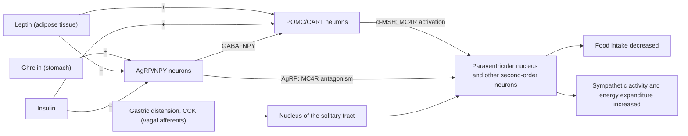

The preceding chapters dealt with digestion and absorption ([7.14.26](/7.14.26)–[7.14.28](/7.14.28)) and the flow of matter between the liver and the other organs ([7.14.29](/7.14.29)). This chapter turns from matter to energy: how much energy the body obtains from food, how its expenditure is measured, what determines the size of that expenditure, and how intake is matched to expenditure. Energy metabolism links digestion, circulation, respiration and endocrinology: measurement of metabolic rate relies on analysis of respiratory gases, the scaling of metabolic rate with body size determines the scaling of heart rate and respiratory frequency ([7.14.13](/7.14.13)), and nearly all metabolic energy ends up as heat, which is the starting point of the next chapter on thermoregulation ([7.14.31](/7.14.31)). The molecular mechanisms of the individual metabolic pathways and their hormonal regulation have been covered in biochemistry ([7.1.16](/7.1.16)–[7.1.29](/7.1.29)); here we deal only with whole-body budgets and feedback.

## 30.1. Sources and Fates of Energy

### 30.1.1. Energy Balance

**Definition 30.1.1 (Energy Metabolism)** The release, transfer, storage and utilization of energy that accompany the metabolism of matter are called **energy metabolism**.

**Definition 30.1.2 (Energy Balance)** The relation between the energy the body takes in from food and the energy it expends is called **energy balance**:

$$
I = E + \frac{\mathrm{d}U_{\mathrm{s}}}{\mathrm{d}t},
$$
where $I$ is the rate of intake of (absorbed) energy, $E$ is the rate of energy expenditure (the sum of heat production and external work), and $U_{\mathrm{s}}$ is the chemical energy stored in the body (as fat, glycogen and protein). When $I = E$ body weight is stable; when $I < E$ the reserves are drawn upon, called negative energy balance; when $I > E$ the reserves increase, called positive energy balance.

A constant body weight does not mean that every term in the energy balance is constant: with aging, muscle protein decreases and fat increases, and total body weight can stay the same while the composition of the energy stores has changed.

The fate of energy can be traced by the **first law of thermodynamics**. More than half of the free energy released in the oxidation of nutrients becomes heat directly in the oxidation process, and the rest is stored in ATP; **active transport**, biosynthesis, nerve conduction and muscle contraction driven by ATP also all end up as heat, apart from the mechanical work done by muscle on the outside. Even in exercise, the efficiency with which skeletal muscle converts chemical energy into external work is only about 20%–25% ([7.14.9](/7.14.9)). At rest, when no external work is done, the rate of energy expenditure therefore equals the rate of heat production: measuring heat is measuring metabolism, which is the basis of the methods of Section 30.2.

ATP hydrolysis is the link between "energy formation" and "energy use" ([7.1.16](/7.1.16)). The standard free energy change of hydrolysis of ATP to ADP and $\mathrm{P_i}$ under standard conditions is $\Delta G'^\circ \approx -30.5\,\mathrm{kJ\,mol^{-1}}$ ($-7.3\,\mathrm{kcal\,mol^{-1}}$); the concentrations of ATP, ADP and $\mathrm{P_i}$ in cells are far from equilibrium, and the actual $\Delta G$ is about $-50$ to $-65\,\mathrm{kJ\,mol^{-1}}$ (about $-12$ to $-15\,\mathrm{kcal\,mol^{-1}}$; the often-quoted "about 12000 cal per mole" is its lower end, not 12000 kcal). This value is the free energy change of the whole hydrolysis reaction, not the bond energy of any one chemical bond: the customary "high-energy phosphate bond" is only a shorthand, since breaking any chemical bond requires energy, and the energy released comes from the products (ADP, $\mathrm{P_i}$) being more stable than the reactants (resonance stabilization and hydration, relief of charge repulsion). **Phosphocreatine** in muscle transfers its phosphoryl group to ADP when ATP is consumed and is a rapid buffering reserve of ATP.

### 30.1.2. Caloric Value of Foods

**Definition 30.1.3 (Caloric Value)** The energy released when 1 g of a food is completely oxidized is called the **caloric value** of the food. The value measured by burning outside the body (bomb calorimeter) is the physical caloric value, and that released by oxidation in the body is the biological caloric value.

Sugar and fat are completely oxidized to $\ce{CO2}$ and $\ce{H2O}$ in the body, and the two values are equal. Protein cannot be completely oxidized in the body: its nitrogen is excreted as urea and other compounds, and urea still contains combustible energy, so the biological caloric value of protein (about $17\,\mathrm{kJ\,g^{-1}}$) is lower than the physical value (about $23.6\,\mathrm{kJ\,g^{-1}}$). In nutrition the Atwater factors (which already deduct losses in digestion and absorption) are commonly used:

| Nutrient | Caloric value (Atwater) / $\mathrm{kJ\,g^{-1}}$ | In $\mathrm{kcal\,g^{-1}}$ | Energy equivalent of oxygen / $\mathrm{kJ\,L^{-1}}$ | Respiratory quotient |
|---|---|---|---|---|
| Carbohydrate | 17 | 4 | 21.0 | 1.00 |
| Fat | 37 | 9 | 19.7 | 0.71 |
| Protein | 17 | 4 | 18.8 | 0.80 |
| Ethanol | 29 | 7 | 20.3 | 0.67 |
| Mixed diet (average) | — | — | 20.2 | about 0.82 |

The Atwater factors refer to food and already allow for losses in digestion and absorption (about 5% for fat); when stored body fat is mobilized there is no such loss, and the heat of oxidation of stored fat is about $39\,\mathrm{kJ\,g^{-1}}$, the value we use in this chapter to estimate energy during fasting and starvation.

Carbohydrate and fat take precedence over protein in the supply of energy: as long as sugar and fat are plentiful, protein is used mainly for synthesis and only a little is oxidized for energy (the protein-sparing action of sugar and fat). The caloric value of fat is more than twice that of sugar, and fat is stored with almost no water, whereas **glycogen** is stored with about 2–3 g of water per gram, so as a long-term fuel fat is about 6–8 times as energy-dense as glycogen on a wet-weight basis. This is why animals use fat as their main energy reserve and why migrating birds use fat as fuel (Section 30.6).

**Definition 30.1.4 (Energy Equivalent of Oxygen)** The energy released per $1\,\mathrm{L}$ of $\ce{O2}$ consumed in the oxidation of a nutrient is called the **energy equivalent of oxygen** of that substance.

The energy equivalents of oxygen of the three nutrients in the table differ by less than 10%, which is why indirect calorimetry is feasible. The average energy equivalent of oxygen of a mixed diet is $4.825\,\mathrm{kcal\,L^{-1}} \approx 20.2\,\mathrm{kJ\,L^{-1}}$ (volume of $\ce{O2}$ at standard conditions). Note that the unit is the kilocalorie (written Calorie with a capital initial in nutrition) and not the calorie: $4.825\,\mathrm{cal}$ is only $20\,\mathrm{J}$, a 1000-fold difference. If only sugar is actually oxidized, the heat production calculated from the average is about 4% too low; if only fat, about 3% too high.

### 30.1.3. Protein and Nitrogen Balance

Protein contains on average 16% nitrogen, so 1 g of nitrogen corresponds to about $1/0.16 = 6.25\,\mathrm{g}$ of protein. About 90% of the nitrogen from protein breakdown is excreted in urine (mainly as urea, [7.1.22](/7.1.22)), about 10% in feces, and the loss through the skin is small. Measuring urinary nitrogen therefore allows the amount of protein broken down to be estimated.

**Definition 30.1.5 (Nitrogen Balance)** The difference between nitrogen ingested and nitrogen excreted is called **nitrogen balance**. Intake equal to output is nitrogen equilibrium (healthy adults); intake greater than output is positive nitrogen balance (growth, pregnancy, recovery from injury, the action of anabolic hormones); intake less than output is negative nitrogen balance (starvation, fever, severe trauma and burns, excess glucocorticoids).

Even with no protein intake at all, an adult still breaks down about 20–30 g of protein per day (obligatory loss); the minimum intake needed to maintain nitrogen balance is about 30–50 g/d, and the recommended intake is about $0.8\,\mathrm{g\,kg^{-1}\,d^{-1}}$ (about 56 g/d for a 70 kg adult), because the amino acid composition of dietary protein does not exactly match the body's needs. Only when sufficient sugar and fat are supplied at the same time can ingested protein be used for synthesis rather than oxidized.

**Example 30.1.1** A person excretes $9\,\mathrm{g}$ of nitrogen in the urine in one day. Estimate the protein he broke down that day.

**Answer** Urinary nitrogen is about 90% of the nitrogen from protein breakdown, so total nitrogen is about $9/0.9 = 10\,\mathrm{g}$, equivalent to $10 \times 6.25 = 62.5\,\mathrm{g}$ of protein, which yields about $62.5 \times 17 \approx 1.06\,\mathrm{MJ}$, about 10%–15% of daily expenditure. If he ingests 80 g of protein per day (12.8 g of nitrogen), he is in positive nitrogen balance; if he ingests 40 g (6.4 g of nitrogen), he is in negative nitrogen balance.

## 30.2. Measurement of Metabolic Rate

### 30.2.1. Direct Calorimetry

**Definition 30.2.1 (Direct Calorimetry)** The method of placing the subject in an insulated calorimeter chamber and directly measuring all the heat he gives off to the environment (radiation, conduction, convection and evaporation) over a period of time in order to determine the metabolic rate is called **direct calorimetry**.

In the 1780s, Lavoisier and Laplace measured the amount of ice melted by a guinea pig in an ice calorimeter and compared it with the $\ce{CO2}$ it exhaled, for the first time connecting respiration with slow combustion. At the end of the 19th century Atwater and Rosa built a human respiration calorimeter; the heat production they measured differed by less than 1% from the energy budget calculated from food and excreta, proving that the first law of thermodynamics applies also to the human body. Direct calorimetry is simple in principle and accurate in result, but the apparatus is complex and a single determination takes a long time, so it is now used mainly for research.

### 30.2.2. Indirect Calorimetry and the Respiratory Quotient

**Definition 30.2.2 (Indirect Calorimetry)** The method of calculating the amounts of carbohydrate, fat and protein oxidized from the oxygen consumption, the $\ce{CO2}$ production and the urinary nitrogen excretion over a period of time, on the basis of the fixed stoichiometric relations between substrates and products in chemical reactions, and then calculating heat production from their caloric values, is called **indirect calorimetry**.

Take glucose and tripalmitoylglycerol as examples:

$$
\begin{aligned}
&\ce{C6H12O6 + 6O2 -> 6CO2 + 6H2O}, && \text{RQ} = 6/6 = 1.00,\\
&\ce{C51H98O6 + 72.5O2 -> 51CO2 + 49H2O}, && \text{RQ} = 51/72.5 = 0.70.
\end{aligned}
$$

The ratio of $\ce{CO2}$ production to oxygen consumption is the **respiratory quotient** (RQ). Fat molecules contain far less oxygen than carbon and hydrogen, and oxidation requires more oxygen from outside, so the RQ is low; protein is incompletely oxidized and has an RQ of about 0.80. By Avogadro's law, equal volumes of gas at the same temperature and pressure contain the same number of molecules, so RQ can be calculated directly from the ratio of volumes. An RQ near 0.7 suggests that mainly fat is being oxidized (prolonged fasting, uncontrolled diabetes), and one near 1.0 that mainly sugar is; when large amounts of sugar are ingested and converted to fat, the synthesis of fat releases oxygen from the oxygen-rich sugar molecules, and the RQ can exceed 1.

At the whole-body level, what is measured at the nose and mouth is the **respiratory exchange ratio** (RER), $\dot V_{\ce{CO2}}/\dot V_{\ce{O2}}$. At steady state the RER equals the tissue RQ; in hyperventilation, stored $\ce{CO2}$ is blown off, and in vigorous exercise lactic acid buffered by $\ce{HCO3-}$ releases extra $\ce{CO2}$, and in both the RER is temporarily above the RQ and can even exceed 1.1 ([7.14.25](/7.14.25)).

**Definition 30.2.3 (Nonprotein Respiratory Quotient)** The ratio of $\ce{CO2}$ production to oxygen consumption that remains after subtracting from the total $\dot V_{\ce{O2}}$ and $\dot V_{\ce{CO2}}$ the part due to protein oxidation (calculated from urinary nitrogen, each gram of urinary nitrogen corresponding to about $5.94\,\mathrm{L}$ of $\ce{O2}$ and $4.76\,\mathrm{L}$ of $\ce{CO2}$), and that arises only from the oxidation of sugar and fat, is called the **nonprotein respiratory quotient** (NPRQ).

From the NPRQ the separate oxidation rates of sugar and fat can be solved, and all three terms can also be combined into one formula:

**Formula 30.2.1 (Weir Equation)** With $\dot V_{\ce{O2}}$ and $\dot V_{\ce{CO2}}$ in $\mathrm{L\,min^{-1}}$ and the urinary nitrogen excretion rate $\dot n$ in $\mathrm{g\,min^{-1}}$, the rate of energy expenditure is

$$
E/(\mathrm{kJ\,min^{-1}}) = 16.49\,\dot V_{\ce{O2}} + 4.63\,\dot V_{\ce{CO2}} - 9.08\,\dot n.
\tag{30.1}
$$

That is, $E/(\mathrm{kcal\,min^{-1}}) = 3.941\,\dot V_{\ce{O2}} + 1.106\,\dot V_{\ce{CO2}} - 2.17\,\dot n$. The contribution of the urinary nitrogen term is usually only 1%–2% and is often neglected.

**Example 30.2.1** An adult at rest has $\dot V_{\ce{O2}} = 0.25\,\mathrm{L\,min^{-1}}$, $\dot V_{\ce{CO2}} = 0.21\,\mathrm{L\,min^{-1}}$, and urinary nitrogen $10\,\mathrm{g\,d^{-1}}$. Find the RQ, the NPRQ and the metabolic rate, and estimate the amounts of the three nutrients oxidized.

**Answer** RQ $= 0.21/0.25 = 0.84$. Urinary nitrogen $\dot n = 10/1440 = 6.9\times 10^{-3}\,\mathrm{g\,min^{-1}}$, protein oxidation consumes $0.041\,\mathrm{L\,min^{-1}}$ of oxygen and produces $0.033\,\mathrm{L\,min^{-1}}$ of $\ce{CO2}$, and NPRQ $= (0.21 - 0.033)/(0.25 - 0.041) = 0.85$. By Eq. (30.1), $E = 16.49\times0.25 + 4.63\times0.21 - 9.08\times0.0069 = 5.03\,\mathrm{kJ\,min^{-1}} \approx 84\,\mathrm{W}$, that is $7.2\,\mathrm{MJ\,d^{-1}}$ (about 1730 kcal/d). Estimating with the average energy equivalent of oxygen alone gives $0.25 \times 20.2 = 5.05\,\mathrm{kJ\,min^{-1}}$, a difference of less than 1%. From the stoichiometric relations of Frayn, about 190 g of sugar, 77 g of fat and 62 g of protein are oxidized per day, and the sum of their energies ($190\times17 + 77\times39 + 62\times17 \approx 7.3\,\mathrm{MJ}$) agrees with the result above.

:::

There are two methods for measuring gas exchange: closed-circuit (the subject inhales pure oxygen from a spirometer, the exhaled $\ce{CO2}$ is absorbed, and the rate of decrease of spirometer volume is the oxygen consumption) and open-circuit (the subject breathes air, the expired gas is collected, and the result is calculated from the volume of expired gas and the difference between its $\ce{O2}$ and $\ce{CO2}$ concentrations and those of inspired gas). Modern metabolic carts and metabolic chambers are all open-circuit.

For free-living humans and wild animals, the *doubly labeled water* method proposed by Lifson in 1955 is commonly used: the subject drinks water labeled with both $^2\mathrm{H}$ and $^{18}\mathrm{O}$; $^2\mathrm{H}$ leaves the body only as water, whereas $^{18}\mathrm{O}$ leaves both as water and as $\ce{CO2}$ (through **carbonic anhydrase**, $\ce{CO2}$ exchanges oxygen with body water). The difference between the elimination rate constants of the two isotopes, $k_{\mathrm{O}} - k_{\mathrm{H}}$, therefore reflects the rate of $\ce{CO2}$ production: neglecting isotope fractionation, $\dot n_{\ce{CO2}} \approx \tfrac{N}{2}(k_{\mathrm{O}} - k_{\mathrm{H}})$, where $N$ is the amount of body water in moles (each $\ce{CO2}$ carries away two oxygen atoms). Assuming an RQ then gives the mean energy expenditure over one to three weeks, the *field metabolic rate*.

### 30.2.3. Basal Metabolic Rate

**Definition 30.2.4 (Basal Metabolic Rate)** The energy expenditure per unit time of a person in the basal state, awake, lying at rest, fasting (more than 12 h without food), free of mental tension, in a comfortable room temperature (about 20–25 °C), is called the **basal metabolic rate** (BMR).

The basal state excludes the effects of muscular activity, food, ambient temperature and mental tension on metabolism, and the energy is used only to maintain the basic activities of life (ion gradients, heartbeat and respiration, protein turnover, neural activity). The basal metabolic rate is not the lowest metabolic rate: in deep sleep, with further relaxation of muscle and reduced central activity, the metabolic rate is lower by another 10%–15%.

The basal metabolic rate of a 70 kg adult man is about $65$–$70\,\mathrm{kcal\,h^{-1}}$, that is about $80\,\mathrm{W}$. When comparing people of different physique, it is traditionally standardized to body surface area, in units of $\mathrm{kJ\,m^{-2}\,h^{-1}}$; for Chinese adult men it is about $155$–$160\,\mathrm{kJ\,m^{-2}\,h^{-1}}$ (about $44\,\mathrm{W\,m^{-2}}$), for women about 7%–10% lower, higher in children and lower in the elderly. Body surface area is estimated from height and weight, for example by the Du Bois formula $A/\mathrm{m^2} = 0.007184\,(W/\mathrm{kg})^{0.425}(H/\mathrm{cm})^{0.725}$; the rationale for standardizing to body surface area is discussed in Section 30.3. A measured value within $\pm10\%$–$15\%$ of the normal mean for the same sex and age is normal, and a difference of 20% or more may be pathologically significant, the most common cause being a change of thyroid function ([7.14.34](/7.14.34)).

Basal metabolism is carried mainly by a few organs: the liver (about 21%), brain (about 20%), resting skeletal muscle (about 22%), heart (about 9%) and kidney (about 8%). Liver, brain, heart and kidney together make up only about 6% of body weight but consume more than half of basal metabolism; skeletal muscle makes up about 40% of body weight and its metabolic rate per unit mass is very low but its total is considerable, so individual differences in BMR come mainly from differences in muscle mass and physique, and the lower BMR of women and the elderly is partly due to a lower proportion of muscle.

In the daily energy expenditure of a sedentary person, basal metabolism accounts for about 60%, the specific dynamic action of food about 8%, nonexercise daily activity (maintaining posture, walking about, fidgeting) about 7%, and purposeful physical activity about 25%. Physical activity is the part in which energy needs differ most between individuals.

### 30.2.4. Factors Affecting Metabolic Rate

**Definition 30.2.5 (Specific Dynamic Action of Food)** After a meal, even at rest, heat production increases beyond the heat that the oxidation of the ingested food itself should produce; this extra heat production caused by eating is called the **specific dynamic action of food**, also known as the thermic effect of food.

The specific dynamic action of protein is the most marked: for protein ingested that would produce $100\,\mathrm{kJ}$ of heat, the body produces an extra $30\,\mathrm{kJ}$, beginning about 1 h after the meal, peaking at about 3 h, and lasting 3–12 h; for sugar and fat it is about 4%–6%, and for a mixed diet about 10%. The extra energy is used mainly for processing after absorption: deamination of amino acids and synthesis of urea in the liver (each urea formed consumes 4 high-energy phosphate bonds, [7.1.22](/7.1.22)), protein synthesis, and storage of glycogen and fat.

| Factor | Effect |
|---|---|
| Muscular activity | The most marked. Brief maximal whole-body exercise can raise heat production to about 50 times the resting value, and sustained exercise in well-trained persons to about 20 times; oxygen consumption remains above the resting level for some time after exercise stops (excess postexercise oxygen consumption, repaying the "oxygen debt") |
| Food | Specific dynamic action, about 10% for a mixed diet |
| Ambient temperature | Most stable at 20–30 °C; cold increases **muscle tone** and causes shivering, raising metabolic rate; in heat, body temperature, respiratory and circulatory activity and sweating increase, and metabolic rate also rises ([7.14.31](/7.14.31)) |
| Mental activity | Quiet thinking changes it very little (no more than 4%); tension, fear and emotional excitement increase muscle tone and sympathetic–adrenomedullary activity and raise metabolic rate markedly |
| **Thyroid hormone** | At maximal secretion metabolic rate can rise 50%–100%, and with complete lack it falls to 40%–60% of normal; the action is slow and lasting ([7.14.34](/7.14.34)) |
| Sympathetic nerves and catecholamines | Stimulation of the **sympathetic nervous system** and **epinephrine** raise metabolic rate rapidly; in individuals with **brown adipose tissue** they can markedly increase heat production (**nonshivering thermogenesis**) |
| Androgens, **growth hormone** | Testosterone raises metabolic rate by about 10%–15%, and in growth hormone–deficient subjects replacement raises BMR by about 20%, mainly by increasing muscle mass |
| Body temperature | In **fever**, each 1 °C rise of body temperature increases metabolic rate by about 10% (equivalent to a $Q_{10}$ of about 2–3, [7.14.31](/7.14.31)) |
| Sleep | Lowers it by 10%–15% |
| Malnutrition | Prolonged malnutrition lowers metabolic rate by 20%–30%, an adaptation (Section 30.5) |
| Age, sex and climate | Higher in children and lower in the elderly, slightly lower in women (markedly higher in pregnancy and lactation); the BMR of inhabitants of cold regions is 10%–20% higher than that of tropical inhabitants |

## 30.3. Scaling of Metabolic Rate

### 30.3.1. The Surface Law and Kleiber's Law

The metabolic rate per unit body weight differs enormously among animals of different size. A 25 g mouse consumes about $1.6\,\mathrm{L}$ of oxygen per kilogram of body weight per hour, a 4 t elephant only about $0.07\,\mathrm{L}$, a difference of more than twentyfold; the whole-body metabolic rate of the elephant is of course much greater. The relation of metabolic rate $B$ to body weight $M$ can be written as the power law of **allometry**, $B = aM^b$, a straight line of slope $b$ on logarithmic axes. $b = 1$ means that the metabolic rate per gram of tissue is independent of body size, and $b < 1$ that the tissue of larger animals is more "economical" per gram.

An intuitive explanation comes from heat loss. In 1883 Rubner measured dogs of different weight and found that daily heat production per unit of body surface area was approximately equal (about $1000\,\mathrm{kcal\,m^{-2}\,d^{-1}}$). For animals of similar shape the surface area is $A \propto M^{2/3}$, and if the heat production of a **homeotherm** must equal the heat lost through the body surface, then:

**Definition 30.3.1 (Surface Law)** The hypothesis that the basal metabolic rate of homeotherms is proportional to body surface area, that is $B \propto M^{2/3}$, is called the **surface law**.

In 1932 Kleiber compiled data from rats to steers and found an exponent closer to $3/4$:

**Definition 30.3.2 (Kleiber's Law)** The empirical rule that the basal metabolic rate of mammals is proportional to the $3/4$ power of body weight is called **Kleiber's law**:

$$
B \approx 3.4\,\mathrm{W} \times (M/\mathrm{kg})^{3/4},
$$
that is $B \approx 70\,\mathrm{kcal\,d^{-1}} \times (M/\mathrm{kg})^{3/4}$; the metabolic rate per unit body weight is $B/M \propto M^{-1/4}$.

By Kleiber's law, for a 70 kg person $B \approx 3.4 \times 70^{0.75} = 82\,\mathrm{W}$, in agreement with the measured value of Section 30.2.3. The body weights of a mouse and an elephant differ by a factor of $1.6\times10^5$, and the metabolic rates per unit body weight differ by $(1.6\times10^5)^{1/4} = 20$. Many physiological times scale accordingly as $M^{1/4}$: heart rate and respiratory frequency $\propto M^{-1/4}$ (because the sizes of the heart and lungs are roughly $\propto M$ while the amount of $\ce{O2}$ delivered is $\propto M^{3/4}$, [7.14.13](/7.14.13)), and the time for one circuit of the blood and the life span $\propto M^{1/4}$, so that the number of heartbeats in a lifetime is of roughly the same order of magnitude (about $10^9$) among mammals.

![Scaling of resting metabolic rate with body mass. A: resting oxygen consumption of 11 mammals from shrew to elephant (converted to power using 20.1 J per mL of O₂); the least-squares slope on log–log axes is 0.70 ± 0.02 (standard error); allometric lines from the literature: Kleiber's law for mammals 3.39 M^0.75 W, passerine birds 6.25 M^0.724 W and nonpasserine birds 3.79 M^0.723 W (Lasiewski and Dawson), ectotherms at 20 °C 0.14 M^0.75 W (M in kg). B: Hemmingsen's three parallel lines: unicellular organisms, ectotherms (20 °C) and endotherms (39 °C), spanning about 20 orders of magnitude of body mass; the dotted line is the result of correcting the ectotherm line to 39 °C with Q₁₀ = 2.5, still about 5 times lower than the endotherm line](./plots/kleiber.py)

### 30.3.2. The Dispute over the Exponent and Fitting

Whether $b$ is $2/3$ or $3/4$ has long been disputed, and this is both a biological and a statistical question. Fitting a **simple linear regression model** ([3.3.2](/3.3.2)) to $\log B$ against $\log M$ is the most common practice: for the 11 mammals of panel A the slope is estimated as $0.70$ with **standard error** $0.022$, and the 95% **confidence interval** with 9 degrees of freedom is about $[0.65, 0.75]$, containing both $2/3$ and $3/4$; so few species cannot distinguish the two. With more species the problem persists:

1. Selection of data: BMR requires an adult, at rest, fasting, in the **thermoneutral zone**, and for many species (ruminants can hardly be fasted, small animals can hardly be at rest) the measurements do not satisfy these conditions. White and Seymour (2003), using only data from more than 600 mammal species that strictly met the conditions and correcting for body temperature, obtained $b \approx 0.69$, close to $2/3$; analyses that include more large animals mostly give $0.72$–$0.75$.
2. Regression method: when both variables have measurement error and the aim is to describe a relationship rather than to predict, some advocate reduced major axis regression (RMA), whose slope equals the OLS slope divided by the **correlation coefficient** and is systematically larger than the OLS slope.
3. Species are not independent observations: closely related species share traits from common ancestors, and methods such as phylogenetic **generalized least squares** (PGLS) are needed for correction; after correction the exponent and confidence interval often change.
4. The exponent is not constant: over a very wide range of body mass the log–log relation curves slightly upward, with a smaller slope for small mammals and a larger one for large; the exponents of different groups (birds, marsupials, ectotherms, unicellular organisms) also differ.

There are also several explanations of $3/4$: West, Brown and Enquist (1997) proposed that a fractal distribution network (blood vessels, tracheae) that must keep the size of the terminal unit (the capillary) constant and minimize the energy of delivery gives $3/4$; other models stress the combination of surface limitation (heat loss, exchange of matter) and volume limitation (the maintenance needs of tissue), which makes the exponent vary between $2/3$ and $1$ with metabolic level. No explanation is yet universally accepted; what can be affirmed is that the metabolic rate per unit body weight falls as body size increases, and that the fall is smaller than the simple heat-loss argument predicts.

### 30.3.3. Metabolic Levels of Endotherms and Ectotherms

The metabolic rate of **ectotherms** varies with body temperature, and there is no "basal" value; the *standard metabolic rate* (SMR) is therefore used to describe the lowest metabolic rate at a specified body temperature, at rest and fasting. Even when compared at the same body mass and the same body temperature (37 °C), the resting metabolic rate of mammals and birds is 5–10 times that of reptiles (the distance between the dotted line and the endotherm line in panel B). At their respective natural body temperatures and activity, the difference is greater: the field metabolic rate of a reptile of the same body mass is usually smaller than that of a mammal or bird by a factor of several tens. High metabolic rate is the price of **endothermy** and requires a much higher food intake; the return is a capacity for sustained activity independent of ambient temperature ([7.14.31](/7.14.31)).

Taking the effect of temperature into account as well, Gillooly et al. (2001) proposed $B = b_0 M^{3/4}\,\mathrm{e}^{-E/(k_{\mathrm{B}}T)}$, where $E \approx 0.6$–$0.7\,\mathrm{eV}$ is the **apparent activation energy** of metabolism. By the **Arrhenius equation**, $E = 0.65\,\mathrm{eV}$ near 20 °C corresponds to $Q_{10} = \exp\!\big(10E/(k_{\mathrm{B}}T_1T_2)\big) \approx 2.3$, in agreement with the $Q_{10}$ commonly found for physiological processes ([7.14.31](/7.14.31)).

**Example 30.3.1** Use Kleiber's law to estimate the basal metabolic rates of a 25 g mouse and a 4000 kg elephant, and find what percentage of its own body weight in food each must eat per day (assume the field metabolic rate is 3 times the basal rate, the usable energy of the food is $17\,\mathrm{kJ\,g^{-1}}$ of dry weight, and 1/4 of fresh weight is dry matter).

**Answer** For the mouse $B = 3.4\times0.025^{0.75} = 0.21\,\mathrm{W}$, so per day $3\times0.21\times86400 = 55\,\mathrm{kJ}$, requiring $3.2\,\mathrm{g}$ of dry food, about $13\,\mathrm{g}$ fresh weight, about half its body weight. For the elephant $B = 3.4\times4000^{0.75} = 1.7\,\mathrm{kW}$, so per day $440\,\mathrm{MJ}$, requiring $26\,\mathrm{kg}$ of dry matter, about $100\,\mathrm{kg}$ fresh weight, only 2.6% of body weight (the elephant digests its plant food poorly and actually eats more). The needs per gram of body weight differ 20-fold, which is why small mammals (shrews) feed almost continuously and may die after a few hours of fasting.

## 30.4. Regulation of Food Intake

### 30.4.1. Hunger, Appetite and Satiety

Feeding behavior is driven by three sensations: hunger is the sense of need for food (stomach contractions, restlessness); appetite is the craving for a particular food (not for a quantity) and is influenced by experience, environment and culture; satiety is the feeling that eating has been satisfied and makes eating stop. Cannon and Washburn (1912) had subjects swallow a balloon to record gastric contractions and found that hunger appeared together with strong gastric contractions; but people whose stomach has been removed or whose vagus nerves have been cut still feel hunger, so gastric contraction is only one of the signals of hunger.

The regulation of feeding can be divided into two time scales: short-term regulation determines how much is eaten at each meal and when to stop (distension of the stomach and gut, chemical signals, gut hormones), and medium- and long-term regulation matches intake and expenditure and the energy reserve over a period of time (blood nutrients, insulin and leptin). Both converge on the hypothalamus.

### 30.4.2. The Hypothalamic Feeding Center and Satiety Center

The classical "dual center" model comes from lesion and stimulation experiments:

**Definition 30.4.1 (Feeding Center and Satiety Center)** The lateral hypothalamic area is called the **feeding center**: stimulating it evokes eating, and bilateral destruction makes the animal refuse food until it starves to death (Anand and Brobeck, 1951). The ventromedial nucleus of the hypothalamus is called the **satiety center**: stimulating it evokes satiety and inhibits eating, and bilateral destruction makes the animal overeat and become obese (Hetherington and Ranson, 1940).

Later studies have revised this model: electrolytic lesions also destroy fibers passing through these regions; lesion of the paraventricular nucleus likewise causes overeating and obesity; and the structure that first responds to internal energy signals is the arcuate nucleus at the floor of the third ventricle. The hypothalamus integrates signals from five sources: stretch of the stomach wall (vagal afferents via the nucleus of the solitary tract), chemical signals of nutrients from food, **gastrointestinal hormones**, hormones from adipose tissue, and visual, olfactory and gustatory inputs from the cerebral cortex. The motor acts of eating (salivating, licking the lips, chewing, swallowing) are carried out by circuits in the brainstem; decerebrate rats can still perform these acts for food placed in the mouth and can stop eating.

### 30.4.3. Two Groups of Neurons in the Arcuate Nucleus

**Definition 30.4.2 (Arcuate Nucleus)** The nucleus at the base of the hypothalamus on either side of the floor of the third ventricle is called the **arcuate nucleus**; it and the adjacent median eminence lack an effective blood–brain barrier, so it can directly sense hormonal and nutrient signals in the blood and is the basic center for regulating appetite and body weight.

The arcuate nucleus contains two groups of neurons with opposite actions ([7.1.29](/7.1.29#sec-29.4.2)):

| | AgRP/NPY neurons | POMC/CART neurons |
|---|---|---|
| Transmitters | Agouti-related peptide (AgRP), neuropeptide Y (NPY), GABA | α-MSH (cleaved from POMC), CART |
| Act on | Second-order neurons of the paraventricular nucleus and elsewhere: NPY through Y1/Y5 receptors; AgRP is an **antagonist** (inverse agonist) of the melanocortin receptor MC4R; GABA and NPY also directly inhibit POMC neurons | MC4R in the paraventricular nucleus and lateral area |
| Effect | Increase food intake, decrease energy expenditure | Decrease food intake, increase energy expenditure |
| Activated by | Ghrelin, low leptin, low insulin, low blood glucose | Leptin, insulin, high blood glucose |

The balance of the two groups of neurons determines the degree of MC4R activation: strong MC4R signaling means eating less and expending more, weak signaling eating more and expending less. Activation of AgRP neurons by **optogenetics** in a sated mouse evokes voracious eating within minutes; ablation of these neurons in adult mice makes them refuse food. The activity of AgRP neurons falls rapidly within seconds of a mouse seeing or smelling food (before it has eaten), showing that they not only report energy deficit but also predict the coming food, a **feedforward control** in the regulation of feeding. Mutations of MC4R are the most common cause of monogenic obesity in humans.

### 30.4.4. Peripheral Signals

**Definition 30.4.3 (Ghrelin)** *Ghrelin* is a peptide of 28 amino acids secreted by endocrine cells of the gastric fundus, active only after octanoylation of serine at position 3; it rises before habitual mealtimes and falls rapidly after a meal, excites the AgRP/NPY neurons of the arcuate nucleus, and is generally regarded as the only peripheral circulating hormone that stimulates appetite.

| Signal | Source | Time scale | Action |
|---|---|---|---|
| Gastric distension | Stretch receptors in the stomach wall, vagal afferents to the nucleus of the solitary tract | Within a meal | Satiety, limits the size of each meal |
| Ghrelin | Stomach | Rises before meals | Stimulates appetite |
| Cholecystokinin (CCK) | I cells of the duodenum and jejunum, stimulated by fat and protein | Within a meal | Produces satiety through vagal afferents and stops the meal without marked changes in blood glucose or insulin |
| $\mathrm{PYY_{3-36}}$, GLP-1 | L cells of the ileum and colon, secreted in proportion to the size of the meal | Hours after a meal | Inhibit NPY neurons (PYY through Y2 receptors) and reduce the size of the next meal; GLP-1 also promotes insulin secretion |
| **Insulin** | Pancreatic islet β cells | Rises after a meal, basal level reflects fat mass | Excites POMC/CART neurons, inhibits AgRP/NPY neurons |
| **Leptin** | Adipocytes, secreted in proportion to fat mass | Days to months | Reflects fat reserve, see Section 30.4.5 |

The molecular mechanisms of these signals and the other factors of short-term regulation (endocannabinoids, gut microbes) are covered in [7.1.29](/7.1.29#sec-29.4.7).

### 30.4.5. Leptin and Medium- and Long-Term Regulation

**Leptin** is the main signal of medium- and long-term regulation. It acts on energy balance in five ways:

1. Inhibits the activity of AgRP/NPY neurons of the arcuate nucleus and the expression of NPY and AgRP;
2. Activates POMC/CART neurons, which release α-MSH to activate MC4R;
3. Increases sympathetic activity, promoting heat production by brown fat and fat mobilization and increasing energy expenditure;
4. Decreases insulin secretion by pancreatic islet β cells and reduces fat storage;
5. Increases hormones and neuropeptides in the hypothalamus that inhibit feeding, such as corticotropin-releasing hormone (CRH).

In addition, leptin acts directly on adipocytes, inhibiting fat synthesis and promoting fat breakdown; it is also a permissive signal for the reproductive axis (puberty is delayed and menstruation ceases when fat reserves are insufficient, [7.14.37](/7.14.37)).

Before leptin was discovered, the existence of "a circulating satiety signal from adipose tissue" had been inferred from the parabiosis experiments of Coleman (1973). The circulations of two mice are joined:

- An obese *ob/ob* mouse joined to a normal mouse eats less and loses weight: it lacks this factor and obtains it from the blood of the normal mouse.
- An obese *db/db* mouse joined to a normal mouse: the normal mouse refuses food and nearly starves; the *db/db* mouse produces large amounts of the factor but cannot respond to it.
- *ob/ob* joined to *db/db*: the *ob/ob* mouse starves.

It was later shown that *ob* encodes leptin and *db* encodes the leptin receptor.

Other medium- and long-term signals include the plasma concentrations of glucose, amino acids and intermediates of lipid metabolism (a marked fall evokes hunger, the traditional "glucostatic", "lipostatic" and "aminostatic" hypotheses) and ambient temperature (cold promotes feeding, and there are connections between the hypothalamic feeding center and the thermoregulatory center). This system responds much more strongly to energy deficit than to energy excess: a fall of leptin is a powerful hunger signal, whereas the high leptin levels of obese people hardly suppress appetite (leptin resistance). This asymmetry may reflect that famine was a more important threat than obesity in evolutionary history.

## 30.5. Starvation and Obesity

### 30.5.1. The Fuel Sequence in Starvation

In complete starvation (water only), the three classes of fuel are drawn upon in a definite sequence:

1. Glycogen: about $100\,\mathrm{g}$ in the liver and about $400\,\mathrm{g}$ in muscle, about $500\,\mathrm{g}$ in all (about $8.5\,\mathrm{MJ}$; [Chapter 29](/7.14.29)). Hepatic glycogen is essentially exhausted within 24 h; muscle glycogen serves only the muscle itself and only part of it is drawn on in starvation, so the mobilizable glycogen covers energy expenditure for only about half a day to a day.
2. Fat: becomes the main source of energy. Fatty acids from fat breakdown are oxidized by muscle and liver, and the liver converts acetyl-CoA to **ketone bodies**; after a few days the brain also uses ketone bodies as its main fuel, and its glucose requirement falls from about 120 g to about 40 g per day.
3. Protein: in the first few days of starvation, the glucose needed by the brain must be supplied by **gluconeogenesis**, with amino acids from muscle protein breakdown as the main raw material, so protein breakdown is rapid (about 75 g/d); after ketone bodies replace glucose, protein breakdown falls to about 20 g/d. When fat is nearly exhausted, protein becomes the last source of energy and breakdown accelerates again; when more than about half of body protein has been consumed, cardiac muscle, respiratory muscles and immune function fail, causing death.

The metabolic rate also falls in starvation (the malnutrition row of Section 30.2.4), prolonging survival further. The description of this sequence at the level of metabolic pathways and plasma fuel concentrations is given in [7.1.29](/7.1.29#sec-29.3.4).

![Depletion of fuel reserves in starvation (schematic compartment model: glycogen first, then fat with a little protein, and finally protein; glycogen and protein 17 kJ/g, fat 39 kJ/g). A: a lean 70 kg adult man (mobilizable glycogen 0.23 kg, that is, liver glycogen plus part of muscle glycogen; fat 15 kg, protein 6 kg); energy expenditure falls 20% from 7.5 MJ/d with a time constant of 14 days; protein breakdown falls from about 75 g/d to about 20 g/d (ketone bodies replace glucose), when fat is nearly exhausted protein bears the whole expenditure, and death occurs when half the protein is lost (about day 100 in the model). B: prolonged fasting of a male emperor penguin (schematic parameters: 38 kg, fat 12 kg, expenditure 4 MJ/d): the first phase is short and the share of protein falls rapidly; the second phase lasts more than three months, with protein supplying only about 4% of the energy; when fat falls to about 15% the third phase begins, the share of protein rises rapidly, body weight falls faster, and the parent abandons incubation at this point and returns to sea to feed](./plots/starvation.py)

### 30.5.2. Body Weight Dynamics and Obesity

Writing energy balance (Definition 30.1.2) as an equation for body weight:

$$
\rho\,\frac{\mathrm{d}W}{\mathrm{d}t} = I - E(W),
\tag{30.2}
$$
where $\rho \approx 32\,\mathrm{MJ\,kg^{-1}}$ is the energy density of the tissue lost or gained (a mixture of fat and a little lean tissue), and $E(W)$ increases with body weight: a heavier person has a higher basal metabolism and also spends more energy moving the body, on average about $k \approx 92\,\mathrm{kJ}$ (about 22 kcal) more per kilogram of body weight per day. Linearized, $\rho\,\mathrm{d}W/\mathrm{d}t = \Delta I - k(W - W_0)$, and the solution is an exponential approach:

$$
W(t) = W_0 + \frac{\Delta I}{k}\left(1 - \mathrm{e}^{-t/\tau}\right), \quad \tau = \frac{\rho}{k} \approx 1\ \text{year}.
$$

Eating $2.1\,\mathrm{MJ}$ (500 kcal) less per day, the common "static rule" holds that one loses $2.1/32 = 66\,\mathrm{g}$ per day, 24 kg a year, and goes on losing; in reality weight loss also reduces expenditure and the energy gap gradually closes, so only about 15 kg are lost in the first year and a new steady state is finally reached at a loss of about $\Delta I/k \approx 23\,\mathrm{kg}$, half of the change taking about 8 months. The body also reduces energy expenditure further (reduced adaptive thermogenesis: falling leptin, lower sympathetic activity and thyroid hormone, higher muscle work efficiency), so the actual weight loss is even smaller. This explains why weight loss becomes slower and slower, and why weight returns after dieting stops.

![Dynamics of body weight after a sustained reduction of energy intake (single-compartment energy balance model ρ dW/dt = I − E(W), ρ = 32 MJ/kg, slope of E with body weight k = 92 kJ kg⁻¹ d⁻¹, initial weight 90 kg, intake 12 MJ/d, intake reduced by 2.1 MJ/d at t = 0). A: the static rule predicts a linear fall of body weight (dotted line); the dynamic model approaches a new steady state of 67 kg with a time constant of about one year (solid line); if energy expenditure additionally falls adaptively by 5% (developing over 30 days), the new steady state falls only to about 74 kg (dashed line). B: the gap in the energy budget closes as body weight falls](./plots/energy-balance.py)

Obesity is an excessive increase of fat reserves and is clinically judged by the *body mass index*, $\mathrm{BMI} = W/H^2$ (weight in kg, height in m), and by waist circumference: WHO criteria define $\mathrm{BMI} \geq 25\,\mathrm{kg\,m^{-2}}$ as overweight and $\geq 30$ as obesity, and the Chinese criteria $\geq 24$ as overweight and $\geq 28$ as obesity; waist circumference reflects abdominal (visceral) fat, which is more strongly related to metabolic risk. By Eq. (30.2), a long-term intake of only 1% more energy per day (about 100 kJ) raises the steady-state body weight by about 1 kg; such a small imbalance is within the precision of the regulation of feeding, so the long-term stability of body weight is itself evidence that the regulatory system is effective. The causes of obesity include heredity (rare mutations of MC4R, leptin and its receptor, and a great many common variants of very small effect), foods of high energy density, and a sedentary lifestyle; obese people have high but less effective leptin (leptin resistance), often accompanied by **insulin resistance** and **type 2 diabetes** ([7.1.29](/7.1.29#sec-29.4)). Whether there is a set point of body weight that is actively "defended", or a balance point determined jointly by environment and regulation, is still debated: defense against weight loss is clearly stronger than defense against weight gain.

## 30.6. Evolution and Comparison

### 30.6.1. The Hemmingsen Plot

Hemmingsen (1960) plotted the metabolic rates of unicellular organisms, multicellular ectotherms and endotherms on the same log–log graph and obtained three approximately parallel lines of slope about $3/4$ (panel B): at the same body mass, the metabolic rate of endotherms (39 °C) is about 30 times that of ectotherms (20 °C), and that of ectotherms about 8 times that of unicellular organisms. After correcting the ectotherms to 39 °C the gap shrinks to about 5-fold, and this residual difference is the metabolic cost of endothermy itself ([7.14.31](/7.14.31)). Later, larger data sets showed that the three lines are not strictly parallel: the exponent of **prokaryotes** is greater than 1, that of **protists** is close to 1, and that of multicellular animals lies between $2/3$ and $1$, so the "universal 3/4" is only an approximation in multicellular animals.

### 30.6.2. The Prolonged Fast of Incubating Emperor Penguins

Male emperor penguins incubate in the Antarctic winter and from going onto the ice to court until the chick hatches they fast for about four months in blizzards at tens of degrees below zero, losing about 40% of body weight. They save energy by huddling: the exposed surface area of the individuals in the group is greatly reduced, and energy expenditure falls by about a quarter. Their fast has the same three phases as human starvation (panel B): the first phase lasts a few days, with a rapid fall in protein use; the second lasts several months, relying almost entirely on fat, with protein supplying only about 4% of energy; after the fat reserve falls to a critical level the third phase begins and protein breakdown rises. On entering the third phase the penguin abandons incubation and returns to the sea to feed, which is interpreted as a "refeeding signal": it makes the parent leave before protein loss threatens survival, rather than only when fat is completely exhausted.

### 30.6.3. Hyperphagia Before Hibernation

Many mammals that undergo **hibernation** (ground squirrels, marmots, dormice) eat heavily in late summer and early autumn, increasing body weight by 30%–50% within a few weeks, and some nearly doubling, the stored fat serving for the whole winter; once winter sets in they hardly eat even when food is available. This seasonal change in food intake is driven by an endogenous annual rhythm and appears even under constant laboratory conditions, accompanied by seasonal changes in hypothalamic sensitivity to leptin: in the hyperphagic period leptin is elevated in the animal but no longer suppresses feeding. Bears likewise overeat and fatten before hibernation (winter dormancy); during hibernation they neither eat nor drink and hardly urinate, recover the nitrogen of urea to synthesize protein, and so lose almost no muscle in months of fasting. The changes of body temperature and metabolic rate in hibernation are described in [7.14.31](/7.14.31).

### 30.6.4. The Energy Budget of Hummingbirds

The metabolic rate per unit body weight of hummingbirds is the highest among vertebrates: during hovering the oxygen consumption of the flight muscle approaches the upper limit of vertebrate muscle, and they use almost exclusively the sugar of nectar as fuel and can use freshly absorbed sugar directly for flight.

**Example 30.6.1 (An Order-of-Magnitude Estimate for a Hummingbird)** Suppose a $3.5\,\mathrm{g}$ hummingbird consumes $40\,\mathrm{mL\,g^{-1}\,h^{-1}}$ of oxygen while hovering, hovers for 20% of 14 h of daytime, and has a metabolic rate for the rest of the time of $1/4$ that of hovering; nectar contains 20% sucrose (mass concentration about $0.2\,\mathrm{g\,mL^{-1}}$, $16.5\,\mathrm{kJ\,g^{-1}}$). Estimate its daytime energy expenditure and the nectar required, and compare with Kleiber's law.

**Answer** In hovering, oxygen consumption is $40\times3.5 = 140\,\mathrm{mL\,h^{-1}}$, a power of $140\times20.1/3600 = 0.78\,\mathrm{W}$; by Kleiber's law the BMR of a mammal of the same body weight is about $3.4\times0.0035^{0.75} = 0.049\,\mathrm{W}$, so hovering is about 16 times that. The daytime expenditure is $0.78\times(2.8 + 11.2/4)\,\mathrm{h} = 4.4\,\mathrm{Wh} \approx 16\,\mathrm{kJ}$, requiring about $1\,\mathrm{g}$ of sucrose, that is about $5\,\mathrm{mL}$ of nectar, more than the body weight itself. If it stayed awake and at rest during the 10 h of night (about half the daytime nonhovering rate), it would need another $3.5\,\mathrm{kJ}$, about 1/5 of the daytime expenditure, which would have to be stored in advance in the evening; the hummingbird's solution is to enter **torpor** at night, with lowered body temperature, the metabolic rate falling to a few percent of the waking value ([7.14.31](/7.14.31)).

## Summary

- Energy balance (Definition 30.1.2): $I = E + \mathrm{d}U_{\mathrm{s}}/\mathrm{d}t$; at rest energy expenditure equals heat production. The $\Delta G$ of ATP hydrolysis in cells is about $-50$ to $-65\,\mathrm{kJ\,mol^{-1}}$ (about $-12$ to $-15\,\mathrm{kcal\,mol^{-1}}$), a free energy change of the reaction and not a bond energy.
- Caloric value (Definition 30.1.3): sugar and protein $17$, fat $37\,\mathrm{kJ\,g^{-1}}$; energy equivalent of oxygen (Definition 30.1.4) on average $20.2\,\mathrm{kJ\,L^{-1}}$ ($4.825\,\mathrm{kcal\,L^{-1}}$). Protein contains 16% nitrogen, nitrogen balance (Definition 30.1.5) reflects protein synthesis and breakdown, and the minimum requirement is 30–50 g/d.
- Measurement: direct calorimetry (Definition 30.2.1) and indirect calorimetry (Definition 30.2.2); RQ 1.00 for carbohydrate, 0.70 for fat, 0.80 for protein; nonprotein respiratory quotient (Definition 30.2.3); Weir equation 30.2.1; doubly labeled water for the *field metabolic rate*.
- Basal metabolic rate (Definition 30.2.4): about 80 W for a 70 kg adult, about 60% of daily expenditure; specific dynamic action of food (Definition 30.2.5): about 30% for protein, about 10% for a mixed diet; the effects of thyroid hormone, sympathetic activity, body temperature, sleep and nutritional state are in the table of Section 30.2.4.
- Scaling: the surface law (Definition 30.3.1) $B \propto M^{2/3}$ and Kleiber's law (Definition 30.3.2) $B \approx 3.4\,M^{3/4}\,\mathrm{W}$; estimates of the exponent depend on the data, the regression method and phylogenetic correction; at the same body mass and body temperature the metabolic rate of endotherms is about 5–10 times that of ectotherms.
- Food intake: the lateral hypothalamic area and ventromedial nucleus (Definition 30.4.1); the AgRP/NPY and POMC/CART neurons of the arcuate nucleus (Definition 30.4.2) determine intake and expenditure through MC4R; ghrelin (Definition 30.4.3) stimulates and CCK, PYY and GLP-1 inhibit eating; the five actions of leptin and the parabiosis experiments.
- Starvation: glycogen (about a day) → fat (ketone bodies spare protein) → protein; death when half of the protein is lost. Body weight dynamics (Eq. (30.2)) approach a new steady state with a time constant of about a year.
- Evolution: the Hemmingsen plot; the three phases of fasting in the emperor penguin and the refeeding signal; seasonal hyperphagia before hibernation and nitrogen recovery in bears; the very high metabolic rate of hummingbirds and nocturnal torpor.

## Questions

1. A person in a metabolic chamber has an oxygen consumption of $360\,\mathrm{L}$ and a $\ce{CO2}$ production of $306\,\mathrm{L}$ over 24 h, with urinary nitrogen of $12\,\mathrm{g}$. Find his RQ, his energy expenditure and the protein broken down that day. How large is the error if only the average energy equivalent of oxygen is used?

   **Answer** RQ $= 306/360 = 0.85$. By the Weir equation (per day): $E = 16.49\times360 + 4.63\times306 - 9.08\times12 = 5936 + 1417 - 109 = 7244\,\mathrm{kJ} \approx 7.2\,\mathrm{MJ}$. Protein broken down: $12/0.9\times6.25 \approx 83\,\mathrm{g}$. Using the average energy equivalent of oxygen: $360\times20.2 = 7272\,\mathrm{kJ}$, a difference of about 0.4%, because an RQ of 0.85 is close to the average of a mixed diet.

2. Use Kleiber's law to explain why mammals of different size cannot be dosed with the same dose "per kilogram of body weight" and why conversion by $M^{3/4}$ is more reasonable. For a 20 g mouse and a 70 kg person, if the human dose is $1\,\mathrm{mg\,kg^{-1}}$, what is the mouse dose converted by metabolic rate?

   **Answer** Drug clearance (hepatic metabolism, renal excretion) is roughly proportional to organ blood flow and metabolic rate, that is $\propto M^{3/4}$, so small animals clear drug faster per unit body weight, and with the same dose per body weight the mouse's blood concentration falls faster. Converting by $M^{3/4}$, the dose per unit body weight is $\propto M^{-1/4}$: for the mouse $1\times(70/0.02)^{1/4} = 1\times(3500)^{0.25} \approx 7.7\,\mathrm{mg\,kg^{-1}}$. The conversion by body surface area commonly used in pharmacology ($\propto M^{2/3}$, conversion factor about 12) gives a similar result.

3. Why do people whose stomach has been removed or whose vagus nerves have been cut still feel hunger? Does the fact that lesions of the ventromedial nucleus cause obesity in rats show that the ventromedial nucleus is the "satiety center"?

   **Answer** Hunger has multiple sources: the fall of blood nutrients, insulin and leptin, ghrelin (a little is still secreted elsewhere after gastrectomy) and conditioned reflexes to mealtime all act on the hypothalamus, and gastric contraction is only one of them. That lesions of the ventromedial nucleus cause obesity shows that this region, or structures passing through it, is necessary for inhibiting feeding, but not that it is the sole satiety center: electrolytic lesions also destroy fibers of passage (such as projections to the paraventricular nucleus), lesions of the paraventricular nucleus also cause overeating, and the obesity of lesioned animals arises partly from autonomic changes (increased vagal activity raises insulin secretion and fat storage). The modern view is a distributed circuit consisting of the arcuate nucleus, paraventricular nucleus, lateral area and brainstem.

4. Reason from Coleman's parabiosis experiments: if an obese mouse, joined to a normal mouse, shows no change in either partner, what conclusion can you draw?

   **Answer** The obesity of this mouse is neither the lack of a circulating satiety factor that can be supplied from the blood (otherwise it would slim down), nor due to an inability to respond to the factor at normal levels with consequent overproduction of it (otherwise the normal mouse would refuse food). Possible causes are a defect downstream of the circulating signal (for example a defect of MC4R or of its downstream neurons: the signals of leptin and insulin reach the arcuate nucleus normally, but the output of POMC neurons cannot act), or causes unrelated to the circulating signal (such as food preference or reduced energy expenditure). Mice lacking MC4R are exactly like this.

5. By Eq. (30.2), if a person takes in $0.5\,\mathrm{MJ}$ more per day than at steady state (a can of sugared drink is about 0.6 MJ), how much weight will he finally gain? How much after one year?

   **Answer** The steady-state gain is $\Delta I/k = 500/92 \approx 5.4\,\mathrm{kg}$; the time constant is $\tau = 32\,000/92 \approx 350\,\mathrm{d}$, and after one year the gain is $5.4\times(1 - \mathrm{e}^{-365/350}) \approx 3.5\,\mathrm{kg}$. The static rule would predict a gain of $0.5\times365/32 = 5.7\,\mathrm{kg}$ in a year and continued growth; in reality weight gain increases expenditure and the growth gradually stops.

6. A 38 kg male emperor penguin fasts for 115 days and loses 40% of body weight. If 85% of the mass lost is adipose tissue (of which 90% is fat) and the rest is lean tissue containing 25% protein, estimate its mean energy expenditure and compare it with the BMR calculated from the allometric equation for nonpasserine birds.

   **Answer** The loss is $15.2\,\mathrm{kg}$: fat $15.2\times0.85\times0.9 = 11.6\,\mathrm{kg}$, yielding $11.6\times39 = 453\,\mathrm{MJ}$; protein $15.2\times0.15\times0.25 = 0.57\,\mathrm{kg}$, yielding $9.7\,\mathrm{MJ}$. The total is about $463\,\mathrm{MJ}$, a mean of $4.0\,\mathrm{MJ\,d^{-1}} = 47\,\mathrm{W}$. Body weight falls from 38 kg to 23 kg, a mean of about 30 kg, and the BMR of a nonpasserine bird is $3.79\times30^{0.723} = 44\,\mathrm{W}$. That expenditure in an environment tens of degrees below zero is only comparable to the BMR shows that huddling and good insulation mean the bird hardly needs extra heat production for warmth. Protein supplies only about 2% of the energy, consistent with the protein sparing of the second phase.
