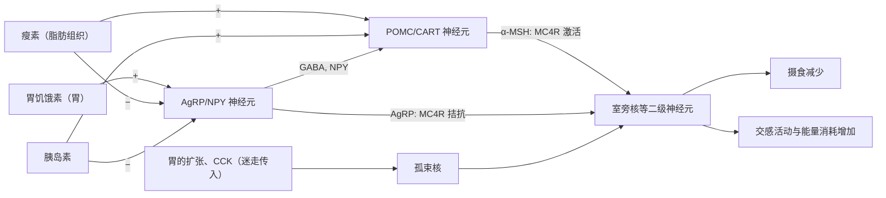

前面几章讨论了消化与吸收（[7.14.26](/7.14.26)–[7.14.28](/7.14.28)），以及肝脏与各器官之间的物质流动（[7.14.29](/7.14.29)）。本章从物质转向能量：机体从食物得到多少能量，怎样测量它的消耗，消耗的大小由什么决定，摄入又怎样与消耗匹配。能量代谢把消化、循环、呼吸与内分泌联系在一起：测量代谢率依靠呼吸气体的分析，代谢率随体型的缩放决定了心率与呼吸频率的缩放（[7.14.13](/7.14.13)），而几乎所有的代谢能最终都变成热，这是下一章体温调节的出发点（[7.14.31](/7.14.31)）。各条代谢通路及其激素调节的分子机制已在生物化学中讲过（[7.1.16](/7.1.16)–[7.1.29](/7.1.29)），这里只讲整体水平的收支与反馈。

## 30.1. 能量的来源与去向

### 30.1.1. 能量平衡

**定义 30.1.1（能量代谢）** 物质代谢过程中伴随的能量的释放、转移、储存与利用，称为**能量代谢**。

**定义 30.1.2（能量平衡）** 机体从食物摄取的能量与消耗的能量之间的关系称为**能量平衡**：

$$
I = E + \frac{\mathrm{d}U_{\mathrm{s}}}{\mathrm{d}t},
$$
其中 $I$ 是摄入（已吸收的）能量的速率，$E$ 是能量消耗速率（产热与对外做功之和），$U_{\mathrm{s}}$ 是体内储存的化学能（脂肪、糖原与蛋白质）。$I = E$ 时体重稳定；$I < E$ 时动用储备，称为能量负平衡；$I > E$ 时储备增加，称为能量正平衡。

体重不变不等于能量平衡中的每一项都不变：随着年龄增长，肌肉蛋白减少、脂肪增加，总体重可以不变，而能量的组成已经改变。

能量的去向可以按**热力学第一定律**追踪。营养物质氧化释放的自由能约一半以上在氧化过程中直接变成热，其余储存在 ATP 中；ATP 驱动的**主动转运**、合成、神经传导与肌肉收缩，除了肌肉对外做的机械功以外，最终也都变成热。即使运动时，骨骼肌把化学能转变为外功的效率也只有约 20%–25%（[7.14.9](/7.14.9)）。所以在不对外做功的静息状态下，能量消耗速率等于产热速率：测热就是测代谢，这是 30.2 节各种方法的基础。

ATP 水解是联系"能量的形成"与"能量的使用"的环节（[7.1.16](/7.1.16)）。标准条件下 ATP 水解为 ADP 和 $\mathrm{P_i}$ 的标准自由能变化 $\Delta G'^\circ \approx -30.5\,\mathrm{kJ\,mol^{-1}}$（$-7.3\,\mathrm{kcal\,mol^{-1}}$）；细胞内 ATP、ADP 与 $\mathrm{P_i}$ 的浓度远离平衡，实际的 $\Delta G$ 约为 $-50$ 至 $-65\,\mathrm{kJ\,mol^{-1}}$（约 $-12$ 至 $-15\,\mathrm{kcal\,mol^{-1}}$；常说的"每摩尔约 12000 cal"取的是其下限，而不是 12000 kcal）。这一数值是整个水解反应的自由能变化，不是某一个化学键的键能：习惯上说的"高能磷酸键"只是一种简称，断开任何化学键都需要吸收能量，释放的能量来自产物（ADP、$\mathrm{P_i}$ 的共振稳定与水合、电荷排斥的解除）比反应物更稳定。肌肉中的**磷酸肌酸**在 ATP 消耗时把磷酰基转给 ADP，是 ATP 的快速缓冲储备。

### 30.1.2. 食物的热价

**定义 30.1.3（热价）** 1 g 食物完全氧化时释放的能量称为该食物的**热价**。在体外燃烧（弹式量热计）测得的是物理热价，在体内氧化释放的是生物热价。

糖与脂肪在体内被完全氧化为 $\ce{CO2}$ 和 $\ce{H2O}$，两种热价相等。蛋白质在体内不能完全氧化，其中的氮以尿素等形式排出，尿素仍含有可燃烧的能量，所以蛋白质的生物热价（约 $17\,\mathrm{kJ\,g^{-1}}$）低于物理热价（约 $23.6\,\mathrm{kJ\,g^{-1}}$）。营养学中常用 Atwater 系数（已扣除消化吸收的损失）：

| 营养物质 | 热价（Atwater）/ $\mathrm{kJ\,g^{-1}}$ | 即 $\mathrm{kcal\,g^{-1}}$ | 氧热价 / $\mathrm{kJ\,L^{-1}}$ | 呼吸商 |
|---|---|---|---|---|
| 糖 | 17 | 4 | 21.0 | 1.00 |
| 脂肪 | 37 | 9 | 19.7 | 0.71 |
| 蛋白质 | 17 | 4 | 18.8 | 0.80 |
| 乙醇 | 29 | 7 | 20.3 | 0.67 |
| 混合膳食（平均） | — | — | 20.2 | 约 0.82 |

Atwater 系数针对的是食物，已扣除消化吸收的损失（脂肪约 5%）；动用体内储存的脂肪时没有这一损失，储存脂肪的氧化热约为 $39\,\mathrm{kJ\,g^{-1}}$，本章估算禁食与饥饿时的能量用这一值。

糖类与脂肪在能量供应中优先于蛋白质：只要糖与脂肪充足，蛋白质主要用于合成，只有少量被氧化供能（糖与脂肪对蛋白质的节约作用）。脂肪的热价是糖的两倍多，而且储存时几乎不带水；**糖原**储存时每克结合约 2–3 g 水，所以作为长期燃料，脂肪按储存的湿重计算比糖原高出约 6–8 倍。这就是动物以脂肪为主要能量储备、迁徙的鸟以脂肪为燃料的原因（30.6 节）。

**定义 30.1.4（氧热价）** 某种营养物质氧化时每消耗 $1\,\mathrm{L}$ $\ce{O2}$ 释放的能量称为该物质的**氧热价**。

上表中三种营养物质的氧热价相差不到 10%，这是间接测热法可行的原因。混合膳食的平均氧热价为 $4.825\,\mathrm{kcal\,L^{-1}} \approx 20.2\,\mathrm{kJ\,L^{-1}}$（标准状况下的 $\ce{O2}$ 体积）。注意单位是千卡（营养学中写作首字母大写的 Calorie），而不是卡：$4.825\,\mathrm{cal}$ 只有 $20\,\mathrm{J}$，相差 1000 倍。若实际只氧化糖，用平均值算出的产热约低估 4%；若只氧化脂肪，约高估 3%。

### 30.1.3. 蛋白质与氮平衡

蛋白质平均含氮 16%，所以 1 g 氮对应约 $1/0.16 = 6.25\,\mathrm{g}$ 蛋白质。蛋白质分解产生的氮约 90% 经尿排出（主要是尿素，[7.1.22](/7.1.22)），约 10% 随粪便排出，经皮肤的损失很少。测定尿氮就可以估计被分解的蛋白质的量。

**定义 30.1.5（氮平衡）** 摄入的氮与排出的氮之差称为**氮平衡**。摄入等于排出为氮的总平衡（健康成人）；摄入多于排出为正氮平衡（生长、妊娠、创伤恢复期、合成代谢激素的作用）；摄入少于排出为负氮平衡（饥饿、发热、严重创伤与烧伤、糖皮质激素过多）。

即使完全不摄入蛋白质，成人每天仍分解约 20–30 g 蛋白质（必然丢失）；维持氮平衡所需的最低摄入约为 30–50 g/d，推荐摄入量约 $0.8\,\mathrm{g\,kg^{-1}\,d^{-1}}$（70 kg 成人约 56 g/d），因为膳食蛋白质的氨基酸组成与机体的需要并不完全匹配。同时供给足够的糖与脂肪，才能使摄入的蛋白质用于合成而不被氧化。

**例 30.1.1** 某人一天尿中排出氮 $9\,\mathrm{g}$。估计他当天分解的蛋白质。

**答** 尿氮约占蛋白质分解氮的 90%，总氮约 $9/0.9 = 10\,\mathrm{g}$，相当于 $10 \times 6.25 = 62.5\,\mathrm{g}$ 蛋白质，产能约 $62.5 \times 17 \approx 1.06\,\mathrm{MJ}$，约占每日消耗的 10%–15%。若他每天摄入 80 g 蛋白质（12.8 g 氮），则为正氮平衡；若摄入 40 g（6.4 g 氮），则为负氮平衡。

## 30.2. 代谢率的测定

### 30.2.1. 直接测热法

**定义 30.2.1（直接测热法）** 把受试者置于隔热的测热室中，直接测量他在一定时间内向环境散发的全部热量（辐射、传导、对流与蒸发），以求出代谢率的方法，称为**直接测热法**。

Lavoisier 与 Laplace 在 18 世纪 80 年代用冰量热计测量了豚鼠融化的冰量，并与它呼出的 $\ce{CO2}$ 比较，第一次把呼吸与缓慢的燃烧联系起来。19 世纪末 Atwater 与 Rosa 建造了人体呼吸测热室，测得的产热与由食物和排泄物计算的能量收支相差不到 1%，证明热力学第一定律也适用于人体。直接测热法原理简单、结果准确，但装置复杂，测定一次需要很长时间，现在主要用于研究。

### 30.2.2. 间接测热法与呼吸商

**定义 30.2.2（间接测热法）** 根据化学反应中底物与产物的定比关系，由一定时间内的耗氧量、$\ce{CO2}$ 产生量与尿氮排出量推算被氧化的糖、脂肪与蛋白质的量，再由它们的热价算出产热量的方法，称为**间接测热法**。

以葡萄糖与三软脂酰甘油为例：

$$
\begin{aligned}
&\ce{C6H12O6 + 6O2 -> 6CO2 + 6H2O}, && \text{RQ} = 6/6 = 1.00,\\
&\ce{C51H98O6 + 72.5O2 -> 51CO2 + 49H2O}, && \text{RQ} = 51/72.5 = 0.70.
\end{aligned}
$$

$\ce{CO2}$ 产生量与耗氧量之比就是**呼吸商**（RQ）。脂肪分子中的氧远比碳和氢少，氧化需要更多外来的氧，所以 RQ 低；蛋白质氧化不完全，RQ 约 0.80。按 Avogadro 定律，同温同压下相同体积的气体分子数相同，所以 RQ 可以直接用体积之比计算。RQ 接近 0.7 提示主要氧化脂肪（长期禁食、未控制的糖尿病），接近 1.0 提示主要氧化糖；大量摄入糖并转变为脂肪时，合成脂肪释放出含氧较多的糖分子中的氧，RQ 可以超过 1。

在整体水平，口鼻处测得的是**呼吸交换率**（RER）$\dot V_{\ce{CO2}}/\dot V_{\ce{O2}}$。稳态下 RER 等于组织的 RQ；过度通气时呼出体内储存的 $\ce{CO2}$，剧烈运动时乳酸被 $\ce{HCO3-}$ 缓冲而释放额外的 $\ce{CO2}$，RER 都会暂时高于 RQ，甚至超过 1.1（[7.14.25](/7.14.25)）。

**定义 30.2.3（非蛋白呼吸商）** 从总的 $\dot V_{\ce{O2}}$ 和 $\dot V_{\ce{CO2}}$ 中减去蛋白质氧化（由尿氮算出，每克尿氮约对应 $5.94\,\mathrm{L}$ $\ce{O2}$ 与 $4.76\,\mathrm{L}$ $\ce{CO2}$）所占的部分，剩下的只来自糖与脂肪氧化的 $\ce{CO2}$ 产生量与耗氧量之比，称为**非蛋白呼吸商**（NPRQ）。

由 NPRQ 可以解出糖与脂肪各自的氧化速率，也可以把三项合起来写成一个公式：

**公式 30.2.1（Weir 公式）** 设 $\dot V_{\ce{O2}}$、$\dot V_{\ce{CO2}}$ 以 $\mathrm{L\,min^{-1}}$ 计、尿氮排出速率 $\dot n$ 以 $\mathrm{g\,min^{-1}}$ 计，则能量消耗速率

$$
E/(\mathrm{kJ\,min^{-1}}) = 16.49\,\dot V_{\ce{O2}} + 4.63\,\dot V_{\ce{CO2}} - 9.08\,\dot n.
\tag{30.1}
$$

即 $E/(\mathrm{kcal\,min^{-1}}) = 3.941\,\dot V_{\ce{O2}} + 1.106\,\dot V_{\ce{CO2}} - 2.17\,\dot n$。尿氮一项的贡献通常只有 1%–2%，常被忽略。

**例 30.2.1** 一位成人静息时 $\dot V_{\ce{O2}} = 0.25\,\mathrm{L\,min^{-1}}$，$\dot V_{\ce{CO2}} = 0.21\,\mathrm{L\,min^{-1}}$，尿氮 $10\,\mathrm{g\,d^{-1}}$。求 RQ、NPRQ 与代谢率，并估计三种营养物质的氧化量。

**答** RQ $= 0.21/0.25 = 0.84$。尿氮 $\dot n = 10/1440 = 6.9\times 10^{-3}\,\mathrm{g\,min^{-1}}$，蛋白质氧化耗氧 $0.041\,\mathrm{L\,min^{-1}}$、产 $\ce{CO2}$ $0.033\,\mathrm{L\,min^{-1}}$，NPRQ $= (0.21 - 0.033)/(0.25 - 0.041) = 0.85$。由式 (30.1)，$E = 16.49\times0.25 + 4.63\times0.21 - 9.08\times0.0069 = 5.03\,\mathrm{kJ\,min^{-1}} \approx 84\,\mathrm{W}$，即 $7.2\,\mathrm{MJ\,d^{-1}}$（约 1730 kcal/d）。只用平均氧热价估算：$0.25 \times 20.2 = 5.05\,\mathrm{kJ\,min^{-1}}$，相差不到 1%。由 Frayn 的化学计量关系可解出每天约氧化糖 190 g、脂肪 77 g、蛋白质 62 g，三者的能量之和（$190\times17 + 77\times39 + 62\times17 \approx 7.3\,\mathrm{MJ}$）与上面的结果一致。

:::

测定气体交换的方法有两种：闭合式（受试者从肺量计中吸入纯氧，呼出的 $\ce{CO2}$ 被吸收，肺量计容积的下降速率就是耗氧量）与开放式（受试者呼吸空气，收集呼出气，由呼出气量与其中 $\ce{O2}$、$\ce{CO2}$ 的浓度和吸入气的差值算出）。现代的代谢车与代谢舱都是开放式。

对自由活动的人与野生动物，常用 Lifson 在 1955 年提出的双标记水法（doubly labeled water method）：给受试者喝下同时用 $^2\mathrm{H}$ 与 $^{18}\mathrm{O}$ 标记的水，$^2\mathrm{H}$ 只以水的形式离开身体，$^{18}\mathrm{O}$ 则既以水、又以 $\ce{CO2}$ 的形式离开（经**碳酸酐酶**，$\ce{CO2}$ 与体内的水交换氧）。两种同位素的消除速率常数之差 $k_{\mathrm{O}} - k_{\mathrm{H}}$ 就反映了 $\ce{CO2}$ 的产生速率：忽略同位素分馏时 $\dot n_{\ce{CO2}} \approx \tfrac{N}{2}(k_{\mathrm{O}} - k_{\mathrm{H}})$，$N$ 是体内水的物质的量（每个 $\ce{CO2}$ 带走两个氧原子）。再假设一个 RQ，就得到一到三周内的平均能量消耗，即野外代谢率（field metabolic rate）。

### 30.2.3. 基础代谢率

**定义 30.2.4（基础代谢率）** 人在清醒、静卧、空腹（禁食 12 h 以上）、无精神紧张、室温舒适（约 20–25 °C）的基础状态下，单位时间的能量消耗称为**基础代谢率**（BMR）。

基础状态排除了肌肉活动、食物、环境温度与精神紧张对代谢的影响，能量只用于维持基本的生命活动（离子梯度、心跳与呼吸、蛋白质周转、神经活动）。基础代谢率不是最低的代谢率：熟睡时由于肌肉进一步松弛、中枢活动减弱，代谢率还要低 10%–15%。

70 kg 成年男性的基础代谢率约为 $65$–$70\,\mathrm{kcal\,h^{-1}}$，即约 $80\,\mathrm{W}$。不同体格的人之间比较时，传统上按体表面积标准化，单位为 $\mathrm{kJ\,m^{-2}\,h^{-1}}$；我国成年男性约 $155$–$160\,\mathrm{kJ\,m^{-2}\,h^{-1}}$（约 $44\,\mathrm{W\,m^{-2}}$），女性约低 7%–10%，儿童高、老人低。体表面积由身高与体重估计，如 Du Bois 公式 $A/\mathrm{m^2} = 0.007184\,(W/\mathrm{kg})^{0.425}(H/\mathrm{cm})^{0.725}$；按体表面积标准化的合理性在 30.3 节讨论。实测值与同性别、同年龄的正常平均值相差 $\pm10\%$–$15\%$ 以内属于正常，相差 20% 以上才可能有病理意义，最常见的原因是甲状腺功能的改变（[7.14.34](/7.14.34)）。

基础代谢主要由少数器官承担：肝（约 21%）、脑（约 20%）、静息的骨骼肌（约 22%）、心（约 9%）和肾（约 8%）。肝、脑、心、肾合计只占体重的约 6%，却消耗基础代谢的一半以上；骨骼肌占体重约 40%，单位质量的代谢率很低，但总量可观，所以 BMR 的个体差异主要来自肌肉量与体格的不同，女性与老人 BMR 较低的部分原因是肌肉比例较低。

久坐少动的人一天的能量消耗中，基础代谢约占 60%，食物的特殊动力作用约 8%，非运动性的日常活动（维持姿势、走动、坐立不安）约 7%，有目的的体力活动约 25%。体力活动是个体之间能量需要差别最大的部分。

### 30.2.4. 影响代谢率的因素

**定义 30.2.5（食物的特殊动力作用）** 进食后即使安静不动，产热量也会增加，超过所摄入食物本身氧化应产生的热量，这种由进食引起的额外产热称为**食物的特殊动力作用**，又称食物热效应。

蛋白质的特殊动力作用最显著：摄入能产热 $100\,\mathrm{kJ}$ 的蛋白质，体内额外产热约 $30\,\mathrm{kJ}$，在进食后约 1 h 开始、3 h 左右达到高峰，持续 3–12 h；糖与脂肪约为 4%–6%，混合膳食约 10%。额外的能量主要用于吸收后的加工：肝中氨基酸的脱氨基与尿素合成（每生成一个尿素消耗 4 个高能磷酸键，[7.1.22](/7.1.22)）、蛋白质合成、糖原与脂肪的储存。

| 因素 | 效应 |
|---|---|
| 肌肉活动 | 最显著。全身短时间的最大运动可使产热增加到静息的约 50 倍，训练良好者持续运动可达约 20 倍；运动停止后耗氧量仍高于静息一段时间（运动后过量氧耗，偿还"氧债"） |
| 食物 | 特殊动力作用，混合膳食约 10% |
| 环境温度 | 20–30 °C 时最稳定；低温引起**肌紧张**增强与寒战，代谢率升高；高温时体温、呼吸与循环活动、出汗增加，代谢率也升高（[7.14.31](/7.14.31)） |
| 精神活动 | 安静思考时变化很小（不超过 4%）；紧张、恐惧、情绪激动时肌紧张与交感–肾上腺髓质活动增强，代谢率显著升高 |
| **甲状腺激素** | 分泌最大时代谢率可升高 50%–100%，完全缺乏时降到正常的 40%–60%；作用慢而持久（[7.14.34](/7.14.34)） |
| 交感神经与儿茶酚胺 | **交感神经系统**兴奋与**肾上腺素**使代谢率迅速升高；在有**褐色脂肪组织**的个体中可显著增加产热（**非寒战产热**） |
| 雄激素、**生长激素** | 睾酮约使代谢率升高 10%–15%，生长激素缺乏者补充后 BMR 约升高 20%，主要通过增加肌肉量 |
| 体温 | **发热**时体温每升高 1 °C 代谢率约增加 10%（相当于 $Q_{10}$ 约 2–3，[7.14.31](/7.14.31)） |
| 睡眠 | 降低 10%–15% |
| 营养不良 | 长期营养不良使代谢率降低 20%–30%，这是一种适应（30.5 节） |
| 年龄、性别与气候 | 儿童高、老人低，女性略低（妊娠与哺乳期显著升高）；寒冷地区居民的 BMR 比热带居民高 10%–20% |

## 30.3. 代谢率的缩放

### 30.3.1. 表面积律与 Kleiber 律

不同体型的动物，单位体重的代谢率差别极大。一只 25 g 的小鼠每千克体重每小时耗氧约 $1.6\,\mathrm{L}$，一头 4 t 的象只有约 $0.07\,\mathrm{L}$，相差二十多倍；而按全身计算，象的代谢率当然大得多。代谢率 $B$ 与体重 $M$ 的关系可以写成**异速生长**的幂律 $B = aM^b$，在对数坐标中是一条斜率为 $b$ 的直线。$b = 1$ 意味着每克组织的代谢率与体型无关，$b < 1$ 则大动物的每克组织更"省"。

一个直观的解释来自散热。Rubner 在 1883 年测量了体重不同的狗，发现按体表面积计算的每日产热近似相等（约 $1000\,\mathrm{kcal\,m^{-2}\,d^{-1}}$）。形状相似的动物表面积 $A \propto M^{2/3}$，若**恒温动物**的产热必须与经体表的散热相等，就有：

**定义 30.3.1（表面积律）** 恒温动物的基础代谢率与体表面积成正比、即 $B \propto M^{2/3}$ 的假说，称为**表面积律**（surface law）。

Kleiber 在 1932 年汇总了从大鼠到阉牛的数据，发现指数更接近 $3/4$：

**定义 30.3.2（Kleiber 律）** 哺乳动物的基础代谢率与体重的 $3/4$ 次方成正比的经验规律称为 **Kleiber 律**：

$$
B \approx 3.4\,\mathrm{W} \times (M/\mathrm{kg})^{3/4},
$$
即 $B \approx 70\,\mathrm{kcal\,d^{-1}} \times (M/\mathrm{kg})^{3/4}$；单位体重的代谢率 $B/M \propto M^{-1/4}$。

由 Kleiber 律，70 kg 的人 $B \approx 3.4 \times 70^{0.75} = 82\,\mathrm{W}$，与 30.2.3 节的实测值一致。小鼠与象体重相差 $1.6\times10^5$ 倍，单位体重的代谢率相差 $(1.6\times10^5)^{1/4} = 20$ 倍。很多生理时间随之按 $M^{1/4}$ 缩放：心率与呼吸频率 $\propto M^{-1/4}$（因为心脏与肺的大小大致 $\propto M$，而输送的 $\ce{O2}$ 量 $\propto M^{3/4}$，[7.14.13](/7.14.13)），血液循环一周的时间与寿命 $\propto M^{1/4}$，于是一生的心跳次数在哺乳类中大致是同一数量级（约 $10^9$）。

### 30.3.2. 指数之争与拟合

$b$ 究竟是 $2/3$ 还是 $3/4$，一直有争论，这既是生物学问题，也是统计问题。对 $\log B$ 与 $\log M$ 拟合**简单线性回归模型**（[3.3.2](/3.3.2)）是最常用的做法：图 A 中 11 种哺乳动物的斜率估计为 $0.70$，**标准误** $0.022$，自由度 9 的 95% **置信区间**约为 $[0.65, 0.75]$，同时包含 $2/3$ 与 $3/4$，这么少的物种不足以区分两者。物种更多时问题依然存在：

1. 数据的选取：BMR 要求成年、静息、空腹、处于**热中性区**，许多物种（反刍动物难以空腹、小型动物难以静息）的测定并不满足这些条件。White 与 Seymour（2003）只采用严格符合条件的 600 多种哺乳动物的数据并校正体温后，得到 $b \approx 0.69$，接近 $2/3$；包括更多大型动物的分析多得到 $0.72$–$0.75$。
2. 回归方法：两个变量都有测量误差且目的是描述关系而非预测时，有人主张用约化主轴回归（RMA），其斜率等于 OLS 斜率除以**相关系数**，系统地大于 OLS 斜率。
3. 物种不是独立的观测：近缘物种共享祖先的性状，需要用系统发育**广义最小二乘**（PGLS）等方法校正，校正后的指数与置信区间往往改变。
4. 指数并不恒定：在很宽的体重范围内，对数–对数关系略向上弯曲，小型哺乳类的斜率较小、大型的较大；不同类群（鸟类、有袋类、外温动物、单细胞生物）的指数也不同。

对 $3/4$ 的解释也有多种：West、Brown 与 Enquist（1997）提出，分形的输送网络（血管、气管）要使末端单元（毛细血管）大小不变并使输送能量最小，就得到 $3/4$；另一些模型强调表面限制（散热、物质交换）与体积限制（组织的维持需要）的组合，使指数在 $2/3$ 与 $1$ 之间随代谢水平变化。目前没有一个解释被普遍接受；可以确定的是，单位体重的代谢率随体型增大而下降，而且其下降幅度比单纯的散热论证预测的小。

### 30.3.3. 内温动物与外温动物的代谢水平

**外温动物**的代谢率随体温变化，不存在一个"基础"值，因此用标准代谢率（standard metabolic rate），简称 SMR，来描述：在指定体温下、静息、空腹的最低代谢率。即使在相同的体重与相同的体温（37 °C）下比较，哺乳类与鸟类的静息代谢率也比爬行类高 5–10 倍（图 B 中点线与内温动物线的距离）。在各自的自然体温与活动下，差别更大：同体重的爬行类野外代谢率通常只有哺乳类或鸟类的几十分之一。高代谢率是**内温性**的代价，它要求高得多的摄食量；回报是不依赖环境温度的持续活动能力（[7.14.31](/7.14.31)）。

把温度的影响也考虑进去，Gillooly 等（2001）提出 $B = b_0 M^{3/4}\,\mathrm{e}^{-E/(k_{\mathrm{B}}T)}$，其中 $E \approx 0.6$–$0.7\,\mathrm{eV}$ 是代谢的**表观活化能**。按 **Arrhenius 方程**，$E = 0.65\,\mathrm{eV}$ 在 20 °C 附近相当于 $Q_{10} = \exp\!\big(10E/(k_{\mathrm{B}}T_1T_2)\big) \approx 2.3$，与生理过程常见的 $Q_{10}$ 相符（[7.14.31](/7.14.31)）。

**例 30.3.1** 用 Kleiber 律估计 25 g 小鼠与 4000 kg 象的基础代谢率，并求它们每天需要吃下相当于自身体重百分之几的食物（设野外代谢率为基础代谢率的 3 倍，食物的可利用能量为干重 $17\,\mathrm{kJ\,g^{-1}}$，鲜重的 $1/4$ 是干物质）。

**答** 小鼠 $B = 3.4\times0.025^{0.75} = 0.21\,\mathrm{W}$，每天 $3\times0.21\times86400 = 55\,\mathrm{kJ}$，需要食物干重 $3.2\,\mathrm{g}$、鲜重约 $13\,\mathrm{g}$，约为体重的一半。象 $B = 3.4\times4000^{0.75} = 1.7\,\mathrm{kW}$，每天 $440\,\mathrm{MJ}$，需要干物质 $26\,\mathrm{kg}$、鲜重约 $100\,\mathrm{kg}$，只是体重的 2.6%（象的植物性食物消化率低，实际吃得更多）。两者每克体重的需要相差 20 倍，这是小型哺乳动物（鼩鼱）几乎不停地进食、禁食几小时就可能死亡的原因。

## 30.4. 摄食的调节

### 30.4.1. 饥饿、食欲与饱感

摄食行为由三种感受驱动：饥饿感是对食物的需要感（胃部收缩、不安），食欲是对某种特定食物（而不是数量）的渴求，受经验、环境与文化影响；饱感是摄食得到满足的感觉，使进食停止。Cannon 与 Washburn（1912）让受试者吞下气囊记录胃的收缩，发现饥饿感与胃的强烈收缩同时出现；但切除胃或切断迷走神经的人仍有饥饿感，所以胃收缩只是饥饿的信号之一。

摄食的调节可以分为两个时间尺度：短期调节决定每一餐吃多少、何时停止（胃肠的扩张与化学信号、肠激素），中长期调节使一段时间内的摄入与消耗以及能量储备相匹配（血中的营养物质、胰岛素与瘦素）。两者都汇聚到下丘脑。

### 30.4.2. 下丘脑的摄食中枢与饱中枢

经典的"双中枢"模型来自损毁与刺激实验：

**定义 30.4.1（摄食中枢与饱中枢）** 下丘脑外侧区称为**摄食中枢**（feeding center）：刺激它引起进食，双侧损毁使动物拒食直至饿死（Anand 与 Brobeck，1951）。下丘脑腹内侧核称为**饱中枢**（satiety center）：刺激它引起饱感、抑制进食，双侧损毁使动物过度进食而肥胖（Hetherington 与 Ranson，1940）。

后来的研究修正了这一模型：电解损毁同时破坏了穿过这些区域的纤维；损毁或破坏室旁核同样引起过度进食与肥胖；而对体内能量信号最先作出反应的，是位于第三脑室底部的弓状核。下丘脑整合来自五个方面的信号：胃壁的牵张（迷走传入，经孤束核）、食物中营养物质的化学信号、**胃肠激素**、脂肪组织的激素，以及大脑皮层的视觉、嗅觉与味觉。进食的动作本身（分泌唾液、舔嘴唇、咀嚼、吞咽）则由脑干的回路执行，去大脑的大鼠仍能对放进口中的食物完成这些动作，并能停止进食。

### 30.4.3. 弓状核的两群神经元

**定义 30.4.2（弓状核）** 下丘脑基底部、第三脑室底两侧的神经核团称为**弓状核**（arcuate nucleus），它与相邻的正中隆起缺乏有效的血脑屏障，能直接感受血液中的激素与营养信号，是调节食欲与体重的基本中枢。

弓状核中有两群作用相反的神经元（[7.1.29](/7.1.29#sec-29.4.2)）：

| | AgRP/NPY 神经元 | POMC/CART 神经元 |
|---|---|---|
| 递质 | 刺鼠相关肽（AgRP）、神经肽 Y（NPY）、GABA | α-MSH（由 POMC 切下）、CART |
| 作用于 | 室旁核等二级神经元：NPY 经 Y1/Y5 受体；AgRP 是黑皮质素受体 MC4R 的**拮抗剂**（反向激动剂）；GABA 与 NPY 同时直接抑制 POMC 神经元 | 室旁核与外侧区的 MC4R |
| 效应 | 增加摄食，降低能量消耗 | 减少摄食，增加能量消耗 |
| 被激活 | 胃饥饿素、低瘦素、低胰岛素、低血糖 | 瘦素、胰岛素、高血糖 |

两群神经元的平衡决定了 MC4R 的激活程度：MC4R 信号强时少吃多耗，弱时多吃少耗。用**光遗传学**激活饱食小鼠的 AgRP 神经元，几分钟内就引起贪婪的进食；在成年小鼠中消除这群神经元则使它们拒食。小鼠看到或闻到食物的几秒钟内（尚未进食）AgRP 神经元的活动就迅速下降，说明它们不只报告能量缺乏，还预测即将到来的食物，这是摄食调节中的**前馈控制**。MC4R 的突变是人类单基因肥胖最常见的原因。

### 30.4.4. 外周信号

**定义 30.4.3（胃饥饿素）** 胃饥饿素（ghrelin）是胃底的内分泌细胞分泌的 28 个氨基酸的肽，第 3 位丝氨酸被辛酰化后才有活性；它在习惯的进餐时间之前升高、进餐后迅速下降，兴奋弓状核的 AgRP/NPY 神经元，通常被认为是唯一刺激食欲的外周循环激素。

| 信号 | 来源 | 时间尺度 | 作用 |
|---|---|---|---|
| 胃的扩张 | 胃壁牵张感受器，迷走传入到孤束核 | 一餐之内 | 饱感，限制每餐的量 |
| 胃饥饿素 | 胃 | 餐前升高 | 刺激食欲 |
| 缩胆囊素（CCK） | 十二指肠与空肠的 I 细胞，受脂肪与蛋白质刺激 | 一餐之内 | 经迷走传入产生饱感，使进餐停止，而无需血糖与胰岛素的明显变化 |
| $\mathrm{PYY_{3-36}}$、GLP-1 | 回肠与结肠的 L 细胞，按进餐量分泌 | 餐后数小时 | 抑制 NPY 神经元（PYY 经 Y2 受体），减少下一餐的量；GLP-1 还促进胰岛素分泌 |
| **胰岛素** | 胰岛 β 细胞 | 餐后升高，基础水平反映脂肪量 | 兴奋 POMC/CART、抑制 AgRP/NPY 神经元 |
| **瘦素** | 脂肪细胞，按脂肪量分泌 | 数天到数月 | 反映脂肪储备，见 30.4.5 节 |

这些信号的分子机制与短期调节的其他因子（内源性大麻素、肠道微生物）见 [7.1.29](/7.1.29#sec-29.4.7)。

### 30.4.5. 瘦素与中长期调节

**瘦素**是中长期调节的主要信号。它对能量平衡有五个方面的作用：

1. 抑制弓状核 AgRP/NPY 神经元的活动与 NPY、AgRP 的表达；
2. 激活 POMC/CART 神经元，释放 α-MSH 激活 MC4R；
3. 增加**交感神经**的活动，促进褐色脂肪的产热与脂肪动员，增加能量消耗；
4. 减少胰岛 β 细胞的胰岛素分泌，减少脂肪的储存；
5. 增加下丘脑中抑制摄食的激素与神经肽，如促肾上腺皮质激素释放激素（CRH）。

此外，瘦素直接作用于脂肪细胞，抑制脂肪合成、促进脂肪分解；它也是生殖轴的允许信号（脂肪储备不足时青春期推迟、月经停止，[7.14.37](/7.14.37)）。

瘦素被发现之前，"脂肪组织发出一种循环的饱感信号"已由 Coleman（1973）的连体实验推断出来。把两只小鼠的循环连在一起：

- 肥胖的 *ob/ob* 小鼠与正常小鼠连体，*ob/ob* 小鼠吃得更少、体重下降：它缺少这种因子，能从正常小鼠的血中得到。
- 肥胖的 *db/db* 小鼠与正常小鼠连体，正常小鼠拒食、几乎饿死：*db/db* 小鼠大量产生这种因子却不能响应它。
- *ob/ob* 与 *db/db* 连体，*ob/ob* 小鼠饿死。

后来证明 *ob* 编码瘦素，*db* 编码瘦素受体。

其他的中长期信号还有：血浆中葡萄糖、氨基酸与脂类代谢中间产物的浓度（明显下降时引起饥饿感，即传统的"糖稳态""脂稳态""氨基酸稳态"假说）；环境温度（低温促进摄食，下丘脑的摄食中枢与体温调节中枢之间有联系）。这一系统对能量缺乏的反应比对能量过剩的反应强得多：瘦素下降是一个强烈的饥饿信号，而肥胖者高水平的瘦素却很难抑制食欲（瘦素抵抗）。这种不对称可能反映了饥荒在演化史上是比肥胖更主要的威胁。

## 30.5. 饥饿与肥胖

### 30.5.1. 饥饿时的燃料序列

完全饥饿（只饮水）时，三类燃料按一定的顺序被动用：

1. 糖原：肝约 $100\,\mathrm{g}$、肌肉约 $400\,\mathrm{g}$，共约 $500\,\mathrm{g}$（约 $8.5\,\mathrm{MJ}$，[第 29 章](/7.14.29)）。肝糖原在 24 h 内基本耗尽；肌糖原只供肌肉自身，饥饿时只动用其中一部分，所以可动用的糖原只够约半天到一天的能量消耗。
2. 脂肪：成为主要的能量来源。脂肪分解产生的脂肪酸供肌肉与肝氧化，肝把乙酰 CoA 转变为**酮体**；几天后脑也以酮体为主要燃料，对葡萄糖的需要从每天约 120 g 降到约 40 g。
3. 蛋白质：饥饿最初几天，脑所需的葡萄糖必须由**糖异生**提供，原料主要是肌肉蛋白质分解出的氨基酸，蛋白质分解很快（约 75 g/d）；酮体代替葡萄糖之后，蛋白质分解降到约 20 g/d。脂肪接近耗尽时，蛋白质成为最后的能量来源，分解再次加快；体内蛋白质消耗超过约一半时，心肌、呼吸肌与免疫功能衰竭，导致死亡。

饥饿时的代谢率也会下降（30.2.4 节的营养不良一行），进一步延长存活时间。这一序列在代谢通路与血浆燃料浓度层面的描述见 [7.1.29](/7.1.29#sec-29.3.4)。

### 30.5.2. 体重的动态与肥胖

把能量平衡（定义 30.1.2）写成体重的方程：

$$
\rho\,\frac{\mathrm{d}W}{\mathrm{d}t} = I - E(W),
\tag{30.2}
$$
其中 $\rho \approx 32\,\mathrm{MJ\,kg^{-1}}$ 是减少或增加的组织（脂肪与少量瘦组织的混合）的能量密度，$E(W)$ 随体重增加而增加：体重大的人基础代谢高，搬动身体的耗能也大，平均每千克体重每天约多消耗 $k \approx 92\,\mathrm{kJ}$（约 22 kcal）。线性化后 $\rho\,\mathrm{d}W/\mathrm{d}t = \Delta I - k(W - W_0)$，解是指数趋近：

$$
W(t) = W_0 + \frac{\Delta I}{k}\left(1 - \mathrm{e}^{-t/\tau}\right), \quad \tau = \frac{\rho}{k} \approx 1\,\text{年}.
$$

每天少吃 $2.1\,\mathrm{MJ}$（500 kcal），常见的"静态规则"认为每天减少 $2.1/32 = 66\,\mathrm{g}$，一年 24 kg 并一直减下去；实际上体重减轻使消耗也减少，能量缺口逐渐闭合，第一年只减约 15 kg，最终在减少约 $\Delta I/k \approx 23\,\mathrm{kg}$ 处达到新的稳态，一半的变化需要约 8 个月。机体还会进一步降低能量消耗（适应性产热减少：瘦素下降、交感活动与甲状腺激素降低、肌肉做功效率提高），使实际的减重更少。这说明了减重为什么越来越慢，而停止节食后体重为什么会回升。

肥胖是脂肪储备的过度增加，临床上常用体质指数（body mass index），即 $\mathrm{BMI} = W/H^2$（体重以 kg、身高以 m 计）与腰围判断：WHO 的标准以 $\mathrm{BMI} \geq 25\,\mathrm{kg\,m^{-2}}$ 为超重、$\geq 30$ 为肥胖，我国的标准为 $\geq 24$ 超重、$\geq 28$ 肥胖；腰围反映与代谢风险关系更大的腹部（内脏）脂肪。按式 (30.2)，长期每天只要多摄入 1% 的能量（约 100 kJ），稳态体重就增加约 1 kg，这种微小的不平衡在摄食调节的精度之内，所以体重的长期稳定本身就说明调节系统是有效的。肥胖的成因包括遗传（MC4R、瘦素与其受体的罕见突变，以及大量效应很小的常见变异）、高能量密度的食物与少动的生活方式；肥胖者的瘦素水平高而作用减弱（瘦素抵抗），常伴有**胰岛素抵抗**与 **2 型糖尿病**（[7.1.29](/7.1.29#sec-29.4)）。体重是否存在一个被主动"捍卫"的设定点，还是由环境与调节共同决定的一个平衡点，目前仍有争论：对体重下降的防御明显强于对体重上升的防御。

## 30.6. 演化与比较

### 30.6.1. Hemmingsen 图

Hemmingsen（1960）把单细胞生物、多细胞外温动物与内温动物的代谢率画在同一张对数–对数图上，得到三条斜率约为 $3/4$ 的近似平行线（图 B）：同样体重下，内温动物（39 °C）的代谢率约为外温动物（20 °C）的 30 倍，外温动物约为单细胞生物的 8 倍。把外温动物校正到 39 °C 后差距缩小到约 5 倍，这一剩余的差别就是内温性本身的代谢代价（[7.14.31](/7.14.31)）。后来更大的数据集表明三条线并不严格平行：**原核生物**的指数大于 1，**原生生物**接近 1，多细胞动物在 $2/3$ 到 $1$ 之间，所以"普适的 3/4"只是在多细胞动物中的一个近似。

### 30.6.2. 帝企鹅孵卵的长期禁食

雄性帝企鹅在南极冬季孵卵，从登上冰面求偶到雏鸟孵出，要在零下几十摄氏度的风雪中禁食约四个月，体重下降约 40%。它们节约能量的方式是挤在一起（huddling）：群体中个体的外露表面积大大减少，能量消耗约降低四分之一。它们的禁食与人的饥饿有相同的三个阶段（图 B）：第一阶段持续几天，蛋白质的利用迅速下降；第二阶段持续几个月，几乎完全依靠脂肪，蛋白质只提供约 4% 的能量；脂肪储备降到临界水平后进入第三阶段，蛋白质分解上升。企鹅在进入第三阶段时会放弃孵卵返回海中觅食，这被解释为一种"再进食信号"：它使亲鸟在蛋白质损失危及生存之前离开，而不是在脂肪完全耗尽时才离开。

### 30.6.3. 冬眠前的过食

许多**冬眠**哺乳动物（地松鼠、旱獭、睡鼠）在夏末秋初大量进食，体重在几周内增加 30%–50%，有的接近翻倍，储存的脂肪供整个冬季使用；入冬后即使有食物也几乎不吃。摄食量的这种季节变化由内源的年节律驱动，在实验室恒定的条件下仍会出现，伴随着下丘脑对瘦素敏感性的季节变化：过食期动物的瘦素虽然升高，却不再抑制摄食。熊在冬眠（冬季休眠）前同样过食增肥；冬眠期间不进食、不饮水，几乎不排尿，把尿素中的氮回收用于合成蛋白质，从而在几个月的禁食中几乎不损失肌肉。冬眠时体温与代谢率的变化见 [7.14.31](/7.14.31)。

### 30.6.4. 蜂鸟的能量预算

蜂鸟的单位体重代谢率是脊椎动物中最高的：悬停时飞行肌的耗氧量接近脊椎动物肌肉的上限，它几乎完全以花蜜中的糖为燃料，并能把刚吸收的糖直接用于飞行。

**例 30.6.1（蜂鸟的数量级估算）** 设一只 $3.5\,\mathrm{g}$ 的蜂鸟悬停时耗氧 $40\,\mathrm{mL\,g^{-1}\,h^{-1}}$，白天 14 h 中悬停 20%，其余时间的代谢率为悬停时的 $1/4$；花蜜含蔗糖 20%（质量浓度约 $0.2\,\mathrm{g\,mL^{-1}}$，$16.5\,\mathrm{kJ\,g^{-1}}$）。估计它白天的能量消耗与所需的花蜜，并与 Kleiber 律比较。

**答** 悬停时耗氧 $40\times3.5 = 140\,\mathrm{mL\,h^{-1}}$，功率 $140\times20.1/3600 = 0.78\,\mathrm{W}$；按 Kleiber 律同体重哺乳动物的 BMR 约 $3.4\times0.0035^{0.75} = 0.049\,\mathrm{W}$，悬停约为其 16 倍。白天消耗 $0.78\times(2.8 + 11.2/4)\,\mathrm{h} = 4.4\,\mathrm{Wh} \approx 16\,\mathrm{kJ}$，需要蔗糖约 $1\,\mathrm{g}$，即花蜜约 $5\,\mathrm{mL}$，超过体重本身。夜间 10 h 若维持清醒静息（约为白天非悬停时的一半），还需约 $3.5\,\mathrm{kJ}$，约为白天消耗的 1/5，需要在傍晚预先储存；蜂鸟的办法是在夜间进入**蛰伏**，体温降低，代谢率可降到清醒时的百分之几（[7.14.31](/7.14.31)）。

## 小结

- 能量平衡（定义 30.1.2）：$I = E + \mathrm{d}U_{\mathrm{s}}/\mathrm{d}t$；静息时能量消耗等于产热。ATP 水解在细胞内的 $\Delta G \approx -50$ 至 $-65\,\mathrm{kJ\,mol^{-1}}$（约 $-12$ 至 $-15\,\mathrm{kcal\,mol^{-1}}$），是反应的自由能变化而不是键能。
- 热价（定义 30.1.3）：糖与蛋白质 $17$、脂肪 $37\,\mathrm{kJ\,g^{-1}}$；氧热价（定义 30.1.4）平均 $20.2\,\mathrm{kJ\,L^{-1}}$（$4.825\,\mathrm{kcal\,L^{-1}}$）。蛋白质含氮 16%，氮平衡（定义 30.1.5）反映蛋白质的合成与分解，最低需要量 30–50 g/d。
- 测定：直接测热法（定义 30.2.1）与间接测热法（定义 30.2.2）；RQ 糖 1.00、脂肪 0.70、蛋白质 0.80；非蛋白呼吸商（定义 30.2.3）；Weir 公式 30.2.1；双标记水法测野外代谢率。
- 基础代谢率（定义 30.2.4）：70 kg 成人约 80 W，约占日消耗的 60%；食物的特殊动力作用（定义 30.2.5）：蛋白质约 30%，混合膳食约 10%；甲状腺激素、交感、体温、睡眠、营养状态等的影响见 30.2.4 节的表。
- 缩放：表面积律（定义 30.3.1）$B \propto M^{2/3}$ 与 Kleiber 律（定义 30.3.2）$B \approx 3.4\,M^{3/4}\,\mathrm{W}$；指数的估计依赖数据、回归方法与系统发育校正；同体重同体温时内温动物的代谢率约为外温动物的 5–10 倍。
- 摄食：下丘脑外侧区与腹内侧核（定义 30.4.1）；弓状核（定义 30.4.2）的 AgRP/NPY 与 POMC/CART 神经元通过 MC4R 决定摄食与消耗；胃饥饿素（定义 30.4.3）刺激、CCK、PYY、GLP-1 抑制进食；瘦素的五项作用与连体实验。
- 饥饿：糖原（约一天）→ 脂肪（酮体使蛋白质得到节约）→ 蛋白质，损失一半蛋白质时死亡。体重的动态（式 (30.2)）以约一年的时间常数趋近新的稳态。
- 演化：Hemmingsen 图；帝企鹅禁食的三阶段与再进食信号；冬眠前的季节性过食与熊的氮回收；蜂鸟的极高代谢率与夜间蛰伏。

## 思考题

1. 一个人在代谢舱中 24 h 的耗氧量为 $360\,\mathrm{L}$，$\ce{CO2}$ 产生量为 $306\,\mathrm{L}$，尿氮 $12\,\mathrm{g}$。求他的 RQ、能量消耗与当天分解的蛋白质量。若只用平均氧热价估算，误差多大？

   **答** RQ $= 306/360 = 0.85$。由 Weir 公式（以每天计）：$E = 16.49\times360 + 4.63\times306 - 9.08\times12 = 5936 + 1417 - 109 = 7244\,\mathrm{kJ} \approx 7.2\,\mathrm{MJ}$。分解的蛋白质：$12/0.9\times6.25 \approx 83\,\mathrm{g}$。用平均氧热价：$360\times20.2 = 7272\,\mathrm{kJ}$，相差约 0.4%，因为 RQ 0.85 接近混合膳食的平均值。

2. 用 Kleiber 律说明：为什么不同体型的哺乳动物不能用"每千克体重"相同的剂量给药，而按 $M^{3/4}$ 换算更合理？20 g 的小鼠与 70 kg 的人，若人的剂量为 $1\,\mathrm{mg\,kg^{-1}}$，按代谢率换算的小鼠剂量是多少？

   **答** 药物的清除（肝代谢、肾排泄）与器官的血流和代谢率大致成正比，即 $\propto M^{3/4}$，所以小动物单位体重的清除速率高，按体重给相同剂量时小鼠的血药浓度下降得更快。按 $M^{3/4}$ 换算，单位体重的剂量 $\propto M^{-1/4}$：小鼠为 $1\times(70/0.02)^{1/4} = 1\times(3500)^{0.25} \approx 7.7\,\mathrm{mg\,kg^{-1}}$。药理学中常用的按体表面积换算（$\propto M^{2/3}$，换算系数约 12）给出相近的结果。

3. 为什么切除胃或切断迷走神经的人仍会感到饥饿？损毁大鼠的腹内侧核引起肥胖，能否说明腹内侧核就是"饱中枢"？

   **答** 饥饿感有多个来源：血中营养物质与胰岛素、瘦素的下降，胃饥饿素（胃切除后其他部位仍有少量分泌）以及进餐时间的条件反射，都作用于下丘脑，胃的收缩只是其中之一。腹内侧核损毁引起肥胖，说明这一区域或经过它的结构对抑制摄食是必要的，但不足以说明它是唯一的饱中枢：电解损毁同时破坏了经过的纤维（如通往室旁核的投射），室旁核的损毁也引起过度进食；而且损毁动物的肥胖部分来自自主神经的改变（迷走活动增强使胰岛素分泌增加、脂肪储存增加）。现代的观点是由弓状核、室旁核、外侧区与脑干组成的分布式回路。

4. 用 Coleman 的连体实验推理：如果某种肥胖小鼠与正常小鼠连体后，双方都没有变化，你能得出什么结论？

   **答** 这种小鼠的肥胖既不是缺少一种可以从血中得到的循环饱感因子（否则它会变瘦），也不是因为不能响应正常水平的这种因子而过量产生它（否则正常小鼠会拒食）。可能的原因是循环信号的下游缺陷（例如 MC4R 或其下游神经元的缺陷：瘦素与胰岛素的信号正常传到弓状核，但 POMC 神经元的输出不能起作用），或者是与循环信号无关的原因（如食物的偏好、能量消耗的降低）。MC4R 缺失的小鼠正是这样。

5. 按式 (30.2)，一个人每天比稳态多摄入 $0.5\,\mathrm{MJ}$（一罐含糖饮料约 0.6 MJ），他的体重最终增加多少？一年后增加多少？

   **答** 稳态增加 $\Delta I/k = 500/92 \approx 5.4\,\mathrm{kg}$；时间常数 $\tau = 32\,000/92 \approx 350\,\mathrm{d}$，一年后增加 $5.4\times(1 - \mathrm{e}^{-365/350}) \approx 3.5\,\mathrm{kg}$。静态规则会预测一年增加 $0.5\times365/32 = 5.7\,\mathrm{kg}$ 并一直增长下去；实际上体重增加使消耗增加，增长逐渐停止。

6. 体重 38 kg 的雄性帝企鹅禁食 115 天，体重减少 40%。若减少的质量 85% 是脂肪组织（其中 90% 是脂肪），其余是含 25% 蛋白质的瘦组织，估计它的平均能量消耗，并与按非雀形目鸟类的异速生长式计算的 BMR 比较。

   **答** 减少 $15.2\,\mathrm{kg}$：脂肪 $15.2\times0.85\times0.9 = 11.6\,\mathrm{kg}$，产能 $11.6\times39 = 453\,\mathrm{MJ}$；蛋白质 $15.2\times0.15\times0.25 = 0.57\,\mathrm{kg}$，产能 $9.7\,\mathrm{MJ}$。合计约 $463\,\mathrm{MJ}$，平均 $4.0\,\mathrm{MJ\,d^{-1}} = 47\,\mathrm{W}$。体重从 38 kg 降到 23 kg，平均约 30 kg，非雀形目鸟类 BMR $= 3.79\times30^{0.723} = 44\,\mathrm{W}$。在零下几十摄氏度的环境中消耗只与 BMR 相当，说明挤在一起与良好的绝热使它几乎不必为保温额外产热。蛋白质只提供约 2% 的能量，与第二阶段的蛋白质节约相符。
