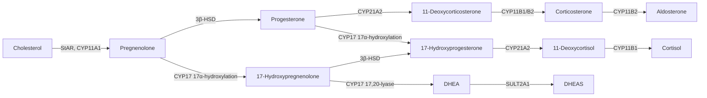

This chapter covers the two endocrine glands most closely tied to fuel and stress. The adrenal gland is "two glands in one." The outer cortex secretes **steroid hormones**: the glucocorticoids regulate metabolism and immunity and allow the body to withstand prolonged stress, while the mineralocorticoids regulate $\ce{Na+}$ and $\ce{K+}$. The inner medulla is part of the **sympathetic nervous system** and releases **epinephrine** within seconds. The islets scattered through the pancreas secrete **insulin** and **glucagon**, which hold blood glucose within the narrow range of $4$–$7\,\mathrm{mmol\,L^{-1}}$ on a time scale of minutes. We first treat the structure of the adrenal cortex and steroid synthesis (Section 35.1), the actions of glucocorticoids (Section 35.2) and the axis that regulates them (Section 35.3), the mineralocorticoids and adrenal androgens (Section 35.4), and the adrenal medulla (Section 35.5), and then compare them in the stress response (Section 35.6). We then turn to the islets (Sections 35.7–35.8), the integrated regulation of blood glucose (Section 35.9) and diabetes (Section 35.10), and finally compare other animals (Section 35.11).

The molecular mechanisms of hormone action (**G protein-coupled receptors** and **second messengers**, **receptor tyrosine kinases**, **nuclear receptors**) are treated in [7.1.14](/7.1.14) and [7.1.15](/7.1.15); the regulation of the individual metabolic pathways by insulin, glucagon and epinephrine, the metabolic switch between the **absorptive state** and fasting, the Bergman minimal model, and the classification and diagnosis of diabetes are treated in [7.1.29](/7.1.29). We do not repeat them here, and instead discuss secretion, regulation and integration at the level of the organ. The quantitative principles of hormone transport, portal systems and paracrine signaling are in [Chapter 33](/7.14.33), and the action of aldosterone on the kidney is in Chapter 24.

## 35.1. Structure of the Adrenal Cortex and Steroid Synthesis

### 35.1.1. Cortex and Medulla

The two human adrenal glands each weigh about $4$–$5\,\mathrm{g}$ and sit on the upper poles of the kidneys. The cortex makes up about $80\%$–$90\%$ of the gland and is derived from the **mesoderm** (it arises from the same adrenogonadal primordium as the gonads, which explains why the two share the same steroidogenic enzymes); the medulla is derived from the **neural crest** and is a cluster of modified sympathetic postganglionic neurons.

Blood enters from subcapsular arteries, flows centripetally through radial sinusoids in the cortex to the medulla, and then drains into the central vein. The medulla therefore receives blood that has passed through the cortex and contains a very high concentration of cortisol. This is a portal-like arrangement ([Chapter 33](/7.14.33)), whose significance is discussed in Section 35.5.1.

From the outside inward, the cortex has three layers that secrete three different classes of steroids:

| Zone | Share of cortex | Main product | Key enzymes | Main regulation |
|---|---|---|---|---|
| Zona glomerulosa | about $15\%$ | Aldosterone (mineralocorticoid) | Aldosterone synthase CYP11B2 (only in this zone) | Angiotensin II, plasma $\ce{K+}$ |
| Zona fasciculata | about $75\%$ | Cortisol (glucocorticoid) | 17α-Hydroxylase CYP17, 11β-hydroxylase CYP11B1 | ACTH |
| Zona reticularis | about $10\%$ | Dehydroepiandrosterone (DHEA) and its sulfate (DHEAS) | 17,20-Lyase activity of CYP17, sulfotransferase | ACTH |

**Definition 35.1.1 (Glucocorticoids and Mineralocorticoids)** Among the 21-carbon steroid hormones secreted by the adrenal cortex, those that act mainly on carbohydrate, protein and fat metabolism and suppress inflammation and immunity (in humans chiefly cortisol) are called **glucocorticoids**; those that act mainly on epithelia such as the distal nephron and regulate $\ce{Na+}$ and $\ce{K+}$ transport (chiefly aldosterone) are called **mineralocorticoids**.

The two names come from bioassays of the 1940s and not from a strict chemical classification: cortisol also has weak mineralocorticoid activity and at high doses can cause salt and water retention.

### 35.1.2. Steroid Synthesis

All adrenocortical hormones are synthesized from **cholesterol**; about $80\%$ of the substrate comes from plasma low-density lipoprotein (taken up through the **LDL receptor**), and the rest is synthesized in the cell or derived from cholesteryl esters in lipid droplets. Synthesis has three characteristic features:

1. The rate-limiting step is the entry of cholesterol into the inner membrane of the **mitochondria**. Steroidogenic acute regulatory protein (StAR) transports cholesterol from the outer to the inner mitochondrial membrane, where the side-chain cleavage enzyme CYP11A1 converts it to pregnenolone. ACTH increases the activity and synthesis of StAR within minutes; this is its acute action.
2. Synthesis is secretion. Steroids are lipid-soluble and cannot be stored in vesicles; they diffuse out of the cell as soon as they are made, so regulating the secretion rate means regulating the synthesis rate.
3. The product is determined by the enzymes of each zone. The reactions after pregnenolone alternate between mitochondria and the **endoplasmic reticulum**: 3β-hydroxysteroid dehydrogenase, 21-hydroxylase (CYP21A2) and 11β-hydroxylase act in turn. In the zona glomerulosa, which lacks CYP17, the pathway leads to corticosterone, and CYP11B2 then forms aldosterone through 18-hydroxylation and 18-oxidation; in the zona fasciculata, which has CYP17, 17α-hydroxylation occurs first and the final product is cortisol; in the zona reticularis, the 17,20-lyase activity of CYP17 cleaves off the side chain to give the 19-carbon androgen precursor DHEA.

The logic of this pathway is easy to see in a common genetic disease.

**Example 35.1.1 (21-Hydroxylase Deficiency)** More than $90\%$ of cases of congenital adrenal hyperplasia are CYP21A2 defects (about $1/15\,000$ of newborns). Cortisol synthesis is blocked, **negative feedback** on the pituitary is lost, ACTH stays elevated, and the adrenal cortex becomes hyperplastic; the accumulated 17-hydroxyprogesterone is diverted by CYP17 toward androgens, and the external genitalia of a female fetus are virilized. In the severe form aldosterone is also lacking, and within a few weeks after birth salt wasting, hyponatremia, hyperkalemia and shock appear. Treatment is replacement with a glucocorticoid (plus a mineralocorticoid when needed), which both replaces the missing hormone and, through negative feedback, suppresses ACTH and so reduces the excess synthesis of androgens. The loss of one enzyme, acting through a negative feedback loop, thus causes deficiency of one hormone and excess of another at the same time.

An adult secretes about $15$–$20\,\mathrm{mg}$ of cortisol per day, with a morning plasma concentration of about $140$–$700\,\mathrm{nmol\,L^{-1}}$ ($5$–$25\,\mathrm{\mu g\,dL^{-1}}$); aldosterone is only about $0.1$–$0.15\,\mathrm{mg}$ per day, with a plasma concentration of about $0.1$–$0.4\,\mathrm{nmol\,L^{-1}}$, about three orders of magnitude lower than cortisol; DHEAS is the steroid with the highest plasma concentration (in the $\mathrm{\mu mol\,L^{-1}}$ range).

## 35.2. Glucocorticoids

### 35.2.1. Transport, Metabolism and Receptors

About $80\%$–$90\%$ of plasma cortisol is bound to corticosteroid-binding globulin (CBG, also called transcortin), about $5\%$–$10\%$ to albumin, and only about $5\%$ is free (the free proportion rises when cortisol is high and CBG approaches saturation); the half-life is about $60$–$90\,\mathrm{min}$. CBG forms a buffer pool in plasma and is cleaved by neutrophil elastase at sites of **inflammation**, releasing cortisol locally ([Chapter 33](/7.14.33)). Cortisol is mainly reduced and conjugated with glucuronic acid in the liver and excreted in the urine. Aldosterone is only weakly protein-bound and has a half-life of only about $20\,\mathrm{min}$.

After entering the cell, a glucocorticoid binds the cytoplasmic glucocorticoid receptor (GR); the complex enters the nucleus and, as a transcription factor, binds response elements on DNA to activate or repress transcription. It can also inhibit the action of other transcription factors (**NF-κB**, AP-1) by binding to them (transrepression), which is the main mechanism of the anti-inflammatory effect ([7.1.15](/7.1.15)). Genomic actions take tens of minutes to hours to appear.

The tissue response to cortisol is also regulated by local metabolism. 11β-Hydroxysteroid dehydrogenase has two **isoenzymes**: type 1 (liver, adipose tissue, brain) reduces inactive cortisone to cortisol and amplifies glucocorticoid action locally; type 2 (renal collecting duct, colon, salivary gland, placenta) oxidizes cortisol to cortisone, so that the mineralocorticoid receptor responds only to aldosterone (see the discussion after Definition 24.6.2), and in the **placenta** protects the fetus from the high maternal cortisol level. The mineralocorticoid receptor (MR) has the same affinity for cortisol and aldosterone; in the brain (hippocampus) and other tissues that do not express the type 2 enzyme it is in effect a high-affinity cortisol receptor, already largely occupied at basal levels, whereas the low-affinity GR is heavily occupied only when cortisol is elevated (circadian peak, stress). This division of labor between the two receptors lets the same hormone signal in two concentration ranges.

### 35.2.2. Metabolic Actions

The name glucocorticoid comes from the hormone's ability to raise blood glucose. Overall, its metabolic actions secure the glucose supply to the brain during fasting and stress, at the expense of protein in peripheral tissues:

| Tissue | Action | Result |
|---|---|---|
| Liver | Induces enzymes of **gluconeogenesis** (phosphoenolpyruvate carboxykinase, glucose-6-phosphatase) and of amino acid metabolism; increases glycogen storage | Hepatic glucose output increases; hepatic glycogen actually increases during fasting |
| Skeletal muscle, skin, bone, lymphoid tissue | Inhibits protein synthesis, activates the ubiquitin–proteasome pathway to break down protein, and exports amino acids | Supplies substrate for gluconeogenesis; with long-term excess, muscle wasting, thin skin and osteoporosis |
| Muscle, adipose tissue | Inhibits GLUT4 translocation and reduces glucose uptake and utilization | Peripheral insulin sensitivity falls ("steroid diabetes") |
| Adipose tissue | Exerts a **permissive action** on the lipolytic actions of catecholamines and **growth hormone**; with long-term excess, promotes deposition of truncal and visceral fat and loss of limb fat | Free fatty acids increase; central obesity |

These actions were discussed from the viewpoint of metabolic pathways in [7.1.29](/7.1.29#sec-29.3.5). Their physiological significance lies in the time scale: glucagon and epinephrine mobilize hepatic glycogen within minutes, but hepatic glycogen lasts only about a day; glucocorticoids induce the enzymes of **gluconeogenesis** within hours, so that during prolonged fasting and stress the body can keep generating glucose from protein (and from glycerol released by lipolysis). Adrenalectomized animals survive when fed but quickly become hypoglycemic when fasted.

### 35.2.3. Anti-Inflammatory and Immunosuppressive Actions

Glucocorticoids above physiological levels strongly suppress inflammatory and immune responses, which is why they are widely used as drugs (prednisone, dexamethasone):

- They suppress the production of inflammatory mediators: through the GR they inhibit the transcriptional activity of NF-κB and AP-1, reducing the synthesis of cytokines such as interleukins 1, 2 and 6 and tumor necrosis factor; they induce annexin A1 (also called lipocortin), which inhibits phospholipase $\mathrm{A_2}$, and they inhibit expression of cyclooxygenase 2, reducing the formation of **prostaglandins** and leukotrienes.
- They reduce vascular responses: they lower capillary permeability, reducing exudation and **edema**, and inhibit leukocyte **diapedesis** and migration to the site of inflammation.
- They change the distribution and lifespan of blood cells: blood lymphocytes and eosinophils fall (redistribution to bone marrow and lymphoid tissue, plus promotion of lymphocyte apoptosis), and neutrophils increase (released from the marginal pool and bone marrow); with long-term use the thymus and lymph nodes atrophy.

Why should physiological levels of cortisol suppress immunity? Munck and colleagues proposed in 1984 that the main role of the cortisol elevated in stress is not to "protect" the body but to limit the body's own defense reactions (inflammation, immunity, sympathetic activation) and prevent them from becoming excessive and damaging tissue. On this view, glucocorticoids are **negative feedback** elements in many defense responses: cytokines produced by inflammation (such as interleukins 1 and 6) stimulate the HPA axis, and the elevated cortisol in turn suppresses inflammation. Animals with adrenal insufficiency often die after infection or **endotoxin** injection from uncontrolled inflammation and shock rather than from the infection itself.

### 35.2.4. Permissive Action and Other Actions

Many actions of glucocorticoids are permissive (Chapter 32): the hormone does not itself cause a response but is a prerequisite for the action of other hormones. The two most important examples are:

- Cardiovascular: glucocorticoids maintain the responsiveness of vascular smooth muscle to catecholamines and angiotensin II (by maintaining expression of adrenergic receptors); without them the vascular response to pressor agents is weakened, hypotension develops, and shock can occur under stress.
- Metabolic: the hyperglycemic and lipolytic actions of glucagon and epinephrine are greatly weakened in the absence of glucocorticoids.

Other actions:

- Kidney: they maintain the GFR and are required for excretion of a water load. Without glucocorticoids, ADH secretion cannot be fully suppressed, **water diuresis** does not occur after a large water intake, and hyponatremia develops easily.
- Bone: they inhibit **osteoblasts** and intestinal calcium absorption, and long-term excess leads to osteoporosis (Chapter 36).
- Central nervous system: they affect mood, sleep and memory; GR and MR are dense in the hippocampus, and long-term excess can cause euphoria, insomnia and even psychiatric symptoms.
- Stomach: they increase secretion of gastric acid and pepsinogen and reduce mucus, so long-term use readily induces ulcers.
- Development: they promote fetal lung maturation and induce type II alveolar cells to synthesize **pulmonary surfactant**; giving a glucocorticoid (betamethasone) to pregnant women at risk of preterm delivery markedly reduces respiratory distress syndrome in premature infants (Chapters 18 and 38).

## 35.3. The Hypothalamic–Pituitary–Adrenal Axis

### 35.3.1. CRH, ACTH and POMC

**Definition 35.3.1 (Hypothalamic–Pituitary–Adrenal Axis)** The regulatory system composed of corticotropin-releasing hormone (CRH) from the paraventricular nucleus of the hypothalamus, adrenocorticotropic hormone (ACTH) from the adenohypophysis and glucocorticoids from the adrenal cortex, linked by negative feedback of the glucocorticoids on the two upstream levels, is called the **hypothalamic–pituitary–adrenal axis** (HPA axis).

- CRH is a 41-amino-acid peptide synthesized by neuroendocrine cells in the parvocellular part of the paraventricular nucleus and released at the median eminence into the **hypothalamo-hypophyseal portal system** (Chapter 34). The same cells often co-secrete **antidiuretic hormone**, which strongly synergizes with CRH through the $\mathrm{V_{1b}}$ receptor and is especially important in chronic stress. CRH promotes the release and synthesis of ACTH through the $\mathrm{G_s}$–cyclic AMP pathway.
- ACTH is a 39-amino-acid peptide secreted by the corticotrophs of the adenohypophysis (about $15\%$–$20\%$ of adenohypophyseal cells). It is cleaved from a larger precursor, pro-opiomelanocortin (POMC); the same precursor also yields β-lipotropin and β-endorphin, and in other tissues (arcuate nucleus of the hypothalamus, skin) α-melanocyte-stimulating hormone (α-MSH, Chapter 30). The first 24 amino acids of ACTH carry all of its activity (synthetic ACTH$_{1\text{–}24}$ is used in stimulation tests), and the plasma half-life is about $10\,\mathrm{min}$.
- ACTH acts on the melanocortin type 2 receptor (MC2R, which needs the accessory protein MRAP to reach the cell membrane) of zona fasciculata and zona reticularis cells, through cAMP and **protein kinase A**: acutely (minutes) it promotes StAR and the supply of cholesterol, and chronically (days) it induces the various synthetic enzymes and promotes growth and blood flow of the cortex. When ACTH is lacking, the zona fasciculata and zona reticularis atrophy, whereas the zona glomerulosa is largely preserved because it is maintained by angiotensin II and $\ce{K+}$.

### 35.3.2. Circadian Rhythm and Pulses

Plasma cortisol has a pronounced **circadian rhythm**: it is highest around waking (about 6–8 a.m. in humans), declines through the afternoon, and is lowest around midnight after falling asleep, with a peak-to-trough difference of about fivefold; there is an additional rise 30–45 min after waking (the cortisol awakening response). The rhythm is driven by the biological clock of the **suprachiasmatic nucleus** acting through the paraventricular nucleus to control CRH secretion, while the adrenal's own molecular clock regulates its sensitivity to ACTH. Superimposed on the circadian rhythm are ultradian pulses about once an hour: ACTH and cortisol are secreted in pulses, with the largest pulse amplitude in the morning. In the nocturnal rat the corticosterone peak comes in the evening, at the start of the active period: glucocorticoids are highest at "the start of the day's activity," preparing for the fuel needs of the active phase.

### 35.3.3. Negative Feedback

Glucocorticoids inhibit the upstream levels of the axis at two sites: in the hypothalamus they inhibit the synthesis and release of CRH and antidiuretic hormone, and in the pituitary they inhibit POMC transcription and ACTH release; GR and MR in the hippocampus also take part in inhibiting the axis. Feedback has two temporal components: fast feedback appears within minutes, is sensitive to the rate of rise of cortisol, and probably acts through nongenomic mechanisms; delayed feedback appears after hours, depends on the level of cortisol, and inhibits POMC and CRH synthesis through genomic mechanisms.

Negative feedback has two clinical applications:

- Dexamethasone suppression test: dexamethasone is a potent synthetic glucocorticoid that is hardly detected in routine cortisol assays. After $1\,\mathrm{mg}$ of dexamethasone is given orally at midnight, the next morning's plasma cortisol in normal people falls below $50\,\mathrm{nmol\,L^{-1}}$ ($1.8\,\mathrm{\mu g\,dL^{-1}}$); failure of suppression suggests hypercortisolism.
- Consequences of long-term medication: long-term glucocorticoid use continuously suppresses CRH and ACTH, and the zona fasciculata of the adrenal cortex atrophies. When the drug is stopped abruptly, the atrophied adrenal cannot resume secretion immediately and acute adrenocortical insufficiency may occur, so the dose is tapered gradually to let the axis recover over weeks to months.

The HPA axis can be written as a three-stage negative feedback model. Let $R$, $A$ and $F$ be the concentrations of CRH, ACTH and cortisol (relative to basal values),

$$
\begin{aligned}
\frac{\mathrm{d}R}{\mathrm{d}t} &= \frac{c(t) + s(t)}{1 + [(F + D)/K_R]^{2}} - k_R R, \\
\frac{\mathrm{d}A}{\mathrm{d}t} &= \frac{a R}{1 + (F + D)/K_A} - k_A A, \\
\frac{\mathrm{d}F}{\mathrm{d}t} &= b A - k_F F,
\end{aligned}
\tag{35.1}
$$
where $c(t)$ is the circadian drive imposed by the suprachiasmatic nucleus, $s(t)$ is the stress input, and $D$ is exogenous dexamethasone (it takes part only in the feedback and is not measured as cortisol); $k_A$ and $k_F$ are set by the half-lives of ACTH (about $10\,\mathrm{min}$) and cortisol (about $70\,\mathrm{min}$).

![Three-stage negative feedback model of the HPA axis (Eq. (35.1); parameters are illustrative; half-lives of ACTH and cortisol taken as 10 and 70 min). A: Circadian rhythm of plasma cortisol (solid) and ACTH (dashed) over two days. The circadian drive is strongest in the morning, and cortisol peaks around waking and is lowest at midnight. A 1 h stress is applied at 14:00 on the second day; CRH and ACTH rise within minutes, and cortisol peaks at about 30–60 min and recovers within hours. B: Dexamethasone suppression test. After dexamethasone is given at midnight, the next morning's cortisol is pushed very low in the normal axis (blue); a pituitary ACTH adenoma (Cushing disease, green) has reduced sensitivity to feedback and cortisol is only partly suppressed; an autonomously secreting adrenal tumor (red) is not controlled by ACTH, so cortisol is not suppressed, while ACTH itself is already suppressed (not shown)](./plots/hpa-axis.py)

### 35.3.4. Stress

Stimuli of every kind that threaten homeostasis (trauma, surgery, infection, hemorrhage, hypoglycemia, strenuous exercise, cold, pain, and psychological threat) raise ACTH and cortisol within minutes; after major surgery cortisol secretion can reach about $75$–$150\,\mathrm{mg}$ per day, several times to nearly ten times the basal rate. Stress signals come from many brain regions (noradrenergic neurons of the brainstem, amygdala, prefrontal cortex) and from the periphery (inflammatory cytokines) and converge on the paraventricular nucleus. Strong stress can override negative feedback: ACTH remains elevated even when cortisol is already very high, equivalent to temporarily raising the set point of the feedback.

In 1936 Selye observed that a variety of different noxious stimuli all produced the same triad in rats (adrenal enlargement, atrophy of the thymus and lymphoid tissue, and gastric ulcers) and proposed the concept of the "general adaptation syndrome" with its alarm, resistance and exhaustion stages. We now see the triad as the expression of HPA activation: the trophic action of ACTH enlarges the adrenals, cortisol suppresses lymphoid tissue, and the gastric ulcers result from the action of cortisol on the gastric mucosa together with mucosal ischemia caused by sympathetic activation. Long-term, repeated stress keeps the axis continuously activated and is associated with visceral fat accumulation, **insulin resistance**, hypertension, reduced immunity and mood disorders.

### 35.3.5. Excess and Deficiency of Cortisol

| | Cushing syndrome (hypercortisolism) | Addison disease (primary adrenocortical insufficiency) |
|---|---|---|
| Cause | Most commonly exogenous glucocorticoid therapy; among endogenous causes about $70\%$ are pituitary ACTH adenomas (Cushing disease), followed by ectopic ACTH (e.g., small-cell lung cancer) and adrenal tumors | Autoimmune adrenalitis predominates in developed countries; historically tuberculosis |
| Hormones | Cortisol high; ACTH high in pituitary and ectopic forms, suppressed in adrenal forms | Cortisol and aldosterone both low; ACTH very high |
| Metabolism | Hyperglycemia, central obesity, moon face, "buffalo hump" | Hypoglycemia, weight loss, weakness |
| Protein catabolism | Proximal muscle weakness, thin skin, purple striae, easy bruising, osteoporosis | — |
| Cardiovascular and electrolytes | Hypertension, hypokalemia (with excess cortisol 11β-hydroxysteroid dehydrogenase 2 is saturated and cortisol acts on the MR) | Hypotension, hyponatremia, hyperkalemia, **metabolic acidosis** (lack of aldosterone) |
| Skin | — | Hyperpigmentation (POMC and ACTH elevated, acting on MC1R of melanocytes) |
| Immunity and stress | Susceptible to infection, poor wound healing | Acute adrenal crisis (shock) can occur under stress, requiring a larger glucocorticoid dose |

The contrast between the two diseases illustrates the physiological significance of the various actions in Section 35.2. Localizing the lesion uses feedback: high ACTH with low cortisol suggests a primary adrenal origin; both low suggests the pituitary or hypothalamus (secondary), in which case aldosterone is maintained by the RAAS, and there is no hyperkalemia and no hyperpigmentation; high-dose dexamethasone can partly suppress ACTH from a pituitary adenoma but cannot suppress ectopic ACTH or an adrenal tumor.

## 35.4. Mineralocorticoids and Adrenal Androgens

### 35.4.1. Control of Aldosterone Secretion

The actions of **aldosterone** (Definition 24.6.2) were covered in Chapter 24: in the distal nephron and collecting duct it promotes $\ce{Na+}$ reabsorption and $\ce{K+}$ and $\ce{H+}$ secretion, with similar actions in the colon, sweat glands and salivary glands. Its secretion has four regulators, in order of importance:

1. Angiotensin II: through the $\mathrm{AT_1}$ receptor of zona glomerulosa cells ($\mathrm{G_q}$–$\mathrm{IP_3}$–$\ce{Ca^2+}$) it promotes aldosterone synthesis, and in the long term also causes hyperplasia of the zona glomerulosa and induces CYP11B2. This is the link by which the **renin–angiotensin–aldosterone system** couples extracellular fluid volume to aldosterone.
2. Plasma $\ce{K+}$: the resting membrane potential of zona glomerulosa cells is set by $\ce{K+}$ channels and is extremely sensitive to extracellular $[\ce{K+}]$. A rise in $[\ce{K+}]$ causes **depolarization** of the cell and opens T-type and L-type voltage-gated $\ce{Ca^2+}$ channels, and $\ce{Ca^2+}$ influx promotes aldosterone synthesis; a rise in plasma $[\ce{K+}]$ of less than $1\,\mathrm{mmol\,L^{-1}}$ can increase aldosterone secretion several-fold. This is a direct negative feedback: aldosterone promotes renal $\ce{K+}$ excretion and lowers plasma $[\ce{K+}]$ without passing through the RAAS.
3. ACTH: it acutely increases aldosterone secretion, but the effect is brief; in the long term it acts mainly in a permissive way.
4. A fall in plasma $\ce{Na+}$ has a weaker direct effect; **atrial natriuretic peptide** and dopamine inhibit aldosterone secretion.

Excess aldosterone secretion (primary aldosteronism, Conn syndrome, usually caused by a zona glomerulosa adenoma or hyperplasia; some adenomas carry mutations in the $\ce{K+}$ channel KCNJ5 that keep the cell continuously depolarized) presents as hypertension, hypokalemia and **metabolic alkalosis**, with suppressed renin. Edema is rare, however: after a few days of expansion of the **extracellular fluid** volume, **pressure natriuresis** and atrial natriuretic peptide bring $\ce{Na+}$ excretion back to equal intake, which is called "escape" from aldosterone; $\ce{K+}$ and $\ce{H+}$ secretion do not escape, so hypokalemia persists. It is one of the most common curable causes of essential-appearing hypertension (about $5\%$–$10\%$ of hypertension).

### 35.4.2. Adrenal Androgens

The DHEA, DHEAS and androstenedione secreted by the zona reticularis have very weak androgenic activity themselves and act only after being converted to testosterone and estrogens in peripheral tissues. In men their role is much smaller than that of testosterone secreted by the testes; in women, adrenal androgens converted peripherally provide a considerable fraction of the androgen supply and maintain the growth of pubic and axillary hair and libido.

The secretion of adrenal androgens has a distinctive age pattern: the zona reticularis begins to develop at about 6–8 years of age and DHEAS rises (adrenarche, which precedes puberty), peaks at 20–30 years, and thereafter declines continuously, reaching only $10\%$–$20\%$ of the peak by 70–80 years. This change is not regulated by gonadotropins, and its mechanism and significance are not yet fully understood. The fetal adrenal has a huge "fetal zone" that secretes large amounts of DHEAS, the substrate for placental estrogen synthesis (Chapter 38).

## 35.5. The Adrenal Medulla

### 35.5.1. Chromaffin Cells and Catecholamine Synthesis

The main cells of the medulla are chromaffin cells (named for the brown color they take on with chromium salts), which are equivalent to sympathetic postganglionic neurons without axons: they receive cholinergic innervation (nicotinic receptors) from sympathetic preganglionic fibers in the greater splanchnic nerve and, when excited, release catecholamines into the blood by **exocytosis**. The medulla and the sympathetic nerves therefore form a unit, the **sympathoadrenal system** (Chapter 7).

Catecholamines are synthesized from tyrosine:

$$
\text{tyrosine} \xrightarrow{\text{tyrosine hydroxylase}} \text{DOPA} \xrightarrow{\text{aromatic amino acid decarboxylase}} \text{dopamine} \xrightarrow{\text{dopamine }\beta\text{-hydroxylase}} \text{norepinephrine} \xrightarrow{\text{PNMT}} \text{epinephrine}
$$

Tyrosine hydroxylase is the rate-limiting enzyme; it is feedback-inhibited by the products, rapidly activated by nerve impulses through phosphorylation, and slowly induced transcriptionally. Dopamine β-hydroxylase is inside the secretory vesicle and PNMT (phenylethanolamine N-methyltransferase) is in the cytosol, so norepinephrine must leave the vesicle to be methylated and then be loaded into vesicles again. PNMT is induced by a high concentration of cortisol: this is the significance of the portal-like blood flow of Section 35.1.1, since only by being bathed in the high cortisol concentration from the cortex can the medulla convert most of its norepinephrine to epinephrine. The human adrenal medulla secretes catecholamines that are about $80\%$ epinephrine and $20\%$ norepinephrine; plasma norepinephrine comes mainly from spillover from sympathetic nerve endings.

Catecholamines are stored in dense-core vesicles together with chromogranins, ATP and enkephalin and are released together. The plasma half-life is only about $2\,\mathrm{min}$; they are degraded by monoamine oxidase and catechol-O-methyltransferase, and the metabolites (metanephrines, vanillylmandelic acid) are excreted in the urine.

### 35.5.2. Actions and the Emergency Reaction

Epinephrine has strong actions on both $\alpha$ and $\beta$ receptors, whereas norepinephrine acts mainly on $\alpha$ and $\beta_1$ receptors and weakly on $\beta_2$ receptors (for the distribution of receptors see Chapter 7). Circulating epinephrine acts much like the sympathetic nerves, with three differences: it reaches all tissues, including cells with no direct sympathetic innervation (such as most hepatocytes); its action lasts about 5–10 times longer than the neural action; and its metabolic action is stronger.

| System | Actions of epinephrine | Receptor |
|---|---|---|
| Heart | Heart rate and contractility increase; **cardiac output** increases | $\beta_1$ |
| Blood vessels | Constriction of skin and visceral vessels, dilation of skeletal muscle and hepatic vessels (**total peripheral resistance** changes little at physiological concentrations) | $\alpha_1$; $\beta_2$ |
| Respiration | Bronchodilation | $\beta_2$ |
| Liver | Glycogenolysis and gluconeogenesis; blood glucose rises | $\beta_2$ (human), $\alpha_1$ |
| Skeletal muscle | Glycogenolysis; lactate output increases | $\beta_2$ |
| Adipose tissue | Lipolysis; plasma free fatty acids can rise several-fold | $\beta_1$, $\beta_3$ |
| Islets | Inhibits insulin and promotes glucagon secretion | $\alpha_2$; $\beta$ |
| Metabolic rate | Increases by $20\%$–$30\%$, approaching a doubling with strong stimulation | — |

In the early twentieth century Cannon did a series of experiments with cats: when a cat faced a dog, a substance appeared in the blood that relaxed an isolated intestinal segment (epinephrine), blood glucose rose, and **blood coagulation** was faster. In 1915 he called this whole-body mobilization the *emergency reaction*, the "fight or flight" response: within seconds the sympathoadrenal system redirects energy and blood flow toward skeletal muscle, heart and brain in preparation for strenuous muscular activity. This work was also the starting point for his later concept of "**homeostasis**" (Chapter 1).

Animals whose adrenal medulla has been removed show no obvious abnormality under resting conditions, since the sympathetic nerves can compensate, but their ability to cope with cold, hypoglycemia or strenuous exercise is reduced. Conversely, a pheochromocytoma (a catecholamine-secreting tumor) causes paroxysmal hypertension, headache, sweating and palpitations, accompanied by hyperglycemia and a raised metabolic rate.

## 35.6. The Neuroendocrine Division of Labor in the Stress Response

In stress the sympathetic nerves, the adrenal medulla and the HPA axis act in succession, with time scales differing by several orders of magnitude ([Chapter 33](/7.14.33) discussed the quantitative basis of this division of labor):

| Signal | Onset | Duration | Main actions |
|---|---|---|---|
| Sympathetic nerves | about $1\,\mathrm{s}$ | Seconds | Heart rate, blood pressure, redistribution of blood flow |
| Epinephrine | Seconds to $1\,\mathrm{min}$ | Minutes (half-life about $2\,\mathrm{min}$) | Mobilizes hepatic glycogen and fat, dilates bronchi and muscle vessels |
| Glucagon up, insulin down | Minutes | Minutes to hours | Maintains hepatic glucose output |
| Nongenomic actions of cortisol | Minutes | — | Fast feedback, some membrane actions |
| Genomic actions of cortisol | $1$–$2\,\mathrm{h}$ | Hours to days | Gluconeogenesis, protein mobilization, permissive action on the responses above; suppresses inflammation and immunity, terminating and limiting the defense response |
| Antidiuretic hormone, RAAS | Minutes to hours | Hours to days | Conserve water and $\ce{Na+}$, maintain blood volume |

This arrangement can be seen as a layered control system: fast, expensive, brief neural signals first deal with the immediate threat; slow, lasting hormonal signals then change metabolism and gene expression, fuel sustained expenditure, and gradually pull the system back to baseline. Cortisol both supports the stress response (permissive action) and limits it (suppressive action), and this apparent contradiction reflects its role as a slow negative feedback.

## 35.7. The Endocrine Pancreas: Islets and Insulin

### 35.7.1. Composition of the Islets

The human pancreas contains about one million islets (islets of Langerhans) scattered through it, each about $0.1$–$0.3\,\mathrm{mm}$ in diameter; together they make up only $1\%$–$2\%$ of the pancreatic mass but receive about $10\%$ of pancreatic blood flow. The islet is made up of five classes of endocrine cells:

| Cell | Share in human islets | Hormone |
|---|---|---|
| β cell | about $50\%$–$60\%$ | **Insulin**; also secretes C-peptide, amylin (islet amyloid polypeptide), $\ce{Zn^2+}$, GABA and others |
| α cell | about $30\%$–$40\%$ | **Glucagon** |
| δ cell | about $10\%$ | Somatostatin |
| PP cell (γ cell) | A few, concentrated in the pancreatic head | Pancreatic polypeptide |
| ε cell | $<1\%$ | **Ghrelin** |

In rodent islets the β cells are concentrated in the center and the α and δ cells at the periphery; in human islets the three cell types are intermingled, and more β cells are in direct contact with α cells. **Paracrine** signaling within the islet forms a local microcircuit ([Chapter 33](/7.14.33) discussed its range of action): insulin (together with co-released $\ce{Zn^2+}$ and GABA) inhibits α cells; somatostatin inhibits α and β cells; glucagon promotes β cell secretion through the GLP-1 receptor and the glucagon receptor. Venous blood from the islets drains into the portal vein, so the liver first receives very high concentrations of insulin and glucagon: the insulin concentration in the portal vein is 2–3 times that in peripheral blood, and about half is taken up during the first pass through the liver.

### 35.7.2. Synthesis and Clearance of Insulin

Insulin is a 51-amino-acid protein in which the A chain (21 residues) and B chain (30 residues) are joined by two interchain disulfide bonds, with one more disulfide bond within the A chain. It is first synthesized as preproinsulin (110 residues), the signal peptide is removed in the endoplasmic reticulum to give proinsulin (86 residues), and in the **secretory granule** prohormone convertases remove the connecting peptide (C-peptide, 31 residues) in the middle; mature insulin is stored as $\ce{Zn^2+}$-stabilized hexamer crystals. A β cell has about ten thousand secretory granules.

Insulin and C-peptide are secreted in equimolar amounts. The plasma half-life of insulin is only about $5$–$6\,\mathrm{min}$, and it is cleared mainly by the liver and kidney; C-peptide is not taken up by the liver and has a half-life of about $30\,\mathrm{min}$. Measuring plasma C-peptide therefore reflects the secretory capacity of β cells and is not confounded by injected exogenous insulin. An adult secretes about $30$–$50$ units of insulin per day (about $1$–$2\,\mathrm{mg}$), about half of it basal secretion between meals and at night.

### 35.7.3. Glucose Sensing by the β Cell

The mechanism by which the β cell converts blood glucose concentration into an insulin secretion rate was covered in [7.1.29](/7.1.29#sec-29.3.2): glucose enters through glucose transporters (mainly GLUT1 in humans, GLUT2 in rodents, both with transport capacity far above the rate of phosphorylation) and is phosphorylated by **glucokinase**; the ATP produced by metabolism raises the [ATP]/[ADP] ratio and closes the **ATP-sensitive potassium channel**, the cell depolarizes, voltage-gated $\ce{Ca^2+}$ channels open, and $\ce{Ca^2+}$ influx triggers granule exocytosis. From the physiological viewpoint, this mechanism has several key features:

- Glucokinase is the "glucose sensor." Its half-saturation concentration is about $8\,\mathrm{mmol\,L^{-1}}$, it has mild cooperativity (Hill coefficient about 1.7), and it is not inhibited by its product glucose-6-phosphate, so over the physiological glucose range the rate of glucose metabolism varies in proportion to blood glucose and determines the threshold for secretion (about $5\,\mathrm{mmol\,L^{-1}}$) and the half-maximal concentration (about $8$–$9\,\mathrm{mmol\,L^{-1}}$). Heterozygous inactivating mutations of glucokinase (MODY 2) shift the entire dose–response curve to the right by about $1$–$2\,\mathrm{mmol\,L^{-1}}$, and patients have mild, stable fasting hyperglycemia for life (about $5.5$–$8\,\mathrm{mmol\,L^{-1}}$) that generally needs no treatment, an example of a "set point" altered genetically; homozygous inactivation causes neonatal diabetes, and activating mutations cause hypoglycemia.
- The $\mathrm{K_{ATP}}$ channel determines excitability. Sulfonylureas bind the SUR1 subunit and close the channel, promoting insulin secretion; diazoxide opens the channel and inhibits secretion. Activating mutations of Kir6.2 or SUR1 make the channel unable to be closed by ATP and cause permanent neonatal diabetes; in 2006 it was found that these children can stop insulin and take high-dose sulfonylureas instead, a well-known example of ion channel physiology translated directly into treatment.
- Electrical activity is bursting. At glucose concentrations above about $7\,\mathrm{mmol\,L^{-1}}$, β cells generate bursts of $\ce{Ca^2+}$ action potentials separated by plateau phases; the higher the glucose, the larger the fraction of time occupied by bursts. The β cells within an islet are coupled by **gap junctions** (**connexin** 36) and fire synchronously; oscillations of glucose metabolism itself give islet $\ce{Ca^2+}$ and insulin secretion a period of about $5\,\mathrm{min}$, the islets of the whole pancreas are synchronized, and insulin in the portal vein is pulsatile. Pulsatile insulin acts more strongly on the liver than a continuous infusion with the same mean level (avoiding receptor **desensitization**, [Chapter 33](/7.14.33)), and in patients with **type 2 diabetes** the regularity of the pulses is impaired early.
- Triggering and amplification. The $\mathrm{K_{ATP}}$ channel–$\ce{Ca^2+}$ route is the "triggering" pathway; glucose metabolism also increases the efficacy of $\ce{Ca^2+}$ on exocytosis through an "amplifying" pathway independent of the $\mathrm{K_{ATP}}$ channel. Pharmacologically, when the $\mathrm{K_{ATP}}$ channel is held open with diazoxide and the cell is depolarized with high $\ce{K+}$ so that $\ce{Ca^2+}$ is clamped, glucose can still increase secretion about twofold, which shows that an amplifying pathway exists.

### 35.7.4. Biphasic Secretion

When blood glucose rises abruptly and is held at a high level (hyperglycemic clamp or perfusion of an isolated pancreas), insulin secretion is biphasic: the first phase rises rapidly to a peak within $1$–$2\,\mathrm{min}$ and declines after $5$–$10\,\mathrm{min}$; the second phase begins after about $15\,\mathrm{min}$, rises slowly and lasts until the end of the stimulus (up to $2$–$3\,\mathrm{h}$ in humans). In 1972 Grodsky proposed a "granule pool" explanation: only a very small fraction of the granules in the β cell (about $1\%$–$5\%$) are already docked at the plasma membrane and ready for release (the readily releasable pool); they are released first when $\ce{Ca^2+}$ rises and form the first phase; the later secretion depends on the rate at which new granules are "primed" from the reserve pool to a releasable state, and this rate itself increases slowly with glucose (the amplifying pathway), forming the second phase.

**Example 35.7.1 (Two-Pool Model of Biphasic Secretion)** Let $L$ be the granules in the readily releasable pool (relative amount) and let the secretion rate be $S = m\,\sigma(G)\,L$, where $\sigma(G)$ is the triggering signal (a sigmoidal function of glucose $G$, representing $\ce{Ca^2+}$); the pool is refilled from reserve granules at rate $p$, and $p$ approaches a level $p_\infty(G)$ that increases with glucose, with time constant $\tau_p$:

$$
\frac{\mathrm{d}L}{\mathrm{d}t} = p - m\,\sigma(G)\,L, \qquad \frac{\mathrm{d}p}{\mathrm{d}t} = \frac{p_\infty(G) - p}{\tau_p}.
$$
When glucose rises abruptly, $\sigma$ increases at once, the filled pool is emptied rapidly, and $S$ shows a sharp peak (the first phase, lasting about $1/(m\sigma)$, a few minutes); afterward $S \approx p$ and follows $p$ as it slowly rises with $\tau_p$ (ten-odd minutes) (the second phase). The area of the first phase depends on the pool size $L_0$, and the height of the second phase on $p_\infty$.

![Two-pool model of biphasic insulin secretion (Example 35.7.1; parameters are illustrative). A: Glucose rises from 5 to 15 mmol/L at t = 10 min and is held. The normal β cell (blue) first empties the readily releasable pool, producing a first phase peaking at 2–4 min; the refilling rate then rises slowly with glucose, producing a gradually rising second phase. When the readily releasable pool shrinks to 20% (red, resembling early type 2 diabetes) the first phase almost disappears while most of the second phase remains; when the refilling rate is also reduced (gray dashed) both phases are weakened. B: Static glucose dose–response curve: the secretion rate at 60 min is sigmoidal in glucose, with a threshold of about 5 mmol/L and a half-maximum at about 8–9 mmol/L; heterozygous inactivation of glucokinase (MODY 2, dashed) shifts the curve to the right by about 1.5 mmol/L](./plots/insulin-biphasic.py)

Loss of first-phase secretion is one of the earliest β cell defects in type 2 diabetes: once fasting glucose exceeds about $6.4\,\mathrm{mmol\,L^{-1}}$, the first-phase response to an intravenous glucose load is already largely lost. The physiological significance of the first phase is to suppress hepatic glucose output rapidly and limit the early postprandial rise in blood glucose.

### 35.7.5. Other Stimuli and Inhibitors

| Factor | Action | Mechanism and significance |
|---|---|---|
| Amino acids (arginine, leucine, etc.) | Stimulate, synergize with glucose | Cationic amino acids depolarize directly; leucine activates glutamate dehydrogenase; promotes amino acid utilization after a protein meal |
| Free fatty acids | Acutely stimulate | Through receptor FFAR1 (GPR40); long-term excess instead damages β cells |
| Incretins (GLP-1, GIP) | Stimulate, only when glucose is elevated | Secreted by L cells and K cells of the small intestine after eating; amplify glucose-stimulated secretion through $\mathrm{G_s}$–cAMP (Chapter 27) |
| Vagus nerve (acetylcholine) | Stimulates | Cephalic-phase secretion: feedforward around eating |
| Sympathetic nerves and epinephrine | Inhibit | $\alpha_2$ receptors ($\mathrm{G_i}$); insulin falls during exercise and stress, preserving glucose supply to tissues other than muscle and fat mobilization |
| Somatostatin | Inhibits | Paracrine action of δ cells |
| Growth hormone, cortisol, **thyroid hormone** | Indirectly stimulate | Raise blood glucose and lower insulin sensitivity; long-term excess can exhaust β cells |

**Definition 35.7.1 (Incretin Effect)** Insulin secretion after oral glucose is markedly greater than that produced when intravenous glucose brings blood glucose to the same level; this difference is called the **incretin effect**. It is mediated mainly by GLP-1 and GIP secreted by the small intestine and accounts for about $50\%$–$70\%$ of the insulin response to oral glucose in healthy people.

Incretins are a feedforward: they inform the islets of nutrients before the nutrients are absorbed into the blood, so that the rise in insulin keeps pace with the absorption of glucose. GLP-1 is degraded in plasma within minutes by dipeptidyl peptidase 4 (DPP-4); degradation-resistant GLP-1 receptor agonists and DPP-4 inhibitors have become important drugs for type 2 diabetes and obesity, and the former also reduce food intake and delay **gastric emptying** through receptors in the brain.

### 35.7.6. Actions of Insulin

Insulin is the hormone of the **absorptive state**: it causes glucose, amino acids and fatty acids to be stored. Its actions on the individual pathways and its signal transduction (the **insulin receptor**–IRS–PI3K–Akt and MAPK branches) are in [7.1.29](/7.1.29#sec-29.3.1); here we summarize only by organ:

| Organ | Carbohydrate | Lipid | Protein and other |
|---|---|---|---|
| Liver | Promotes glycogen synthesis and **glycolysis**, inhibits glycogenolysis and gluconeogenesis; glucose output falls rapidly | Promotes synthesis of fatty acids and triglycerides and VLDL secretion; inhibits ketogenesis | Promotes protein synthesis |
| Skeletal muscle | GLUT4 translocates to the membrane and glucose uptake increases (the main fate of postprandial glucose); glycogen synthesis increases | — | Promotes amino acid uptake and protein synthesis, inhibits breakdown |
| Adipose tissue | GLUT4 translocation, glucose uptake increases | Activates **lipoprotein lipase** and promotes triglyceride storage; strongly inhibits hormone-sensitive lipase | — |
| Whole body | — | — | Promotes entry of $\ce{K+}$, $\ce{Mg^2+}$ and phosphate into cells (activating the **Na⁺/K⁺-ATPase**); synergizes with growth hormone to promote growth |

Two dose-related facts are important: the insulin concentration needed to inhibit lipolysis is the lowest, that to inhibit hepatic glucose output is intermediate, and that to promote muscle glucose uptake is the highest. The residual insulin in type 2 diabetes is therefore often enough to suppress lipolysis and ketogenesis but not to control blood glucose. The action of insulin in driving $\ce{K+}$ into cells is used in emergencies: intravenous insulin plus glucose can lower dangerous hyperkalemia within tens of minutes.

## 35.8. Glucagon, Somatostatin and Pancreatic Polypeptide

### 35.8.1. Glucagon

Glucagon is a 29-amino-acid peptide. Its precursor proglucagon is cleaved to glucagon in α cells by prohormone convertase 2; the same precursor is cleaved in intestinal L cells by prohormone convertases 1/3 into GLP-1, GLP-2 and oxyntomodulin: one gene, two processing routes, hormones with opposing actions. The half-life of glucagon is about $5\,\mathrm{min}$, and it acts mainly on the liver (where the concentration in the portal vein is highest).

Through $\mathrm{G_s}$–cAMP–PKA it acts on hepatocytes: within minutes it activates glycogenolysis, multiplying hepatic glucose output; more slowly it promotes gluconeogenesis (inducing key enzymes and increasing amino acid uptake and urea synthesis); and it lowers malonyl-CoA, relieving the inhibition of carnitine palmitoyltransferase 1 and promoting fatty acid oxidation and the formation of **ketone bodies**. It has no action on human skeletal muscle and very little on adipose tissue.

The secretion of glucagon is regulated by the following factors:

- A fall in blood glucose promotes secretion and a rise inhibits it. The α cell can itself sense glucose, but withdrawal of signals from β cells within the islet (a fall in insulin, $\ce{Zn^2+}$ and GABA) and somatostatin are equally important: in hypoglycemia the "switching off of insulin" is a necessary signal for the rise in glucagon.
- Amino acids (especially alanine and arginine) promote secretion. After a protein meal insulin and glucagon rise together: if only insulin rose, a protein meal (containing almost no carbohydrate) would cause hypoglycemia; glucagon maintains hepatic glucose output and promotes amino acid breakdown. Glucagon promotes amino acid catabolism in the liver, and amino acids in turn promote glucagon secretion from α cells, so the two form a "liver–α cell" negative feedback loop: animals and people lacking the glucagon receptor have raised plasma amino acids and α cell hyperplasia.
- Sympathetic nerves ($\beta_2$), epinephrine and the vagus nerve promote secretion; insulin, somatostatin, GLP-1 and free fatty acids inhibit it.

### 35.8.2. Somatostatin and Pancreatic Polypeptide

The δ cells of the islet secrete somatostatin, a 14-amino-acid peptide (identical to the hypothalamic hormone that inhibits growth hormone; a 28-amino-acid form also occurs in the digestive tract). It is stimulated by glucose, amino acids and **gastrointestinal hormones**, locally inhibits α and β cells through $\mathrm{G_i}$-coupled receptors, and inhibits gastrointestinal motility, secretion and absorption. δ cells have long processes that can contact many cells. Tumors that secrete somatostatin cause a triad of diabetes, gallstones and steatorrhea, which reflects its inhibitory actions on the islets, gallbladder and digestion.

Pancreatic polypeptide (36 amino acids) is secreted after eating, mainly under vagal stimulation, and inhibits exocrine pancreatic secretion and gallbladder contraction; its secretion depends on an intact vagus nerve, so it is used as an index of vagal function. Amylin (37 amino acids), co-secreted with insulin by β cells, delays gastric emptying, inhibits postprandial glucagon secretion and produces satiety; in the islets of humans and cats with type 2 diabetes it aggregates into amyloid deposits.

## 35.9. Regulation of Blood Glucose

### 35.9.1. Blood Glucose Is a Tightly Controlled Quantity

Normal fasting plasma glucose is $3.9$–$5.6\,\mathrm{mmol\,L^{-1}}$ ($70$–$100\,\mathrm{mg\,dL^{-1}}$), and after a meal it generally does not exceed $7.8\,\mathrm{mmol\,L^{-1}}$. The lower limit matters because the brain uses almost only glucose (it can use **ketone bodies** extensively only after several days of starvation), about $120\,\mathrm{g}$ per day, more than half of the resting glucose utilization of the whole body, while the brain's own glycogen store lasts only a few minutes; the upper limit matters because long-term hyperglycemia damages blood vessels and nerves (Section 35.10), and above the **renal threshold for glucose** glucose is lost in the urine (Chapter 23).

**Example 35.9.1 (Turnover of the Blood Glucose Pool)** Glucose is distributed in about $15\,\mathrm{L}$ of **extracellular fluid** and part of the **intracellular fluid**; at $5\,\mathrm{mmol\,L^{-1}}$ the exchangeable glucose pool is about $75$–$100\,\mathrm{mmol}$ ($14$–$18\,\mathrm{g}$). In the **postabsorptive state** whole-body glucose utilization is about $2\,\mathrm{mg\,kg^{-1}\,min^{-1}}$, or about $8\,\mathrm{g\,h^{-1}}$ for a 70 kg person. If the liver suddenly stopped exporting glucose, the blood glucose pool would be exhausted in about $2\,\mathrm{h}$; in reality blood glucose hardly changes, which shows that hepatic output is matched to utilization moment by moment, with an error of no more than a few percent. Such precision requires a fast feedback: the half-lives of insulin and glucagon are only a few minutes, which suits this task ([Chapter 33](/7.14.33)).

### 35.9.2. The Hierarchy of Hyperglycemic Hormones

Insulin is the only hormone that lowers blood glucose, whereas several hormones raise it, and they are recruited in turn as glucose falls (approximate thresholds in terms of human venous plasma glucose):

| Blood glucose ($\mathrm{mmol\,L^{-1}}$) | Response |
|---|---|
| about $4.5$ | Insulin secretion decreases (first line of defense) |
| about $3.6$–$3.9$ | Glucagon and epinephrine secretion increase (glucagon is the second and epinephrine the third line of defense; epinephrine becomes critical when glucagon is lacking) |
| about $3.7$ | Growth hormone and cortisol secretion increase (their effects appear after several hours) |
| about $3.0$ | Autonomic symptoms: palpitations, sweating, tremor, hunger, prompting eating |
| $<2.8$ | Brain dysfunction: impaired attention, confusion; with a further fall, seizures and coma |

The logic of this hierarchy is that the fastest and least costly means is used first (reducing insulin), then glucagon, which acts only on the liver, then epinephrine, with its wide actions, and last cortisol and growth hormone, which change gene expression and are the most costly; the threshold for behavior (eating) is higher than that for impaired brain function, giving a warning before damage. In patients with **type 1 diabetes**, the injected insulin cannot be "switched off," and after several years of disease the glucagon response to hypoglycemia is lost, leaving only epinephrine; repeated hypoglycemia then shifts the threshold of the epinephrine response downward (hypoglycemia-associated autonomic failure), so patients may fall into severe hypoglycemia without warning symptoms.

The hyperglycemic hormones also act synergistically: when physiological increments of glucagon, epinephrine and cortisol are infused together in dogs and humans, the rise in blood glucose is larger than the sum of the rises when each is infused alone (experiments of 1979–1981). The permissive action of cortisol is the main source of this synergy; it also explains the marked hyperglycemia in stress, when all three rise together.

### 35.9.3. A Model of the Oral Glucose Tolerance Test

In the oral glucose tolerance test (OGTT) the fasting subject drinks $75\,\mathrm{g}$ of glucose, and blood glucose and insulin are measured over $2\,\mathrm{h}$; for the diagnostic criteria see [7.1.29](/7.1.29#sec-29.5.2). The Bergman minimal model in [7.1.29](/7.1.29#sec-29.3.6) describes the intravenous glucose tolerance test; here we extend it to an oral load by adding two compartments, stomach and small intestine, to describe glucose absorption, and letting insulin secretion respond to both blood glucose and incretins.

**Example 35.9.2 (A Model of the Oral Glucose Tolerance Test)** Let $Q_1$ and $Q_2$ be the amounts of glucose ($\mathrm{mmol}$) in the stomach and small intestine, $G$ the plasma glucose, $X$ the action of insulin in the interstitial space, and $I$ the plasma insulin,

$$
\begin{aligned}
\frac{\mathrm{d}Q_1}{\mathrm{d}t} &= -k_{\mathrm{e}} Q_1, \qquad
\frac{\mathrm{d}Q_2}{\mathrm{d}t} = k_{\mathrm{e}} Q_1 - k_{\mathrm{a}} Q_2, \qquad R_{\mathrm{a}} = f k_{\mathrm{a}} Q_2, \\
\frac{\mathrm{d}G}{\mathrm{d}t} &= -\left(S_{\mathrm{G}} + X\right) G + S_{\mathrm{G}} G_{\mathrm{b}} + \frac{R_{\mathrm{a}}}{V}, \qquad
\frac{\mathrm{d}X}{\mathrm{d}t} = -p_2 X + p_2 S_{\mathrm{I}} \left(I - I_{\mathrm{b}}\right), \\
\frac{\mathrm{d}I}{\mathrm{d}t} &= -n\left(I - I_{\mathrm{b}}\right) + \beta\left[\phi(G) - \phi(G_{\mathrm{b}})\right] + \iota R_{\mathrm{a}},
\end{aligned}
$$
where $k_{\mathrm{e}}$ and $k_{\mathrm{a}}$ are the rate constants of gastric emptying and absorption, $f$ is the fraction absorbed, $V$ is the volume of distribution of glucose, $S_{\mathrm{G}}$ and $S_{\mathrm{I}}$ are glucose effectiveness and insulin sensitivity (with the same meaning as in [7.1.29](/7.1.29#sec-29.3.6)), $n$ is the insulin clearance rate, $\phi(G)$ is the sigmoidal dose–response function of the β cell, $\beta$ is the secretory capacity of the β cell, and $\iota$ represents the incretin effect.

![Model of the oral glucose tolerance test (Example 35.9.2, 75 g glucose; parameters are illustrative). A: Plasma glucose. A normal person (blue) peaks at about 8 mmol/L at about 40 min and returns below 7.8 by 2 h; when insulin sensitivity falls to 1/4 while β cell secretory capacity increases compensatorily 2.5-fold (green), the glucose curve rises only mildly and stays in the normal range; with the same insulin resistance, β cell secretory capacity reduced to 0.4 times, and fasting glucose already raised to 7.5 mmol/L (red), the 2 h glucose exceeds 11.1 mmol/L, meeting the criterion for diabetes. Gray dashed lines are the two diagnostic thresholds, 7.8 and 11.1 mmol/L. B: Corresponding plasma insulin: the insulin response of the compensated subject is about 3 times that of the normal person (hyperinsulinemia); the insulin response of the decompensated subject is delayed and flat, far too small relative to the insulin resistance. C: The β cell secretory capacity needed to make the 2 h glucose exactly 7.8 mmol/L (taking the value required at normal insulin sensitivity as 1) as a function of insulin sensitivity; on log–log axes it is a straight line of slope −1, that is, the product of the two is constant (the disposition index). In this model the relation is exact, because the action of insulin is proportional to the product of sensitivity and amount secreted; in real populations the relation holds approximately](./plots/ogtt-model.py)

The conclusion of the model agrees with clinical studies (Kahn and colleagues, 1993): in people with normal glucose tolerance, insulin sensitivity is inversely proportional to the β cell secretory response, and the product of the two is approximately constant; this product is called the *disposition index*. **Insulin resistance** by itself does not necessarily cause hyperglycemia as long as the β cell can compensate; blood glucose rises only when β cell compensation fails to keep up and the disposition index falls. Type 2 diabetes is therefore the joint result of insulin resistance and inadequate β cell function, and the latter determines whether the disease appears.

## 35.10. Pathophysiology of Diabetes

The definition of **diabetes mellitus**, the distinction between **type 1 diabetes** and **type 2 diabetes**, and diagnostic criteria and treatment are in [7.1.29](/7.1.29#sec-29.5). Here we explain its main manifestations from the physiological viewpoint:

1. Hyperglycemia: when insulin is lacking or its action insufficient, muscle and adipose tissue take up less glucose, while hepatic glucose output is not suppressed (made worse by the relative excess of glucagon). Fasting hyperglycemia in type 2 diabetes comes mainly from excess hepatic output, and postprandial hyperglycemia mainly from inadequate peripheral uptake and loss of first-phase secretion.
2. Polyuria, thirst and polydipsia: when blood glucose exceeds about $10\,\mathrm{mmol\,L^{-1}}$ ($180\,\mathrm{mg\,dL^{-1}}$), the filtered glucose exceeds the **tubular transport maximum** and glucosuria appears (**renal threshold for glucose**, Chapter 23). Unreabsorbed glucose in the tubular fluid carries water with it, causing **osmotic diuresis**; the water loss raises plasma osmolality and causes thirst (Chapter 24).
3. Weight loss and polyphagia: glucose is lost in the urine (up to several hundred grams per day, equivalent to several thousand kilojoules), and protein and fat are broken down; the energy deficit sensed by the hypothalamus promotes feeding.
4. **Ketoacidosis**: when insulin is severely lacking (more common in type 1), lipolysis is released from inhibition and large amounts of free fatty acids enter the liver; the excess of glucagon then turns them toward ketogenesis. Acetoacetate and β-hydroxybutyrate are strong acids and cause a **metabolic acidosis** with a raised **anion gap** (Chapter 25); patients show deep, rapid Kussmaul breathing (respiratory compensation) and the smell of acetone. Osmotic diuresis causes severe dehydration and loss of $\ce{Na+}$ and $\ce{K+}$; because insulin deficiency and acidosis shift $\ce{K+}$ out of cells, plasma $[\ce{K+}]$ can be normal or even raised, masking a severe whole-body $\ce{K+}$ deficit, and after insulin treatment is begun $\ce{K+}$ moves quickly back into cells, so potassium must be given at the same time. In patients with type 2 diabetes the residual insulin suffices to suppress ketogenesis (Section 35.7.6), and in severe decompensation the more common picture is the hyperosmolar hyperglycemic state: extreme hyperglycemia, hyperosmolality and dehydration without marked ketosis.
5. Chronic complications: long-term hyperglycemia increases nonenzymatic glycation of proteins (**glycated hemoglobin** is its marker, [7.1.29](/7.1.29)), the polyol pathway and oxidative stress, damaging the microvasculature (retina, glomerulus, nerves) and the large vessels (atherosclerosis).

## 35.11. Evolution and Comparison

### 35.11.1. Interrenal Tissue and Chromaffin Tissue

The mammalian arrangement of "cortex surrounding medulla" is a special case among vertebrates. The steroid-synthesizing cells (called interrenal tissue in fishes and amphibians) and the chromaffin cells are arranged differently in different groups:

| Group | Steroid-synthesizing tissue (interrenal tissue) | Chromaffin tissue |
|---|---|---|
| Cyclostomes | Cell clusters scattered along the posterior cardinal vein | Scattered in vessel walls and the heart |
| Cartilaginous fishes | Separate gland between the two kidneys | Paired "suprarenal bodies" along the dorsal side of the kidney, separate from interrenal tissue |
| Bony fishes | Embedded in the head kidney (hematopoietic tissue remaining from the pronephros) and distributed along the posterior cardinal vein | Intermingled with or adjacent to interrenal tissue |
| Amphibians | Strips along the ventral surface of the kidney, intermingled with chromaffin cells | Same as left |
| Reptiles and birds | Discrete adrenal gland with the two tissues interleaved (in a cord-like interlacing in birds) | Same as left |
| Mammals | Cortex, divided into three zones | Medulla, surrounded by the cortex |

The trend of the two tissues from separate, to intermingled, to concentric arrangement may be related to the portal-like link by which cortisol induces PNMT: the separate chromaffin tissue of cartilaginous fishes secretes mainly norepinephrine, whereas the mammalian medulla secretes mainly epinephrine.

### 35.11.2. Evolution of Cortisol, Corticosterone and the Receptors

The main glucocorticoid differs among groups. Humans, most other mammals and bony fishes have cortisol as the main one; birds, reptiles, amphibians, and rats and mice have corticosterone as the main one (the adrenals of rats and mice do not express CYP17 and cannot perform 17α-hydroxylation). The main corticosteroid of cartilaginous fishes is 1α-hydroxycorticosterone, and that of lampreys is 11-deoxycortisol.

Aldosterone appears as the main mineralocorticoid only in tetrapods and lungfishes; bony fishes have almost no aldosterone, and cortisol acts as both glucocorticoid and mineralocorticoid through both GR and MR: when fish move from fresh water to seawater cortisol rises and induces proliferation of ion-transporting cells in the gill and expression of the **Na⁺/K⁺-ATPase**, promoting salt excretion; moving from seawater to fresh water depends mainly on **prolactin** (Chapter 34). Land-living tetrapods face the problem of conserving water and salt, and the aldosterone–MR system is adapted to it.

The evolution of the receptors provides a well-known example of "molecular exploitation." Thornton and colleagues (2006–2007) inferred and reconstructed in the laboratory the ancestral receptor of GR and MR (about 450 million years ago) and found that it could be activated by aldosterone, even though aldosterone appears only later in tetrapods. That is, the receptor's ability to bind aldosterone predates the hormone itself, and aldosterone "exploited" an existing receptor; GR later lost its response to aldosterone through a few amino acid substitutions and gained specificity for cortisol.

### 35.11.3. Diversity of Islets and Blood Glucose

- Origin of the islets: in cyclostomes the islet organ is separate from the exocrine pancreas, lies near the bile duct, and consists mainly of β cells and δ cells. In many bony fishes the endocrine tissue is gathered into a few large islets visible to the naked eye (Brockmann bodies); in 1922 Macleod and colleagues extracted insulin free of digestive enzymes from fish Brockmann bodies, showing that insulin comes from the islets and not from the exocrine gland. Insulin is a very ancient hormone whose sequence is fairly conserved among vertebrates; it was extracted from pig and bovine pancreas for therapy for a long time (porcine insulin differs from the human by only one amino acid).
- Birds: blood glucose is about $11$–$17\,\mathrm{mmol\,L^{-1}}$, 2–3 times that of mammals of the same size; skeletal muscle and adipose tissue lack GLUT4 and are relatively insensitive to insulin, and fat synthesis occurs mainly in the liver; glucagon is more important than in mammals. It has been reported that in some birds (such as ducks) pancreatectomy causes hypoglycemia rather than diabetes, which shows that loss of glucagon matters more than loss of insulin.
- Ruminants: **rumen** microbes ferment almost all dietary carbohydrate to volatile fatty acids (Chapter 28), and very little glucose is absorbed from the small intestine; blood glucose is only about $2.5$–$3.5\,\mathrm{mmol\,L^{-1}}$, the liver carries out **gluconeogenesis** continuously from propionate, and insulin secretion is also stimulated by propionate and butyrate. A lactating cow exports about $3\,\mathrm{kg}$ of glucose per day for lactose synthesis, almost all from gluconeogenesis.
- Cats: as obligate carnivores, cats have very low hepatic **glucokinase** activity, and gluconeogenesis continues without a marked fall after feeding. Feline amylin readily forms amyloid deposits, and diabetes in domestic cats is pathologically similar to human type 2 diabetes and is often associated with obesity.

### 35.11.4. Insulin-Like Peptides of Invertebrates

Insulin and the insulin-like growth factors belong to an ancient peptide family that exists in invertebrates as various insulin-like peptides and regulates growth, metabolism, reproduction and lifespan:

- *Caenorhabditis elegans* has about 40 insulin-like peptides but only one receptor, DAF-2 (the homolog of the insulin/IGF receptor), downstream of which are the PI3K–Akt pathway and the transcription factor DAF-16 (the homolog of FOXO). When food is lacking or the population is crowded, insulin-like signaling weakens and larvae enter a nonfeeding, stress-resistant diapause state (dauer). In 1993 Kenyon and colleagues found that partial loss-of-function mutations of *daf-2* roughly double the lifespan of adults, an effect that depends on DAF-16 and the first strong evidence that "a single gene regulates lifespan" ([7.5.37](/7.5.37)).
- *Drosophila* has 8 insulin-like peptides (dILP1–8). About 14 cells specialized for **neurosecretion** (insulin-producing cells) near the midline of the brain release dILP2, 3 and 5 into the hemolymph and are equivalent to "β cells in the brain"; when these cells are destroyed, flies are smaller, hemolymph sugar rises, and lifespan is extended. Adipokinetic hormone (AKH) secreted by the corpora cardiaca plays the role of glucagon, mobilizing glycogen and fat in the fat body; AKH cells also sense sugar concentration through $\mathrm{K_{ATP}}$ channels.

Thus the antagonistic design of "a glucose-lowering storage hormone versus a glucose-raising mobilizing hormone," and the mechanism that converts metabolic state into secretion through $\mathrm{K_{ATP}}$ channels, exist in both insects and vertebrates; but in invertebrates insulin-like signaling is more directly tied to growth, reproduction and lifespan, whereas vertebrates have divided these functions between two systems, insulin and IGF (for IGF see Chapter 34).

## Summary

| Topic | Key points |
|---|---|
| Adrenal cortex | Three zones: zona glomerulosa (aldosterone, CYP11B2), zona fasciculata (cortisol), zona reticularis (DHEA); glucocorticoids and mineralocorticoids (Definition 35.1.1); StAR is rate-limiting, synthesis is secretion; 21-hydroxylase deficiency causes deficiency and excess at once through negative feedback (Example 35.1.1) |
| Glucocorticoids | CBG binds 75%–90%, half-life 60–90 min; two-range division of labor between GR and MR, 11β-HSD1 and 2; secure brain glucose at the expense of peripheral protein; anti-inflammatory and immunosuppressive (negative feedback limiting defense responses); permissive action (vascular reactivity, hyperglycemic effects); water excretion, bone, brain, fetal lung |
| HPA axis | Definition 35.3.1; CRH (41 aa) synergizes with ADH, ACTH (39 aa, from POMC); circadian rhythm (morning peak) and ultradian pulses; fast and delayed negative feedback; dexamethasone suppression test; three-stage feedback model, Eq. (35.1); stress overrides feedback; contrast of Cushing and Addison |
| Aldosterone | Ang II, plasma $\ce{K+}$ (direct negative feedback), ACTH; "escape" in Conn syndrome; age pattern of adrenal androgens |
| Adrenal medulla | Chromaffin cells are sympathetic postganglionic neurons; tyrosine → DOPA → dopamine → norepinephrine → epinephrine, PNMT induced by cortisol; 80% epinephrine; half-life about 2 min; emergency reaction (Cannon) |
| Division of labor in stress | Sympathetic (seconds) → epinephrine (minutes) → islet hormones (minutes–hours) → cortisol (hours–days) |
| Islets | β/α/δ/PP/ε; portal first pass; insulin 51 aa, C-peptide, half-life 5–6 min; glucokinase sensor (MODY 2), $\mathrm{K_{ATP}}$ (sulfonylureas, neonatal diabetes), bursting and 5 min pulses; two-pool model of biphasic secretion (Example 35.7.1); incretin effect (Definition 35.7.1) |
| Glucagon and others | 29 aa, same gene as GLP-1; acts only on the liver; protein meals and the "liver–α cell" loop; somatostatin, pancreatic polypeptide, amylin |
| Blood glucose regulation | Blood glucose pool turns over in about 2 h (Example 35.9.1); hyperglycemic hormones are layered by threshold and act synergistically; OGTT model (Example 35.9.2): insulin sensitivity × β cell response approximately constant |
| Diabetes | Hyperglycemia, osmotic diuresis, weight loss, ketoacidosis (hidden potassium deficit), hyperosmolar state, chronic complications |
| Evolution | Interrenal and chromaffin tissue from separate to concentric; cortisol and corticosterone; no aldosterone in bony fishes; receptor older than aldosterone; hyperglycemia in birds and the role of glucagon; ruminants and cats; nematode DAF-2 and lifespan, insulin-producing cells and AKH in the fly |

## Questions

1. A patient who had long taken high-dose prednisone for rheumatoid arthritis stops it abruptly and develops weakness, hypotension and hypoglycemia, but plasma potassium is normal and there is no hyperpigmentation. Explain these findings and say why they differ from Addison disease.

   **Answer** Long-term exogenous glucocorticoid suppresses CRH and ACTH through **negative feedback**, and the zona fasciculata and zona reticularis atrophy; after abrupt withdrawal neither the atrophied adrenal nor the suppressed pituitary can recover at once, causing secondary adrenocortical insufficiency: lack of cortisol leads to hypoglycemia (inadequate gluconeogenesis), hypotension (loss of the permissive action on catecholamines) and weakness. The zona glomerulosa is maintained by the RAAS and $\ce{K+}$ and aldosterone is essentially normal, so there is no hyperkalemia; ACTH is low rather than high, so there is no hyperpigmentation. In Addison disease the adrenal itself is damaged, cortisol and aldosterone are both lacking, and ACTH and POMC products are very high because feedback is lost.
2. Why does Cushing syndrome often show hypokalemia and hypertension, while the mineralocorticoid action of cortisol is almost invisible in normal people?

   **Answer** Cortisol has the same affinity for the MR as aldosterone and is present at about 1000-fold higher concentration; normally 11β-hydroxysteroid dehydrogenase 2 in **principal cells** of the renal collecting duct oxidizes cortisol entering the cell to cortisone, so that the MR responds only to aldosterone. With excess cortisol this enzyme is saturated, and the surplus cortisol occupies the MR and promotes $\ce{Na+}$ reabsorption and $\ce{K+}$ secretion, causing hypertension and hypokalemia (in the ectopic ACTH syndrome cortisol is highest and hypokalemia is also most marked). In addition, glucocorticoids increase the vascular response to vasoconstrictors, which also contributes to hypertension.
3. Use the two-pool model of Example 35.7.1 to explain how a drug that enlarges only the readily releasable pool without changing the refilling rate would affect first-phase and second-phase secretion. What if it increased only the refilling rate?

   **Answer** The area of the first phase is approximately equal to the initial pool size $L_0$, so enlarging the pool strengthens the first phase; in the second phase $S \approx p$ is set by the refilling rate and is essentially unchanged. If only the refilling rate is increased (larger $p_\infty$), the second phase rises; the resting pool is also fuller before stimulation because refilling is faster (little effect if the upper limit of the pool is unchanged), so the first phase changes little. Experimentally, GLP-1 and others acting through cAMP increase both the priming of granules (enlarging the releasable pool) and refilling, so both phases are enhanced.
4. A patient with type 1 diabetes stops injecting insulin because of vomiting and two days later shows deep, labored breathing, with blood glucose $28\,\mathrm{mmol\,L^{-1}}$, plasma $[\ce{Na+}] = 130$, $[\ce{Cl-}] = 95$, $[\ce{HCO3-}] = 8\,\mathrm{mmol\,L^{-1}}$, and plasma $[\ce{K+}] = 5.5\,\mathrm{mmol\,L^{-1}}$. Calculate the anion gap and explain the origin of the acid–base disturbance; why does plasma potassium fall rapidly during treatment?

   **Answer** **Anion gap** $= 130 - (95 + 8) = 27\,\mathrm{mmol\,L^{-1}}$, well above the normal of about $12$; this is a **metabolic acidosis** caused by unmeasured anions (acetoacetate and β-hydroxybutyrate). Insulin deficiency removes the inhibition of lipolysis, and the excess of glucagon makes the liver turn fatty acids toward ketogenesis. The deep, labored breathing is respiratory compensation. Osmotic diuresis and vomiting cause a large whole-body loss of $\ce{K+}$, but insulin deficiency, hyperosmolality and acidosis shift $\ce{K+}$ out of cells, so plasma $[\ce{K+}]$ is instead on the high side; after insulin is injected the **Na⁺/K⁺-ATPase** is activated and the acidosis is corrected, $\ce{K+}$ moves quickly back into cells, and without potassium replacement dangerous hypokalemia can occur.
5. Why does glucagon rise after a protein meal but fall after a carbohydrate meal? If there were insulin but no glucagon, what would happen after a meal of pure meat?

   **Answer** After a carbohydrate meal blood glucose rises and β cells secrete insulin; insulin and the elevated glucose inhibit α cells, glucagon falls, and the liver switches to storage. The amino acids of a protein meal stimulate both β cells and α cells: insulin promotes entry of amino acids into muscle for protein synthesis, but it also suppresses hepatic glucose output and increases glucose uptake; since the meal contains almost no glucose, without the opposition of glucagon blood glucose would fall and hypoglycemia could occur. Glucagon maintains hepatic glycogenolysis and gluconeogenesis and promotes hepatic breakdown of surplus amino acids and urea synthesis, keeping blood glucose stable.
6. (Open question) The blood glucose of birds is 2–3 times that of mammals, yet birds rarely show the vascular damage that hyperglycemia causes in mammals. Propose several possible explanations and say how to test them.

   **Answer** Possible explanations include: (1) the rate of glycation of avian plasma proteins (such as albumin) and hemoglobin is lower, or avian erythrocytes are poorly permeable to glucose (they take up very little glucose), so the flux through intracellular glycation and the polyol pathway is small; (2) birds have stronger antioxidant and advanced glycation end product clearance mechanisms; (3) hyperglycemia is the physiological set point in birds, and tissue glucose transport (lack of GLUT4 and so on) keeps intracellular glucose from rising, whereas damage in human diabetes comes from an excess of intracellular glucose and metabolic flux. Tests: compare glycation rates of plasma proteins and hemoglobin in birds and mammals at the same glucose (in vitro incubation); measure intracellular glucose, sorbitol and advanced glycation end products in tissues; compare expression of antioxidant enzymes and the receptor for advanced glycation end products; raise blood glucose further in birds and look for damage.
