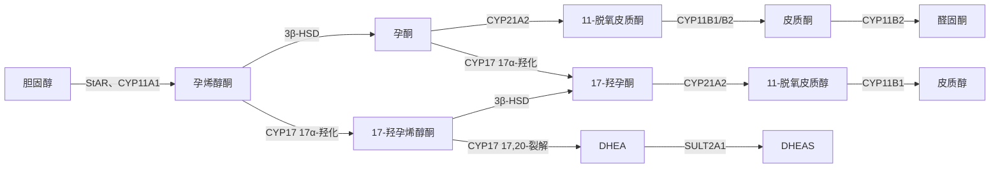

这一章讲两组与燃料和应激关系最密切的内分泌腺。肾上腺是"两个腺体合在一起"：外层的皮质分泌**类固醇激素**，其中糖皮质激素调节代谢与免疫、使机体能够承受长时间的应激，盐皮质激素调节 $\ce{Na+}$ 与 $\ce{K+}$；内层的髓质是**交感神经系统**的一部分，在几秒钟内释放**肾上腺素**。胰腺中散布的胰岛分泌**胰岛素**与**胰高血糖素**，以分钟为尺度把血糖维持在 $4$–$7\,\mathrm{mmol\,L^{-1}}$ 的窄范围内。本章先讲肾上腺皮质的结构与类固醇合成（35.1 节）、糖皮质激素的作用（35.2 节）与它的调节轴（35.3 节）、盐皮质激素与肾上腺雄激素（35.4 节）、肾上腺髓质（35.5 节），再把它们放在应激反应中比较（35.6 节）；然后讲胰岛（35.7–35.8 节）、血糖的整体调节（35.9 节）与糖尿病（35.10 节），最后比较其他动物（35.11 节）。

激素作用的分子机制——**G 蛋白偶联受体**与**第二信使**、**受体酪氨酸激酶**、**核受体**——见 [7.1.14](/7.1.14) 与 [7.1.15](/7.1.15)；胰岛素、胰高血糖素与肾上腺素对各条代谢通路的调节、**吸收期**与禁食的代谢转换、Bergman 极小模型与糖尿病的分型和诊断见 [7.1.29](/7.1.29)。本章不重复这些内容，而讲器官层面的分泌、调节与整合。激素运输、门脉与旁分泌的定量原理见[第 33 章](/7.14.33)，醛固酮对肾的作用见第 24 章。

## 35.1. 肾上腺皮质的结构与类固醇合成

### 35.1.1. 皮质与髓质

人的两个肾上腺各重约 $4$–$5\,\mathrm{g}$，位于肾的上极。皮质约占腺体的 $80\%$–$90\%$，来自**中胚层**（与性腺来自同一个肾上腺–性腺原基，这解释了两者的类固醇合成酶相同）；髓质来自**神经嵴**，是一群变形的交感节后神经元。

血液从被膜下的动脉进入，经皮质中放射状的血窦向心流向髓质，再汇入中央静脉。于是髓质接受的是流经皮质、含有很高浓度皮质醇的血液——这是一种门脉式的排列（[第 33 章](/7.14.33)），它的意义在 35.5.1 节讨论。

皮质由外向内分为三层，分泌三类不同的类固醇：

| 分带 | 占皮质的比例 | 主要产物 | 关键的酶 | 主要调节 |
|---|---|---|---|---|
| 球状带 | 约 $15\%$ | 醛固酮（盐皮质激素） | 醛固酮合酶 CYP11B2（只在此带） | 血管紧张素 II、血浆 $\ce{K+}$ |
| 束状带 | 约 $75\%$ | 皮质醇（糖皮质激素） | 17α-羟化酶 CYP17、11β-羟化酶 CYP11B1 | ACTH |
| 网状带 | 约 $10\%$ | 脱氢表雄酮（DHEA）及其硫酸盐（DHEAS） | CYP17 的 17,20-裂解酶活性、磺基转移酶 | ACTH |

**定义 35.1.1（糖皮质激素与盐皮质激素）** 肾上腺皮质分泌的含 21 个碳的类固醇激素中，主要作用于糖、蛋白质与脂肪代谢并抑制炎症与免疫的一类（人以皮质醇为主）称为**糖皮质激素**（glucocorticoid）；主要作用于远端肾单位等上皮、调节 $\ce{Na+}$ 与 $\ce{K+}$ 转运的一类（以醛固酮为主）称为**盐皮质激素**（mineralocorticoid）。

两类名称来自 20 世纪 40 年代的生物检测，而不是严格的化学分类：皮质醇也有弱的盐皮质激素活性，大剂量时可以引起水钠潴留。

### 35.1.2. 类固醇的合成

所有肾上腺皮质激素都由**胆固醇**合成，约 $80\%$ 的原料来自血浆的低密度脂蛋白（经 **LDL 受体**摄取），其余在细胞内合成或取自脂滴中的胆固醇酯。合成有三个特点：

1. 限速步骤是胆固醇进入**线粒体**内膜。类固醇合成急性调节蛋白（StAR）把胆固醇从线粒体外膜转运到内膜，那里的侧链裂解酶 CYP11A1 把它切成孕烯醇酮。ACTH 在几分钟内增加 StAR 的活性与合成，这是它的急性作用。
2. 合成即分泌。类固醇是脂溶性的，不能储存在囊泡中，生成后即扩散出细胞；分泌速率的调节就是合成速率的调节。
3. 产物由各带的酶决定。孕烯醇酮之后的反应交替在线粒体与**内质网**中进行：3β-羟类固醇脱氢酶、21-羟化酶（CYP21A2）、11β-羟化酶依次作用，在没有 CYP17 的球状带走向皮质酮，再由 CYP11B2 经 18-羟化与 18-氧化生成醛固酮；在有 CYP17 的束状带先进行 17α-羟化，最终生成皮质醇；在网状带，CYP17 的 17,20-裂解酶活性切去侧链，生成 19 碳的雄激素前体 DHEA。

这条通路的逻辑在一种常见的遗传病中看得很清楚。

**例 35.1.1（21-羟化酶缺乏症）** 先天性肾上腺皮质增生症中 $90\%$ 以上是 CYP21A2 缺陷（新生儿中约 $1/15\,000$）。皮质醇合成受阻，对垂体的**负反馈**消失，ACTH 持续升高，肾上腺皮质增生；堆积的 17-羟孕酮被 CYP17 转向雄激素，女性胎儿的外生殖器男性化。严重型同时缺乏醛固酮，出生后几周内出现失盐、低血钠、高血钾与休克。治疗是补充糖皮质激素（必要时加盐皮质激素）：它同时替代缺乏的激素，并通过负反馈压低 ACTH，减少雄激素的过量合成。一个酶的缺失，经过负反馈环路，同时造成了激素的缺乏与另一种激素的过多。

成人每天分泌皮质醇约 $15$–$20\,\mathrm{mg}$，晨间血浆浓度约 $140$–$700\,\mathrm{nmol\,L^{-1}}$（$5$–$25\,\mathrm{\mu g\,dL^{-1}}$）；醛固酮只有约 $0.1$–$0.15\,\mathrm{mg}$，血浆浓度约 $0.1$–$0.4\,\mathrm{nmol\,L^{-1}}$，比皮质醇低约三个数量级；DHEAS 是血浆中浓度最高的类固醇（$\mathrm{\mu mol\,L^{-1}}$ 级）。

## 35.2. 糖皮质激素

### 35.2.1. 运输、代谢与受体

血浆皮质醇约 $75\%$–$90\%$ 与皮质类固醇结合球蛋白（CBG，又称运皮质激素蛋白）结合，约 $5\%$–$15\%$ 与白蛋白结合，游离的只有约 $5\%$–$10\%$；半衰期约 $60$–$90\,\mathrm{min}$。CBG 在血浆中构成缓冲库，并在**炎症**部位被中性粒细胞弹性蛋白酶切割而局部释放皮质醇（[第 33 章](/7.14.33)）。皮质醇主要在肝中被还原并与葡萄糖醛酸结合，由尿排出。醛固酮与蛋白质结合很弱，半衰期只有约 $20\,\mathrm{min}$。

糖皮质激素进入细胞后与胞质中的糖皮质激素受体（GR）结合，复合物入核，作为转录因子结合 DNA 上的应答元件，激活或抑制基因的转录；它还能通过与其他转录因子（**NF-κB**、AP-1）结合而抑制它们的作用（转录抑制），这是抗炎作用的主要机制（[7.1.15](/7.1.15)）。基因组作用需要几十分钟到几小时才出现。

组织对皮质醇的反应还受局部代谢的调节。11β-羟类固醇脱氢酶有两种**同工酶**：1 型（肝、脂肪、脑）把无活性的可的松还原为皮质醇，在局部放大糖皮质激素的作用；2 型（肾集合管、结肠、唾液腺、胎盘）把皮质醇氧化为可的松，使盐皮质激素受体只对醛固酮起反应（定义 24.6.2 之后的讨论），并在**胎盘**中保护胎儿免受母体高水平皮质醇的影响。盐皮质激素受体（MR）与皮质醇和醛固酮的亲和力相同，在脑（海马）等不表达 2 型酶的组织中，它实际上是一个高亲和力的皮质醇受体，在基础水平下已大部分被占据；低亲和力的 GR 则在皮质醇升高（昼夜高峰、应激）时才被大量占据。两种受体的这种分工使同一种激素能在两个浓度范围内传递信号。

### 35.2.2. 对代谢的作用

糖皮质激素的名称来自它升高血糖的作用。它的代谢作用总体上是保证脑在禁食与应激中的葡萄糖供应，代价是外周组织的蛋白质：

| 组织 | 作用 | 结果 |
|---|---|---|
| 肝 | 诱导**糖异生**的酶（磷酸烯醇式丙酮酸羧激酶、葡萄糖-6-磷酸酶）与氨基酸代谢的酶；增加糖原的储存 | 肝的葡萄糖输出增加；禁食时肝糖原反而增加 |
| 骨骼肌、皮肤、骨、淋巴组织 | 抑制蛋白质合成、激活泛素–蛋白酶体途径分解蛋白质，输出氨基酸 | 为糖异生提供原料；长期过量时肌肉萎缩、皮肤变薄、骨质疏松 |
| 肌肉、脂肪 | 抑制 GLUT4 的转位，减少葡萄糖的摄取与利用 | 外周的胰岛素敏感性降低（"类固醇性糖尿病"） |
| 脂肪组织 | 对儿茶酚胺与**生长激素**的脂解作用起**允许作用**；长期过量时促进躯干与内脏脂肪的堆积、四肢的脂肪减少 | 游离脂肪酸增加；向心性肥胖 |

这些作用在 [7.1.29](/7.1.29#sec-29.3.5) 中从代谢通路的角度讨论过。生理意义在于时间尺度：胰高血糖素与肾上腺素在几分钟内动员肝糖原，但肝糖原只够约一天；糖皮质激素在几小时内诱导**糖异生**的酶，使机体能够在长时间的禁食与应激中由蛋白质（以及脂肪分解释放的甘油）不断生成葡萄糖。切除肾上腺的动物在进食时可以存活，禁食时却很快发生低血糖。

### 35.2.3. 抗炎与免疫抑制作用

高于生理水平的糖皮质激素强烈地抑制炎症与免疫反应，这是它们作为药物（泼尼松、地塞米松）被广泛使用的原因：

- 抑制炎症介质的产生：经 GR 抑制 NF-κB 与 AP-1 的转录活性，减少白细胞介素 1、2、6、肿瘤坏死因子等细胞因子的合成；诱导膜联蛋白 A1（又称脂皮质蛋白），抑制磷脂酶 $\mathrm{A_2}$，并抑制环氧合酶 2 的表达，减少**前列腺素**与白三烯的生成。
- 减轻血管反应：降低毛细血管通透性，减少渗出与**水肿**；抑制白细胞的**渗出**与向炎症部位的迁移。
- 改变血细胞的分布与寿命：血中淋巴细胞与嗜酸性粒细胞减少（重新分布到骨髓与淋巴组织，并促进淋巴细胞凋亡），中性粒细胞增多（从边缘池与骨髓释放）；长期使用时胸腺与淋巴结萎缩。

生理水平的皮质醇为什么要抑制免疫？Munck 等在 1984 年提出：应激时升高的皮质醇的主要作用不是"保护"机体，而是限制机体自身的防御反应（炎症、免疫、交感激活），防止它们过度而损伤组织。按照这一看法，糖皮质激素是许多防御反应中的**负反馈**元件：炎症产生的细胞因子（如白细胞介素 1、6）刺激 HPA 轴，升高的皮质醇反过来抑制炎症。肾上腺功能不全的动物在感染或注射**内毒素**后，往往死于失控的炎症与休克，而不是死于感染本身。

### 35.2.4. 允许作用与其他作用

许多糖皮质激素的作用是允许性的（第 32 章）：它本身不引起某种反应，却是其他激素发挥作用的前提。最重要的两个例子：

- 心血管：糖皮质激素维持血管平滑肌对儿茶酚胺与血管紧张素 II 的反应性（维持肾上腺素能受体的表达），缺乏时血管对升压物质的反应减弱，发生低血压，应激时可发生休克。
- 代谢：胰高血糖素与肾上腺素的升糖与脂解作用在缺乏糖皮质激素时大为减弱。

其他作用：

- 肾：维持 GFR，并且是排出水负荷所必需的。缺乏糖皮质激素时，ADH 的分泌不能被充分抑制，大量饮水后不能产生**水利尿**，易发生低钠血症。
- 骨：抑制**成骨细胞**与肠道的钙吸收，长期过量导致骨质疏松（第 36 章）。
- 中枢神经：影响情绪、睡眠与记忆；海马中 GR 与 MR 密集，长期过量可以引起欣快、失眠，甚至精神症状。
- 胃：增加胃酸与胃蛋白酶原的分泌，减少黏液，长期使用易诱发溃疡。
- 发育：促进胎儿肺的成熟，诱导 II 型肺泡细胞合成**肺表面活性物质**；对有早产风险的孕妇注射糖皮质激素（倍他米松）可以显著减少早产儿的呼吸窘迫综合征（第 18 章、第 38 章）。

## 35.3. 下丘脑–垂体–肾上腺轴

### 35.3.1. CRH、ACTH 与 POMC

**定义 35.3.1（下丘脑–垂体–肾上腺轴）** 由下丘脑室旁核的促肾上腺皮质激素释放激素（CRH）、腺垂体的促肾上腺皮质激素（ACTH）与肾上腺皮质的糖皮质激素组成、以糖皮质激素对上两级的负反馈相联系的调节系统，称为**下丘脑–垂体–肾上腺轴**（hypothalamic–pituitary–adrenal axis，HPA 轴）。

- CRH 是 41 个氨基酸的肽，由室旁核小细胞部的神经内分泌细胞合成，在正中隆起释放到**下丘脑–垂体门脉系统**（第 34 章）。同一批细胞常同时分泌**抗利尿激素**，后者经 $\mathrm{V_{1b}}$ 受体强烈地协同 CRH 的作用，在慢性应激中尤为重要。CRH 经 $\mathrm{G_s}$–**环腺苷酸**通路促进 ACTH 的释放与合成。
- ACTH 是 39 个氨基酸的肽，由腺垂体的促肾上腺皮质激素细胞（约占腺垂体细胞的 $15\%$–$20\%$）分泌。它由一个更大的前体阿黑皮素原（POMC）切割而来；同一前体还产生 β-促脂解素、β-内啡肽，在其他组织（下丘脑弓状核、皮肤）中还产生 α-黑素细胞刺激素（α-MSH，第 30 章）。ACTH 的前 24 个氨基酸即具有全部活性（人工合成的 ACTH$_{1\text{–}24}$ 用于兴奋试验），血浆半衰期约 $10\,\mathrm{min}$。
- ACTH 作用于束状带与网状带细胞的黑皮质素 2 型受体（MC2R，需要辅助蛋白 MRAP 才能到达细胞膜），经 cAMP–**蛋白激酶 A** 起作用：急性地（几分钟）促进 StAR 与胆固醇的供应，慢性地（几天）诱导各种合成酶、促进皮质的增生与血流。ACTH 缺乏时束状带与网状带萎缩，而球状带因受血管紧张素 II 与 $\ce{K+}$ 维持而基本保留。

### 35.3.2. 昼夜节律与脉冲

血浆皮质醇有明显的**昼夜节律**：在醒来前后（人约早晨 6–8 时）最高，下午逐渐下降，入睡后约午夜最低，峰谷相差约 5 倍；醒后 30–45 min 还有一个额外的升高（觉醒反应）。节律由**视交叉上核**的生物钟经室旁核驱动 CRH 的分泌，同时肾上腺自身的分子钟调节它对 ACTH 的敏感性。昼夜节律之上叠加着约每小时一次的超日脉冲：ACTH 与皮质醇以脉冲方式分泌，脉冲幅度在早晨最大。夜间活动的大鼠，皮质酮的高峰在傍晚，即活动期开始时——糖皮质激素在"一天的活动开始时"最高，为活动期的燃料需要做准备。

### 35.3.3. 负反馈

糖皮质激素在两个水平上抑制轴的上游：在下丘脑抑制 CRH 与抗利尿激素的合成与释放，在垂体抑制 POMC 的转录与 ACTH 的释放；海马的 GR 与 MR 也参与对轴的抑制。反馈有两个时间成分：快速反馈在几分钟内出现，对皮质醇升高的**速率**敏感，可能通过非基因组机制；延迟反馈在几小时后出现，取决于皮质醇的水平，通过基因组机制抑制 POMC 与 CRH 的合成。

负反馈的临床应用有两个方面：

- 地塞米松抑制试验：地塞米松是一种强效的合成糖皮质激素，在常规的皮质醇测定中几乎不被检出。午夜口服 $1\,\mathrm{mg}$ 地塞米松，正常人次日早晨的血浆皮质醇降到 $50\,\mathrm{nmol\,L^{-1}}$（$1.8\,\mathrm{\mu g\,dL^{-1}}$）以下；不被抑制提示皮质醇增多症。
- 长期用药的后果：长期服用糖皮质激素会持续抑制 CRH 与 ACTH，肾上腺皮质的束状带萎缩。突然停药时，萎缩的肾上腺不能立即恢复分泌，可能发生急性肾上腺皮质功能不全，因此停药要逐渐减量，让轴在几周到几个月内恢复。

HPA 轴可以写成一个三级的负反馈模型。设 $R$、$A$、$F$ 为 CRH、ACTH 与皮质醇的浓度（相对于基础值），

$$
\begin{aligned}
\frac{\mathrm{d}R}{\mathrm{d}t} &= \frac{c(t) + s(t)}{1 + [(F + D)/K_R]^{2}} - k_R R, \\
\frac{\mathrm{d}A}{\mathrm{d}t} &= \frac{a R}{1 + (F + D)/K_A} - k_A A, \\
\frac{\mathrm{d}F}{\mathrm{d}t} &= b A - k_F F,
\end{aligned}
\tag{35.1}
$$
其中 $c(t)$ 是视交叉上核施加的昼夜驱动，$s(t)$ 是应激的输入，$D$ 是外源的地塞米松（只参与反馈，不被测定为皮质醇）；$k_A$ 与 $k_F$ 由 ACTH（约 $10\,\mathrm{min}$）与皮质醇（约 $70\,\mathrm{min}$）的半衰期决定。

### 35.3.4. 应激

各种威胁稳态的刺激——创伤、手术、感染、出血、低血糖、剧烈运动、寒冷、疼痛，以及心理上的威胁——都在几分钟内使 ACTH 与皮质醇升高，大手术后皮质醇的分泌可达每天 $150$–$300\,\mathrm{mg}$，为基础的十倍以上。应激信号来自多个脑区（脑干的去甲肾上腺素能神经元、杏仁核、前额叶皮质）与外周（炎症细胞因子），汇聚到室旁核。强的应激可以越过负反馈：在皮质醇已经很高时 ACTH 仍然升高，相当于把反馈的设定点临时调高。

Selye 在 1936 年观察到，各种不同的有害刺激都使大鼠出现同样的三联征——肾上腺增大、胸腺与淋巴组织萎缩、胃溃疡，并提出"一般适应综合征"的概念：警觉期、抵抗期与衰竭期。今天看来，三联征正是 HPA 轴激活的表现：ACTH 的营养作用使肾上腺增大，皮质醇抑制淋巴组织，胃溃疡则是皮质醇对胃黏膜的作用与交感兴奋引起的黏膜缺血共同的结果。长期、反复的应激使轴持续激活，与内脏脂肪堆积、**胰岛素抵抗**、高血压、免疫力下降与情绪障碍有关。

### 35.3.5. 皮质醇的过多与缺乏

| | Cushing 综合征（皮质醇增多症） | Addison 病（原发性肾上腺皮质功能减退症） |
|---|---|---|
| 病因 | 最常见是外源性糖皮质激素治疗；内源性中约 $70\%$ 是垂体 ACTH 腺瘤（Cushing 病），其次是异位 ACTH（如小细胞肺癌）与肾上腺肿瘤 | 发达国家以自身免疫性肾上腺炎为主，历史上以结核为主 |
| 激素 | 皮质醇高；ACTH 在垂体性与异位性中高，在肾上腺性中被抑制 | 皮质醇与醛固酮都低；ACTH 很高 |
| 代谢 | 高血糖、向心性肥胖、满月脸、"水牛背" | 低血糖，体重减轻，乏力 |
| 蛋白质分解 | 近端肌无力、皮肤变薄、紫纹、易瘀斑、骨质疏松 | — |
| 心血管与电解质 | 高血压、低血钾（皮质醇过多时 11β-羟类固醇脱氢酶 2 被饱和，作用于 MR） | 低血压、低血钠、高血钾、**代谢性酸中毒**（缺乏醛固酮） |
| 皮肤 | — | 色素沉着（POMC 与 ACTH 升高，作用于黑素细胞的 MC1R） |
| 免疫与应激 | 易感染，伤口愈合差 | 应激时可发生急性肾上腺危象（休克），须加大糖皮质激素剂量 |

两种病的对照说明了 35.2 节各种作用的生理意义。区分病变的部位要利用反馈：ACTH 高而皮质醇低提示原发于肾上腺；两者都低提示垂体或下丘脑（继发性），此时醛固酮由 RAAS 维持，没有高血钾，也没有色素沉着；大剂量地塞米松能部分抑制垂体腺瘤的 ACTH，却不能抑制异位 ACTH 或肾上腺肿瘤。

## 35.4. 盐皮质激素与肾上腺雄激素

### 35.4.1. 醛固酮的分泌调节

**醛固酮**（定义 24.6.2）的作用在第 24 章讲过：在远端肾单位与集合管促进 $\ce{Na+}$ 重吸收与 $\ce{K+}$、$\ce{H+}$ 的分泌，在结肠、汗腺与唾液腺中有类似的作用。它的分泌有四个调节因素，按重要性排列：

1. 血管紧张素 II：经球状带细胞的 $\mathrm{AT_1}$ 受体（$\mathrm{G_q}$–$\mathrm{IP_3}$–$\ce{Ca^2+}$）促进醛固酮的合成，长期还使球状带增生、诱导 CYP11B2。这是**肾素–血管紧张素–醛固酮系统**把细胞外液容积与醛固酮联系起来的环节。
2. 血浆 $\ce{K+}$：球状带细胞的静息膜电位由 $\ce{K+}$ 通道决定，对胞外 $[\ce{K+}]$ 极为敏感。$[\ce{K+}]$ 升高使细胞**去极化**，打开 T 型与 L 型电压门控 $\ce{Ca^2+}$ 通道，$\ce{Ca^2+}$ 内流促进醛固酮的合成；血浆 $[\ce{K+}]$ 升高不到 $1\,\mathrm{mmol\,L^{-1}}$ 就可以使醛固酮的分泌增加数倍。这是一个直接的负反馈：醛固酮促进肾排 $\ce{K+}$，降低血浆 $[\ce{K+}]$，而不需要经过 RAAS。
3. ACTH：急性地增加醛固酮的分泌，但作用短暂；长期主要起允许作用。
4. 血浆 $\ce{Na+}$ 降低的直接作用较弱；**心房钠尿肽**与多巴胺抑制醛固酮的分泌。

醛固酮分泌过多（原发性醛固酮增多症，Conn 综合征，多由球状带腺瘤或增生引起，部分腺瘤有 $\ce{K+}$ 通道 KCNJ5 的突变，使细胞持续去极化）的表现是高血压、低血钾与**代谢性碱中毒**，而肾素被抑制。水肿却很少见：**细胞外液**容积增加几天后，**压力利尿**与心房钠尿肽使 $\ce{Na+}$ 的排出回到与摄入相等，这称为醛固酮的"逃逸"；而 $\ce{K+}$ 与 $\ce{H+}$ 的分泌不逃逸，所以低血钾持续存在。它是原发性高血压中最常见的可治愈病因之一（约占高血压的 $5\%$–$10\%$）。

### 35.4.2. 肾上腺雄激素

网状带分泌的 DHEA、DHEAS 与雄烯二酮本身的雄激素活性很弱，在外周组织中被转化为睾酮与雌激素后才起作用。它们在男性中的作用远小于睾丸分泌的睾酮；在女性中，肾上腺雄激素经外周转化提供了相当一部分雄激素，维持阴毛与腋毛的生长与性欲。

肾上腺雄激素的分泌有独特的年龄变化：网状带在约 6–8 岁开始发育，DHEAS 升高（肾上腺功能初现，早于青春期），在 20–30 岁达到高峰，此后持续下降，到 70–80 岁只有高峰时的 $10\%$–$20\%$。这一变化不受促性腺激素调节，其机制与意义尚不完全清楚。胎儿肾上腺有一个巨大的"胎儿带"，分泌大量 DHEAS，是胎盘合成雌激素的原料（第 38 章）。

## 35.5. 肾上腺髓质

### 35.5.1. 嗜铬细胞与儿茶酚胺的合成

髓质的主要细胞是嗜铬细胞（遇铬盐呈褐色，因此得名），它们相当于没有轴突的交感节后神经元：接受内脏大神经中交感节前纤维的胆碱能支配（烟碱型受体），兴奋时以**胞吐**方式把儿茶酚胺释放入血。因此，髓质与交感神经构成一个整体，即**交感–肾上腺系统**（第 7 章）。

儿茶酚胺由酪氨酸合成：

$$
\text{酪氨酸} \xrightarrow{\text{酪氨酸羟化酶}} \text{多巴} \xrightarrow{\text{芳香族氨基酸脱羧酶}} \text{多巴胺} \xrightarrow{\text{多巴胺 }\beta\text{-羟化酶}} \text{去甲肾上腺素} \xrightarrow{\text{PNMT}} \text{肾上腺素}
$$

酪氨酸羟化酶是限速酶，受产物的反馈抑制，被神经冲动经磷酸化快速激活、经转录慢速诱导。多巴胺 β-羟化酶在分泌囊泡内，PNMT（苯乙醇胺 N-甲基转移酶）在胞质中，因此去甲肾上腺素要从囊泡出来甲基化，再被重新装入囊泡。PNMT 被高浓度的皮质醇诱导：这正是 35.1.1 节的门脉式血流的意义——髓质浸泡在来自皮质的高浓度皮质醇中，才能把大部分去甲肾上腺素转变为肾上腺素。人的肾上腺髓质分泌的儿茶酚胺约 $80\%$ 是肾上腺素、$20\%$ 是去甲肾上腺素；而血浆中的去甲肾上腺素主要来自交感神经末梢的溢出。

儿茶酚胺与嗜铬粒蛋白、ATP、脑啡肽一起储存在致密核心囊泡中，一同释放。血浆半衰期只有约 $2\,\mathrm{min}$，由单胺氧化酶与儿茶酚-O-甲基转移酶降解，代谢物（甲氧基肾上腺素类、香草扁桃酸）由尿排出。

### 35.5.2. 作用与应急反应

肾上腺素对 $\alpha$ 与 $\beta$ 受体都有强的作用，去甲肾上腺素主要作用于 $\alpha$ 与 $\beta_1$ 受体，对 $\beta_2$ 受体作用弱（受体的分布见第 7 章）。循环中的肾上腺素与交感神经的作用大致相同，但有三点不同：它到达所有组织，包括没有交感神经直接支配的细胞（如肝细胞的大部分）；它的作用持续时间约为神经作用的 5–10 倍；它的代谢作用更强。

| 系统 | 肾上腺素的作用 | 受体 |
|---|---|---|
| 心 | 心率与收缩力增加，**心输出量**增加 | $\beta_1$ |
| 血管 | 皮肤与内脏血管收缩，骨骼肌与肝血管舒张（生理浓度下**总外周阻力**变化不大） | $\alpha_1$；$\beta_2$ |
| 呼吸 | 支气管舒张 | $\beta_2$ |
| 肝 | 糖原分解与糖异生，血糖升高 | $\beta_2$（人）、$\alpha_1$ |
| 骨骼肌 | 糖原分解，乳酸输出增加 | $\beta_2$ |
| 脂肪组织 | 脂肪分解，血浆游离脂肪酸可升高数倍 | $\beta_1$、$\beta_3$ |
| 胰岛 | 抑制胰岛素、促进胰高血糖素的分泌 | $\alpha_2$；$\beta$ |
| 代谢率 | 增加 $20\%$–$30\%$，强烈刺激时可接近一倍 | — |

Cannon 在 20 世纪初用猫做了一系列实验：猫在面对狗时，血中出现一种能使离体肠段舒张的物质（肾上腺素），血糖升高，**血液凝固**加快。他在 1915 年把这种全身动员称为应急反应（emergency reaction），即"战斗或逃跑"反应：交感–肾上腺系统在几秒钟内把能量与血流转向骨骼肌、心与脑，为剧烈的肌肉活动做好准备。这一工作也是他后来提出"**稳态**"概念的起点（第 1 章）。

切除肾上腺髓质的动物在安静条件下没有明显异常，交感神经可以代偿；但在寒冷、低血糖或剧烈运动中的应对能力下降。相反，嗜铬细胞瘤（分泌儿茶酚胺的肿瘤）引起阵发性的高血压、头痛、出汗与心悸，伴有高血糖与代谢率升高。

## 35.6. 应激反应的神经–内分泌分工

应激时，交感神经、肾上腺髓质与 HPA 轴依次起作用，时间尺度相差几个数量级（[第 33 章](/7.14.33)讨论了这一分工的定量基础）：

| 信号 | 起效 | 持续 | 主要作用 |
|---|---|---|---|
| 交感神经 | 约 $1\,\mathrm{s}$ | 秒 | 心率、血压、血流的重新分配 |
| 肾上腺素 | 数秒到 $1\,\mathrm{min}$ | 分钟（半衰期约 $2\,\mathrm{min}$） | 动员肝糖原与脂肪，扩张支气管与肌肉血管 |
| 胰高血糖素升高、胰岛素降低 | 分钟 | 分钟到小时 | 维持肝的葡萄糖输出 |
| 皮质醇的非基因组作用 | 分钟 | — | 快速反馈，部分膜作用 |
| 皮质醇的基因组作用 | $1$–$2\,\mathrm{h}$ | 小时到天 | 糖异生、蛋白质动员、对上述反应的允许作用；抑制炎症与免疫，终止并限制防御反应 |
| 抗利尿激素、RAAS | 分钟到小时 | 小时到天 | 保存水与 $\ce{Na+}$，维持血容量 |

这一安排可以看成一个分层的控制系统：快速、昂贵、短暂的神经信号先应对眼前的威胁；慢速、持久的激素信号随后改变代谢与基因表达，为持续的消耗提供燃料，并逐渐把系统拉回基础状态。皮质醇既支持应激反应（允许作用），又限制它（抑制作用），这一看似矛盾的两面正体现了它作为慢速负反馈的角色。

## 35.7. 内分泌胰腺：胰岛与胰岛素

### 35.7.1. 胰岛的组成

人的胰腺中散布着约 $100$ 万个胰岛（Langerhans 岛），每个直径约 $0.1$–$0.3\,\mathrm{mm}$，总共只占胰腺质量的 $1\%$–$2\%$，却得到约 $10\%$ 的胰腺血流。胰岛由五类内分泌细胞组成：

| 细胞 | 人胰岛中的比例 | 激素 |
|---|---|---|
| β 细胞 | 约 $50\%$–$60\%$ | **胰岛素**；同时分泌 C 肽、胰淀素（胰岛淀粉样多肽）、$\ce{Zn^2+}$、GABA 等 |
| α 细胞 | 约 $30\%$–$40\%$ | **胰高血糖素** |
| δ 细胞 | 约 $10\%$ | 生长抑素 |
| PP 细胞（γ 细胞） | 少量，集中在胰头 | 胰多肽 |
| ε 细胞 | $<1\%$ | **胃饥饿素** |

啮齿类的胰岛中 β 细胞集中在中心、α 与 δ 细胞在周围；人的胰岛中三类细胞混杂排列，更多的 β 细胞与 α 细胞直接相邻。胰岛内的**旁分泌**构成一个局部的微回路（[第 33 章](/7.14.33)讨论了它的作用距离）：胰岛素（以及同时释放的 $\ce{Zn^2+}$ 与 GABA）抑制 α 细胞；生长抑素抑制 α 与 β 细胞；胰高血糖素经 GLP-1 受体与胰高血糖素受体促进 β 细胞的分泌。胰岛的静脉血汇入门静脉，所以肝首先接受很高浓度的胰岛素与胰高血糖素：门静脉中的胰岛素浓度是外周血的 2–3 倍，约一半在第一次流经肝时被摄取。

### 35.7.2. 胰岛素的合成与清除

胰岛素是 51 个氨基酸的蛋白质，由 A 链（21 个残基）与 B 链（30 个残基）经两个链间二硫键相连，A 链内另有一个二硫键。它先合成为前胰岛素原（110 个残基），在内质网中切去信号肽成为胰岛素原（86 个残基），在**分泌颗粒**中被激素原转化酶切去中间的连接肽（C 肽，31 个残基），成熟的胰岛素以 $\ce{Zn^2+}$ 稳定的六聚体结晶储存。一个 β 细胞约有一万个分泌颗粒。

胰岛素与 C 肽等摩尔分泌。胰岛素的血浆半衰期只有约 $5$–$6\,\mathrm{min}$，主要被肝与肾清除；C 肽不被肝摄取，半衰期约 $30\,\mathrm{min}$。所以测定血浆 C 肽可以反映 β 细胞的分泌能力，而且不受注射的外源胰岛素的干扰。成人每天分泌胰岛素约 $30$–$50$ 单位（约 $1$–$2\,\mathrm{mg}$），约一半是两餐之间与夜间的基础分泌。

### 35.7.3. β 细胞的葡萄糖感受

β 细胞把血糖浓度转换为胰岛素分泌速率的机制在 [7.1.29](/7.1.29#sec-29.3.2) 中讲过：葡萄糖经葡萄糖转运体进入（人主要为 GLUT1，啮齿类为 GLUT2，转运能力都远大于磷酸化的速率），被**葡萄糖激酶**磷酸化；代谢产生的 ATP 升高 [ATP]/[ADP] 比，关闭 **ATP 敏感钾通道**，细胞去极化，电压门控 $\ce{Ca^2+}$ 通道开放，$\ce{Ca^2+}$ 内流触发颗粒的胞吐。从生理学的角度，这一机制有几个要点：

- 葡萄糖激酶是"葡萄糖传感器"。它的半饱和浓度约 $8\,\mathrm{mmol\,L^{-1}}$，有轻度的协同性（Hill 系数约 1.7），不被产物葡萄糖-6-磷酸抑制，因此在生理血糖范围内葡萄糖的代谢速率随血糖成比例地变化，决定了分泌的阈值（约 $5\,\mathrm{mmol\,L^{-1}}$）与半最大浓度（约 $8$–$9\,\mathrm{mmol\,L^{-1}}$）。葡萄糖激酶的杂合失活突变（MODY 2 型）使整条剂量–反应曲线右移约 $1$–$2\,\mathrm{mmol\,L^{-1}}$，患者终生有轻度而稳定的空腹高血糖（约 $5.5$–$8\,\mathrm{mmol\,L^{-1}}$），一般不需要治疗——这是一个"设定点"被遗传地改变的例子；纯合失活引起新生儿糖尿病，激活突变则引起低血糖。
- $\mathrm{K_{ATP}}$ 通道决定兴奋性。磺脲类药物与 SUR1 亚基结合关闭通道，促进胰岛素分泌；二氮嗪打开通道，抑制分泌。Kir6.2 或 SUR1 的激活突变使通道不能被 ATP 关闭，引起永久性新生儿糖尿病；2006 年发现，这些患儿可以停用胰岛素、改服大剂量磺脲类药物，这是把离子通道的生理学直接转化为治疗的著名例子。
- 电活动是成簇的。在约 $7\,\mathrm{mmol\,L^{-1}}$ 以上的葡萄糖中，β 细胞产生一簇簇 $\ce{Ca^2+}$ 动作电位，簇与簇之间是平台期；血糖越高，簇占的时间越长。胰岛中的 β 细胞经**缝隙连接**（**连接蛋白** 36）偶联而同步放电；葡萄糖代谢本身的振荡使胰岛的 $\ce{Ca^2+}$ 与胰岛素分泌有约 $5\,\mathrm{min}$ 的周期，全胰腺的胰岛同步，门静脉中的胰岛素呈脉冲式。脉冲式的胰岛素对肝的作用比同样平均水平的持续输注更强（避免受体**脱敏**，[第 33 章](/7.14.33)），**2 型糖尿病**患者的脉冲规律性早期即受损。
- 触发与放大。$\mathrm{K_{ATP}}$ 通道–$\ce{Ca^2+}$ 是"触发"通路；葡萄糖代谢还通过不依赖 $\mathrm{K_{ATP}}$ 通道的"放大"通路增加 $\ce{Ca^2+}$ 对胞吐的效能。药理学上把 $\mathrm{K_{ATP}}$ 通道用二氮嗪打开、再用高 $\ce{K+}$ 去极化，使 $\ce{Ca^2+}$ 固定，葡萄糖仍能使分泌增加约一倍，说明放大通路的存在。

### 35.7.4. 双相分泌

当血糖突然升高并维持在高水平时（高血糖钳夹或离体胰腺灌流），胰岛素的分泌呈两相：第一相在 $1$–$2\,\mathrm{min}$ 内迅速升到高峰，$5$–$10\,\mathrm{min}$ 后下降；第二相在约 $15\,\mathrm{min}$ 后开始，缓慢升高并持续到刺激结束（在人体中可达 $2$–$3\,\mathrm{h}$）。Grodsky 在 1972 年提出用"颗粒库"解释这一现象：β 细胞中只有很小一部分颗粒（约 $1\%$–$5\%$）已停靠在质膜上、随时可以释放（易释放库），$\ce{Ca^2+}$ 升高时首先被释放，形成第一相；此后的分泌取决于新颗粒从储存库被"准备"为可释放状态的速率，这一速率本身也随葡萄糖（放大通路）缓慢地增加，形成第二相。

**例 35.7.1（双相分泌的两库模型）** 设 $L$ 为易释放库中的颗粒（相对量），分泌速率 $S = m\,\sigma(G)\,L$，其中 $\sigma(G)$ 是触发信号（随葡萄糖 $G$ 的 S 形函数，代表 $\ce{Ca^2+}$）；库由储存颗粒以速率 $p$ 补充，而 $p$ 以时间常数 $\tau_p$ 趋向一个随葡萄糖增加的水平 $p_\infty(G)$：

$$
\frac{\mathrm{d}L}{\mathrm{d}t} = p - m\,\sigma(G)\,L, \qquad \frac{\mathrm{d}p}{\mathrm{d}t} = \frac{p_\infty(G) - p}{\tau_p}.
$$
葡萄糖突然升高时，$\sigma$ 立即增大，已充满的库被迅速排空，$S$ 出现一个尖峰（第一相，持续约 $1/(m\sigma)$，几分钟）；随后 $S \approx p$，跟随 $p$ 以 $\tau_p$（十几分钟）缓慢升高（第二相）。第一相的面积取决于库的大小 $L_0$，第二相的高度取决于 $p_\infty$。

第一相分泌的丧失是 2 型糖尿病最早的 β 细胞缺陷之一：空腹血糖超过约 $6.4\,\mathrm{mmol\,L^{-1}}$ 时，静脉葡萄糖负荷引起的第一相反应已大部分消失。第一相的生理意义在于迅速抑制肝的葡萄糖输出，限制餐后血糖的早期升高。

### 35.7.5. 其他刺激与抑制

| 因素 | 作用 | 机制与意义 |
|---|---|---|
| 氨基酸（精氨酸、亮氨酸等） | 促进，与葡萄糖协同 | 阳离子氨基酸直接去极化；亮氨酸激活谷氨酸脱氢酶；蛋白餐后促进氨基酸的利用 |
| 游离脂肪酸 | 急性促进 | 经受体 FFAR1（GPR40）；长期过量反而损害 β 细胞 |
| 肠促胰岛素（GLP-1、GIP） | 促进，只在葡萄糖升高时 | 小肠 L 细胞与 K 细胞在进食后分泌，经 $\mathrm{G_s}$–cAMP 放大葡萄糖刺激的分泌（第 27 章） |
| 迷走神经（乙酰胆碱） | 促进 | 头期分泌：进食前后的前馈 |
| 交感神经与肾上腺素 | 抑制 | $\alpha_2$ 受体（$\mathrm{G_i}$）；运动与应激时胰岛素降低，保证肌肉以外组织的葡萄糖供应与脂肪动员 |
| 生长抑素 | 抑制 | δ 细胞的旁分泌 |
| 生长激素、皮质醇、**甲状腺激素** | 间接促进 | 升高血糖、降低胰岛素敏感性；长期过量可使 β 细胞衰竭 |

**定义 35.7.1（肠促胰岛素效应）** 口服葡萄糖引起的胰岛素分泌显著多于静脉输注葡萄糖使血糖达到相同水平时的分泌，这一差别称为**肠促胰岛素效应**（incretin effect）；它主要由小肠分泌的 GLP-1 与 GIP 介导，在健康人中约占口服葡萄糖后胰岛素反应的 $50\%$–$70\%$。

肠促胰岛素是一种前馈：营养物在被吸收入血之前就告知胰岛，使胰岛素的升高跟上葡萄糖的吸收。GLP-1 在血浆中几分钟内被二肽基肽酶 4（DPP-4）降解；抗降解的 GLP-1 受体激动剂与 DPP-4 抑制剂已成为 2 型糖尿病与肥胖的重要药物，前者还通过脑的受体减少摄食并延缓**胃排空**。

### 35.7.6. 胰岛素的作用

胰岛素是**吸收期**的激素：它使葡萄糖、氨基酸与脂肪酸被储存起来。各条通路上的作用与信号转导（**胰岛素受体**–IRS–PI3K–Akt 与 MAPK 两支）见 [7.1.29](/7.1.29#sec-29.3.1)，这里只按器官归纳：

| 器官 | 糖 | 脂 | 蛋白质与其他 |
|---|---|---|---|
| 肝 | 促进糖原合成与**糖酵解**，抑制糖原分解与糖异生；葡萄糖输出迅速降低 | 促进脂肪酸与甘油三酯的合成及 VLDL 分泌；抑制生酮 | 促进蛋白质合成 |
| 骨骼肌 | GLUT4 转位到膜上，葡萄糖摄取增加（餐后葡萄糖的主要去路）；糖原合成增加 | — | 促进氨基酸摄取与蛋白质合成，抑制分解 |
| 脂肪组织 | GLUT4 转位，葡萄糖摄取增加 | 激活**脂蛋白脂肪酶**，促进甘油三酯的储存；强烈抑制激素敏感性脂肪酶 | — |
| 全身 | — | — | 促进 $\ce{K+}$、$\ce{Mg^2+}$、磷酸盐进入细胞（激活**钠钾泵**）；与生长激素协同促进生长 |

两个剂量方面的事实很重要：抑制脂肪分解所需的胰岛素浓度最低，抑制肝的葡萄糖输出次之，促进肌肉摄取葡萄糖所需的最高。所以 2 型糖尿病中残存的胰岛素常足以抑制脂解与生酮，而不能控制血糖。胰岛素促进 $\ce{K+}$ 进入细胞的作用用于急救：静脉注射胰岛素加葡萄糖可在几十分钟内降低危险的高血钾。

## 35.8. 胰高血糖素、生长抑素与胰多肽

### 35.8.1. 胰高血糖素

胰高血糖素是 29 个氨基酸的肽。它的前体胰高血糖素原在 α 细胞中被激素原转化酶 2 切成胰高血糖素；同一前体在小肠 L 细胞中被激素原转化酶 1/3 切成 GLP-1、GLP-2 与胃泌酸调节素——一个基因、两种加工方式、作用相反的激素。胰高血糖素的半衰期约 $5\,\mathrm{min}$，主要作用于肝（门静脉中的浓度最高）。

它经 $\mathrm{G_s}$–cAMP–PKA 作用于肝细胞：几分钟内激活糖原分解，使肝的葡萄糖输出成倍增加；较慢地促进糖异生（诱导关键酶、增加氨基酸的摄取与尿素合成）；降低丙二酰辅酶 A、解除对肉碱棕榈酰转移酶 1 的抑制，促进脂肪酸氧化与**酮体**的生成。它对人的骨骼肌没有作用，对脂肪组织的作用也很小。

胰高血糖素的分泌受以下因素调节：

- 血糖降低促进、升高抑制分泌。α 细胞自身能感受葡萄糖，但胰岛内 β 细胞信号的撤除（胰岛素、$\ce{Zn^2+}$、GABA 的减少）以及生长抑素同样重要——低血糖时，"胰岛素的关闭"是胰高血糖素升高的一个必要信号。
- 氨基酸（尤其丙氨酸与精氨酸）促进分泌。蛋白餐后胰岛素与胰高血糖素同时升高：若只有胰岛素升高，蛋白餐（几乎不含糖）会引起低血糖；胰高血糖素维持肝的葡萄糖输出，并促进氨基酸的分解。胰高血糖素促进肝分解氨基酸，氨基酸又促进 α 细胞分泌，两者构成一个"肝–α 细胞"的负反馈环：缺乏胰高血糖素受体的动物与人血浆氨基酸升高，α 细胞增生。
- 交感神经（$\beta_2$）、肾上腺素与迷走神经促进分泌；胰岛素、生长抑素、GLP-1 与游离脂肪酸抑制分泌。

### 35.8.2. 生长抑素与胰多肽

胰岛 δ 细胞分泌 14 个氨基酸的生长抑素（与下丘脑抑制生长激素的激素相同，消化道中也有 28 个氨基酸的形式）。它被葡萄糖、氨基酸与**胃肠激素**促进，经 $\mathrm{G_i}$ 偶联的受体局部抑制 α 与 β 细胞，并抑制胃肠的运动、分泌与吸收。δ 细胞有长的突起，可以接触多个细胞。分泌生长抑素的肿瘤引起糖尿病、胆石与脂肪泻的三联征，正是它对胰岛、胆囊与消化的抑制作用。

胰多肽（36 个氨基酸）在进食后主要由迷走神经刺激分泌，抑制胰腺外分泌与胆囊收缩；它的分泌依赖完整的迷走神经，因此被用作迷走神经功能的指标。β 细胞与胰岛素共同分泌的胰淀素（37 个氨基酸）延缓胃排空、抑制餐后的胰高血糖素分泌并产生饱感；它在人与猫的 2 型糖尿病胰岛中聚集成淀粉样沉积。

## 35.9. 血糖的调节

### 35.9.1. 血糖是一个被精确控制的量

空腹血浆葡萄糖正常为 $3.9$–$5.6\,\mathrm{mmol\,L^{-1}}$（$70$–$100\,\mathrm{mg\,dL^{-1}}$），餐后一般不超过 $7.8\,\mathrm{mmol\,L^{-1}}$。下限之所以重要，是因为脑几乎只用葡萄糖（饥饿数天后才能大量利用**酮体**），每天约 $120\,\mathrm{g}$，占全身静息葡萄糖利用的一半以上，而脑本身的糖原储备只够几分钟；上限之所以重要，是因为长期高血糖损伤血管与神经（35.10 节），且超过**肾糖阈**后葡萄糖从尿中丢失（第 23 章）。

**例 35.9.1（血糖池的周转）** 葡萄糖分布在约 $15\,\mathrm{L}$ 的**细胞外液**与部分**细胞内液**中；按 $5\,\mathrm{mmol\,L^{-1}}$ 计，可交换的葡萄糖池约 $75$–$100\,\mathrm{mmol}$（$14$–$18\,\mathrm{g}$）。**吸收后期**全身的葡萄糖利用约 $2\,\mathrm{mg\,kg^{-1}\,min^{-1}}$，70 kg 的人约 $8\,\mathrm{g\,h^{-1}}$。所以如果肝突然停止输出葡萄糖，血糖池在约 $2\,\mathrm{h}$ 内就会耗尽；实际上的血糖几乎不变，说明肝的输出时刻与利用相匹配，误差不超过百分之几。这样的精度需要一个快速的反馈：胰岛素与胰高血糖素的半衰期只有几分钟，正适合这一任务（[第 33 章](/7.14.33)）。

### 35.9.2. 升糖激素的层级

降低血糖的激素只有胰岛素一种，升高血糖的激素却有好几种，它们按血糖下降的程度依次启动（以人的静脉血浆葡萄糖计的近似阈值）：

| 血糖（$\mathrm{mmol\,L^{-1}}$） | 反应 |
|---|---|
| 约 $4.5$ | 胰岛素分泌减少（第一道防线） |
| 约 $3.6$–$3.9$ | 胰高血糖素与肾上腺素分泌增加（胰高血糖素是第二道、肾上腺素是第三道防线；胰高血糖素缺乏时肾上腺素变得关键） |
| 约 $3.7$ | 生长激素与皮质醇分泌增加（作用在几小时后出现） |
| 约 $3.0$ | 自主神经症状：心悸、出汗、震颤、饥饿，促使进食 |
| $<2.8$ | 脑功能障碍：注意力下降、意识模糊，进一步下降可致抽搐与昏迷 |

这一层级的逻辑是：最先使用的是最快、代价最小的手段（减少胰岛素），然后是只作用于肝的胰高血糖素，再然后是作用广泛的肾上腺素，最后才是改变基因表达、代价最大的皮质醇与生长激素；行为（进食）的阈值高于脑功能受损的阈值，在损伤之前给出警告。**1 型糖尿病**患者因为注射的胰岛素不能被"关闭"，且病程数年后胰高血糖素对低血糖的反应消失，只剩下肾上腺素；反复的低血糖又使肾上腺素反应的阈值下移（低血糖相关的自主神经衰竭），患者可能在没有预警症状的情况下陷入严重低血糖。

升糖激素之间还有协同作用：在狗与人身上同时输注生理增量的胰高血糖素、肾上腺素与皮质醇，血糖升高的幅度大于三者分别输注时升幅之和（1979–1981 年的实验）。皮质醇的允许作用是这一协同的主要来源；它也解释了应激时（三者同时升高）明显的高血糖。

### 35.9.3. 口服葡萄糖耐量的模型

口服葡萄糖耐量试验（OGTT）中受试者空腹口服 $75\,\mathrm{g}$ 葡萄糖，测定 $2\,\mathrm{h}$ 内的血糖与胰岛素；诊断标准见 [7.1.29](/7.1.29#sec-29.5.2)。[7.1.29](/7.1.29#sec-29.3.6) 中的 Bergman 极小模型描述静脉葡萄糖耐量试验，这里把它扩展到口服负荷：在模型中加入胃与小肠两个室描述葡萄糖的吸收，并让胰岛素分泌同时受血糖与肠促胰岛素的刺激。

**例 35.9.2（口服葡萄糖耐量的模型）** 设 $Q_1$、$Q_2$ 为胃与小肠中的葡萄糖量（$\mathrm{mmol}$），$G$ 为血浆葡萄糖，$X$ 为胰岛素在组织间隙中的作用，$I$ 为血浆胰岛素，

$$
\begin{aligned}
\frac{\mathrm{d}Q_1}{\mathrm{d}t} &= -k_{\mathrm{e}} Q_1, \qquad
\frac{\mathrm{d}Q_2}{\mathrm{d}t} = k_{\mathrm{e}} Q_1 - k_{\mathrm{a}} Q_2, \qquad R_{\mathrm{a}} = f k_{\mathrm{a}} Q_2, \\
\frac{\mathrm{d}G}{\mathrm{d}t} &= -\left(S_{\mathrm{G}} + X\right) G + S_{\mathrm{G}} G_{\mathrm{b}} + \frac{R_{\mathrm{a}}}{V}, \qquad
\frac{\mathrm{d}X}{\mathrm{d}t} = -p_2 X + p_2 S_{\mathrm{I}} \left(I - I_{\mathrm{b}}\right), \\
\frac{\mathrm{d}I}{\mathrm{d}t} &= -n\left(I - I_{\mathrm{b}}\right) + \beta\left[\phi(G) - \phi(G_{\mathrm{b}})\right] + \iota R_{\mathrm{a}},
\end{aligned}
$$
其中 $k_{\mathrm{e}}$ 与 $k_{\mathrm{a}}$ 是胃排空与吸收的速率常数，$f$ 是被吸收的比例，$V$ 是葡萄糖的分布容积，$S_{\mathrm{G}}$ 与 $S_{\mathrm{I}}$ 是葡萄糖效能与胰岛素敏感性（意义同 [7.1.29](/7.1.29#sec-29.3.6)），$n$ 是胰岛素的清除速率，$\phi(G)$ 是 β 细胞的 S 形剂量–反应函数，$\beta$ 是 β 细胞的分泌能力，$\iota$ 代表肠促胰岛素效应。

模型给出的结论与临床研究（Kahn 等，1993）一致：在糖耐量正常的人群中，胰岛素敏感性与 β 细胞的分泌反应成反比，二者的乘积近似恒定，这一乘积称为处置指数（disposition index）；**胰岛素抵抗**本身不一定引起高血糖，只要 β 细胞能代偿；当 β 细胞的代偿跟不上——处置指数下降——血糖才升高。2 型糖尿病因此是胰岛素抵抗与 β 细胞功能不足共同的结果，后者决定了疾病是否出现。

## 35.10. 糖尿病的病理生理

**糖尿病**的定义、**1 型糖尿病**与 **2 型糖尿病**的区别、诊断标准与治疗见 [7.1.29](/7.1.29#sec-29.5)。这里从生理学的角度解释它的主要表现：

1. 高血糖：胰岛素缺乏或作用不足时，肌肉与脂肪摄取的葡萄糖减少，而肝的葡萄糖输出不受抑制（胰高血糖素相对过多使之加重）。2 型糖尿病的空腹高血糖主要来自肝的输出过多，餐后高血糖主要来自外周摄取不足与第一相分泌的丧失。
2. 多尿、口渴与多饮：血糖超过约 $10\,\mathrm{mmol\,L^{-1}}$（$180\,\mathrm{mg\,dL^{-1}}$）时滤过的葡萄糖超过肾小管的**最大转运量**，出现糖尿（**肾糖阈**，第 23 章）。小管液中未被重吸收的葡萄糖带走水，引起**渗透性利尿**；失水使血浆渗透浓度升高，引起口渴（第 24 章）。
3. 体重减轻与多食：葡萄糖从尿中丢失（每天可达数百克，相当于几千千焦），蛋白质与脂肪被分解；下丘脑感知到的能量不足促进摄食。
4. **酮症酸中毒**：胰岛素严重缺乏（多见于 1 型）时，脂肪分解失去抑制，大量游离脂肪酸进入肝；胰高血糖素过多又使它们转向生酮。乙酰乙酸与 β-羟丁酸是强酸，引起阴离子间隙增大的**代谢性酸中毒**（**阴离子间隙**，第 25 章），患者出现深而快的 Kussmaul 呼吸（呼吸代偿）与丙酮的气味。渗透性利尿造成严重脱水与 $\ce{Na+}$、$\ce{K+}$ 的丢失；由于胰岛素缺乏与酸中毒使 $\ce{K+}$ 移出细胞，血浆 $[\ce{K+}]$ 可以正常甚至升高，掩盖了全身 $\ce{K+}$ 的严重缺乏，开始胰岛素治疗后 $\ce{K+}$ 迅速移回细胞，必须同时补钾。2 型糖尿病患者残存的胰岛素足以抑制生酮（35.7.6 节），严重失代偿时更常见的是高渗性高血糖状态：极度高血糖、高渗与脱水，而没有明显的酮症。
5. 慢性并发症：长期高血糖使蛋白质非酶糖化（**糖化血红蛋白**即是其标志，[7.1.29](/7.1.29)）、多元醇通路与氧化应激增加，损伤微血管（视网膜、肾小球、神经）与大血管（动脉粥样硬化）。

## 35.11. 演化与比较

### 35.11.1. 肾间组织与嗜铬组织

哺乳类的"皮质包着髓质"在脊椎动物中是特例。合成类固醇的细胞（在鱼类与两栖类中称为肾间组织）与嗜铬细胞在各类群中的排列不同：

| 类群 | 类固醇合成组织（肾间组织） | 嗜铬组织 |
|---|---|---|
| 圆口类 | 沿后主静脉散布的细胞团 | 散布在血管壁与心脏中 |
| 软骨鱼 | 位于两肾之间的独立腺体 | 沿肾背侧成对排列的"肾上体"，与肾间组织分开 |
| 硬骨鱼 | 埋在头肾（前肾残留的造血组织）中、沿后主静脉分布 | 与肾间组织混杂或相邻 |
| 两栖类 | 沿肾腹面的条带，与嗜铬细胞混杂 | 同左 |
| 爬行类与鸟类 | 独立的肾上腺，两种组织交错排列（鸟类呈索状交织） | 同左 |
| 哺乳类 | 皮质，分为三带 | 髓质，被皮质包围 |

两种组织从分开到混杂、再到同心排列的趋势，可能与皮质醇诱导 PNMT 的门脉式联系有关：分开的软骨鱼嗜铬组织主要分泌去甲肾上腺素，而哺乳类的髓质以肾上腺素为主。

### 35.11.2. 皮质醇、皮质酮与受体的演化

不同类群的主要糖皮质激素不同。人、大多数其他哺乳类与硬骨鱼以皮质醇为主；鸟类、爬行类、两栖类与大鼠、小鼠以皮质酮为主——大鼠与小鼠的肾上腺不表达 CYP17，不能进行 17α-羟化。软骨鱼的主要皮质类固醇是 1α-羟皮质酮，七鳃鳗则是 11-脱氧皮质醇。

醛固酮只在四足动物与肺鱼中作为主要的盐皮质激素出现；硬骨鱼几乎没有醛固酮，皮质醇同时经 GR 与 MR 起糖皮质激素与盐皮质激素的作用：鱼从淡水进入海水时皮质醇升高，诱导鳃的离子细胞增殖与**钠钾泵**的表达，促进排盐；从海水进入淡水则主要依靠**催乳素**（第 34 章）。登陆的四足动物面对的是保水保盐的问题，醛固酮–MR 系统与之相适应。

受体的演化提供了一个有名的"分子利用"的例子。Thornton 等（2006–2007 年）推断并在实验室中重建了 GR 与 MR 的祖先受体（约 4.5 亿年前），发现它能被醛固酮激活——而醛固酮要到后来的四足动物中才出现。也就是说，受体结合醛固酮的能力早于激素本身，醛固酮"利用"了一个已有的受体；GR 后来经少数几个氨基酸替换失去了对醛固酮的反应，获得了对皮质醇的特异性。

### 35.11.3. 胰岛与血糖的多样性

- 胰岛的起源：圆口类的胰岛器官与外分泌胰腺分开，位于胆管附近，主要由 β 细胞与 δ 细胞组成。许多硬骨鱼的内分泌组织集中成几个肉眼可见的大胰岛（Brockmann 小体）；1922 年 Macleod 等就是从鱼的 Brockmann 小体中提取了不混有消化酶的胰岛素，证明胰岛素来自胰岛而不是外分泌腺。胰岛素是很古老的激素，其序列在脊椎动物中相当保守，曾长期从猪与牛的胰腺中提取用于治疗（猪胰岛素与人的只差一个氨基酸）。
- 鸟类：血糖约 $11$–$17\,\mathrm{mmol\,L^{-1}}$，是同体型哺乳类的 2–3 倍；骨骼肌与脂肪缺乏 GLUT4，对胰岛素相对不敏感，脂肪合成主要在肝中进行；胰高血糖素的地位比哺乳类更重要。据报道，部分鸟类（如鸭）切除胰腺后发生的是低血糖而不是糖尿病，这说明胰高血糖素的缺失比胰岛素的缺失影响更大。
- 反刍动物：**瘤胃**微生物把几乎所有的膳食碳水化合物发酵为挥发性脂肪酸（第 28 章），小肠吸收的葡萄糖很少；血糖只有约 $2.5$–$3.5\,\mathrm{mmol\,L^{-1}}$，肝持续以丙酸为原料进行**糖异生**，胰岛素的分泌也受丙酸与丁酸的刺激。泌乳的奶牛每天要为乳糖合成输出约 $3\,\mathrm{kg}$ 葡萄糖，几乎全部来自糖异生。
- 猫：作为专性肉食动物，猫的肝**葡萄糖激酶**活性很低，糖异生持续进行而不随进食明显降低。猫的胰淀素易形成淀粉样沉积，家猫的糖尿病在病理上与人的 2 型糖尿病相似，常与肥胖相关。

### 35.11.4. 无脊椎动物的胰岛素样肽

胰岛素与胰岛素样生长因子属于一个古老的肽家族，在无脊椎动物中以多种胰岛素样肽的形式存在，调节生长、代谢、繁殖与寿命：

- 秀丽隐杆线虫有约 40 种胰岛素样肽，却只有一个受体 DAF-2（胰岛素/IGF 受体的同源物），其下游是 PI3K–Akt 通路与转录因子 DAF-16（FOXO 的同源物）。食物缺乏或拥挤时，胰岛素样信号减弱，幼虫进入不摄食、抗逆的滞育状态（dauer）。Kenyon 等在 1993 年发现，*daf-2* 的部分失活突变使成虫的寿命延长约一倍，这一作用依赖 DAF-16，是"单个基因调节寿命"的第一个有力证据（[7.5.37](/7.5.37)）。
- 果蝇有 8 种胰岛素样肽（dILP1–8）。脑中线附近的约 14 个**神经分泌**细胞（胰岛素产生细胞）把 dILP2、3、5 释放入血淋巴，相当于"脑中的 β 细胞"；破坏这些细胞，果蝇的个体变小、血淋巴糖升高，寿命延长。心侧体分泌的脂动激素（AKH）则起胰高血糖素的作用，动员脂肪体中的糖原与脂肪；AKH 细胞也用 $\mathrm{K_{ATP}}$ 通道感受糖的浓度。

可见，"一种降糖的储存激素对一种升糖的动员激素"的拮抗设计，以及以 $\mathrm{K_{ATP}}$ 通道把代谢状态转换为分泌的机制，在昆虫与脊椎动物中都存在；但在无脊椎动物中，胰岛素样信号与生长、生殖和寿命的联系更为直接，脊椎动物则把这些功能分给了胰岛素与 IGF 两套系统（IGF 见第 34 章）。

## 小结

| 主题 | 要点 |
|---|---|
| 肾上腺皮质 | 三带：球状带（醛固酮，CYP11B2）、束状带（皮质醇）、网状带（DHEA）；糖皮质激素与盐皮质激素（定义 35.1.1）；StAR 限速、合成即分泌；21-羟化酶缺乏经负反馈同时造成缺乏与过多（例 35.1.1） |
| 糖皮质激素 | CBG 结合 75%–90%，半衰期 60–90 min；GR 与 MR 的两段浓度分工，11β-HSD1 与 2；保证脑的葡萄糖、代价是外周蛋白质；抗炎与免疫抑制（限制防御反应的负反馈）；允许作用（血管反应性、升糖）；排水、骨、脑、胎肺 |
| HPA 轴 | 定义 35.3.1；CRH（41 aa）与 ADH 协同，ACTH（39 aa，来自 POMC）；昼夜节律（晨峰）与超日脉冲；快速与延迟负反馈；地塞米松抑制试验；三级反馈模型式 (35.1)；应激越过反馈；Cushing 与 Addison 的对照 |
| 醛固酮 | Ang II、血浆 $\ce{K+}$（直接负反馈）、ACTH；Conn 综合征的"逃逸"；肾上腺雄激素的年龄变化 |
| 肾上腺髓质 | 嗜铬细胞即交感节后神经元；酪氨酸 → 多巴 → 多巴胺 → 去甲肾上腺素 → 肾上腺素，PNMT 由皮质醇诱导；80% 肾上腺素；半衰期约 2 min；应急反应（Cannon） |
| 应激的分工 | 交感（秒）→ 肾上腺素（分钟）→ 胰岛激素（分钟–小时）→ 皮质醇（小时–天） |
| 胰岛 | β/α/δ/PP/ε；门脉首过；胰岛素 51 aa、C 肽、半衰期 5–6 min；葡萄糖激酶传感器（MODY 2）、$\mathrm{K_{ATP}}$（磺脲类、新生儿糖尿病）、成簇放电与 5 min 脉冲；双相分泌的两库模型（例 35.7.1）；肠促胰岛素效应（定义 35.7.1） |
| 胰高血糖素等 | 29 aa，与 GLP-1 同源；只作用于肝；蛋白餐与"肝–α 细胞"环；生长抑素、胰多肽、胰淀素 |
| 血糖调节 | 血糖池约 2 h 周转（例 35.9.1）；升糖激素按阈值分层与协同；OGTT 模型（例 35.9.2）：胰岛素敏感性 × β 细胞反应近似恒定 |
| 糖尿病 | 高血糖、渗透性利尿、体重减轻、酮症酸中毒（隐藏的缺钾）、高渗状态、慢性并发症 |
| 演化 | 肾间组织与嗜铬组织由分开到同心；皮质醇与皮质酮；硬骨鱼无醛固酮；受体早于醛固酮；鸟类高血糖与胰高血糖素的地位；反刍类与猫；线虫 DAF-2 与寿命、果蝇的胰岛素产生细胞与 AKH |

## 思考题

1. 一位患者长期服用大剂量泼尼松治疗类风湿关节炎后突然停药，出现乏力、低血压与低血糖，但血钾正常，也没有色素沉着。解释这些表现，并说明为什么它与 Addison 病不同。

   **答** 长期外源性糖皮质激素经**负反馈**抑制 CRH 与 ACTH，束状带与网状带萎缩；突然停药后，萎缩的肾上腺与被抑制的垂体都不能立即恢复，出现继发性肾上腺皮质功能不全：缺乏皮质醇导致低血糖（糖异生不足）、低血压（失去对儿茶酚胺的允许作用）与乏力。球状带由 RAAS 与 $\ce{K+}$ 维持，醛固酮基本正常，所以没有高血钾；ACTH 低而不是高，所以没有色素沉着。Addison 病是肾上腺本身受损，皮质醇与醛固酮都缺乏，ACTH 与 POMC 产物因失去反馈而很高。
2. 为什么 Cushing 综合征常有低血钾与高血压，而皮质醇的盐皮质激素作用在正常人中几乎看不到？

   **答** 皮质醇与 MR 的亲和力和醛固酮相同，浓度高约 1000 倍；正常情况下，肾集合管**主细胞**的 11β-羟类固醇脱氢酶 2 把进入细胞的皮质醇氧化为可的松，使 MR 只对醛固酮起反应。皮质醇过多时，这一酶被饱和，多余的皮质醇占据 MR，促进 $\ce{Na+}$ 重吸收与 $\ce{K+}$ 分泌，引起高血压与低血钾（异位 ACTH 综合征中皮质醇最高，低血钾也最明显）。此外，糖皮质激素增加血管对缩血管物质的反应性，也促进高血压。
3. 用例 35.7.1 的两库模型说明：若一种药物只增大易释放库而不改变补充速率，它对第一相与第二相分泌的影响分别如何？若只增加补充速率呢？

   **答** 第一相的面积约等于库的初始大小 $L_0$，增大库使第一相增强；第二相 $S \approx p$ 由补充速率决定，基本不变。只增加补充速率（增大 $p_\infty$）时，第二相升高；静息时的库在刺激前也因补充较快而更满（若库的上限不变则影响不大），第一相变化较小。实验上，GLP-1 等经 cAMP 的作用同时增加颗粒的启动（增大可释放库）与补充，因此两相都被增强。
4. 一个 1 型糖尿病患者因呕吐停止注射胰岛素，两天后出现深大呼吸，血糖 $28\,\mathrm{mmol\,L^{-1}}$，血浆 $[\ce{Na+}] = 130$、$[\ce{Cl-}] = 95$、$[\ce{HCO3-}] = 8\,\mathrm{mmol\,L^{-1}}$，血浆 $[\ce{K+}] = 5.5\,\mathrm{mmol\,L^{-1}}$。计算阴离子间隙，解释酸碱紊乱的来源；为什么治疗时血钾会迅速下降？

   **答** **阴离子间隙** $= 130 - (95 + 8) = 27\,\mathrm{mmol\,L^{-1}}$，明显高于正常的约 $12$，是由未测定的阴离子（乙酰乙酸与 β-羟丁酸）引起的**代谢性酸中毒**；胰岛素缺乏解除了对脂解的抑制，胰高血糖素过多使肝把脂肪酸转向生酮。深大呼吸是呼吸性代偿。渗透性利尿与呕吐使全身 $\ce{K+}$ 大量丢失，但胰岛素缺乏、高渗与酸中毒使 $\ce{K+}$ 从细胞内移出，血浆 $[\ce{K+}]$ 反而偏高；注射胰岛素后**钠钾泵**被激活、酸中毒纠正，$\ce{K+}$ 迅速移回细胞，若不补钾可发生危险的低血钾。
5. 为什么蛋白质餐后胰高血糖素升高，而碳水化合物餐后胰高血糖素降低？如果只有胰岛素而没有胰高血糖素，吃一顿纯肉食会发生什么？

   **答** 碳水化合物餐后血糖升高，β 细胞分泌胰岛素，胰岛素与升高的葡萄糖抑制 α 细胞，胰高血糖素降低，肝转向储存。蛋白餐中的氨基酸同时刺激 β 细胞与 α 细胞：胰岛素促进氨基酸进入肌肉合成蛋白质，但它也会抑制肝的葡萄糖输出、增加葡萄糖摄取；由于餐中几乎没有葡萄糖，若没有胰高血糖素的对抗，血糖会下降，可能发生低血糖。胰高血糖素维持肝的糖原分解与糖异生，并促进肝对多余氨基酸的分解与尿素合成，使血糖保持稳定。
6. （开放题）鸟类的血糖比哺乳类高 2–3 倍，却很少出现哺乳类中高血糖造成的血管损伤。提出几种可能的解释，并说明怎样检验它们。

   **答** 可能的解释包括：①鸟类的血浆蛋白（如白蛋白）与血红蛋白的糖化速率较低，或红细胞对葡萄糖的通透性低（鸟类红细胞摄取葡萄糖很少），使胞内糖化与多元醇通路的流量较小；②鸟类有更强的抗氧化与糖化终产物清除机制；③高血糖在鸟类中是生理的设定点，组织的葡萄糖转运（缺乏 GLUT4 等）使细胞内葡萄糖并不升高，而人糖尿病的损伤来自细胞内葡萄糖与代谢流的过量。检验方法：比较鸟类与哺乳类同等血糖下血浆蛋白与血红蛋白的糖化率（体外孵育）；测定组织细胞内的葡萄糖、山梨醇与糖化终产物；比较抗氧化酶与糖化终产物受体的表达；在鸟类中进一步升高血糖观察是否出现损伤。
