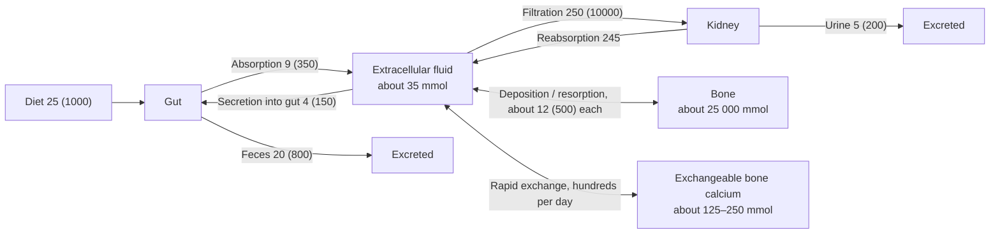

The calcium ion is one of the most important intracellular signals (muscle contraction, **neurotransmitter** release, hormone secretion, **blood coagulation**), and the $[\ce{Ca^2+}]$ of the **extracellular fluid** directly determines the **excitability** of nerve and muscle, so it is controlled more precisely than almost any other ion: the daily fluctuation of plasma free $[\ce{Ca^2+}]$ is only a few percent. Phosphate is a component of ATP, nucleic acids, phospholipids and countless phosphorylated intermediates, and is also a buffer. The great majority of both is stored in bone, which is thus both the structure that supports the body and a huge ion reservoir. This chapter first treats the distribution and effects of calcium and phosphate in the body (Section 36.1), their flows among gut, kidney and bone (Section 36.2) and vitamin D (Section 36.3), then bone itself (Section 36.4), then the three regulatory hormones, parathyroid hormone (Section 36.5), calcitonin (Section 36.6) and FGF23 (Section 36.7), combines them into a feedback system with two time scales (Section 36.8), and finally covers disease (Section 36.9) and other animals (Section 36.10).

Intestinal calcium absorption is in [7.14.28](/7.14.28#sec-28.6.3), and the renal tubular handling of calcium and phosphate is in [7.14.23](/7.14.23#sec-23.5.2); bone development (**endochondral ossification** and **intramembranous ossification**) is in [7.5](/7.5).

## 36.1. Distribution and Effects of Calcium and Phosphate

### 36.1.1. Calcium

An adult body contains about $1$–$1.2\,\mathrm{kg}$ of calcium (about $25$–$30\,\mathrm{mol}$), of which about $99\%$ is in bone and teeth, about $1\%$ is in cells (mostly stored in the endoplasmic reticulum and mitochondria or bound to proteins), and only about $0.1\%$ (about $1\,\mathrm{g}$) is in the extracellular fluid. Total plasma calcium is about $2.4\,\mathrm{mmol\,L^{-1}}$ ($2.2$–$2.6$, that is about $9.5\,\mathrm{mg\,dL^{-1}}$) and exists in three forms:

| Form | Fraction | Filterable | Remarks |
|---|---|---|---|
| Free $\ce{Ca^2+}$ | about $50\%$ ($1.1$–$1.3\,\mathrm{mmol\,L^{-1}}$) | Yes | The physiologically active, regulated quantity |
| Protein-bound | about $40\%$ | No | Bound mainly to albumin |
| Complexed with small anions | about $10\%$ | Yes | Citrate, phosphate, bicarbonate |

What is regulated is free $\ce{Ca^2+}$, not total calcium. Protein binding depends on pH: in alkalosis $\ce{H+}$ dissociates from albumin, the vacated negative charges bind more $\ce{Ca^2+}$, and free $\ce{Ca^2+}$ falls.

**Example 36.1.1 (Tetany from Hyperventilation)** Hyperventilation in anxiety lowers $P_{\ce{CO2}}$ and raises plasma pH (**respiratory alkalosis**, Chapter 25). For each rise of $0.1$ in pH, free $\ce{Ca^2+}$ falls by about $0.04$–$0.05\,\mathrm{mmol\,L^{-1}}$ (about $4\%$). Total calcium is unchanged, yet this fall in free calcium is enough to cause perioral and finger numbness and carpopedal spasm in sensitive people. Breathing into a paper bag, which raises $P_{\ce{CO2}}$, relieves it. Conversely, a patient with hypoalbuminemia has a low total calcium but normal free calcium and needs no calcium supplement: clinically total calcium is often corrected for albumin, or free calcium is measured directly.

### 36.1.2. Phosphate

The body contains about $600$–$700\,\mathrm{g}$ of phosphorus, about $85\%$ in bone, about $14\%$–$15\%$ in cells (organic phosphate esters, nucleic acids, phospholipids), and less than $1\%$ in the extracellular fluid. Plasma inorganic phosphate is about $0.8$–$1.45\,\mathrm{mmol\,L^{-1}}$ (about $40\,\mathrm{mg\,L^{-1}}$ as phosphorus), higher in children. The $\mathrm{p}K_{\mathrm{a2}}$ of phosphoric acid is about $6.8$; by the **Henderson–Hasselbalch equation**, at pH 7.4 $[\ce{HPO4^2-}]/[\ce{H2PO4-}] \approx 10^{0.6} \approx 4$, so about $80\%$ is $\ce{HPO4^2-}$; this pair is an important buffer pair in cells and in urine (Chapter 25). Unlike calcium, plasma phosphate varies over a wide range: a change between $50\%$ and $300\%$ of the normal value does not at once cause dysfunction; only severe hypophosphatemia ($<0.3\,\mathrm{mmol\,L^{-1}}$) causes muscle weakness, hemolysis and respiratory failure, through a shortage of ATP and 2,3-BPG.

### 36.1.3. Hypocalcemia and Hypercalcemia

A fall in extracellular $\ce{Ca^2+}$ raises the excitability of nerve and muscle, which is contrary to intuition. The reason is that extracellular $\ce{Ca^2+}$ binds to and screens the negative charges on the outer surface of the membrane; when $\ce{Ca^2+}$ falls the screening weakens, the transmembrane field at the voltage sensor of voltage-gated $\ce{Na+}$ channels becomes weaker, the activation curve shifts toward negative potentials, and the channels open closer to the **resting potential** (Chapter 4). Thus:

- Hypocalcemia: when free calcium falls to about $60\%$–$70\%$ of normal (total calcium about $1.5$–$1.75\,\mathrm{mmol\,L^{-1}}$), peripheral nerves fire spontaneously and tetany appears (spasm of the wrist and foot); tapping the facial nerve causes twitching of the facial muscles (Chvostek sign), and inflating a cuff causes carpal spasm (Trousseau sign); in severe cases laryngospasm can cause asphyxia. On the **electrocardiogram** the QT interval is prolonged (prolonged plateau).
- Hypercalcemia: when total calcium exceeds about $3\,\mathrm{mmol\,L^{-1}}$ ($12\,\mathrm{mg\,dL^{-1}}$), the excitability of nerve and muscle is reduced, with sluggish reflexes and muscle weakness; gastrointestinal motility is reduced, causing anorexia and constipation; the QT interval is shortened; renal concentrating ability falls and polyuria results, and kidney stones form readily. Above about $4\,\mathrm{mmol\,L^{-1}}$, calcium phosphate precipitates in soft tissues throughout the body, which is life-threatening.

### 36.1.4. Coupling of Calcium and Phosphate

The regulation of calcium and phosphate is coupled for two reasons: (1) bone mineral is calcium phosphate, so deposition and resorption of bone move both together; (2) both are regulated by the same group of hormones (parathyroid hormone, vitamin D, FGF23). The product of their concentrations in body fluids is close to the solubility of calcium phosphate: if the product stays elevated, calcium phosphate is deposited ectopically in blood vessels, kidney and soft tissues, which is the cause of vascular calcification in chronic kidney disease (where phosphate cannot be excreted). An important principle of the regulatory system is therefore that the hormone that raises plasma calcium (parathyroid hormone) at the same time promotes phosphate excretion, preventing the product from rising.

## 36.2. Calcium and Phosphorus Balance

The daily calcium balance of an adult is roughly as follows (in $\mathrm{mmol\,d^{-1}}$, with $\mathrm{mg\,d^{-1}}$ in parentheses):

Each of the three pathways has its own features:

- Gut: only about $25\%$–$35\%$ of dietary calcium is absorbed, and after subtracting the amount secreted in digestive fluids the net absorption is about $5\,\mathrm{mmol\,d^{-1}}$; the active **transcellular pathway** is induced by active vitamin D ([7.14.28](/7.14.28#sec-28.6.3)). The fraction absorbed varies with need: with low calcium intake, growth, pregnancy and lactation it can rise above $50\%$.
- Kidney: about $250\,\mathrm{mmol}$ of calcium is filtered per day and $98\%$–$99\%$ is reabsorbed; the proximal tubule and thick ascending limb reabsorb most of it proportionally, and the transcellular route in the distal convoluted tubule is regulated by parathyroid hormone ([7.14.23](/7.14.23#sec-23.5.2)). At steady state urinary calcium equals net intestinal absorption.
- Bone: in an adult, deposition and resorption are each about $12\,\mathrm{mmol\,d^{-1}}$ and essentially balanced; during growth deposition exceeds resorption, and in old age and after menopause resorption exceeds deposition.

Phosphate is different: dietary phosphate is about $30$–$45\,\mathrm{mmol\,d^{-1}}$ and about $60\%$–$70\%$ is absorbed, much more easily than calcium, and the amount absorbed is little regulated; plasma phosphate is determined mainly by the kidney. According to the threshold model of [7.14.23](/7.14.23#sec-23.5.3), filtered phosphate below the renal threshold $C_0 = T_{\mathrm{mP}}/\mathrm{GFR}$ is entirely reabsorbed and the part above $C_0$ is entirely excreted, so the steady-state plasma phosphate is $\approx C_0 + (\text{net absorption})/\mathrm{GFR}$; $C_0$ is set by the number of $\ce{Na+}$–phosphate **cotransporters** (NaPi-IIa, IIc) in the proximal tubule, which are the targets of parathyroid hormone and FGF23 (Sections 36.5 and 36.7).

![Two dose–response curves in calcium and phosphate regulation (schematic; parameters taken from typical literature values). A: The relation between parathyroid hormone secretion and plasma free Ca²⁺ is a steep inverse sigmoid curve (four-parameter model; the set point, the half-maximal inhibition, is at about 1.2 mmol/L). Free calcium changes by only 0.1 mmol/L within the normal range (gray band), yet PTH secretion changes several-fold. A heterozygous inactivating mutation of the calcium-sensing receptor (familial hypocalciuric hypercalcemia, dashed) shifts the set point to the right, and a calcimimetic (dotted) shifts it to the left. B: Threshold relation between phosphate excretion and plasma phosphate (GFR 120 mL/min). With a renal threshold C₀ = 1.0 mmol/L (blue), a net absorption of 30 mmol phosphate per day gives a steady-state plasma phosphate of about 1.17 mmol/L (intersection with the horizontal dashed line); an increase in parathyroid hormone or FGF23 lowers C₀ to 0.7 (green) and the steady state to about 0.87; when GFR falls to 30 mL/min (red, chronic kidney disease), plasma phosphate at steady state still rises above about 1.4 mmol/L even with C₀ reduced to 0.7](./plots/pth-phosphate-curves.py)

## 36.3. Vitamin D

The name vitamin D comes from the history of its discovery as a nutrient that prevents and cures rickets (in the 1920s), but it is more like a **prohormone**: with ample sunlight the body can synthesize enough vitamin D itself, and its active form acts on distant target organs through a **nuclear receptor** and is regulated by **negative feedback**.

**Definition 36.3.1 (1,25-Dihydroxyvitamin D)** The active form of vitamin D, produced by 25-hydroxylation in the liver followed by 1α-hydroxylation in the renal proximal tubule, is called **1,25-dihydroxyvitamin D**, also known as calcitriol. Through the vitamin D receptor (a nuclear receptor that forms a heterodimer with the retinoid X receptor) it promotes intestinal absorption of calcium and phosphate and is one of the main regulatory hormones of calcium and phosphate metabolism.

Synthesis has four steps:

1. Skin: 7-dehydrocholesterol in the epidermis absorbs medium-wave ultraviolet light ($290$–$315\,\mathrm{nm}$), the B ring opens to give previtamin D, and temperature-dependent isomerization then gives vitamin $\mathrm{D_3}$ (cholecalciferol). Prolonged sun exposure does not cause toxicity: excess previtamin D is converted by light to inactive products. Dietary vitamin $\mathrm{D_2}$ (from fungi) and $\mathrm{D_3}$ (cod liver oil, egg yolk) are absorbed with fat.
2. Liver: 25-hydroxylase (mainly CYP2R1) forms 25-hydroxyvitamin D. This step is hardly regulated; the product is bound to vitamin D-binding protein in plasma, has a half-life of about $2$–$3$ weeks, and is the main circulating and storage form of vitamin D; clinically its concentration is used to judge vitamin D nutritional status.
3. Kidney: 1α-hydroxylase (CYP27B1) in the proximal tubule forms 1,25-dihydroxyvitamin D, whose half-life is only about $4$–$6\,\mathrm{h}$. This is the regulated step: parathyroid hormone and hypophosphatemia promote it, and FGF23, 1,25-dihydroxyvitamin D itself and hypercalcemia (through suppression of parathyroid hormone) inhibit it. Macrophages and the **placenta** can also carry out 1α-hydroxylation (the origin of hypercalcemia in sarcoidosis).
4. Inactivation: 24-hydroxylase (CYP24A1) converts 25-hydroxyvitamin D and 1,25-dihydroxyvitamin D to inactive 24-hydroxylated products; it is induced by 1,25-dihydroxyvitamin D and FGF23, forming another negative feedback.

Actions of 1,25-dihydroxyvitamin D:

| Target organ | Action |
|---|---|
| Small intestine | Induces the apical $\ce{Ca^2+}$ channel TRPV6, the intracellular calcium-binding protein calbindin-D9k and the basolateral $\ce{Ca^2+}$-ATPase, increasing transcellular calcium absorption several-fold; the rate of transmembrane $\ce{Ca^2+}$ transport is directly related to the amount of calbindin; also promotes phosphate absorption (NaPi-IIb) |
| Bone | Promotes mineralization indirectly by supplying calcium and phosphate; at high doses acts synergistically with parathyroid hormone to promote osteoclast differentiation and bone resorption through RANKL of osteoblasts |
| Kidney | Promotes calcium reabsorption in the distal convoluted tubule; induces CYP24A1 and inhibits CYP27B1 (self negative feedback) |
| Parathyroid | Inhibits transcription of the parathyroid hormone gene and proliferation of parathyroid cells |
| Osteocyte | Promotes secretion of FGF23 (keeping phosphate from becoming too high) |

## 36.4. Bone

### 36.4.1. Composition and Mechanics of Bone

About $30\%$ of the dry weight of bone is organic matrix and about $70\%$ is mineral. Of the organic matrix, $90\%$–$95\%$ is type I collagen fibers, and the rest is a matrix of **proteoglycans** (containing chondroitin sulfate and **hyaluronic acid**), osteocalcin, osteopontin and others, which help the deposition of mineral. The mineral is mainly crystalline hydroxyapatite $\ce{Ca10(PO4)6(OH)2}$; the crystals are very small (about $40\,\mathrm{nm}$ long and only a few nanometers thick) and are arranged between and on the collagen fibers, and the huge surface area allows bone to exchange ions rapidly with body fluids; the lattice also contains substitutions such as carbonate, $\ce{Mg^2+}$, $\ce{Na+}$ and $\ce{F-}$. $\ce{Sr^2+}$, $\ce{Pb^2+}$ and the radioactive radium, plutonium and strontium-90 can also enter the lattice, and long-term irradiation in bone can cause osteosarcoma and leukemia.

The two components are mechanically complementary, like reinforced concrete: collagen fibers provide tensile strength and toughness, and mineral binds adjacent fibers together, preventing them from sliding on one another, and provides compressive strength and stiffness. Demineralized bone is soft and flexible, whereas bone from which the organic matter has been removed is hard and brittle.

### 36.4.2. Osteons, Cortical Bone and Trabecular Bone

The shaft of a long bone consists of cortical bone, whose basic structural unit is the osteon (Haversian system): a cylinder about $0.2\,\mathrm{mm}$ in diameter formed of 4–20 concentric lamellae around a central canal (Haversian canal, containing blood vessels and nerves); the central canals of neighboring osteons are connected by transverse Volkmann canals. In the small cavities between lamellae (lacunae) lie osteocytes, which extend long thin processes that are connected to one another by **gap junctions** in canaliculi, forming a cellular network throughout the bone.

| | Cortical bone | Trabecular bone |
|---|---|---|
| Distribution | Shaft and outer shell of all bones | Epiphyses, vertebral bodies, interior of flat bones |
| Structure | Tightly packed osteons | A lattice of trabeculae, with marrow in the spaces |
| Share of bone mass | about $80\%$ | about $20\%$ |
| Surface area | Small | Large (about $80\%$ of bone surface) |
| Turnover | Slow (about $3\%$ per year) | Fast (about $25\%$ per year) |

The metabolic activity of bone takes place at surfaces, so although trabecular bone makes up only one fifth of bone mass, it carries out most of the calcium exchange and remodeling; bone loss after menopause and bed rest appears first at sites rich in trabecular bone (vertebral bodies, distal radius, femoral neck), which is also why these sites fracture most easily.

### 36.4.3. Mineralization

Osteoblasts first secrete collagen fibers and matrix to form unmineralized osteoid; after about $10$ days mineral begins to be deposited in the osteoid (mineralization lag). What is first deposited is not hydroxyapatite but amorphous hydrated calcium phosphate (precursors such as $\ce{CaHPO4.2H2O}$), which is converted into crystalline hydroxyapatite over weeks to months through a series of substitution and recrystallization reactions.

The product of calcium and phosphate concentrations in body fluids is already above the **solubility product** of hydroxyapatite, yet no precipitation occurs throughout the body because of inhibitors: the most important is inorganic pyrophosphate ($\mathrm{PP_i}$), which adsorbs on the surface of crystal nuclei and prevents crystal growth. The switch for mineralization is local removal of this inhibitor: tissue-nonspecific alkaline phosphatase (TNAP) on the osteoblast membrane hydrolyzes pyrophosphate into two phosphate ions, both removing the inhibitor and supplying substrate; on the other hand, ENPP1 generates pyrophosphate and ANK transports it out of the cell, maintaining inhibition in soft tissues. TNAP deficiency (hypophosphatasia) prevents bone from mineralizing, and ENPP1 deficiency causes widespread arterial calcification in infants; the two prove the existence of the switch from opposite directions.

### 36.4.4. Rapidly Exchangeable Bone Calcium

The bone surface (especially trabecular bone) carries a layer of more loosely bound calcium phosphate (mainly amorphous calcium phosphate such as $\ce{CaHPO4}$) that can dissolve into the extracellular fluid or take up calcium from it at any time; it makes up about $0.4\%$–$1\%$ of bone calcium ($5$–$10\,\mathrm{g}$, that is $125$–$250\,\mathrm{mmol}$), several times the calcium of the extracellular fluid (about $35\,\mathrm{mmol}$). About $5\%$ of **cardiac output** flows through bone, and this exchange can restore most of the change in plasma calcium caused by calcium added or lost within $30$–$60\,\mathrm{min}$. This buffering is independent of hormones and is the first line of defense; the osteocyte network and the lining cells of the bone surface may take part by regulating ion transport between bone fluid and extracellular fluid, and parathyroid hormone can strengthen it within minutes to hours.

**Example 36.4.1** If $5\,\mathrm{mmol}$ of calcium absorbed from one meal all stayed in about $14\,\mathrm{L}$ of extracellular fluid, total plasma calcium would rise by about $0.36\,\mathrm{mmol\,L^{-1}}$ ($15\%$), close to hypercalcemia. In reality plasma calcium rises by only a few percent after a meal: the exchangeable bone calcium pool and renal excretion (urinary calcium increases after a meal) absorb this load.

### 36.4.5. Osteoblasts, Osteoclasts and Osteocytes

Bone is continually resorbed and rebuilt. At any moment about $4\%$ of the bone surface has new bone being deposited and less than $1\%$ of the surface has bone being resorbed:

- **Osteoblasts** derive from mesenchymal stem cells (transcription factors Runx2 and Osterix), line the surfaces where bone is formed, secrete osteoid and control mineralization; they also secrete factors that regulate osteoclasts (Section 36.4.6). After finishing bone formation, some osteoblasts are embedded in the bone matrix they secreted and become osteocytes, some become quiescent lining cells, and the rest undergo apoptosis.
- **Osteoclasts** derive from the monocyte–macrophage lineage and are large multinucleated cells formed by the fusion of several to dozens of cells. Through **integrins** they form a sealing zone ring on the bone surface, within which they extend a ruffled border and secrete $\ce{H+}$ (vacuolar $\ce{H+}$-ATPase, with $\ce{H+}$ supplied inside the cell by **carbonic anhydrase** II) and $\ce{Cl-}$ (ClC-7) into the sealed resorption lacuna, lowering the local pH to about 4.5 and dissolving mineral; they then secrete cathepsin K and **matrix metalloproteinases** to digest collagen. The degradation products are transported by transcytosis and released into the blood from the other side of the cell. One osteoclast resorbs bone at a rate equal to the rate of bone formation by about a hundred osteoblasts.
- Osteocytes make up more than $90\%$ of the cells in bone and can live for decades. Their network of processes is the mechanosensor of bone: when bone is loaded, fluid flow in the canaliculi stimulates osteocytes, and osteocytes reduce secretion of sclerostin (which inhibits Wnt signaling in osteoblasts), thereby promoting bone formation; osteocytes are also the main source of RANKL and FGF23. This is the cellular basis of Wolff's law (the structure of bone adapts to the loads it bears): in bed rest, paraplegia and space flight, weight-bearing bones lose about $1\%$–$1.5\%$ of their mass per month; the forearm bone of the racket arm of a tennis player is much thicker than on the other side.

### 36.4.6. Bone Remodeling

**Definition 36.4.1 (Bone Remodeling)** The coupled process in which osteoclasts first resorb a small piece of old bone and osteoblasts then form an equal amount of new bone at the same site is called **bone remodeling**; the group of osteoclasts and osteoblasts that carries out one remodeling event is called the basic multicellular unit.

At one site a remodeling event passes in turn through activation, resorption (about $2$–$3$ weeks), reversal and formation (about $3$ months). About $10\%$ of an adult's bone is renewed each year, and the whole skeleton is renewed in about ten years. The significance of remodeling is that it repairs microcracks produced by fatigue, adapts the structure of bone to changes in load, and provides an adjustable calcium reservoir.

Resorption and formation are coupled, and the key is the RANKL–RANK–OPG system:

- Osteoblasts and osteocytes express RANKL (receptor activator of nuclear factor κB ligand), which binds the receptor RANK on osteoclast precursors and, together with macrophage colony-stimulating factor, promotes osteoclast differentiation, fusion and activation.
- Osteoblasts at the same time secrete osteoprotegerin (OPG), a soluble decoy receptor for RANKL that prevents RANKL from binding RANK.
- The rate of resorption is set by the RANKL/OPG ratio. Parathyroid hormone, 1,25-dihydroxyvitamin D, **glucocorticoids** and cytokines of **inflammation** increase this ratio and promote bone resorption; estrogen lowers the ratio and promotes osteoclast apoptosis. Most hormones that regulate bone resorption therefore do not act directly on osteoclasts but first on the osteoblast lineage.
- Coupling in the opposite direction: when osteoclasts resorb bone they release growth factors buried in the matrix (such as TGF-β and IGF) and secrete signals that recruit osteoblasts to the resorbed site.

The molecules of this system have become drug targets: a **monoclonal antibody** against RANKL (denosumab) and an antibody against sclerostin are used to inhibit bone resorption and to promote bone formation, respectively.

## 36.5. Parathyroid Hormone

### 36.5.1. The Parathyroid Glands and the Hormone

Humans usually have four parathyroid glands, on the back of the thyroid, each about $6\times 3\times 2\,\mathrm{mm}$ and weighing about $30\,\mathrm{mg}$. Chief cells secrete parathyroid hormone; oxyphil cells increase with age and their function is unclear.

**Definition 36.5.1 (Parathyroid Hormone)** The peptide hormone of 84 amino acids secreted by the chief cells of the parathyroid glands is called **parathyroid hormone** (PTH). It acts on the PTH/PTHrP receptor (PTH1R) in bone and kidney to raise plasma $\ce{Ca^2+}$, lower plasma phosphate and promote the synthesis of 1,25-dihydroxyvitamin D.

PTH is first synthesized on ribosomes as the 115-amino-acid preproparathyroid hormone; the signal peptide is cleaved in the endoplasmic reticulum to give the 90-amino-acid proparathyroid hormone, and six more residues are cleaved in the Golgi apparatus to give the mature hormone of 84 amino acids and molecular weight about $9.5\,\mathrm{kDa}$, which is stored in **secretory granules**. The N-terminal fragment 1–34 has full activity (the synthetic teriparatide is this fragment), and C-terminal fragments have no classical activity. The plasma half-life of PTH is only about $4\,\mathrm{min}$, and it is cleaved mainly in the liver and kidney.

### 36.5.2. Regulation of Secretion: The Calcium-Sensing Receptor

Plasma free $\ce{Ca^2+}$ is the most important regulator of PTH secretion, and the two are related by a steep inverse sigmoid relation (panel A of the figure):

**Definition 36.5.2 (Calcium-Sensing Receptor)** The class C G protein-coupled receptor that has extracellular $\ce{Ca^2+}$ as its ligand and is found on the plasma membrane of parathyroid chief cells, the thick ascending limb and distal tubule of the kidney, thyroid C cells and others is called the **calcium-sensing receptor** (CaSR). In the parathyroid, when activated by $\ce{Ca^2+}$ it inhibits PTH secretion, synthesis and parathyroid cell proliferation through $\mathrm{G_q}$ and $\mathrm{G_i}$.

CaSR is a dimer, and the extracellular domain of each subunit binds several $\ce{Ca^2+}$ with very high cooperativity, so the dose–response curve is very steep: the set point (half-maximal inhibition) is about $1.2\,\mathrm{mmol\,L^{-1}}$ free $\ce{Ca^2+}$, and a fall in free calcium of $0.1\,\mathrm{mmol\,L^{-1}}$ can increase PTH secretion several-fold. Note that this is an "inhibitory" control: when calcium is low, CaSR activity falls and its inhibition of PTH secretion is released.

The regulation of PTH works on three time scales: within seconds to minutes, **exocytosis** of stored granules changes; within hours, the stability and transcription of PTH mRNA change (increased by low calcium and low 1,25-dihydroxyvitamin D, and also by high phosphate); over days to weeks, parathyroid cells proliferate (gland hyperplasia in chronic hypocalcemia, vitamin D deficiency and chronic kidney disease). In addition, severe hypomagnesemia inhibits PTH secretion and action, in which case calcium replacement is ineffective and magnesium must be given.

Genetic diseases of CaSR directly show the meaning of the set point: heterozygous inactivating mutations (familial hypocalciuric hypercalcemia) shift the set point to the right, and patients have mild hypercalcemia for life with a normal PTH ("inappropriately" normal relative to plasma calcium) and low urinary calcium (the renal CaSR is also insensitive); there are generally no symptoms and no surgery is needed; activating mutations cause hypocalcemia. The drug cinacalcet increases the sensitivity of CaSR to $\ce{Ca^2+}$ (mimicking calcium) and is used to treat hyperparathyroidism.

### 36.5.3. Three Effector Pathways

| Target organ | Action | Time |
|---|---|---|
| Bone | Fast phase: promotes release of exchangeable calcium on the bone surface into the extracellular fluid (osteocytes and lining cells take part); slow phase: through osteoblasts, increases RANKL and reduces OPG, the number and activity of osteoclasts increase, and bone matrix is resorbed, releasing calcium and phosphate | Minutes to hours; days |
| Kidney | Promotes $\ce{Ca^2+}$ reabsorption in the distal convoluted tubule and connecting tubule (TRPV5 and others); causes internalization and degradation of NaPi-IIa and IIc in the proximal tubule, reducing phosphate reabsorption (lowering $C_0$); induces 1α-hydroxylase (CYP27B1); inhibits NHE3 and $\ce{HCO3-}$ reabsorption in the proximal tubule | Minutes; hours |
| Gut (indirect) | Increases calcium and phosphate absorption through 1,25-dihydroxyvitamin D | Days |

The net effect is a rise in plasma calcium and a fall in plasma phosphate: although bone and gut release phosphate at the same time, the renal action of excreting phosphate is stronger, so the calcium–phosphate product does not rise (Section 36.1.4).

The response of bone to PTH has an apparent paradox: a continuously high level of PTH (as in hyperparathyroidism) makes resorption exceed formation and bone mass falls; yet one subcutaneous injection a day of a small dose of PTH(1–34) makes formation exceed resorption and bone mass increases, and this is used to treat severe osteoporosis. The mechanism is not fully clarified; it is related to the fact that a brief PTH signal mainly activates the osteoblast lineage and inhibits osteocyte sclerostin, whereas a sustained signal keeps RANKL elevated, another example in which the temporal pattern of a hormone determines its effect ([Chapter 33](/7.14.33)).

## 36.6. Calcitonin

**Definition 36.6.1 (Calcitonin)** The 32-amino-acid peptide hormone secreted by the parafollicular cells of the thyroid (C cells, classically thought to derive from the neural crest, although lineage tracing in mice indicates an origin in the pharyngeal endoderm; they are incorporated into the thyroid in the embryo with the ultimobranchial body) is called **calcitonin**; it is secreted when plasma calcium is raised and, through a G protein-coupled receptor, inhibits osteoclasts and lowers plasma calcium.

The action of calcitonin is mainly on bone: in the short term (minutes) the ruffled border of osteoclasts retracts and their activity falls rapidly, so less calcium is mobilized from bone; in the long term the formation of new osteoclasts is reduced (and later the number of osteoblasts also falls through coupling). It also reduces renal reabsorption of calcium and phosphate.

In adults the role of calcitonin in calcium homeostasis is weak: patients after total thyroidectomy (lacking calcitonin) and patients with medullary thyroid carcinoma (calcitonin may be hundreds of times normal) both have essentially normal plasma calcium. The reason is that adult bone remodeling is slow, so calcitonin can affect only a very small calcium flux, and any fall in plasma calcium it causes is at once offset by a rise in PTH. In children, in whom bone remodeling is rapid, in certain pathological states, and in pregnancy and lactation, its action may be more evident. Salmon calcitonin is several tens of times more potent than the human hormone and was used to treat hypercalcemia and Paget disease of bone. By **alternative splicing** the calcitonin gene produces calcitonin gene-related peptide (CGRP) in neural tissue, a strong vasodilator and a neuropeptide associated with pain (a drug target in migraine).

## 36.7. FGF23 and Regulation of Phosphate

For a long time PTH was the only known regulator of phosphate. In the early twenty-first century a third calcium–phosphate regulatory hormone was discovered in studies of hereditary hypophosphatemia:

**Definition 36.7.1 (Fibroblast Growth Factor 23)** The member of the fibroblast growth factor family that is secreted mainly by osteocytes (and osteoblasts) and acts on kidney and parathyroid with α-Klotho as the essential coreceptor is called **fibroblast growth factor 23** (FGF23). It reduces phosphate reabsorption and 1,25-dihydroxyvitamin D synthesis in the proximal tubule and lowers plasma phosphate.

The secretion of FGF23 is promoted by plasma phosphate (and dietary phosphate load) and by 1,25-dihydroxyvitamin D. Its actions are:

- Kidney: it reduces NaPi-IIa and IIc and increases phosphate excretion (lowering $C_0$); it inhibits CYP27B1 and induces CYP24A1, lowering 1,25-dihydroxyvitamin D, so that intestinal phosphate absorption is also reduced.
- Parathyroid: it inhibits PTH synthesis and secretion.

This forms a bone–kidney negative feedback in which phosphate is the regulated quantity: excess phosphate → bone secretes FGF23 → increased renal phosphate excretion and less active vitamin D → phosphate falls. It also forms a loop with vitamin D: 1,25-dihydroxyvitamin D promotes FGF23, and FGF23 in turn inhibits the synthesis of 1,25-dihydroxyvitamin D, preventing phosphate and calcium from both becoming too high when vitamin D activity is too high.

Diseases of FGF23 confirm this regulation: X-linked hypophosphatemia (*PHEX* mutations, the most common hereditary rickets) and certain FGF23-secreting tumors raise FGF23 too high and cause renal phosphate wasting, hypophosphatemia and rickets or osteomalacia, with 1,25-dihydroxyvitamin D inappropriately low; mice lacking FGF23 or Klotho have hyperphosphatemia, high vitamin D and widespread soft tissue calcification, and show features of accelerated aging. In chronic kidney disease FGF23 begins to rise very early in order to maintain phosphate excretion, but it also lowers 1,25-dihydroxyvitamin D and so leads to secondary hyperparathyroidism.

## 36.8. Integrated Feedback: Two Time Scales

The three hormones and the buffering of bone form a layered control system:

| Level | Mechanism | Time scale | Acts on |
|---|---|---|---|
| 1 | Physicochemical buffering by exchangeable bone calcium | Minutes to $1\,\mathrm{h}$ | A single meal, brief losses |
| 2 | Action of PTH on renal tubular calcium reabsorption and the fast phase in bone | Minutes to hours | Daily fluctuations |
| 3 | PTH → 1,25-dihydroxyvitamin D → intestinal absorption | Days | Changes in dietary calcium |
| 4 | PTH and vitamin D → number of osteoclasts → bone resorption | Days to weeks | Long-term calcium deficiency, at the expense of bone mass |

**Example 36.8.1 (A Two-Time-Scale Model of Calcium Homeostasis)** Let the calcium content of the extracellular fluid be $M = cV$ ($c$ the total plasma calcium, $V = 14\,\mathrm{L}$), the exchangeable bone calcium pool $B$, and the relative levels of PTH, 1,25-dihydroxyvitamin D and osteoclast activity $P$, $D$ and $O$ (equal to 1 in the normal state),

$$
\begin{aligned}
\frac{\mathrm{d}M}{\mathrm{d}t} &= a(D)\,I - E + O\,J_{\mathrm{r}} - J_{\mathrm{f}} - U(c, P) + k_{\mathrm{x}}\left[c_{\mathrm{B}}(B, P) - c\right], \qquad
\frac{\mathrm{d}B}{\mathrm{d}t} = -k_{\mathrm{x}}\left[c_{\mathrm{B}}(B, P) - c\right], \\
\frac{\mathrm{d}P}{\mathrm{d}t} &= \frac{P_\infty(c) - P}{\tau_P}, \qquad
\frac{\mathrm{d}D}{\mathrm{d}t} = \frac{P - D}{\tau_D}, \qquad
\frac{\mathrm{d}O}{\mathrm{d}t} = \frac{P^{0.8}D^{0.3} - O}{\tau_O},
\end{aligned}
\tag{36.1}
$$
where $I$ is dietary calcium, $a(D)$ is the absorbed fraction, which increases with vitamin D, $E$ is calcium secreted into the gut, $J_{\mathrm{r}}$ and $J_{\mathrm{f}}$ are basal bone resorption and formation (each about $12\,\mathrm{mmol\,d^{-1}}$), $U$ is urinary calcium (increasing with $c$ and decreased by $P$), $c_{\mathrm{B}}$ is the equilibrium concentration of the exchangeable bone calcium pool (increasing with filling of the pool and with PTH), and $P_\infty(c)$ is the inverse sigmoid PTH secretion curve; the time constants $\tau_P$ (about $6\,\mathrm{min}$), the bone pool exchange corresponding to $1/k_{\mathrm{x}}$ (about $45\,\mathrm{min}$), $\tau_D$ (about $12\,\mathrm{h}$) and $\tau_O$ (about $3$ days) differ by three orders of magnitude.

![Two-time-scale model of calcium homeostasis (Example 36.8.1, Eq. (36.1); parameters are illustrative). A: At t = 0, 7 mmol of calcium (about 20%) is rapidly removed from the extracellular fluid (for example by intravenous infusion of a chelator). The intact system (blue) returns to near normal within about 1 h, leaving only a deviation of about 1% (the exchangeable bone calcium pool is partly emptied); with PTH clamped at the basal level (green), the bone pool can still eliminate most of the deviation within 1–2 h but leaves a larger persistent hypocalcemia; when the exchange of the bone pool is also removed (red dashed), only the slow regulation by kidney and gut remains, and plasma calcium stays markedly low for several hours. B and C: From day 2 dietary calcium is reduced from 25 mmol (1 g) to 5 mmol (200 mg) per day. PTH (B, solid) rises soon after plasma calcium falls slightly, 1,25-dihydroxyvitamin D (dashed) follows within 1–2 days, and the fraction of calcium absorbed by the gut (dotted) rises; total plasma calcium (C, top) falls by only about 2%. The new steady state depends on continuously increased bone resorption, with a net loss of about 0.15 g calcium from bone per day (C, bottom: cumulative extra bone calcium loss, about 5 g in 40 days), which is why a long-term low-calcium diet reduces bone mass. When the kidney cannot increase 1,25-dihydroxyvitamin D synthesis (gray, resembling chronic kidney disease), intestinal absorption cannot compensate, plasma calcium falls more and PTH rises higher (secondary hyperparathyroidism)](./plots/calcium-two-timescales.py)

The model illustrates two points: the exchangeable bone calcium pool keeps plasma calcium stable against rapid perturbations with almost no need for hormones, and the rapid action of PTH compensates for depletion of the pool; a long-term negative calcium balance is "hidden" by the hormones, with plasma calcium almost normal at the cost of bone mass. A normal plasma calcium therefore does not show that calcium intake is adequate; bone density reflects the long-term calcium balance.

## 36.9. Diseases of Bone and Calcium Metabolism

| Disease | Mechanism | Main manifestations |
|---|---|---|
| Osteoporosis | Resorption exceeds formation for a long time, and both bone mass and microarchitecture are damaged while mineralization is normal; postmenopausal estrogen deficiency (raised RANKL/OPG), aging, **glucocorticoids**, disuse, inadequate calcium and vitamin D | Reduced bone density (T-score $\le -2.5$); vertebral compression fractures, hip and distal radius fractures |
| Rickets (children) and osteomalacia (adults) | Inadequate mineralization: vitamin D deficiency (insufficient sunlight, malabsorption), impaired hydroxylation in kidney or liver, phosphate deficiency (such as excess FGF23) | Excess osteoid; in children widened **growth plates**, bowlegs or knock-knees, rachitic rosary; in adults bone pain and pseudofractures; with secondary hyperparathyroidism |
| Primary hyperparathyroidism | Usually a single parathyroid adenoma, with a set point shifted to the right and excess secretion | Hypercalcemia, hypophosphatemia, hypercalciuria; kidney stones, bone pain and reduced bone mass, abdominal pain and constipation, psychiatric symptoms ("stones, bones, abdominal groans and psychic moans"); now often found without symptoms in routine tests |
| Hypoparathyroidism | Most commonly accidental injury to or removal of the parathyroids during thyroid surgery | Hypocalcemia, hyperphosphatemia; tetany, in severe cases laryngospasm; treated with calcium and active vitamin D |
| Chronic kidney disease–mineral and bone disorder | Phosphate retention, raised FGF23, lowered 1,25-dihydroxyvitamin D → secondary hyperparathyroidism | Renal osteodystrophy, vascular calcification |

The difference between osteoporosis and osteomalacia is "little bone" versus "soft bone": in the former there is less bone matrix per unit volume but mineralization is normal, and in the latter the amount of matrix is not reduced but mineralization is inadequate. Both appear on radiographs as reduced bone density and have to be distinguished by tests such as plasma calcium, phosphate, alkaline phosphatase and 25-hydroxyvitamin D, and by bone biopsy.

## 36.10. Evolution and Comparison

### 36.10.1. Aquatic and Terrestrial: Two Calcium Environments

The $[\ce{Ca^2+}]$ of seawater is about $10\,\mathrm{mmol\,L^{-1}}$, nearly ten times plasma free calcium, and fresh water also contains appreciable calcium; fishes can take up calcium directly from the water through ion-transporting cells of the gill (with TRPV5/6-type calcium channels on the apical membrane), and the problem they face is often too much calcium rather than too little. Land animals can obtain calcium only from food, and bone is the only large reserve. Correspondingly, calcium regulation in fishes emphasizes "calcium-lowering" hormones and in tetrapods the "calcium-raising" PTH.

- Corpuscles of Stannius and stanniocalcin: on the surface of the kidney of teleosts and holosteans there are a few small **endocrine glands** (corpuscles of Stannius) that secrete the **glycoprotein** hormone stanniocalcin. When plasma calcium rises its secretion increases, inhibiting calcium uptake by the gill and promoting renal phosphate reabsorption. Fish whose corpuscles of Stannius have been removed develop raised plasma calcium, especially in water with a high calcium content, which makes sense in calcium-rich seawater. Mammals also have stanniocalcin genes (STC1, STC2), which act in a **paracrine** manner in many tissues.
- Calcitonin and the ultimobranchial body: in fishes, amphibians, reptiles and birds the C cells form a separate ultimobranchial body, and plasma calcitonin levels are far higher than in mammals, but its physiological role is still debated; one view is that when the liver of a female fish synthesizes large amounts of calcium-binding vitellogenin before spawning (Chapter 37), calcitonin protects the skeleton from excessive mobilization. In mammals the ultimobranchial body is incorporated into the thyroid.
- Branchial origin of the parathyroid: fishes have no parathyroid but do have the PTH gene. Development of the parathyroid requires the transcription factor Gcm2, and fish *gcm2* is expressed in the gill, where it is also required for the development of the ion-transporting cells that regulate calcium uptake. It has therefore been proposed that when tetrapods came onto land, the calcium-regulating tissue that had been in the pharyngeal gills was retained as the gills disappeared and became the parathyroid of the neck (Okabe and Graham, 2004).

### 36.10.2. Avian Medullary Bone and the Eggshell

For each egg she lays, a laying hen puts about $2\,\mathrm{g}$ of calcium (as calcium carbonate) into the eggshell, about $10\%$ of the calcium of her whole body; the shell is formed in the uterine part (shell gland) over about $15$–$20\,\mathrm{h}$, the rate of calcium deposition per hour exceeds the whole calcium content of the blood, and most of it occurs at night when she is not feeding. For this reason, before sexual maturity and laying, estrogen (acting with androgen) induces in the female bird the deposition in the marrow cavities of long bones of a special, nonstructural medullary bone, which turns over extremely rapidly, with osteoblasts and osteoclasts alternately active; when the shell is forming, osteoclasts resorb medullary bone massively within a few hours and can supply $30\%$–$40\%$ of eggshell calcium, the rest coming from intestinal absorption (during laying 1,25-dihydroxyvitamin D and intestinal calcium absorption increase greatly, and hens deliberately eat more calcium-rich food in the afternoon). Medullary bone appears only in laying female birds; in 2005 tissue resembling medullary bone was found in the femur of a *Tyrannosaurus rex* fossil and was used as evidence that this individual was a laying female, which also supports the relationship of birds to theropod dinosaurs.

### 36.10.3. Crustacean Gastroliths and Antlers

The exoskeleton of crustaceans is mineralized with calcium carbonate, and each **molt** discards a large amount of calcium. Before molting (under the control of molting steroids), freshwater crayfish reabsorb calcium from the old exoskeleton and store it as amorphous calcium carbonate in a pair of gastroliths on the two sides of the stomach wall (terrestrial isopods store it on the sternal plates); after the molt the gastroliths are dissolved in the stomach and the calcium is used rapidly to harden the new exoskeleton. Amorphous calcium carbonate dissolves more easily than crystalline calcite, which suits short-term storage, for the same reason that exchangeable calcium in vertebrate bone consists of amorphous calcium phosphate.

The most extreme mobilization of bone calcium in mammals is the antler: the antlers of a stag are shed every year and regrow within a few months, at up to $2\,\mathrm{cm}$ per day at the fastest, and a considerable part of the calcium and phosphate needed comes from resorption of the skeleton (especially the ribs); the stag goes through a reversible "periodic osteoporosis" every year. Similar mobilization of bone calcium occurs in human pregnancy and lactation (Chapter 38).

## Summary

| Topic | Key points |
|---|---|
| Distribution | Calcium 99% in bone, 0.1% extracellular; total plasma calcium 2.4 mmol/L, free 50%, protein-bound 40%, complexed 10%, alkalosis lowers free calcium (Example 36.1.1); phosphate 85% in bone, $\ce{HPO4^2-}$ about 80% at pH 7.4 |
| Effects | Low calcium raises excitability (screening of negative charge): tetany, prolonged QT; high calcium lowers excitability: constipation, shortened QT, polyuria; calcium–phosphate product and ectopic calcification |
| Balance | Net intestinal absorption about 5 mmol/d, kidney filters 250 and reabsorbs 98%–99%, bone deposition and resorption about 12 each; phosphate set by the renal threshold $C_0$ |
| Vitamin D | Skin UVB → liver 25-hydroxylation (storage form) → kidney 1α-hydroxylation (regulated, Definition 36.3.1) → 24-hydroxylation inactivates; induces TRPV6 and calbindin |
| Bone | Organic 30% (collagen 90%–95%), mineral 70% (hydroxyapatite); osteon; cortical 80% of bone mass, trabecular most of the surface; mineralization: osteoid → amorphous calcium phosphate → hydroxyapatite, pyrophosphate inhibits and TNAP relieves; exchangeable calcium 0.4%–1%, 30–60 min (Example 36.4.1) |
| Cells and remodeling | 4% of surface depositing, <1% resorbing; osteoblasts, osteoclasts ($\ce{H+}$, cathepsin K), osteocytes (mechanosensing, sclerostin, FGF23); bone remodeling (Definition 36.4.1) and RANKL/OPG |
| Hormones | PTH (Definition 36.5.1, 115 → 90 → 84 aa, N-terminal 1–34 active) and CaSR (Definition 36.5.2): bone, kidney and gut pathways, calcium up, phosphate down; intermittent PTH promotes bone formation; calcitonin (Definition 36.6.1) weak in adults; FGF23 (Definition 36.7.1) with phosphate as the regulated quantity |
| Integration | Four levels, minutes to weeks; two-time-scale model (Example 36.8.1): normal plasma calcium can be at the cost of bone mass |
| Disease | Osteoporosis (little bone), rickets and osteomalacia (soft bone), hyperparathyroidism and hypoparathyroidism, chronic kidney disease |
| Evolution | Calcium-rich seawater and calcium lowering predominant, on land calcium raising predominant; corpuscles of Stannius and stanniocalcin; ultimobranchial body; parathyroid from gills; avian medullary bone and eggshell; crustacean gastroliths; antlers |

## Questions

1. A patient with thyroid cancer develops perioral numbness and finger spasm on the second day after total thyroidectomy. Why does plasma calcium fall? Why is loss of thyroid hormone and calcitonin after surgery not the cause? Why is active vitamin D needed in treatment in addition to calcium?

   **Answer** During surgery the parathyroids are accidentally injured, removed or deprived of their blood supply, and PTH falls abruptly: renal calcium reabsorption and bone calcium mobilization decrease, and plasma calcium falls within a day or two (the half-life of PTH is only about 4 min, and buffering by the exchangeable bone calcium pool lasts only a few hours). **Thyroid hormone** has a half-life of several days and does not directly regulate plasma calcium; calcitonin has very little action in adults, and its absence does not lower plasma calcium (if it had any effect it would be to raise it). Without PTH the kidney cannot carry out 1α-hydroxylation effectively, ordinary oral vitamin D cannot be converted to the active form, and intestinal calcium absorption is very low, so 1,25-dihydroxyvitamin D (calcitriol) must be given directly.
2. Using the model of Example 36.8.1, explain why an elderly woman on a long-term low-calcium diet can have severe osteoporosis even though her plasma calcium is normal. Which measurements could reveal her negative calcium balance?

   **Answer** Plasma calcium is protected by several layers of feedback: when dietary calcium falls, PTH rises, 1,25-dihydroxyvitamin D increases the fraction absorbed by the gut, and renal calcium reabsorption increases; the remaining gap is made up by increased bone resorption, so plasma calcium is almost normal at the cost of a daily net loss of bone. After menopause, estrogen deficiency raises RANKL/OPG and speeds resorption further. Measurements that can reveal the negative balance are a high PTH (secondary hyperparathyroidism), a low 25-hydroxyvitamin D, a low 24 h urinary calcium, raised bone resorption markers, and reduced bone density.
3. Why does PTH lower plasma phosphate while raising plasma calcium? What would be the consequence if PTH could not promote phosphate excretion?

   **Answer** PTH causes bone resorption to release calcium and phosphate, and through 1,25-dihydroxyvitamin D also increases intestinal absorption of both; considering only these two pathways, calcium and phosphate would rise together. But PTH causes internalization and degradation of NaPi-IIa and IIc in the proximal tubule, lowering the renal threshold $C_0$ and excreting large amounts of phosphate, and the net effect is a fall in plasma phosphate. Without this action, plasma calcium and phosphate would rise together, the calcium–phosphate product would exceed the solubility, and calcium phosphate would be deposited in blood vessels, kidney and soft tissues; moreover, binding of phosphate to calcium would lower free calcium and offset the action of PTH. This actually happens in chronic kidney disease with severely reduced GFR, when the kidney cannot excrete phosphate.
4. Familial hypocalciuric hypercalcemia and primary hyperparathyroidism both show hypercalcemia with a normal or high PTH. From the role of the calcium-sensing receptor in the parathyroid and kidney, explain why urinary calcium is low in the former and high in the latter, and why the former needs no surgery.

   **Answer** Familial hypocalciuric hypercalcemia is a heterozygous inactivation of CaSR: the parathyroid is insensitive to $\ce{Ca^2+}$, the set point shifts to the right, and a "normal" amount of PTH is still secreted at a higher plasma calcium; CaSR in the thick ascending limb is likewise insensitive, hypercalcemia cannot inhibit paracellular calcium reabsorption, and so urinary calcium is low. This is a shift of the overall set point, with plasma calcium stable at a slightly higher level to which the tissues (including bone and kidney) adapt; there are usually no symptoms, and removing the parathyroids would only cause hypocalcemia. In primary hyperparathyroidism an adenoma secretes too much PTH; after plasma calcium rises, the filtered calcium load exceeds the distal reabsorptive capacity promoted by PTH, the renal CaSR is activated normally by the high calcium and inhibits reabsorption in the thick ascending limb, urinary calcium rises, stones form readily, and bone is lost, so surgery is needed.
5. About how many times the total extracellular calcium does a laying hen need each day? Using medullary bone, vitamin D and behavior, explain how she meets this need.

   **Answer** The extracellular fluid of a hen of about $2\,\mathrm{kg}$ is about $0.4$–$0.5\,\mathrm{L}$, and total plasma calcium rises during laying because of binding to vitellogenin, but free and exchangeable extracellular calcium is still only several tens of milligrams; the eggshell needs about $2\,\mathrm{g}$ of calcium per day, several tens of times the extracellular calcium, which must be supplied almost entirely within a day from gut or bone. Her solution is: before laying, medullary bone is stored in advance under the action of estrogen; during laying 1,25-dihydroxyvitamin D and intestinal calcium absorption increase greatly; she eats calcium-rich food (shell, limestone) in the afternoon and evening, so that there is still calcium in the gut to absorb when the shell forms at night; when intestinal calcium is insufficient at night, osteoclasts rapidly resorb medullary bone to make up the difference, and it is redeposited after daytime feeding.
6. (Open question) Speculate on why hydroxyapatite (calcium phosphate), not calcium carbonate, became the mineral of vertebrate bone. Why do crustaceans and mollusks mostly use calcium carbonate?

   **Answer** Possible considerations: (1) calcium phosphate is more stable than calcium carbonate at physiological pH and $\mathrm{CO_2}$; muscles produce large amounts of $\mathrm{CO_2}$ and lactate during vertebrate locomotion, a calcium carbonate skeleton would dissolve in acidosis, whereas the solubility of hydroxyapatite depends less on pH. (2) Bone is also a reservoir of phosphate, and vertebrates (especially early ones in phosphate-poor fresh water) may have used bone to store phosphorus; one hypothesis is that the earliest mineralized tissues appeared as reserves of phosphate and calcium. (3) The composite of hydroxyapatite nanocrystals and collagen has a combination of toughness and strength suited to an endoskeleton bearing dynamic loads. The exoskeletons and shells of crustaceans and mollusks are in direct contact with seawater, which is rich in carbonate and calcium, so mineralizing with calcium carbonate is energetically cheaper; their exoskeletons do not serve mainly as ion reserves, or they use amorphous calcium carbonate as a temporary reserve (gastroliths). These are all speculation and could be tested by comparing the mineralized tissues of early vertebrate fossils and by measuring the solubility of different minerals in simulated body fluid.
