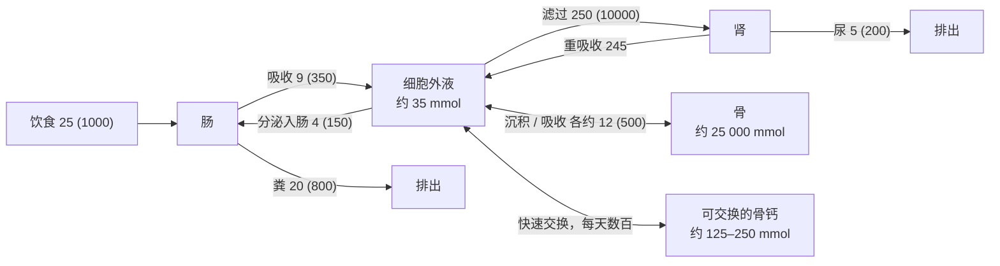

钙离子是细胞内最重要的信号之一（肌肉收缩、**神经递质**释放、激素分泌、**凝血**），**细胞外液**中的 $[\ce{Ca^2+}]$ 又直接决定神经与肌肉的**兴奋性**，所以它被控制得比几乎任何其他离子都精确：血浆游离 $[\ce{Ca^2+}]$ 的日间波动只有百分之几。磷酸盐则是 ATP、核酸、磷脂与无数磷酸化中间物的组成部分，并且是缓冲剂。两者的绝大部分储存在骨中，骨因此既是支撑身体的结构，又是一个巨大的离子库。本章先讲钙与磷酸盐在体内的分布与效应（36.1 节）、它们在肠、肾与骨之间的流动（36.2 节）与维生素 D（36.3 节），再讲骨本身（36.4 节），然后讲三种调节激素——甲状旁腺激素（36.5 节）、降钙素（36.6 节）与 FGF23（36.7 节），把它们组合成一个有两个时间尺度的反馈系统（36.8 节），最后讲疾病（36.9 节）与其他动物（36.10 节）。

肠道的钙吸收见 [7.14.28](/7.14.28#sec-28.6.3)，肾小管对钙与磷酸盐的处理见 [7.14.23](/7.14.23#sec-23.5.2)；骨的发育（**软骨内成骨**与**膜内成骨**）见 [7.5](/7.5)。

## 36.1. 钙与磷酸盐的分布与效应

### 36.1.1. 钙

成人体内约有 $1$–$1.2\,\mathrm{kg}$ 钙（约 $25$–$30\,\mathrm{mol}$），其中约 $99\%$ 在骨与牙中，约 $1\%$ 在细胞内（大部分储存在内质网、线粒体中或与蛋白质结合），细胞外液中只有约 $0.1\%$（约 $35\,\mathrm{mmol}$，即约 $1.4\,\mathrm{g}$）。血浆总钙约 $2.4\,\mathrm{mmol\,L^{-1}}$（$2.2$–$2.6$，即约 $9.5\,\mathrm{mg\,dL^{-1}}$），以三种形式存在：

| 形式 | 比例 | 能否滤过 | 说明 |
|---|---|---|---|
| 游离 $\ce{Ca^2+}$ | 约 $50\%$（$1.1$–$1.3\,\mathrm{mmol\,L^{-1}}$） | 能 | 有生理活性、被调节的量 |
| 与蛋白质结合 | 约 $40\%$ | 不能 | 主要结合在白蛋白上 |
| 与小分子阴离子复合 | 约 $10\%$ | 能 | 柠檬酸、磷酸、碳酸氢根 |

被调节的是游离 $\ce{Ca^2+}$，而不是总钙。蛋白结合受 pH 的影响：碱中毒时白蛋白上的 $\ce{H+}$ 解离，空出的负电荷结合更多的 $\ce{Ca^2+}$，游离 $\ce{Ca^2+}$ 降低。

**例 36.1.1（过度通气引起的手足抽搐）** 焦虑时过度通气使 $P_{\ce{CO2}}$ 下降，血浆 pH 升高（**呼吸性碱中毒**，第 25 章）。pH 每升高 $0.1$，游离 $\ce{Ca^2+}$ 约降低 $0.04$–$0.05\,\mathrm{mmol\,L^{-1}}$（约 $4\%$）。总钙不变，游离钙的这一下降却足以使敏感的人出现口周与手指麻木、手足痉挛。对着纸袋呼吸提高 $P_{\ce{CO2}}$ 即可缓解。反过来，低白蛋白血症的患者总钙降低而游离钙正常，并不需要补钙：临床上常按白蛋白校正总钙，或直接测定游离钙。

### 36.1.2. 磷酸盐

体内约有 $600$–$700\,\mathrm{g}$ 磷，约 $85\%$ 在骨中，约 $14\%$–$15\%$ 在细胞内（有机磷酸酯、核酸、磷脂），细胞外液中不到 $1\%$。血浆无机磷酸盐约 $0.8$–$1.45\,\mathrm{mmol\,L^{-1}}$（以磷计约 $40\,\mathrm{mg\,L^{-1}}$），儿童较高。磷酸的 $\mathrm{p}K_{\mathrm{a2}}$ 约为 $6.8$，按 **Henderson–Hasselbalch 方程**，pH 7.4 时 $[\ce{HPO4^2-}]/[\ce{H2PO4-}] \approx 10^{0.6} \approx 4$，即约 $80\%$ 为 $\ce{HPO4^2-}$；这一对是细胞内与尿中的重要缓冲对（第 25 章）。与钙不同，血浆磷酸盐的变化范围很大：在正常值的 $50\%$ 到 $300\%$ 之间变化，不会立即引起功能障碍；严重的低磷血症（$<0.3\,\mathrm{mmol\,L^{-1}}$）才因 ATP 与 2,3-BPG 的不足引起肌无力、溶血与呼吸衰竭。

### 36.1.3. 低钙与高钙

细胞外 $\ce{Ca^2+}$ 降低使神经与肌肉的兴奋性升高，这与直觉相反。原因是胞外的 $\ce{Ca^2+}$ 结合并屏蔽膜外表面的负电荷；$\ce{Ca^2+}$ 降低时屏蔽减弱，跨膜电场在电压门控 $\ce{Na+}$ 通道的电压感受器处变得较弱，激活曲线向负电位方向移动，通道在较接近**静息电位**时就会开放（第 4 章）。所以：

- 低钙血症：游离钙降低到正常的约 $60\%$–$70\%$（总钙约 $1.5$–$1.75\,\mathrm{mmol\,L^{-1}}$）时，外周神经自发放电，出现手足抽搐（腕部与足部的痉挛），叩击面神经引起面肌抽动（Chvostek 征），袖带加压引起腕部痉挛（Trousseau 征）；严重时喉痉挛可致窒息。**心电图**上 QT 间期延长（平台期延长）。
- 高钙血症：总钙超过约 $3\,\mathrm{mmol\,L^{-1}}$（$12\,\mathrm{mg\,dL^{-1}}$）时，神经与肌肉的兴奋性降低，反射迟钝、肌无力；消化道运动减弱，引起食欲减退与便秘；心电图 QT 间期缩短；肾的浓缩能力下降而多尿，易形成肾结石。超过约 $4\,\mathrm{mmol\,L^{-1}}$ 时，磷酸钙在全身的软组织中沉淀，危及生命。

### 36.1.4. 钙与磷酸盐的耦合

钙与磷酸盐的调节是耦合的，原因有两个：①骨的矿物是磷酸钙，骨的沉积与吸收同时移动两者；②两者受同一组激素调节（甲状旁腺激素、维生素 D、FGF23）。体液中两者的浓度乘积接近磷酸钙的溶解度：若乘积持续升高，磷酸钙在血管、肾与软组织中异位沉积，这是慢性肾病（磷酸盐排不出）中血管钙化的原因。因此调节系统的一个重要原则是：升高血钙的激素（甲状旁腺激素）同时促进磷酸盐的排出，防止乘积升高。

## 36.2. 钙与磷的平衡

成人每天的钙平衡大致如下（单位 $\mathrm{mmol\,d^{-1}}$，括号内为 $\mathrm{mg\,d^{-1}}$）：

三条通路各有特点：

- 肠：膳食钙只吸收约 $25\%$–$35\%$，扣除消化液分泌的部分，净吸收约 $5\,\mathrm{mmol\,d^{-1}}$；主动的**跨细胞途径**受活性维生素 D 的诱导（[7.14.28](/7.14.28#sec-28.6.3)）。吸收分数随需要变化：钙摄入低、生长、妊娠与泌乳时可升到 $50\%$ 以上。
- 肾：每天滤过约 $250\,\mathrm{mmol}$ 钙，$98\%$–$99\%$ 被重吸收；近端小管与升支粗段按比例重吸收大部分，远曲小管的跨细胞途径受甲状旁腺激素调节（[7.14.23](/7.14.23#sec-23.5.2)）。稳态时尿钙等于肠的净吸收。
- 骨：成人骨的沉积与吸收各约 $12\,\mathrm{mmol\,d^{-1}}$，基本平衡；生长期沉积大于吸收，老年与绝经后吸收大于沉积。

磷酸盐的情况不同：膳食磷酸盐约 $30$–$45\,\mathrm{mmol\,d^{-1}}$，吸收约 $60\%$–$70\%$，比钙容易得多，吸收量受调节较少；血浆磷酸盐主要由肾决定。按 [7.14.23](/7.14.23#sec-23.5.3) 的阈值模型，滤过的磷酸盐低于肾阈值 $C_0 = T_{\mathrm{mP}}/\mathrm{GFR}$ 时全部被重吸收，高于 $C_0$ 的部分全部排出，稳态血浆磷酸盐 $\approx C_0 + (\text{净吸收量})/\mathrm{GFR}$；$C_0$ 由近端小管的 $\ce{Na+}$–磷酸盐**协同转运体**（NaPi-IIa、IIc）的数量决定，而它们正是甲状旁腺激素与 FGF23 的靶点（36.5 节、36.7 节）。

## 36.3. 维生素 D

维生素 D 的名称来自它作为防治佝偻病的营养素被发现的历史（20 世纪 20 年代），但它更像一种**激素原**：在阳光充足时人体可以自己合成足够的维生素 D，其活性形式经**核受体**作用于远处的靶器官，并受**负反馈**调节。

**定义 36.3.1（1,25-二羟维生素 D）** 维生素 D 先后在肝中被 25-羟化、在肾近端小管中被 1α-羟化而生成的活性形式称为 **1,25-二羟维生素 D**（1,25-dihydroxyvitamin D），又称骨化三醇。它经维生素 D 受体（与类视黄醇 X 受体组成异二聚体的核受体）促进肠对钙与磷酸盐的吸收，是钙磷代谢的主要调节激素之一。

合成分四步：

1. 皮肤：表皮中的 7-脱氢胆固醇吸收中波紫外线（$290$–$315\,\mathrm{nm}$），B 环打开生成维生素 D 原，再经温度依赖的异构化成为维生素 $\mathrm{D_3}$（胆钙化醇）。长时间日照不会中毒：过量的维生素 D 原被光转化为无活性的产物。饮食中的维生素 $\mathrm{D_2}$（来自真菌）与 $\mathrm{D_3}$（鱼肝油、蛋黄）随脂肪吸收。
2. 肝：25-羟化酶（主要为 CYP2R1）生成 25-羟维生素 D。这一步几乎不受调节，产物在血浆中与维生素 D 结合蛋白结合，半衰期约 $2$–$3$ 周，是维生素 D 的主要循环与储存形式；临床上用它的浓度判断维生素 D 的营养状态。
3. 肾：近端小管的 1α-羟化酶（CYP27B1）生成 1,25-二羟维生素 D，半衰期只有约 $4$–$6\,\mathrm{h}$。这是被调节的一步：甲状旁腺激素与低磷血症促进它，FGF23、1,25-二羟维生素 D 本身与高钙血症（经抑制甲状旁腺激素）抑制它。巨噬细胞与**胎盘**也能进行 1α-羟化（结节病的高钙血症由此而来）。
4. 灭活：24-羟化酶（CYP24A1）把 25-羟维生素 D 与 1,25-二羟维生素 D 转变为无活性的 24-羟化产物；它被 1,25-二羟维生素 D 与 FGF23 诱导，构成另一个负反馈。

1,25-二羟维生素 D 的作用：

| 靶器官 | 作用 |
|---|---|
| 小肠 | 诱导顶膜的 $\ce{Ca^2+}$ 通道 TRPV6、胞内的钙结合蛋白 calbindin-D9k 与基底外侧膜的 $\ce{Ca^2+}$-ATP 酶，使跨细胞钙吸收增加数倍；$\ce{Ca^2+}$ 的跨膜转运速率与 calbindin 的数量直接相关；同时促进磷酸盐的吸收（NaPi-IIb） |
| 骨 | 通过提供钙与磷酸盐间接促进矿化；大剂量时与甲状旁腺激素协同，经成骨细胞的 RANKL 促进破骨细胞的分化与骨吸收 |
| 肾 | 促进远曲小管的钙重吸收；诱导 CYP24A1、抑制 CYP27B1（自身负反馈） |
| 甲状旁腺 | 抑制甲状旁腺激素基因的转录与甲状旁腺细胞的增殖 |
| 骨细胞 | 促进 FGF23 的分泌（使磷酸盐不至于过高） |

## 36.4. 骨

### 36.4.1. 骨的组成与力学

骨的干重中约 $30\%$ 是有机基质，约 $70\%$ 是矿物。有机基质的 $90\%$–$95\%$ 是 I 型胶原纤维，其余是由**蛋白聚糖**（含硫酸软骨素、**透明质酸**）、骨钙素、骨桥蛋白等组成的基质，它们帮助矿物的沉积。矿物主要是结晶的羟基磷灰石 $\ce{Ca10(PO4)6(OH)2}$，晶体很小（长约 $40\,\mathrm{nm}$、厚只有几纳米），排列在胶原纤维之间与之上，巨大的表面积使骨能与体液迅速交换离子；晶格中还有碳酸根、$\ce{Mg^2+}$、$\ce{Na+}$、$\ce{F-}$ 等替代。$\ce{Sr^2+}$、$\ce{Pb^2+}$ 与放射性的镭、钚、锶-90 也能进入晶格，长期在骨中照射，可引起骨肉瘤与白血病。

两种成分在力学上互补，像钢筋混凝土：胶原纤维提供抗拉强度与韧性，矿物把相邻的纤维黏结起来、防止它们相互滑动，提供抗压强度与刚度。去矿化的骨柔软可弯曲，去除有机质的骨则坚硬而脆。

### 36.4.2. 骨单位、密质骨与松质骨

长骨的骨干由密质骨构成，基本结构单位是骨单位（Haversian 系统）：直径约 $0.2\,\mathrm{mm}$ 的圆柱，由 4–20 层同心的骨板围绕中央管（Haversian 管，含血管与神经）组成，相邻骨单位的中央管由横行的 Volkmann 管连接。骨板之间的小腔（骨陷窝）中是骨细胞，它们伸出细长的突起，在骨小管中彼此以**缝隙连接**相连，形成一个遍布骨质的细胞网络。

| | 密质骨 | 松质骨 |
|---|---|---|
| 分布 | 骨干与所有骨的外壳 | 骨骺、椎体、扁骨的内部 |
| 结构 | 骨单位紧密排列 | 骨小梁构成的网格，间隙中是骨髓 |
| 占骨量 | 约 $80\%$ | 约 $20\%$ |
| 表面积 | 小 | 大（约占骨表面的 $80\%$） |
| 周转 | 慢（每年约 $3\%$） | 快（每年约 $25\%$） |

骨的代谢活动发生在表面，所以松质骨虽然只占骨量的五分之一，却承担了大部分的钙交换与重建；绝经与卧床后的骨丢失首先出现在松质骨丰富的部位（椎体、桡骨远端、股骨颈），这也是这些部位最易骨折的原因。

### 36.4.3. 矿化

成骨细胞先分泌胶原纤维与基质，形成尚未矿化的类骨质；约 $10$ 天后矿物开始在类骨质中沉积（矿化延迟）。最初沉积的不是羟基磷灰石，而是无定形的水合磷酸钙（如 $\ce{CaHPO4.2H2O}$ 等前体），经一系列置换与重结晶反应，在几周到几个月内转变为结晶的羟基磷灰石。

体液中的钙与磷酸盐浓度乘积已经高于羟基磷灰石的**溶度积**，却没有在全身沉淀，因为有抑制剂：最重要的是无机焦磷酸（$\mathrm{PP_i}$），它吸附在晶核表面阻止晶体的生长。矿化的开关在于局部除去这个抑制剂：成骨细胞膜上的组织非特异性碱性磷酸酶（TNAP）把焦磷酸水解为两个磷酸根，同时去除抑制剂并提供原料；另一方面，ENPP1 生成焦磷酸、ANK 把它运出细胞，在软组织中维持抑制。TNAP 缺陷（低磷酸酯酶症）使骨不能矿化，ENPP1 缺陷则引起婴儿的广泛动脉钙化——两者从相反的方向证明了这个开关的存在。

### 36.4.4. 可快速交换的骨钙

骨表面（尤其是松质骨）有一层较松散地结合的磷酸钙（主要是 $\ce{CaHPO4}$ 等无定形磷酸钙），可以随时溶入细胞外液或从中吸收钙，约占骨钙的 $0.4\%$–$1\%$（$5$–$10\,\mathrm{g}$，即 $125$–$250\,\mathrm{mmol}$），是细胞外液钙（约 $35\,\mathrm{mmol}$）的数倍。约 $5\%$ 的**心输出量**流经骨，这一交换在 $30$–$60\,\mathrm{min}$ 内就能使输入或丢失的钙所造成的血钙变化恢复大半。这一缓冲与激素无关，相当于第一道防线；骨细胞网络与骨表面的衬细胞可能通过调节骨液与细胞外液之间的离子转运参与其中，甲状旁腺激素能在几分钟到几小时内增强它。

**例 36.4.1** 一次进餐吸收 $5\,\mathrm{mmol}$ 钙，若全部留在约 $14\,\mathrm{L}$ 的细胞外液中，血浆总钙将升高约 $0.36\,\mathrm{mmol\,L^{-1}}$（$15\%$），接近高钙血症。实际上餐后血钙只升高百分之几：可交换的骨钙池与肾的排出（尿钙在餐后增加）吸收了这一负荷。

### 36.4.5. 成骨细胞、破骨细胞与骨细胞

骨不停地被吸收与重建。在任何时刻，约 $4\%$ 的骨表面有新骨的沉积，不到 $1\%$ 的表面有骨的吸收：

- **成骨细胞**来自间充质干细胞（转录因子 Runx2 与 Osterix），排列在骨形成的表面，分泌类骨质并控制矿化；它们还分泌调节破骨细胞的因子（36.4.6 节）。成骨细胞完成造骨后，一部分被自己分泌的骨质包埋成为骨细胞，一部分成为静止的衬细胞，其余凋亡。
- **破骨细胞**来自单核–巨噬细胞系，是由数个到数十个细胞融合而成的大型多核细胞。它通过**整合素**在骨面上形成一圈密封区，在其中伸出皱褶缘，向封闭的吸收腔中分泌 $\ce{H+}$（液泡型 $\ce{H+}$-ATP 酶，胞内由**碳酸酐酶** II 供应 $\ce{H+}$）与 $\ce{Cl-}$（ClC-7），使局部 pH 降到约 4.5，溶解矿物；再分泌组织蛋白酶 K 与**基质金属蛋白酶**消化胶原。降解产物经胞吞转运并从细胞的另一侧释放入血。一个破骨细胞吸收骨的速度相当于约一百个成骨细胞造骨的速度。
- 骨细胞占骨中细胞的 $90\%$ 以上，寿命可达数十年。它们的突起网络是骨的机械感受器：骨承受负荷时骨小管中的液体流动刺激骨细胞，骨细胞减少硬化蛋白（sclerostin，抑制成骨细胞的 Wnt 信号）的分泌，从而促进骨形成；骨细胞也是 RANKL 与 FGF23 的主要来源。这是 Wolff 定律（骨的结构适应其承受的负荷）的细胞基础：卧床、截瘫与太空飞行中，承重骨每月丢失约 $1\%$–$1.5\%$ 的骨量；网球运动员持拍侧的前臂骨比另一侧粗壮得多。

### 36.4.6. 骨重建

**定义 36.4.1（骨重建）** 由破骨细胞先吸收一小块旧骨、再由成骨细胞在同一位置形成等量新骨的偶联过程称为**骨重建**（bone remodeling）；执行一次重建的破骨细胞与成骨细胞群称为基本多细胞单位。

一次重建在同一位置依次经过激活、吸收（约 $2$–$3$ 周）、逆转与形成（约 $3$ 个月）几个阶段。成人每年约有 $10\%$ 的骨被更新，十年左右整个骨骼更新一遍。重建的意义在于：修复疲劳产生的微小裂纹，使骨的结构适应负荷的变化，并提供可调节的钙库。

吸收与形成是偶联的，关键是 RANKL–RANK–OPG 系统：

- 成骨细胞与骨细胞表达 RANKL（核因子 κB 受体激活因子配体），它结合破骨细胞前体上的受体 RANK，在巨噬细胞集落刺激因子的配合下促进破骨细胞的分化、融合与活化。
- 成骨细胞同时分泌骨保护素（OPG），这是 RANKL 的可溶性诱饵受体，阻止 RANKL 与 RANK 结合。
- 吸收的速率由 RANKL/OPG 的比决定。甲状旁腺激素、1,25-二羟维生素 D、**糖皮质激素**与**炎症**细胞因子增大这一比值，促进骨吸收；雌激素降低这一比值并促进破骨细胞凋亡。所以调节骨吸收的激素大多不直接作用于破骨细胞，而是先作用于成骨细胞系。
- 反方向的偶联：破骨细胞吸收骨质时释放埋在基质中的生长因子（如 TGF-β、IGF），并分泌信号招募成骨细胞到被吸收的位置。

这一系统的分子已成为药物靶点：抗 RANKL 的**单克隆抗体**（地舒单抗）与抗硬化蛋白的抗体分别用于抑制骨吸收与促进骨形成。

## 36.5. 甲状旁腺激素

### 36.5.1. 甲状旁腺与激素

人通常有四个甲状旁腺，位于甲状腺的背面，每个约 $6\times 3\times 2\,\mathrm{mm}$、重约 $30\,\mathrm{mg}$。主细胞分泌甲状旁腺激素；嗜酸细胞随年龄增多，功能尚不清楚。

**定义 36.5.1（甲状旁腺激素）** 甲状旁腺主细胞分泌的、由 84 个氨基酸组成的肽激素称为**甲状旁腺激素**（parathyroid hormone，PTH）。它作用于骨与肾的 PTH/PTHrP 受体（PTH1R），升高血浆 $\ce{Ca^2+}$、降低血浆磷酸盐，并促进 1,25-二羟维生素 D 的合成。

PTH 先在核糖体上合成为 115 个氨基酸的前甲状旁腺激素原，在内质网中切去信号肽成为 90 个氨基酸的甲状旁腺激素原，在高尔基体中再切去 6 个残基，成为 84 个氨基酸、分子量约 $9.5\,\mathrm{kDa}$ 的成熟激素，储存在**分泌颗粒**中。N 端的 1–34 片段具有全部活性（人工合成的特立帕肽即此片段），C 端的片段无经典活性。PTH 的血浆半衰期只有约 $4\,\mathrm{min}$，主要在肝与肾中被切割。

### 36.5.2. 分泌的调节：钙敏感受体

血浆游离 $\ce{Ca^2+}$ 是 PTH 分泌最主要的调节因素，两者呈陡峭的反 S 形关系（图中 A）：

**定义 36.5.2（钙敏感受体）** 位于甲状旁腺主细胞、肾升支粗段与远端小管、甲状腺 C 细胞等的质膜上、以细胞外 $\ce{Ca^2+}$ 为配体的 C 类 G 蛋白偶联受体称为**钙敏感受体**（calcium-sensing receptor，CaSR）。在甲状旁腺中，它被 $\ce{Ca^2+}$ 激活后经 $\mathrm{G_q}$ 与 $\mathrm{G_i}$ 抑制 PTH 的分泌、合成与甲状旁腺细胞的增殖。

CaSR 是一个二聚体，每个亚基的胞外域结合多个 $\ce{Ca^2+}$，协同性很高，所以剂量–反应曲线非常陡：设定点（半最大抑制）约 $1.2\,\mathrm{mmol\,L^{-1}}$ 游离 $\ce{Ca^2+}$，游离钙降低 $0.1\,\mathrm{mmol\,L^{-1}}$ 就能使 PTH 的分泌增加数倍。值得注意的是这是一种"抑制性"的控制：低钙时 CaSR 的活性降低，对 PTH 分泌的抑制被解除。

PTH 的调节在三个时间尺度上起作用：几秒到几分钟内，储存颗粒的**胞吐**改变；几小时内，PTH 的 mRNA 稳定性与转录改变（低钙与低 1,25-二羟维生素 D 增加，磷酸盐升高也增加）；几天到几周，甲状旁腺细胞增殖（慢性低钙、维生素 D 缺乏与慢性肾病中腺体增生）。另外，严重的低镁血症抑制 PTH 的分泌与作用，此时补钙无效，必须补镁。

CaSR 的遗传病直接显示了设定点的意义：杂合失活突变（家族性低尿钙性高钙血症）使设定点右移，患者终生有轻度的高钙血症，而 PTH 正常（相对于血钙"不适当地"正常）、尿钙低（肾的 CaSR 也不敏感），一般没有症状，不需要手术；激活突变则引起低钙血症。药物西那卡塞增强 CaSR 对 $\ce{Ca^2+}$ 的敏感性（模拟钙剂），用于治疗甲状旁腺功能亢进。

### 36.5.3. 三条效应通路

| 靶器官 | 作用 | 时间 |
|---|---|---|
| 骨 | 快相：促进骨表面的可交换钙释放到细胞外液（骨细胞与衬细胞参与）；慢相：经成骨细胞增加 RANKL、减少 OPG，破骨细胞的数量与活性增加，骨基质被吸收，释放钙与磷酸盐 | 分钟到小时；天 |
| 肾 | 促进远曲小管与连接小管的 $\ce{Ca^2+}$ 重吸收（TRPV5 等）；使近端小管的 NaPi-IIa、IIc 内吞并降解，磷酸盐重吸收减少（降低 $C_0$）；诱导 1α-羟化酶（CYP27B1）；抑制近端小管的 NHE3 与 $\ce{HCO3-}$ 重吸收 | 分钟；小时 |
| 肠（间接） | 通过 1,25-二羟维生素 D 增加钙与磷酸盐的吸收 | 天 |

净效应是血钙升高、血磷降低：骨与肠虽然同时释放磷酸盐，但肾排磷的作用更强，钙磷乘积因此不致升高（36.1.4 节）。

骨对 PTH 的反应有一个看似矛盾的地方：持续高水平的 PTH（如甲状旁腺功能亢进）使骨吸收大于形成，骨量减少；而每天一次皮下注射小剂量的 PTH（1–34）却使骨形成大于吸收，骨量增加，被用于治疗严重的骨质疏松。机制尚未完全阐明，与短暂的 PTH 信号主要激活成骨细胞系、抑制骨细胞的硬化蛋白，而持续的信号则使 RANKL 持续升高有关——又一个激素的时间模式决定其效应的例子（[第 33 章](/7.14.33)）。

## 36.6. 降钙素

**定义 36.6.1（降钙素）** 甲状腺滤泡旁细胞（C 细胞，经典上认为来自神经嵴，小鼠的谱系追踪则表明来自咽内胚层；在胚胎中随鳃后体并入甲状腺）分泌的、32 个氨基酸的肽激素称为**降钙素**（calcitonin）；它在血钙升高时分泌，经 G 蛋白偶联受体抑制破骨细胞，降低血钙。

降钙素的作用主要在骨：短期内（几分钟）破骨细胞的皱褶缘退缩、活性迅速降低，从骨中动员的钙减少；长期使新的破骨细胞的形成减少（随后成骨细胞的数量也因偶联而减少）。它也减少肾对钙与磷酸盐的重吸收。

在成年人中，降钙素在钙稳态中的作用很弱：甲状腺全切除的患者（缺乏降钙素）与甲状腺髓样癌的患者（降钙素可高出正常数百倍）血钙都基本正常。原因是成人骨的重建速率低，降钙素只能影响很小的钙流量，而且它引起的任何血钙下降都会立即被 PTH 的升高所抵消。在骨重建速率快的儿童与某些病理状态中，以及在妊娠与泌乳时，它的作用可能更明显。鲑鱼降钙素的效力比人的高几十倍，曾用于治疗高钙血症与 Paget 骨病。降钙素基因经**选择性剪接**，在神经组织中产生降钙素基因相关肽（CGRP），这是一种强烈的血管舒张剂与痛觉相关的神经肽（偏头痛的药物靶点）。

## 36.7. FGF23 与磷的调节

很长一段时间里，调节磷酸盐的只知道 PTH。21 世纪初研究遗传性低磷血症时发现了第三种钙磷调节激素：

**定义 36.7.1（成纤维细胞生长因子 23）** 主要由骨细胞（以及成骨细胞）分泌、以 α-Klotho 为必需的共受体作用于肾与甲状旁腺的成纤维细胞生长因子家族成员称为**成纤维细胞生长因子 23**（fibroblast growth factor 23，FGF23）。它减少近端小管的磷酸盐重吸收与 1,25-二羟维生素 D 的合成，降低血浆磷酸盐。

FGF23 的分泌被血浆磷酸盐（以及膳食磷酸盐负荷）与 1,25-二羟维生素 D 促进。它的作用：

- 肾：使 NaPi-IIa、IIc 减少，磷酸盐排出增加（降低 $C_0$）；抑制 CYP27B1、诱导 CYP24A1，降低 1,25-二羟维生素 D，于是肠的磷酸盐吸收也减少。
- 甲状旁腺：抑制 PTH 的合成与分泌。

这构成一个以磷酸盐为被调节量的骨–肾负反馈：磷酸盐过多 → 骨分泌 FGF23 → 肾排磷增加、活性维生素 D 减少 → 磷酸盐降低。它也与维生素 D 构成一个环：1,25-二羟维生素 D 促进 FGF23，FGF23 又抑制 1,25-二羟维生素 D 的合成，防止维生素 D 活性过高时磷酸盐与钙同时过高。

FGF23 的疾病证实了这一调节：X 连锁低磷血症（*PHEX* 突变，最常见的遗传性佝偻病）与某些分泌 FGF23 的肿瘤使 FGF23 过高，引起肾性失磷、低磷血症与佝偻病或骨软化，且 1,25-二羟维生素 D 不适当地偏低；FGF23 或 Klotho 缺乏的小鼠则有高磷血症、高维生素 D、广泛的软组织钙化，并表现出加速衰老的特征。慢性肾病中 FGF23 很早就开始升高，以维持磷酸盐的排出，但它同时降低 1,25-二羟维生素 D，导致继发性甲状旁腺功能亢进。

## 36.8. 整体的反馈：两个时间尺度

三种激素与骨的缓冲组成一个分层的控制系统：

| 层次 | 机制 | 时间尺度 | 对什么起作用 |
|---|---|---|---|
| 1 | 可交换骨钙的物理化学缓冲 | 分钟到 $1\,\mathrm{h}$ | 一次进餐、短时的丢失 |
| 2 | PTH 对肾小管钙重吸收与骨的快相作用 | 分钟到小时 | 每天的波动 |
| 3 | PTH → 1,25-二羟维生素 D → 肠的吸收 | 天 | 膳食钙的变化 |
| 4 | PTH 与维生素 D → 破骨细胞的数量 → 骨吸收 | 天到周 | 长期的钙缺乏，以骨量为代价 |

**例 36.8.1（钙稳态的双时间尺度模型）** 设细胞外液的钙量为 $M = cV$（$c$ 为血浆总钙，$V = 14\,\mathrm{L}$），可交换骨钙池为 $B$，PTH、1,25-二羟维生素 D 与破骨细胞活性的相对水平为 $P$、$D$、$O$（正常为 1），

$$
\begin{aligned}
\frac{\mathrm{d}M}{\mathrm{d}t} &= a(D)\,I - E + O\,J_{\mathrm{r}} - J_{\mathrm{f}} - U(c, P) + k_{\mathrm{x}}\left[c_{\mathrm{B}}(B, P) - c\right], \qquad
\frac{\mathrm{d}B}{\mathrm{d}t} = -k_{\mathrm{x}}\left[c_{\mathrm{B}}(B, P) - c\right], \\
\frac{\mathrm{d}P}{\mathrm{d}t} &= \frac{P_\infty(c) - P}{\tau_P}, \qquad
\frac{\mathrm{d}D}{\mathrm{d}t} = \frac{P - D}{\tau_D}, \qquad
\frac{\mathrm{d}O}{\mathrm{d}t} = \frac{P^{0.8}D^{0.3} - O}{\tau_O},
\end{aligned}
\tag{36.1}
$$
其中 $I$ 是膳食钙，$a(D)$ 是随维生素 D 增加的吸收分数，$E$ 是分泌入肠的钙，$J_{\mathrm{r}}$ 与 $J_{\mathrm{f}}$ 是基础的骨吸收与形成（各约 $12\,\mathrm{mmol\,d^{-1}}$），$U$ 是尿钙（随 $c$ 增加、被 $P$ 减少），$c_{\mathrm{B}}$ 是可交换骨钙池的平衡浓度（随池的充盈与 PTH 增加），$P_\infty(c)$ 是反 S 形的 PTH 分泌曲线；时间常数 $\tau_P$（约 $6\,\mathrm{min}$）、$1/k_{\mathrm{x}}$ 对应的骨池交换（约 $45\,\mathrm{min}$）、$\tau_D$（约 $12\,\mathrm{h}$）与 $\tau_O$（约 $3$ 天）相差三个数量级。

模型说明了两点：可交换骨钙池使血钙对快速扰动几乎不需要激素就能保持稳定，PTH 的快速作用则补偿池的消耗；长期的钙负平衡被激素"隐藏"了——血钙几乎正常，代价是骨量。所以血钙正常并不说明钙的摄入充足，骨密度才反映长期的钙平衡。

## 36.9. 骨与钙代谢的疾病

| 疾病 | 机制 | 主要表现 |
|---|---|---|
| 骨质疏松 | 骨吸收长期大于形成，骨量与骨的微结构都受损，而矿化正常；绝经后雌激素缺乏（RANKL/OPG 升高）、增龄、**糖皮质激素**、废用、钙与维生素 D 不足 | 骨密度降低（T 值 $\le -2.5$）；椎体压缩骨折、髋部与桡骨远端骨折 |
| 佝偻病（儿童）与骨软化（成人） | 矿化不足：维生素 D 缺乏（日照不足、吸收不良）、肾或肝的羟化障碍、磷酸盐缺乏（如 FGF23 过多） | 类骨质增多；儿童**生长板**增宽、"O" 形或 "X" 形腿、肋骨串珠；成人骨痛与假骨折；伴继发性甲状旁腺功能亢进 |
| 原发性甲状旁腺功能亢进 | 多为单个甲状旁腺腺瘤，设定点右移且分泌过多 | 高血钙、低血磷、高尿钙；肾结石、骨痛与骨量减少、腹痛与便秘、精神症状（"结石、骨痛、腹痛与呻吟"）；现在多在常规化验中无症状地发现 |
| 甲状旁腺功能减退 | 最常见于甲状腺手术时误伤或切除甲状旁腺 | 低血钙、高血磷；手足抽搐，严重时喉痉挛；治疗用钙与活性维生素 D |
| 慢性肾病的矿物质–骨异常 | 磷酸盐潴留、FGF23 升高、1,25-二羟维生素 D 降低 → 继发性甲状旁腺功能亢进 | 肾性骨病、血管钙化 |

骨质疏松与骨软化的区别是"骨少"与"骨软"：前者每单位体积的骨基质少但矿化正常，后者基质的量不少但矿化不足。两者在 X 线片上都表现为骨密度降低，需要依靠血钙、血磷、碱性磷酸酶与 25-羟维生素 D 等化验与骨活检区分。

## 36.10. 演化与比较

### 36.10.1. 水生与陆生：两种钙环境

海水中的 $[\ce{Ca^2+}]$ 约 $10\,\mathrm{mmol\,L^{-1}}$，是血浆游离钙的近十倍，淡水也含有可观的钙；鱼类可以经鳃的离子细胞（顶膜有 TRPV5/6 类钙通道）直接从水中摄取钙，面对的问题常常是钙过多而不是不足。陆生动物只能从食物中获得钙，而骨是唯一的大储备。与此相应，鱼类的钙调节以"降钙"激素为重，四足动物以"升钙"的 PTH 为重。

- Stannius 小体与斯钙素：硬骨鱼与全骨鱼的肾表面有几个小的**内分泌腺**（Stannius 小体），分泌**糖蛋白**激素斯钙素（stanniocalcin）。血钙升高时它分泌增加，抑制鳃对钙的摄取，并促进肾对磷酸盐的重吸收。切除 Stannius 小体的鱼血钙升高，在钙含量高的水中尤为明显——这在高钙的海水中是有意义的。哺乳类也有斯钙素的基因（STC1、STC2），在多种组织中以**旁分泌**的方式起作用。
- 降钙素与鳃后体：鱼类、两栖类、爬行类与鸟类的 C 细胞组成独立的鳃后体，降钙素在血浆中的水平远高于哺乳类，但它的生理作用仍有争论；一个看法是，雌鱼在产卵前肝合成大量结合钙的卵黄蛋白原（第 37 章）时，降钙素保护骨骼不被过度动员。哺乳类中鳃后体并入甲状腺。
- 甲状旁腺的鳃起源：鱼类没有甲状旁腺，却有 PTH 的基因。甲状旁腺的发育需要转录因子 Gcm2，而鱼类的 *gcm2* 在鳃中表达，鳃中调节钙摄取的离子细胞的发育也需要它。由此推测，四足动物登陆时，原本位于咽部鳃中的钙调节组织随着鳃的消失被保留下来，成为颈部的甲状旁腺（Okabe 与 Graham，2004 年）。

### 36.10.2. 鸟类的髓质骨与蛋壳

产蛋的母鸡每产一枚蛋，蛋壳中含约 $2\,\mathrm{g}$ 钙（以碳酸钙的形式），约为它全身钙的 $10\%$；蛋壳在子宫部（壳腺）中约 $15$–$20\,\mathrm{h}$ 内形成，钙沉积的速率每小时超过血液中全部的钙量，而且大部分发生在夜间不进食的时候。为此，雌鸟在性成熟与产蛋前，雌激素（协同雄激素）诱导在长骨的骨髓腔中沉积一种特殊的、非结构性的髓质骨，它的周转极快，成骨细胞与破骨细胞交替活跃；壳形成时，破骨细胞在几小时内大量吸收髓质骨，可供应蛋壳钙的 $30\%$–$40\%$，其余来自肠的吸收（产蛋期间 1,25-二羟维生素 D 与肠的钙吸收大大增加，鸡在下午会主动多吃含钙的食物）。髓质骨只出现在产蛋的雌鸟中；2005 年在一具霸王龙化石的股骨中发现了类似髓质骨的组织，被用作判断该个体是正在产蛋的雌性的证据，也支持鸟类与兽脚类恐龙的亲缘关系。

### 36.10.3. 甲壳类的胃石与鹿角

甲壳类的外骨骼以碳酸钙矿化，每次**蜕皮**都要丢弃大量的钙。蜕皮前（受蜕皮类固醇的控制），淡水的螯虾从旧外骨骼中重吸收钙，以无定形碳酸钙的形式储存在胃壁两侧的一对胃石中（陆生的等足类则储存在胸板上）；蜕皮后，胃石在胃中被溶解，钙被迅速用于新外骨骼的硬化。无定形碳酸钙比结晶的方解石更易溶解，正适合短期储存——与脊椎动物骨中的可交换钙由无定形磷酸钙构成同理。

哺乳类中最极端的骨钙动员是鹿角：雄鹿的鹿角每年脱落并在几个月内重新长出，生长最快时每天可达 $2\,\mathrm{cm}$，所需的钙与磷酸盐有相当一部分来自骨骼（尤其是肋骨）的吸收，雄鹿每年经历一次可逆的"周期性骨质疏松"。人的妊娠与泌乳中也有相似的骨钙动员（第 38 章）。

## 小结

| 主题 | 要点 |
|---|---|
| 分布 | 钙 99% 在骨，细胞外 0.1%；血浆总钙 2.4 mmol/L，游离 50%、蛋白结合 40%、复合 10%，碱中毒降低游离钙（例 36.1.1）；磷酸盐 85% 在骨，pH 7.4 时 $\ce{HPO4^2-}$ 约占 80% |
| 效应 | 低钙升高兴奋性（屏蔽负电荷）：手足抽搐、QT 延长；高钙降低兴奋性：便秘、QT 缩短、多尿；钙磷乘积与异位钙化 |
| 平衡 | 肠净吸收约 5 mmol/d、肾滤过 250 重吸收 98%–99%、骨沉积与吸收各约 12；磷酸盐由肾阈值 $C_0$ 设定 |
| 维生素 D | 皮肤 UVB → 肝 25-羟化（储存形式）→ 肾 1α-羟化（被调节，定义 36.3.1）→ 24-羟化灭活；诱导 TRPV6 与 calbindin |
| 骨 | 有机 30%（胶原 90%–95%）、矿物 70%（羟基磷灰石）；骨单位；密质 80% 骨量、松质大部分表面；矿化：类骨质 → 无定形磷酸钙 → 羟基磷灰石，焦磷酸抑制、TNAP 解除；可交换钙 0.4%–1%，30–60 min（例 36.4.1） |
| 细胞与重建 | 4% 表面沉积、<1% 吸收；成骨细胞、破骨细胞（$\ce{H+}$、组织蛋白酶 K）、骨细胞（机械感受、硬化蛋白、FGF23）；骨重建（定义 36.4.1）与 RANKL/OPG |
| 激素 | PTH（定义 36.5.1，115 → 90 → 84 aa，N 端 1–34 有活性）与 CaSR（定义 36.5.2）：骨、肾、肠三条通路，血钙升、血磷降；间歇 PTH 促骨形成；降钙素（定义 36.6.1）在成人作用弱；FGF23（定义 36.7.1）以磷为被调节量 |
| 整体 | 四个层次、分钟到周；双时间尺度模型（例 36.8.1）：血钙正常可以以骨量为代价 |
| 疾病 | 骨质疏松（骨少）、佝偻病与骨软化（骨软）、甲旁亢与甲旁减、慢性肾病 |
| 演化 | 海水高钙与降钙为主、陆地升钙为主；Stannius 小体与斯钙素；鳃后体；甲状旁腺来自鳃；鸟类髓质骨与蛋壳；甲壳类胃石；鹿角 |

## 思考题

1. 一位甲状腺癌患者行甲状腺全切除术后第二天出现口周麻木与手指痉挛。血钙为什么会降低？为什么术后甲状腺激素与降钙素的缺失都不是原因？治疗中为什么除了补钙还需要活性维生素 D？

   **答** 手术中甲状旁腺被误伤、切除或血供受损，PTH 骤降：肾的钙重吸收减少、骨的钙动员减少，血钙在一两天内下降（PTH 半衰期仅约 4 min，而可交换骨钙池的缓冲只能维持几小时）。**甲状腺激素**有数天的半衰期，且不直接调节血钙；降钙素在成人中作用很弱，缺乏它不会使血钙降低（若有影响也是升高）。没有 PTH，肾不能有效地进行 1α-羟化，口服的普通维生素 D 不能转变为活性形式，肠的钙吸收很低，所以需要直接补充 1,25-二羟维生素 D（骨化三醇）。
2. 用例 36.8.1 的模型解释：一位长期低钙饮食的老年女性血钙正常，为什么仍可能有严重的骨质疏松？测定哪些指标可以发现她的钙负平衡？

   **答** 血钙被多层反馈保护：膳食钙减少时 PTH 升高，1,25-二羟维生素 D 增加使肠的吸收分数升高，肾的钙重吸收增加；剩下的缺口由增加的骨吸收补足，血钙因此几乎正常，代价是骨每天的净丢失。绝经后雌激素缺乏又使 RANKL/OPG 升高，加速骨吸收。可以发现负平衡的指标：PTH 偏高（继发性甲旁亢）、25-羟维生素 D 偏低、24 h 尿钙偏低、骨吸收标志物升高，以及骨密度降低。
3. 为什么 PTH 升高血钙的同时降低血磷？如果 PTH 不能促进磷酸盐的排出，会有什么后果？

   **答** PTH 使骨吸收释放钙与磷酸盐，经 1,25-二羟维生素 D 也增加肠对两者的吸收，若只看这两条通路，钙与磷酸盐会同时升高；但 PTH 使近端小管的 NaPi-IIa、IIc 内吞降解，降低肾阈值 $C_0$，大量排出磷酸盐，净效应是血磷下降。若没有这一作用，血钙与血磷同时升高，钙磷乘积超过溶解度，磷酸钙会在血管、肾与软组织中沉积，而且磷酸盐与钙结合又会降低游离钙，抵消 PTH 的作用。这在 GFR 严重降低、肾不能排磷的慢性肾病中实际发生。
4. 家族性低尿钙性高钙血症与原发性甲状旁腺功能亢进都表现为高钙血症与正常或偏高的 PTH。从钙敏感受体在甲状旁腺与肾中的作用，解释为什么前者尿钙低、后者尿钙高，以及为什么前者不需要手术。

   **答** 家族性低尿钙性高钙血症是 CaSR 的杂合失活：甲状旁腺对 $\ce{Ca^2+}$ 不敏感，设定点右移，于较高的血钙下仍分泌"正常"量的 PTH；肾升支粗段的 CaSR 同样不敏感，高血钙不能抑制旁细胞的钙重吸收，所以尿钙低。这是一个整体设定点的移动，血钙稳定在稍高的水平，组织（包括骨与肾）对此适应，通常无症状，切除甲状旁腺也只会造成低钙。原发性甲旁亢中腺瘤分泌过多 PTH，血钙升高后，滤过的钙负荷超过了 PTH 促进的远端重吸收能力，肾的 CaSR 正常地被高钙激活而抑制升支的重吸收，尿钙升高，易形成结石，并有骨丢失，因此需要手术。
5. 母鸡在产蛋期每天需要的钙约为其细胞外液钙总量的多少倍？结合髓质骨、维生素 D 与行为，说明它怎样满足这一需求。

   **答** 一只约 $2\,\mathrm{kg}$ 的母鸡细胞外液约 $0.4$–$0.5\,\mathrm{L}$，血浆总钙在产蛋期因卵黄蛋白原结合而升高，但游离与可交换的细胞外钙也只有约几十毫克；每天蛋壳需要约 $2\,\mathrm{g}$ 钙，是细胞外液钙的数十倍，必须几乎全部在一天之内经肠或骨补充。它的方案是：产蛋前在雌激素作用下预先储存髓质骨；产蛋期 1,25-二羟维生素 D 与肠的钙吸收大大增加；下午与傍晚主动摄食大量含钙的食物（贝壳、石灰石），使夜间壳形成时肠中仍有钙可吸收；夜间肠道钙不足时，破骨细胞迅速吸收髓质骨补充，白天进食后再重新沉积。
6. （开放题）推测：为什么羟基磷灰石（磷酸钙）而不是碳酸钙成为脊椎动物骨的矿物？甲壳类与软体动物为什么多用碳酸钙？

   **答** 可能的考虑：①磷酸钙在生理 pH 与 $\mathrm{CO_2}$ 下比碳酸钙更稳定；脊椎动物运动时肌肉产生大量 $\mathrm{CO_2}$ 与乳酸，碳酸钙骨架会在酸中毒时溶解，而羟基磷灰石的溶解度对 pH 的依赖较小。②骨同时是磷酸盐的储库，脊椎动物（尤其是早期在磷酸盐缺乏的淡水环境中）可能借骨储存磷，一种假说认为最早的矿化组织正是作为磷酸盐与钙的储备出现的。③羟基磷灰石的纳米晶体与胶原组成的复合材料，韧性与强度的组合适合承受动态载荷的内骨骼。甲壳类与软体动物的外骨骼与壳直接与海水接触，海水中碳酸盐与钙丰富，以碳酸钙矿化在能量上更便宜；它们的外骨骼不承担离子储备的主要作用，或者用无定形碳酸钙作为暂时储备（胃石）。这些都是推测，可以从比较化石中早期脊椎动物的矿化组织、测定不同矿物在模拟体液中的溶解度来检验。
