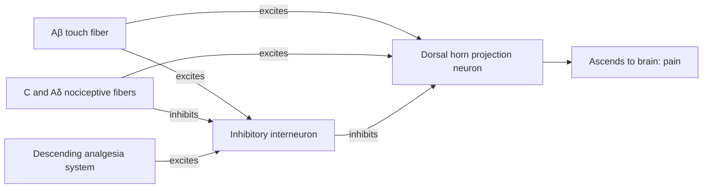

Pain is an alarm: it tells the animal that tissue is being, or is about to be, damaged, forcing it to stop a harmful behavior and protect the injured part. People born unable to feel pain (for example, patients with loss-of-function mutations of the voltage-gated sodium channel Nav1.7) are often seriously injured in childhood by repeated burns, fractures, and self-mutilation, which shows the survival value of pain. Pain also differs from the other senses: its receptors hardly adapt and may even become more sensitive; it carries a strong emotional component; and the central nervous system has dedicated systems that can turn it down. This chapter covers nociceptors, the two pain pathways, the analgesia system and gate control, referred pain and visceral pain, and then thermal sensation and itch, which share pathways with pain. The general principles of receptors (receptor potentials, adaptation, the anterolateral system) are in [7.14.39](/7.14.39); the thermodynamics of temperature-gated channels is in [7.6.4](/7.6.4#sec-4.2.3); the role of thermoreceptors in thermoregulation is in [7.14.31](/7.14.31).

## 40.1. Pain and Nociception

**Definition 40.1.1 (Pain and Nociception)** Pain is an unpleasant sensory and emotional experience associated with, or resembling that associated with, actual or potential tissue damage (International Association for the Study of Pain, 2020). The detection and encoding of noxious stimuli by the nervous system is called **nociception**; the receptors that perform this detection are called **nociceptors**.

Nociception and pain are not the same thing: nociception is the activity of receptors and pathways, whereas pain is an experience constructed centrally. Vigorous exercise or a serious wound on the battlefield may involve intense nociception and almost no pain, and chronic pain may persist for a long time after the noxious stimulus has gone.

By time course, a single noxious stimulus causes two kinds of pain.

**Definition 40.1.2 (Fast Pain and Slow Pain)** Sharp, well-localized pain that appears within about $0.1\,\mathrm{s}$ of the stimulus is called **fast pain**, also called first pain; burning or dull, poorly localized, long-lasting pain that appears $1\,\mathrm{s}$ or more after the stimulus is called **slow pain**, also called second pain.

Fast pain is seen with needle pricks, cuts, and electric shocks, usually occurs at the body surface, and rarely in the viscera; slow pain is associated with tissue destruction and can last a long time, and occurs both at the body surface and, commonly, in the viscera and deep tissues. Fast and slow pain are two signals evoked by a single stimulus in two classes of fibers (Section 40.3); they are different concepts from the clinical distinction by course between acute pain and chronic pain (lasting longer than about three months and often accompanied by long-term changes in the nervous system).

## 40.2. Nociceptors

### 40.2.1. Distribution and Stimuli

Nociceptors are all free nerve endings belonging to thin myelinated Aδ fibers or unmyelinated C fibers. They are widely distributed in the skin, periosteum, arterial walls, joint surfaces, and the falx cerebri and tentorium cerebelli in the cranial cavity, and are sparse in most deep tissues and viscera; the brain parenchyma itself has no nociceptors, so craniotomy can be performed with the patient awake.

Three classes of stimuli cause pain: mechanical stimuli, thermal stimuli (both cause fast and slow pain), and chemical stimuli (causing mainly slow pain). By response properties, nociceptors are divided into mechanical nociceptors (mostly Aδ), thermal nociceptors, and polymodal nociceptors (mostly C, responding to intense mechanical, thermal, and chemical stimuli). Most of their molecular "sensors" have been identified:

| Molecule | Activating stimulus | Role |
|---|---|---|
| TRPV1 | Temperature above about $43\,{}^\circ\mathrm{C}$, capsaicin, protons | Heat pain and inflammatory heat hyperalgesia |
| TRPA1 | Irritant chemicals such as mustard oil, allicin, and acrolein; some inflammatory mediators | Chemical pain and inflammatory pain |
| TRPM3 | Noxious heat | Shares detection of heat pain with TRPV1 and ANO1 |
| ASIC, TRPV1 | Acid (low pH in tissue ischemia and inflammation) | Ischemic pain, inflammatory pain |
| P2X3 | ATP released by damaged cells | Tissue damage |
| Piezo2 | Mechanical force | Touch-evoked pain after inflammation or injury (Szczot et al., 2018) |
| Nav1.7, Nav1.8 | Voltage | Generation of action potentials in nociceptors; loss of function of Nav1.7 causes congenital insensitivity to pain, and gain of function causes paroxysmal severe pain |

Algogenic chemicals include bradykinin, serotonin, histamine, $\ce{K+}$, acid, acetylcholine, and proteolytic enzymes. Injecting an extract of damaged tissue under normal skin causes severe pain precisely through the action of these substances. Prostaglandins and substance P do not themselves cause pain directly, but enhance the sensitivity of nociceptors.

### 40.2.2. Nonadaptation and Sensitization

Nociceptors hardly adapt. Under some conditions, sustained noxious stimulation makes them even easier to activate.

**Definition 40.2.1 (Hyperalgesia and Allodynia)** An increased pain response to a noxious stimulus is called **hyperalgesia**; pain caused by a stimulus that normally does not cause pain (such as light touch or warm water) is called **allodynia**.

Sunburned skin hurts even from the friction of clothes and from warm water, which is both together. The mechanisms divide into peripheral and central parts:

- Peripheral sensitization: prostaglandin $\mathrm{E_2}$, bradykinin, nerve growth factor, and other mediators released at the site of inflammation phosphorylate TRPV1 and Nav1.8 through G protein-coupled receptors and protein kinases, and the heat threshold of TRPV1 can fall to near body temperature; activated nociceptor endings also release substance P and calcitonin gene-related peptide to the surroundings, causing vasodilation, plasma extravasation, and sensitization of neighboring endings (neurogenic inflammation). Nonsteroidal anti-inflammatory drugs (aspirin, ibuprofen) inhibit cyclooxygenase and reduce prostaglandin synthesis, acting mainly at this step.
- Central sensitization: sustained C-fiber input makes the responses of dorsal horn neurons to subsequent input progressively larger (the "wind-up" phenomenon), involving activation of NMDA receptors and synaptic changes resembling long-term potentiation; after sensitization, Aβ input that originally conveyed only touch can also activate pain pathways, which is the main cause of allodynia.

The significance of the nonadaptation of nociceptors is that as long as the danger remains, the alarm does not stop.

### 40.2.3. Tissue Damage, Ischemia, and Spasm

- Tissue damage: the chemicals described above, especially bradykinin, are considered the main mediators of tissue damage pain; the intensity of pain correlates with the rate of tissue damage.
- Ischemia: when blood flow to a tissue is blocked, pain appears within minutes, and the faster the tissue's metabolism, the earlier the pain appears. If blood flow to the upper arm is blocked with a cuff and the subject exercises the forearm muscles, pain appears within $15$–$20\,\mathrm{s}$; at rest it takes $3$–$4\,\mathrm{min}$. Lactic acid (protons), bradykinin, and proteolytic enzymes accumulating during ischemia are possible causes, and angina pectoris is the ischemic pain of the myocardium.
- Muscle spasm: spasm directly stimulates the mechanical nociceptors in the muscle, compresses blood vessels to cause ischemia, and raises the metabolic rate of the muscle, further aggravating the ischemia.

### 40.2.4. Skin Temperature That Causes Pain

When a small patch of skin is heated gradually in a large number of subjects and the temperature at which each begins to report pain is recorded, the result is a fairly narrow distribution: almost no one feels pain below $43\,{}^\circ\mathrm{C}$, the median is about $45\,{}^\circ\mathrm{C}$, and at $47$–$48\,{}^\circ\mathrm{C}$ almost everyone feels pain (panel C). About $45\,{}^\circ\mathrm{C}$ is also the temperature at which tissue begins to be damaged by heat, and when skin temperature is held constant and tissue damage stops, pain also gradually fades. The agreement of the pain threshold with the temperature at which damage begins is direct evidence that "pain reports damage".

## 40.3. Pain Pathways

### 40.3.1. Two Pathways

Signals from nociceptors enter the dorsal horn of the spinal cord through the dorsal roots and ascend by two pathways of the anterolateral system ([7.14.39](/7.14.39#sec-39.6.1)).

The fast pain pathway (neospinothalamic tract). Fast pain signals are carried by Aδ fibers ($6$–$30\,\mathrm{m\,s^{-1}}$) and terminate mainly in lamina I (marginal layer) of the dorsal horn, with glutamate as the transmitter. The axons of second-order neurons immediately cross to the opposite side through the anterior commissure and ascend in the anterolateral funiculus; a few terminate in the brainstem reticular formation, and most go directly to the ventral posterior nuclear complex of the thalamus (ventrobasal complex) and then project to the somatosensory cortex. This pathway has clear somatotopy, so fast pain is accurately localized, and especially when tactile receptors are also activated, localization can be precise to within a few centimeters.

The slow pain pathway (paleospinothalamic tract). Slow pain signals are carried by C fibers ($0.5$–$2\,\mathrm{m\,s^{-1}}$) and terminate mainly in laminae II and III (substantia gelatinosa), then reach lamina V through one or two short interneurons, and cross to the opposite side to ascend. C-fiber terminals release both glutamate and substance P: glutamate acts within milliseconds, whereas substance P (a neuropeptide) is released more slowly and builds up over seconds to minutes, consistent with the gradually intensifying, persistent character of slow pain. Most slow pain fibers (about 75–90 %) terminate in the brainstem: the reticular formation of the medulla, pons, and midbrain, the tectal area of the midbrain, and the periaqueductal gray; only about 10–25 % go directly to the thalamus, terminating in the intralaminar nuclei and ventrolateral nucleus. The intralaminar nuclei are closely related to arousal, attention, and level of consciousness. Slow pain is therefore very crudely localized, often only to a limb or a large area of the trunk, yet it can strongly arouse the whole nervous system and make it difficult to sleep.

**Example 40.3.1 (Arrival Times of the Two Pains)** When a toe is stepped on, the signal must travel along about $1.0\,\mathrm{m}$ of peripheral nerve to the lumbar spinal cord. For Aδ fibers taking $15\,\mathrm{m\,s^{-1}}$, the time is $1.0/15 \approx 0.07\,\mathrm{s}$; for C fibers taking $1\,\mathrm{m\,s^{-1}}$, it is $1.0\,\mathrm{s}$. The segment from spinal cord to brain takes tens of milliseconds for both (second-order fibers are thicker), so first and second pain are separated by about $1\,\mathrm{s}$, and one clearly experiences "first a sting, then a wave of burning pain". A stimulus on the hand is about $0.7\,\mathrm{m}$ from the spinal cord and the two pains are separated by about $0.7\,\mathrm{s}$; a stimulus on the face is a short distance away and the two arrive almost simultaneously. If conduction in myelinated fibers is first blocked by compression (thick fibers lose function first), first pain disappears and second pain is retained; with low concentrations of local anesthetic (thin fibers blocked first), the reverse occurs.

![First pain and second pain. A: conduction time t = L/v as a function of path length to the spinal cord; the shading shows the ranges of Aδ fibers (6–30 m/s, solid line 15 m/s) and C fibers (0.5–2 m/s, solid line 1 m/s); dotted lines mark the hand (about 0.7 m) and the foot (about 1.0 m). B: afferent volley arriving at the spinal cord after a brief noxious stimulus to the foot (L = 1.0 m): histogram of arrival times of 1000 Aδ fibers (lognormally distributed velocities, median 15 m/s) and 3000 C fibers (median 1 m/s) (10 ms bins, each normalized to its peak). The two volleys are separated by about 1 s, corresponding to first and second pain; the C volley is more dispersed, consistent with the vague character of slow pain.](./plots/pain-arrival.py)

### 40.3.2. Processing of Pain in the Brain

Removal of the somatosensory cortex does not abolish pain: noxious signals entering the reticular formation, thalamus, and lower centers are enough to produce the awareness of pain, and the role of the cortex lies mainly in judging the quality of pain and localizing it precisely. The experience of pain has a sensory-discriminative component (where, how strong, what quality) and an emotional-motivational component (how distressing, whether to flee); functional imaging shows that the former mainly involves S1 and S2, and the latter the anterior cingulate cortex and insula. Patients with lesions of the anterior cingulate gyrus can detect and localize a noxious stimulus yet say that it is "not very distressing". The strong activation of the brainstem reticular formation and the intralaminar thalamic nuclei by slow pain fibers raises the excitability of the whole brain, which explains the difficulty of sleeping during severe pain.

## 40.4. The Analgesia System and Gate Control

### 40.4.1. The Descending Analgesia System

The same noxious stimulus causes very different pain in different people or in different situations, in part because the central nervous system has a system that can suppress pain input.

**Definition 40.4.1 (Analgesia System)** The descending pathway composed of the periaqueductal gray of the midbrain and the gray matter around the third ventricle, the nucleus raphe magnus of the medulla, and the pain inhibitory complex of the spinal dorsal horn, which can suppress the transmission of noxious signals in the spinal cord and brainstem, is called the **analgesia system**.

Its three links:

1. Neurons of the periaqueductal gray (PAG) and periventricular gray receive input from the cortex, hypothalamus, and amygdala, and their axons descend to the medulla.
2. In the nucleus raphe magnus of the medulla (and the adjacent paragigantocellular reticular nucleus), the axons of serotonergic neurons descend in the dorsolateral funiculus to the spinal dorsal horn; the locus coeruleus and other brainstem nuclei also send noradrenergic descending fibers (acting on $\alpha_2$ receptors).
3. In the dorsal horn, serotonin released by descending fibers activates local interneurons, which release enkephalin and inhibit transmission from C and Aδ fibers at both presynaptic and postsynaptic sites.

Reynolds (1969) found that the analgesia produced by electrical stimulation of the periaqueductal gray in rats was sufficient to perform abdominal surgery without anesthetics, the first direct evidence for the existence of the analgesia system.

Endogenous opioid peptides and opioid receptors. The site of action of morphine is precisely this system. Opioid receptors were found in the brain in 1973, and three major receptor subtypes have since been identified: μ, δ, and κ (plus a structurally similar NOP receptor), all $\mathrm{G_{i/o}}$-coupled receptors; together with their endogenous ligands: β-endorphin, methionine-enkephalin and leucine-enkephalin, and dynorphin. Morphine and the opioids commonly used clinically act mainly on μ receptors. Presynaptically, receptor activation inhibits voltage-gated $\ce{Ca^2+}$ channels and reduces the release of glutamate and substance P from C-fiber terminals; postsynaptically, it opens G protein-gated inwardly rectifying $\ce{K+}$ channels (GIRK) and hyperpolarizes dorsal horn neurons. Opioid receptors are also abundant in the PAG and nucleus raphe magnus, where opioids inhibit local GABAergic interneurons and thereby cause **disinhibition** of the descending analgesic pathway. The same receptors are also found in the respiratory centers of the brainstem and in the intestine, so the main danger of opioid overdose is respiratory depression and a common side effect is constipation. The opioid receptor antagonist naloxone can reverse the effect of morphine and can also partly reverse placebo-induced analgesia (Levine et al., 1978), showing that part of the placebo effect is mediated by endogenous opioid peptides.

### 40.4.2. The Gate Control Theory

After a bump, people instinctively rub the injured part, and this does reduce pain.

**Definition 40.4.2 (Gate Control Theory)** Inhibitory interneurons in the spinal dorsal horn that are activated by thick tactile afferent fibers regulate, like a gate, how much of the noxious signal is transmitted upward: activity of thick fibers closes the gate, activity of thin fibers opens it, and descending pathways can also modulate the gate. This model is called the **gate control theory** (Melzack and Wall, 1965).

Rubbing excites Aβ fibers, which, through inhibitory interneurons in the substantia gelatinosa, inhibit projection neurons and reduce the upward transmission of noxious signals; activity of C fibers inhibits these interneurons and "opens" the gate. Some details of the original model (for example, the direct inhibition of interneurons by thin fibers) have since been revised, but the core idea that "the dorsal horn is a modulated gateway rather than a passive relay" has been confirmed and has driven analgesic methods such as transcutaneous electrical nerve stimulation (TENS) and spinal cord stimulation of the dorsal columns. It also explains the allodynia that follows central sensitization: when the function of inhibitory interneurons weakens (for example, after nerve injury), Aβ input directly drives the pain pathway.

## 40.5. Referred Pain and Visceral Pain

### 40.5.1. Referred Pain

**Definition 40.5.1 (Referred Pain)** Pain caused by disease of a viscus or deep tissue that is felt as occurring in a region of the body surface remote from the lesion is called **referred pain**.

The main explanation of referred pain is convergence–projection: nociceptive afferents from the viscera and afferents from the skin converge in the dorsal horn onto the same projection neurons. Ordinarily these neurons receive mainly cutaneous input, so the central nervous system "interprets" the signals from them as cutaneous pain. The site of reference is usually the dermatome that was in the same segment as the viscus in the embryo, because afferents from viscera and skin enter the same segment of the spinal cord; after organs migrate during development, their afferents still return to the original segment.

| Viscus | Typical site of referred pain | Segment |
|---|---|---|
| Heart | Retrosternal, left shoulder and medial left upper arm | $\mathrm{T_1}$–$\mathrm{T_5}$ |
| Esophagus | Retrosternal and pharyngeal | $\mathrm{T_4}$–$\mathrm{T_6}$ |
| Stomach | Upper abdomen | $\mathrm{T_6}$–$\mathrm{T_9}$ |
| Liver and gallbladder | Right upper abdomen; when the gallbladder and diaphragm are irritated, also referred to the right shoulder (phrenic nerve, $\mathrm{C_3}$–$\mathrm{C_5}$) | $\mathrm{T_7}$–$\mathrm{T_9}$ |
| Small intestine and appendix (early) | Periumbilical | $\mathrm{T_{10}}$ |
| Kidney and ureter | Lumbar back, groin | $\mathrm{T_{10}}$–$\mathrm{L_1}$ |
| Colon and bladder | Lower abdomen | $\mathrm{T_{11}}$–$\mathrm{L_1}$ |

The site of referred pain therefore has diagnostic value: patients with myocardial ischemia often complain of pain in the left arm.

### 40.5.2. Visceral Pain

Visceral pain differs from pain at the body surface in several ways:

1. Localized damage rarely causes severe pain: cutting or burning the intestinal wall of a conscious patient during surgery is not painful; whereas diffuse stimulation activates nociceptors over a large area and causes severe pain, for example ischemia of a long stretch of intestine.
2. Causes of visceral pain: ischemia (tissue acidification, appearance of bradykinin and proteolytic enzymes); chemical stimuli (for example, acidic digestive fluid leaking into the peritoneal cavity after perforation of a gastric or duodenal ulcer); spasm of hollow organs (directly stimulating mechanical nociceptors and compressing blood vessels to cause ischemia, often presenting as periodic colicky pain, such as biliary colic and renal colic); and overdistension of hollow organs.
3. Some visceral tissues hardly sense pain: liver parenchyma and the pulmonary alveoli. But the liver capsule, bile ducts, bronchi, and parietal pleura are very sensitive to pain.

Visceral pain is conducted by two routes.

- True visceral pain: nociceptive afferents of the viscera (mostly C fibers) enter the spinal cord along with the autonomic nerves (mainly sympathetic); the pain is diffuse and poorly localized, often referred to the body surface, and accompanied by autonomic reactions such as nausea and sweating.
- Parietal pain: when disease involves the wall of a body cavity (parietal peritoneum, pleura, pericardium), the wall, like skin, has dense nociceptors and is supplied by local spinal nerves; the pain is accurately localized and often accompanied by reflex tension of local muscles.

Appendicitis is a classic example in which the two routes act in succession: early in the inflammation, visceral afferents of the appendix enter near $\mathrm{T_{10}}$ along the sympathetic nerves, and the pain is diffusely referred to the periumbilical region; after the inflammation spreads to the adjacent parietal peritoneum, the pain shifts and localizes to the right lower abdomen, and is more pronounced on pressure.

## 40.6. Thermal Sensation

### 40.6.1. Cold Receptors and Warm Receptors

**Definition 40.6.1 (Thermoreceptor)** A receptor that responds specifically to skin temperature and its changes and fires within the innocuous temperature range is called a **thermoreceptor**; thermoreceptors are divided into cold receptors, sensitive to cooling, and warm receptors, sensitive to warming.

People can distinguish every grade from painful cold, cold, cool, neutral, warm, and hot to burning pain, which is encoded at least by a combination of three classes of receptors: cold receptors, warm receptors, and nociceptors that respond to freezing pain and burning pain at the two ends, respectively. Cold receptors are served by Aδ and C fibers, and warm receptors mainly by C fibers. On the skin they are distributed as discrete cold spots and warm spots, and there are $3$–$10$ times as many cold spots as warm spots: the lips have $15$–$25$ cold spots per square centimeter, the fingers only $3$–$5$, and some parts of the trunk fewer than $1$. Because each spot is small, it is hard to judge hot or cold when only a small patch of skin is stimulated, and the larger the stimulated area, the stronger the temperature sensation (spatial summation).

At steady state, cold fibers fire most at about $20$–$30\,{}^\circ\mathrm{C}$ and warm fibers at about $40$–$45\,{}^\circ\mathrm{C}$, and above about $45\,{}^\circ\mathrm{C}$ heat nociceptors begin to fire (panel B); some cold fibers fire again above $45\,{}^\circ\mathrm{C}$, producing "paradoxical cold". The dynamic responses of thermoreceptors are far stronger than their static responses: when temperature drops suddenly, the firing rate of cold fibers surges within seconds and then mostly adapts within about $30\,\mathrm{min}$. We are therefore most sensitive to changes in temperature: stepping into a cold pool feels bitterly cold, and after a few minutes it feels "fine", though the water temperature has not changed. Thermal signals ascend with pain signals along the anterolateral system to the thalamus and somatosensory cortex, and also to the hypothalamus for thermoregulation ([7.14.31](/7.14.31)).

### 40.6.2. Temperature-Gated TRP Channels

The transduction mechanisms of thermoreceptors have been gradually elucidated since 1997, and are mainly temperature-sensitive channels of the transient receptor potential (TRP) family, which do not sense temperature by changing the rate of metabolic reactions; rather, the opening of the channel protein itself is gated directly by temperature.

| Channel | Activation temperature | Chemical activators | Role |
|---|---|---|---|
| TRPM8 | Below about $25\,{}^\circ\mathrm{C}$ | Menthol, eucalyptol | Main sensor of cold; cold sensation severely impaired in knockout mice |
| TRPA1 | Noxious cold (below about $17\,{}^\circ\mathrm{C}$, disputed in mammals) | Mustard oil, allicin | Chemical irritant pain |
| TRPV1 | Above about $43\,{}^\circ\mathrm{C}$ | Capsaicin, protons | Heat pain |
| TRPM3 | Noxious heat | Pregnenolone sulfate | Heat pain |
| TRPV2 | Above about $52\,{}^\circ\mathrm{C}$ (rodents) | | Physiological role unclear |
| TRPM2, TRPV3, TRPV4 | Warmth (about $30$–$40\,{}^\circ\mathrm{C}$) | | Candidate sensors of warmth; the molecular basis of warm sensation is still disputed |

The open probability of these channels depends on temperature in a steep sigmoid, which can be described by a two-state model: the enthalpy difference $\Delta H$ and entropy difference $\Delta S$ between the open and closed states are both large, and the midpoint temperature is $T_{1/2} = \Delta H/\Delta S$ (the temperature-gating formula for **two-state systems** is in [7.6.4](/7.6.4#sec-4.2.3)). $\Delta H$ is positive for heat-activated channels and negative for cold-activated channels; the gating enthalpy of TRPV1 is several hundred $\mathrm{kJ\,mol^{-1}}$, so that the open probability goes from near 0 to near 1 within a few degrees Celsius, and $Q_{10}$ can reach several tens. Capsaicin making the mouth feel "hot" and menthol making it feel "cool" are everyday examples of the labeled line principle ([7.14.39](/7.14.39#sec-39.1.2)): the chemical activates a heat or cold channel, and the central nervous system knows only that this line has been activated. The cloning of TRPV1 and the discovery of Piezo were awarded the 2021 Nobel Prize in Physiology or Medicine.

![Temperature sensing. A: open probability of two-state channels p_o = 1/(1 + exp[(ΔH/R)(1/T − 1/T½)]), with parameters illustrative values of the same order as those of temperature-sensitive TRP channels in the literature: TRPM8 (T½ = 25 °C, ΔH = −250 kJ/mol, cold-activated), TRPV1 (43 °C, +400 kJ/mol), TRPV2 (52 °C, +400 kJ/mol). B: static firing of cold fibers, warm fibers, and heat nociceptors as a function of skin temperature (schematic, each obtained by multiplying two such sigmoid functions: activation times cessation at the high or low temperature end, peak normalized to 1): cold fibers fire most at about 23 °C, warm fibers at about 42 °C, and heat nociceptors above 45 °C. C: cumulative fraction of a population reporting pain as a function of skin temperature (schematic, pain threshold taken as a normal distribution with mean 45 °C and standard deviation 1.2 °C).](./plots/thermal-sensors.py)

## 40.7. Itch

**Definition 40.7.1 (Itch)** An unpleasant skin sensation that provokes the desire to scratch is called **itch**.

Itch was once thought to be weak pain, but we now know that it has its own receptors and pathways. One class of itch is mediated by histamine: during an insect bite or allergy, mast cells release histamine, which causes itch through H1 receptors on C fibers and TRPV1, and antihistamines are effective. Another class does not depend on histamine: the antimalarial chloroquine, the spicules of cowhage, and others cause itch through Mas-related G protein-coupled receptors (human MRGPRX1, mouse MrgprA3) and TRPA1, and antihistamines are ineffective; this kind of itch is common in chronic skin diseases and hepatobiliary disease. In the spinal dorsal horn, itch signals are transmitted through interneurons that express the gastrin-releasing peptide receptor (GRPR), and then ascend along the anterolateral system. The mild pain evoked by scratching inhibits the transmission of itch through inhibitory interneurons (such as Bhlhb5-expressing neurons), so scratching temporarily relieves itch, an interaction similar to gate control; conversely, morphine, which suppresses pain (especially when given intrathecally), often causes itch.

## 40.8. Evolution and Comparison

Universality of nociception. Almost all animals studied have nociception. The ASH neuron of the nematode *Caenorhabditis elegans* is a polymodal nociceptor that responds to touch at the nose, hyperosmolarity, and noxious chemicals, transducing through OSM-9 of the TRPV family and causing backing away. Class IV multidendritic neurons in the body wall of *Drosophila* larvae respond to noxious heat and strong mechanical stimuli, with transduction depending on Painless and TRPA1 of the TRP family, Pickpocket of the DEG/ENaC family, and Piezo; when activated, the larva rolls along its long body axis, an effective action for escaping the ovipositor of a parasitoid wasp (Hwang et al., 2007), and optogenetic activation of this group of neurons is sufficient to cause rolling ([7.14.39](/7.14.39#sec-39.1.2)). The N cells of the leech and the sensory neurons of *Aplysia* are also nociceptors, and sensitization in *Aplysia* is a classic model for the study of learning ([7.14.46](/7.14.46)). Both molecular similarity and behavioral similarity show that nociception appeared early in animal evolution.

Infrared sensing in snakes. Pit vipers (subfamily Crotalinae, such as rattlesnakes), pythons, and boas each independently evolved organs for sensing infrared radiation: the loreal pit between the eye and nostril of pit vipers and the labial pits of pythons and boas. The floor of the pit is a suspended thin membrane about $15\,\mu\mathrm{m}$ thick, with air on both sides and very small heat capacity, whose temperature rises rapidly when illuminated by infrared radiation emitted by warm-blooded prey; the membrane is densely supplied with free endings of the trigeminal nerve, and the transduction molecule is TRPA1 (Gracheva et al., 2010). Snake TRPA1 is itself a heat-activated channel, whereas the homologous channel in mammals responds mainly to irritant chemicals. The pit is estimated to sense temperature changes of a few thousandths of a degree Celsius. Signals from the pit project to the optic tectum of the midbrain, overlapping the visual map and letting the snake "see" a thermal image of its prey in the dark.

The nose leaf of the vampire bat. The vampire bat (*Desmodus rotundus*) uses heat sensing at its nose leaf to find sites under the skin of prey where blood vessels are abundant. In the trigeminal ganglion innervating the nose leaf, alternative splicing of the *TRPV1* transcript produces a C-terminally truncated variant whose heat threshold falls to about $30\,{}^\circ\mathrm{C}$, making it a sensor for detecting warmth rather than burning pain; the dorsal root ganglia innervating the rest of the body express mainly the normal long variant (Gracheva et al., 2011).

The naked mole-rat and birds. The naked mole-rat, which lives in underground burrows with high $\ce{CO2}$, feels almost no pain from acid: its Nav1.7 has several amino acid substitutions that make protons block this channel more strongly, so that an acidic environment instead suppresses firing of nociceptors (Smith et al., 2011); its cutaneous C fibers lack substance P and are also insensitive to capsaicin-induced inflammatory hyperalgesia (Park et al., 2008). Bird TRPV1 is insensitive to capsaicin (but still sensitive to heat, Jordt and Julius, 2002): chili fruits are pungent to mammals and not to birds, and birds pass the seeds intact and disperse them far, which is thought to be the reason capsaicin evolved as a selective defensive substance.

Do fish feel pain? Fish have nociceptors: when acetic acid or bee venom is injected into the lip of a rainbow trout, it rubs the lip on gravel for a long time, eats less, and loses its avoidance of novel objects, and these changes can be reduced by morphine (Sneddon et al., 2003). On the other hand, fish have no neocortex, and C fibers make up only about $5\,\%$ of the trigeminal nerve of the rainbow trout, far lower than the proportion in mammalian cutaneous nerves; some researchers consider that the above behaviors can be explained by nociceptive reflexes that need no conscious experience (Rose et al., 2014). The core of the dispute is the definition of "pain": nociception certainly exists in fish, and whether it is accompanied by a subjective experience resembling that of mammals cannot be determined with the present evidence.

## Summary

| Topic | Key points |
|---|---|
| Definitions (Definitions 40.1.1, 40.1.2) | Pain is an experience, nociception is detection; fast pain about $0.1\,\mathrm{s}$, sharp, well localized; slow pain $>1\,\mathrm{s}$, burning, poorly localized |
| Nociceptors | Free endings (Aδ, C); mechanical, thermal, and chemical stimuli; TRPV1, TRPA1, TRPM3, ASIC, P2X3, Nav1.7 |
| Sensitization (Definition 40.2.1) | Hardly adapt; peripheral sensitization (prostaglandins lower the TRPV1 threshold) and central sensitization (NMDA, wind-up) cause hyperalgesia and allodynia |
| Damage, ischemia, spasm | Chemicals such as bradykinin; the speed of onset of ischemic pain relates to metabolic rate; spasm combines mechanical stimulation and ischemia |
| Pain threshold | Population median about $45\,{}^\circ\mathrm{C}$, matching the temperature at which tissue begins to be damaged |
| Two pathways | Fast pain: Aδ $6$–$30\,\mathrm{m\,s^{-1}}$, lamina I, glutamate, neospinothalamic tract, ventral posterior nuclei; slow pain: C $0.5$–$2\,\mathrm{m\,s^{-1}}$, laminae II and III, glutamate and substance P, mostly ending in the brainstem, 10–25 % reaching the intralaminar thalamic nuclei; the two pains are separated by about $L/v$ (Example 40.3.1) |
| Analgesia (Definition 40.4.1) | PAG → nucleus raphe magnus (serotonin) → dorsal horn enkephalin interneurons, presynaptic and postsynaptic inhibition; μ, δ, κ receptors and endogenous opioid peptides |
| Gate control (Definition 40.4.2) | Thick fibers close the gate through inhibitory interneurons, thin fibers open it, and descending pathways modulate it |
| Referred pain (Definition 40.5.1) | Visceral and cutaneous afferents converge in the dorsal horn, and pain is projected to the dermatome of the same segment |
| Visceral pain | Severe only with diffuse stimulation; ischemia, chemical, spasm, distension; visceral pathway (autonomic nerves, vague) and parietal pathway (spinal nerves, accurate); appendicitis |
| Thermal sensation (Definition 40.6.1) | More cold spots than warm spots; cold fibers fire most at about $20$–$30\,{}^\circ\mathrm{C}$ and warm fibers at about $40$–$45\,{}^\circ\mathrm{C}$; strong dynamic response, adaptation; two-state channels such as TRPM8 and TRPV1 gated directly by temperature |
| Itch (Definition 40.7.1) | Histamine-dependent and histamine-independent classes; GRPR interneurons; pain from scratching inhibits itch |
| Evolution | Nematode ASH, *Drosophila* larval class IV neurons; snake pit TRPA1, vampire bat short TRPV1 variant, naked mole-rat Nav1.7, bird TRPV1 insensitive to capsaicin; the debate on fish pain |

## Questions

1. When the hand is scalded by boiling water, people often withdraw the hand before feeling pain. Explain this order using this chapter and Chapter 44, and estimate the time of each step.

   **Answer** Hand withdrawal is a flexor reflex completed by the spinal cord ([7.14.44](/7.14.44)): the Aδ nociceptive signal travels from the hand to the cervical spinal cord (about $0.7\,\mathrm{m}$, about $50\,\mathrm{ms}$ at $15\,\mathrm{m\,s^{-1}}$), excites flexor motor neurons through several interneurons (about $0.5$–$1\,\mathrm{ms}$ per synapse), and then reaches the muscle over about $0.7\,\mathrm{m}$ of Aα fiber (about $10\,\mathrm{ms}$); with the excitation–contraction delay of the muscle, the reflex movement begins within about $0.1\,\mathrm{s}$. The fast pain signal must still ascend the spinothalamic tract to the thalamus and cortex (tens of milliseconds more) and be perceived; and slow pain via C fibers takes more than about $0.7\,\mathrm{s}$. The movement thus precedes the awareness of first pain, and precedes second pain by far.

2. Why does locally scalded skin hurt even with warm water a few hours later? If ibuprofen is given, at which step does it mainly act?

   **Answer** Inflammation at the scalded site releases prostaglandin $\mathrm{E_2}$, bradykinin, nerve growth factor, and others, which phosphorylate TRPV1 through G protein-coupled receptors and protein kinases, lowering its heat threshold from about $43\,{}^\circ\mathrm{C}$ to near body temperature, so that warm water can also activate nociceptors (heat hyperalgesia and allodynia due to peripheral sensitization, Definition 40.2.1); sustained C-fiber input also causes central sensitization in the dorsal horn. Ibuprofen inhibits cyclooxygenase and reduces prostaglandin synthesis, mainly relieving the step of peripheral sensitization.

3. After eating a very spicy dish, a person drinks a cup of hot tea and finds the tea much hotter than usual; after a mint candy, cold water feels especially icy. Explain with the two-state model of TRP channels.

   **Answer** Capsaicin binds to TRPV1 and stabilizes its open state, equivalent to lowering the free energy of opening, which shifts the open-probability curve toward lower temperature (lower $T_{1/2}$), so that tea that is merely warm can already open many TRPV1 channels and is felt as burning hot; the central nervous system receives a signal on the "heat pain" labeled line. Menthol binding to TRPM8 likewise stabilizes its open state, shifting the cold-activation curve toward higher temperature, so that cooler water activates more TRPM8 and feels colder. These two examples show that thermal sensation is determined by the opening of channels, not by temperature itself.

4. A patient first feels a diffuse dull pain around the umbilicus, and a few hours later the pain shifts to the right lower abdomen and worsens on pressure. Explain the shift, and why the early pain is not at the position of the appendix.

   **Answer** Early inflammation is confined to the appendix wall, and the signal enters about the $\mathrm{T_{10}}$ segment along the sympathetic nerves through the visceral afferent fibers of the appendix and converges in the dorsal horn with afferents from the periumbilical skin, and so is felt as diffuse, poorly localized periumbilical referred pain (Definition 40.5.1). After the inflammation spreads to the parietal peritoneum next to the appendix, the parietal peritoneum, like skin, has dense nociceptors and is supplied by local spinal nerves, so the pain is accurately localized to the right lower abdomen where the appendix lies, and pressure directly stimulates these receptors and so worsens it.

5. (Open question) The pit organ of snakes can sense temperature changes of a few thousandths of a degree Celsius. Analyze physically: why is a membrane suspended in air the key? What would happen if the membrane were attached to tissue?

   **Answer** Idea: for a given absorbed infrared power $P$, the membrane temperature rises by $\Delta T \approx P\,t/(m c)$ (short times) or $P/G$ (steady state, where $G$ is the thermal conductance for heat loss to the surroundings). A suspended thin membrane has a very small mass $m$ and heat capacity, with poorly conducting air on both sides and thus also a very small conductance $G$, so the same radiation causes a large and rapid temperature rise, and the time constant $mc/G$ is short, so it can follow the movement of prey. If the membrane were attached to perfused tissue, the heat capacity of the tissue and heat removal by blood flow would quickly carry away the absorbed heat, the temperature rise would be smaller by several orders of magnitude, and the signal would be swamped by fluctuations of body temperature. This is similar to the capsule of the Pacinian corpuscle: the physical design of the accessory structure determines what kind of stimulus the receptor can "see", and TRPA1 is only the final transduction step.
