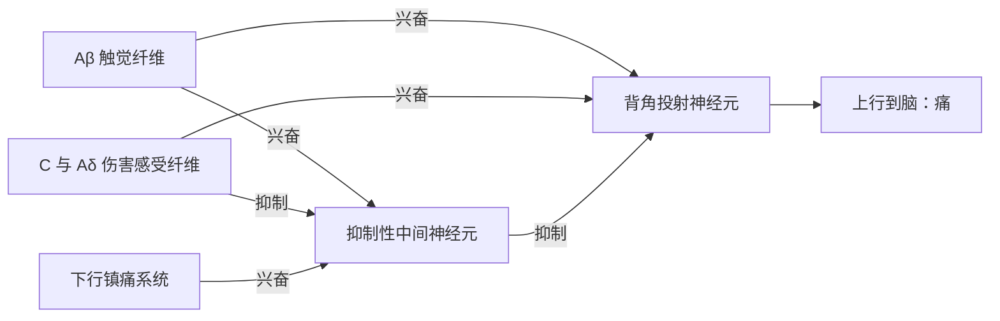

痛觉是一种报警：它告诉动物组织正在受到或即将受到损伤，迫使它停止有害的行为并保护受伤的部位。先天不能感到疼痛的人（例如电压门控钠通道 Nav1.7 功能缺失的患者）往往在童年就因反复的烫伤、骨折与自残而严重受伤，说明痛觉对生存的价值。痛觉又不同于其他感觉：它的感受器几乎不适应，反而会变得更敏感；它强烈地带有情绪成分；中枢有专门的系统可以把它"关小"。本章讲伤害感受器、两条痛觉通路、镇痛系统与闸门控制、牵涉痛与内脏痛，再讲与痛觉共用通路的温度觉与瘙痒。感受器的一般原理（受体电位、适应、前外侧系统）见 [7.14.39](/7.14.39)；温度门控通道的热力学见 [7.6.4](/7.6.4#sec-4.2.3)；温度感受器在体温调节中的作用见 [7.14.31](/7.14.31)。

## 40.1. 痛与伤害感受

**定义 40.1.1（痛与伤害感受）** 痛是一种与实际或潜在的组织损伤相关、或类似于这种损伤的不愉快的感觉与情绪体验（国际疼痛研究协会，2020）。神经系统对伤害性刺激的检测与编码称为**伤害感受**（nociception）；完成这一检测的感受器称为**伤害感受器**（nociceptor）。

伤害感受与痛不是一回事：伤害感受是感受器与通路的活动，痛是中枢构建的体验。剧烈运动或战场上的重伤可以有强烈的伤害感受而几乎不痛，慢性痛则可以在伤害性刺激消失之后长期存在。

按时间进程，一次伤害性刺激引起两种痛。

**定义 40.1.2（快痛与慢痛）** 刺激后约 $0.1\,\mathrm{s}$ 内出现、尖锐而定位准确的痛称为**快痛**（fast pain），也称第一痛；刺激后 $1\,\mathrm{s}$ 或更久才出现、烧灼样或钝痛、定位模糊并持续较久的痛称为**慢痛**（slow pain），也称第二痛。

快痛见于针刺、刀割、电击，通常发生在体表，很少发生在内脏；慢痛与组织破坏有关，可以持续很久，既见于体表，也常见于内脏与深部组织。快痛与慢痛是一次刺激在两类纤维中引起的两个信号（40.3 节），与临床上按病程区分的急性痛和慢性痛（持续超过约三个月、往往伴有神经系统的长期改变）是不同的概念。

## 40.2. 伤害感受器

### 40.2.1. 分布与刺激

伤害感受器都是游离的神经末梢，属于细的有髓 Aδ 纤维或无髓 C 纤维。它们广泛分布于皮肤、骨膜、动脉壁、关节面、颅腔中的大脑镰与小脑幕等处，在大多数深部组织与内脏中较稀疏；脑实质本身没有伤害感受器，所以开颅手术可以在病人清醒时进行。

引起痛觉的刺激有三类：机械刺激、热刺激（两者都引起快痛与慢痛）与化学刺激（主要引起慢痛）。按反应特性，伤害感受器可分为机械伤害感受器（多为 Aδ）、热伤害感受器与多觉型伤害感受器（多为 C，对强的机械、热与化学刺激都反应）。它们的分子"传感器"大多已经鉴定：

| 分子 | 激活刺激 | 作用 |
|---|---|---|
| TRPV1 | 高于约 $43\,{}^\circ\mathrm{C}$ 的温度、辣椒素、质子 | 热痛与炎症性热痛过敏 |
| TRPA1 | 芥子油、大蒜素、丙烯醛等刺激性化学物、某些炎症介质 | 化学性痛与炎症痛 |
| TRPM3 | 有害的热 | 与 TRPV1、ANO1 共同承担热痛的检测 |
| ASIC、TRPV1 | 酸（组织缺血与炎症时的低 pH） | 缺血痛、炎症痛 |
| P2X3 | 受损细胞释放的 ATP | 组织损伤 |
| Piezo2 | 机械力 | 炎症或损伤后的触觉痛（Szczot 等，2018） |
| Nav1.7、Nav1.8 | 电压 | 伤害感受器中动作电位的产生；Nav1.7 功能缺失者先天无痛觉，功能获得者有阵发性剧痛 |

致痛的化学物质包括缓激肽、5-羟色胺、组胺、$\ce{K+}$、酸、乙酰胆碱与蛋白水解酶。把损伤组织的提取液注射到正常皮下就能引起剧痛，正是这些物质的作用。前列腺素与 P 物质本身不直接引起痛，但增强伤害感受器的敏感性。

### 40.2.2. 不适应与敏化

伤害感受器几乎不适应。在某些条件下，持续的伤害性刺激反而使它们越来越容易被激活。

**定义 40.2.1（痛觉过敏与痛觉超敏）** 对伤害性刺激的痛反应增强称为**痛觉过敏**（hyperalgesia）；正常情况下不引起痛的刺激（如轻触、温水）引起痛称为**痛觉超敏**（allodynia）。

被晒伤的皮肤连衣服的摩擦与温水都会引起痛，就是两者兼有。机制分外周与中枢两部分：

- 外周敏化：炎症部位释放的前列腺素 $\mathrm{E_2}$、缓激肽、神经生长因子等经 G 蛋白偶联受体与蛋白激酶使 TRPV1 与 Nav1.8 磷酸化，TRPV1 的热阈值可以降到接近体温；被激活的伤害感受器末梢还向周围释放 P 物质与降钙素基因相关肽，引起血管扩张、血浆外渗与周围末梢的敏化（神经源性炎症）。非甾体抗炎药（阿司匹林、布洛芬）抑制环加氧酶、减少前列腺素的合成，主要作用于这一步。
- 中枢敏化：持续的 C 纤维输入使脊髓背角神经元对后续输入的反应逐渐增大（"上发条"现象），涉及 NMDA 受体的激活与长时程增强样的突触变化；敏化之后，原本只传递触觉的 Aβ 输入也能激活痛觉通路，这是痛觉超敏的主要原因。

伤害感受器不适应的意义在于：只要危险还在，警报就不停止。

### 40.2.3. 组织损伤、缺血与痉挛

- 组织损伤：前述的化学物质，尤其是缓激肽，被认为是组织损伤痛的主要介质；痛的强度与组织损伤的速率相关。
- 缺血：组织的血流被阻断时，在数分钟内就会出现痛，组织的代谢越快，痛出现越早。用袖带阻断上臂的血流并让受试者活动前臂肌肉，痛在 $15$–$20\,\mathrm{s}$ 内出现；静止时则需要 $3$–$4\,\mathrm{min}$。缺血时堆积的乳酸（质子）、缓激肽与蛋白水解酶是可能的原因，心绞痛就是心肌的缺血痛。
- 肌肉痉挛：痉挛直接刺激肌肉中的机械伤害感受器，同时压迫血管造成缺血，并使肌肉的代谢率升高，进一步加重缺血。

### 40.2.4. 引起痛觉的皮肤温度

对大量受试者逐渐加热一小块皮肤、记录每个人开始报告疼痛的温度，结果呈现一个相当窄的分布：几乎没有人在 $43\,{}^\circ\mathrm{C}$ 以下感到痛，中位数约 $45\,{}^\circ\mathrm{C}$，到 $47$–$48\,{}^\circ\mathrm{C}$ 几乎所有人都感到痛（图 C）。约 $45\,{}^\circ\mathrm{C}$ 也正是组织开始被热损伤的温度，而当皮肤温度保持不变、组织损伤停止时，痛也逐渐消失。痛阈与损伤开始的温度一致，是"痛报告损伤"的直接证据。

## 40.3. 痛觉的传导通路

### 40.3.1. 两条通路

伤害感受器的信号经背根进入脊髓背角，沿前外侧系统（[7.14.39](/7.14.39#sec-39.6.1)）的两条通路上行。

快痛通路（新脊髓丘脑束）。快痛的信号由 Aδ 纤维（$6$–$30\,\mathrm{m\,s^{-1}}$）传入，主要终止于背角第 I 层（边缘层），递质是谷氨酸。二级神经元的轴突立即经前连合交叉到对侧，在前外侧索上行，少数终止于脑干网状结构，大多直达丘脑的腹后核群（腹侧基底复合体），再投射到躯体感觉皮层。这条通路的躯体定位清楚，所以快痛定位准确，尤其是同时有触觉感受器被激活时，定位可以精确到几厘米以内。

慢痛通路（旧脊髓丘脑束）。慢痛的信号由 C 纤维（$0.5$–$2\,\mathrm{m\,s^{-1}}$）传入，主要终止于背角第 II、III 层（胶状质），经一两个短的中间神经元再到第 V 层，然后交叉到对侧上行。C 纤维末梢同时释放谷氨酸与 P 物质：谷氨酸在数毫秒内起作用，P 物质（一种神经肽）释放较慢，在数秒到数分钟内逐渐增强，这与慢痛逐渐加重、持续的性质一致。慢痛纤维的大部分（约 75–90 %）终止于脑干：延髓、脑桥与中脑的网状结构、中脑顶盖区与导水管周围灰质；只有约 10–25 % 直达丘脑，终止于板内核与腹外侧核。板内核与觉醒、注意和意识水平密切相关。因此慢痛的定位很粗略，常只能定位到一个肢体或躯干的一大片区域，却能强烈地唤醒整个神经系统，使人难以入睡。

**例 40.3.1（两种痛的到达时间）** 脚趾被踩到时，信号要沿约 $1.0\,\mathrm{m}$ 的周围神经传到腰段脊髓。Aδ 纤维取 $15\,\mathrm{m\,s^{-1}}$，所需时间 $1.0/15 \approx 0.07\,\mathrm{s}$；C 纤维取 $1\,\mathrm{m\,s^{-1}}$，需要 $1.0\,\mathrm{s}$。脊髓到脑的一段对两者都是数十毫秒（二级纤维较粗），所以第一痛与第二痛相隔约 $1\,\mathrm{s}$，人能清楚地体验到"先一下刺痛，然后一阵烧灼的痛"。手上的刺激距脊髓约 $0.7\,\mathrm{m}$，两种痛相隔约 $0.7\,\mathrm{s}$；面部的刺激距离很短，两者几乎同时到达。若先用压迫阻断有髓纤维的传导（粗纤维先失去功能），第一痛消失而第二痛保留；用低浓度局麻药（细纤维先被阻断）则相反。

### 40.3.2. 脑对痛觉的处理

切除躯体感觉皮层并不消除痛觉：伤害性信号进入网状结构、丘脑与更低的中枢就足以产生痛的意识，皮层的作用主要在于判断痛的性质与精确定位。痛的体验有感觉辨别的成分（在哪里、多强、是什么性质）与情绪动机的成分（有多难受、要不要逃）；功能成像显示前者主要涉及 S1 与 S2，后者涉及前扣带回与岛叶。前扣带回受损的患者能够察觉并定位伤害性刺激，却说它"不怎么难受"。慢痛纤维对脑干网状结构与丘脑板内核的强烈激活提高整个脑的兴奋性，这解释了剧痛时难以入睡。

## 40.4. 镇痛系统与闸门控制

### 40.4.1. 下行镇痛系统

同样的伤害性刺激在不同的人或不同的情境下引起的痛差别很大，部分原因是中枢有一个可以抑制痛觉传入的系统。

**定义 40.4.1（镇痛系统）** 由中脑导水管周围灰质与第三脑室周围的灰质、延髓的中缝大核以及脊髓背角的痛觉抑制复合体组成、能够抑制伤害性信号在脊髓与脑干传递的下行通路，称为**镇痛系统**（analgesia system）。

它的三个环节：

1. 中脑导水管周围灰质（PAG）与脑室周围灰质的神经元接受来自皮层、下丘脑与杏仁核的输入，其轴突下行到延髓。
2. 延髓的中缝大核（以及邻近的网状巨细胞旁核）中，5-羟色胺能神经元的轴突沿背外侧索下行到脊髓背角；蓝斑等脑干核团还发出去甲肾上腺素能的下行纤维（作用于 $\alpha_2$ 受体）。
3. 背角中，下行纤维释放的 5-羟色胺激活局部的中间神经元，后者释放脑啡肽，在突触前与突触后两处抑制 C 与 Aδ 纤维的传递。

Reynolds（1969）发现，电刺激大鼠的导水管周围灰质产生的镇痛足以在不用麻醉药的情况下进行腹部手术，这是镇痛系统存在的第一个直接证据。

内源性阿片肽与阿片受体。吗啡的作用部位正是这一系统。1973 年在脑中发现了阿片受体，此后鉴定出三个主要的受体亚型：μ、δ 与 κ（还有一个结构相近的 NOP 受体），都是 $\mathrm{G_{i/o}}$ 偶联的受体；以及它们的内源性配体：β-内啡肽、甲硫氨酸脑啡肽与亮氨酸脑啡肽、强啡肽。吗啡与临床常用的阿片类药物主要作用于 μ 受体。在突触前，受体激活抑制电压门控 $\ce{Ca^2+}$ 通道，减少 C 纤维末梢释放谷氨酸与 P 物质；在突触后，它打开 G 蛋白门控的内向整流 $\ce{K+}$ 通道（GIRK），使背角神经元超极化。阿片受体在 PAG 与中缝大核中也很丰富，在那里阿片类药物抑制局部的 GABA 能中间神经元，**去抑制**下行镇痛通路。同一类受体也分布在脑干的呼吸中枢与肠道，所以阿片类药物过量的主要危险是呼吸抑制，常见的副作用是便秘。阿片受体拮抗剂纳洛酮能逆转吗啡的作用，也能部分地逆转安慰剂引起的镇痛（Levine 等，1978），说明安慰剂效应的一部分是由内源性阿片肽介导的。

### 40.4.2. 闸门控制学说

碰伤之后人会本能地揉搓受伤的部位，这确实能减轻疼痛。

**定义 40.4.2（闸门控制学说）** 脊髓背角中由粗的触觉传入纤维激活的抑制性中间神经元，像一个闸门一样调节伤害性信号向上传递的多少：粗纤维的活动关闭闸门，细纤维的活动打开闸门，下行通路也可以调节闸门。这一模型称为**闸门控制学说**（gate control theory；Melzack 与 Wall，1965）。

揉搓兴奋 Aβ 纤维，经胶状质中的抑制性中间神经元抑制投射神经元，减少伤害性信号上传；C 纤维的活动则抑制这些中间神经元，"打开"闸门。原始模型中的一些细节（例如细纤维对中间神经元的直接抑制）后来被修正，但"背角是一个受调制的关口，而不是被动的中继"这一核心思想得到了证实，并推动了经皮电神经刺激（TENS）与脊髓背柱电刺激等镇痛方法。它也解释了中枢敏化后的痛觉超敏：当抑制性中间神经元的功能减弱（例如神经损伤后），Aβ 输入就直接驱动痛觉通路。

## 40.5. 牵涉痛与内脏痛

### 40.5.1. 牵涉痛

**定义 40.5.1（牵涉痛）** 内脏或深部组织的病变引起的痛，被感觉为发生在远离病变部位的体表区域，称为**牵涉痛**（referred pain）。

牵涉痛的主要解释是会聚–投射：来自内脏的伤害性传入纤维与来自皮肤的传入纤维在脊髓背角会聚到同一些投射神经元上。平时这些神经元主要接受皮肤的输入，所以中枢把来自它们的信号"解释"为皮肤的痛。牵涉的部位通常是与该内脏在胚胎期处于同一节段的皮节，因为内脏与皮肤的传入纤维进入同一节段的脊髓；器官在发育中迁移之后，其传入仍回到原来的节段。

| 内脏 | 牵涉痛的典型部位 | 节段 |
|---|---|---|
| 心 | 胸骨后、左肩与左上臂内侧 | $\mathrm{T_1}$–$\mathrm{T_5}$ |
| 食管 | 胸骨后与咽部 | $\mathrm{T_4}$–$\mathrm{T_6}$ |
| 胃 | 上腹部 | $\mathrm{T_6}$–$\mathrm{T_9}$ |
| 肝与胆囊 | 右上腹；胆囊与膈受刺激时还牵涉到右肩（膈神经，$\mathrm{C_3}$–$\mathrm{C_5}$） | $\mathrm{T_7}$–$\mathrm{T_9}$ |
| 小肠与阑尾（早期） | 脐周 | $\mathrm{T_{10}}$ |
| 肾与输尿管 | 腰背部、腹股沟 | $\mathrm{T_{10}}$–$\mathrm{L_1}$ |
| 结肠与膀胱 | 下腹部 | $\mathrm{T_{11}}$–$\mathrm{L_1}$ |

牵涉痛的部位因此有诊断价值：心肌缺血的患者常主诉左臂痛。

### 40.5.2. 内脏痛

内脏痛与体表痛有几点不同：

1. 局限的损伤很少引起剧痛：在外科手术中切割或烧灼清醒病人的肠壁并不痛；而弥散的刺激会激活大片区域的伤害感受器，引起剧痛，例如一大片肠段的缺血。
2. 引起内脏痛的原因：缺血（组织酸化，缓激肽与蛋白水解酶的出现）；化学刺激（例如胃或十二指肠溃疡穿孔后，酸性的消化液漏入腹膜腔）；空腔脏器的痉挛（直接刺激机械伤害感受器，并压迫血管造成缺血，常表现为周期性的绞痛，如胆绞痛与肾绞痛）；空腔脏器的过度扩张。
3. 有些内脏组织几乎不感受痛：肝实质与肺泡。但肝的被膜、胆管、支气管与壁层胸膜对痛非常敏感。

内脏的痛觉沿两条途径传入。

- 真正的内脏痛：内脏的伤害性传入纤维（多为 C 纤维）随自主神经（主要是交感神经）进入脊髓，痛是弥散的，定位模糊，常牵涉到体表，伴有恶心、出汗等自主神经反应。
- 壁层痛：病变累及体腔壁（壁层腹膜、胸膜、心包）时，体腔壁像皮肤一样有密集的伤害感受器，并由局部的脊神经支配，痛定位准确，常伴有局部肌肉的反射性紧张。

阑尾炎是两条途径先后起作用的典型例子：发炎早期，阑尾的内脏传入经交感神经进入 $\mathrm{T_{10}}$ 附近，痛弥散地牵涉到脐周；炎症扩展到相邻的壁层腹膜后，痛转移并局限到右下腹，按压时更加明显。

## 40.6. 温度觉

### 40.6.1. 冷感受器与热感受器

**定义 40.6.1（温度感受器）** 对皮肤温度及其变化特异地反应、在无害的温度范围内发放的感受器称为**温度感受器**（thermoreceptor），分为对降温敏感的冷感受器与对升温敏感的热感受器。

人能分辨从冻痛的寒冷、冷、凉、不冷不热、温、热到灼痛的各个等级，这至少由三类感受器的组合编码：冷感受器、热感受器，以及在两端分别对冻痛与灼痛反应的伤害感受器。冷感受器由 Aδ 与 C 纤维传入，热感受器主要由 C 纤维传入。在皮肤上，它们分布为分立的冷点与热点，冷点的数目是热点的 $3$–$10$ 倍：嘴唇每平方厘米有 $15$–$25$ 个冷点，手指只有 $3$–$5$ 个，躯干的某些部位不到 $1$ 个。由于每个点很小，只刺激一小块皮肤时很难判断冷热，刺激面积越大，温度感觉越强（空间总和）。

稳态时，冷纤维在约 $20$–$30\,{}^\circ\mathrm{C}$ 发放最多，热纤维在约 $40$–$45\,{}^\circ\mathrm{C}$ 发放最多，高于约 $45\,{}^\circ\mathrm{C}$ 热伤害感受器开始发放（图 B）；某些冷纤维在 $45\,{}^\circ\mathrm{C}$ 以上又重新发放，这时会产生"反常冷觉"。温度感受器的动态反应远强于静态反应：温度突然下降时，冷纤维的发放频率在数秒内骤增，然后在约 $30\,\mathrm{min}$ 内大部分适应。所以我们对温度的变化最敏感：走进一池冷水时觉得刺骨，几分钟后就觉得"还好"，水温并没有变。温度觉的信号与痛觉一起沿前外侧系统上行，到丘脑与躯体感觉皮层，同时到下丘脑参与体温调节（[7.14.31](/7.14.31)）。

### 40.6.2. 温度门控的 TRP 通道

温度感受器的换能机制在 1997 年之后逐步阐明，主要是瞬时受体电位（TRP）家族中对温度敏感的通道，它们不是通过改变代谢反应的速率感受温度，而是通道蛋白本身的开放由温度直接门控。

| 通道 | 激活温度 | 化学激活剂 | 作用 |
|---|---|---|---|
| TRPM8 | 低于约 $25\,{}^\circ\mathrm{C}$ | 薄荷醇、桉叶醇 | 冷觉的主要传感器；敲除小鼠的冷觉严重受损 |
| TRPA1 | 有害的冷（低于约 $17\,{}^\circ\mathrm{C}$，在哺乳动物中有争议） | 芥子油、大蒜素 | 化学刺激性痛 |
| TRPV1 | 高于约 $43\,{}^\circ\mathrm{C}$ | 辣椒素、质子 | 热痛 |
| TRPM3 | 有害的热 | 孕烯醇酮硫酸酯 | 热痛 |
| TRPV2 | 高于约 $52\,{}^\circ\mathrm{C}$（啮齿类） | | 生理作用尚不清楚 |
| TRPM2、TRPV3、TRPV4 | 温暖（约 $30$–$40\,{}^\circ\mathrm{C}$） | | 候选的温觉传感器，温觉的分子基础尚有争议 |

这些通道的开放概率随温度呈陡峭的 S 形，可以用两态模型描述：开放与关闭两种状态之间的焓差 $\Delta H$ 与熵差 $\Delta S$ 都很大，中点温度 $T_{1/2} = \Delta H/\Delta S$（**两态系统**的温度门控公式见 [7.6.4](/7.6.4#sec-4.2.3)）。热激活通道的 $\Delta H$ 为正，冷激活通道为负；TRPV1 的门控焓达数百 $\mathrm{kJ\,mol^{-1}}$，使开放概率在几摄氏度内从接近 0 变到接近 1，$Q_{10}$ 可达数十。辣椒素使口腔感到"热"、薄荷使人感到"凉"，是专线原则（[7.14.39](/7.14.39#sec-39.1.2)）的日常例证：化学物质激活的是热或冷的通道，中枢只知道这条线被激活了。TRPV1 的克隆与 Piezo 的发现获得 2021 年诺贝尔生理学或医学奖。

![温度的传感。A：两态通道的开放概率 p_o = 1/(1 + exp[(ΔH/R)(1/T − 1/T½)])，参数取与文献中温度敏感 TRP 通道同量级的示意值：TRPM8（T½ = 25 °C，ΔH = −250 kJ/mol，冷激活）、TRPV1（43 °C，+400 kJ/mol）、TRPV2（52 °C，+400 kJ/mol）。B：冷纤维、热纤维与热伤害感受器的静态发放随皮肤温度的变化（示意，各由两个这样的 S 形函数相乘得到：激活乘以高温端或低温端的停止，峰值归一化为 1）：冷纤维在约 23 °C 发放最多，热纤维在约 42 °C，热伤害感受器在 45 °C 以上。C：一个人群中报告疼痛的累积比例随皮肤温度的变化（示意，痛阈取均值 45 °C、标准差 1.2 °C 的正态分布）。](./plots/thermal-sensors.py)

## 40.7. 瘙痒

**定义 40.7.1（瘙痒）** 引起搔抓欲望的不愉快的皮肤感觉称为**瘙痒**（itch）。

瘙痒曾被认为是弱的痛，但现在知道它有自己的感受器与通路。一类瘙痒由组胺介导：蚊虫叮咬或过敏时，肥大细胞释放组胺，经 C 纤维上的 H1 受体与 TRPV1 引起瘙痒，抗组胺药有效。另一类不依赖组胺：抗疟药氯喹、刺毛黧豆的刺毛等经 Mas 相关 G 蛋白偶联受体（人的 MRGPRX1，小鼠的 MrgprA3）与 TRPA1 引起瘙痒，抗组胺药无效，这类瘙痒在慢性皮肤病与肝胆疾病中常见。在脊髓背角，瘙痒信号经表达胃泌素释放肽受体（GRPR）的中间神经元传递，再沿前外侧系统上行。搔抓引起的轻微痛觉经抑制性中间神经元（如表达 Bhlhb5 的神经元）抑制瘙痒的传递，所以抓痒能暂时止痒，这是一种类似闸门控制的相互作用；反过来，抑制痛觉的吗啡（尤其是椎管内给药）常引起瘙痒。

## 40.8. 演化与比较

伤害感受的普遍性。几乎所有被研究过的动物都有伤害感受。线虫 *Caenorhabditis elegans* 的 ASH 神经元是多觉型伤害感受器，对鼻端的触碰、高渗与有害化学物反应，经 TRPV 家族的 OSM-9 换能，引起后退。果蝇幼虫体壁上的 IV 类多树突神经元对有害的热与强机械刺激反应，换能依赖 TRP 家族的 Painless 与 TRPA1、DEG/ENaC 家族的 Pickpocket 以及 Piezo；被激活时幼虫沿身体长轴翻滚，这是逃脱寄生蜂产卵器的有效动作（Hwang 等，2007），光遗传地激活这群神经元就足以引起翻滚（[7.14.39](/7.14.39#sec-39.1.2)）。水蛭的 N 细胞与海兔的感觉神经元也是伤害感受器，海兔的敏化是研究学习的经典模型（[7.14.46](/7.14.46)）。分子的相似性与行为的相似性都说明，伤害感受在动物的早期演化中就已出现。

蛇的红外感受。蝮亚科（如响尾蛇）、蟒与蚺各自独立演化出了感受红外辐射的器官：蝮蛇眼与鼻孔之间的颊窝，蟒与蚺唇部的唇窝。颊窝的底部是一层悬空的薄膜，厚约 $15\,\mu\mathrm{m}$，两侧都是空气，热容很小，被温血猎物发出的红外线照到时温度迅速升高；膜上密布三叉神经的游离末梢，换能分子是 TRPA1（Gracheva 等，2010）。蛇的 TRPA1 本身是一个热激活通道，而哺乳动物的同源通道主要对刺激性化学物反应。据估计颊窝可以感受千分之几摄氏度的温度变化。颊窝的信号投射到中脑顶盖，与视觉的地图重叠，使蛇在黑暗中"看见"猎物的热像。

吸血蝠的鼻叶。吸血蝠（*Desmodus rotundus*）用鼻叶的热感受寻找猎物皮肤下血管丰富的部位。支配鼻叶的三叉神经节中，*TRPV1* 的转录本经可变剪接产生一种 C 端缩短的变体，其热阈值降到约 $30\,{}^\circ\mathrm{C}$，使它成为探测温暖而不是灼痛的传感器；支配身体其他部位的背根神经节中则主要表达正常的长变体（Gracheva 等，2011）。

裸鼹鼠与鸟类。生活在高 $\ce{CO2}$ 地下洞穴中的裸鼹鼠对酸几乎不痛：它的 Nav1.7 有几个氨基酸替换，使质子更强地阻断这一通道，酸性环境反而抑制伤害感受器的发放（Smith 等，2011）；它的皮肤 C 纤维缺少 P 物质，对辣椒素引起的炎症性痛觉过敏也不敏感（Park 等，2008）。鸟类的 TRPV1 对辣椒素不敏感（但对热仍敏感，Jordt 与 Julius，2002）：辣椒的果实对哺乳动物辛辣，对鸟类不辣，而鸟类能把种子完整地排出并散布到远处，被认为是辣椒素作为选择性的防御物质演化的原因。

鱼类有没有痛觉？鱼类有伤害感受器：在虹鳟的唇部注射醋酸或蜂毒，它会长时间在砂石上摩擦唇部、减少进食，并对新奇物体失去回避反应，这些变化可以被吗啡减轻（Sneddon 等，2003）。另一方面，鱼类没有新皮层，虹鳟三叉神经中 C 纤维的比例只有约 $5\,\%$，远低于哺乳动物皮神经中的比例，一些研究者认为上述行为可以用不需要意识体验的伤害感受反射解释（Rose 等，2014）。争论的核心是"痛"的定义：伤害感受在鱼类中确实存在，是否伴有类似于哺乳动物的主观体验，现有证据还不能确定。

## 小结

| 主题 | 要点 |
|---|---|
| 定义（定义 40.1.1、40.1.2） | 痛是体验，伤害感受是检测；快痛约 $0.1\,\mathrm{s}$、尖锐、定位准，慢痛 $>1\,\mathrm{s}$、烧灼、定位模糊 |
| 伤害感受器 | 游离末梢（Aδ、C）；机械、热、化学三类刺激；TRPV1、TRPA1、TRPM3、ASIC、P2X3、Nav1.7 |
| 敏化（定义 40.2.1） | 几乎不适应；外周敏化（前列腺素使 TRPV1 阈值下降）与中枢敏化（NMDA、上发条）导致痛觉过敏与痛觉超敏 |
| 损伤、缺血、痉挛 | 缓激肽等化学物质；缺血痛出现的快慢与代谢率相关；痉挛兼有机械刺激与缺血 |
| 痛阈 | 群体中位数约 $45\,{}^\circ\mathrm{C}$，与组织开始受损的温度一致 |
| 两条通路 | 快痛：Aδ $6$–$30\,\mathrm{m\,s^{-1}}$、第 I 层、谷氨酸、新脊髓丘脑束、腹后核；慢痛：C $0.5$–$2\,\mathrm{m\,s^{-1}}$、第 II、III 层、谷氨酸与 P 物质、大部分止于脑干，10–25 % 到丘脑板内核；两痛相隔约 $L/v$（例 40.3.1） |
| 镇痛（定义 40.4.1） | PAG → 中缝大核（5-羟色胺）→ 背角脑啡肽中间神经元，突触前与突触后抑制；μ、δ、κ 受体与内源性阿片肽 |
| 闸门控制（定义 40.4.2） | 粗纤维经抑制性中间神经元关闸，细纤维开闸，下行通路调节 |
| 牵涉痛（定义 40.5.1） | 内脏与皮肤传入在背角会聚，痛被投射到同节段的皮节 |
| 内脏痛 | 弥散刺激才剧痛；缺血、化学、痉挛、扩张；内脏通路（自主神经，模糊）与壁层通路（脊神经，准确）；阑尾炎 |
| 温度觉（定义 40.6.1） | 冷点多于热点；冷纤维约 $20$–$30\,{}^\circ\mathrm{C}$、热纤维约 $40$–$45\,{}^\circ\mathrm{C}$ 发放最多；动态反应强，适应；TRPM8、TRPV1 等两态通道直接由温度门控 |
| 瘙痒（定义 40.7.1） | 组胺依赖与非组胺依赖两类；GRPR 中间神经元；搔抓的痛抑制瘙痒 |
| 演化 | 线虫 ASH、果蝇幼虫 IV 类神经元；蛇颊窝 TRPA1、吸血蝠 TRPV1 短变体、裸鼹鼠 Nav1.7、鸟类 TRPV1 对辣椒素不敏感；鱼类痛觉的争论 |

## 思考题

1. 手被开水烫到，人往往在感到痛之前就已经把手缩回。用本章与第 44 章的内容解释这一顺序，并估计各个环节的时间。

   **答** 缩手是由脊髓完成的屈肌反射（[7.14.44](/7.14.44)）：Aδ 伤害感受信号从手传到颈段脊髓（约 $0.7\,\mathrm{m}$，按 $15\,\mathrm{m\,s^{-1}}$ 约 $50\,\mathrm{ms}$），经数个中间神经元（每个突触约 $0.5$–$1\,\mathrm{ms}$）兴奋屈肌的运动神经元，再经约 $0.7\,\mathrm{m}$ 的 Aα 纤维（约 $10\,\mathrm{ms}$）到达肌肉，加上肌肉的兴奋–收缩延迟，反射动作在约 $0.1\,\mathrm{s}$ 内开始。快痛的信号还要沿脊髓丘脑束上行到丘脑与皮层（再数十毫秒）并被意识到；而慢痛经 C 纤维约需 $0.7\,\mathrm{s}$ 以上。所以动作先于第一痛的意识，更远远先于第二痛。

2. 为什么局部的皮肤烫伤在数小时后连温水都觉得烫？如果给予布洛芬，主要作用于哪一步？

   **答** 烫伤部位的炎症释放前列腺素 $\mathrm{E_2}$、缓激肽与神经生长因子等，经 G 蛋白偶联受体与蛋白激酶使 TRPV1 磷酸化，其热阈值从约 $43\,{}^\circ\mathrm{C}$ 降到接近体温，于是温水也能激活伤害感受器（外周敏化引起的热痛觉过敏与痛觉超敏，定义 40.2.1）；持续的 C 纤维输入还引起背角的中枢敏化。布洛芬抑制环加氧酶，减少前列腺素的合成，主要减轻外周敏化这一步。

3. 一个人吃了很辣的菜后去喝一杯热茶，觉得茶比平时烫得多；吃薄荷糖后喝冷水觉得格外冰。用 TRP 通道的两态模型解释。

   **答** 辣椒素与 TRPV1 结合，稳定其开放态，相当于降低了开放的自由能，使开放概率曲线向低温移动（$T_{1/2}$ 降低），于是原本只是温热的茶已经能打开大量 TRPV1，被感觉为灼热；中枢收到的是"热痛"这条专线的信号。薄荷醇与 TRPM8 结合同样使其开放态更稳定，冷激活的曲线向高温移动，较凉的水就能激活更多的 TRPM8，感觉更冷。这两个例子说明温度觉是由通道的开放决定的，而不是由温度本身决定的。

4. 一位患者先感到脐周的弥散钝痛，几小时后痛转移到右下腹，按压时加剧。解释这一转移，并说明为什么早期的痛不在阑尾所在的位置。

   **答** 早期炎症局限在阑尾壁内，信号经阑尾的内脏传入纤维随交感神经进入约 $\mathrm{T_{10}}$ 节段，与来自脐周皮肤的传入在背角会聚，于是被感觉为弥散、定位模糊的脐周牵涉痛（定义 40.5.1）。炎症扩展到阑尾旁的壁层腹膜后，壁层腹膜像皮肤一样有密集的伤害感受器并由局部的脊神经支配，痛就准确地定位到阑尾所在的右下腹，按压直接刺激这些感受器，所以加剧。

5. （开放题）蛇的颊窝能感受千分之几摄氏度的温度变化。从物理上分析：为什么薄膜悬在空气中是关键？如果膜贴在组织上会怎样？

   **答** 思路：吸收的红外功率 $P$ 一定时，膜的温度升高 $\Delta T \approx P\,t/(m c)$（短时间）或 $P/G$（稳态，$G$ 是向周围散热的热导）。悬空的薄膜质量 $m$ 极小、热容小，两侧是导热很差的空气，热导 $G$ 也很小，所以同样的辐射引起较大而迅速的温升，且时间常数 $mc/G$ 短，能跟随猎物的移动。如果膜贴在有血液灌流的组织上，组织的热容与血流的散热会把吸收的热量迅速带走，温升会小几个数量级，信号淹没在体温的波动之中。这与 Pacinian 小体的被囊相似：附属结构的物理设计决定了感受器能"看到"什么样的刺激，TRPA1 只是最后的换能步骤。
