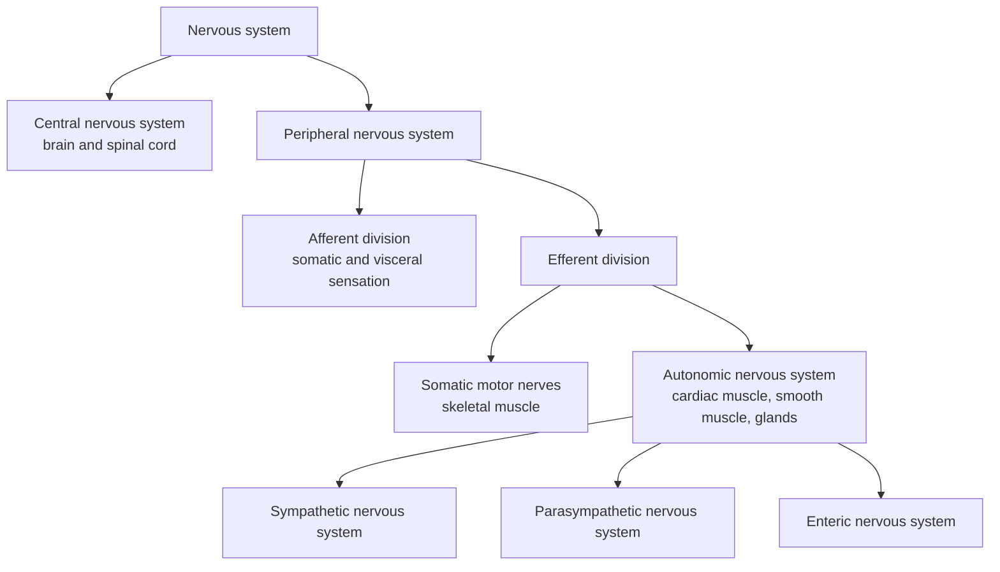

The preceding two chapters dealt with neurons, synapses and circuits ([7.14.5](/7.14.5), [7.14.6](/7.14.6)). This chapter looks at how the nervous system is organized as a whole: information enters the central nervous system from receptors, is processed at successive levels of the center, and is delivered to the effectors by somatic motor nerves and autonomic nerves. The first half outlines the functional localization of the parts of the central and peripheral nervous systems and provides a map for the later chapters on sensation, movement and the higher functions of the brain (Chapters 39–46). The second half discusses the autonomic nervous system in detail; it controls the heart, blood vessels, airways, digestive tract, glands and bladder, and is the effector pathway used repeatedly in the chapters on circulation (Chapter 16), respiration (Chapter 20), digestion (Chapter 26) and thermoregulation (Chapter 31).

## 7.1. The Basic Framework of the Nervous System

### 7.1.1. Sensing, Integration and Effection

The nervous system coordinates the voluntary and involuntary activities of an animal and transmits signals between the parts of the body. Its basic framework has three parts: the sensory nervous system collects information from the external world and from inside the body; the central nervous system integrates this information and makes decisions; and the effector system carries them out, the effectors being skeletal muscle, smooth muscle, cardiac muscle and glands. Some of the processing is completed in the spinal cord or brainstem before the information reaches higher centers; this is the reflex.

**Definition 7.1.1 (Reflex and Reflex Arc)** A regular response of the organism to a stimulus, mediated by the central nervous system, is called a reflex; the structure that carries out a reflex is called a **reflex arc**. It consists of five parts: receptor, afferent nerve, center, efferent nerve and effector, and if any part is destroyed the reflex disappears.

Reflexes can be classified by the number of synapses in the center into monosynaptic reflexes (such as the **stretch reflex**) and polysynaptic reflexes; by effector into somatic reflexes and visceral (autonomic) reflexes; and by whether learning is required into unconditioned and conditioned reflexes (Chapter 46). The reflex time minus the conduction time in the fibers is the central delay, which can be used to estimate the number of synapses in the pathway ([7.14.5](/7.14.5)).

### 7.1.2. Hierarchical Control

The control of effectors by the center is hierarchical. For skeletal muscle, the lowest level consists of the motor neurons and interneurons of the spinal cord, which carry out reflexes and rhythmic movements (Chapter 44); above it is the brainstem, which controls posture and eye movements; above that are the cerebellum and the **basal ganglia**, which do not issue motor commands directly but correct and select motor programs; and the highest level is the cerebral cortex, which initiates voluntary movement (Chapter 45). Sensory information likewise ascends in stages: spinal cord, brainstem, thalamus and finally cortex. Visceral control has a similar hierarchy: spinal cord, brainstem, hypothalamus, **limbic system** and cortex (Section 7.4.6).

The basis of the higher functions of the human nervous system lies not in some cell type or molecule that other animals lack, but mainly in number and connectivity: the cerebral cortex has many neurons and complex connections, together with a few cell types and structures that are expanded in primates or humans (such as the prefrontal cortex and the language areas).

## 7.2. The Central Nervous System

The central nervous system consists of the brain and the spinal cord. Neuronal somata of similar function aggregate in the center into nuclei and are arranged in layers in the cortex; myelinated axons are gathered into bundles (tracts). In fresh tissue the regions dense in somata appear gray and are called gray matter, and the regions dense in myelinated fibers appear white and are called white matter.

### 7.2.1. Meninges and Cerebrospinal Fluid

The brain and spinal cord are enclosed by three meninges: the outermost is the tough dura mater, the middle is the arachnoid, and the inner is the pia mater, which adheres closely to the surface of the brain. The subarachnoid space between the arachnoid and the pia is filled with cerebrospinal fluid.

Cerebrospinal fluid amounts to about $150\,\mathrm{mL}$ and is secreted mainly by the choroid plexuses in the ventricles, at about $500\,\mathrm{mL}$ per day, so it is renewed three to four times a day. It flows from the lateral ventricles through the third ventricle, the cerebral aqueduct and the fourth ventricle into the subarachnoid space, and returns to the venous sinuses through the arachnoid granulations (villi); it is also partly drained along the cranial nerve sheaths and the meningeal lymphatic vessels. In the recumbent position the pressure of the cerebrospinal fluid in the lumbar region is about $10\,\mathrm{mmHg}$ (about $1.3\,\mathrm{kPa}$, that is, about $130\,\mathrm{mm}$ of water). The functions of cerebrospinal fluid are:

- to make the brain float in fluid, reducing its effective weight from about $1.4\,\mathrm{kg}$ to about $50\,\mathrm{g}$ and cushioning impact;
- to provide the brain with a chemical environment of stable composition (the **central chemoreceptors** sense precisely the pH of the cerebrospinal fluid, Chapter 20);
- to exchange with interstitial fluid along the perivascular spaces and clear metabolic products (the glymphatic system, [7.14.15](/7.14.15)).

Obstruction of the return of cerebrospinal fluid or excessive secretion enlarges the ventricles and raises intracranial pressure; this is hydrocephalus.

### 7.2.2. The Blood–Brain Barrier

**Definition 7.2.1 (Blood–Brain Barrier)** The tight junctions between endothelial cells of brain capillaries, together with their basement membrane, the pericytes and the astrocytic end feet that ensheathe the vessels, restrict the entry of substances in the blood into the interstitial fluid of the brain tissue; the sum of this structure and function is called the **blood–brain barrier**.

At the end of the 19th century Ehrlich found that a dye injected intravenously stained the tissues of the whole body but not the brain; it was later found that when the dye was injected into the cerebrospinal fluid the brain did stain, showing that the barrier lies in the vessels and not in the brain itself. Compared with the capillaries of other organs, the endothelium of brain capillaries differs in three respects: the **tight junctions** between the cells (claudin-5, occludin) prevent ions and water-soluble molecules from passing between the cells; the endothelial cells have almost no pinocytotic vesicles or fenestrations; and the endothelium expresses many transporters. Consequently:

| Substance | Mode of passage | Examples |
|---|---|---|
| Gases and lipid-soluble molecules | Free diffusion | $\ce{O2}$, $\ce{CO2}$, ethanol, anesthetics; heroin enters more readily than morphine |
| Glucose | Facilitated diffusion | GLUT1 |
| Amino acids | Carriers | LAT1 transports large neutral amino acids; L-dopa enters the brain through LAT1, dopamine itself cannot |
| Ions | Channels and pumps, strictly regulated | The $\ce{K+}$ of brain interstitial fluid is lower than that of plasma and does not follow fluctuations of plasma $\ce{K+}$ |
| Many drugs and toxins | Pumped back into the blood by efflux pumps | P-glycoprotein |

The blood–brain barrier protects neurons from fluctuations of transmitters, hormones and toxins in the blood, but it also makes it difficult for many drugs to enter the brain. The barrier has several gaps: the capillaries of the circumventricular organs around the third and fourth ventricles (the area postrema, the organum vasculosum of the lamina terminalis, the subfornical organ, the median eminence and neurohypophysis, and the pineal gland) are fenestrated, which allows the hypothalamus to sense the **osmotic pressure** and hormones of the blood, the area postrema to sense toxins in the blood and trigger vomiting, and the hormones of the **neurohypophysis** and median eminence to enter the blood (Chapter 34). At the choroid plexus there is another barrier, the blood–cerebrospinal fluid barrier formed by tight junctions between epithelial cells.

### 7.2.3. The Telencephalon

The telencephalon includes the cerebral cortex, the white matter and the basal ganglia.

- The cerebral cortex (gray matter) is responsible for higher functions such as perception, voluntary movement, language, thought and memory. The human cerebral cortex is $2$–$4\,\mathrm{mm}$ thick, and the surface area of the two hemispheres is about $0.2\,\mathrm{m^2}$ (about $2000\,\mathrm{cm^2}$). Its number of neurons is about $1.6\times10^{10}$ by the isotropic fractionator method (Azevedo et al., 2009) and the **neocortex** has about $2\times10^{10}$ by stereological counting (Pakkenberg and Gundersen, 1997); the difference comes from the methods. The neocortex has about $1.5\times10^{14}$ synapses (Pakkenberg et al., 2003). The organizing principle of the cortex is functional parcellation and topographic mapping: the parts of the body, the visual field and sound frequencies are all projected in an orderly way onto the corresponding cortical areas (Chapters 39–46).
- The white matter consists of the myelinated axons that connect cortical areas with one another and the cortex with other brain regions; the corpus callosum is the largest fiber bundle connecting the two hemispheres. As the cortical area increases, the volume of fibers needed to connect it grows faster: in mammals the white matter volume grows approximately as the $4/3$ power of the gray matter volume (the measured exponent is about 1.23, Zhang and Sejnowski, 2000), so the proportion of white matter in the human brain (about 40%) is much higher than in the mouse (about 10%).
- The basal ganglia are subcortical nuclei that include the striatum (caudate nucleus and putamen) and the globus pallidus, and functionally also the subthalamic nucleus and the substantia nigra. They form a loop with the cortex: a particular cortical area → basal ganglia → thalamus → back to the same cortical area, taking part in the selection and initiation of movement and also in cognition and motivation (Chapter 45).

The limbic system (cingulate gyrus, hippocampus, amygdala and others) lies on the medial side of the telencephalon and is related to emotion, memory and visceral activity (Chapter 46).

### 7.2.4. The Diencephalon

- Thalamus: apart from olfaction, all sensory information is relayed in the thalamus and then projected to the cortex, so the thalamus is the gateway of conscious perception; it also receives the outputs of the basal ganglia and cerebellum, projects to the motor cortex, and takes part in certain aspects of arousal and memory.
- Subthalamus: reciprocally connected with the basal ganglia and thalamus, it is important for normal motor control; a lesion of the subthalamic nucleus causes violent, involuntary, flinging movements of the contralateral limbs.
- Hypothalamus: it weighs only about $4\,\mathrm{g}$, yet it is the main control center of the **autonomic nervous system** and the hub of the **endocrine system**, containing specialized centers that regulate body temperature, feeding, drinking and cardiovascular activity (Section 7.4.6, Chapter 34).
- Epithalamus: it contains the pineal gland and the habenula and is related to **circadian rhythms** (melatonin) and the regulation of mood.

### 7.2.5. The Brainstem and the Cranial Nerves

The brainstem lies at the rostral end of the spinal cord and consists of the midbrain, pons and medulla. Its common features are these: it retains segmental structure, receiving sensory information dorsally and sending out motor signals ventrally through the cranial nerves; it is the necessary route of ascending and descending pathways; it contains the control centers of the autonomic nervous system; and it contains the reticular formation, which connects the cortex and other brain regions diffusely and influences the level of consciousness and arousal (Chapter 46).

- Midbrain: controls eye movements (III, IV), takes part in motor control together with the cerebellum and cortex (red nucleus, substantia nigra), and relays visual (superior colliculus) and auditory (inferior colliculus) signals; the periaqueductal gray matter takes part in analgesia (Chapter 40).
- Pons: controls chewing (V), abduction of the eye (VI) and the facial muscles (VII), receives sensation from the face, scalp, mouth and nose, and processes auditory and balance information (VIII); the pontine nuclei ventrally receive cortical input and project to the cerebellum, coordinating movement; it contains centers that adjust the respiratory rhythm (Chapter 20).
- Medulla: its structure most resembles that of the spinal cord; it innervates the neck muscles (XI) and the tongue muscles (XII); together with the pons it controls blood pressure, heart rate, respiration and digestion (IX, X) and is often called the "vital center"; it is the first station at which auditory and balance information enters the center.

| Cranial nerve | Name | Type | Main functions |
|---|---|---|---|
| I | Olfactory nerve | Sensory | Smell |
| II | Optic nerve | Sensory | Vision |
| III | Oculomotor nerve | Motor, parasympathetic | Four extraocular muscles and levator palpebrae superioris; sphincter pupillae and ciliary muscle (via the ciliary ganglion) |
| IV | Trochlear nerve | Motor | Superior oblique muscle |
| V | Trigeminal nerve | Sensory, motor | Sensation of the face, mouth and cornea; muscles of mastication |
| VI | Abducens nerve | Motor | Lateral rectus muscle |
| VII | Facial nerve | Motor, sensory, parasympathetic | Muscles of facial expression; taste of the anterior 2/3 of the tongue; lacrimal gland, submandibular gland and sublingual gland |
| VIII | Vestibulocochlear nerve | Sensory | Hearing and balance |
| IX | Glossopharyngeal nerve | Sensory, motor, parasympathetic | Taste of the posterior 1/3 of the tongue and sensation of the pharynx, afferents from the carotid sinus and carotid body; parotid gland (via the otic ganglion) |
| X | Vagus nerve | Sensory, motor, parasympathetic | Muscles of the pharynx and larynx; sensation and parasympathetic innervation of the thoracic and abdominal viscera, afferents from the pressure and chemical receptors of the aortic arch |
| XI | Accessory nerve | Motor | Sternocleidomastoid and trapezius muscles |
| XII | Hypoglossal nerve | Motor | Tongue muscles |

### 7.2.6. The Cerebellum

The cerebellum lies dorsal to the brainstem and receives abundant input from the spinal cord, the vestibular system and the cerebral cortex (via the pontine nuclei); it sends its output through the deep nuclei to the brainstem and thalamus. It compares the intended movement with the actual movement, corrects errors and takes part in motor learning (Chapter 45). The cerebellum accounts for only about 10% of brain weight but contains about 80% of the neurons of the human brain, mainly the enormous number of small granule cells (figure).

![Distribution of mass and cells among the parts of the human brain (isotropic fractionator, mean of four adult men, Azevedo et al., 2009). Brain mass $1509\,\mathrm{g}$: cerebral cortex (including white matter) 82%, cerebellum 10%, the remainder (brainstem, diencephalon and basal ganglia) 8%. Of the $8.6\times10^{10}$ neurons, the cerebellum has 80%, the cerebral cortex only 19% and the remainder less than 1%; the $8.5\times10^{10}$ non-neuronal cells (glial and endothelial cells) are distributed close to the distribution of mass.](./plots/brain-neurons.py)

### 7.2.7. The Spinal Cord

Anatomy of the spinal cord. The spinal cord is continuous with the caudal end of the medulla and in adults extends from the base of the skull to the first or second lumbar vertebra, not through the whole vertebral canal; below it lies the cauda equina formed by spinal nerve roots, so a lumbar puncture is made between the third and fourth lumbar vertebrae without injuring the cord. The spinal cord has 31 segments (cervical 8, thoracic 12, lumbar 5, sacral 5, coccygeal 1), and each segment has a pair of dorsal roots and a pair of ventral roots, which join to form 31 pairs of spinal nerves. The spinal nerve roots, spinal nerves and spinal ganglia belong to the peripheral nervous system.

Dorsal and ventral roots. Sensory information from skin, muscle and viscera enters the spinal cord through the dorsal roots; the somata of the dorsal root axons lie in the dorsal root ganglia (spinal ganglia) and are pseudounipolar neurons. The ventral root contains only efferent fibers, which come from two kinds of neurons: the somatic motor neurons of the ventral horn, which innervate skeletal muscle, and the preganglionic autonomic neurons of the intermediolateral gray column (lateral horn), which innervate visceral smooth muscle and glands through postganglionic neurons. The division of labor, afferent in the dorsal root and efferent in the ventral root, is called the Bell–Magendie law.

Gray matter and white matter. In cross section the center of the spinal cord is the butterfly-shaped gray matter: the dorsal horn receives afferents and contains many interneurons that pass information to higher centers through ascending tracts; the ventral horn contains motor neurons; and the thoracolumbar and sacral segments have lateral horns. The peripheral white matter consists of myelinated axons and contains ascending tracts (dorsal columns, spinothalamic tract, spinocerebellar tracts) and descending tracts (such as the lateral corticospinal tract, which descends from the cortex and brainstem and controls the ventral horn motor neurons, producing coordinated voluntary movement and posture).

Three levels of reflex and interaction: in segmental reflexes, afferent fibers after entering the spinal cord form synapses, directly or through interneurons, with motor neurons of the same segment; in intersegmental reflexes, afferent fibers form synapses with neurons of other segments; in suprasegmental interaction, afferent signals first ascend to the brainstem and then act on the spinal cord through descending pathways. After complete transection of the spinal cord, all reflexes below the cut first disappear (spinal shock) and gradually recover after several weeks, showing that the spinal cord itself is the primary center of reflexes but is normally under the facilitation of higher centers.

## 7.3. The Peripheral Nervous System

The peripheral nervous system is the part of the nervous system outside the dura mater, and includes: the receptors for the various stimuli; the peripheral parts of the spinal and cranial nerves; and the whole peripheral part of the autonomic nervous system. The sensory nerves that carry information from the periphery to the center are called afferent nerves, and the motor nerves that carry information from the center to peripheral tissues are called efferent nerves; the nodules or masses formed by the aggregation of neuronal somata outside the center are called ganglia (dorsal root ganglia, the sensory ganglia of cranial nerves and the autonomic ganglia). A peripheral nerve usually contains many kinds of fibers, somatic and visceral, afferent and efferent, classified by diameter and conduction velocity into types A (α, β, γ, δ), B and C; afferent fibers are also classified as types I–IV ([7.14.4](/7.14.4)).

## 7.4. The Autonomic Nervous System

**Definition 7.4.1 (Autonomic Nervous System)** The part of the nervous system that regulates visceral functions (heart rate, blood pressure, digestion, micturition, sweating, body temperature, reproduction and others) and innervates cardiac muscle, smooth muscle and glands is called the **autonomic nervous system** (ANS); its efferent part is divided into the sympathetic nervous system, the parasympathetic nervous system and the enteric nervous system.

The autonomic nervous system is relatively independent in function, but anatomically it is composed of parts of both the central and peripheral nervous systems. Visceral control is carried out through reflex arcs: visceral afferent neurons send signals into the center, the control centers in the center (spinal cord, brainstem, hypothalamus) integrate them, and visceral efferents then carry them to the effectors; the limbic cortex also takes part. Visceral afferent fibers usually run alongside efferent fibers and are numerous: about 80% of the fibers in the vagus nerve are afferent. The word "autonomic" indicates that these activities are generally not under voluntary control, but they are not truly autonomous; they are under continuous regulation by the center.

### 7.4.1. The Two-Neuron Pathway

**Definition 7.4.2 (Sympathetic and Parasympathetic Nervous Systems)** The autonomic efferent system whose preganglionic neurons lie in the lateral horn of the thoracic and upper lumbar spinal cord ($\mathrm{T_1}$–$\mathrm{L_2}$) and synapse in the paravertebral or prevertebral ganglia is called the **sympathetic nervous system**; the one whose preganglionic neurons lie in the brainstem (through cranial nerves III, VII, IX, X) and the sacral spinal cord ($\mathrm{S_2}$–$\mathrm{S_4}$) and synapse in ganglia near or within the walls of the target organs is called the **parasympathetic nervous system**.

Unlike somatic movement, which has a single neuron, the autonomic efferent pathway consists of two neurons: a preganglionic neuron whose soma lies in the center and whose axon (myelinated, type B fiber) goes to a ganglion and synapses on a postganglionic neuron; and the axon of the postganglionic neuron (unmyelinated, type C fiber) goes to the effector. The location at which the first synapse is formed differs in the two systems.

The sympathetic nervous system. Preganglionic fibers leave the spinal cord through the ventral root and enter the paravertebral ganglia of the sympathetic trunk (sympathetic chain) through the white rami communicantes. Humans have about 22–23 pairs of paravertebral ganglia (fused in the neck into the superior, middle and inferior cervical ganglia), connected into two chains along both sides of the vertebral column. After reaching the sympathetic chain, preganglionic fibers take one of three courses: they synapse at the same level; they ascend or descend several segments in the chain before synapsing; or they do not synapse but pass through the chain to the prevertebral ganglia (celiac ganglion, superior mesenteric ganglion, aorticorenal ganglion, inferior mesenteric ganglion and hypogastric ganglion), where they synapse and innervate the abdominal and pelvic viscera. Some postganglionic fibers return through the gray rami communicantes to all 31 pairs of spinal nerves and are distributed to the blood vessels, sweat glands and arrector pili muscles of the skin of the whole body; others form plexuses that follow the blood vessels to the organs. One preganglionic neuron synapses with more than 10 postganglionic neurons, and the terminals of postganglionic fibers have strings of varicosities along their course, forming many "en passant" synapses on the smooth muscle they pass: the structure of the sympathetic system is suited to broad mobilization. Preganglionic neurons together with postganglionic neurons, plus the accompanying visceral afferent fibers, constitute a complete feedback loop.

The parasympathetic nervous system. Preganglionic fibers leave the brainstem with cranial nerves III (to the ciliary ganglion, innervating the sphincter pupillae and ciliary muscle), VII (to the pterygopalatine ganglion and submandibular ganglion, innervating the lacrimal and salivary glands), IX (to the otic ganglion, innervating the parotid gland) and X, or leave the sacral cord with the pelvic splanchnic nerves. More than about 75% of parasympathetic fibers are in the vagus nerve, which innervates the heart, lungs and the digestive tract up to the left colic flexure of the transverse colon. Postganglionic neurons lie on the surface or in the walls of the organs, the postganglionic fibers are very short, and one preganglionic neuron connects with only a few postganglionic neurons: the structure of the parasympathetic system is suited to local and precise regulation.

| | Sympathetic nervous system | Parasympathetic nervous system |
|---|---|---|
| Central origin | Lateral horn of the thoracolumbar cord ($\mathrm{T_1}$–$\mathrm{L_2}$) | Craniosacral: brainstem nuclei (III, VII, IX, X) and sacral cord $\mathrm{S_2}$–$\mathrm{S_4}$ |
| Location of ganglia | Beside the vertebral column (sympathetic chain) and prevertebral | Near or within the walls of target organs |
| Fiber length | Short preganglionic, long postganglionic | Long preganglionic, short postganglionic |
| Preganglionic : postganglionic neurons | About 1 : 10 or more | About 1 : 1 to 1 : 3 |
| Distribution | Whole body, including skin vessels, sweat glands and arrector pili muscles | Head and thoracic, abdominal and pelvic viscera; most blood vessels and the skin lack it |
| Typical action | "Fight or flight": faster heart rate, higher blood pressure, reduced digestion, higher blood glucose | "Rest and digest": slower heart rate, increased digestion, energy storage |

![Somatic and autonomic efferent pathways with their transmitters and receptors. From top to bottom: the somatic motor neuron innervates skeletal muscle directly (ACh acting on the muscle-type nicotinic receptor $\mathrm{N_M}$); in the parasympathetic pathway the preganglionic fiber is long and synapses in a ganglion near the organ, and the short postganglionic fiber releases ACh acting on muscarinic receptors M; in the sympathetic pathway the preganglionic fiber is short and synapses in a paravertebral or prevertebral ganglion, and the long postganglionic fiber releases norepinephrine (NA) acting on $\alpha$ and $\beta$ adrenergic receptors; the sympathetic postganglionic fibers to sweat glands are cholinergic; the chromaffin cells of the adrenal medulla correspond to postganglionic neurons without axons and release epinephrine (about 80%) and norepinephrine into the blood. All preganglionic neurons release ACh acting on neuronal nicotinic receptors $\mathrm{N_N}$. Solid lines are preganglionic (or somatic) fibers, dashed lines are postganglionic fibers.](./plots/autonomic-pathways.py)

### 7.4.2. Transmitters and Receptors

All autonomic preganglionic fibers release acetylcholine, which acts on the neuronal **nicotinic acetylcholine receptors** of postganglionic neurons ($\mathrm{N_N}$, composed mainly of $\alpha_3\beta_4$ subunits, different from the muscle-type $\mathrm{N_M}$ of the skeletal muscle end plate, and the two also differ in their sensitivity to blockers). All parasympathetic postganglionic fibers release acetylcholine, which acts on muscarinic receptors; sympathetic postganglionic fibers mostly release norepinephrine, the exceptions being the sympathetic cholinergic fibers innervating sweat glands (and, in some animals, the vasodilator fibers innervating skeletal muscle vessels). Fibers that release acetylcholine are called cholinergic fibers, and those that release norepinephrine are called adrenergic fibers.

**Definition 7.4.3 (Sympathoadrenal Medulla)** The chromaffin cells of the adrenal medulla arise from the neural crest, receive cholinergic innervation from sympathetic preganglionic fibers (through $\mathrm{N_N}$ receptors), do not send out axons, and release epinephrine (about 80%) and norepinephrine (about 20%) as hormones into the blood; the medulla is equivalent to a sympathetic ganglion that has become an endocrine gland, and together with the sympathetic nerves it is called the **sympathoadrenal system**.

Receptors of the autonomic nervous system (for the signal transduction of **G protein-coupled receptors** see [7.1.14](/7.1.14)):

| Receptor | Type | Main distribution | Main actions |
|---|---|---|---|
| $\mathrm{N_N}$ | Ligand-gated cation channel | Autonomic ganglia, adrenal medulla | Excitation of postganglionic neurons and chromaffin cells |
| $\mathrm{N_M}$ | Ligand-gated cation channel | Skeletal muscle end plate (somatic motor, not autonomic) | **End-plate potential** ([7.14.8](/7.14.8)) |
| $\mathrm{M_1}$ | $\mathrm{G_q}$ | Ganglia, center, gastric glands | Slow EPSP, gastric acid secretion |
| $\mathrm{M_2}$ | $\mathrm{G_i}$ | Heart (**sinoatrial node**, atrioventricular node, atrial muscle) | The $\beta\gamma$ subunit opens GIRK potassium channels and cAMP falls: slower heart rate, slower atrioventricular conduction |
| $\mathrm{M_3}$ | $\mathrm{G_q}$ | Smooth muscle, glands, vascular endothelium | Smooth muscle contraction, glandular secretion; the endothelium releases NO, dilating vessels |
| $\alpha_1$ | $\mathrm{G_q}$ | Vascular smooth muscle, dilator pupillae, sphincters, arrector pili | Contraction |
| $\alpha_2$ | $\mathrm{G_i}$ | Presynaptic terminals (autoreceptors), pancreatic β cells, platelets | Inhibition of transmitter release; inhibition of insulin secretion |
| $\beta_1$ | $\mathrm{G_s}$ | Heart, juxtaglomerular cells of the kidney | Faster heart rate, stronger contractility, faster conduction; renin secretion |
| $\beta_2$ | $\mathrm{G_s}$ | Smooth muscle of bronchi, skeletal muscle vessels, uterus and gastrointestinal tract; liver | Smooth muscle relaxation; glycogenolysis |
| $\beta_3$ | $\mathrm{G_s}$ | Adipose tissue, detrusor of the bladder | Lipolysis, detrusor relaxation |

Norepinephrine acts mainly on $\alpha$ and $\beta_1$ receptors and has low affinity for $\beta_2$ receptors; epinephrine has strong actions on both $\alpha$ and $\beta$ receptors. Circulating epinephrine therefore dilates skeletal muscle vessels through $\beta_2$ receptors and dilates the bronchi, whereas the action of the sympathetic nerves themselves is dominated by $\alpha_1$-mediated vasoconstriction. Autonomic nerve terminals also commonly release cotransmitters: sympathetic fibers release ATP (causing rapid contraction through P2X receptors) and neuropeptide Y (causing slow, sustained contraction on high-frequency stimulation), and parasympathetic fibers release vasoactive intestinal peptide and NO.

### 7.4.3. Dual Innervation and Organ Effects

Most visceral organs receive both sympathetic and parasympathetic innervation, and the actions of the two are usually antagonistic, although there are also synergism and single innervation:

| Organ | Sympathetic (receptor) | Parasympathetic (M receptors) |
|---|---|---|
| Pupil | Dilator contracts, pupil dilates ($\alpha_1$) | Sphincter contracts, pupil constricts |
| Ciliary muscle | Slight relaxation, far vision ($\beta_2$) | Contraction, near vision |
| Lacrimal and salivary glands | Scant, viscous saliva rich in enzymes ($\alpha_1$, $\beta$) | Abundant, watery saliva and tears |
| Heart: sinoatrial node | Faster heart rate ($\beta_1$) | Slower heart rate |
| Heart: atrioventricular node | Faster conduction ($\beta_1$) | Slower conduction |
| Cardiac muscle | Stronger contractility ($\beta_1$) | Weaker atrial contractility (little effect on ventricles) |
| Skin and visceral vessels | Constriction ($\alpha_1$) | Mostly not innervated |
| Skeletal muscle vessels | Constriction ($\alpha_1$); circulating epinephrine dilates them ($\beta_2$) | None |
| Bronchial smooth muscle | Relaxation ($\beta_2$, mainly by circulating epinephrine) | Contraction, increased glandular secretion |
| Gastrointestinal smooth muscle | Reduced motility ($\alpha$, $\beta_2$) | Increased motility |
| Gastrointestinal sphincters | Contraction ($\alpha_1$) | Relaxation |
| Gastrointestinal glands | Reduced secretion | Increased secretion |
| Liver | Glycogenolysis and **gluconeogenesis** ($\beta_2$, $\alpha_1$) | Slightly increased glycogen synthesis |
| Pancreatic islets | Reduced **insulin** secretion ($\alpha_2$) | Increased insulin and **glucagon** secretion |
| Adipose tissue | Lipolysis ($\beta_3$) | None |
| Kidney | Renin secretion ($\beta_1$), afferent arteriole constriction ($\alpha_1$) | None |
| Bladder detrusor | Relaxation ($\beta_3$) | Contraction (micturition) |
| Internal sphincter of the bladder | Contraction ($\alpha_1$) | Relaxation |
| Male genitalia | Ejaculation ($\alpha_1$) | Erection (NO) |
| Sweat glands | Secretion (M, sympathetic cholinergic) | None |
| Arrector pili | Contraction ($\alpha_1$) | None |
| Adrenal medulla | Secretion of epinephrine and norepinephrine ($\mathrm{N_N}$) | None |

Several rules can be read from the table:

- Antagonism: heart rate, pupil, gastrointestinal motility and the bladder are controlled bidirectionally by the two, so that the organ can be finely regulated within a range.
- Synergism: both promote secretion in the salivary glands, though the products differ; male sexual function requires the parasympathetic (erection) and the sympathetic (ejaculation) to take part in succession.
- Single innervation: most blood vessels, sweat glands, arrector pili muscles, the adrenal medulla and the kidney are innervated only by the sympathetic system, and their regulation depends on increases and decreases of sympathetic tone (Section 7.4.4).
- The effect depends on the state of the organ: the action of the same nerve may change with the current state of the organ. For example, sympathetic nerves cause the pregnant uterus to contract and the nonpregnant uterus to relax, because progesterone and estrogen change the ratio of $\alpha$ and $\beta$ receptors on the uterine smooth muscle; when the pylorus is contracted, stimulating the vagus relaxes it, whereas when it is relaxed the same stimulation contracts it.

### 7.4.4. Tone and the Sympathoadrenal System

**Definition 7.4.4 (Tone)** At rest, the sympathetic and parasympathetic nerves continuously discharge at a low frequency (roughly 0.5–2 impulses per second) to the effectors, keeping the effectors at a certain level of activity; this is called the autonomic **tone**.

Tone allows a nervous system to regulate an organ in both directions: when the discharge increases the action is strengthened, and when the discharge decreases the action is weakened. Blood vessels without parasympathetic innervation constrict or dilate by increases or decreases of sympathetic tone: after the sympathetic nerves are cut, the vessels dilate immediately and arterial pressure falls within minutes, and only after several days does the intrinsic tension of the vascular smooth muscle partly recover. The heart is acted on by both tones, and at rest vagal tone predominates.

**Example 7.4.1 (Tonic Vagal Inhibition of the Heart)** When the influence of all autonomic nerves is removed by blocking M receptors with atropine and $\beta$ receptors with propranolol at the same time, the resulting heart rate is called the intrinsic heart rate. In healthy people it falls with age and is approximately (Jose and Collison, 1970)

$$
\mathrm{IHR} = 118.1 - 0.57 \times \text{age (years)} \quad (\mathrm{min^{-1}}). \tag{7.1}
$$

At age 30 the intrinsic heart rate is about $101\,\mathrm{min^{-1}}$, whereas the resting heart rate is about $70\,\mathrm{min^{-1}}$, so the net effect at rest is that the vagus lowers the heart rate by about 30%; blocking the vagus alone raises the heart rate to near or above the intrinsic heart rate. The rapid rise of heart rate at the onset of exercise comes mainly from withdrawal of vagal tone, and the further rise afterward depends on the sympathetic nerves (Chapter 16).

![Intrinsic heart rate and resting heart rate. The intrinsic heart rate (heart rate after autonomic blockade with atropine plus propranolol) falls with age according to Eq. (7.1); the shading is its 95% range (about ±14% below age 45 and ±18% above); the blue band is the typical resting heart rate of healthy adults ($60$–$80\,\mathrm{min^{-1}}$). The resting heart rate is lower than the intrinsic heart rate, showing that vagal tone exceeds sympathetic tone at rest; with increasing age the intrinsic heart rate falls and the gap between the two narrows.](./plots/intrinsic-heart-rate.py)

The sympathoadrenal system and the emergency response. Cannon found that when an animal faces danger, strenuous exercise, blood loss or cold, the sympathetic nerves and the adrenal medulla are activated together on a wide scale; he called this the "fight or flight" reaction: arterial blood pressure rises, blood flow to active muscles increases while visceral blood flow decreases, **cardiac output** rises, blood glucose rises, glycolysis and metabolic rate increase, muscle strength increases, mental alertness is heightened and coagulation is accelerated. Circulating epinephrine and norepinephrine act on the same receptors as the sympathetic nerves and also on tissues without direct sympathetic innervation (for example the metabolism of cells throughout the body); they are cleared only slowly, over $2$–$4\,\mathrm{min}$, so their action lasts 5–10 times longer than direct nerve stimulation. The two routes back each other up: if one is removed the other can compensate. However, "fight or flight" is only one extreme state of the sympathetic system; in everyday regulation, sympathetic activity is regional and selective, for example in thermoregulation only the skin vessels and sweat glands are changed, whereas the **baroreceptor reflex** mainly changes the heart and visceral vessels (Chapters 16 and 31).

### 7.4.5. The Enteric Nervous System

**Definition 7.4.5 (Enteric Nervous System)** The neural network within the wall of the digestive tract, composed of the myenteric plexus (Auerbach's plexus, between the longitudinal and circular muscle layers) and the submucosal plexus (Meissner's plexus), containing sensory neurons, interneurons and motor neurons and capable of carrying out local reflexes of the digestive tract independently, is called the **enteric nervous system**.

The human enteric nervous system has about $2\times10^8$–$6\times10^8$ neurons, comparable to the whole spinal cord. After the extrinsic nerves are cut, an isolated segment of intestine can still produce coordinated movements such as **peristalsis**, showing that it is a relatively autonomous "second brain"; the sympathetic and parasympathetic nerves mainly regulate its activity and do not directly drive each contraction of the smooth muscle. The myenteric plexus mainly controls motility, and the submucosal plexus mainly controls secretion and local blood flow. The relation of the enteric nervous system to the electrical activity of the **interstitial cells of Cajal**, to gastrointestinal reflexes and to **gastrointestinal hormones** is discussed in Chapter 26.

### 7.4.6. Central Integration of Visceral Activity

Visceral activity is controlled by multiple levels of structure in the center, and the higher the level, the wider the range of integration:

- The spinal cord is the origin of the sympathetic and part of the parasympathetic system and the primary center of visceral reflexes. In patients with high spinal transection, after spinal shock has passed, the vascular tone reflex, the **micturition reflex**, the defecation reflex, the sweating reflex and the erection reflex can recover, but regulation is very imperfect: for example, on changing from the recumbent to the standing position, orthostatic hypotension occurs for lack of the **baroreceptor reflex** of the higher centers; micturition is incomplete and cannot be controlled voluntarily.
- The lower brainstem is the center of many basic vital activities. The nucleus of the solitary tract (NTS) receives almost all visceral afferents from baroreceptors, chemoreceptors and the thoracic and abdominal organs and is the most important visceral integration center of the lower brainstem; the rostral ventrolateral medulla maintains tonic sympathetic discharge; the dorsal motor nucleus of the vagus and the nucleus ambiguus send out the cardiac and visceral parasympathetic fibers; the medulla is also the integration site for swallowing, coughing, sneezing and vomiting, the pons has the micturition center and the pneumotaxic center, and the midbrain is the center of the **pupillary light reflex**. The circuit of the baroreceptor reflex is described in Chapter 16.
- The hypothalamus is a higher center for regulating visceral activity; it integrates autonomic, endocrine and behavioral responses and regulates body temperature (Chapter 31), feeding (Chapter 30), water balance (Chapter 24), biological rhythms (**suprachiasmatic nucleus**, Chapter 46) and the secretion of pituitary hormones (Chapter 34). The paraventricular nucleus of the hypothalamus regulates the autonomic neurons of the brainstem and spinal cord through direct projections; broadly, activation of its posterior and lateral parts causes sympathetic responses, and activation of its anterior and medial parts causes parasympathetic responses.
- The limbic system and cortex: the amygdala, the anterior cingulate gyrus and the insula link emotion with visceral responses, for example the faster heart rate and higher blood pressure in fear and the blushing in embarrassment; conditioned reflexes can link visceral responses with originally unrelated stimuli.

## 7.5. Evolution and Comparative Aspects

Centralization of the nervous system. The evolutionary trend of the nervous system is from diffuse to centralized, with aggregation at the head to form a brain (cephalization):

1. In cnidarians the nerve net is diffusely distributed in the body wall and has no definite center; jellyfish have a nerve ring at the bell margin and concentrate their sense organs there ([7.14.5](/7.14.5)).
2. Flatworms have cerebral ganglia in the head and several longitudinal nerve cords, joined by transverse commissures into a ladder-like (orthogonal) nervous system.
3. Annelids and arthropods have paired cerebral ganglia, a circumpharyngeal nerve ring and a ventral nerve cord, with a pair of ganglia in each body segment; in arthropods adjacent ganglia are often fused (such as the thoracic ganglionic mass of insects), and there are large brain regions that process information from the compound eyes and antennae.
4. The ganglia of molluscs are highly concentrated in cephalopods; the octopus has about $5\times10^8$ neurons, about two thirds of them in the arms, and each arm can control movement to a considerable degree independently (Chapter 45).
5. Chordates have a dorsal hollow **neural tube**, the anterior end of which swells to form the brain.

The nerve cord of arthropods is ventral and that of vertebrates is dorsal, and the distribution of BMP and its antagonists, which determine the dorsoventral axis (Chordin in vertebrates, Sog in *Drosophila*), is exactly inverted in the two; this supports the "dorsoventral inversion" hypothesis: the central nervous systems of the two may be homologous, only inverted relative to the rest of the body. Another view holds that the common ancestor of bilaterians had only a diffuse nerve net and that centralized centers formed independently in several groups; the diverse morphology of the nervous systems of groups such as acoelomorph flatworms is where the evidence in this controversy lies.

Proportions of the parts of the vertebrate brain. The brains of all vertebrates consist of the same basic parts (telencephalon, diencephalon, midbrain, cerebellum, medulla), and the relative sizes of the parts change with way of life:

- Sharks and many fishes have well-developed olfactory lobes; the optic tectum of the midbrain is large in teleosts and birds that depend strongly on vision, and it is the main center of visual integration in nonmammalian vertebrates, corresponding to the superior colliculus of mammals.
- The cerebellum is enlarged in groups that need precise movement or special sensory processing: the cerebella of birds and primates are well developed; the African elephantfishes (weakly electric fishes), which perceive their surroundings by **electrolocation** (Chapter 43), have a cerebellum (especially the valvula) so large that it covers the whole surface of the brain, and the brain consumes about 60% of the oxygen of the whole body (Nilsson, 1996).
- The telencephalon is expanded in mammals into the six-layered **neocortex** and in birds into nuclear-type homologues of the cerebral cortex (the dorsal ventricular ridge and others). At the same brain mass, the telencephalon of corvids and parrots contains a number of neurons comparable to that of primate cortex of much larger volume, because their neurons are packed more densely (Olkowicz et al., 2016). The number of neurons, rather than brain mass, may be related more directly to cognitive ability (Chapter 46).

Comparison of autonomic control. The basic two-neuron structure of the autonomic nervous system is general among gnathostomes, but the specific modes of cardiac innervation differ among vertebrate groups: the heart of the hagfish has no nerve supply; the vagus nerve of the lamprey accelerates the heart, acting through nicotinic receptors, the opposite of the inhibitory vagal innervation of other vertebrates; the heart of cartilaginous fishes has only vagal inhibition and no sympathetic innervation, and its excitation depends mainly on circulating catecholamines; teleosts and tetrapods have both sympathetic and parasympathetic cardiac innervation. In amphibians the transmitter of sympathetic postganglionic fibers is mainly epinephrine rather than norepinephrine, and the "accelerator substance" that Loewi discovered in the frog heart in 1921 was precisely epinephrine. In amniotes, the assignment of the sacral autonomic outflow has also been reexamined: on the basis of transcription factor expression and developmental origin, Espinosa-Medina et al. (2016) argued that the sacral "parasympathetic" outflow of the mouse is molecularly closer to the sympathetic, and this reclassification is still debated.

Visceral control in invertebrates. Invertebrates have no sympathetic and parasympathetic systems homologous to those of vertebrates, but they have functionally similar "visceral nervous systems": the stomatogastric nervous system of insects (the frontal ganglion and others) controls the rhythmic movements of the foregut, and the stomatogastric ganglion of crustaceans produces the rhythm of the stomach ([7.14.6](/7.14.6)); visceral regulation relies more on neuroendocrine mechanisms, for example neurohemal organs such as the corpora cardiaca of insects release neurosecretions into the hemolymph. Octopamine of insects corresponds in many respects to norepinephrine of vertebrates: during stress and flight it is released from neurons and neurohemal organs, mobilizes energy, strengthens muscles and the heartbeat, and acts in a "fight or flight" manner.

## Summary

- The nervous system consists of sensing, integration and effection, and the reflex arc (Definition 7.1.1) is its smallest functional unit; control is hierarchical: spinal cord, brainstem, cerebellum and basal ganglia, thalamus, cortex.
- The parts of the center:

  | Part | Main structures | Main functions |
  |---|---|---|
  | Telencephalon | Cortex, white matter, basal ganglia, limbic system | Perception, voluntary movement, language, memory; selection of movement |
  | Diencephalon | Thalamus, subthalamus, hypothalamus, epithalamus | Sensory relay; motor loops; hub of autonomic and endocrine control; rhythms |
  | Brainstem | Midbrain, pons, medulla, reticular formation; cranial nerves III–XII | Eye movement, chewing, facial expression, hearing and balance; cardiovascular, respiratory and digestive centers; arousal |
  | Cerebellum | Cortex and deep nuclei | Correction and learning of movement; contains 80% of the neurons |
  | Spinal cord | 31 segments; afferent in the dorsal root, efferent in the ventral root; gray matter butterfly, white matter tracts | Reflexes and rhythms; ascending and descending conduction |

- Cerebrospinal fluid, about $150\,\mathrm{mL}$ and renewed three to four times a day, makes the brain float and provides a stable chemical environment; the blood–brain barrier (Definition 7.2.1) is formed by tight junctions of the endothelium and transporters and has gaps at the circumventricular organs.
- The efferent limb of the autonomic nervous system (Definition 7.4.1) consists of two neurons: sympathetic (thoracolumbar, short preganglionic, long postganglionic, broad mobilization) and parasympathetic (craniosacral, long preganglionic, short postganglionic, local and precise) (Definition 7.4.2). All preganglionic fibers are cholinergic ($\mathrm{N_N}$), parasympathetic postganglionic fibers are cholinergic (M), sympathetic postganglionic fibers are mostly adrenergic ($\alpha$, $\beta$) with sweat glands the exception; the adrenal medulla is a sympathetic ganglion that has become an endocrine gland (Definition 7.4.3).
- The organ effects are in the table of Section 7.4.3: antagonism, synergism, single innervation and state dependence. Tone (Definition 7.4.4) allows organs with single innervation to be regulated bidirectionally; at rest vagal tone lowers the heart rate by about 30% below the intrinsic heart rate $118.1 - 0.57\times$ age (Example 7.4.1).
- The enteric nervous system (Definition 7.4.5) can carry out digestive-tract reflexes independently; visceral activity is integrated in stages by the spinal cord, the brainstem (nucleus of the solitary tract), the hypothalamus and the limbic cortex.
- Comparison: nerve net → ladder-like nervous system → ventral nerve cord and brain / dorsal neural tube; the proportions of the parts of the vertebrate brain change with the mode of sensation and movement, and the avian telencephalon has a high neuron density; the autonomic innervation of the heart differs among cyclostomes, cartilaginous fishes and teleosts, and tetrapods; octopamine is the emergency transmitter of insects.

## Questions

1. One patient takes a selective $\beta_1$ receptor blocker and another a nonselective $\beta$ receptor blocker. Why is the latter contraindicated in asthmatic patients? How are the effects of the two drugs on heart rate during exercise similar and different?

   **Answer** Relaxation of bronchial smooth muscle is mediated by $\beta_2$ receptors, mainly through circulating epinephrine; a nonselective blocker also blocks $\beta_2$ receptors and can induce bronchoconstriction, so it is contraindicated in asthmatic patients. Both drugs block the cardiac $\beta_1$ receptors, so the rise of heart rate caused by the sympathetic nerves during exercise is weakened by both; but the rise of heart rate caused by withdrawal of vagal tone at the onset of exercise is unaffected, and the heart rate can still rise to near the intrinsic heart rate (Example 7.4.1).

2. Why does cutting the sympathetic nerves to a segment of skin vessels dilate the vessels, whereas cutting the vagus nerves to the heart accelerates the heart rate? Explain using "tone".

   **Answer** All these effectors receive continuous tonic discharge at rest. Skin vessels are innervated only by the sympathetic system, and sympathetic tone keeps them partly constricted; when it is removed the vessels lose the drive to constrict and dilate. At rest the sinoatrial node is inhibited by the predominant vagal tone, so that the heart rate is lower than the intrinsic heart rate; cutting the vagus removes this inhibition and the heart rate rises to near the intrinsic heart rate.

3. What do the chromaffin cells of the adrenal medulla and sympathetic postganglionic neurons have in common and how do they differ? Why are the sympathetic nerves and the adrenal medulla said to "back each other up"?

   **Answer** In common: both arise from the **neural crest**, both receive cholinergic innervation from sympathetic preganglionic fibers ($\mathrm{N_N}$ receptors), both synthesize catecholamines, and both act on the same $\alpha$ and $\beta$ receptors. Differences: the chromaffin cells send out no axons and release their product into the blood, mainly epinephrine (about 80%), with broad and lasting action (clearance takes minutes); the postganglionic neurons release norepinephrine onto local effectors, with rapid and localized action. Because the receptors are the same, if one route is removed (for example by removal of the adrenal medulla, or sympathetic nerve injury), the other can still produce similar effects, only with different speed and extent.

4. Use the receptor distribution in the tables to explain why a frightened person has dilated pupils, a dry mouth, a pounding heart and sweaty palms, yet has difficulty urinating.

   **Answer** In fright, sympathetic activity increases widely and parasympathetic activity decreases. The dilator pupillae contracts through $\alpha_1$ receptors and the pupil dilates; with reduced parasympathetic activity the salivary glands secrete only a little viscous saliva and the mouth feels dry; the sinoatrial node is accelerated through $\beta_1$ receptors; the sweat glands are driven to sweat by sympathetic cholinergic fibers (M receptors), and "emotional sweating" is especially marked in the palms; the bladder detrusor relaxes through $\beta_3$ receptors and the internal sphincter contracts through $\alpha_1$ receptors, while the parasympathetic (M receptor) activity that causes micturition is reduced, so urination is difficult.

5. (Open question) Compare the autonomic innervation of the heart in hagfishes, lampreys, cartilaginous fishes and teleosts. What do these differences imply for the statement that "sympathetic–parasympathetic antagonism is the basic principle of the vertebrate autonomic nervous system"?

   **Answer** Key points: the hagfish heart has no nerve supply, the vagus of the lamprey is excitatory (nicotinic receptors), cartilaginous fishes have only inhibitory vagal innervation and depend on circulating catecholamines for excitation, and only teleosts and tetrapods have dual antagonistic sympathetic and parasympathetic innervation. This shows that the dual antagonistic mode of innervation was established gradually and was not present in vertebrates from the start; early vertebrates relied more on circulating hormones (catecholamines secreted by chromaffin tissue) to regulate the heart, and rapid bidirectional neural control was added later. The "basic principle" is better stated as the mode of organization of mammals (and most jawed vertebrates), and comparisons must attend to differences among groups; it also suggests that hormones and nerves are two regulatory channels that can substitute for each other (Chapters 32 and 33).
