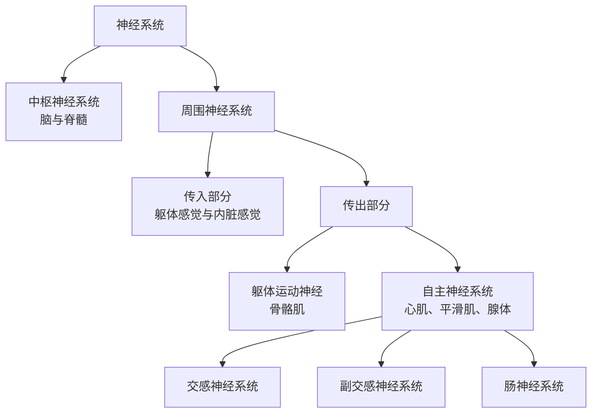

前两章讨论了神经元、突触与回路（[7.14.5](/7.14.5)、[7.14.6](/7.14.6)）。本章从整体上看神经系统怎样组织：信息从感受器进入中枢，经各级中枢处理，再由躯体运动神经与自主神经送到效应器。前半部分概述中枢与周围神经系统各部分的功能定位，为后面的感觉、运动与脑的高级功能各章（第 39–46 章）提供一张地图；后半部分详细讨论自主神经系统，它控制心脏、血管、呼吸道、消化道、腺体与膀胱，是循环（第 16 章）、呼吸（第 20 章）、消化（第 26 章）与体温调节（第 31 章）等各章反复用到的效应通路。

## 7.1. 神经系统的基本框架

### 7.1.1. 感受、整合与效应

神经系统协调动物的随意与不随意活动，在身体各部分之间传递信号。它的基本框架有三部分：感受神经系统收集来自外部世界与身体内部的信息；中枢神经系统整合这些信息、做出决定；效应系统执行，效应器是骨骼肌、平滑肌、心肌与腺体。一部分处理在到达高级中枢之前就在脊髓或脑干完成，这就是反射。

**定义 7.1.1（反射与反射弧）** 机体在中枢神经系统参与下对刺激作出的规律性应答称为反射；实现反射的结构称为**反射弧**，由感受器、传入神经、中枢、传出神经与效应器五部分组成，任何一部分被破坏，反射即消失。

反射可按中枢内的突触数分为单突触反射（如**牵张反射**）与多突触反射；按效应器分为躯体反射与内脏（自主）反射；按是否需要学习分为非条件反射与条件反射（第 46 章）。反射时间减去纤维中的传导时间就是中枢延搁，可用来估计通路中的突触数（[7.14.5](/7.14.5)）。

### 7.1.2. 层级控制

中枢对效应器的控制是分层的。对骨骼肌，最低一级是脊髓的运动神经元与中间神经元，它们实现反射与节律性运动（第 44 章）；其上是脑干，控制姿势与眼球运动；再上是小脑与**基底神经节**，它们不直接发出运动指令，而是修正与选择运动程序；最高一级是大脑皮层，发起随意运动（第 45 章）。感觉信息同样分级上行：脊髓、脑干、丘脑，最后到皮层。内脏控制也有类似的层级：脊髓、脑干、下丘脑、**边缘系统**与皮层（7.4.6）。

人类神经系统高级功能的基础，不在于它有其他动物所没有的某种细胞或分子，而主要在于数量与连接：大脑皮层的神经元多、连接复杂，加上少数在灵长类或人类中扩展的细胞类型与结构（如前额叶与语言区）。

## 7.2. 中枢神经系统

中枢神经系统由脑和脊髓组成。功能相似的神经元胞体在中枢内聚集成核团，在皮层排成层；有髓轴突集合成束（传导束）。新鲜组织中胞体密集处呈灰色，称灰质，有髓纤维密集处呈白色，称白质。

### 7.2.1. 脑膜与脑脊液

脑和脊髓外包三层脑膜：最外层是坚韧的硬脑膜，中间是蛛网膜，内层是紧贴脑表面的软脑膜。蛛网膜与软脑膜之间的蛛网膜下腔充满脑脊液。

脑脊液约 $150\,\mathrm{mL}$，主要由各脑室中的脉络丛分泌，每天约 $500\,\mathrm{mL}$，因此每天更新三到四次。它从侧脑室经第三脑室、中脑导水管、第四脑室流入蛛网膜下腔，经蛛网膜颗粒（绒毛）回流到静脉窦，也部分沿脑神经鞘与脑膜淋巴管引流。卧位时腰部的脑脊液压力约 $10\,\mathrm{mmHg}$（约 $1.3\,\mathrm{kPa}$，即约 $130\,\mathrm{mm}$ 水柱）。脑脊液的作用是：

- 使脑浮在液体中，脑的有效重量从约 $1.4\,\mathrm{kg}$ 减小到约 $50\,\mathrm{g}$，缓冲冲击；
- 为脑提供一个成分稳定的化学环境（**中枢化学感受器**感受的正是脑脊液的 pH，第 20 章）；
- 沿血管周围间隙与组织间液交换，清除代谢产物（类淋巴系统，[7.14.15](/7.14.15)）。

脑脊液的回流受阻或分泌过多，会使脑室扩大、颅内压升高，即脑积水。

### 7.2.2. 血脑屏障

**定义 7.2.1（血脑屏障）** 脑毛细血管内皮细胞之间的紧密连接，连同其基膜、周细胞与包裹血管的星形胶质细胞终足，限制血液中的物质进入脑组织间液，这一结构与功能的总和称为**血脑屏障**（blood–brain barrier）。

Ehrlich 在 19 世纪末发现静脉注射的染料使全身组织着色而脑不着色；后来发现把染料注入脑脊液则脑着色，说明屏障位于血管而不在脑本身。与其他器官的毛细血管相比，脑毛细血管内皮有三点不同：细胞间的**紧密连接**（claudin-5、occludin）使离子与水溶性分子不能从细胞间通过；内皮细胞几乎没有胞饮小泡与窗孔；内皮表达大量转运体。因此：

| 物质 | 通过方式 | 例子 |
|---|---|---|
| 气体与脂溶性分子 | 自由扩散 | $\ce{O2}$、$\ce{CO2}$、乙醇、麻醉剂、海洛因比吗啡更易进入 |
| 葡萄糖 | 易化扩散 | GLUT1 |
| 氨基酸 | 载体 | LAT1 转运大的中性氨基酸；左旋多巴经 LAT1 进入脑，多巴胺本身不能 |
| 离子 | 通道与泵，受严格调控 | 脑间液的 $\ce{K+}$ 比血浆低，而且不随血浆 $\ce{K+}$ 的波动而变化 |
| 许多药物与毒素 | 被外排泵泵回血液 | P-糖蛋白 |

血脑屏障保护神经元免受血液中递质、激素与毒物的波动影响，但也使许多药物难以进入脑。屏障有几个缺口：围绕第三、第四脑室的室周器（最后区、终板血管器、穹窿下器、正中隆起与神经垂体、松果体）的毛细血管有窗孔，使下丘脑能感受血液的**渗透压**与激素、使最后区能感受血液中的毒物而引起呕吐，并使**神经垂体**与正中隆起的激素能进入血液（第 34 章）。脉络丛处是另一道屏障，即上皮细胞之间的紧密连接构成的血–脑脊液屏障。

### 7.2.3. 端脑

端脑包括大脑皮层、白质与基底神经节。

- 大脑皮层（灰质）负责感知、随意运动、语言、思考与记忆等高级功能。人的大脑皮层厚 $2$–$4\,\mathrm{mm}$，两半球表面积约 $0.2\,\mathrm{m^2}$（约 $2000\,\mathrm{cm^2}$）。其神经元数用各向同性分离法计数约 $1.6\times10^{10}$ 个（Azevedo 等，2009），用体视学计数**新皮层**约 $2\times10^{10}$ 个（Pakkenberg 与 Gundersen，1997），差别来自方法；新皮层的突触约 $1.5\times10^{14}$ 个（Pakkenberg 等，2003）。皮层的组织原则是功能分区与拓扑映射：身体各部位、视野与声音频率都有序地投射到相应皮层区（第 39–46 章）。
- 白质是连接皮层各区之间以及皮层与其他脑区的有髓轴突，胼胝体是连接两半球的最大纤维束。皮层面积增大时，连接它所需的纤维体积增长得更快：在哺乳动物中白质体积约按灰质体积的 $4/3$ 次幂增长（测得的指数约 1.23，Zhang 与 Sejnowski，2000），所以人脑中白质的比例（约 40%）远高于小鼠（约 10%）。
- 基底神经节是皮层下的核团，包括纹状体（尾状核与壳核）与苍白球，功能上还包括底丘脑核与黑质。它与皮层组成环路：特定皮层区 → 基底神经节 → 丘脑 → 回到同一皮层区，参与运动的选择与启动，也参与认知与动机（第 45 章）。

边缘系统（扣带回、海马、杏仁核等）位于端脑内侧，与情绪、记忆与内脏活动有关（第 46 章）。

### 7.2.4. 间脑

- 丘脑：除嗅觉外，所有感觉信息都在丘脑换元后投射到皮层，丘脑因此是意识感知的门户；它也接受基底神经节与小脑的输出、投射到运动皮层，并参与觉醒与记忆的某些方面。
- 底丘脑：与基底神经节和丘脑相互连接，对正常的运动控制很重要，底丘脑核损伤引起对侧肢体剧烈的不随意投掷样运动。
- 下丘脑：只有约 $4\,\mathrm{g}$，却是**自主神经系统**的主要控制中枢与**内分泌系统**的枢纽，含有调节体温、摄食、饮水与心血管活动的专门中枢（7.4.6、第 34 章）。
- 上丘脑：含松果体与缰核，与**昼夜节律**（褪黑素）及情绪调控有关。

### 7.2.5. 脑干与脑神经

脑干位于脊髓头端，由中脑、脑桥与延髓组成。它的共同特征是：保留节段性结构，通过脑神经在背侧接收感觉信息、在腹侧发出运动信号；是上行与下行通路的必经之路；含有自主神经的控制中枢；内含网状结构，弥散地连接皮层与其他脑区，影响意识水平与觉醒（第 46 章）。

- 中脑：控制眼球运动（III、IV），与小脑和皮层共同参与运动控制（红核、黑质），中继视觉（上丘）与听觉（下丘）信号；中脑导水管周围灰质参与镇痛（第 40 章）。
- 脑桥：控制咀嚼（V）、眼外展（VI）与面部肌肉（VII），接收面部、头皮、口腔与鼻的感觉，处理听觉与平衡信息（VIII）；腹侧的脑桥核接收皮层输入并投射到小脑，协调运动；含调整呼吸节律的中枢（第 20 章）。
- 延髓：结构最像脊髓；支配颈部肌肉（XI）与舌肌（XII）；与脑桥共同控制血压、心率、呼吸与消化（IX、X），常被称为"生命中枢"；是听觉与平衡信息进入中枢的第一站。

| 脑神经 | 名称 | 性质 | 主要功能 |
|---|---|---|---|
| I | 嗅神经 | 感觉 | 嗅觉 |
| II | 视神经 | 感觉 | 视觉 |
| III | 动眼神经 | 运动、副交感 | 四条眼外肌与上睑提肌；瞳孔括约肌与睫状肌（经睫状神经节） |
| IV | 滑车神经 | 运动 | 上斜肌 |
| V | 三叉神经 | 感觉、运动 | 面部、口腔与角膜的感觉；咀嚼肌 |
| VI | 展神经 | 运动 | 外直肌 |
| VII | 面神经 | 运动、感觉、副交感 | 表情肌；舌前 2/3 的味觉；泪腺、下颌下腺与舌下腺 |
| VIII | 前庭蜗神经 | 感觉 | 听觉与平衡觉 |
| IX | 舌咽神经 | 感觉、运动、副交感 | 舌后 1/3 的味觉与咽部感觉，颈动脉窦与颈动脉体的传入；腮腺（经耳神经节） |
| X | 迷走神经 | 感觉、运动、副交感 | 咽喉肌；胸腹腔内脏的感觉与副交感支配，主动脉弓的压力与化学感受器传入 |
| XI | 副神经 | 运动 | 胸锁乳突肌与斜方肌 |
| XII | 舌下神经 | 运动 | 舌肌 |

### 7.2.6. 小脑

小脑位于脑干背侧，接受来自脊髓、前庭与大脑皮层（经脑桥核）的大量输入，经深部核团输出到脑干与丘脑；它比较运动意图与实际运动，校正误差，并参与运动学习（第 45 章）。小脑只占脑重的约 10%，却含有人脑约 80% 的神经元，主要是数量巨大的小颗粒细胞（图）。

### 7.2.7. 脊髓

脊髓的解剖。脊髓与延髓尾端相连，在成人中从颅底延伸到第一或第二腰椎，并不贯穿整个椎管；再往下是由脊神经根组成的马尾，因此腰椎穿刺在第三、四腰椎之间进行而不伤及脊髓。脊髓分 31 个节段（颈 8、胸 12、腰 5、骶 5、尾 1），每个节段有一对背根与一对腹根，汇合成 31 对脊神经。脊神经根、脊神经与脊神经节属于周围神经系统。

背根与腹根。来自皮肤、肌肉与内脏的感觉信息经背根进入脊髓，背根轴突的胞体位于背根神经节（脊神经节），是假单极神经元。腹根只含传出纤维，来自两类神经元：腹角的躯体运动神经元，支配骨骼肌；中间外侧灰柱（侧角）的节前自主神经元，经节后神经元支配内脏平滑肌与腺体。背根传入、腹根传出的分工称为 Bell–Magendie 定律。

灰质与白质。脊髓横截面中央是蝶形的灰质：背角接收传入并含大量中间神经元，经上行束把信息传到高级中枢；腹角含运动神经元；胸腰段与骶段有侧角。外周的白质由有髓轴突组成，含上行束（背柱、脊髓丘脑束、脊髓小脑束）与下行束（如皮质脊髓侧束，从皮层与脑干下行，控制腹角运动神经元，产生协调的随意运动与姿势）。

三级反射与相互作用：节段内反射，传入纤维进入脊髓后直接或经中间神经元与同一节段的运动神经元形成突触；节段间反射，传入纤维与其他节段的神经元形成突触；超节段相互作用，传入信号先上行到脑干，再经下行通路作用于脊髓。脊髓完全横断后，断面以下的反射先全部消失（脊休克），数周后逐渐恢复，说明脊髓本身是反射的初级中枢，但平时处在高级中枢的易化之下。

## 7.3. 周围神经系统

周围神经系统是硬脑膜以外的神经部分，包括：各种刺激的感受器；脊神经与脑神经的外周部分；自主神经系统的全部外周部分。把信息从外周传向中枢的感觉神经称为传入神经，把中枢的信息传向外周组织的运动神经称为传出神经；中枢以外神经元胞体聚集成的小结或团块称为神经节（背根神经节、脑神经的感觉节与自主神经节）。一条周围神经通常含有躯体与内脏的、传入与传出的多种纤维，按直径与传导速度分为 A（α、β、γ、δ）、B、C 类，传入纤维另有 I–IV 类的分类（[7.14.4](/7.14.4)）。

## 7.4. 自主神经系统

**定义 7.4.1（自主神经系统）** 神经系统中调节内脏功能（心率、血压、消化、排尿、出汗、体温、生殖等）、支配心肌、平滑肌与腺体的部分称为**自主神经系统**（autonomic nervous system，ANS）；其传出部分分为交感神经系统、副交感神经系统与肠神经系统。

自主神经系统在功能上相对独立，在解剖上则由中枢与周围神经系统的部分结构共同组成。内脏控制通过反射弧实现：内脏传入神经元把信号送进中枢，中枢内的控制中心（脊髓、脑干、下丘脑）整合，再经内脏传出到效应器；边缘皮层也参与。内脏传入纤维通常与传出纤维伴行，而且数量很多：迷走神经中约 80% 的纤维是传入纤维。"自主"一词表示这些活动一般不受意志控制，但它们并非真正自主，而是在中枢的持续调节之下。

### 7.4.1. 两级神经元通路

**定义 7.4.2（交感神经系统与副交感神经系统）** 节前神经元位于脊髓胸段与上腰段（$\mathrm{T_1}$–$\mathrm{L_2}$）侧角、在脊柱旁或椎前神经节换元的自主传出系统称为**交感神经系统**；节前神经元位于脑干（经脑神经 III、VII、IX、X）与脊髓骶段（$\mathrm{S_2}$–$\mathrm{S_4}$）、在靶器官附近或壁内的神经节换元的称为**副交感神经系统**。

与躯体运动只有一个神经元不同，自主神经的传出通路由两个神经元组成：胞体在中枢的节前神经元，其轴突（有髓的 B 类纤维）到神经节，与节后神经元形成突触；节后神经元的轴突（无髓的 C 类纤维）到效应器。两个系统的第一级突触形成的位置不同。

交感神经系统。节前纤维从腹根离开脊髓，经白交通支进入交感干（交感链）的椎旁神经节。人有约 22–23 对椎旁神经节（颈部融合为颈上、颈中、颈下三节），沿脊柱两侧连成两条链。节前纤维到达交感链后有三种走向：在同一水平换元；在链中上行或下行若干节段后换元；不换元，穿过交感链到达椎前神经节（腹腔神经节、肠系膜上神经节、主动脉肾神经节、肠系膜下神经节与腹下神经节），在那里换元，支配腹腔与盆腔的内脏。节后纤维一部分经灰交通支回到所有 31 对脊神经，分布到全身皮肤的血管、汗腺与竖毛肌；另一部分组成神经丛随血管到达器官。一个节前神经元与 10 个以上的节后神经元形成突触，节后纤维的末梢沿途有成串的膨体（曲张体），在经过的平滑肌上形成大量"过路"突触：交感系统的结构适合广泛地动员。节前神经元与节后神经元一起，再加上伴行的内脏传入纤维，构成一个完整的反馈环路。

副交感神经系统。节前纤维随脑神经 III（到睫状神经节，支配瞳孔括约肌与睫状肌）、VII（到翼腭神经节与下颌下神经节，支配泪腺与唾液腺）、IX（到耳神经节，支配腮腺）与 X 离开脑干，或随盆内脏神经离开骶髓。约 75% 以上的副交感纤维在迷走神经中，支配心脏、肺与横结肠左曲以前的消化道。节后神经元位于器官表面或壁内，节后纤维很短，一个节前神经元只与少数几个节后神经元相连：副交感系统的结构适合局部而精确的调节。

| | 交感神经系统 | 副交感神经系统 |
|---|---|---|
| 中枢起源 | 胸腰段（$\mathrm{T_1}$–$\mathrm{L_2}$）侧角 | 颅骶段：脑干核团（III、VII、IX、X）与骶髓 $\mathrm{S_2}$–$\mathrm{S_4}$ |
| 神经节位置 | 脊柱旁（交感链）与椎前 | 靶器官附近或壁内 |
| 纤维长度 | 节前短，节后长 | 节前长，节后短 |
| 节前:节后神经元 | 约 1:10 以上 | 约 1:1 到 1:3 |
| 分布 | 全身，包括皮肤血管、汗腺与竖毛肌 | 头部与胸腹盆腔的内脏，大多数血管与皮肤没有 |
| 典型作用 | "战斗或逃跑"：心率加快、血压升高、消化减弱、血糖升高 | "休息与消化"：心率减慢、消化增强、能量储存 |

### 7.4.2. 递质与受体

所有自主神经节前纤维都释放乙酰胆碱，作用于节后神经元上的神经元型**烟碱型乙酰胆碱受体**（$\mathrm{N_N}$，主要为 $\alpha_3\beta_4$ 亚基组成，与骨骼肌终板的肌肉型 $\mathrm{N_M}$ 不同，二者对阻断剂的敏感性也不同）。副交感节后纤维都释放乙酰胆碱，作用于毒蕈碱型受体；交感节后纤维大多释放去甲肾上腺素，例外是支配汗腺的交感胆碱能纤维（以及某些动物中支配骨骼肌血管的舒血管纤维）。释放乙酰胆碱的纤维称为胆碱能纤维，释放去甲肾上腺素的称为肾上腺素能纤维。

**定义 7.4.3（交感–肾上腺髓质）** 肾上腺髓质的嗜铬细胞由神经嵴发生，接受交感节前纤维的胆碱能支配（经 $\mathrm{N_N}$ 受体），本身不发出轴突，而把肾上腺素（约 80%）与去甲肾上腺素（约 20%）作为激素释放入血；它相当于一个变成内分泌腺的交感神经节，与交感神经一起称为**交感–肾上腺系统**。

自主神经系统的受体（**G 蛋白偶联受体**的信号转导见 [7.1.14](/7.1.14)）：

| 受体 | 类型 | 主要分布 | 主要作用 |
|---|---|---|---|
| $\mathrm{N_N}$ | 配体门控阳离子通道 | 自主神经节，肾上腺髓质 | 节后神经元与嗜铬细胞兴奋 |
| $\mathrm{N_M}$ | 配体门控阳离子通道 | 骨骼肌终板（躯体运动，非自主） | **终板电位**（[7.14.8](/7.14.8)） |
| $\mathrm{M_1}$ | $\mathrm{G_q}$ | 神经节、中枢、胃腺 | 慢 EPSP，胃酸分泌 |
| $\mathrm{M_2}$ | $\mathrm{G_i}$ | 心脏（**窦房结**、房室结、心房肌） | $\beta\gamma$ 亚基打开 GIRK 钾通道，cAMP 降低：心率减慢、房室传导减慢 |
| $\mathrm{M_3}$ | $\mathrm{G_q}$ | 平滑肌、腺体、血管内皮 | 平滑肌收缩，腺体分泌；内皮释放 NO 使血管舒张 |
| $\alpha_1$ | $\mathrm{G_q}$ | 血管平滑肌、瞳孔开大肌、括约肌、竖毛肌 | 收缩 |
| $\alpha_2$ | $\mathrm{G_i}$ | 突触前末梢（自身受体），胰岛 β 细胞，血小板 | 抑制递质释放；抑制胰岛素分泌 |
| $\beta_1$ | $\mathrm{G_s}$ | 心脏，肾的球旁细胞 | 心率加快、收缩力增强、传导加快；肾素分泌 |
| $\beta_2$ | $\mathrm{G_s}$ | 支气管、骨骼肌血管、子宫、胃肠道的平滑肌；肝 | 平滑肌舒张；糖原分解 |
| $\beta_3$ | $\mathrm{G_s}$ | 脂肪组织，膀胱逼尿肌 | 脂肪分解，逼尿肌舒张 |

去甲肾上腺素主要作用于 $\alpha$ 与 $\beta_1$ 受体，对 $\beta_2$ 受体的亲和力低；肾上腺素对 $\alpha$ 与 $\beta$ 受体都有强作用。因此循环中的肾上腺素能使骨骼肌血管经 $\beta_2$ 受体舒张、支气管舒张，而交感神经本身的作用以 $\alpha_1$ 介导的血管收缩为主。自主神经末梢还普遍释放共同递质：交感纤维释放 ATP（经 P2X 受体引起快速收缩）与神经肽 Y（高频刺激时引起缓慢持久的收缩），副交感纤维释放血管活性肠肽与 NO。

### 7.4.3. 双重支配与器官效应

大多数内脏器官同时接受交感与副交感的支配，二者的作用通常相互拮抗，但也有协同与单一支配：

| 器官 | 交感（受体） | 副交感（M 受体） |
|---|---|---|
| 瞳孔 | 开大肌收缩，瞳孔扩大（$\alpha_1$） | 括约肌收缩，瞳孔缩小 |
| 睫状肌 | 轻度舒张，看远（$\beta_2$） | 收缩，看近 |
| 泪腺与唾液腺 | 唾液少而黏稠、富含酶（$\alpha_1$、$\beta$） | 大量稀薄的唾液与泪液 |
| 心：窦房结 | 心率加快（$\beta_1$） | 心率减慢 |
| 心：房室结 | 传导加快（$\beta_1$） | 传导减慢 |
| 心肌 | 收缩力增强（$\beta_1$） | 心房收缩力减弱（对心室作用小） |
| 皮肤、内脏血管 | 收缩（$\alpha_1$） | 多数没有支配 |
| 骨骼肌血管 | 收缩（$\alpha_1$）；循环肾上腺素使之舒张（$\beta_2$） | 无 |
| 支气管平滑肌 | 舒张（$\beta_2$，主要由循环肾上腺素） | 收缩，腺体分泌增加 |
| 胃肠道平滑肌 | 运动减弱（$\alpha$、$\beta_2$） | 运动增强 |
| 胃肠道括约肌 | 收缩（$\alpha_1$） | 舒张 |
| 胃肠道腺体 | 分泌减少 | 分泌增加 |
| 肝 | 糖原分解与**糖异生**（$\beta_2$、$\alpha_1$） | 糖原合成略增 |
| 胰岛 | **胰岛素**分泌减少（$\alpha_2$） | 胰岛素与**胰高血糖素**分泌增加 |
| 脂肪组织 | 脂肪分解（$\beta_3$） | 无 |
| 肾 | 肾素分泌（$\beta_1$），入球小动脉收缩（$\alpha_1$） | 无 |
| 膀胱逼尿肌 | 舒张（$\beta_3$） | 收缩（排尿） |
| 膀胱内括约肌 | 收缩（$\alpha_1$） | 舒张 |
| 男性生殖器 | 射精（$\alpha_1$） | 勃起（NO） |
| 汗腺 | 分泌（M，交感胆碱能） | 无 |
| 竖毛肌 | 收缩（$\alpha_1$） | 无 |
| 肾上腺髓质 | 分泌肾上腺素与去甲肾上腺素（$\mathrm{N_N}$） | 无 |

从表中可以读出几条规律：

- 拮抗：心率、瞳孔、胃肠运动与膀胱等由两者双向控制，使器官能在一个范围内被精细地调节。
- 协同：唾液腺两者都促进分泌，只是产物不同；男性性功能需要副交感（勃起）与交感（射精）依次参与。
- 单一支配：大多数血管、汗腺、竖毛肌、肾上腺髓质与肾只受交感支配，它们的调节靠交感紧张性的增减（7.4.4）。
- 效应依赖于器官的状态：同一神经的作用可以随器官当时的状态而改变。例如交感神经使有孕的子宫收缩、未孕的子宫舒张，因为孕激素与雌激素改变了子宫平滑肌上 $\alpha$ 与 $\beta$ 受体的比例；胃幽门原来处于收缩状态时，刺激迷走神经使之舒张，原来处于舒张状态时则使之收缩。

### 7.4.4. 紧张性与交感–肾上腺系统

**定义 7.4.4（紧张性）** 静息时，交感与副交感神经持续以低频（每秒 0.5–2 次左右）向效应器发放，使效应器保持一定的活动水平，称为自主神经的**紧张性**（tone）。

紧张性使一个神经系统能双向地调节器官：发放增加，作用增强；发放减少，作用减弱。没有副交感支配的血管就是靠交感紧张性的增减来收缩或舒张的：切断交感神经后血管立即舒张，动脉压在数分钟内下降，数天后血管平滑肌的内在张力才部分恢复。心脏受两种紧张性的共同作用，在静息时迷走紧张性占优势。

**例 7.4.1（迷走神经对心脏的紧张性抑制）** 同时用阿托品阻断 M 受体、用普萘洛尔阻断 $\beta$ 受体，去除全部自主神经的影响，此时的心率称为固有心率。在健康人中它随年龄下降，约为（Jose 与 Collison，1970）

$$
\mathrm{IHR} = 118.1 - 0.57 \times \text{年龄（岁）} \quad (\mathrm{min^{-1}}). \tag{7.1}
$$

30 岁时固有心率约 $101\,\mathrm{min^{-1}}$，而静息心率约 $70\,\mathrm{min^{-1}}$，所以静息时净的作用是迷走神经使心率降低约 30%；只阻断迷走神经，心率就升高到接近或超过固有心率。运动初期心率的迅速上升主要来自迷走紧张性的撤除，此后的进一步上升才依赖交感神经（第 16 章）。

:::

交感–肾上腺系统与应急反应。Cannon 发现，动物在面临危险、剧烈运动、失血或寒冷时，交感神经与肾上腺髓质被广泛地一同激活，他称之为"战斗或逃跑"反应：动脉血压升高、活动肌肉的血流增加而内脏血流减少、**心输出量**增加、血糖升高、糖酵解与代谢率增加、肌力增强、精神警觉性提高、凝血加快。循环中的肾上腺素与去甲肾上腺素作用于与交感神经相同的受体，也作用于没有交感神经直接支配的组织（例如全身细胞的代谢）；它们在 $2$–$4\,\mathrm{min}$ 内才被缓慢清除，所以作用比直接的神经刺激持久 5–10 倍。两条途径互为备份：去除其中一条，另一条可以代偿。不过，"战斗或逃跑"只是交感系统的一种极端状态；在日常调节中，交感活动是分区的、有选择的，例如体温调节时只改变皮肤血管与汗腺，而**压力感受器反射**主要改变心脏与内脏血管（第 16 章、第 31 章）。

### 7.4.5. 肠神经系统

**定义 7.4.5（肠神经系统）** 位于消化道壁内、由肌间神经丛（Auerbach 丛，在纵行肌与环行肌之间）与黏膜下神经丛（Meissner 丛）组成、含有感觉神经元、中间神经元与运动神经元、能独立完成消化道局部反射的神经网络，称为**肠神经系统**（enteric nervous system）。

人的肠神经系统约有 $2\times10^8$–$6\times10^8$ 个神经元，与整个脊髓相当。切断外来神经后，离体的肠段仍能产生**蠕动**等协调的运动，说明它是一个相对自主的"第二大脑"；交感与副交感神经主要调节它的活动，而不直接驱动平滑肌的每次收缩。肌间丛主要控制运动，黏膜下丛主要控制分泌与局部血流。肠神经系统与 **Cajal 间质细胞**的电活动、胃肠道反射与**胃肠激素**的关系见第 26 章。

### 7.4.6. 中枢对内脏活动的整合

内脏活动由中枢的多级结构控制，层次越高，整合的范围越广：

- 脊髓是交感与部分副交感的发源地，是内脏反射的初级中枢。高位脊髓横断的患者在脊休克过去后，血管张力反射、**排尿反射**、排便反射、出汗反射与勃起反射可以恢复，但调节很不完善：例如由卧位转为站立时，因缺少高位中枢的**压力感受器反射**而出现直立性低血压；排尿不完全、也不能受意识控制。
- 低位脑干是许多基本生命活动的中枢。孤束核（NTS）接收来自压力感受器、化学感受器与胸腹腔器官的几乎全部内脏传入，是低位脑干最重要的内脏整合中枢；延髓头端腹外侧区维持交感的紧张性发放，迷走背核与疑核发出心脏与内脏的副交感纤维；延髓还是吞咽、咳嗽、喷嚏与呕吐的整合部位，脑桥有排尿中枢与呼吸调整中枢，中脑是**瞳孔对光反射**的中枢。压力感受器反射的环路见第 16 章。
- 下丘脑是调节内脏活动的较高级中枢，它把自主、内分泌与行为的反应整合起来，调节体温（第 31 章）、摄食（第 30 章）、水平衡（第 24 章）、生物节律（**视交叉上核**，第 46 章）与垂体激素的分泌（第 34 章）。下丘脑的室旁核经直接投射调节脑干与脊髓的自主神经元；大体上，其后部与外侧部的激活引起交感性反应，前部与内侧部的激活引起副交感性反应。
- 边缘系统与皮层：杏仁核、扣带回前部与岛叶把情绪与内脏反应联系起来，例如恐惧时的心率加快与血压升高、尴尬时的面红；条件反射可以使内脏反应与原本无关的刺激联系起来。

## 7.5. 演化与比较

神经系统的集中化。神经系统的演化趋势是从弥散走向集中，从头部聚集形成脑（头化）：

1. 刺胞动物的神经网弥散地分布在体壁中，没有明确的中枢；水母在伞缘有神经环，并集中了感觉器官（[7.14.5](/7.14.5)）。
2. 扁形动物有头部的脑神经节与若干纵向神经索，由横向连合连成梯状（正交型）神经系统。
3. 环节动物与节肢动物有成对的脑神经节、围咽神经环与腹神经索，每个体节有一对神经节；节肢动物的相邻神经节常融合（如昆虫的胸部神经节团），并有处理复眼与触角信息的大型脑区。
4. 软体动物的神经节在头足类中高度集中，章鱼约有 $5\times10^8$ 个神经元，其中约三分之二在腕中，每条腕能在相当程度上独立地控制运动（第 45 章）。
5. 脊索动物有背侧的中空**神经管**，其前端膨大形成脑。

节肢动物的神经索在腹侧，脊椎动物的在背侧，而决定背腹轴的 BMP 与其拮抗物（脊椎动物的 Chordin、果蝇的 Sog）的分布在两者中正好颠倒，这支持了"背腹倒置"的假说：二者的中枢神经系统可能同源，只是相对于身体其他部分翻转了。另一种观点认为两侧对称动物的共同祖先只有弥散的神经网，集中的中枢在几个类群中独立形成；无体腔扁虫等类群的神经系统形态多样，是争论的证据所在。

脊椎动物脑各部分的比例。所有脊椎动物的脑都由同样的基本部分（端脑、间脑、中脑、小脑、延髓）组成，各部分的相对大小随生活方式改变：

- 鲨鱼与许多鱼类的嗅叶发达；视觉依赖强的硬骨鱼与鸟类的中脑视顶盖很大，它是非哺乳类脊椎动物整合视觉的主要中枢，相当于哺乳类的上丘。
- 小脑在需要精确运动或特殊感觉处理的类群中扩大：鸟类与灵长类的小脑都很发达；非洲的长颌鱼（弱电鱼）以**电定位**感知周围（第 43 章），其小脑（特别是瓣叶）大到覆盖整个脑的表面，脑消耗全身约 60% 的氧（Nilsson，1996）。
- 端脑在哺乳类中扩展为六层的**新皮层**，在鸟类中扩展为核团式的大脑皮层同源物（背侧脑室嵴等）。在相同的脑重下，鸦科与鹦鹉的端脑所含神经元数与体积大得多的灵长类皮层相当，因为它们的神经元排列得更密（Olkowicz 等，2016）。神经元数而不是脑重，可能更直接地关系到认知能力（第 46 章）。

自主神经的比较。自主神经系统的基本两级结构在颌口类中普遍存在，但心脏的具体支配方式在脊椎动物各类群之间不同：盲鳗的心脏没有神经支配；七鳃鳗的迷走神经使心脏加快，经烟碱型受体起作用，与其他脊椎动物的抑制性迷走支配相反；软骨鱼的心脏只有迷走抑制，没有交感神经支配，心脏的兴奋主要依靠循环中的儿茶酚胺；硬骨鱼与四足类同时有交感与副交感的心脏支配。两栖类的交感节后纤维主要以肾上腺素而不是去甲肾上腺素为递质，Loewi 1921 年在蛙心上发现的"加速物质"正是肾上腺素。在羊膜动物中，骶部自主神经的归属也受到重新审视：根据转录因子的表达与发育来源，Espinosa-Medina 等（2016）认为小鼠的骶部"副交感"流出在分子特征上更接近交感神经，这一重新分类仍有争议。

无脊椎动物的内脏控制。无脊椎动物没有与脊椎动物同源的交感与副交感系统，但有功能上相似的"内脏神经系统"：昆虫的口胃神经系统（额神经节等）控制前肠的节律运动，甲壳类的口胃神经节产生胃的节律（[7.14.6](/7.14.6)）；内脏的调节更多依靠神经内分泌，例如昆虫心侧体等神经血器官把神经分泌物释放入血淋巴。昆虫的章鱼胺在许多方面相当于脊椎动物的去甲肾上腺素：应激与飞行时它从神经元与神经血器官释放，动员能量、增强肌肉与心跳，起"战斗或逃跑"式的作用。

## 小结

- 神经系统由感受、整合与效应三部分组成，反射弧（定义 7.1.1）是其最小的功能单位；控制分层：脊髓、脑干、小脑与基底神经节、丘脑、皮层。
- 中枢各部分：

  | 部分 | 主要结构 | 主要功能 |
  |---|---|---|
  | 端脑 | 皮层、白质、基底神经节、边缘系统 | 感知、随意运动、语言、记忆；运动选择 |
  | 间脑 | 丘脑、底丘脑、下丘脑、上丘脑 | 感觉中继；运动环路；自主与内分泌的枢纽；节律 |
  | 脑干 | 中脑、脑桥、延髓、网状结构；脑神经 III–XII | 眼动、咀嚼、表情、听平衡；心血管、呼吸、消化中枢；觉醒 |
  | 小脑 | 皮层与深部核团 | 运动的校正与学习；含 80% 的神经元 |
  | 脊髓 | 31 节段；背根传入、腹根传出；灰质三角、白质束 | 反射与节律；上下行传导 |

- 脑脊液约 $150\,\mathrm{mL}$、每天更新三到四次，使脑浮起并提供稳定的化学环境；血脑屏障（定义 7.2.1）由内皮的紧密连接与转运体构成，在室周器处有缺口。
- 自主神经系统（定义 7.4.1）的传出是两级神经元：交感（胸腰，节前短、节后长、广泛动员）与副交感（颅骶，节前长、节后短、局部精确）（定义 7.4.2）。节前都是胆碱能（$\mathrm{N_N}$），副交感节后胆碱能（M），交感节后多为肾上腺素能（$\alpha$、$\beta$），汗腺例外；肾上腺髓质是变成内分泌腺的交感神经节（定义 7.4.3）。
- 器官效应见 7.4.3 的表：拮抗、协同、单一支配与依赖状态。紧张性（定义 7.4.4）使单一支配的器官能被双向调节；静息时迷走紧张性使心率比固有心率 $118.1 - 0.57\times$ 年龄低约 30%（例 7.4.1）。
- 肠神经系统（定义 7.4.5）能独立完成消化道反射；内脏活动由脊髓、脑干（孤束核）、下丘脑与边缘皮层逐级整合。
- 比较：神经网 → 梯状神经系统 → 腹神经索与脑 / 背侧神经管；脊椎动物脑各部分的比例随感觉与运动方式改变，鸟类端脑的神经元密度高；心脏的自主支配在圆口类、软骨鱼与硬骨鱼、四足类之间不同；章鱼胺是昆虫的应急递质。

## 思考题

1. 一位患者服用了一种选择性 $\beta_1$ 受体阻断剂，另一位服用了非选择性的 $\beta$ 受体阻断剂。为什么后者在哮喘患者中禁用？两种药对运动时心率的影响有何异同？

   **答** 支气管平滑肌的舒张由 $\beta_2$ 受体介导，主要依靠循环中的肾上腺素；非选择性阻断剂同时阻断 $\beta_2$ 受体，可诱发支气管收缩，因此哮喘患者禁用。两种药都阻断心脏的 $\beta_1$ 受体，所以运动时由交感神经引起的心率上升都被削弱；但运动初期迷走紧张性撤除引起的心率上升不受影响，心率仍可升高到接近固有心率（例 7.4.1）。

2. 为什么切断支配某段皮肤血管的交感神经会使血管舒张，而切断支配心脏的迷走神经会使心率加快？用"紧张性"解释。

   **答** 这些效应器在静息时都受到持续的紧张性发放。皮肤血管只受交感支配，交感紧张性维持其部分收缩；去除它，血管失去收缩的驱动而舒张。窦房结在静息时受到占优势的迷走紧张性抑制，使心率低于固有心率；切断迷走神经去除了这一抑制，心率升高到固有心率附近。

3. 肾上腺髓质的嗜铬细胞与交感节后神经元有哪些相同与不同？为什么说交感神经与肾上腺髓质"互为备份"？

   **答** 相同：都来自**神经嵴**，都接受交感节前纤维的胆碱能支配（$\mathrm{N_N}$ 受体），都合成儿茶酚胺，作用于相同的 $\alpha$ 与 $\beta$ 受体。不同：嗜铬细胞不发出轴突，把产物释放入血，以肾上腺素为主（约 80%），作用广泛、持久（清除需数分钟）；节后神经元释放去甲肾上腺素到局部的效应器，作用快速、局限。因为受体相同，去除其中一条途径（如摘除肾上腺髓质，或交感神经损伤），另一条仍能产生类似的效应，只是速度与范围不同。

4. 用表中的受体分布解释：为什么一个人在惊恐时会瞳孔扩大、口干、心跳加快、手心出汗，却很难排尿？

   **答** 惊恐时交感活动广泛增强、副交感活动减弱。瞳孔开大肌经 $\alpha_1$ 受体收缩，瞳孔扩大；唾液腺副交感减弱，只有少量黏稠唾液，感到口干；窦房结经 $\beta_1$ 受体加快；汗腺由交感胆碱能纤维（M 受体）驱动出汗，手掌等部位的"情绪性出汗"尤其明显；膀胱逼尿肌经 $\beta_3$ 受体舒张、内括约肌经 $\alpha_1$ 受体收缩，而引起排尿的副交感（M 受体）活动减弱，所以难以排尿。

5. （开放题）比较盲鳗、七鳃鳗、软骨鱼与硬骨鱼的心脏自主支配。这些差异对"交感–副交感拮抗是脊椎动物自主神经系统的基本原理"这一说法意味着什么？

   **答** 要点：盲鳗的心脏没有神经支配，七鳃鳗的迷走神经是兴奋性的（烟碱型受体），软骨鱼只有抑制性的迷走支配、兴奋依赖循环的儿茶酚胺，硬骨鱼与四足类才有交感与副交感的双重拮抗支配。这说明双重拮抗的支配方式是逐步建立的，而不是脊椎动物一开始就有的；早期脊椎动物更多依靠循环中的激素（嗜铬组织分泌的儿茶酚胺）调节心脏，神经的快速双向控制是后来加上的。"基本原理"更适合表述为哺乳动物（及多数有颌类）的组织方式，比较时要注意类群的差异，也提示激素与神经是两套可以互相替代的调节通道（第 32、33 章）。
