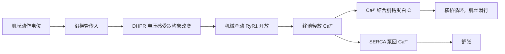

肌肉是动物最主要的效应器：人体的骨骼肌约占体重的 40%，平滑肌与心肌合计约占 10%。一次随意运动从运动神经元的一个**动作电位**开始，到肌丝滑行结束，中间要经过五步：神经末梢在**神经–肌肉接头**释放递质；肌膜产生动作电位；动作电位沿横管进入细胞深处并触发肌质网释放 $\ce{Ca^2+}$（兴奋–收缩偶联）；$\ce{Ca^2+}$ 打开细肌丝上的开关，**横桥循环**使肌丝滑行；$\ce{Ca^2+}$ 被泵回肌质网，收缩停止。本章讲第一、二、三、五步；第四步与肌肉作为发动机的力学和能量学是 [第 9 章](/7.14.9) 的内容，心肌、平滑肌与无脊椎动物的肌肉在 [第 10 章](/7.14.10)。神经–肌肉接头是研究得最透彻的**化学突触**，它的**量子释放**、$\ce{Ca^2+}$ 依赖与受体动力学是 [第 5 章](/7.14.5) 讲的一般突触传递的原型；接头的发育见 [7.5.21](/7.5.21)，动作电位的离子机制见 [第 4 章](/7.14.4) 与 [7.6.30](/7.6.30)。

## 8.1. 肌肉与运动单位

### 8.1.1. 为什么需要肌肉

动物要在环境中移动、摄食、泵血和推送内容物，需要一种能把化学能直接变成机械功的组织。肌肉满足三类要求：材料上，它由蛋白质**自组装**而成，柔软、可大幅变形（**肌节**可缩短约 40%），单位横截面积的最大应力约 $0.2$–$0.4\,\mathrm{MPa}$；能量上，它直接以 ATP 为燃料，整块肌肉把化学能变为功的效率约 20%–25%，在最适速度下可达更高；修复上，肌纤维损伤后由**卫星细胞**增殖、融合而再生，训练时还能按负荷增粗。

一个有启发的对照是软体机器人（soft robotics）。今天的机器人大多由刚性材料和电机构成，因为刚体的运动学容易建模和精确控制，电机的功率密度与寿命也有保证；用气动或介电弹性体做成的"人工肌肉"可以达到与肌肉相当的应变和应力，却往往需要外接气源或上千伏的电压，难以自我感知和修复。肌肉把驱动（横桥）、感知（**肌梭**与**腱器官**，[第 44 章](/7.14.44)）、能量供给、生长和修复集成在同一种组织里，这是人工系统至今难以同时做到的。

产生力的细胞并不只有肌肉。跳蚤在 $1\,\mathrm{ms}$ 内起跳，靠的是肌肉缓慢地把能量储存在节肢弹性蛋白里再突然释放（[第 9 章](/7.14.9)）；捕蝇草的闭合则完全不用肌肉，而是靠叶片的弹性失稳（[7.13.19](/7.13.19)）。

肌肉之所以是人类最早系统研究的组织，原因也很直接：它的收缩肉眼可见，与"活着"直接相连；医学与解剖学（Vesalius 的《人体的构造》，1543）需要它；它又是力学和哲学讨论"生命是否是机器"的天然对象。17 世纪 Swammerdam 证明肌肉收缩时体积不变，否定了"神经向肌肉灌注气体使之膨胀"的古老假说；18 世纪末 Galvani 的蛙腿实验把肌肉收缩与电联系起来（[第 4 章](/7.14.4)）。

### 8.1.2. 骨骼肌的层次结构

| 层次 | 尺寸 | 结构要点 |
|---|---|---|
| 肌肉 | 厘米到数十厘米 | 两端经肌腱附着于骨；外包肌外膜 |
| 肌束 | 约 $1\,\mathrm{mm}$ | 许多肌纤维由肌束膜包成一束 |
| 肌纤维（肌细胞） | 直径 $10$–$100\,\mu\mathrm{m}$，长数毫米到 $10\,\mathrm{cm}$ 以上 | 多核合胞体，由**成肌细胞**融合而成；外包肌内膜；细胞膜称肌膜 |
| 肌原纤维 | 直径约 $1\,\mu\mathrm{m}$ | 由肌节首尾相连而成，贯穿纤维全长 |
| 肌节 | 静息时约 $2$–$2.5\,\mu\mathrm{m}$ | 粗丝（肌球蛋白）与细丝（肌动蛋白）交错排列，产生横纹 |

**肌节**的结构与**滑行学说**见 [第 9 章](/7.14.9)；肌纤维的多核结构由成肌细胞融合形成，见 [7.5.24](/7.5.24)。

### 8.1.3. 运动单位

脊椎动物的每根骨骼肌纤维（除少数张力纤维外，8.8 节）只有一个神经–肌肉接头，只受一个运动神经元支配；反过来，一个运动神经元的轴突在肌肉内分支，支配几根到上千根纤维。

**定义 8.1.1（运动单位）** 一个 α 运动神经元及其轴突分支所支配的全部肌纤维称为一个**运动单位**（motor unit）。运动单位是神经系统控制骨骼肌的最小单元：该神经元每发放一个动作电位，它的所有肌纤维都产生一次动作电位和一次收缩。

一个运动单位中的纤维数（神经支配比）决定控制的精细程度。眼外肌的运动单位只含约 10 根纤维，手的小肌肉约 100 根，而小腿的腓肠肌、背部的姿势肌可达上千根：精细的运动需要许多小的运动单位，粗大有力的运动用少数大的运动单位就够了。同一运动单位的纤维属于同一类型（[第 9 章](/7.14.9)），并且不聚在一起，而是分散在肌肉横截面的一个区域里（覆盖面从不足 10% 到 70% 以上），只在局部形成小的簇；这样，单个运动单位的力分布在肌肉的较大范围上，许多运动单位异步发放时，合力平滑。中枢通过改变被调动的运动单位数目和每个单位的发放频率来分级调节肌力，二者的规律（**尺寸法则**与**强直**）在 [第 9 章](/7.14.9) 讨论。

## 8.2. 神经–肌肉接头的结构

运动神经元的有髓轴突到达肌纤维附近时失去髓鞘，分成几个末梢分支，末端膨大为终扣，嵌在肌膜表面的浅槽（突触槽）里，上面覆盖着终末 Schwann 细胞。这一特化的化学突触就是**神经肌肉接头**（NMJ），肌膜上与之相对的特化区域称为运动终板（motor end plate）。

| 结构 | 特征 | 意义 |
|---|---|---|
| 突触前终末 | 含大量直径约 $50\,\mathrm{nm}$ 的突触囊泡，每个囊泡装有约 $10^4$ 个乙酰胆碱（ACh）分子；线粒体丰富 | 囊泡库容量大；线粒体为囊泡循环与 $\ce{Ca^2+}$ 清除供能 |
| 活性区 | 突触前膜上的致密带，两侧整齐排列着电压门控 $\ce{Ca^2+}$ 通道（$\mathrm{Ca_V2.1}$）与停靠的囊泡 | $\ce{Ca^2+}$ 进入点与融合点相距只有几十纳米，释放快而同步 |
| 突触间隙 | 宽约 $20$–$50\,\mathrm{nm}$，其中的基膜锚定着乙酰胆碱酯酶（AChE） | 距离短，递质扩散只需微秒；AChE 就位，信号能迅速终止 |
| 接头后皱褶 | 终板膜向内折叠，形成许多次级间隙，正对活性区 | 增大突触后膜面积；皱褶顶部 ACh 受体密度约 $10^4\,\mu\mathrm{m^{-2}}$，皱褶底部集中着电压门控 $\mathrm{Na^+}$ 通道（$\mathrm{Na_V1.4}$），降低终板附近触发动作电位的阈值 |
| 终板的位置与大小 | 多位于肌纤维中部，面积不到肌纤维表面积的 0.1% | 动作电位从中部向两端传播，传到两端的时间减半 |

终板的形成依赖运动神经末梢释放的 agrin，它通过肌膜上的 LRP4–MuSK 受体复合体和支架蛋白 rapsyn 把 ACh 受体聚集到接头下方（[7.5.21](/7.5.21)）。

## 8.3. 递质的释放

### 8.3.1. 化学传递的发现

神经怎样跨过与肌肉之间的间隙传递信号，是 20 世纪上半叶神经生理学的中心问题。

| 年代 | 研究者 | 关键贡献 | 回答的问题 |
|---|---|---|---|
| 1914 | H. H. Dale | 从麦角（真菌）提取物中分离出乙酰胆碱，发现其作用强而短暂（易被水解），分为毒蕈碱样与烟碱样两类作用 | 有没有可作递质的物质？ |
| 1921 | O. Loewi | 刺激蛙心迷走神经，灌流液能使第二颗心脏减慢（"迷走物质"） | 神经是否释放化学信号？ |
| 1936 | Dale、Feldberg 与 Vogt | 刺激运动神经时从肌肉的灌流液中检测到 ACh | 神经–肌肉接头的递质是什么？ |
| 1930 年代后期 | 冯德培 | 改变细胞外 $\ce{Ca^2+}$ 显著改变神经–肌肉传递；描述了强直后增强 | 释放受什么调节？ |
| 1950–1960 年代 | B. Katz 及合作者 | 量子释放；$\ce{Ca^2+}$ 必须在神经冲动到达时存在（Katz 与 Miledi，1967） | 释放的物理机制是什么？ |
| 1976 年起 | E. Neher 与 B. Sakmann | **膜片钳**记录到单个 ACh 受体通道的电流 | 受体通道怎样工作？ |

Loewi 与 Dale 分享 1936 年诺贝尔生理学或医学奖，Katz 获 1970 年奖，Neher 与 Sakmann 获 1991 年奖。冯德培的工作早于 Katz 的定量研究，是中国生理学在这一领域的开创性贡献；他在 1932 年还发现，静息的肌肉被拉长时产热增加（冯氏效应，[第 9 章](/7.14.9)）。

### 8.3.2. 释放的过程

1. 动作电位传到终末，使活性区的 $\mathrm{Ca_V2.1}$（P/Q 型）通道开放。$\ce{Ca^2+}$ 的电化学梯度极大（胞外约 $1$–$2\,\mathrm{mmol\,L^{-1}}$，胞内约 $0.1\,\mu\mathrm{mol\,L^{-1}}$），通道口附近的"纳米域"中 $[\ce{Ca^2+}]$ 在不到 1 ms 内升到几十 $\mu\mathrm{mol\,L^{-1}}$。
2. $\ce{Ca^2+}$ 结合囊泡上的 $\ce{Ca^2+}$ 感受器突触结合蛋白（synaptotagmin），已经组装好的 **SNARE 蛋白**复合体完成膜融合，ACh 以**胞吐作用**释放。从动作电位到终板电流开始约 $0.5\,\mathrm{ms}$，即**突触延搁**，主要花在 $\ce{Ca^2+}$ 通道开放与融合上。
3. 一个神经冲动通常释放约 125–200 个囊泡，即约 $10^6$ 个 ACh 分子。
4. 囊泡膜经**网格蛋白**介导的胞吞回收，重新装填：胆碱乙酰转移酶在胞质中用乙酰辅酶 A 与胆碱合成 ACh，囊泡 ACh 转运体把它泵入囊泡；合成所需的胆碱主要来自间隙中 ACh 水解后被高亲和力胆碱转运体回收的部分。

一个终板的终末中约有 $3\times10^5$ 个囊泡，只够几千次冲动之用。以高于约 $100\,\mathrm{Hz}$ 的频率持续刺激几分钟，囊泡耗竭，传递失败：这就是接头的疲劳。正常运动神经元的发放频率远低于此。

释放强烈依赖 $\ce{Ca^2+}$。Dodge 与 Rahamimoff（1967）测得释放量 $m$ 与细胞外 $\ce{Ca^2+}$ 的四次方成正比，$\ce{Mg^2+}$ 竞争性地抑制：

$$
m = K\left(\frac{[\ce{Ca^2+}]_{\mathrm{o}}}{1 + [\ce{Ca^2+}]_{\mathrm{o}}/K_1 + [\ce{Mg^2+}]_{\mathrm{o}}/K_2}\right)^4 . \tag{8.1}
$$

四次方意味着大约四个 $\ce{Ca^2+}$ 必须协同作用才能使一个囊泡融合，这与突触结合蛋白和 SNARE 复合体上多个 $\ce{Ca^2+}$ 结合位点的结构相符。正是这一陡峭的非线性，使释放只在 $\ce{Ca^2+}$ 通道开放的那一瞬间、在通道口附近发生。

### 8.3.3. 量子释放

Fatt 与 Katz（1952）在未受刺激的蛙肌终板上记录到随机出现的、约 $0.4$–$0.5\,\mathrm{mV}$ 的小去极化，平均每秒约一次；它们的时程与终板电位相同，被箭毒阻断，被胆碱酯酶抑制剂增大和延长。这就是微终板电位（miniature end-plate potential，MEPP）。del Castillo 与 Katz（1954）在低 $\ce{Ca^2+}$、高 $\ce{Mg^2+}$ 的溶液中刺激神经，使诱发的终板电位很小，发现它的幅度只取 MEPP 的整数倍：0、1、2、3……个单位。

**定义 8.3.1（量子释放）** 递质以大小基本固定的"包"释放，每包称为一个量子，对应一个突触囊泡的内容物；神经冲动诱发的突触后电位是若干个量子效应的总和。这种释放方式称为**量子释放**（quantal release）。一次冲动释放的平均量子数 $m$ 称为**量子含量**（quantal content），一个量子产生的电位 $q$ 称为量子大小。

量子释放可以写成一个统计模型。设终末有 $N$ 个可释放的位点，每个位点在一次冲动中以概率 $p$ 独立地释放一个量子，则释放的量子数服从**二项分布**；在低 $\ce{Ca^2+}$ 下 $p$ 很小而 $N$ 很大，二项分布趋于均值 $m = Np$ 的 **Poisson 分布**（[3.1.4](/3.1.4#def-4.1.10)）：

$$
\mathbb{P}(k) = \mathrm{e}^{-m}\frac{m^k}{k!}, \qquad k = 0, 1, 2, \dots \tag{8.2}
$$

这一模型给出三种相互独立的 $m$ 的估计，它们一致就支持量子假说：

- 直接法：$m = \bar V_{\mathrm{EPP}}/\bar q$，即平均终板电位除以平均 MEPP；
- 失败法：由 $\mathbb{P}(0) = \mathrm{e}^{-m}$，$m = \ln(N_{\text{试验}}/N_{\text{失败}})$；
- 方差法：Poisson 分布的方差等于均值，所以终板电位幅度的变异系数满足 $\mathrm{CV}^2 = 1/m$（忽略量子大小本身的变异）。

**例 8.3.1** 在 $0.5\,\mathrm{mmol\,L^{-1}}$ $\ce{Ca^2+}$、$5\,\mathrm{mmol\,L^{-1}}$ $\ce{Mg^2+}$ 中刺激 400 次，有 61 次没有反应，平均终板电位 $0.78\,\mathrm{mV}$，平均 MEPP $0.40\,\mathrm{mV}$。失败法给出 $m = \ln(400/61) = 1.88$，直接法给出 $m = 0.78/0.40 = 1.95$，二者在统计误差内一致。再由式 (8.2) 预测：恰好 1 个量子的试验应约有 $400\times1.88\,\mathrm{e}^{-1.88} \approx 115$ 次，2 个量子的约 $108$ 次。del Castillo 与 Katz 以及其后对猫、鼠接头的实验都得到了这样的吻合。

:::

一个量子打开约 1000–2000 个 ACh 受体通道，而单个通道的开放只产生微伏量级的去极化。正常 $\ce{Ca^2+}$ 下，蛙肌接头的量子含量约 200–300，哺乳类约 50–150，人的接头更小（约 20–50），但接头后皱褶更深，单个量子的效应更大。

**例 8.3.2（终板电位的非线性总和）** 量子含量 150、量子大小 $0.4\,\mathrm{mV}$ 时，线性相加会给出 $60\,\mathrm{mV}$ 的终板电位，实测（阻断动作电位时）只有约 $40\,\mathrm{mV}$。原因是去极化减小了离子流的驱动力。设终板通道的反转电位 $E_{\mathrm{r}} \approx 0\,\mathrm{mV}$，**静息电位** $V_{\mathrm{r}} = -90\,\mathrm{mV}$，Martin（1955）的修正把观测值 $v$ 换算为线性值 $v' = v/[1 - v/(E_{\mathrm{r}} - V_{\mathrm{r}})]$；反过来，$v = v'/(1 + v'/90\,\mathrm{mV}) = 60/(1 + 60/90) = 36\,\mathrm{mV}$。做量子分析时，正常 $\ce{Ca^2+}$ 下必须先作这一修正，直接法才不会低估 $m$。

## 8.4. 乙酰胆碱受体与终板电位

### 8.4.1. 受体与终板电位

终板上的受体是肌肉型**烟碱型乙酰胆碱受体**（[7.1.14](/7.1.14)）：由五个亚基围成的配体门控阳离子通道，成体为 $\alpha_2\beta\delta\varepsilon$，胎儿与失神经的肌肉为 $\alpha_2\beta\gamma\delta$。两个 ACh 结合位点位于 α–δ 与 α–ε 界面上，两个位点都被占据通道才有效开放，所以开放概率对 ACh 浓度的依赖是协同的（**Hill 系数**约 2）。通道对 $\mathrm{Na^+}$ 与 $\mathrm{K^+}$ 几乎不加选择（$P_{\mathrm{K}}/P_{\mathrm{Na}} \approx 1.1$），也通透少量 $\ce{Ca^2+}$，单通道电导约 $50\,\mathrm{pS}$，平均开放约 $1\,\mathrm{ms}$，反转电位约 $0\,\mathrm{mV}$。在 $-90\,\mathrm{mV}$ 时，$\mathrm{Na^+}$ 内流的驱动力远大于 $\mathrm{K^+}$ 外流，净电流内向，终板去极化。

**定义 8.4.1（终板电位）** ACh 激活终板上的受体通道，使终板膜产生的去极化称为**终板电位**（end-plate potential，EPP）。它是一种局部的突触后电位：幅度分级，与释放的 ACh 量有关，没有不应期，可以总和，并以电紧张方式向周围衰减；它本身不传播，而是使相邻肌膜去极化到阈电位，由那里的电压门控 $\mathrm{Na^+}$ 通道产生向两端传播的肌肉动作电位。

在稳态近似下，终板是一个由受体电导 $g_{\mathrm{ACh}}$ 与其余膜电导 $g_{\mathrm{m}}$ 并联而成的分压器（等效电路见 [7.6.30](/7.6.30#sec-30.4.1)），

$$
V = \frac{g_{\mathrm{ACh}}E_{\mathrm{r}} + g_{\mathrm{m}}V_{\mathrm{r}}}{g_{\mathrm{ACh}} + g_{\mathrm{m}}}, \qquad \Delta V = (E_{\mathrm{r}} - V_{\mathrm{r}})\frac{g_{\mathrm{ACh}}}{g_{\mathrm{ACh}} + g_{\mathrm{m}}}, \tag{8.3}
$$
去极化随打开的通道增多而趋于饱和，这就是例 8.3.2 中非线性总和的来源。

### 8.4.2. 信号的终止

间隙中的 ACh 寿命不到 $1\,\mathrm{ms}$。基膜上的乙酰胆碱酯酶是最快的酶之一，每个活性中心每秒水解约 $10^4$ 个 ACh 分子；相当一部分 ACh 在到达受体之前就被水解，其余的在与受体解离之后很快被水解。终板电流因此在约 $1$–$2\,\mathrm{ms}$ 内衰减，其时程基本由通道关闭的速率决定。

**例 8.4.1（扩散不是瓶颈）** 取 ACh 的扩散系数 $D \approx 4\times10^{-10}\,\mathrm{m^2\,s^{-1}}$，跨过 $50\,\mathrm{nm}$ 的间隙所需时间 $t \approx x^2/(2D) = (5\times10^{-8})^2/(8\times10^{-10})\,\mathrm{s} \approx 3\,\mu\mathrm{s}$，比突触延搁（约 $500\,\mu\mathrm{s}$）短两个数量级。突触的快慢取决于 $\ce{Ca^2+}$ 通道、融合与受体门控，而不是扩散。

:::

接头上有多重负反馈使每个神经冲动只产生一个短暂的终板电位，从而保持神经与肌肉一对一的关系：

- 胆碱酯酶水解 ACh，扩散使 ACh 离开间隙；
- 持续暴露于 ACh 的受体发生**脱敏**，即使 ACh 仍在也关闭；
- 终末中的 $\ce{Ca^2+}$ 激活 $\mathrm{K^+}$ 通道使终末复极化，$\ce{Ca^2+}$ 被泵出或摄入内质网与线粒体；
- 高频刺激时可释放的囊泡减少，释放量下降（短时程压抑）；
- 肌膜上的 $\mathrm{Na^+}$ 通道失活与不应期，使一个终板电位只能触发一个肌肉动作电位。

### 8.4.3. 安全系数

正常接头释放的递质远多于触发动作电位所需。

**定义 8.4.2（安全系数）** 终板电位的幅度与触发肌肉动作电位所需的去极化之比称为神经–肌肉传递的**安全系数**（safety factor）。

哺乳类的安全系数通常约 3–5，人的接头较低（约 2–3）。安全系数使传递在高频发放、温度变化与疾病中仍然可靠，代价是每次冲动都要多释放几倍的递质。

图 C 说明了安全系数的意义。串刺激中量子含量逐次下降（可释放的囊泡逐渐减少），在第 4–5 个刺激降到约 60%。正常接头的终板电位仍是阈值的近两倍；而当安全系数降到 1 附近时，同样的下降就使越来越多的纤维传递失败。这正是重症肌无力的表现与电诊断的原理（8.7 节）：反复用力后肌力进行性减弱，以 $3\,\mathrm{Hz}$ 刺激神经时复合肌肉动作电位逐次递减。

## 8.5. 骨骼肌动作电位与兴奋–收缩偶联

### 8.5.1. 骨骼肌的动作电位

骨骼肌纤维的动作电位与神经元的机制相同（电压门控 $\mathrm{Na^+}$ 通道的开放与失活，延迟整流 $\mathrm{K^+}$ 通道的开放，[第 4 章](/7.14.4)），参数有所不同：

| 参数 | 神经元 | 骨骼肌纤维 | 说明 |
|---|---|---|---|
| 静息电位 | $-65$ 至 $-70\,\mathrm{mV}$ | $-85$ 至 $-90\,\mathrm{mV}$ | 肌膜静息电导的约 70%–80% 来自 $\mathrm{Cl^-}$ 通道（ClC-1），使膜电位稳定 |
| **阈电位** | 约 $-55\,\mathrm{mV}$ | 约 $-60$ 至 $-55\,\mathrm{mV}$ | 二者相近 |
| 超射峰值 | $+30$ 至 $+40\,\mathrm{mV}$ | $+20$ 至 $+30\,\mathrm{mV}$ | 由 $\mathrm{Na^+}$ 内流决定 |
| 时程 | $1$–$2\,\mathrm{ms}$ | $2$–$5\,\mathrm{ms}$ | 横管膜的电容使复极化稍慢 |
| **绝对不应期** | 约 $1\,\mathrm{ms}$ | 约 $1$–$3\,\mathrm{ms}$ | 骨骼肌稍长 |
| **传导速度** | $1$–$120\,\mathrm{m\,s^{-1}}$ | $3$–$5\,\mathrm{m\,s^{-1}}$ | 肌纤维无髓鞘，速度只随直径的平方根增大 |
| 功能 | 传递信息 | 触发收缩 | |

ClC-1 的作用在疾病中看得最清楚：先天性肌强直患者的 ClC-1 功能缺失，肌膜电导降低，一次随意收缩后肌纤维继续发放动作电位，肌肉不能及时放松。高频发放时 $\mathrm{K^+}$ 在狭窄的横管中积累，使横管膜去极化，这是 $\mathrm{Cl^-}$ 电导重要的另一原因：$\mathrm{Cl^-}$ 电导削弱了 $\mathrm{K^+}$ 积累引起的去极化对**兴奋性**的影响。

动作电位从中部的终板向两端传播。长 $10\,\mathrm{cm}$ 的纤维，以 $4\,\mathrm{m\,s^{-1}}$ 传播 $5\,\mathrm{cm}$ 需要约 $12.5\,\mathrm{ms}$，与快肌**单收缩**的上升时间（约 $10$–$40\,\mathrm{ms}$）相比不可忽略；这也是终板通常位于纤维中部的原因之一。

### 8.5.2. 横管与三联管

肌纤维直径可达 $100\,\mu\mathrm{m}$，而收缩要在动作电位后几毫秒内在整个横截面上同步开始。A. V. Hill（1949）指出，任何从表面扩散进入的物质都做不到这一点。

**例 8.5.1（Hill 的扩散论证）** $\ce{Ca^2+}$ 在肌浆中的扩散系数至多约 $5\times10^{-10}\,\mathrm{m^2\,s^{-1}}$（被缓冲时有效值更小）。从表面扩散到半径 $50\,\mu\mathrm{m}$ 的纤维的中心需要 $t \approx r^2/(2D) = (5\times10^{-5})^2/(10^{-9})\,\mathrm{s} \approx 2.5\,\mathrm{s}$，比单收缩的全部时程长约两个数量级。所以激活信号必须由电传入细胞内部，在每个肌节附近就地释放 $\ce{Ca^2+}$。

:::

传入的通路是横管（transverse tubule，T 管）：肌膜周期性地向内凹陷形成的管道，直径约 $20$–$40\,\mathrm{nm}$，在哺乳类中位于每个肌节的 A 带与 I 带交界处（每个肌节两条），在蛙中位于 Z 线处；管腔与**细胞外液**相通，管膜能传导动作电位，动作电位在约 $1\,\mathrm{ms}$ 内传到纤维中心。**肌质网**（[7.3.7](/7.3.7#def-7.5.1)）是包绕每条肌原纤维的**光面内质网**，它在横管两侧膨大成终池。

**定义 8.5.1（三联管）** 骨骼肌中一条横管与两侧的两个终池紧密相贴（间隙约 $12\,\mathrm{nm}$）形成的结构称为**三联管**（triad）。它是兴奋–收缩偶联的结构单位：横管膜上的电压感受器正对终池膜上的 $\ce{Ca^2+}$ 释放通道。心肌中横管只与一个终池相贴，形成二联体（[第 10 章](/7.14.10)）。

**定义 8.5.2（兴奋–收缩偶联）** 把肌膜上的动作电位（电信号）转变为胞质 $\ce{Ca^2+}$ 浓度升高、进而启动肌丝滑行（机械活动）的过程，称为**兴奋–收缩偶联**（excitation–contraction coupling）。其结构基础是横管–肌质网系统，偶联因子是 $\ce{Ca^2+}$。

### 8.5.3. DHPR–RyR1 机械偶联

横管膜上的**电压感受器**是二氢吡啶受体（dihydropyridine receptor，DHPR），即 L 型 $\ce{Ca^2+}$ 通道 $\mathrm{Ca_V1.1}$；终池膜上的释放通道是兰尼碱受体（ryanodine receptor）RyR1，一个分子量约 $2.2\,\mathrm{MDa}$ 的同四聚体，是已知最大的离子通道。在三联管中，RyR1 排成规则的棋盘状阵列；每隔一个 RyR1，其胞质结构域正对着一组四个 DHPR（"四联体"）。去极化时 DHPR 的电压感受器移动（可测为电荷移动，Schneider 与 Chandler，1973），通过蛋白质之间的直接接触（还需要接头蛋白 STAC3 等）把 RyR1 拉开。不与 DHPR 相连的那一半 RyR1 可能被邻近释放的 $\ce{Ca^2+}$ 打开，使释放放大。这种偶联还是双向的：RyR1 反过来增强 DHPR 自身的 $\ce{Ca^2+}$ 电流。

由于偶联是机械的，骨骼肌收缩不需要细胞外 $\ce{Ca^2+}$ 进入：在无 $\ce{Ca^2+}$ 的溶液中，蛙骨骼肌仍能在一段时间内正常收缩（直到肌质网的储存耗尽），心肌则在几次搏动内停止（[第 10 章](/7.14.10)）。DHPR 的 $\ce{Ca^2+}$ 电流在骨骼肌中又慢又小，对单收缩并不必需。

RyR1 的突变造成恶性高热（malignant hyperthermia）：携带者在吸入卤代烷类麻醉剂或使用琥珀胆碱时，RyR1 持续开放，肌质网 $\ce{Ca^2+}$ 失控释放，肌肉强直、ATP 大量消耗、产热剧增、**酸中毒**与高钾血症，不治可致死；RyR1 抑制剂丹曲林是特效药。

## 8.6. Ca²⁺ 的释放、回收与舒张

一次动作电位从肌质网释放的 $\ce{Ca^2+}$，以肌浆体积计约为 $300$–$400\,\mu\mathrm{mol\,L^{-1}}$，但绝大部分立即被结合：胞质游离 $[\ce{Ca^2+}]$ 从静息的约 $0.05$–$0.1\,\mu\mathrm{mol\,L^{-1}}$ 在 1–2 ms 内升到约 $10$–$20\,\mu\mathrm{mol\,L^{-1}}$，又在几毫秒内回落；肌钙蛋白 C 的调节位点、ATP 与小型哺乳动物快肌中大量的小清蛋白（parvalbumin）分走了释放的 $\ce{Ca^2+}$。肌钙蛋白 C 结合 $\ce{Ca^2+}$ 后使原肌球蛋白移开，横桥得以结合（[第 9 章](/7.14.9)）。

收缩的终止需要把 $\ce{Ca^2+}$ 移出胞质，有两条途径，都是主动过程：

- 回收（主要）：肌质网膜上的 SERCA（sarco/endoplasmic reticulum $\ce{Ca^2+}$-ATPase，快肌为 SERCA1a，慢肌与心肌为 SERCA2a）每水解一个 ATP 把两个 $\ce{Ca^2+}$ 泵入肌质网，是一种 **P 型 ATP 酶**。它在快肌肌质网膜蛋白中占大部分。
- 排出（次要）：肌膜上的质膜 $\ce{Ca^2+}$-ATP 酶与 $\mathrm{Na^+}$–$\ce{Ca^2+}$ 交换体。

肌质网腔内的肌集钙蛋白（calsequestrin）是低亲和力（$K_{\mathrm{d}} \approx 1\,\mathrm{mmol\,L^{-1}}$）、高容量（每分子结合约 40–50 个 $\ce{Ca^2+}$）的缓冲蛋白，聚集在终池中。它有两个作用：增大肌质网的 $\ce{Ca^2+}$ 容量；使腔内游离 $\ce{Ca^2+}$ 保持在亚毫摩尔水平，从而推迟腔内高 $\ce{Ca^2+}$ 对 SERCA 的抑制。

**例 8.6.1（SERCA 的热力学上限）** 把 2 个 $\ce{Ca^2+}$ 从 $0.1\,\mu\mathrm{mol\,L^{-1}}$ 的胞质泵到游离 $\ce{Ca^2+}$ 为 $0.5\,\mathrm{mmol\,L^{-1}}$ 的肌质网（跨肌质网膜几乎没有电位差，因为它对 $\mathrm{K^+}$、$\mathrm{Cl^-}$ 通透），在 $37\,^\circ\mathrm{C}$ 需要的自由能为
$$
\Delta G = 2RT\ln\frac{c_{\mathrm{SR}}}{c_{\mathrm{cyt}}} = 2\times2.58\,\mathrm{kJ\,mol^{-1}}\times\ln(5\times10^3) \approx 44\,\mathrm{kJ\,mol^{-1}},
$$
小于肌肉中 ATP 水解的自由能（约 $-60\,\mathrm{kJ\,mol^{-1}}$）。若腔内的 $\ce{Ca^2+}$ 都是游离的（十余 $\mathrm{mmol\,L^{-1}}$），浓度比升到 $10^5$，所需自由能约 $59\,\mathrm{kJ\,mol^{-1}}$，泵将接近停转。肌集钙蛋白的缓冲使肌质网能储存大量 $\ce{Ca^2+}$ 而不触及这一热力学极限。

:::

$\ce{Ca^2+}$ 泵的耗能相当可观：收缩期间肌肉消耗的 ATP 中约 30%–40% 用于 SERCA，其余主要用于横桥循环，少量用于**钠钾泵**。舒张因此与收缩一样需要 ATP；死后 ATP 耗尽，横桥停留在与肌动蛋白紧密结合的状态，肌肉僵硬（尸僵，[7.3.13](/7.3.13#sec-13.5.2)）。长时间活动后肌质网 $\ce{Ca^2+}$ 逐渐流失，肌质网 $\ce{Ca^2+}$ 降低时，肌质网膜上的 STIM1 激活肌膜上的 Orai1 通道，从细胞外补充 $\ce{Ca^2+}$（钙库操纵的 $\ce{Ca^2+}$ 内流）。

## 8.7. 神经–肌肉接头的药理与疾病

接头上的每一步都有天然毒素、药物或疾病作用于它：

| 环节 | 药物、毒素或疾病 | 作用 | 结果 |
|---|---|---|---|
| 突触前 $\ce{Ca^2+}$ 通道 | Lambert–Eaton 肌无力综合征（抗 $\mathrm{Ca_V2.1}$ 自身抗体，常伴小细胞肺癌）；高 $\ce{Mg^2+}$ | 释放减少 | 无力；与重症肌无力相反，高频刺激时 $\ce{Ca^2+}$ 积累使肌力暂时增强 |
| 囊泡融合 | 肉毒毒素（切割 SNAP-25 等 SNARE 蛋白） | 阻止 ACh 释放 | 弛缓性瘫痪；小剂量用于治疗肌张力障碍与美容 |
| 囊泡融合 | α-黑寡妇蛛毒素 | 使囊泡大量释放直至耗竭 | 先痉挛后麻痹 |
| ACh 合成 | 密胆碱-3 | 阻断胆碱的高亲和力摄取 | 递质逐渐耗竭 |
| ACh 受体 | 筒箭毒碱 | 竞争性阻断 | 肌肉松弛，用于外科麻醉（需人工通气） |
| ACh 受体 | α-银环蛇毒素（李镇源与张传炯，1963） | 几乎不可逆地结合 α 亚基 | 麻痹；后来成为标记和纯化 ACh 受体的工具 |
| ACh 受体 | 琥珀胆碱 | 持续激活受体 | 去极化阻滞：终板周围肌膜的 $\mathrm{Na^+}$ 通道保持失活 |
| 胆碱酯酶 | 新斯的明、吡斯的明（可逆） | 延长 ACh 作用 | 治疗重症肌无力；逆转竞争性肌松药 |
| 胆碱酯酶 | 有机磷农药、神经毒剂（不可逆） | ACh 堆积 | 先肌束震颤，后去极化阻滞与呼吸肌麻痹；毒蕈碱样症状（瞳孔缩小、分泌增多）；用阿托品与胆碱酯酶复能剂解救 |
| ACh 受体（自身免疫） | 重症肌无力（多数为抗 ACh 受体抗体，少数抗 MuSK 或 LRP4） | 受体被内吞、补体破坏终板皱褶 | 量子大小降低、安全系数降到 1 附近 |

重症肌无力的患病率约为每 1 万人 1–2 例，典型表现是眼睑下垂、复视等眼外肌症状和活动后加重、休息后好转的无力：眼外肌的运动单位小、发放频率高，安全系数本来就较低。机制由图 C 量化：受体减少使每个量子的效应减小，终板电位只略高于阈值，串刺激中量子含量的正常下降便使传递失败。胆碱酯酶抑制剂使每个 ACh 分子停留更久、能多次结合受体，等效于增大量子大小。

## 8.8. 演化与比较

### 8.8.1. 电器官：去掉了收缩装置的终板

电鳐（*Torpedo*）与电鳗（*Electrophorus*）的**电器官**由电细胞（electrocyte）叠成，大多数电细胞来自肌细胞：它们失去了收缩装置，却保留并极度扩大了一侧受胆碱能神经支配的终板膜。神经冲动同时激活这一侧膜上的 ACh 受体（电鳐）或 ACh 受体加上 $\mathrm{Na^+}$ 通道（电鳗），使电细胞两侧膜电位不对称，许多电细胞串联，放电可达几十到数百伏（物理分析见 [7.6.30](/7.6.30#sec-30.8)）。电鳐电器官的终末中充满突触囊泡，是冰冻蚀刻电镜观察突触囊泡的经典材料；这一组织中 ACh 受体的密度极高，Changeux 等（1970）用 α-银环蛇毒素在电鳗的电器官中首先鉴定出 ACh 受体蛋白，随后几个实验室从电鳐与电鳗的电器官中纯化了它，这是第一个被分离出来的神经递质受体。电器官在鱼类中独立起源了至少六次，几乎都由肌肉改造而成（南美的线翎电鳗科由运动神经元的轴突形成，是例外），说明终板加串联的结构是很容易被演化"重新利用"的模块。

### 8.8.2. 脊椎动物：抽搐纤维与张力纤维

哺乳类躯干与四肢的骨骼肌纤维几乎都是"抽搐纤维"（twitch fiber）：每根纤维一个终板，产生全或无的传播性动作电位。两栖类、爬行类与鸟类的一些肌肉（以及哺乳类的眼外肌、中耳肌和肌梭的梭内纤维）还有"张力纤维"（tonic fiber）：受多个分散的接头支配（葡萄串状终末），肌膜不产生传播性动作电位，各接头的终板电位就地引起分级、缓慢而持久的收缩，适合维持姿势和精细的眼位控制。可见"一根纤维一个终板加全或无"并不是脊椎动物肌肉唯一的方案，而是为快速、可靠的运动特化出来的。

### 8.8.3. 节肢动物：少数神经元，多终末、多神经支配

甲壳类与昆虫的肌肉由很少的运动神经元支配：例如螯虾螯的开肌只由一个兴奋性和一个抑制性神经元支配。每根肌纤维沿全长接受同一神经元的许多终末（多终末支配），常常还接受几个神经元的支配（多神经支配，包括快、慢兴奋性神经元和共同的抑制性神经元）。兴奋性递质是谷氨酸（离子型谷氨酸受体），抑制性递质是 GABA，抑制既作用于肌纤维（使 $\mathrm{Cl^-}$ 电导增大），也作用于兴奋性终末本身（突触前抑制，Dudel 与 Kuffler，1961）。许多纤维只产生分级的**局部电位**或 $\ce{Ca^2+}$ 动作电位。于是肌力的分级不靠调动运动单位的数目，而靠每个神经元的发放频率、易化以及兴奋与抑制的配合。果蝇幼虫的谷氨酸能接头是今天研究突触发育与可塑性的主要模型之一。

### 8.8.4. 线虫：肌肉向神经伸出"突起"

秀丽隐杆线虫的体壁肌反转了脊椎动物的格局：不是运动轴突长到肌肉上，而是每个肌细胞向背、腹神经索伸出几条"肌臂"，在神经索上与运动神经元形成接头。兴奋性输入是胆碱能的，抑制性输入是 GABA 能的；线虫有对左旋咪唑敏感的特有 ACh 受体亚型，左旋咪唑、噻嘧啶等驱虫药正是选择性地激活它们，使线虫痉挛性麻痹而不影响宿主。另一类驱虫药伊维菌素作用于线虫与节肢动物特有的谷氨酸门控 $\mathrm{Cl^-}$ 通道。

### 8.8.5. 兴奋–收缩偶联的两种方式

依赖细胞外 $\ce{Ca^2+}$ 内流、再由 $\ce{Ca^2+}$ 诱导肌质网释放的偶联方式，见于无脊椎动物的肌肉和脊椎动物的心肌与平滑肌，是更普遍、也更古老的方式；许多无脊椎动物的肌肉以 $\ce{Ca^2+}$ 动作电位兴奋。DHPR 直接机械门控 RyR 的偶联方式，以及与之对应的 DHPR 四联体，目前只在脊椎动物及其近缘的脊索动物的骨骼肌中见到。机械偶联使骨骼肌的激活不受细胞外 $\ce{Ca^2+}$ 波动和 $\ce{Ca^2+}$ 内流速度的限制，适合快速、反复的收缩；代价是失去了心肌那样用 $\ce{Ca^2+}$ 内流量调节收缩力的手段（[第 10 章](/7.14.10)）。

## 小结

| 环节 | 关键结构与分子 | 定量要点 |
|---|---|---|
| 运动单位（定义 8.1.1） | α 运动神经元 + 所支配的纤维 | 眼外肌约 10 根纤维，姿势肌上千根 |
| 递质释放 | 活性区、$\mathrm{Ca_V2.1}$、SNARE | 每次冲动约 125–200 个囊泡 × 约 $10^4$ ACh；释放 $\propto [\ce{Ca^2+}]^4$（式 (8.1)）；突触延搁约 $0.5\,\mathrm{ms}$ |
| 量子释放（定义 8.3.1） | 一个囊泡 = 一个量子 | Poisson 分布（式 (8.2)）；$m = \ln(N/N_0) = \bar V/\bar q$；MEPP 约 $0.4\,\mathrm{mV}$ |
| 终板电位（定义 8.4.1） | 肌肉型烟碱受体，反转电位约 $0\,\mathrm{mV}$ | 约 $40\,\mathrm{mV}$；非线性总和（例 8.3.2）；安全系数约 3 |
| 终止 | 乙酰胆碱酯酶、脱敏、扩散 | ACh 寿命 $< 1\,\mathrm{ms}$；扩散跨间隙约 $3\,\mu\mathrm{s}$（例 8.4.1） |
| 肌肉动作电位 | $\mathrm{Na_V1.4}$、ClC-1 | $-90\,\mathrm{mV}$，$2$–$5\,\mathrm{ms}$，$3$–$5\,\mathrm{m\,s^{-1}}$ |
| 兴奋–收缩偶联（定义 8.5.2） | 横管、三联管（定义 8.5.1）、DHPR–RyR1 机械偶联 | 不需细胞外 $\ce{Ca^2+}$；扩散不可能完成激活（例 8.5.1） |
| 舒张 | SERCA、肌集钙蛋白、小清蛋白 | 游离 $\ce{Ca^2+}$ $0.1 \to 10$–$20 \to 0.1\,\mu\mathrm{mol\,L^{-1}}$；SERCA 耗能约占 30%–40%（例 8.6.1） |

疾病与药物（8.7 节）分别打断上述各环节；比较生理（8.8 节）表明，"一根纤维一个终板、全或无的动作电位、机械偶联"是脊椎动物为快速可靠的运动形成的特化，节肢动物与线虫用少数神经元、多终末支配和分级电位实现了另一套控制方式。

## 思考题

1. 为什么终板电位的幅度远大于中枢神经元上单个**兴奋性突触后电位**的幅度？这种差别与两类突触各自的功能有什么关系？

   **答** 一次神经冲动在终板释放 100 个以上的量子，而且终板面积大、受体密度高、接头后皱褶增大了膜面积，所以终板电位达到约 $40\,\mathrm{mV}$，远超阈值所需（安全系数约 3）。神经–肌肉接头的功能是可靠地一对一传递，每个神经冲动必须引起一次肌肉动作电位；中枢突触的功能是整合，单个突触只产生约 $0.1$–$1\,\mathrm{mV}$ 的电位，只有许多兴奋性输入在时间与空间上总和、并与抑制性输入相抵后，才决定是否发放（[第 5 章](/7.14.5)）。

2. 在低 $\ce{Ca^2+}$ 溶液中刺激神经 250 次，有 92 次无反应；平均 MEPP 为 $0.45\,\mathrm{mV}$。（a）估计量子含量。（b）预测平均终板电位和恰好出现 2 个量子的次数。（c）若把细胞外 $\ce{Ca^2+}$ 加倍（仍在低浓度范围内），$m$ 大约变为多少？

   **答** （a）$m = \ln(250/92) = 1.00$。（b）平均终板电位 $\approx mq = 0.45\,\mathrm{mV}$；$\mathbb{P}(2) = \mathrm{e}^{-1}\cdot1^2/2! = 0.184$，约 46 次。（c）低 $\ce{Ca^2+}$ 时 $m \propto [\ce{Ca^2+}]^4$（式 (8.1)），加倍后 $m \approx 2^4 = 16$，此时失败几乎不再出现，量子分析要改用直接法或方差法。

3. 为什么骨骼肌在无 $\ce{Ca^2+}$ 的溶液中仍能收缩，而心肌很快停止跳动？若用一种药物阻断 DHPR 的电压感受器运动（而不是它的 $\ce{Ca^2+}$ 电流），骨骼肌会怎样？

   **答** 骨骼肌的 DHPR 以构象变化直接牵动 RyR1，释放的 $\ce{Ca^2+}$ 全部来自肌质网，不需要 $\ce{Ca^2+}$ 进入细胞；心肌需要经 L 型通道进入的 $\ce{Ca^2+}$ 触发 RyR2 开放（**钙诱导的钙释放**），没有外钙就没有触发信号（[第 10 章](/7.14.10)）。若电压感受器的运动被阻断，即使肌膜动作电位正常，RyR1 也不开放，兴奋–收缩偶联中断，肌肉不收缩；仅阻断 $\ce{Ca^2+}$ 电流（如二氢吡啶类药物在骨骼肌中的作用）则对单收缩影响很小。

4. 有机磷中毒为什么先出现肌束震颤，随后出现肌无力乃至呼吸麻痹？

   **答** 胆碱酯酶被不可逆抑制后，ACh 在间隙中持续存在：起初每个神经冲动的终板电位延长，可在肌膜上触发多个动作电位，甚至在没有冲动时使纤维自发兴奋，表现为肌束震颤；随后终板持续去极化，终板周围肌膜的电压门控 $\mathrm{Na^+}$ 通道保持在失活状态，不能再产生动作电位（去极化阻滞），受体也逐渐脱敏，传递中断，膈肌等呼吸肌麻痹。治疗用阿托品对抗毒蕈碱样作用，用复能剂在酶"老化"之前使其恢复活性，必要时人工通气。

5. （开放题）用本章的数据估计一次单收缩中 $\ce{Ca^2+}$ 回收的 ATP 消耗，并与一次单收缩中横桥消耗的 ATP 作比较，说明为什么快速、反复收缩的肌肉（如响尾蛇的发声肌、鱼的鳔肌）往往有极其发达的肌质网和很高的 SERCA 密度。

   **答** 思路：每次动作电位释放约 $350\,\mu\mathrm{mol\,L^{-1}}$ 的 $\ce{Ca^2+}$（按肌浆体积计），SERCA 每个 ATP 泵 2 个，所以每次单收缩约消耗 $175\,\mu\mathrm{mol\,L^{-1}}$ ATP 用于回收；按横桥约占耗能的 60%–70% 推算，横桥消耗约为其 1.5–2.3 倍。收缩频率越高，每秒释放与回收的次数越多，而且每次收缩都必须在下一次刺激之前把 $\ce{Ca^2+}$ 降下来，否则单收缩会融合成强直（图 C）。因此每秒振动上百次的超快肌肉把大部分体积让给肌质网与线粒体，肌原纤维反而很少，单收缩力很小：它们以力量换取速度。与之相对，昆虫的**异步飞行肌**用延迟牵张激活摆脱了每次收缩都要循环 $\ce{Ca^2+}$ 的限制（[第 10 章](/7.14.10)）。
