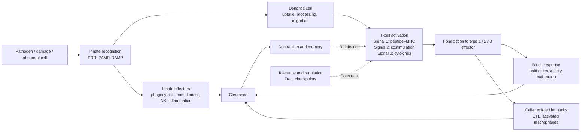

Immunology often gives the impression of having too many names: hundreds of CD molecules, dozens of interleukins, more than a dozen T-cell subsets. But these names serve a small number of questions: who recognizes, what is recognized, how the decision is made after recognition, which effector mechanisms clear the threat, and how the response is remembered and brought to a close afterward. This chapter is the map for the whole course. It first describes the components and functions of the immune system (§1.1), then the division of labor between the two kinds of immune response (§1.2) and the central theory explaining adaptive immunity, the clonal selection theory (§1.3). A few key discoveries show how these concepts came to be understood (§1.4), and the chapter ends with the knowledge path that runs through the whole course (§1.5) and a classification of immune-related diseases (§1.6). The introduction of every later chapter states its position on this path.

Immunology builds on several earlier courses: antibody structure and ligand binding in [7.1.7](/7.1.7); **V(D)J recombination** of antigen-receptor genes in [7.2.9](/7.2.9); signal transduction in [7.3.18](/7.3.18) and [7.3.19](/7.3.19); **apoptosis** and the **inflammasome** in [7.3.25](/7.3.25); the physiology of blood leukocytes and **inflammation** in [7.14.11](/7.14.11); how viruses are restricted by the host's **pattern recognition receptors** and **interferons** in [7.11.27](/7.11.27); and the types of **vaccine** in [7.11.28](/7.11.28). This course organizes these scattered pieces of knowledge into one system.

## 1.1. Immunity and the Immune System

### 1.1.1. The Meaning of Immunity

The word "immunity" comes from the Latin *immunitas*, which originally meant exemption from taxes and public service and later came to mean exemption from disease: a person who survives smallpox does not catch it again. The modern meaning is broader: immunity is the full range of biological effects by which the body recognizes "self" and "nonself" and eliminates "nonself". "Nonself" includes invading **pathogens** as well as abnormal components arising within the body (tumor cells, aged and dead cells). "Elimination" is also not always killing; very often it is tolerance, since the failure to react to one's own tissues, food, and commensal bacteria is likewise an active function of the immune system.

**Definition 1.1.1 (Immune System)** The **immune system** is the sum of the organs, cells, and molecules that carry out immune functions.

| Level | Components | See |
|---|---|---|
| Immune organs | Central: bone marrow, thymus; peripheral: lymph nodes, spleen, mucosa-associated lymphoid tissue, skin-associated lymphoid tissue | [7.15.3](/7.15.3) |
| Immune cells | Lymphocytes (T cells, B cells, NK cells, innate lymphoid cells); myeloid cells (monocytes and macrophages, neutrophils, eosinophils and basophils, mast cells, dendritic cells) | [7.15.2](/7.15.2) |
| Membrane-bound molecules | Antigen receptors (TCR, BCR), CD molecules, adhesion molecules, MHC molecules, cytokine receptors, pattern recognition receptors | [7.15.4](/7.15.4), [7.15.6](/7.15.6) |
| Secreted molecules | Antibodies, complement, cytokines, chemokines | [7.15.9](/7.15.9)–[7.15.11](/7.15.11) |

The immune system has no central organ. Its cells are scattered throughout the body, migrate constantly among blood, lymph, and tissues, and exchange information by cell contact and soluble molecules. Because of this dispersal, "where" matters as much as "what": the same cell does different things in the T-cell zone of a lymph node and in inflamed skin ([7.15.22](/7.15.22)).

### 1.1.2. The Three Basic Functions

**Definition 1.1.2** The immune system has three basic functions:

- **Immune defense**: preventing pathogens from invading and eliminating pathogens that have invaded, together with their toxins;
- **Immune surveillance**: detecting and eliminating "nonself" components that appear within the body, such as tumor cells arising by mutation and virus-infected cells;
- **Immune homeostasis**: maintaining the stability of the internal environment through immune tolerance and immune regulation toward self components, including the clearance of aged and dead cells.

Each of the three functions has its own "failure mode", which provides an outline for understanding immune diseases (§1.6): insufficient defense causes recurrent infections, excessive defense causes hypersensitivity; failed surveillance lets tumors grow; failed homeostasis causes autoimmune disease.

**Remark 1.1.1** The immune response is a double-edged sword. The same mechanisms that clear pathogens (the proteases and reactive oxygen species released by neutrophils, the perforin of cytotoxic T cells, the membrane attack complex of complement) also cause tissue damage because they do not distinguish friend from foe. The symptoms of many infections (fever, swelling, the exudate in pneumonia) arise mainly from the host's own response rather than from the pathogen itself ([7.15.7](/7.15.7)). Every immune effector mechanism is therefore paired with constraints: thresholds, negative feedback, and dedicated suppressive cells ([7.15.25](/7.15.25)).

## 1.2. The Two Kinds of Immune Response

### 1.2.1. Innate Immunity and Adaptive Immunity

**Definition 1.2.1 (Immune Response)** The whole process in which, after the immune system recognizes an antigen or a danger signal, immune cells are activated, proliferate, differentiate, produce effector functions, and finally eliminate the antigen is called the **immune response**.

The immune response of vertebrates is carried out jointly by two systems that differ both in evolutionary origin and in mechanism.

**Definition 1.2.2 (Innate Immunity)** **Innate immunity** is the defense that is present from birth and does not depend on prior exposure: its cells use germline-encoded receptors to recognize molecular patterns shared by classes of pathogens, act within minutes to hours of infection, and do not respond more strongly on repeated exposure to the same pathogen.

**Definition 1.2.3 (Adaptive Immunity)** **Adaptive immunity** is the defense carried out by T cells and B cells: each lymphocyte carries an almost unique antigen receptor generated by somatic gene rearrangement, only the cells selected by antigen are activated, proliferate, and differentiate into effector cells, and the response takes several days to peak and leaves memory.

Recognition in innate immunity depends on the recognition of **pathogen-associated molecular patterns** by **pattern recognition receptors** ([7.15.6](/7.15.6)); recognition in adaptive immunity depends on the recognition by lymphocyte antigen receptors of **epitopes** on specific **antigen** molecules.

| Feature | Innate immunity | Adaptive immunity |
|---|---|---|
| Main cells | Epithelial cells, phagocytes, dendritic cells, NK cells, innate lymphoid cells, mast cells; innate-like lymphocytes (γδ T, NKT, B-1) | αβ T cells, B cells (B-2) |
| Main molecules | Complement, antimicrobial peptides, acute-phase proteins, cytokines | Antibodies, cytokines |
| Recognition receptors | Pattern recognition receptors: germline-encoded, limited in number (about a hundred in humans), many kinds expressed by each cell | Antigen receptors: generated by somatic rearrangement, repertoire of more than about $10^{8}$ kinds, one kind per cell |
| What is recognized | Conserved structures shared by classes of microbes (lipopolysaccharide, double-stranded RNA) | Specific epitopes on proteins, polysaccharides, and other molecules; T cells recognize peptides presented by MHC molecules |
| Time course | Immediate to about 96 h | Effector phase reached after about 4–7 days |
| Clonal expansion | None | Yes: selected clones expand $10^{3}$–$10^{5}$-fold |
| Memory | Generally none (trained immunity is a limited exception, [7.15.6](/7.15.6)) | Yes: faster, stronger secondary responses |
| Self and nonself | Receptors recognize only structures unique to microbes | Tolerance acquired through selection during development and peripheral regulation |
| Evolution | Present in all multicellular animals and plants | Only in jawed vertebrates (RAG-based); jawless vertebrates have another, independently evolved system |

The difference between the two systems can be summarized as "limited recognition encoded in advance" versus "unlimited recognition generated at random and selected afterward". The former is fast but coarse; the latter is slow but fine.

### 1.2.2. Features of Adaptive Immunity: Specificity, Memory, and Tolerance

Adaptive immunity has three classical features, all of which can be seen in a simple set of immunization experiments. When antigen A is injected into an animal, antibodies against A appear in the serum after about a week (mainly IgM) and then gradually decline: this is the **primary immune response**. When A is injected again weeks or months later, antibody levels rise within a day or two to a much higher peak, persist longer, are mainly IgG, and have higher affinity: this is the **secondary immune response**. If a new antigen B is injected together with A the second time, the response to B still looks like a primary response.

| Feature | Primary response | Secondary response |
|---|---|---|
| Lag phase | About 5–7 days | 1–3 days |
| Peak antibody level | Low | High (often more than 10-fold higher) |
| Duration | Short | Long |
| Main antibody class | IgM | IgG (IgA at mucosal sites) |
| Mean affinity | Low | High (affinity maturation) |
| Responding cells | Naive lymphocytes | Memory cells |

This experiment shows three things at once: the response is directed against A and not B (specificity); the body "remembers" the first exposure (memory); and the memory is also specific.

**Definition 1.2.4 (Immunological Memory)** The ability of the body, after an initial exposure to an antigen, to mount a faster, stronger, and longer-lasting response on re-exposure to the same antigen is called **immunological memory**. Its cellular basis is the long-lived memory cells left after the primary response, which outnumber the naive precursors, and the long-lived plasma cells that continue to secrete antibody.

The third feature is **immune tolerance**: because the receptors of adaptive immunity are generated at random, some of them inevitably recognize self components; through selection during lymphocyte development and peripheral regulation, the body prevents them from mounting harmful responses against self ([7.15.24](/7.15.24)). Like memory, tolerance is acquired rather than directly specified by germline genes, which is one of the most important corollaries of the clonal selection theory in §1.3.

### 1.2.3. Humoral Immunity and Cell-Mediated Immunity

Adaptive immunity is divided into two arms according to the mode of effector action.

**Definition 1.2.5** The response in which plasma cells derived from B cells secrete antibodies and clear antigen through them is called **humoral immunity**; the response carried out directly by T cells, in which cytotoxic T cells kill target cells and helper T cells secrete cytokines that activate other cells, is called **cell-mediated immunity**.

The names are historical: antibodies are present in serum (the "humor") and immunity can be transferred to another individual with serum, whereas some immunity can be transferred only with lymphocytes. The logic of the division of labor lies in where the pathogen is located:

| | Humoral immunity | Cell-mediated immunity |
|---|---|---|
| Effector molecules or cells | Antibodies (and the complement, phagocytes, and NK cells they recruit) | CTLs, Th cells, and the macrophages they activate |
| Pathogens reached | Extracellular: bacteria, virus particles, and toxins in blood, interstitial fluid, and on mucosal surfaces | Intracellular: virus-infected cells, bacteria that survive inside macrophages; tumor cells |
| Recognition | Antibodies recognize the native conformation on the surface of antigen molecules | TCRs recognize peptides presented by MHC molecules |
| Passive transfer | Can be transferred with serum | Can be transferred only with T cells |

The two arms are not independent: most antibody responses need the help of helper T cells ([7.15.20](/7.15.20)), and antibodies in turn deliver extracellular pathogens into phagocytes, which allows T cells to see them.

### 1.2.4. Cooperation Between the Two Systems

Innate and adaptive immunity are not two lines of defense that act in relay, but two layers of the same response. Innate immunity buys time: a pathogen can double every 20–60 min, whereas clonal expansion of lymphocytes takes several days (§1.3.4), and during this period barriers, phagocytes, complement, and interferons must keep the infection under control. Innate immunity also determines the direction of the adaptive response: dendritic cells take up antigen at the site of infection, judge "what kind of threat this is" through their pattern recognition receptors, and then migrate to the lymph node and hand the antigen together with this judgment to T cells. The presented peptide determines "against whom", while costimulatory molecules and cytokines determine "whether to respond and with which effector type" ([7.15.14](/7.15.14), [7.15.16](/7.15.16)). Conversely, most products of adaptive immunity act through innate effectors: antibodies activate complement and cause pathogens to be phagocytosed (**opsonization**), and Th1 cells greatly enhance the microbicidal capacity of macrophages.

![Time course of innate and adaptive immunity (qualitative sketch, no numerical scale). A: primary infection. The pathogen (gray) multiplies rapidly after invasion; the innate response (orange) appears within hours and limits its growth but usually cannot clear it alone; the adaptive response (blue) reaches effector level only after several days, after which the pathogen is cleared, the response contracts, and a small number of memory cells remain. B: on reinfection with the same pathogen, memory cells allow the adaptive response to appear before the pathogen reaches significant levels, often without symptoms](./plots/innate-adaptive-timing.py)

## 1.3. The Clonal Selection Theory

### 1.3.1. From the Side-Chain Theory to Clonal Selection

By the end of the nineteenth century it was known that antitoxin in serum specifically neutralizes a toxin. The question was how the body could make a molecule exactly complementary to a molecule it had never seen.

In 1897 Ehrlich proposed the side-chain theory: the cell surface already carries various "side chains" (receptors); when a toxin binds one of them, the cell synthesizes large amounts of this side chain and releases it into the blood, where it is the antitoxin. This was an early form of the idea of selection, but Landsteiner later showed that artificially synthesized chemical groups that do not exist in nature can also induce specific antibodies, and it was hard to believe that cells carry receptors in advance against all man-made molecules. The "instructive theory" therefore prevailed in the 1930s–1950s: antigen acts as a template around which the antibody polypeptide folds into a complementary shape. The instructive theory could not explain why the secondary response is stronger than the primary one or why antibody continues to be produced long after the antigen has disappeared, and it also contradicted the fact that the amino acid sequence of a protein determines its conformation.

In 1955 Jerne proposed that a variety of natural antibodies pre-exist in serum and that antigen merely selects among them; in 1957 Burnet (and Talmage) changed the unit of selection from the molecule to the cell.

**Definition 1.3.1 (Clonal Selection Theory)** The **clonal selection theory** holds that:

1. each lymphocyte carries antigen receptors of only one specificity, and the body contains in advance an enormous number of lymphocyte clones recognizing all kinds of antigens;
2. antigen binds to the receptor and selects and activates the lymphocyte that can recognize it;
3. the activated cell proliferates, and its progeny (a clone) carry the same receptor as the parent and differentiate into effector cells and memory cells;
4. lymphocytes that recognize self antigens early in development are eliminated or inactivated, so the mature lymphocyte repertoire is tolerant of self.

![The four postulates of clonal selection theory. Left: during development, lymphocytes randomly generate different receptors (receptor colors), and cells recognizing self antigens are eliminated (postulate 4). Middle: each cell in the mature naive lymphocyte pool has only one receptor (postulate 1); antigen binds only the cell whose receptor is complementary and activates it (postulate 2). Right: the selected cell proliferates into a clone with the same receptor and differentiates into effector cells (which clear the antigen) and memory cells (postulate 3)](./plots/clonal-selection.py)

### 1.3.2. Corollaries and Evidence

The clonal selection theory is the most important theory in immunology; it reduces the main phenomena of immunology to the selection and proliferation of cell populations:

- Specificity: only clones with complementary receptors are expanded. Each B cell secretes only one antibody, whose specificity is the same as that of its membrane receptor; this was confirmed in the 1970s by antibody assays on single cells and by monoclonal antibodies.
- Memory: the expanded clone is much larger than the naive precursor pool, and a fraction of it survives long term, so the secondary response starts from a higher level and has a shorter lag.
- Tolerance is acquired: in 1945 Owen found that dizygotic twin cattle sharing a placental blood circulation carry each other's red cells for life without rejecting them (blood chimerism). Burnet and Fenner predicted from this that antigens encountered before the immune system matures will be permanently regarded as "self"; in 1953 Medawar and colleagues injected cells of another strain into newborn mice, and these mice accepted skin grafts from that strain as adults, confirming the prediction (Nobel Prize 1960).
- The puzzle of diversity: if each specificity corresponds to one clone and the receptor of each clone is encoded by one gene, the human genome could not hold more than $10^{8}$ receptors. The answer is that antigen-receptor genes are assembled in somatic cells by rearrangement of gene segments (Tonegawa, 1976), which turned clonal selection from a hypothesis into a molecular mechanism ([7.15.12](/7.15.12)).

Clonal selection is Darwinian: variation is first generated at random (receptor diversity), then the environment (antigen) selects, and the selected ones reproduce. Affinity maturation in germinal centers ([7.15.20](/7.15.20)) repeats this process within a single response and is "evolution" at the somatic level.

### 1.3.3. The Immune Network Theory

**Definition 1.3.2 (Immune Network Theory)** The **immune network theory** proposed by Jerne in 1974 holds that the variable regions of antibodies and lymphocyte receptors are themselves antigens (their unique determinants are called idiotypes) that can be recognized by other antibodies (anti-idiotypic antibodies), which in turn can be recognized by a third set; the lymphocyte repertoire is thus a network of mutual recognition, stimulation, and inhibition that is in dynamic equilibrium even without foreign antigen, and foreign antigen disturbs the equilibrium and elicits a response.

The network theory predicted the "internal image": the binding sites of some anti-idiotypic antibodies (Ab2β) mimic the shape of the original antigen and can substitute for the antigen in inducing antibodies against it. Idiotypic interactions do exist, but as the main mechanism of immune regulation the idea has not been supported by later experiments; in modern immunology regulation is carried out mainly by regulatory T cells, inhibitory receptors, and cytokine networks ([7.15.25](/7.15.25)). What the network theory left behind is a way of thinking: viewing the immune system as a self-referential dynamic system rather than merely a passive reaction to the outside world.

### 1.3.4. Orders of Magnitude: How Much Must a Clone Expand?

Clonal selection has a direct quantitative consequence. Suppose an adult has about $N \approx 10^{11}$ naive T cells and the frequency of naive precursors recognizing a given peptide–MHC complex is $f$, measured to be of the order of $10^{-6}$–$10^{-5}$. The whole body then has only $fN \approx 10^{5}$–$10^{6}$ precursors, and often only a few to a few dozen can be found in a single draining lymph node at one time. Clearing a disseminated viral infection requires effector cells numbering $10^{7}$–$10^{9}$ (in acute infection, CD8⁺ T cells directed against one dominant epitope can make up several to more than ten percent of all CD8⁺ T cells), that is, each precursor must expand $10^{3}$–$10^{5}$-fold.

**Example 1.3.1** Suppose $n_0$ precursors are activated in a lymph node, begin dividing after a delay of about one day, and divide once every interval $\tau$. The clone size at time $t$ is then

$$
n(t) = n_0 \cdot 2^{(t - t_{\mathrm{lag}})/\tau}, \qquad t > t_{\mathrm{lag}}.
$$

The number of divisions needed to reach the effector cell number $n^*$ is $k = \log_2(n^*/n_0)$. Taking $n_0 = 10$ and $n^* = 10^{6}$ gives $k = \log_2 10^{5} \approx 17$; activated CD8⁺ T cells divide once every 6–8 h, so 17 divisions take 4–6 days, and with the delay this is about one week, in agreement with the peak of the primary T-cell response on days 7–10 after infection. Ten times more precursors saves only $\log_2 10 \approx 3.3$ divisions, about one day.

For comparison, bacteria with a doubling time of 1 h could multiply $2^{168}$-fold in a week if unrestricted. This contrast in orders of magnitude makes two points: the adaptive response is slow because it starts from very few precursors, and before it arrives, innate immunity must hold the pathogen at a controllable level (§1.2.4). The significance of memory cells is also clear: the precursor frequency in a secondary response is $10^{2}$–$10^{3}$ times higher and the cells differentiate faster, so the lag shortens to a day or two.

:::

![Orders of magnitude of clonal expansion (the model of Example 1.3.1). The vertical axis is the cell number on a logarithmic scale and the horizontal axis is days after antigen entry. The three solid lines are different initial precursor numbers $n_0$ (10, 100, 1000) growing exponentially with a doubling time of 7 h after a 1-day delay; the horizontal dashed line is the required effector cell number $n^* = 10^{6}$ (illustrative value), and the dots and numbers mark the arrival times (5.8, 4.9, 3.9 days). A tenfold increase in precursors advances the arrival time by only about one day. The steep gray dashed line is an unrestricted bacterium with a 1-h doubling time, which within hours exceeds the speed of any clonal expansion and shows why innate immunity is necessary in the first few days. The parameters are illustrative values of the order found in the literature and are not a fit to any particular infection](./plots/clonal-expansion.py)

This calculation links the "frequency of naive precursors" (a small-probability event, as in [3.1](/3.1)) to "exponential growth" (the linear equation of [2.4](/2.4)); the real kinetics of expansion, contraction, and memory formation in T-cell responses are in [7.15.18](/7.15.18), and how precursors find dendritic cells presenting antigen in the lymph node is in [7.15.3](/7.15.3).

## 1.4. A Brief History of Immunology: Concepts Explained Through Discoveries

Most major concepts of immunology can be traced to a key experiment. The table below does not list people chronologically; it pairs each discovery with the concept it established and its place in this course.

| Date | Discovery | Concept established | Chapter |
|---|---|---|---|
| 16th century (China); 1796 | Variolation; Jenner's use of cowpox to prevent smallpox | Artificially induced protective immunity; vaccination | [7.15.33](/7.15.33) |
| 1880–1885 | Pasteur's attenuated vaccines against chicken cholera, anthrax, and rabies | Attenuated pathogens induce active immunity | [7.15.33](/7.15.33) |
| 1882 | Metchnikoff observes motile cells of starfish larvae engulfing foreign bodies | Phagocytes and the cellular theory of immunity | [7.15.5](/7.15.5) |
| 1890 | von Behring and Kitasato: antitoxin serum therapy for diphtheria and tetanus | Antibody; passive immunity; the humoral theory of immunity | [7.15.9](/7.15.9) |
| 1890s | Bordet: a heat-labile serum component assists antibody-mediated bacteriolysis | Complement | [7.15.10](/7.15.10) |
| 1900–1901 | Landsteiner discovers the ABO blood groups | Alloantigens; blood-transfusion matching | [7.15.27](/7.15.27) |
| 1902 | Richet and Portier describe systemic anaphylaxis | The immune response can cause damage | [7.15.26](/7.15.26) |
| 1939 | Tiselius and Kabat: antibodies reside in the γ-globulin fraction of serum | Immunoglobulins | [7.15.9](/7.15.9) |
| 1945–1953 | Owen's chimeric cattle; Medawar's neonatal tolerance | Tolerance is acquired | [7.15.24](/7.15.24) |
| 1957 | Burnet's clonal selection theory | Clonal selection (§1.3) | Whole course |
| 1959–1960s | Porter and Edelman solve antibody structure | Heavy chain, light chain, Fab, and Fc | [7.15.9](/7.15.9) |
| 1960s | Gowans shows that small lymphocytes recirculate and mediate responses; Miller discovers the function of the thymus; the avian bursa of Fabricius and B cells | The T-cell and B-cell lineages; lymphocyte recirculation | [7.15.2](/7.15.2), [7.15.3](/7.15.3) |
| 1930–1970s | Snell's mouse H-2, Dausset's HLA, Benacerraf's immune response genes | Major histocompatibility complex | [7.15.13](/7.15.13) |
| 1973 | Steinman and Cohn discover dendritic cells | The cells that initiate naive T-cell responses | [7.15.14](/7.15.14) |
| 1974 | Zinkernagel and Doherty | MHC restriction | [7.15.13](/7.15.13) |
| 1975 | Köhler and Milstein's hybridoma | Monoclonal antibodies | [7.15.9](/7.15.9) |
| 1976 | Tonegawa: immunoglobulin genes rearrange in somatic cells | Diversity of antigen receptors | [7.15.12](/7.15.12) |
| 1984 | Davis, Hedrick, Mak, and colleagues clone the TCR genes | T-cell receptor | [7.15.12](/7.15.12) |
| 1986 | Mosmann and Coffman distinguish Th1 and Th2 | Helper T-cell subsets | [7.15.17](/7.15.17) |
| 1989–1998 | Janeway's pattern recognition hypothesis; antifungal role of *Drosophila* Toll (1996); TLR4 recognizes lipopolysaccharide (1998) | Pattern recognition receptors | [7.15.6](/7.15.6) |
| 1995–2003 | Sakaguchi's CD25⁺ regulatory T cells; *FOXP3* mutation causes fatal autoimmunity | Peripheral tolerance (Nobel Prize 2025) | [7.15.24](/7.15.24) |
| 1990s–2010s | Allison and Honjo: blockade of CTLA-4 and PD-1 | Immune checkpoint therapy | [7.15.25](/7.15.25), [7.15.30](/7.15.30) |

Two threads deserve attention. First, the late nineteenth-century dispute between the "cellular school" (Metchnikoff) and the "humoral school" (Ehrlich, von Behring) in fact corresponds to today's division of labor between innate and adaptive immunity and between cell-mediated and humoral immunity; the two schools shared a Nobel Prize in 1908. Second, innate immunity was for a long time treated as a "nonspecific" background, until in 1989 Janeway pointed out that adaptive immunity needs an upstream system to judge "whether there is danger", and that this system must work by recognizing molecular patterns unique to microbes. This idea was confirmed by the discovery of the Toll-like receptors (Nobel Prize 2011, shared with the discovery of dendritic cells) and is also why this course teaches innate immunity before adaptive immunity.

## 1.5. The Knowledge Path

### 1.5.1. Five Questions

An immune response answers five questions in turn. Each question corresponds to a group of cells and molecules; once the questions are in mind, the names fall into place.

| Question | Content | Main participants | Chapters |
|---|---|---|---|
| 1. Who recognizes, and what is recognized | Innate recognition: pattern recognition receptors for microbial patterns and damage signals; adaptive recognition: BCR for the native conformation of antigen, TCR for peptides presented by MHC | PRRs; antigens, antibodies, TCR, MHC | 5–6, 8–9, 12–14 |
| 2. How the decision is made after recognition | Whether to respond (tolerance or immunity), the type of response (type 1, 2, 3), the magnitude of the response | Dendritic cells; costimulatory molecules, cytokines; T-cell activation and differentiation | 11, 14, 16–17 |
| 3. Which effectors clear the threat | Phagocytosis and killing, complement, antibodies, cytotoxic killing, inflammation | Macrophages, neutrophils, NK cells, CTLs; antibodies, complement | 7, 10, 17, 21 |
| 4. How it is remembered | Memory T and B cells, long-lived plasma cells; affinity maturation | Germinal centers; memory subsets | 18, 20 |
| 5. How it is shut down and constrained | Contraction after antigen clearance; tolerance; inhibitory receptors and regulatory cells | Treg, PD-1, CTLA-4; apoptosis | 24–25 |

Questions 1–5 together form a complete response path; Chapter 22 walks through it again in the space and time of the body, and Chapters 26–33 discuss where this path goes wrong (disease) and how it can be exploited deliberately (vaccines and therapies).

### 1.5.2. Three Effector Modules: Type 1, 2, and 3 Immunity

There are so many names among adaptive and innate effector cells because the same logic recurs in different cell types: the type of pathogen determines which kind of effector is needed, and each kind of effector is carried out jointly by a matching set of innate cells, T-cell subsets, cytokines, and antibody classes. Modern immunology groups them into three modules.

**Definition 1.5.1** According to the pathogens they address and the effector mechanisms they use, immune responses fall into three effector modules:

- **Type 1 immunity**: directed against intracellular pathogens (viruses, intracellular bacteria, some protozoa) and tumors; the core cytokine is IFN-γ (induced by IL-12); it is carried out by ILC1s and NK cells, Th1 cells, and CTLs, and its effects are the activation of macrophages and the killing of infected cells;
- **Type 2 immunity**: directed against large parasites such as helminths and against toxins, and also involved in tissue repair; the core cytokines are IL-4, IL-5, and IL-13; it is carried out by ILC2s and Th2 cells, and its effects are IgE, eosinophils, mast cells, mucus secretion, and smooth-muscle contraction;
- **Type 3 immunity**: directed against extracellular bacteria and fungi; the core cytokines are IL-17 and IL-22 (induced by IL-23); it is carried out by ILC3s and Th17 cells, and its effects are the recruitment of neutrophils and the strengthening of the epithelial barrier and antimicrobial peptides.

| | Type 1 | Type 2 | Type 3 |
|---|---|---|---|
| Main targets | Viruses, intracellular bacteria, tumors | Helminths, toxins; tissue repair | Extracellular bacteria, fungi |
| Inducing signals | IL-12, type I interferons | IL-25, IL-33, TSLP (epithelial "alarmins") | IL-1β, IL-6, IL-23, TGF-β |
| Innate lymphoid cells | ILC1, NK cells | ILC2 | ILC3 |
| CD4⁺ T-cell subset | Th1 | Th2 | Th17 |
| Master regulator | T-bet | GATA3 | RORγt |
| Effector cytokines | IFN-γ, TNF | IL-4, IL-5, IL-13 | IL-17A/F, IL-22 |
| Antibodies | Opsonizing and complement-fixing IgG subclasses | IgE, IgG4 (human) / IgG1 (mouse) | IgA, IgG |
| Effector cells | Activated macrophages, CTLs | Eosinophils, mast cells, basophils, alternatively activated macrophages | Neutrophils |
| Disease when dysregulated | Some organ-specific autoimmunity, granulomatous inflammation | Allergy, asthma | Psoriasis, some inflammatory bowel disease |

The three modules inhibit one another: IFN-γ inhibits the differentiation of Th2 cells and IL-4 inhibits the differentiation of Th1 cells ([7.15.17](/7.15.17) discusses this "either-or" choice with a bistable model). A response is therefore usually dominated by one module. Tfh cells, which help B cells, and Treg cells, which exert restraint, do not belong to any one module but span all three. Whenever a new cytokine or cell subset is encountered, asking which module it belongs to and which of the five questions it addresses places it on the map.

### 1.5.3. How to Read the Course

| Part | Chapters | Questions addressed |
|---|---|---|
| Overview | 1–4 | Components of the system: cells, organs, surface molecules, and migration |
| Innate immunity | 5–7 | The innate parts of questions 1 and 3: barriers, cells, pattern recognition, inflammation |
| Recognition molecules | 8–12 | Questions 1 and 3: antigens, antibodies, complement, cytokines, diversity of receptor genes |
| MHC and presentation | 13–14 | Questions 1 and 2: what T cells see and who displays it |
| T cells | 15–18 | Questions 2–4: development and selection, activation, effector subsets, memory |
| B cells and antibody effector functions | 19–21 | Questions 2–4: B-cell development, germinal centers, antibody effector functions |
| Integration and regulation | 22–25 | Space and time of the response, mucosal immunity, tolerance, immune regulation (question 5) |
| Disease and applications | 26–33 | Hypersensitivity, autoimmunity, transplantation, tumors, immunodeficiency, infection, vaccines |
| Methods and markers | 34–36 | Experimental techniques, immunophenotyping and a marker atlas, course summary |

Chapters 1–25 are the trunk of the path and should be read in order; Chapters 26–33 can be read selectively according to interest, and the beginning of each one indicates which trunk chapters it depends on. To look up molecule names, see the summary table of cytokines in [7.15.11](/7.15.11) and the CD molecules in [7.15.4](/7.15.4) (by function) and [7.15.35](/7.15.35) (by cell lineage).

## 1.6. Immunity and Disease

Diseases caused by abnormal composition or function of the immune system are collectively called immune diseases. By "what went wrong with the response" they fall into the following types:

| Type | Mechanism | Examples | Chapter |
|---|---|---|---|
| Too weak | Congenital defects of immune cells or molecules, or secondary deficiency from infection, drugs, or malnutrition | Severe combined immunodeficiency, AIDS; recurrent opportunistic infections | [7.15.31](/7.15.31) |
| Too strong | Response to harmless antigens or excessive response | Allergy and asthma (hypersensitivity), cytokine storm | [7.15.26](/7.15.26), [7.15.27](/7.15.27) |
| Misdirected | Loss of tolerance to self antigens | Type 1 diabetes, rheumatoid arthritis, systemic lupus erythematosus | [7.15.28](/7.15.28) |
| Insufficient to clear | The pathogen or tumor evades recognition and effector mechanisms | Chronic infection, tumor immune escape | [7.15.30](/7.15.30), [7.15.32](/7.15.32) |
| Response against a graft | Response to alloantigens | Transplant rejection, graft-versus-host disease | [7.15.29](/7.15.29) |

Immunology has three clinical roles. Immunodiagnosis: the high specificity of the antigen–antibody reaction makes antibodies a universal tool for detecting molecules, from blood typing, serological diagnosis of infection, and autoantibody panels to CD4⁺ T-cell counts by flow cytometry ([7.15.34](/7.15.34)). Immunoprophylaxis: by inducing immunological memory through **vaccines**, humans declared smallpox eradicated in 1980, the only human infectious disease eradicated so far ([7.15.33](/7.15.33)). Immunotherapy: monoclonal antibody drugs (for example antibodies against TNF-α, IL-4Rα, and IL-12/23 p40 for chronic inflammation, and anti-PD-1 antibodies for tumors) have become the largest class of drugs by sales; cell therapies such as hematopoietic stem cell transplantation and chimeric antigen receptor T cells have also entered routine clinical practice. The principles of all these therapies come from one link or another in the trunk of this course and are covered in the corresponding chapters.

## Summary

- The **immune system** consists of immune organs, cells, and molecules and carries out three functions: **immune defense**, **immune surveillance**, and **immune homeostasis** (Definition 1.1.2); the immune response is a double-edged sword, and every effector mechanism needs constraint (Remark 1.1.1).
- The **immune response** has two layers:

  | | **Innate immunity** | **Adaptive immunity** |
  |---|---|---|
  | Receptors | Germline-encoded pattern recognition receptors | Somatically rearranged antigen receptors, one kind per cell |
  | Speed | Minutes to hours | Days |
  | Clonal expansion and memory | None | Yes |
  | Role | Controls early infection and determines the direction of the adaptive response | Specific clearance and leaves memory |

- The three features of adaptive immunity are specificity, **immunological memory** (Definition 1.2.4), and acquired **immune tolerance**; by mode of effector action it is divided into **humoral immunity** and **cell-mediated immunity** (Definition 1.2.5), and the division of labor depends on whether the pathogen is outside or inside cells.
- The **clonal selection theory** (Definition 1.3.1) reduces specificity, memory, and tolerance to the selection and proliferation of lymphocyte clones; the precursor frequency is only $10^{-6}$–$10^{-5}$, and a clone must expand $10^{3}$–$10^{5}$-fold through a dozen or so divisions, which is why the primary response needs about a week (Example 1.3.1). The **immune network theory** (Definition 1.3.2) proposed an idiotypic network but is not the main mechanism of regulation.
- The knowledge path consists of five questions (recognition, decision, effector, memory, constraint) and three effector modules, **type 1 immunity** (IFN-γ, intracellular pathogens), **type 2 immunity** (IL-4/5/13, parasites and allergy), and **type 3 immunity** (IL-17/22, extracellular bacteria and fungi) (Definition 1.5.1).
- Immune diseases are classified as "too weak, too strong, misdirected, insufficient to clear, response against a graft", corresponding to Chapters 26–33.

## Questions

1. Why is it said that innate immunity "determines" the direction of adaptive immunity? Give one specific step.

   **Answer** Naive T cells are activated only when a dendritic cell provides both peptide–MHC (signal 1) and costimulatory molecules (signal 2), and whether the dendritic cell expresses costimulatory molecules and which cytokine it secretes (signal 3) depends on what its pattern recognition receptors sense: recognition of viral nucleic acid leads to IL-12 and type I interferons, which drive T cells toward Th1 (type 1); IL-33 and TSLP released by damaged epithelium favor Th2 (type 2). Without innate recognition, antigen alone usually induces tolerance rather than immunity.

2. Why can the instructive theory not explain the secondary response? How does the clonal selection theory explain it?

   **Answer** According to the instructive theory, antigen acts as a template that directly shapes the antibody, so the amount of antibody should depend only on the amount of antigen present at the time; a second injection of the same amount of antigen should not cause a faster or stronger response, and the continued production of antibody after the antigen is cleared would be unexplained. According to the clonal selection theory, the first response expands the clones recognizing this antigen hundreds or thousands of times and leaves memory cells; the second response starts from many more precursors, and memory cells are activated faster, so the lag is short and the peak is high.

3. Use the model of Example 1.3.1 to estimate how much earlier a secondary response reaches the same effector size if memory cells increase the precursor number $10^{3}$-fold and shorten the delay before division from 1 day to 0.5 day. (Take a doubling time of 7 h.)

   **Answer** A $10^{3}$-fold increase in precursors saves $\log_2 10^{3} \approx 10$ divisions, that is, about $10 \times 7\,\mathrm{h} = 70\,\mathrm{h} \approx 2.9$ days; shortening the delay by a further 0.5 day gives about 3.4 days earlier in total. The original time is about $1 + 17 \times 7/24 \approx 6$ days, so the secondary response needs about 2.6 days, consistent with the "lag of 1–3 days". The actual secondary response is faster still because memory cells are more widely distributed (including tissue-resident memory cells).

4. Assign the following effects to type 1, 2, or 3 immunity: eosinophil degranulation killing helminth larvae; neutrophils recruited to a staphylococcal infection of the skin; macrophages activated to kill intracellular *Mycobacterium tuberculosis*; intestinal goblet cells secreting large amounts of mucus.

   **Answer** Eosinophil killing of helminths and mucus secretion by goblet cells belong to type 2 (IL-5 recruits eosinophils, and IL-13 induces goblet-cell hyperplasia and mucus secretion); neutrophil recruitment to a site of extracellular bacterial infection belongs to type 3 (IL-17 induces epithelial and stromal cells to produce chemokines that recruit neutrophils); macrophage activation to kill intracellular bacteria belongs to type 1 (IFN-γ activates macrophages).

5. (Open question) Adaptive immunity occurs only in vertebrates, whereas all animals have innate immunity. Discuss, in terms of costs and benefits, why adaptive immunity did not replace innate immunity.

   **Answer** Key points: (1) Time: the adaptive response starts from very few precursors and needs days to expand, so innate immunity is irreplaceable for early control; (2) Judgment: randomly generated receptors do not know by themselves whether an antigen is dangerous, and the innate system must supply "danger" signals, otherwise autoreactivity and responses to harmless antigens cannot be controlled; (3) Cost: maintaining a huge lymphocyte repertoire and the risks of autoimmunity and lymphoma from random rearrangement are high, which does not pay for short-lived, small animals; (4) Most effector functions of adaptive immunity still act through innate mechanisms (complement, phagocytosis, inflammation). The two are therefore complementary rather than substitutes.
