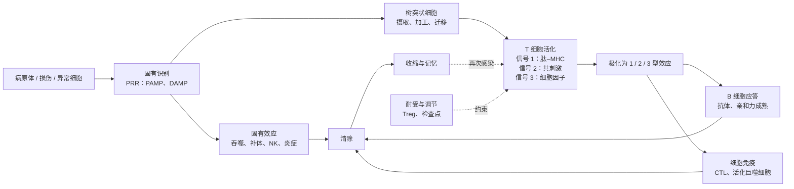

免疫学常给人"名字太多"的印象：几百个 CD 分子、几十个白细胞介素、十几种 T 细胞亚群。但这些名字服务于少数几个问题：谁在识别、识别什么、识别之后怎样决定、用什么效应清除、清除之后怎样记住并收场。本章是全课程的地图。它先给出免疫系统的组成和功能（§1.1），再讲两类免疫应答的分工（§1.2）和解释适应性免疫的核心理论——克隆选择学说（§1.3），用几个关键发现说明这些概念是怎样被认识的（§1.4），最后给出贯穿全课程的知识路径（§1.5）和免疫相关疾病的分类（§1.6）。以后每一章的引言都会说明它在这条路径上的位置。

免疫学建立在前面几门课程的基础上：抗体的结构与配体结合见 [7.1.7](/7.1.7)，抗原受体基因的 **V(D)J 重排**见 [7.2.9](/7.2.9)，信号转导见 [7.3.18](/7.3.18)、[7.3.19](/7.3.19)，**细胞凋亡**与**炎症小体**见 [7.3.25](/7.3.25)，血液中的白细胞与**炎症**的生理学见 [7.14.11](/7.14.11)，病毒怎样被宿主的**模式识别受体**和**干扰素**限制见 [7.11.27](/7.11.27)，**疫苗**的类型见 [7.11.28](/7.11.28)。本课程把这些零散的知识组织成一个系统。

## 1.1. 免疫与免疫系统

### 1.1.1. 免疫的含义

"免疫"一词来自拉丁文 *immunitas*，原指免除赋税和徭役，后来指免于疫病：从天花中幸存的人不会再患天花。现代的含义更宽：免疫是机体识别"自己"与"非己"、并排除"非己"的全部生物学效应。"非己"既包括入侵的**病原体**，也包括体内出现的异常成分（肿瘤细胞、衰老和死亡的细胞）；"排除"也不总是杀伤，很多时候是忍耐——对自身组织、食物和共生菌不起反应，同样是免疫系统的主动功能。

**定义 1.1.1（免疫系统）** **免疫系统**是机体执行免疫功能的器官、细胞和分子的总和。

| 层次 | 组成 | 详见 |
|---|---|---|
| 免疫器官 | 中枢：骨髓、胸腺；外周：淋巴结、脾、黏膜相关淋巴组织、皮肤相关淋巴组织 | [7.15.3](/7.15.3) |
| 免疫细胞 | 淋巴细胞（T 细胞、B 细胞、NK 细胞、固有淋巴细胞）；髓系细胞（单核细胞与巨噬细胞、中性粒细胞、嗜酸性与嗜碱性粒细胞、肥大细胞、树突状细胞） | [7.15.2](/7.15.2) |
| 膜型分子 | 抗原受体（TCR、BCR）、CD 分子、黏附分子、MHC 分子、细胞因子受体、模式识别受体 | [7.15.4](/7.15.4)、[7.15.6](/7.15.6) |
| 分泌型分子 | 抗体、补体、细胞因子、趋化因子 | [7.15.9](/7.15.9)–[7.15.11](/7.15.11) |

免疫系统没有一个中心器官。它的细胞分散在全身，在血液、淋巴和组织之间不断迁移，靠细胞接触和可溶性分子交换信息。正因为分散，"在哪里"与"是什么"同样重要：同一个细胞在淋巴结的 T 细胞区和在发炎的皮肤中做的事情不同（[7.15.22](/7.15.22)）。

### 1.1.2. 三项基本功能

**定义 1.1.2** 免疫系统有三项基本功能：

- **免疫防御**：阻止病原体入侵，清除已入侵的病原体及其毒素；
- **免疫监视**：发现并清除体内出现的"非己"成分，如突变产生的肿瘤细胞和被病毒感染的细胞；
- **免疫自稳**：通过对自身成分的免疫耐受和免疫调节维持内环境的稳定，包括清除衰老、死亡的细胞。

三项功能各有其"失效模式"，这也是理解免疫病的提纲（§1.6）：防御不足导致反复感染，防御过度导致超敏反应；监视失败使肿瘤得以生长；自稳失败导致自身免疫病。

**注 1.1.1** 免疫应答是一把双刃剑。清除病原体的同一套机制——中性粒细胞释放的蛋白酶与活性氧、细胞毒性 T 细胞的穿孔素、补体的攻膜复合体——不区分敌我造成的组织损伤。许多感染的症状（发热、肿胀、肺炎中的渗出）主要来自宿主自己的应答，而不是病原体本身（[7.15.7](/7.15.7)）。因此免疫系统的每一种效应都配有相应的约束：阈值、负反馈和专门的抑制性细胞（[7.15.25](/7.15.25)）。

## 1.2. 两类免疫应答

### 1.2.1. 固有免疫与适应性免疫

**定义 1.2.1（免疫应答）** 免疫系统识别抗原或危险信号后，免疫细胞被活化、增殖、分化并产生效应、最终清除抗原的全过程称为**免疫应答**。

脊椎动物的免疫应答由两套在演化上、机制上都不同的系统共同完成。

**定义 1.2.2（固有免疫）** **固有免疫**是生来就有、不依赖于事先接触的防御：它的细胞用种系编码的受体识别一类病原体共有的分子模式，在感染后数分钟到数小时内起作用，应答的强度不因再次接触同一病原体而显著提高。

**定义 1.2.3（适应性免疫）** **适应性免疫**是由 T 细胞和 B 细胞执行的防御：每个淋巴细胞带有一种经体细胞基因重排产生的、几乎独一无二的抗原受体，只有被抗原选中的细胞才活化、增殖并分化为效应细胞，应答需要数天才达到高峰，并留下记忆。

固有免疫的识别依赖**模式识别受体**对**病原体相关分子模式**的识别（[7.15.6](/7.15.6)），适应性免疫的识别依赖淋巴细胞的抗原受体对具体**抗原**分子上**表位**的识别。

| 特征 | 固有免疫 | 适应性免疫 |
|---|---|---|
| 主要细胞 | 上皮细胞、吞噬细胞、树突状细胞、NK 细胞、固有淋巴细胞、肥大细胞；固有样淋巴细胞（γδ T、NKT、B-1） | αβ T 细胞、B 细胞（B-2） |
| 主要分子 | 补体、抗菌肽、急性期蛋白、细胞因子 | 抗体、细胞因子 |
| 识别受体 | 模式识别受体：种系编码，数量有限（人约百余种），每种细胞表达许多种 | 抗原受体：体细胞重排产生，组库约 $10^{8}$ 种以上，每个细胞只表达一种 |
| 识别对象 | 一类微生物共有的保守结构（脂多糖、双链 RNA） | 蛋白质、多糖等分子上的特定表位；T 细胞识别 MHC 分子提呈的肽 |
| 时相 | 即刻至约 96 h | 约 4–7 天后达到效应期 |
| 克隆扩增 | 无 | 有：被选中的克隆扩增 $10^{3}$–$10^{5}$ 倍 |
| 记忆 | 一般无（训练免疫是有限的例外，[7.15.6](/7.15.6)） | 有：再次应答更快、更强 |
| 自身与非己 | 靠受体只识别微生物特有的结构 | 靠发育中的选择与外周调节获得耐受 |
| 演化 | 所有多细胞动物、植物都有 | 只见于有颌脊椎动物（基于 RAG）；无颌类有独立演化的另一套 |

两套系统的差别可以概括为"预先编好的有限识别"与"随机生成、事后挑选的无限识别"。前者快而粗，后者慢而精。

### 1.2.2. 适应性免疫的特征：特异性、记忆与耐受

适应性免疫有三个经典特征，都可以用一组简单的免疫实验看到。给动物注射抗原 A，约一周后血清中出现针对 A 的抗体（以 IgM 为主），随后逐渐下降，这是**初次免疫应答**。数周或数月后再注射 A，抗体在一两天内迅速升高，峰值高得多、持续更久、以 IgG 为主、亲和力更高，这是**再次免疫应答**。如果第二次同时注射一种新抗原 B，机体对 B 的应答仍然是初次应答的样子。

| 特征 | 初次应答 | 再次应答 |
|---|---|---|
| 潜伏期 | 约 5–7 天 | 1–3 天 |
| 抗体峰值 | 低 | 高（常高 10 倍以上） |
| 持续时间 | 短 | 长 |
| 主要抗体类别 | IgM | IgG（黏膜处为 IgA） |
| 平均亲和力 | 低 | 高（亲和力成熟） |
| 应答的细胞 | 初始淋巴细胞 | 记忆细胞 |

这个实验同时说明了三点：应答针对 A 而不针对 B（特异性）；机体"记住"了第一次接触（记忆）；记忆也是特异的。

**定义 1.2.4（免疫记忆）** 机体在初次接触抗原后，再次接触同一抗原时产生更快、更强、更持久应答的能力称为**免疫记忆**。它的细胞基础是初次应答后留下的、数量多于初始前体的长寿记忆细胞，以及持续分泌抗体的长寿浆细胞。

第三个特征是**免疫耐受**：适应性免疫的受体是随机生成的，必然有一部分能识别自身成分；机体通过淋巴细胞发育中的选择和外周的调节，使它们不对自身发生有害的应答（[7.15.24](/7.15.24)）。耐受和记忆一样是习得的，而不是由种系基因直接写定的——这是 §1.3 中克隆选择学说最重要的推论之一。

### 1.2.3. 体液免疫与细胞免疫

适应性免疫按效应方式分为两支。

**定义 1.2.5** 由 B 细胞分化的浆细胞分泌抗体、通过抗体清除抗原的应答称为**体液免疫**；由 T 细胞直接执行的应答——细胞毒性 T 细胞杀伤靶细胞、辅助性 T 细胞分泌细胞因子活化其他细胞——称为**细胞免疫**。

两者的名字来自历史：抗体存在于血清（"体液"）中，可以把免疫力随血清转移给另一个体；而有些免疫力只能随淋巴细胞转移。分工的逻辑在于病原体所处的位置：

| | 体液免疫 | 细胞免疫 |
|---|---|---|
| 效应分子或细胞 | 抗体（及其募集的补体、吞噬细胞、NK 细胞） | CTL、Th 细胞及其活化的巨噬细胞 |
| 能到达的病原体 | 细胞外：血液、组织液、黏膜表面的细菌、病毒颗粒、毒素 | 细胞内：被病毒感染的细胞、在巨噬细胞内存活的细菌；肿瘤细胞 |
| 识别 | 抗体识别抗原分子表面的天然构象 | TCR 识别 MHC 分子提呈的肽 |
| 被动转移 | 可随血清转移 | 只能随 T 细胞转移 |

两支并不独立：大多数抗体应答需要辅助性 T 细胞的帮助（[7.15.20](/7.15.20)），而抗体又能把细胞外的病原体送进吞噬细胞，使 T 细胞得以看到它们。

### 1.2.4. 两套系统的协作

固有免疫和适应性免疫不是先后接力的两道防线，而是同一应答的两个层次。固有免疫争取时间：病原体可以每 20–60 min 倍增一次，而淋巴细胞的克隆扩增要好几天（§1.3.4），这段时间必须由屏障、吞噬细胞、补体和干扰素把感染控制住。固有免疫还决定适应性应答的方向：树突状细胞在感染部位摄取抗原并通过模式识别受体判断"是什么类型的威胁"，然后迁移到淋巴结，把抗原和这一判断一起交给 T 细胞——提呈的肽决定"针对谁"，共刺激分子和细胞因子决定"要不要应答、用哪一种效应"（[7.15.14](/7.15.14)、[7.15.16](/7.15.16)）。反过来，适应性免疫的产物大多借助固有效应发挥作用：抗体激活补体、使病原体被吞噬（**调理作用**），Th1 细胞使巨噬细胞的杀菌能力大大增强。

## 1.3. 克隆选择学说

### 1.3.1. 从侧链学说到克隆选择

19 世纪末人们已经知道，血清中的抗毒素能特异地中和一种毒素。问题是：机体怎样为从未见过的分子造出恰好互补的分子？

1897 年 Ehrlich 提出侧链学说：细胞表面本来就带有各种"侧链"（受体），毒素结合其中一种后，细胞大量合成这种侧链并释放到血液中，就是抗毒素。这是"选择"思想的雏形，但后来 Landsteiner 证明，人工合成的、自然界不存在的化学基团也能诱导特异的抗体，人们难以相信细胞预先带有针对一切人造分子的受体。于是 20 世纪 30–50 年代流行"指令学说"：抗原作为模板，使抗体多肽在它周围折叠成互补的形状。指令学说无法解释再次应答比初次应答更强、抗体在抗原消失后仍能长期产生，也与蛋白质的氨基酸序列决定其构象这一事实矛盾。

1955 年 Jerne 提出血清中预先存在各种天然抗体、抗原只是选择它们；1957 年 Burnet（以及 Talmage）把选择的单位从分子换成细胞。

**定义 1.3.1（克隆选择学说）** **克隆选择学说**认为：

1. 每个淋巴细胞只带有一种特异性的抗原受体，体内预先存在识别各种抗原的、数量巨大的淋巴细胞克隆；
2. 抗原与受体结合，选择并活化恰好能识别它的淋巴细胞；
3. 被活化的细胞增殖，其子代（一个克隆）带有与亲代相同的受体，分化为效应细胞和记忆细胞；
4. 在发育早期识别自身抗原的淋巴细胞被清除或失活，因此成熟的淋巴细胞库对自身耐受。

### 1.3.2. 克隆选择的推论与证据

克隆选择学说是免疫学最重要的理论，它把免疫学的主要现象都归结为细胞群体的选择与增殖：

- 特异性：只有受体互补的克隆被扩增。每个 B 细胞只分泌一种抗体，其特异性与它的膜受体相同；这在 1970 年代被单个细胞的抗体测定和单克隆抗体证实。
- 记忆：扩增后的克隆比初始前体多得多，其中一部分长期存活，所以再次应答起点更高、潜伏期更短。
- 耐受是习得的：1945 年 Owen 发现共用胎盘血液循环的异卵双生牛终身带有对方的红细胞而不排斥（血细胞嵌合）。Burnet 与 Fenner 据此预言，在免疫系统成熟前接触的抗原会被永久视为"自身"；1953 年 Medawar 等给新生小鼠注射另一品系的细胞，这些小鼠成年后接受该品系的皮肤移植，证实了预言（1960 年诺贝尔奖）。
- 多样性之谜：如果每种特异性对应一个克隆、每个克隆的受体由一个基因编码，人类基因组装不下 $10^{8}$ 种以上的受体。答案是抗原受体基因由片段在体细胞中重排拼接而成（Tonegawa，1976），这把克隆选择从假说变成了分子机制（[7.15.12](/7.15.12)）。

克隆选择是达尔文式的：先随机产生变异（受体多样性），再由环境（抗原）选择，被选中者繁殖。生发中心中的亲和力成熟（[7.15.20](/7.15.20)）在一个应答之内重复这一过程，是体细胞层面的"演化"。

### 1.3.3. 免疫网络学说

**定义 1.3.2（免疫网络学说）** 1974 年 Jerne 提出的**免疫网络学说**认为：抗体与淋巴细胞受体的可变区本身也是抗原（其独特的抗原决定簇称为独特型），能被另一些抗体识别（抗独特型抗体），后者又可被第三组识别；淋巴细胞库因此是一个相互识别、相互刺激与抑制的网络，即使没有外来抗原也处于动态平衡中，外来抗原打破平衡引起应答。

网络学说预言了"内影像"：一部分抗独特型抗体（Ab2β）的结合部位在形状上模拟原来的抗原，可以代替抗原诱导针对它的抗体。独特型相互作用确实存在，但作为免疫调节的主要机制，它没有得到后来实验的支持；现代免疫学中的调节主要由调节性 T 细胞、抑制性受体和细胞因子网络承担（[7.15.25](/7.15.25)）。网络学说留下的影响是一种思路：把免疫系统看作一个自我参照的动态系统，而不只是对外界的被动反应。

### 1.3.4. 数量级：一个克隆要扩增多少

克隆选择有一个直接的定量后果。设成人体内约有 $N \approx 10^{11}$ 个初始 T 细胞，识别某一个肽–MHC 复合物的初始前体的频率为 $f$，实测在 $10^{-6}$–$10^{-5}$ 量级，于是全身只有 $fN \approx 10^{5}$–$10^{6}$ 个前体，而在一个引流淋巴结里同时能找到的往往只有几个到几十个。要清除一个播散的病毒感染，需要的效应细胞以 $10^{7}$–$10^{9}$ 计（在急性感染中，针对一个优势表位的 CD8⁺ T 细胞可占全部 CD8⁺ T 细胞的百分之几到十几），即每个前体要扩增 $10^{3}$–$10^{5}$ 倍。

**例 1.3.1** 设一个淋巴结中有 $n_0$ 个前体被活化，活化后经过约一天的延迟开始分裂，每次分裂的间隔为 $\tau$，则 $t$ 时刻的克隆大小为

$$
n(t) = n_0 \cdot 2^{(t - t_{\mathrm{lag}})/\tau}, \qquad t > t_{\mathrm{lag}}.
$$

达到效应所需的细胞数 $n^*$ 需要的分裂次数为 $k = \log_2(n^*/n_0)$。取 $n_0 = 10$、$n^* = 10^{6}$，则 $k = \log_2 10^{5} \approx 17$；活化的 CD8⁺ T 细胞每 6–8 h 分裂一次，17 次分裂需要 4–6 天，加上延迟约一周，与初次 T 细胞应答在感染后第 7–10 天达到高峰相符。前体多 10 倍只节省 $\log_2 10 \approx 3.3$ 次分裂，约一天。

作为对照，倍增时间为 1 h 的细菌在一周内若不受限制可增殖 $2^{168}$ 倍。这个数量级上的对比说明了两点：适应性应答之所以慢，是因为它从极少的前体开始；而在它赶到之前，固有免疫必须把病原体压在可控的水平（§1.2.4）。记忆细胞的意义也一目了然：再次应答的前体频率高 $10^{2}$–$10^{3}$ 倍，并且分化得更快，于是潜伏期缩短到一两天。

:::

这个计算把"初始前体频率"（[3.1](/3.1) 中的小概率事件）和"指数增长"（[2.4](/2.4) 中的线性方程）联系起来；T 细胞应答真实的扩增、收缩与记忆形成的动力学见 [7.15.18](/7.15.18)，前体怎样在淋巴结中找到提呈抗原的树突状细胞见 [7.15.3](/7.15.3)。

## 1.4. 免疫学简史：用发现解释概念

免疫学的主要概念大都可以追溯到一个关键实验。下表不按年代罗列人物，而是把每一项发现和它奠定的概念、在本课程中的位置对应起来。

| 年代 | 发现 | 奠定的概念 | 章节 |
|---|---|---|---|
| 16 世纪（中国）；1796 | 人痘接种；Jenner 用牛痘预防天花 | 人为诱导的保护性免疫；接种 | [7.15.33](/7.15.33) |
| 1880–1885 | Pasteur 的鸡霍乱、炭疽与狂犬病减毒疫苗 | 减毒病原体诱导主动免疫 | [7.15.33](/7.15.33) |
| 1882 | Metchnikoff 观察到海星幼虫的游走细胞吞噬异物 | 吞噬细胞与细胞免疫学说 | [7.15.5](/7.15.5) |
| 1890 | von Behring 与北里柴三郎：抗毒素血清治疗白喉、破伤风 | 抗体；被动免疫；体液免疫学说 | [7.15.9](/7.15.9) |
| 1890 年代 | Bordet：血清中不耐热的成分协助抗体溶菌 | 补体 | [7.15.10](/7.15.10) |
| 1900–1901 | Landsteiner 发现 ABO 血型 | 同种抗原；输血配型 | [7.15.27](/7.15.27) |
| 1902 | Richet 与 Portier 描述全身性过敏反应 | 免疫应答可造成损伤 | [7.15.26](/7.15.26) |
| 1939 | Tiselius 与 Kabat：抗体位于血清的 γ 球蛋白组分 | 免疫球蛋白 | [7.15.9](/7.15.9) |
| 1945–1953 | Owen 的嵌合牛；Medawar 的新生期耐受 | 耐受是习得的 | [7.15.24](/7.15.24) |
| 1957 | Burnet 的克隆选择学说 | 克隆选择（§1.3） | 全课程 |
| 1959–1960 年代 | Porter 与 Edelman 解析抗体结构 | 重链、轻链、Fab 与 Fc | [7.15.9](/7.15.9) |
| 1960 年代 | Gowans 证明小淋巴细胞再循环并介导应答；Miller 发现胸腺的功能；鸡法氏囊与 B 细胞 | T 细胞与 B 细胞两个谱系；淋巴细胞再循环 | [7.15.2](/7.15.2)、[7.15.3](/7.15.3) |
| 1930–1970 年代 | Snell 的小鼠 H-2、Dausset 的 HLA、Benacerraf 的免疫应答基因 | 主要组织相容性复合体 | [7.15.13](/7.15.13) |
| 1973 | Steinman 与 Cohn 发现树突状细胞 | 启动初始 T 细胞应答的细胞 | [7.15.14](/7.15.14) |
| 1974 | Zinkernagel 与 Doherty | MHC 限制性 | [7.15.13](/7.15.13) |
| 1975 | Köhler 与 Milstein 的杂交瘤 | 单克隆抗体 | [7.15.9](/7.15.9) |
| 1976 | Tonegawa：免疫球蛋白基因在体细胞中重排 | 抗原受体的多样性 | [7.15.12](/7.15.12) |
| 1984 | Davis、Hedrick 与 Mak 等克隆 TCR 基因 | T 细胞受体 | [7.15.12](/7.15.12) |
| 1986 | Mosmann 与 Coffman 区分 Th1 与 Th2 | 辅助性 T 细胞亚群 | [7.15.17](/7.15.17) |
| 1989–1998 | Janeway 的模式识别假说；果蝇 Toll 抗真菌（1996）；TLR4 识别脂多糖（1998） | 模式识别受体 | [7.15.6](/7.15.6) |
| 1995–2003 | Sakaguchi 的 CD25⁺ 调节性 T 细胞；FOXP3 突变导致致死性自身免疫 | 外周耐受（2025 年诺贝尔奖） | [7.15.24](/7.15.24) |
| 1990 年代–2010 年代 | Allison 与本庶佑：CTLA-4 与 PD-1 的阻断 | 免疫检查点治疗 | [7.15.25](/7.15.25)、[7.15.30](/7.15.30) |

两条线索值得注意。第一，19 世纪末的"细胞学派"（Metchnikoff）与"体液学派"（Ehrlich、von Behring）之争，实际上对应今天固有免疫与适应性免疫、细胞免疫与体液免疫的分工，两派在 1908 年共获诺贝尔奖。第二，固有免疫在很长时间里被当作"非特异"的背景，直到 1989 年 Janeway 指出：适应性免疫需要一个判断"是否危险"的前置系统，这个系统必须靠识别微生物特有的分子模式来工作。这一思路随 Toll 样受体的发现被证实（2011 年诺贝尔奖与树突状细胞的发现共享），也使本课程把固有免疫放在适应性免疫之前讲。

## 1.5. 知识路径

### 1.5.1. 五个问题

一个免疫应答依次回答五个问题。每个问题对应一组细胞和分子；记住问题，名字就有了归属。

| 问题 | 内容 | 主要参与者 | 章节 |
|---|---|---|---|
| 1. 谁在识别、识别什么 | 固有识别：模式识别受体对微生物模式与损伤信号；适应性识别：BCR 对抗原的天然构象，TCR 对 MHC 提呈的肽 | PRR；抗原、抗体、TCR、MHC | 5–6、8–9、12–14 |
| 2. 识别之后怎样决定 | 是否应答（耐受还是免疫）、应答的类型（1、2、3 型）、应答的规模 | 树突状细胞；共刺激分子、细胞因子；T 细胞的活化与分化 | 11、14、16–17 |
| 3. 用什么效应清除 | 吞噬与杀菌、补体、抗体、细胞毒性杀伤、炎症 | 巨噬细胞、中性粒细胞、NK、CTL；抗体、补体 | 7、10、17、21 |
| 4. 怎样记住 | 记忆 T 与 B 细胞、长寿浆细胞；亲和力成熟 | 生发中心；记忆亚群 | 18、20 |
| 5. 怎样关闭与约束 | 抗原清除后应答收缩；耐受；抑制性受体与调节性细胞 | Treg、PD-1、CTLA-4；凋亡 | 24–25 |

问题 1–5 合起来是一条完整的应答路径；第 22 章把它放回身体的空间与时间中走一遍，第 26–33 章讨论这条路径在哪里出错（疾病）以及怎样人为地利用它（疫苗与治疗）。

### 1.5.2. 三种效应模块：1、2、3 型免疫

适应性和固有效应细胞的名字之所以多，是因为同一种逻辑在不同的细胞类型中重复出现：病原体的类型决定需要哪一种效应，每一种效应都由一组配套的固有细胞、T 细胞亚群、细胞因子和抗体类别共同执行。现代免疫学把它们归为三个模块。

**定义 1.5.1** 按所对付的病原体与所用的效应机制，免疫应答分为三种效应模块：

- **1 型免疫**：针对胞内病原体（病毒、胞内菌、部分原虫）和肿瘤，核心细胞因子是 IFN-γ（并有 IL-12 诱导），由 ILC1 与 NK 细胞、Th1 细胞、CTL 执行，效应是活化巨噬细胞和杀伤被感染的细胞；
- **2 型免疫**：针对蠕虫等大型寄生虫与毒素，并参与组织修复，核心细胞因子是 IL-4、IL-5、IL-13，由 ILC2、Th2 细胞执行，效应是 IgE、嗜酸性粒细胞、肥大细胞、黏液分泌与平滑肌收缩；
- **3 型免疫**：针对胞外细菌与真菌，核心细胞因子是 IL-17 与 IL-22（并有 IL-23 诱导），由 ILC3、Th17 细胞执行，效应是募集中性粒细胞和增强上皮屏障与抗菌肽。

| | 1 型 | 2 型 | 3 型 |
|---|---|---|---|
| 主要对象 | 病毒、胞内菌、肿瘤 | 蠕虫、毒素；组织修复 | 胞外细菌、真菌 |
| 诱导信号 | IL-12、I 型干扰素 | IL-25、IL-33、TSLP（上皮"警报素"） | IL-1β、IL-6、IL-23、TGF-β |
| 固有淋巴细胞 | ILC1、NK 细胞 | ILC2 | ILC3 |
| CD4⁺ T 细胞亚群 | Th1 | Th2 | Th17 |
| 主调控因子 | T-bet | GATA3 | RORγt |
| 效应细胞因子 | IFN-γ、TNF | IL-4、IL-5、IL-13 | IL-17A/F、IL-22 |
| 抗体 | 调理与补体结合的 IgG 亚类 | IgE、IgG4（人）/IgG1（小鼠） | IgA、IgG |
| 效应细胞 | 活化的巨噬细胞、CTL | 嗜酸性粒细胞、肥大细胞、嗜碱性粒细胞、交替活化的巨噬细胞 | 中性粒细胞 |
| 失调时的疾病 | 某些器官特异性自身免疫、肉芽肿性炎症 | 过敏、哮喘 | 银屑病、部分炎症性肠病 |

三个模块互相抑制：IFN-γ 抑制 Th2 的分化，IL-4 抑制 Th1 的分化（[7.15.17](/7.15.17) 用双稳态模型讨论这种"二选一"）。因此一个应答通常以一种模块为主。辅助 B 细胞的 Tfh 细胞与起约束作用的 Treg 不属于任何一个模块，而是横跨三者。每当遇到一个新的细胞因子或细胞亚群，先问它属于哪个模块、在五个问题中的哪一个，就能把它放到地图上。

### 1.5.3. 全课程的读法

| 部分 | 章 | 回答的问题 |
|---|---|---|
| 全景 | 1–4 | 系统的组成：细胞、器官、表面分子与迁移 |
| 固有免疫 | 5–7 | 问题 1、3 的固有部分：屏障、细胞、模式识别、炎症 |
| 识别分子 | 8–12 | 问题 1、3：抗原、抗体、补体、细胞因子、受体基因的多样性 |
| MHC 与提呈 | 13–14 | 问题 1、2：T 细胞看见什么、由谁展示 |
| T 细胞 | 15–18 | 问题 2–4：发育与选择、活化、效应亚群、记忆 |
| B 细胞与抗体效应 | 19–21 | 问题 2–4：B 细胞发育、生发中心、抗体的效应 |
| 整合与调节 | 22–25 | 应答的时空、黏膜免疫、耐受、免疫调节（问题 5） |
| 疾病与应用 | 26–33 | 超敏反应、自身免疫、移植、肿瘤、免疫缺陷、感染、疫苗 |
| 方法与标志物 | 34–36 | 实验技术、免疫表型与标志物图谱、课程总结 |

第 1–25 章是路径的主干，按顺序阅读；第 26–33 章可以按兴趣选读，每章开头都会指出它依赖主干的哪几章。需要查分子名称时，细胞因子见 [7.15.11](/7.15.11) 的总表，CD 分子见 [7.15.4](/7.15.4)（按功能）与 [7.15.35](/7.15.35)（按细胞谱系）。

## 1.6. 免疫与疾病

免疫系统的组成或功能异常引起的疾病统称免疫性疾病。按"应答出了什么错"可分为三类：

| 类型 | 机制 | 例子 | 章节 |
|---|---|---|---|
| 过弱 | 免疫细胞或分子的先天缺陷，或感染、药物、营养不良造成的继发缺陷 | 重症联合免疫缺陷、艾滋病；反复的机会性感染 | [7.15.31](/7.15.31) |
| 过强 | 对无害抗原或过度的应答 | 过敏与哮喘（超敏反应）、细胞因子风暴 | [7.15.26](/7.15.26)、[7.15.27](/7.15.27) |
| 错向 | 对自身抗原失去耐受 | 1 型糖尿病、类风湿关节炎、系统性红斑狼疮 | [7.15.28](/7.15.28) |
| 应答不足以清除 | 病原体或肿瘤逃避识别与效应 | 慢性感染、肿瘤免疫逃逸 | [7.15.30](/7.15.30)、[7.15.32](/7.15.32) |
| 应答针对移植物 | 对同种异型抗原的应答 | 移植排斥、移植物抗宿主病 | [7.15.29](/7.15.29) |

免疫学在临床上的作用有三个方面。免疫诊断：抗原抗体反应的高度特异性使抗体成为检测分子的通用工具，从血型鉴定、感染的血清学诊断、自身抗体谱到流式细胞术的 CD4⁺ T 细胞计数（[7.15.34](/7.15.34)）。免疫预防：通过**疫苗**诱导免疫记忆，人类以此在 1980 年宣布消灭了天花，这是迄今唯一被消灭的人类传染病（[7.15.33](/7.15.33)）。免疫治疗：单克隆抗体药物（如抗 TNF-α、抗 IL-4Rα、抗 IL-12/23 p40 的抗体治疗慢性炎症，抗 PD-1 抗体治疗肿瘤）已成为销售额最大的一类药物；造血干细胞移植、嵌合抗原受体 T 细胞等细胞治疗也已进入常规临床。这些疗法的原理都来自本课程主干中的某一环，在相应章节讲到。

## 小结

- **免疫系统**由免疫器官、细胞和分子组成，执行**免疫防御**、**免疫监视**和**免疫自稳**三项功能（定义 1.1.2）；免疫应答是一把双刃剑，每一种效应都需要约束（注 1.1.1）。
- **免疫应答**分为两个层次：

  | | **固有免疫** | **适应性免疫** |
  |---|---|---|
  | 受体 | 种系编码的模式识别受体 | 体细胞重排的抗原受体，每个细胞一种 |
  | 速度 | 数分钟至数小时 | 数天 |
  | 克隆扩增与记忆 | 无 | 有 |
  | 作用 | 控制早期感染，决定适应性应答的方向 | 特异清除，留下记忆 |

- 适应性免疫的三个特征是特异性、**免疫记忆**（定义 1.2.4）和习得的**免疫耐受**；按效应方式分为**体液免疫**与**细胞免疫**（定义 1.2.5），分工取决于病原体在细胞外还是细胞内。
- **克隆选择学说**（定义 1.3.1）把特异性、记忆和耐受都归结为淋巴细胞克隆的选择与增殖；前体频率只有 $10^{-6}$–$10^{-5}$，克隆需要扩增 $10^{3}$–$10^{5}$ 倍、经历十几次分裂，这决定了初次应答需要约一周（例 1.3.1）。**免疫网络学说**（定义 1.3.2）提出了独特型网络，但不是调节的主要机制。
- 知识路径：识别 → 决策 → 效应 → 记忆 → 约束五个问题，以及 **1 型免疫**（IFN-γ，胞内病原体）、**2 型免疫**（IL-4/5/13，寄生虫与过敏）、**3 型免疫**（IL-17/22，胞外细菌与真菌）三个效应模块（定义 1.5.1）。
- 免疫性疾病按"过弱、过强、错向、不足以清除、针对移植物"分类，对应第 26–33 章。

## 思考题

1. 为什么说固有免疫"决定"适应性免疫的方向？举出一个具体的环节。

   **答** 初始 T 细胞只有在树突状细胞同时提供肽–MHC（信号 1）和共刺激分子（信号 2）时才被活化，而树突状细胞表达共刺激分子、分泌哪一种细胞因子（信号 3），取决于它的模式识别受体感知到了什么：识别病毒核酸后产生 IL-12 与 I 型干扰素，使 T 细胞向 Th1（1 型）分化；上皮受损释放 IL-33、TSLP 时倾向 Th2（2 型）。没有固有识别，抗原本身通常诱导耐受而不是免疫。

2. 指令学说为什么不能解释再次应答？克隆选择学说怎样解释？

   **答** 按指令学说，抗原作为模板直接塑造抗体，抗体的量应只取决于当时存在的抗原量，第二次注射同样多的抗原不应引起更快、更强的应答，也无法解释抗原清除后抗体仍长期产生。按克隆选择学说，第一次应答把识别该抗原的克隆扩增了成百上千倍并留下记忆细胞，第二次应答从多得多的前体开始，且记忆细胞活化更快，因此潜伏期短、峰值高。

3. 利用例 1.3.1 的模型估计：如果记忆细胞使前体数增加 $10^{3}$ 倍、并且分裂前的延迟从 1 天缩短到 0.5 天，再次应答到达同样效应规模的时间提前多少？（取倍增时间 7 h。）

   **答** 前体增加 $10^{3}$ 倍节省 $\log_2 10^{3} \approx 10$ 次分裂，即约 $10 \times 7\,\mathrm{h} = 70\,\mathrm{h} \approx 2.9$ 天；延迟再缩短 0.5 天，共提前约 3.4 天。原来约需 $1 + 17 \times 7/24 \approx 6$ 天，再次应答约需 2.6 天，与"潜伏期 1–3 天"相符。实际的再次应答还因为记忆细胞分布更广（包括组织驻留记忆细胞）而更快。

4. 把以下效应归入 1、2、3 型免疫：嗜酸性粒细胞脱颗粒杀伤蠕虫幼虫；中性粒细胞被募集到皮肤的葡萄球菌感染处；巨噬细胞被活化后杀死胞内的结核分枝杆菌；肠道杯状细胞分泌大量黏液。

   **答** 嗜酸性粒细胞杀伤蠕虫与杯状细胞分泌黏液属于 2 型（IL-5 募集嗜酸性粒细胞，IL-13 诱导杯状细胞增生与黏液分泌）；中性粒细胞募集到胞外细菌感染处属于 3 型（IL-17 诱导上皮与基质细胞产生募集中性粒细胞的趋化因子）；巨噬细胞活化杀死胞内菌属于 1 型（IFN-γ 活化巨噬细胞）。

5. （开放题）适应性免疫只出现在脊椎动物中，而所有动物都有固有免疫。从代价与收益的角度讨论，为什么适应性免疫没有取代固有免疫？

   **答** 要点：（1）时间：适应性应答从极少的前体开始，需要数天扩增，固有免疫是不可替代的早期控制；（2）判断：随机生成的受体本身不知道抗原是否危险，需要固有系统提供"危险"信号，否则自身反应和对无害抗原的应答无法控制；（3）代价：维持巨大的淋巴细胞库、随机重排带来的自身免疫与淋巴瘤风险都很高，对寿命短、体型小的动物不合算；（4）适应性免疫的效应大多仍借助固有机制（补体、吞噬、炎症）。所以两者是分工协作而非替代关系。
