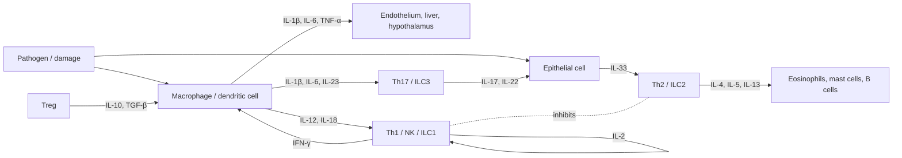

The preceding chapters covered recognition ([7.15.6](/7.15.6), [7.15.8](/7.15.8)) and effector functions ([7.15.7](/7.15.7), [7.15.9](/7.15.9), [7.15.10](/7.15.10)). What connects these steps? Cytokines. The immune system consists of cells scattered throughout the body, numbering in the trillions, and it has no dedicated wiring like the nervous system; cells pass "alarms" (TNF-α, IL-1β), "instructions" (IL-12 and IL-4, which decide in which direction a lymphocyte differentiates), "growth signals" (IL-2, IL-7) and "regulatory signals" (IL-10, TGF-β) to one another by secreting small protein molecules. This chapter gives the molecular part of the answer to the question "how is the decision made after recognition?" on the path of knowledge ([7.15.1](/7.15.1)): the content of the decision is carried by cytokines and read out by their receptors and signaling.

The names of cytokines are astonishingly numerous, but they need not be memorized one by one. Three threads suffice to make them a system: (1) there are only six receptor families, and different cytokines share receptor chains (the common γ chain is the most typical example), which determines the overlap of functions; (2) by function they fall into five groups, alarm, polarization, growth and differentiation, killing and regulation, and chemotaxis, each corresponding to a step on the path; (3) each of the three effector modules (type 1, type 2 and type 3 immunity) has a characteristic set of cytokines. This chapter first treats general properties and receptors, then gives a summary table of the roughly 30 core cytokines, and finally uses a simple model to explain what it means for cytokines to be "competed for." The functions of chemokines and adhesion molecules were introduced in [7.15.4](/7.15.4); here only their receptors and signaling are covered.

## 11.1. Definition and Functional Properties of Cytokines

### 11.1.1. Definition and Modes of Action

**Definition 11.1.1 (Cytokine)** **Cytokines** are small soluble proteins (relative molecular mass about $8$–$30\ \mathrm{kDa}$) synthesized and secreted by immune cells and some nonimmune cells, which regulate the proliferation, differentiation and function of cells by binding specific receptors on the surface of target cells.

They differ from classical hormones in that the producing cells are not concentrated in endocrine glands: scattered cells synthesize them only when stimulated. They usually act locally, over short distances and with short half-lives (minutes). They act at extremely low concentrations (picomolar to nanomolar), and their receptors have very high affinity ($K_\mathrm{D}$ about $10^{-10}$–$10^{-12}\ \mathrm{M}$). By the distance of action there are three modes: **autocrine** (acting on the cell that secretes it, such as IL-2 made by a T cell acting on itself), **paracrine** (acting on neighboring cells, the most common mode) and **endocrine** (acting on distant cells through the blood, which only IL-1, IL-6 and TNF-α do at high concentrations, causing systemic effects such as fever and the acute-phase response, see [7.15.7](/7.15.7)). Directed secretion at the immunological synapse lets a cytokine act only on the target cell in contact.

Cytokine synthesis is transient and tightly regulated: transcription is induced by cell activation signals (transcription factors such as NF-κB and NFAT), and the 3′ untranslated region of their mRNA often contains instability sequences that cause rapid degradation, so secretion stops as soon as the signal disappears; some (IL-1β, IL-18) need caspase-1 activation through an inflammasome before they can mature and be secreted ([7.15.6](/7.15.6)).

### 11.1.2. Functional Properties: Pleiotropy, Redundancy, Synergy, Antagonism and Networks

**Definition 11.1.2 (Cytokine Pleiotropy and Redundancy)** The property that one cytokine acts on different target cells and produces different biological effects is called **cytokine pleiotropy**; the property that several different cytokines act on the same target cell and produce the same or similar effects is called **cytokine redundancy**.

"Pleiotropy" here refers to this property of cytokines and is not the same concept as gene pleiotropy (one gene affecting several phenotypes). IL-4 is an example of pleiotropy: on B cells it promotes class switching to IgE, on T cells it promotes Th2 polarization, and on macrophages it induces alternative activation. The molecular basis of redundancy is the sharing of receptor chains: the receptors for IL-2, IL-4, IL-7, IL-9, IL-15 and IL-21 share the **common γ chain**, so that all of them can activate JAK3 and STAT5 and have similar effects on lymphocyte proliferation and survival; IL-6, IL-11, leukemia inhibitory factor and oncostatin M share gp130. Redundancy also explains a common genetic phenomenon: loss of most single cytokines has a mild effect, whereas loss of a shared receptor chain is catastrophic (X-linked severe combined immunodeficiency, §11.6.2).

There are three further kinds of relationship among cytokines:

- Synergy: the effect of two cytokines together is greater than the sum of their separate effects, as when IL-12 and IL-18 synergistically induce IFN-γ secretion by NK cells and Th1 cells.
- Antagonism: one cytokine inhibits the action of another, as IFN-γ inhibits Th2 differentiation and IL-4 inhibits Th1 differentiation, which is also the basis of the mutual exclusion of type 1 and type 2 immunity.
- Network: one cytokine induces the production of others, forming cascades and positive and negative feedback, as TNF-α induces IL-1β and IL-1β induces IL-6; the action of cytokines depends on the overall combination rather than on any single factor.

## 11.2. Classification of Cytokines

Cytokines were first named by function (lymphokines, monokines) and were later grouped into several families by structure and function.

**Definition 11.2.1 (Cytokine Families)** **Interleukins** (IL) originally meant cytokines produced by leukocytes that mediate interactions between leukocytes; they are numbered in order of discovery (there are now about 40, IL-1 to IL-38 and their family members), although many are in fact also produced by other cells. The **tumor necrosis factor** (TNF) family is a group of cytokines that act as trimers on the TNF receptor family and includes TNF-α, lymphotoxin, Fas ligand, CD40 ligand, TRAIL and BAFF. **Colony-stimulating factors** (CSF) are cytokines that stimulate the proliferation of hematopoietic progenitors and their differentiation into colonies of different lineages, and include G-CSF, M-CSF, GM-CSF and IL-3 (erythropoietin and thrombopoietin are also hematopoietic factors of this kind). **Transforming growth factor-β** (TGF-β) is a multifunctional growth factor that in the immune system acts mainly to inhibit and regulate, while also promoting IgA class switching and tissue repair.

Two other large classes have been introduced elsewhere. **Interferons** are divided into type I (IFN-α/β), type II (IFN-γ) and type III (IFN-λ); types I and III are produced mainly by virus-infected cells and plasmacytoid dendritic cells and induce the antiviral state ([7.15.7](/7.15.7), [7.11.27](/7.11.27)), and IFN-γ is produced mainly by NK cells, Th1 cells and CD8⁺ T cells and activates macrophages. **Chemokines** are a family of about 50 members, divided by the arrangement of conserved cysteines into four subfamilies, CC, CXC, CX3C and XC, and control leukocyte migration ([7.15.4](/7.15.4)). The correspondence of IL numbers to function and structure is haphazard: the IL-1 family contains both inflammatory factors (IL-1β, IL-18, IL-33) and a receptor antagonist (IL-1Ra), and the members of the IL-17 and IL-10 families are each structurally independent. This chapter therefore does not list them by number but groups them by function (§11.4).

## 11.3. Cytokine Receptors and Their Signaling

### 11.3.1. Six Receptor Families

**Definition 11.3.1 (Cytokine Receptor)** Transmembrane proteins that bind cytokines specifically and transmit the signal into the cell are called **cytokine receptors**. By structure and signaling mechanism, the cytokine receptors important in immunology fall into six families.

| Family | Structural features | Representative ligands | Signaling |
|---|---|---|---|
| Type I (hematopoietic factor) receptors | Extracellular fibronectin type III domains and a conserved WSXWS motif; mostly heterodimers or heterotrimers containing shared chains (γc, βc, gp130) | IL-2, IL-4, IL-6, IL-7, IL-15, GM-CSF, G-CSF | JAK–STAT |
| Type II (interferon) receptors | Similar to type I, without WSXWS | IFN-α/β, IFN-γ, IFN-λ, IL-10 family | JAK–STAT |
| IL-1 / Toll family | Immunoglobulin-like extracellular domains, intracellular TIR domain | IL-1β, IL-18, IL-33, ligands of Toll-like receptors | MyD88 → NF-κB, MAP kinases |
| TNF receptor family | Extracellular cysteine-rich domains, trimers; some members have an intracellular death domain | TNF-α, Fas ligand, CD40 ligand, TRAIL | TRAF → NF-κB; death domain → caspase cascade |
| Chemokine receptors | Seven-transmembrane G-protein-coupled receptors | Chemokines | Gαi → cell migration |
| TGF-β receptors | Serine/threonine kinases, type I and type II receptors | TGF-β, activin, BMP | SMAD |

JAK–STAT signaling of type I and II receptors (see [7.1.15](/7.1.15)): the intracellular regions of receptors in these two families have no kinase activity of their own and form complexes with the cytoplasmic Janus kinases (JAK1, JAK2, JAK3, TYK2). The cytokine dimerizes or brings together the receptor chains, so that adjacent JAKs phosphorylate each other and become active; JAK phosphorylates the intracellular region of the receptor, which becomes a docking site for the SH2 domains of STAT proteins (STAT1–6); phosphorylated STATs form dimers, enter the nucleus and bind the promoters of target genes. Different combinations of JAK and STAT determine the response: IL-2 activates STAT5 through JAK1/JAK3, IFN-γ activates STAT1 through JAK1/JAK2, IL-4 activates STAT6 through JAK1/JAK3, and IL-6 activates STAT3 through gp130. Signaling is terminated by negative feedback such as SOCS proteins. The generality of JAK–STAT explains why JAK inhibitors can affect many cytokines at the same time (§11.6.3).

The **common γ chain** was mentioned in §11.1.2 and is defined below as a concept in its own right.

**Definition 11.3.2 (Common γ Chain)** The protein encoded by the *IL2RG* gene, a signaling chain shared by the receptors for six cytokines (IL-2, IL-4, IL-7, IL-9, IL-15 and IL-21), is called the **common γ chain** (γc, CD132); it transmits signals by binding JAK3.

The IL-2 receptor is the best example: the high-affinity IL-2 receptor consists of three chains, IL-2Rα (CD25), IL-2Rβ (CD122) and γc ($K_\mathrm{D}$ about 10 pM); the intermediate-affinity receptor with only β and γc has $K_\mathrm{D}$ about 1 nM; the α chain alone has $K_\mathrm{D}$ about 10 nM and transmits no signal. Resting effector T cells express the intermediate-affinity receptor and upregulate CD25 on activation; Tregs constitutively express high levels of CD25 and are very sensitive to low concentrations of IL-2 (§11.5).

The TIR family: IL-1 family receptors and Toll-like receptors share the TIR domain inside the cell, bind the adaptor protein MyD88, and activate NF-κB through IRAK and TRAF6, so the signals of IL-1β and of LPS converge inside the cell ([7.15.6](/7.15.6)). The TNF receptor family binds ligands as trimers: the death domain of TNFR1 recruits TRADD and FADD and can both activate caspase-8, causing apoptosis, and activate NF-κB through TRAF and RIP1, promoting survival and inflammation, the outcome depending on the balance inside the cell (death receptors, see [7.3.25](/7.3.25)); CD40 and the BAFF receptor contain no death domain and transmit costimulatory signals through TRAF. Chemokine receptors inhibit adenylyl cyclase through Gαi and release Gβγ, which activates PI3K and small GTPases and causes actin rearrangement and directed migration. TGF-β receptors: the ligand binds the type II receptor, which recruits and phosphorylates the type I receptor, and the type I receptor phosphorylates SMAD2/3, which enter the nucleus together with SMAD4 (see [7.3.19](/7.3.19)).

![The six families of cytokine receptors. The orange circle above the extracellular region represents the ligand; each domain is a rounded square (blue, teal and green are different chains); below the membrane (beige band) are the intracellular part and the signaling molecules it binds first. The type I receptor is exemplified by the IL-2 receptor, with α, β and common γ chains, the β chain binding JAK1 and the γ chain JAK3; the type II receptor has two chains and binds JAK1 and TYK2; the IL-1 family and Toll-like receptors have intracellular TIR domains; the TNF receptor is a trimer whose intracellular part contains a death domain (DD); the chemokine receptor is seven-transmembrane and couples to heterotrimeric G proteins; the TGF-β receptor is a serine/threonine kinase, with the type II receptor phosphorylating the type I receptor](./plots/receptors.py)

### 11.3.2. Soluble Receptors, Decoy Receptors and Receptor Antagonists

The action of cytokines is also regulated by some special receptors or ligands.

**Definition 11.3.3 (Soluble Cytokine Receptors and Decoy Receptors)** Forms of the extracellular region of a receptor that are produced by proteolytic cleavage or by alternative splicing of mRNA and can exist free in body fluids are called **soluble cytokine receptors**; they can bind ligand and may either neutralize it or act in transport and stabilization. Transmembrane or secreted receptors that lack the intracellular region or have no signaling function, binding ligand but not transmitting a signal, are called **decoy receptors**.

The soluble IL-2 receptor α chain (sCD25) is a marker of T-cell activation; soluble TNF receptors and IL-1 receptor II (a decoy receptor, which can also be shed from the membrane) capture TNF and IL-1β; IL-18-binding protein is a secreted inhibitor of IL-18; DcR3 binds Fas ligand and protects tumor cells. In addition, the IL-1 receptor antagonist (IL-1Ra) is a member of the IL-1 family that binds the IL-1 receptor but does not recruit the accessory receptor chain IL-1RAcP and so blocks signaling; it is a natural "structural antagonist." These mechanisms show that the action of a cytokine depends not only on the amount of ligand but also on the types of receptor and the amount of soluble inhibitors.

## 11.4. A Functional Map of Cytokines

### 11.4.1. Core Cytokines Grouped by Function

The table below arranges about 30 core cytokines by step on the path rather than by number (for chemokines only the most representative are listed). When reading it, look first at the group and then at who produces and who responds within each group.

| Group | Cytokine | Main sources | Main targets | Main effects |
|---|---|---|---|---|
| Alarm | IL-1β | Monocytes/macrophages, dendritic cells (requires inflammasome) | Endothelium, hypothalamus, hepatocytes, T cells | Fever, endothelial activation, acute-phase response, promotes Th17 differentiation |
| | IL-18 | Macrophages, epithelial cells (inflammasome) | NK cells, T cells | Synergizes with IL-12 to induce IFN-γ |
| | IL-33 | Epithelial and endothelial cells (released on cell damage) | ILC2, Th2, mast cells | Initiates type 2 immunity |
| | TNF-α | Macrophages, T cells, NK cells, mast cells | Endothelium, neutrophils, liver, hypothalamus | Local inflammation, endothelial activation, fever, cachexia, cell death |
| | IL-6 | Macrophages, T cells, endothelium, fibroblasts | Hepatocytes, B cells, T cells | Acute-phase proteins, plasma-cell differentiation, Th17 differentiation |
| | IFN-α/β | Plasmacytoid dendritic cells, virus-infected cells | Almost all nucleated cells | Antiviral state, upregulation of MHC I, activation of NK cells |
| Polarization | IL-12 | Dendritic cells, macrophages | Naive CD4⁺ T cells, NK cells | Th1 differentiation, induces IFN-γ (type 1 immunity) |
| | IL-4 | Th2, mast cells, basophils, ILC2 | Naive CD4⁺ T cells, B cells | Th2 differentiation, B-cell class switching to IgE (type 2 immunity) |
| | IL-23 | Dendritic cells, macrophages | Th17 cells, ILC3 | Maintains and expands Th17 (type 3 immunity) |
| | IL-21 | Tfh, Th17 | B cells, T cells | Tfh differentiation, differentiation of B cells to plasma cells |
| Growth and differentiation | IL-2 | Activated T cells | T cells, NK cells, Tregs | T-cell proliferation, Treg survival |
| | IL-7 | Stromal cells | Thymocytes, naive and memory T cells, early B cells | Lymphocyte development and homeostatic survival |
| | IL-15 | Monocytes, dendritic cells | NK cells, memory CD8⁺ T cells | NK-cell development, maintenance of memory cells |
| | IL-3 | T cells | Hematopoietic progenitors, mast cells | Multilineage colony formation |
| | GM-CSF | T cells, macrophages, endothelium | Granulocyte/monocyte progenitors | Granulocyte–monocyte production, activation of macrophages and dendritic cells |
| | G-CSF | Monocytes, endothelium, fibroblasts | Neutrophil progenitors | Neutrophil production and mobilization |
| | M-CSF | Fibroblasts, endothelium, monocytes | Monocyte and macrophage progenitors | Monocyte/macrophage production and survival |
| | IL-5 | Th2, ILC2, mast cells | Eosinophils | Eosinophil production and activation |
| Killing and effector | IFN-γ | Th1, CD8⁺ T, NK, ILC1 | Macrophages, almost all cells | Activates macrophages, kills intracellular pathogens, upregulates MHC I and II |
| | IL-13 | Th2, ILC2 | Epithelial cells, smooth muscle, macrophages, B cells | Mucus secretion, airway hyperreactivity, alternative activation |
| | IL-17A | Th17, ILC3, γδ T cells | Epithelium, fibroblasts, endothelium | Attracts neutrophils, induces antimicrobial peptides (type 3 immunity) |
| | IL-22 | Th17, Th22, ILC3 | Epithelial cells | Barrier repair, antimicrobial peptides |
| Regulation | IL-10 | Tregs, Th2, B cells, macrophages | Macrophages, dendritic cells, T cells | Suppresses proinflammatory cytokines, MHC II and costimulatory molecules |
| | TGF-β | Tregs, macrophages, many cell types | T cells, B cells, macrophages, fibroblasts | Suppresses responses, Treg differentiation, IgA class switching, fibrosis |
| Chemotaxis | CXCL8 (IL-8) | Macrophages, epithelial cells | Neutrophils (CXCR1/2) | Recruits neutrophils |
| | CCL2 | Macrophages, endothelium | Monocytes (CCR2) | Recruits monocytes |
| | CXCL10 | Many cell types induced by IFN-γ | Th1, CD8⁺ T, NK cells (CXCR3) | Recruitment of type 1 response cells |
| | CCL19, CCL21 | Stromal cells of the lymph node T zone, lymphatic endothelium | Naive T cells, mature dendritic cells (CCR7) | Homing to the T zone of the lymph node |
| | CXCL13 | Follicular dendritic cells and stromal cells | B cells, Tfh (CXCR5) | Organization of B-cell follicles |
| | CXCL12 | Bone marrow stromal cells | Hematopoietic stem cells, lymphocytes (CXCR4) | Homing to the bone marrow |
| | CCL11 (eotaxin) | Epithelium, endothelium | Eosinophils (CCR3) | Recruitment in type 2 inflammation |

### 11.4.2. The Three Effector Modules and the Cytokine Network

Each of the three effector modules has a characteristic set of cytokines, based on antagonism among cytokines ([7.15.17](/7.15.17) discusses the differentiation of Th subsets, and [7.15.32](/7.15.32) their action against different pathogens):

| Module | Initiating signals | Polarizing factors | Effector factors | Targets |
|---|---|---|---|---|
| Type 1 | Intracellular pathogens and tumors | IL-12, IL-18, IFN-γ | IFN-γ, TNF-α | Macrophage activation, CTLs and NK cells |
| Type 2 | Helminths, allergens | IL-33, TSLP, IL-4 | IL-4, IL-5, IL-13 | Eosinophils, mast cells, IgE |
| Type 3 | Extracellular bacteria and fungi | IL-1β, IL-6, IL-23, TGF-β | IL-17, IL-22 | Neutrophils, epithelial antimicrobial peptides |

## 11.5. A Model: Tregs and Effector T Cells Compete for IL-2

The action of a cytokine depends on receptor occupancy, and the cytokine is in turn consumed by receptors, so different cells "compete" for the limited ligand. IL-2 is the best example: effector T cells (Teff) secrete IL-2 after activation, whereas Tregs produce no IL-2 themselves but constitutively express high levels of CD25, depend on IL-2 for survival and deplete the IL-2 around them. The model below shows how this depletion suppresses the expansion of Teff.

Let each Teff cell produce IL-2 at rate $p$, and let Teff and Treg consume IL-2 through receptor binding and endocytosis at maximal rates $u_\mathrm{E}$ and $u_\mathrm{T}$ (per cell). The receptor occupancy is $f = L/(K + L)$ ($K$ is the $K_\mathrm{D}$ of the high-affinity receptor and $L$ is the IL-2 concentration in units of $K$), and IL-2 is also degraded at rate $d$. Let $r = T/E$ be the ratio of Treg to Teff numbers. IL-2 changes faster than cell numbers, so we take the quasi-steady-state balance per Teff cell:

$$
p = (u_\mathrm{T} r + u_\mathrm{E}) f + d K \frac{f}{1 - f}. \tag{11.1}
$$

The expansion rate of Teff is $(r_\mathrm{E} f - \mu)$ ($r_\mathrm{E}$ is the maximal proliferation rate and $\mu$ the death rate), so Teff expand only when the occupancy exceeds the threshold $f_\mathrm{c} = \mu/r_\mathrm{E}$. Substituting $f = f_\mathrm{c}$ into Eq. (11.1) gives the critical ratio that Tregs need in order to prevent expansion:

$$
r_\mathrm{c} = \frac{1}{u_\mathrm{T}}\left[\frac{p - dK f_\mathrm{c}/(1 - f_\mathrm{c})}{f_\mathrm{c}} - u_\mathrm{E}\right]. \tag{11.2}
$$

Take $K = 1$, $u_\mathrm{E} = 0.2$, $u_\mathrm{T} = 3$ (Tregs have many high-affinity receptors, so consumption per cell is 15 times that of Teff), $d = 0.05$, $r_\mathrm{E} = 1$ and $\mu = 0.3$ ($f_\mathrm{c} = 0.3$), all illustrative values. At $p = 1$, the occupancy without Tregs ($r = 0$) is $f = 0.94$; at $r = 1$ it falls to 0.31, just at the threshold; at $r = 2$ it falls to 0.16 and Teff cannot expand. Eq. (11.2) gives $r_\mathrm{c} \approx 1.02$.

![Competition for IL-2 (Eq. (11.1), dimensionless). A: Occupancy $f$ of the high-affinity receptor as a function of the Treg-to-Teff ratio $r$; the three curves correspond to IL-2 production rates per Teff cell of $p = 0.5$, 1 and 2; the dashed line is the expansion threshold $f_\mathrm{c} = 0.3$, which the $p = 1$ curve crosses at $r_\mathrm{c} \approx 1.02$. B: Occupancy as a function of $p$: the higher the Treg fraction, the further the curve shifts to the right, and Teff must produce more IL-2 to cross the threshold](./plots/il2.py)

The model has several implications. First, suppression by Tregs need not require secretion of inhibitory factors: depletion of IL-2 alone can lower the signal in neighboring Teff, which fits the constitutive high expression of CD25 on Tregs. Second, because Tregs have high receptor affinity, low-dose IL-2 preferentially expands Tregs whereas high-dose IL-2 also expands effector cells, which is why IL-2 is used at low dose to treat autoimmune disease and at high dose to treat tumors. Third, the model embodies the idea that "molecular concentration is determined by competition between cells," the same as resource competition in ecology ([7.9.14](/7.9.14); differential equation methods in [2.4](/2.4)). Its limitations are that it ignores other suppressive mechanisms of Tregs (CTLA-4, IL-10, TGF-β), the positive feedback of IL-2 on CD25 expression, the diffusion of IL-2 in tissue and the spatial distances between cells, and it has no dynamics of cell numbers.

## 11.6. Cytokines in Disease and Targeted Therapy

### 11.6.1. Cytokine Storm

**Definition 11.6.1 (Cytokine Storm)** A clinical syndrome in which large numbers of immune cells are excessively activated and release large quantities of proinflammatory cytokines such as TNF-α, IL-1β, IL-6 and IFN-γ within a short time, causing high fever, hypotension, capillary leak and multiple organ dysfunction, is called a **cytokine storm** (cytokine release syndrome).

Its core is a positive feedback: activated immune cells release cytokines, and cytokines in turn activate more cells. Severe bacterial and viral infection, sepsis, superantigens ([7.15.8](/7.15.8)) and some immunotherapies (CAR-T cell therapy, bispecific antibodies) can all trigger it. IL-6 is one of the key mediators, and blockade of the IL-6 receptor can relieve the cytokine release syndrome caused by CAR-T cells.

### 11.6.2. Deficiencies

Hereditary defects in cytokines and their receptors reveal their functions:

| Defect | Disease | Notes |
|---|---|---|
| Common γ chain (*IL2RG*) or JAK3 | Severe combined immunodeficiency (X-linked), lacking T cells and NK cells | Signals of six cytokines are lost at once (the price of redundancy) |
| IL-12, IFN-γ and their receptors, STAT1 | Mendelian susceptibility to mycobacteria and *Salmonella* | The axis of type 1 immunity is broken |
| IL-17 pathway | Chronic mucocutaneous candidiasis | The role of type 3 immunity against fungi |
| IL-10 or its receptor | Early-onset inflammatory bowel disease | Lack of a factor that suppresses inflammation |

### 11.6.3. Targeted Therapy

Drugs that target cytokines fall into four classes by mechanism, each exploiting a mechanism of §11.3:

| Strategy | Examples | Principle | Indications |
|---|---|---|---|
| Neutralize the cytokine | Anti-TNF-α antibody, anti-IL-17, anti-IL-23, anti-IL-5 | Antibody binds the ligand ([7.15.9](/7.15.9)) | Rheumatoid arthritis, inflammatory bowel disease, psoriasis, eosinophilic asthma |
| Block the receptor or use a decoy | Anti-IL-6 receptor, anti-IL-4 receptor α, soluble TNF receptor fusion protein, IL-1 receptor antagonist | Antibody or decoy receptor occupies the receptor | Rheumatoid arthritis, atopic dermatitis, cytokine release syndrome |
| Block signaling | JAK inhibitors | Small molecules inhibit JAK and block the signals of many cytokines at once | Rheumatoid arthritis, myeloproliferative disorders |
| Supplement the cytokine | IFN-α/β, IL-2 (high dose), G-CSF, erythropoietin | Recombinant proteins | Viral hepatitis, tumors, neutropenia, anemia |

## Summary

| Topic | Key points |
|---|---|
| Definition and modes (§11.1) | Cytokines are small, locally acting proteins (Definition 11.1.1); autocrine, paracrine, endocrine; pleiotropy and redundancy (Definition 11.1.2), synergy, antagonism and networks |
| Classification (§11.2) | Interleukins, tumor necrosis factors, colony-stimulating factors, transforming growth factor-β (Definition 11.2.1), and interferons and chemokines |
| Receptors (§11.3) | Six families (Definition 11.3.1): type I, type II (JAK–STAT), IL-1/Toll (TIR), TNF receptors, chemokine GPCRs, TGF-β receptors (SMAD); common γ chain (Definition 11.3.2); soluble and decoy receptors (Definition 11.3.3) |
| Functional map (§11.4) | Alarm, polarization, growth and differentiation, killing and effector, regulation, chemotaxis; characteristic cytokines of the three effector modules |
| Model (§11.5) | The high-affinity IL-2 receptor is depleted by Tregs, lowering receptor occupancy in Teff; Eqs. (11.1), (11.2) |
| Disease (§11.6) | Cytokine storm (Definition 11.6.1); common γ chain deficiency; four classes of therapy: neutralization, receptor blockade, signal blockade and supplementation |

## Questions

1. Why do patients with common γ chain deficiency lack T cells and NK cells, whereas individuals lacking IL-2 or lacking IL-4 have a much milder immunodeficiency?

   **Answer** The common γ chain is the shared chain of IL-2, IL-4, IL-7, IL-9, IL-15 and IL-21, and its deficiency abolishes the signals of all six cytokines at once. Of these, IL-7 is required for T-cell development and IL-15 for NK-cell development, so T cells and NK cells are lacking; B cells are present in normal numbers but function poorly. Loss of a single cytokine is partly compensated by other factors (redundancy) and has a milder effect on immunodeficiency; IL-2 deficiency instead causes autoimmunity, because Tregs depend on IL-2.

2. Why can one cytokine, IL-6, both cause fever and the acute-phase response and promote plasma-cell differentiation? What phenomenon is this? What molecular mechanism ensures it?

   **Answer** This is cytokine pleiotropy. The IL-6 receptor (IL-6Rα and gp130) and its STAT3 signaling are present on hepatocytes, the hypothalamus and B cells, but the transcription factor background differs from cell to cell and STAT3 activates different target genes: in hepatocytes, acute-phase protein genes; in B cells, genes that promote plasma-cell differentiation; in the hypothalamus, fever through PGE2. The effect of a cytokine depends on the state of the target cell and not only on the ligand.

3. Use Eq. (11.2) to calculate how the Treg ratio $r_\mathrm{c}$ needed to prevent Teff expansion changes if the consumption capacity of Tregs $u_\mathrm{T}$ falls from 3 to 1.5 (for example, through lowered CD25 expression), with other parameters unchanged.

   **Answer** In Eq. (11.2), $r_\mathrm{c}$ is inversely proportional to $u_\mathrm{T}$: the value in brackets is $(1 - 0.05 \times 0.3/0.7)/0.3 - 0.2 \approx 3.06$, so $r_\mathrm{c} = 1.02$ for $u_\mathrm{T} = 3$ and $r_\mathrm{c} \approx 2.04$ for $u_\mathrm{T} = 1.5$: halving the consumption capacity of each Treg doubles the number of Tregs required. This is one explanation of why patients with CD25 deficiency or defective IL-2 receptor signaling readily develop autoimmune disease.

4. Anti-TNF antibody and soluble TNF receptor fusion protein can both treat rheumatoid arthritis. How are their principles alike and different? Why must one be alert to reactivation of latent tuberculosis with both?

   **Answer** Both prevent TNF from binding its receptor on the cell surface: the antibody binds TNF directly, and the fusion protein is an engineered version of a decoy receptor. The difference is that the antibody has an Fc and can bind cells expressing membrane TNF and kill them through ADCC and complement, which the fusion protein cannot; their half-lives and immunogenicity also differ. TNF-α is required to maintain granulomas and restrain *Mycobacterium tuberculosis*, and blocking it causes granulomas to break down and latent tuberculosis to reactivate, so patients must be screened for latent tuberculosis before treatment.

5. (Open question) The core of a cytokine storm is positive feedback. Using the mechanisms of this chapter, list the points in the positive-feedback loop at which it could be interrupted, with the advantages and disadvantages of each.

   **Answer** Ideas: (1) neutralize cytokines (anti-IL-6 receptor, anti-IL-1, anti-TNF): the target is clear, but only one link is cut, and antimicrobial defense is affected; (2) block common signaling (JAK inhibitors, glucocorticoids): acts on many cytokines at once and so has broad coverage, but immunosuppression is strong; (3) remove the trigger, such as clearing the pathogen, removing the superantigen or ending CAR-T activation: the fundamental approach, but often too late; (4) supportive care. The core of the trade-offs is balancing control of inflammation against the immunity needed to fight infection.
