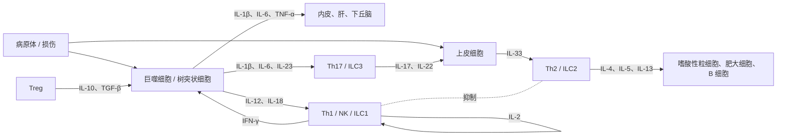

前面各章讲了识别（[7.15.6](/7.15.6)、[7.15.8](/7.15.8)）与效应（[7.15.7](/7.15.7)、[7.15.9](/7.15.9)、[7.15.10](/7.15.10)）。这些步骤之间由什么联系？是细胞因子：免疫系统由分散在全身、数以千万亿计的细胞组成，没有神经那样的专用线路，细胞之间靠分泌的小分子蛋白质互相传递"警报"（TNF-α、IL-1β）、"指令"（IL-12、IL-4 决定淋巴细胞往哪个方向分化）、"生长信号"（IL-2、IL-7）与"调节信号"（IL-10、TGF-β）。本章回答知识路径上"识别之后怎样决定"（[7.15.1](/7.15.1)）的分子部分：决定的内容由细胞因子传递，由它的受体和信号读出。

细胞因子的名字多得惊人，但并不需要逐个记忆。三条线索足以让它们成为系统：（1）受体只有六个家族，而且不同细胞因子共用受体链（共同 γ 链是最典型的例子），这决定了功能的重叠；（2）按功能归为警报、极化、生长与分化、杀伤与调节、趋化五类，各类对应路径上的一个环节；（3）三种效应模块（1 型、2 型、3 型免疫）各有一组特征性的细胞因子。本章先讲通性与受体，再给出核心约 30 个细胞因子的总表，最后用一个简单模型说明细胞因子"争夺"的含义。趋化因子的功能与黏附分子已在 [7.15.4](/7.15.4) 介绍，这里只讲它的受体与信号。

## 11.1. 细胞因子的定义与功能特点

### 11.1.1. 定义与作用方式

**定义 11.1.1（细胞因子）** **细胞因子**是由免疫细胞和某些非免疫细胞合成与分泌的小分子可溶性蛋白质（相对分子质量约 $8$–$30\ \mathrm{kDa}$），通过与靶细胞表面的特异性受体结合，调节细胞的增殖、分化与功能。

它们与经典激素的差别在于：产生细胞不集中在内分泌腺，而是分散的细胞在受到刺激时才合成；通常在局部起作用，作用距离短、半衰期短（数分钟）；浓度极低（皮摩尔到纳摩尔）即起作用，受体亲和力很高（$K_\mathrm{D}$ 约 $10^{-10}$–$10^{-12}\ \mathrm{M}$）。按作用的距离，分为三种方式：**自分泌**（作用于分泌它的细胞自己，如 T 细胞自己产生的 IL-2 作用于自身）、**旁分泌**（作用于邻近细胞，是最常见的方式）与**内分泌**（经血液作用于远处的细胞，只有 IL-1、IL-6、TNF-α 在高浓度时才这样，造成发热、急性期反应等全身效应，见 [7.15.7](/7.15.7)）。免疫突触中的定向分泌使细胞因子只作用于接触的靶细胞。

细胞因子的合成是短暂而受严格调控的：由细胞活化信号（NF-κB、NFAT 等转录因子）诱导转录，其 mRNA 的 3′ 非翻译区常含不稳定序列，使 mRNA 很快降解，所以信号一消失，分泌即停止；有些（IL-1β、IL-18）需要经过炎症小体活化 caspase-1 才能成熟分泌（[7.15.6](/7.15.6)）。

### 11.1.2. 功能特点：多效性、冗余、协同、拮抗与网络

**定义 11.1.2（细胞因子多效性与冗余）** 同一种细胞因子作用于不同的靶细胞，产生不同的生物学效应，称为**细胞因子多效性**；几种不同的细胞因子作用于同一种靶细胞，产生相同或相似的效应，称为**细胞因子冗余**。

这里的"多效性"指细胞因子的该性质，与基因多效性（一个基因影响多个表型）不是同一个概念。IL-4 是多效性的例子：对 B 细胞促进类别转换到 IgE，对 T 细胞促进 Th2 极化，对巨噬细胞诱导替代性活化。冗余的分子基础是受体链的共用：IL-2、IL-4、IL-7、IL-9、IL-15、IL-21 的受体共用**共同 γ 链**，所以它们都能活化 JAK3 与 STAT5，对淋巴细胞的增殖与存活有相似的作用；IL-6、IL-11、白血病抑制因子、制瘤素 M 共用 gp130。冗余也解释了一个常见的遗传学现象：多数单个细胞因子的缺失影响轻微，而共用受体链的缺失则是灾难性的（X 连锁重症联合免疫缺陷，§11.6.2）。

细胞因子之间还有三种关系：

- 协同：两种细胞因子合用的效果大于各自效果之和，如 IL-12 与 IL-18 协同诱导 NK 细胞与 Th1 细胞分泌 IFN-γ。
- 拮抗：一种细胞因子抑制另一种的作用，如 IFN-γ 抑制 Th2 的分化，IL-4 抑制 Th1 的分化，也是 1 型与 2 型免疫相互排斥的基础。
- 网络：一种细胞因子诱导另一些细胞因子的产生，形成级联和正负反馈，如 TNF-α 诱导 IL-1β，IL-1β 诱导 IL-6；细胞因子的作用取决于整体组合，而不是单个因子。

## 11.2. 细胞因子的分类

细胞因子最初以功能命名（淋巴因子、单核因子），后来按结构与功能归为几个家族。

**定义 11.2.1（细胞因子的家族）** **白细胞介素**（IL）原指由白细胞产生、介导白细胞之间相互作用的细胞因子，按发现顺序编号（目前已有约 40 个，IL-1 至 IL-38 及其家族成员），实际上许多也由其他细胞产生。**肿瘤坏死因子**（TNF）家族是一组以三聚体形式作用于 TNF 受体家族的细胞因子，包括 TNF-α、淋巴毒素、Fas 配体、CD40 配体、TRAIL、BAFF 等。**集落刺激因子**（CSF）是刺激造血祖细胞增殖并分化成不同谱系集落的细胞因子，包括 G-CSF、M-CSF、GM-CSF、IL-3 等（红细胞生成素与血小板生成素也属于此类造血因子）。**转化生长因子-β**（TGF-β）是一类多功能的生长因子，在免疫系统中以抑制与调节为主，同时促进 IgA 类别转换与组织修复。

另外两大类已经在别处介绍：**干扰素**分为 I 型（IFN-α/β）、II 型（IFN-γ）与 III 型（IFN-λ），I 型与 III 型主要由被病毒感染的细胞和浆细胞样树突状细胞产生，诱导抗病毒状态（[7.15.7](/7.15.7)、[7.11.27](/7.11.27)），IFN-γ 主要由 NK 细胞、Th1 与 CD8⁺ T 细胞产生，活化巨噬细胞；**趋化因子**是一个有约 50 个成员的家族，按保守的半胱氨酸排列分为 CC、CXC、CX3C 与 XC 四个亚家族，控制白细胞的迁移（[7.15.4](/7.15.4)）。IL 编号、功能与结构的对应是零散的：IL-1 家族同时有炎症因子（IL-1β、IL-18、IL-33）与受体拮抗剂（IL-1Ra）；IL-17 家族与 IL-10 家族的成员在结构上各自独立。本章不按编号罗列，而按功能分组（§11.4）。

## 11.3. 细胞因子受体及其信号

### 11.3.1. 六个受体家族

**定义 11.3.1（细胞因子受体）** 与细胞因子特异性结合并把信号传入细胞的跨膜蛋白称为**细胞因子受体**。按结构和信号机制，免疫学中重要的细胞因子受体分为六个家族。

| 家族 | 结构特点 | 代表性的配体 | 信号 |
|---|---|---|---|
| I 型（造血因子）受体 | 胞外含纤连蛋白 III 型结构域与保守的 WSXWS 基序；多数是异源二聚体或三聚体，含共用的链（γc、βc、gp130） | IL-2、IL-4、IL-6、IL-7、IL-15、GM-CSF、G-CSF | JAK–STAT |
| II 型（干扰素）受体 | 与 I 型相似，无 WSXWS | IFN-α/β、IFN-γ、IFN-λ、IL-10 家族 | JAK–STAT |
| IL-1 / Toll 家族 | 胞外为免疫球蛋白样结构域，胞内为 TIR 结构域 | IL-1β、IL-18、IL-33、Toll 样受体的配体 | MyD88 → NF-κB、MAP 激酶 |
| TNF 受体家族 | 胞外有富含半胱氨酸的结构域，三聚体；胞内部分成员含死亡结构域 | TNF-α、Fas 配体、CD40 配体、TRAIL | TRAF → NF-κB；死亡结构域 → caspase 级联 |
| 趋化因子受体 | 七次跨膜 G 蛋白偶联受体 | 趋化因子 | Gαi → 细胞迁移 |
| TGF-β 受体 | 丝氨酸/苏氨酸激酶，I 型与 II 型受体 | TGF-β、激活素、BMP | SMAD |

I 型与 II 型受体的 JAK–STAT 信号（见 [7.1.15](/7.1.15)）：这两个家族的受体胞内区自己没有激酶活性，而与细胞质中的 Janus 激酶（JAK1、JAK2、JAK3、TYK2）组成复合物。细胞因子使受体链二聚化或聚拢，使相邻的 JAK 彼此磷酸化而活化；JAK 把受体的胞内区磷酸化，成为 STAT 蛋白（STAT1–6）SH2 结构域的停靠位点；STAT 被磷酸化后形成二聚体，进入细胞核，结合靶基因启动子。不同的 JAK 与 STAT 组合决定应答：IL-2 经 JAK1/JAK3 活化 STAT5，IFN-γ 经 JAK1/JAK2 活化 STAT1，IL-4 经 JAK1/JAK3 活化 STAT6，IL-6 经 gp130 活化 STAT3。信号由 SOCS 蛋白等负反馈终止。JAK–STAT 的通用性解释了为什么 JAK 抑制剂能同时影响许多细胞因子（§11.6.3）。

**共同 γ 链**在 §11.1.2 已提到，下面作为一个单独的概念定义。

**定义 11.3.2（共同 γ 链）** 作为 IL-2、IL-4、IL-7、IL-9、IL-15 和 IL-21 六种细胞因子受体共有的信号链，由 *IL2RG* 基因编码的蛋白质称为**共同 γ 链**（γc，CD132），它通过结合 JAK3 传递信号。

IL-2 受体是最好的例子：高亲和力的 IL-2 受体由 IL-2Rα（CD25）、IL-2Rβ（CD122）与 γc 三条链组成（$K_\mathrm{D}$ 约 10 pM）；仅有 β 与 γc 的中等亲和力受体 $K_\mathrm{D}$ 约 1 nM；仅有 α 链的 $K_\mathrm{D}$ 约 10 nM，不传递信号。静息的效应 T 细胞表达中等亲和力受体，活化后上调 CD25；Treg 持续表达高水平 CD25，对低浓度 IL-2 非常敏感（§11.5）。

TIR 家族：IL-1 家族受体与 Toll 样受体在胞内共有 TIR 结构域，结合接头蛋白 MyD88，经 IRAK 与 TRAF6 活化 NF-κB，所以 IL-1β 与 LPS 的信号在胞内汇合（[7.15.6](/7.15.6)）。TNF 受体家族以三聚体结合配体：TNFR1 的死亡结构域招募 TRADD、FADD，既能活化 caspase-8 引起凋亡，也能通过 TRAF 与 RIP1 活化 NF-κB 促进存活与炎症，两种结果取决于细胞内的平衡（死亡受体，见 [7.3.25](/7.3.25)）；CD40 与 BAFF 受体不含死亡结构域，通过 TRAF 传递共刺激信号。趋化因子受体经 Gαi 抑制腺苷酸环化酶并释放 Gβγ，活化 PI3K 与小 GTP 酶，引起肌动蛋白重排与定向迁移。TGF-β 受体：配体结合 II 型受体，招募并磷酸化 I 型受体，I 型受体磷酸化 SMAD2/3，与 SMAD4 一起入核（见 [7.3.19](/7.3.19)）。

### 11.3.2. 可溶性受体、诱饵受体与受体拮抗剂

细胞因子的作用还受到一些特殊的受体或配体所调控。

**定义 11.3.3（可溶性细胞因子受体与诱饵受体）** 受体胞外区经蛋白酶切下或经 mRNA 选择性剪接产生的、可以在体液中游离存在的形式称为**可溶性细胞因子受体**，它们能结合配体，既可以中和配体，也可能起运输和稳定的作用。胞内区缺失或无信号功能、只结合配体而不传递信号的跨膜或分泌型受体称为**诱饵受体**。

可溶性 IL-2 受体 α 链（sCD25）是 T 细胞活化的标志物；可溶性 TNF 受体与 IL-1 受体 II（诱饵受体，膜型也可脱落）捕获 TNF 与 IL-1β；IL-18 结合蛋白是 IL-18 的分泌型抑制物；DcR3 结合 Fas 配体，保护肿瘤细胞。此外，IL-1 受体拮抗剂（IL-1Ra）是 IL-1 家族的成员，它结合 IL-1 受体但不招募辅助受体链 IL-1RAcP，因此阻断信号，也是一种天然的"结构上的拮抗剂"。这些机制说明，细胞因子的作用不仅看配体的量，还看受体的类型与可溶性抑制物的量。

## 11.4. 细胞因子的功能图谱

### 11.4.1. 按功能分组的核心细胞因子

下表按路径上的环节而不是按编号整理了核心的约 30 个细胞因子（趋化因子只列最有代表性的）。读表时先看分组，再看每组中谁产生、谁响应。

| 分组 | 细胞因子 | 主要来源 | 主要靶细胞 | 主要效应 |
|---|---|---|---|---|
| 警报 | IL-1β | 单核/巨噬细胞、树突状细胞（需炎症小体） | 内皮、下丘脑、肝细胞、T 细胞 | 发热、内皮活化、急性期反应、促 Th17 分化 |
| | IL-18 | 巨噬细胞、上皮细胞（炎症小体） | NK 细胞、T 细胞 | 与 IL-12 协同诱导 IFN-γ |
| | IL-33 | 上皮、内皮细胞（细胞损伤时释放） | ILC2、Th2、肥大细胞 | 启动 2 型免疫 |
| | TNF-α | 巨噬细胞、T 细胞、NK 细胞、肥大细胞 | 内皮、中性粒细胞、肝、下丘脑 | 局部炎症、内皮活化、发热、恶病质、细胞死亡 |
| | IL-6 | 巨噬细胞、T 细胞、内皮、成纤维细胞 | 肝细胞、B 细胞、T 细胞 | 急性期蛋白、浆细胞分化、Th17 分化 |
| | IFN-α/β | 浆细胞样树突状细胞、被病毒感染的细胞 | 几乎所有有核细胞 | 抗病毒状态、上调 MHC I、活化 NK 细胞 |
| 极化 | IL-12 | 树突状细胞、巨噬细胞 | 初始 CD4⁺ T 细胞、NK 细胞 | Th1 分化，诱导 IFN-γ（1 型免疫） |
| | IL-4 | Th2、肥大细胞、嗜碱性粒细胞、ILC2 | 初始 CD4⁺ T 细胞、B 细胞 | Th2 分化，B 细胞类别转换到 IgE（2 型免疫） |
| | IL-23 | 树突状细胞、巨噬细胞 | Th17 细胞、ILC3 | 维持与扩增 Th17（3 型免疫） |
| | IL-21 | Tfh、Th17 | B 细胞、T 细胞 | Tfh 分化，B 细胞向浆细胞分化 |
| 生长与分化 | IL-2 | 活化的 T 细胞 | T 细胞、NK 细胞、Treg | T 细胞增殖，Treg 存活 |
| | IL-7 | 基质细胞 | 胸腺细胞、初始与记忆 T 细胞、早期 B 细胞 | 淋巴细胞发育与稳态存活 |
| | IL-15 | 单核细胞、树突状细胞 | NK 细胞、记忆 CD8⁺ T 细胞 | NK 细胞发育，记忆细胞维持 |
| | IL-3 | T 细胞 | 造血祖细胞、肥大细胞 | 多系集落形成 |
| | GM-CSF | T 细胞、巨噬细胞、内皮 | 粒细胞/单核细胞祖细胞 | 粒单细胞生成，巨噬细胞与树突状细胞活化 |
| | G-CSF | 单核细胞、内皮、成纤维细胞 | 中性粒细胞祖细胞 | 中性粒细胞的生成与动员 |
| | M-CSF | 成纤维细胞、内皮、单核细胞 | 单核细胞与巨噬细胞祖细胞 | 单核/巨噬细胞生成与存活 |
| | IL-5 | Th2、ILC2、肥大细胞 | 嗜酸性粒细胞 | 嗜酸性粒细胞生成与活化 |
| 杀伤与效应 | IFN-γ | Th1、CD8⁺ T、NK、ILC1 | 巨噬细胞、几乎所有细胞 | 活化巨噬细胞，杀灭胞内病原体，上调 MHC I 与 II |
| | IL-13 | Th2、ILC2 | 上皮细胞、平滑肌、巨噬细胞、B 细胞 | 黏液分泌、气道高反应、替代性活化 |
| | IL-17A | Th17、ILC3、γδ T 细胞 | 上皮、成纤维细胞、内皮 | 趋化中性粒细胞，诱导抗菌肽（3 型免疫） |
| | IL-22 | Th17、Th22、ILC3 | 上皮细胞 | 屏障修复、抗菌肽 |
| 调节 | IL-10 | Treg、Th2、B 细胞、巨噬细胞 | 巨噬细胞、树突状细胞、T 细胞 | 抑制促炎因子、MHC II 与共刺激分子 |
| | TGF-β | Treg、巨噬细胞、多种细胞 | T 细胞、B 细胞、巨噬细胞、成纤维细胞 | 抑制应答，Treg 分化，IgA 类别转换，纤维化 |
| 趋化 | CXCL8（IL-8） | 巨噬细胞、上皮细胞 | 中性粒细胞（CXCR1/2） | 募集中性粒细胞 |
| | CCL2 | 巨噬细胞、内皮 | 单核细胞（CCR2） | 募集单核细胞 |
| | CXCL10 | 受 IFN-γ 诱导的多种细胞 | Th1、CD8⁺ T、NK 细胞（CXCR3） | 1 型应答细胞的募集 |
| | CCL19、CCL21 | 淋巴结 T 区的基质细胞、淋巴管内皮 | 初始 T 细胞、成熟树突状细胞（CCR7） | 淋巴结 T 区的归巢 |
| | CXCL13 | 滤泡树突状细胞与基质细胞 | B 细胞、Tfh（CXCR5） | B 细胞滤泡的组织 |
| | CXCL12 | 骨髓基质细胞 | 造血干细胞、淋巴细胞（CXCR4） | 骨髓归巢 |
| | CCL11（嗜酸性粒细胞趋化因子） | 上皮、内皮 | 嗜酸性粒细胞（CCR3） | 2 型炎症的募集 |

### 11.4.2. 三种效应模块与细胞因子网络

三种效应模块各有一组特征性的细胞因子，其基础是细胞因子之间的拮抗（[7.15.17](/7.15.17) 讨论 Th 亚群的分化，[7.15.32](/7.15.32) 讨论它们对不同病原体的作用）：

| 模块 | 启动信号 | 极化因子 | 效应因子 | 靶 |
|---|---|---|---|---|
| 1 型 | 胞内病原体与肿瘤 | IL-12、IL-18、IFN-γ | IFN-γ、TNF-α | 巨噬细胞活化，CTL 与 NK 细胞 |
| 2 型 | 蠕虫、过敏原 | IL-33、TSLP、IL-4 | IL-4、IL-5、IL-13 | 嗜酸性粒细胞，肥大细胞，IgE |
| 3 型 | 胞外细菌与真菌 | IL-1β、IL-6、IL-23、TGF-β | IL-17、IL-22 | 中性粒细胞，上皮的抗菌肽 |

## 11.5. 一个模型：Treg 与效应 T 细胞争夺 IL-2

细胞因子的作用取决于受体的占有，而细胞因子又被受体消耗，所以不同的细胞会"争夺"有限的配体。IL-2 是最好的例子：效应 T 细胞（Teff）活化后分泌 IL-2，但 Treg 自己不产生 IL-2，却持续表达高水平的 CD25，依靠 IL-2 存活，并且消耗周围的 IL-2。下面的模型说明消耗如何抑制 Teff 的扩增。

设 Teff 每个细胞以速率 $p$ 产生 IL-2，Teff 与 Treg 以最大速率 $u_\mathrm{E}$、$u_\mathrm{T}$（每个细胞）通过受体结合与内吞消耗 IL-2，受体的占有率为 $f = L/(K + L)$（$K$ 是高亲和力受体的 $K_\mathrm{D}$，$L$ 是 IL-2 浓度，以 $K$ 为单位），IL-2 还以速率 $d$ 降解。令 $r = T/E$ 为 Treg 与 Teff 的数量比，IL-2 变化快于细胞数量，取每个 Teff 细胞的拟稳态平衡：

$$
p = (u_\mathrm{T} r + u_\mathrm{E}) f + d K \frac{f}{1 - f}. \tag{11.1}
$$

Teff 的扩增速率为 $(r_\mathrm{E} f - \mu)$（$r_\mathrm{E}$ 是最大增殖速率，$\mu$ 是死亡速率），所以只有占有率超过阈值 $f_\mathrm{c} = \mu/r_\mathrm{E}$ 时 Teff 才扩增。把 $f = f_\mathrm{c}$ 代入式 (11.1)，得到 Treg 能阻止扩增所需的临界比例：

$$
r_\mathrm{c} = \frac{1}{u_\mathrm{T}}\left[\frac{p - dK f_\mathrm{c}/(1 - f_\mathrm{c})}{f_\mathrm{c}} - u_\mathrm{E}\right]. \tag{11.2}
$$

取 $K = 1$、$u_\mathrm{E} = 0.2$、$u_\mathrm{T} = 3$（Treg 的高亲和力受体多，每个细胞的消耗是 Teff 的 15 倍）、$d = 0.05$、$r_\mathrm{E} = 1$、$\mu = 0.3$（$f_\mathrm{c} = 0.3$），均为示意值。在 $p = 1$ 时，没有 Treg（$r = 0$）占有率为 $f = 0.94$；$r = 1$ 时降到 0.31，刚好在阈值上；$r = 2$ 时降到 0.16，Teff 不能扩增。式 (11.2) 给出 $r_\mathrm{c} \approx 1.02$。

模型有几点意义。第一，Treg 的抑制不一定需要分泌抑制性因子，仅靠消耗 IL-2 就能压低邻近 Teff 的信号，这与 Treg 对 CD25 的持续高表达相符；第二，因为 Treg 的受体亲和力高，低剂量的 IL-2 优先扩增 Treg，而高剂量的 IL-2 同时扩增效应细胞，所以用 IL-2 治疗自身免疫病时用低剂量，治疗肿瘤时用高剂量；第三，这个模型体现了"分子浓度由细胞之间的竞争决定"，与生态学中的资源竞争相同（[7.9.14](/7.9.14)，微分方程方法见 [2.4](/2.4)）。局限是它忽略了 Treg 的其他抑制机制（CTLA-4、IL-10、TGF-β）、IL-2 对 CD25 表达的正反馈、IL-2 在组织中的扩散与细胞间的空间距离，也没有细胞数量的动态变化。

## 11.6. 细胞因子与疾病、靶向治疗

### 11.6.1. 细胞因子风暴

**定义 11.6.1（细胞因子风暴）** 大量免疫细胞被过度活化，在短时间内释放大量 TNF-α、IL-1β、IL-6、IFN-γ 等促炎细胞因子，引起高热、低血压、毛细血管渗漏和多器官功能障碍的临床综合征，称为**细胞因子风暴**（细胞因子释放综合征）。

它的核心是一个正反馈：活化的免疫细胞释放细胞因子，细胞因子又使更多的细胞活化。严重的细菌与病毒感染、脓毒症、超抗原（[7.15.8](/7.15.8)）以及某些免疫治疗（CAR-T 细胞疗法、双特异性抗体）都可以诱发。IL-6 是其中的关键介质之一，对 IL-6 受体的阻断可缓解 CAR-T 引起的细胞因子释放综合征。

### 11.6.2. 缺陷

细胞因子及其受体的遗传缺陷揭示了它们的功能：

| 缺陷 | 疾病 | 说明 |
|---|---|---|
| 共同 γ 链（*IL2RG*）或 JAK3 | 重症联合免疫缺陷（X 连锁），缺乏 T 细胞与 NK 细胞 | 六种细胞因子的信号同时丧失（冗余的代价） |
| IL-12、IFN-γ 及其受体，STAT1 | 对分枝杆菌与沙门菌的孟德尔易感性 | 1 型免疫的轴断裂 |
| IL-17 通路 | 慢性黏膜皮肤念珠菌病 | 3 型免疫对真菌的作用 |
| IL-10 或其受体 | 早发性炎症性肠病 | 缺少抑制炎症的因子 |

### 11.6.3. 靶向治疗

靶向细胞因子的药物按作用原理分为四类，各自利用了 §11.3 中的机制：

| 策略 | 例子 | 原理 | 适应证 |
|---|---|---|---|
| 中和细胞因子 | 抗 TNF-α 抗体、抗 IL-17、抗 IL-23、抗 IL-5 | 抗体结合配体（[7.15.9](/7.15.9)） | 类风湿关节炎、炎症性肠病、银屑病、嗜酸性粒细胞性哮喘 |
| 阻断受体或用诱饵 | 抗 IL-6 受体、抗 IL-4 受体 α、可溶性 TNF 受体融合蛋白、IL-1 受体拮抗剂 | 抗体或诱饵受体占据受体 | 类风湿关节炎、特应性皮炎、细胞因子释放综合征 |
| 阻断信号 | JAK 抑制剂 | 小分子抑制 JAK，同时阻断多种细胞因子的信号 | 类风湿关节炎、骨髓增殖性疾病 |
| 补充细胞因子 | IFN-α/β、IL-2（大剂量）、G-CSF、红细胞生成素 | 重组蛋白 | 病毒性肝炎、肿瘤、中性粒细胞减少、贫血 |

## 小结

| 主题 | 要点 |
|---|---|
| 定义与方式（§11.1） | 细胞因子是局部作用的小分子蛋白质（定义 11.1.1）；自分泌、旁分泌、内分泌；多效性与冗余（定义 11.1.2），协同、拮抗与网络 |
| 分类（§11.2） | 白细胞介素、肿瘤坏死因子、集落刺激因子、转化生长因子-β（定义 11.2.1），以及干扰素与趋化因子 |
| 受体（§11.3） | 六个家族（定义 11.3.1）：I 型、II 型（JAK–STAT）、IL-1/Toll（TIR）、TNF 受体、趋化因子 GPCR、TGF-β 受体（SMAD）；共同 γ 链（定义 11.3.2）；可溶性受体与诱饵受体（定义 11.3.3） |
| 功能图谱（§11.4） | 警报、极化、生长与分化、杀伤与效应、调节、趋化；三种效应模块的特征性细胞因子 |
| 模型（§11.5） | 高亲和力 IL-2 受体被 Treg 消耗，使 Teff 的受体占有率下降；式 (11.1)、(11.2) |
| 疾病（§11.6） | 细胞因子风暴（定义 11.6.1）；共同 γ 链缺陷；中和、阻断受体、阻断信号与补充四类治疗 |

## 思考题

1. 为什么共同 γ 链缺陷的患者缺少 T 细胞与 NK 细胞，而缺少 IL-2 或缺少 IL-4 的个体免疫缺陷轻得多？

   **答** 共同 γ 链是 IL-2、IL-4、IL-7、IL-9、IL-15、IL-21 的共用链，缺陷使这六种细胞因子的信号同时丧失，其中 IL-7 是 T 细胞发育必需的，IL-15 是 NK 细胞发育必需的，因此 T 细胞与 NK 细胞缺乏，B 细胞数量正常但功能很差。单个细胞因子的缺失被其他因子部分代偿（冗余），对免疫缺陷的影响较轻；IL-2 缺陷反而引起自身免疫，因为 Treg 依赖 IL-2。

2. 同一种细胞因子 IL-6 为什么既能引起发热与急性期反应，又能促进浆细胞分化？这是什么现象？它是由什么分子机制保证的？

   **答** 这是细胞因子多效性。IL-6 受体（IL-6Rα 与 gp130）及其 STAT3 信号在肝细胞、下丘脑与 B 细胞上都有，但不同细胞的转录因子背景不同，STAT3 激活的靶基因不同：肝细胞中是急性期蛋白基因，B 细胞中是促进浆细胞分化的基因，下丘脑经 PGE2 引起发热。一种细胞因子的效应取决于靶细胞的状态，而不只取决于配体。

3. 用式 (11.2) 计算：若 Treg 的消耗能力 $u_\mathrm{T}$ 由 3 降到 1.5（如 CD25 表达下降），其他参数不变，阻止 Teff 扩增所需的 Treg 比例 $r_\mathrm{c}$ 怎样变化？

   **答** 式 (11.2) 中 $r_\mathrm{c}$ 与 $u_\mathrm{T}$ 成反比：括号内的值为 $(1 - 0.05 \times 0.3/0.7)/0.3 - 0.2 \approx 3.06$，$u_\mathrm{T} = 3$ 时 $r_\mathrm{c} = 1.02$，$u_\mathrm{T} = 1.5$ 时 $r_\mathrm{c} \approx 2.04$：每个 Treg 的消耗能力减半，需要的 Treg 数目加倍。这是 CD25 缺陷或 IL-2 受体信号缺陷的患者容易发生自身免疫病的一种解释。

4. 抗 TNF 抗体与可溶性 TNF 受体融合蛋白都能治疗类风湿关节炎。二者的原理有何异同？为什么都要警惕潜伏结核的再活化？

   **答** 二者都使 TNF 不能结合细胞表面的受体：抗体直接结合 TNF，融合蛋白是诱饵受体的人工版本。差别在于抗体有 Fc，可以结合表达膜型 TNF 的细胞并经 ADCC 与补体杀伤，融合蛋白没有这一点；二者的半衰期与免疫原性也不同。TNF-α 是维持肉芽肿、限制结核分枝杆菌所必需的，阻断它会使肉芽肿崩解、潜伏的结核再活化，因此用药前要筛查潜伏结核。

5. （开放题）细胞因子风暴的核心是正反馈。试从本章的机制出发，列举可以在正反馈环的哪些环节打断它，各有什么利弊。

   **答** 思路：（1）中和细胞因子（抗 IL-6 受体、抗 IL-1、抗 TNF）：靶点明确，但只能切断一个环节，且影响抗感染；（2）阻断共同的信号（JAK 抑制剂、糖皮质激素）：同时作用于许多细胞因子，覆盖面广，但免疫抑制强；（3）阻断诱因，如清除病原体、去除超抗原或终止 CAR-T 的活化，是根本办法但常常来不及；（4）支持疗法。利弊的核心是平衡炎症控制和抗感染所需的免疫。
