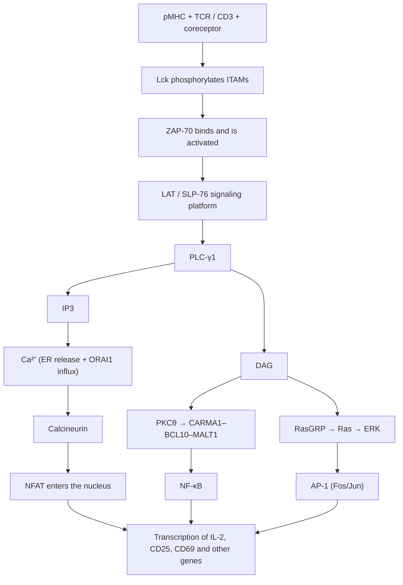

The third question on the knowledge path is "how is the decision made after recognition?" When a naive T cell meets, in the lymph node, a dendritic cell displaying its cognate pMHC ([7.15.14](/7.15.14)), it must decide within hours whether to proliferate and differentiate into an effector cell, or to ignore, become anergic or die. This decision is not made by the TCR alone but integrates three kinds of signal: TCR recognition of pMHC gives the "what" (signal 1), costimulatory molecules give the "is it dangerous" (signal 2), and cytokines give the "how to respond" (signal 3). This chapter covers the molecular mechanisms of the first two signals, how the TCR makes extremely sensitive and specific judgments from minute differences in affinity, and IL-2, the most basic of the third signals; how the third signals determine the effector subset is covered in [7.15.17](/7.15.17), expansion and memory after activation in [7.15.18](/7.15.18), and the details of the "brakes" (coinhibitory receptors and checkpoints) in [7.15.25](/7.15.25). The general principles of signal transduction (kinase cascades, second messengers, activation of transcription factors) are in [7.1.14](/7.1.14), [7.1.15](/7.1.15) and [7.3.19](/7.3.19); only the parts specific to T cells are covered here.

## 16.1. The Encounter of T Cells and APCs

**Definition 16.1.1 (T-Cell Activation)** The process in which a naive or memory T cell recognizes its cognate pMHC through the TCR, receives costimulatory and cytokine signals, enters the cell cycle, proliferates and differentiates into effector cells is called **T-cell activation**.

In the T-cell zone of the lymph node, naive T cells walk randomly over the network of fibroblastic reticular cells at about 10 µm per minute and contact over a hundred DCs per hour ([7.15.3](/7.15.3), [7.15.22](/7.15.22)). The contacts are nonspecific at first:

| T cell | APC | Role |
|---|---|---|
| LFA-1 (CD11a/CD18, an **integrin**) | ICAM-1 (CD54), ICAM-2, ICAM-3 | Main adhesion; TCR signaling converts LFA-1 from a low-affinity to a high-affinity conformation ("inside-out" signaling) |
| CD2 | CD58 (LFA-3; CD48 in mice) | Adhesion, and signal enhancement |
| ICAM-3 (CD50) | DC-SIGN (CD209) | The initial contact between DC and T cell |

If the TCR does not recognize its cognate pMHC, the T cell dissociates from the APC after a few minutes and continues scanning; if it does, TCR signaling rapidly activates LFA-1, the T cell stops moving, and it forms a stable conjugate with the APC lasting several hours. Intravital two-photon imaging divides the process into three phases: brief, repeated contacts during the first approximately 8 h, followed by stable conjugation for about 12 h (during which IL-2 is secreted and CD69 and CD25 are expressed), after which the T cell resumes motility and begins to divide.

## 16.2. The TCR–CD3 Complex and Coreceptors

The intracellular segment of the αβTCR is only a few amino acids long and cannot transmit signals. Signals are transmitted by the CD3 molecules that are noncovalently associated with it: a TCR complex consists of TCRαβ, CD3εγ, CD3εδ and the ζζ homodimer, assembled by charged residues in the transmembrane regions.

**Definition 16.2.1 (Immunoreceptor Tyrosine-Based Activation Motif)** An **immunoreceptor tyrosine-based activation motif** (ITAM) is the sequence YxxL/I-x$_{6\text{–}8}$-YxxL/I in the intracellular segment of a signaling subunit of an immune receptor; once its two tyrosines are phosphorylated by Src-family kinases, it becomes a binding site for kinases containing two **SH2 domains** (ZAP-70 in T cells, Syk in B cells and myeloid cells).

A TCR complex has 10 ITAMs: one each on CD3γ, δ and the two ε chains, and three each on the two ζ chains. Igα/Igβ of the BCR, the γ chain of Fc receptors and DAP12 of NK-cell activating receptors all use ITAMs, which are a universal module of activating receptors in the immune system; the corresponding inhibitory module is the ITIM ([7.15.25](/7.15.25)).

**Definition 16.2.2 (Coreceptor)** Molecules that bind a different part of the same pMHC recognized by the TCR and that do not themselves determine specificity but enhance TCR signaling are called **coreceptors**: CD4 binds the β2 domain of MHC class II molecules through its D1 domain, and CD8 (an αβ heterodimer) binds the α3 domain of MHC class I molecules ([7.15.13](/7.15.13)).

Coreceptors have two roles: they increase the binding between the T cell and the APC, and, more importantly, they bring the kinase Lck to the TCR, since the intracellular segments of CD4 and CD8α bind Lck through zinc coordination. Coreceptor participation raises the sensitivity of the T cell to ligand by about a hundredfold. The correspondence of coreceptor to MHC class is exactly the basis on which the CD4/CD8 lineage is determined in the thymus ([7.15.15](/7.15.15)). CD4 is also the receptor by which HIV enters cells, which is why HIV infection specifically depletes CD4⁺ T cells ([7.15.31](/7.15.31)).

TCR recognition has three seemingly contradictory properties:

1. Low affinity: the dissociation constant of TCR–pMHC is $1$–$100\,\mu\mathrm{M}$, with binding half-lives of only seconds, 3–6 orders of magnitude weaker than antibody–antigen binding;
2. Extremely high sensitivity: a T cell can respond to only a few (1–10) cognate pMHC on the APC surface, drowned among $10^5$ self pMHC;
3. Extremely high specificity: ligands whose binding lifetimes differ by only a few-fold (an agonist versus a self peptide, or variant peptides differing by a single residue) can elicit completely different responses, even antagonism.

The kinetic proofreading model of §16.4 is the classical framework explaining these three points.

## 16.3. The Immunological Synapse

**Definition 16.3.1 (Immunological Synapse)** The organized structure at the contact interface between a T cell and an APC (or a CTL and a target cell), in which receptors, ligands and signaling molecules are arranged into concentric regions according to size and function, is called the **immunological synapse**: the central supramolecular activation cluster (cSMAC) contains TCR–pMHC, CD28 and PKCθ; the peripheral ring (pSMAC) contains LFA-1–ICAM-1 and talin; the distal ring (dSMAC) contains CD45 and CD43, which have very large extracellular segments.

The synapse forms within a few minutes of contact. Imaging studies show that what actually signals are the TCR microclusters (containing TCR, Lck, ZAP-70, LAT and SLP-76) continually formed at the periphery of the contact interface, which move toward the center along the actin flow; the cSMAC is mainly where the TCR is internalized and degraded and signaling is terminated, and it is also the location of CD28 costimulatory signals.

The physical basis of the zoning is molecular size: the TCR–pMHC and CD28–CD80 complexes span about 15 nm, LFA-1–ICAM-1 about 40 nm, and the extracellular segment of CD45 is larger still. The tightly apposed region cannot accommodate CD45, so the phosphatase is excluded from the region where the TCR sits and the balance of kinase and phosphatase shifts toward phosphorylation; this is the kinetic segregation model of TCR triggering. It does not conflict with kinetic proofreading: the former explains how the signal is initiated, and the latter explains how the signal discriminates among ligands. The synapse also polarizes the T cell: the microtubule-organizing center turns toward the contact interface, and cytokines (such as IL-2 and IFN-γ) and the cytolytic granules of CTLs are released in a directed way toward the APC or target cell ([7.15.17](/7.15.17)).

![The immunological synapse. A: Side-view schematic of the contact interface between a CD4⁺ T cell and an APC (not to scale). In the central region (cSMAC) the two membranes are about 15 nm apart, held apart by TCR–pMHC II (CD4 binding the β2 domain of MHC II) and CD28–CD80; in the peripheral ring (pSMAC) the longer integrin LFA-1 (αLβ2) binds ICAM-1, with a membrane gap of about 40 nm; the phosphatase CD45, with its very large extracellular segment, is excluded to the distal ring (dSMAC), which is the basis of the kinetic segregation model. B: Face-on view of a mature synapse, three concentric zones in a "bull's-eye" pattern](./plots/immune-synapse.py)

## 16.4. Signal 1

### 16.4.1. The TCR Signaling Cascade

After the TCR recognizes pMHC, the signal is transmitted along a clear cascade and ultimately activates three transcription factors, NFAT, AP-1 and NF-κB, which act cooperatively on the promoters of genes such as IL-2:

1. Lck, brought by the coreceptor, phosphorylates the ITAMs of CD3 and the ζ chains (the phosphatase activity of CD45 keeps Lck in a state in which it can be activated; T cells lacking CD45 cannot transmit signals through the TCR);
2. ZAP-70 binds doubly phosphorylated ITAMs through its two SH2 domains and is activated by phosphorylation by Lck;
3. ZAP-70 phosphorylates the adaptor proteins LAT and SLP-76, which assemble into a signaling platform that recruits PLC-γ1, Grb2–SOS, Vav, Itk and PI3K;
4. PLC-γ1 hydrolyzes PIP2 to produce the two **second messengers** IP3 and DAG:
   - IP3 → release of Ca²⁺ from the endoplasmic reticulum → depletion of endoplasmic reticulum calcium is sensed by STIM1, which opens the ORAI1 calcium channel in the plasma membrane (the calcium release-activated calcium channel, CRAC) → sustained rise of intracellular Ca²⁺ → **calmodulin** activates the phosphatase calcineurin → NFAT is dephosphorylated and enters the nucleus;
   - DAG → the θ isoform of **protein kinase C** (PKCθ) → the CARMA1–BCL10–MALT1 complex → IKK → **NF-κB**;
   - DAG → RasGRP → Ras (a **small G protein**) → the **MAP kinase cascade** (ERK) → Fos; JNK → Jun; Fos–Jun is AP-1.

**Remark 16.4.1** NFAT and AP-1 must bind cooperatively at many promoters. When there is calcium signaling but insufficient AP-1 (for example, TCR signaling without costimulation), NFAT alone induces a set of inhibitory genes and the cell enters **clonal anergy** ([7.15.24](/7.15.24)). This is one reason why the second signal is necessary at the molecular level. The calcineurin inhibitors cyclosporin A and tacrolimus (FK506) form complexes with cyclophilin and FKBP12, respectively, to inhibit calcineurin and block the nuclear entry of NFAT; they are the most important immunosuppressive drugs in organ transplantation ([7.15.29](/7.15.29)).

:::

### 16.4.2. Kinetic Proofreading

How does a T cell make sharply different judgments among ligands whose binding lifetimes differ only a few-fold? McKeithan (1995) applied the **kinetic proofreading** proposed by Hopfield to the TCR: after the TCR binds pMHC, $N$ successive modification steps (ITAM phosphorylation, ZAP-70 binding and activation, LAT phosphorylation, ...) must be completed before a signal is emitted; at any step, if the pMHC dissociates, the complex returns to the starting state.

**Example 16.4.1 (Kinetic Proofreading Model of the TCR)** Let the rate of each modification step be $k_{\mathrm{p}}$ and the dissociation rate of the pMHC be $k_{\mathrm{off}}$, with binding lifetime $\tau = 1/k_{\mathrm{off}}$. The probability that each step is completed before dissociation is $k_{\mathrm{p}}/(k_{\mathrm{p}} + k_{\mathrm{off}})$, so the probability that one binding event reaches the signaling state is

$$
f(\tau) = \left(\frac{k_{\mathrm{p}}}{k_{\mathrm{p}} + k_{\mathrm{off}}}\right)^{N} = \left(\frac{k_{\mathrm{p}}\tau}{1 + k_{\mathrm{p}}\tau}\right)^{N}.
$$

When $k_{\mathrm{p}}\tau \ll 1$, $f \approx (k_{\mathrm{p}}\tau)^N$: two ligands whose lifetimes differ 3-fold differ $3^N$-fold in signal. Take the illustrative value $k_{\mathrm{p}} = 1\,\mathrm{s^{-1}}$ and compare an agonist with $\tau = 3\,\mathrm{s}$ and a self-like ligand with $\tau = 1\,\mathrm{s}$:

| $N$ | $f(3\,\mathrm{s})$ | $f(1\,\mathrm{s})$ | Discrimination ratio |
|---|---|---|---|
| 0 | 1 | 1 | 1 |
| 3 | 0.42 | 0.125 | 3.4 |
| 6 | 0.18 | 0.016 | 11 |
| 10 | 0.056 | 0.00098 | 58 |

The more steps there are, the better the discrimination, but at the cost that the fraction of binding events of the agonist itself that can trigger a signal also falls (only about 6% remains at $N = 10$), and on average more time is needed. T cells make up for the loss of sensitivity in two ways: one pMHC can bind many TCRs in succession within seconds ("serial triggering," with an estimated hundred or more TCRs triggered by one pMHC); and positive feedback in the signaling network (for example, the allosteric activation of SOS by Ras-GTP) amplifies a small number of signals into an all-or-none response.

:::

![Kinetic proofreading of the TCR (illustrative parameters, $k_{\mathrm{p}} = 1\,\mathrm{s^{-1}}$). A: The probability that one binding event reaches the signaling state as a function of binding lifetime $\tau$, with $N$ the number of proofreading steps (log–log axes); the larger $N$ is, the steeper the curve, and ligands whose lifetimes differ by a few-fold (shaded region) produce signals that differ by several orders of magnitude. B: The signal ratio of an agonist with a 3 s lifetime to a self-like ligand with a 1 s lifetime grows exponentially with $N$, far exceeding the 3-fold difference in lifetime itself (dashed line); the cost is that the fraction of agonist binding events that can signal falls exponentially with $N$](./plots/kinetic-proofreading.py)

The basic model explains "why the response is so sensitive to lifetime" but not two other things: why large numbers of weak ligands do not accumulate to trigger a response, and why weak ligands can antagonize strong ones. Later models add negative feedback to the proofreading chain (for example, the phosphatase SHP-1 is activated by weak signals and inhibits neighboring TCRs, whereas ERK activated by strong signals protects Lck from SHP-1), which yields "adaptive" proofreading that can explain sensitivity, specificity and antagonism at the same time. These models are also the molecular basis of the steep thresholds in thymic selection ([7.15.15](/7.15.15)).

## 16.5. Signal 2: Costimulation

A naive T cell receiving only TCR signals is not fully activated and instead becomes anergic. A second signal is therefore needed, provided by molecules that the APC expresses only after sensing danger. This "two-signal" idea was first proposed for B cells by Bretscher and Cohn (1970) and extended to T cells by Lafferty and Cunningham (1975); Jenkins and Schwartz (1987) showed that signal 1 alone leads to anergy; Janeway (1989) connected it with innate immunity: an APC expresses costimulatory molecules only after pattern recognition receptors sense microbes, so the second signal hands the judgment of "whether a response is worthwhile" to innate immunity.

**Definition 16.5.1 (Costimulatory Molecule)** The cell-surface molecules and their ligands that transmit, between a T cell (or B cell) and an APC, auxiliary signals other than those of the TCR (or BCR) that are required for full activation are called **costimulatory molecules**; in a broad sense this also includes coinhibitory molecules that transmit inhibitory signals.

The most important costimulation is the binding of CD28 to the B7 molecules CD80 (B7-1) and CD86 (B7-2). CD28 recruits PI3K and Grb2, with the following effects: enhancing transcription of the IL-2 gene and stabilizing its mRNA; inducing the antiapoptotic protein Bcl-xL; promoting glucose uptake and **glycolysis** through Akt–mTOR, which gives metabolic support for proliferation; and lowering the TCR signal threshold required for activation. CD80/86 on resting DCs is very low and is markedly upregulated after maturation ([7.15.14](/7.15.14)).

| Family | Molecule on the T cell | Ligand (APC, etc.) | Role |
|---|---|---|---|
| CD28 family (Ig superfamily) | CD28 | CD80, CD86 | The most important costimulation: priming of naive T cells |
| | ICOS | ICOSL | Effector and memory T cells; differentiation and maintenance of Tfh |
| | **CTLA-4** | CD80, CD86 (higher affinity than CD28) | Coinhibition: competes for ligand and removes B7 from the APC by transendocytosis |
| | **PD-1** | PD-L1, PD-L2 | Coinhibition: recruits SHP-2 and inhibits TCR and CD28 signaling |
| TNF receptor family | 4-1BB (CD137) | 4-1BBL | Promotes survival and memory of CD8⁺ T cells |
| | OX40 (CD134) | OX40L | Promotes survival of CD4⁺ effector and memory cells |
| | CD27 | CD70 | Expansion of naive T cells and memory formation |
| | GITR | GITRL | Costimulation; regulates Tregs |
| TNF family (ligand provided by the T cell) | CD40L (CD154) | CD40 (DCs, B cells, macrophages) | T cells activate APCs: licensing of DCs, B-cell help and class switching, activation of macrophages |
| Other | CD2 | CD58 | Adhesion and signal enhancement |

**CTLA-4** and **PD-1** are the two main **immune checkpoints**: CTLA-4 is expressed on activated T cells and Tregs and limits costimulation in the lymphoid organs during the priming phase; PD-1 is expressed on persistently stimulated effector T cells and limits effector function in peripheral tissues. Their mechanisms, their roles in exhaustion and tolerance, and the principle of blocking therapy are covered in [7.15.25](/7.15.25).

## 16.6. Signal 3 and IL-2

The third signal is the cytokines provided by the APC and the surrounding environment, which determine what the T cell differentiates into: for CD4⁺ T cells, IL-12 directs toward Th1, IL-4 toward Th2, and TGF-β plus IL-6 toward Th17 ([7.15.17](/7.15.17)); for CD8⁺ T cells, IL-12 and type I interferon promote effector function and survival. The most important cytokine produced by T cells themselves is IL-2.

**Definition 16.6.1 (Interleukin-2)** **Interleukin-2** (IL-2) is a four-helix-bundle cytokine of about 15 kDa secreted by activated T cells (mainly CD4⁺ T cells); through the IL-2 receptor it promotes the proliferation and survival of T cells in an autocrine and paracrine manner and maintains regulatory T cells.

The IL-2 receptor consists of three chains, and their combination determines the affinity:

| Receptor form | Chains | Dissociation constant | Expressing cells |
|---|---|---|---|
| Low affinity | α (CD25) | about $10^{-8}\,\mathrm{M}$ | Does not transmit signals |
| Intermediate affinity | β (CD122) + γc (CD132) | about $10^{-9}\,\mathrm{M}$ | NK cells, memory CD8⁺ T cells, resting T cells |
| High affinity | α + β + γc | about $10^{-11}\,\mathrm{M}$ | Activated T cells, Tregs (constitutively high CD25) |

γc is the **common γ chain** shared by the receptors for IL-2, IL-4, IL-7, IL-9, IL-15 and IL-21 ([7.15.11](/7.15.11)), and mutations in its gene *IL2RG* cause X-linked severe combined immunodeficiency ([7.15.31](/7.15.31)). The IL-2 receptor activates STAT5 through JAK1 and JAK3 (the **JAK–STAT pathway**) and also activates the PI3K–Akt–mTOR and MAPK pathways.

The time course of activation is roughly as follows (naive T cells, in vitro stimulation):

| Time | Event |
|---|---|
| Seconds to minutes | ITAM phosphorylation, calcium influx, synapse formation |
| 1–2 h | Immediate early genes: *FOS*, *MYC*; CD69 upregulated (the earliest **activation marker**, which transiently retains the T cell in the lymph node) |
| Several hours | IL-2 mRNA and secretion; CD25 upregulated |
| About 24 h | Blast transformation: cell size increases and metabolism shifts to aerobic glycolysis |
| 24–48 h | First division; thereafter CD8⁺ T cells divide about every 6–8 h |
| 3–5 d | Differentiation into effector cells, downregulation of CD62L and CCR7, exit from the lymph node |

IL-2 is not absolutely required for proliferation (IL-2-deficient mice still have T-cell responses), but it is required for the maintenance of Tregs: mice and patients deficient in IL-2 or CD25 instead develop severe autoimmunity. This is the origin of the therapeutic idea of selectively expanding Tregs with low-dose IL-2.

## 16.7. Activation of CD8⁺ T Cells and CD4 Help

Activation of naive CD8⁺ T cells is more demanding than that of CD4⁺ T cells and occurs in two ways:

- Th-independent: when the DC itself is infected by a virus or receives strong pattern recognition signals, it expresses enough costimulatory molecules, IL-12 and type I interferon that CD8⁺ T cells can also produce IL-2 themselves;
- Th-dependent: in most situations (for example, when antigen is cross-presented and the DC is not directly infected), the same DC presents antigen to CD4⁺ and CD8⁺ T cells at once; CD40L of the CD4⁺ T cell activates CD40 on the DC (DC "licensing"), causing the DC to upregulate CD80/86, CD70, 4-1BBL and IL-12, and the CD4⁺ T cell also supplies IL-2 nearby.

Under normal circumstances the IL-2 produced by CD8⁺ T cells themselves is not enough to sustain full proliferation. The primary response of CD8⁺ T cells primed without CD4 help can often still occur, but the memory cells formed respond poorly on re-exposure and are more prone to activation-induced death; this is the most prominent effect of CD4 help ([7.15.18](/7.15.18)).

## 16.8. Outcomes of Activation and CAR-T

| Signal combination | Outcome |
|---|---|
| Signals 1 + 2 + 3 | Full activation: proliferation, differentiation into effector cells, and some become memory cells |
| Signal 1 only (immature APC, lacking costimulation) | Anergy, or differentiation into regulatory T cells |
| No signal 1 (antigen not in lymphoid organs or too little) | Immunological ignorance |
| Repeated strong stimulation | Activation-induced cell death (Fas–FasL) |

Anergy, immunological ignorance and activation-induced cell death are mechanisms of peripheral tolerance; details are in [7.15.24](/7.15.24) and [7.15.25](/7.15.25). After full activation, the fate of the cell (short-lived effector cell or memory precursor) is covered in [7.15.18](/7.15.18).

### 16.8.1. Design Principles of CAR-T

Recognition of tumors by natural T cells depends on the tumor cells expressing MHC class I molecules and presenting tumor antigen peptides, with APCs providing costimulation; tumor cells often downregulate MHC class I molecules and lack costimulatory ligands, so the natural pathway is often interrupted. **CAR-T cells** (chimeric antigen receptor T cells) bypass this multistep relay: a T cell is equipped with an artificial receptor that splices "recognition" and "signaling" together directly.

The chimeric antigen receptor (CAR) consists of four parts, from outside to inside the cell:

| Part | Origin | Role |
|---|---|---|
| Antigen-binding region | Single-chain variable fragment (scFv) of an antibody (VH and VL joined by a linker) | Recognizes antigen on the tumor cell surface in the manner of an antibody, without MHC |
| Hinge and transmembrane region | CD8α or CD28 | Determines the distance of the antigen-binding region from the membrane and the stability of the receptor |
| Costimulatory domain | CD28 or 4-1BB | Provides signal 2 |
| Signaling domain | CD3ζ (containing ITAMs) | Provides signal 1 |

The natural pathway is a multistep relay of "pMHC → TCR → CD3 → recruitment of costimulatory molecules → signal amplification," which depends on MHC expression, the efficiency of signal initiation, and whether the tumor cell expresses costimulatory ligands; after a CAR binds its target antigen, it directly and simultaneously initiates both the CD3ζ and the costimulatory signals. The cost is that a CAR can recognize only protein antigens on the cell surface and does not undergo the careful screening of kinetic proofreading, so signal strength and the requirement for target antigen density are determined by the design of the CAR. Clinical applications and limitations of CAR-T are covered in [7.15.30](/7.15.30).

## Summary

- Activation of naive T cells requires three kinds of signal: TCR recognition of pMHC (signal 1), costimulation (signal 2) and cytokines (signal 3); Definition 16.1.1.
- Adhesion precedes recognition: LFA-1–ICAM-1 predominates; TCR signaling converts LFA-1 to a high-affinity conformation through inside-out signaling, and the T cell stops moving.
- TCR signals are transmitted by the 10 ITAMs (Definition 16.2.1) of CD3 and the ζ chains; the coreceptors (Definition 16.2.2) CD4/CD8 bring Lck and raise sensitivity about a hundredfold.
- The immunological synapse (Definition 16.3.1) is zoned by molecular size; exclusion of the large phosphatase CD45 from the tight contact zone is the basis of the kinetic segregation model of TCR triggering.
- The signal 1 cascade:

| Step | Molecules | Result |
|---|---|---|
| Initiation | Lck, ZAP-70 | ITAM phosphorylation, ZAP-70 activation |
| Platform | LAT, SLP-76 | Recruitment of PLC-γ1, Grb2–SOS, Vav and others |
| Second messengers | IP3, DAG | Calcium influx; PKCθ; RasGRP |
| Transcription factors | NFAT, NF-κB, AP-1 | Jointly induce IL-2 and other genes |

- Kinetic proofreading (Example 16.4.1): $f(\tau) = \bigl(k_{\mathrm{p}}\tau/(1 + k_{\mathrm{p}}\tau)\bigr)^{N}$ makes the signal sensitive to the $N$th power of the binding lifetime, explaining the coexistence of low affinity, high sensitivity and high specificity; the cost is a reduced triggering fraction, compensated by serial triggering and positive feedback.
- Costimulation (Definition 16.5.1): CD28–CD80/86 is the most important; CTLA-4 and PD-1 are the coinhibitory checkpoints; CD40L activates APCs. With signal 1 alone, NFAT alone induces inhibitory genes and the cell becomes anergic (Remark 16.4.1).
- IL-2 (Definition 16.6.1) promotes proliferation through the high-affinity receptor α + β + γc and the JAK–STAT pathway; it is more indispensable for maintaining Tregs than for proliferation.
- Full activation of CD8⁺ T cells often depends on licensing of the DC by CD4⁺ T cells through CD40L; a CAR splices antibody recognition with CD3ζ and costimulatory signals into a single receptor.

## Questions

1. Why do T cells require a second signal for full activation? Answer at both the molecular level and the level of functional significance.

   **Answer** Molecular level: with TCR signals but no CD28 signal, calcium signaling activates NFAT, but AP-1 and NF-κB are insufficient, and NFAT alone induces an inhibitory gene program (Remark 16.4.1) and the cell becomes anergic; CD28 also enhances IL-2 transcription, stabilizes its mRNA, induces Bcl-xL, promotes glycolysis and lowers the TCR signal threshold. Functional significance: what a naive T cell recognizes is a peptide on self MHC, and the peptide itself cannot distinguish self from pathogen; the second signal is expressed in large amounts only after the APC senses microbes through pattern recognition receptors, so the information "is it dangerous" is handed over to innate immunity, avoiding responses to harmless self and environmental antigens.

2. Take $k_{\mathrm{p}} = 1\,\mathrm{s^{-1}}$ and $N = 6$, and calculate the signal ratio of a ligand with binding lifetime $\tau = 10\,\mathrm{s}$ to a ligand with $\tau = 1\,\mathrm{s}$, and compare it with the result for $N = 0$. How does this result show that "T cells are sensitive to binding lifetime, and not linearly to affinity"?

   **Answer** $f(10) = (10/11)^6 \approx 0.564$ and $f(1) = (1/2)^6 \approx 0.0156$, a ratio of about 36; for $N = 0$ both are 1, the ratio is 1, and the signal is independent of lifetime. A lifetime difference of only 10-fold gives a 36-fold difference in signal; when $k_{\mathrm{p}}\tau \ll 1$ the ratio approaches the $N$th power of the ratio of the $\tau$ values, and this high-order (superlinear) dependence gives an agonist with a slightly longer lifetime and a self ligand with a slightly shorter lifetime sharply different responses.

3. Why can T cells lacking CD45 not transmit signals through the TCR? What is the significance of the position of CD45 in the immunological synapse?

   **Answer** The phosphatase activity of CD45 removes the phosphate from the inhibitory site of Lck, keeping Lck in a state in which it can be activated; without CD45, Lck cannot be activated, ITAMs are not phosphorylated, and signaling cannot start. In the synapse, CD45, because of its very large extracellular segment, is excluded from the tight contact zone of TCR–pMHC (about 15 nm), shifting the local kinase/phosphatase ratio toward phosphorylation; this is the kinetic segregation model: triggering of the TCR does not need a conformational change, only that the large phosphatase be kept out.

4. (Open question) CAR-T splices an scFv, a costimulatory domain and CD3ζ together. What advantages does it have over the natural TCR pathway? What problems might it bring?

   **Answer** Ideas: advantages are that it does not depend on MHC or antigen processing and is therefore unaffected by tumor downregulation of MHC class I molecules; recognition is by an antibody and the affinity is high; it provides signals 1 and 2 together and does not need the tumor cell to express costimulatory ligands. Problems are that it can recognize only protein antigens on the cell surface; the signal is strong and does not undergo the screening of kinetic proofreading, so sensitivity to low-density antigen and "on-target, off-tumor" toxicity against the same antigen on normal tissue must be balanced; sustained strong signaling may cause cell exhaustion and cytokine storm ([7.15.25](/7.15.25), [7.15.30](/7.15.30)).
