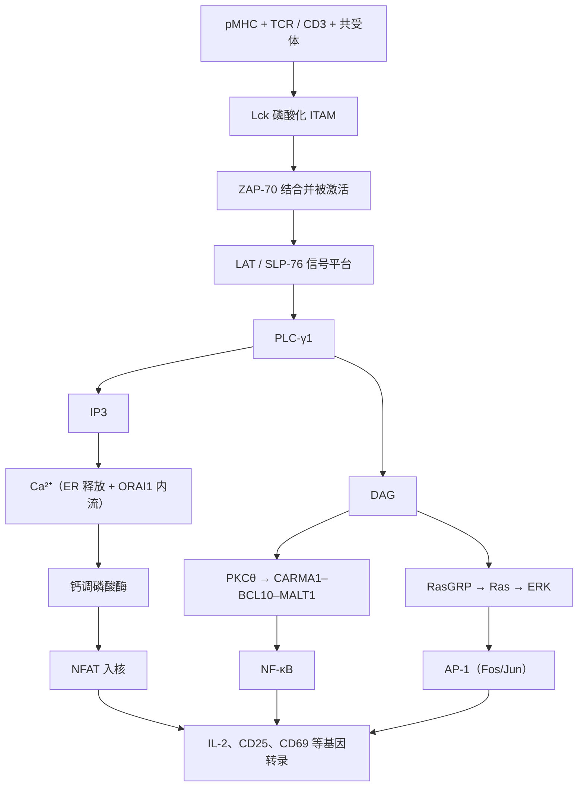

知识路径的第三问是"识别之后怎样决定"。一个初始 T 细胞在淋巴结中遇到展示其同源 pMHC 的树突状细胞（[7.15.14](/7.15.14)）之后，要在几小时内决定：是增殖并分化为效应细胞，还是忽略、失能或死亡。这个决定不是由 TCR 单独做出的，而是整合三类信号：TCR 识别 pMHC 给出"是什么"（第一信号），共刺激分子给出"是否危险"（第二信号），细胞因子给出"怎样应答"（第三信号）。本章讲前两个信号的分子机制、TCR 怎样从微弱的亲和力差别中做出极其灵敏而特异的判断，以及第三信号中最基本的 IL-2；第三信号怎样决定效应亚群见 [7.15.17](/7.15.17)，活化之后的扩增与记忆见 [7.15.18](/7.15.18)，"刹车"（共抑制受体与检查点）的细节见 [7.15.25](/7.15.25)。信号转导的一般原理（激酶级联、第二信使、转录因子的激活）见 [7.1.14](/7.1.14)、[7.1.15](/7.1.15) 与 [7.3.19](/7.3.19)，这里只讲 T 细胞特有的部分。

## 16.1. T 细胞与 APC 的相遇

**定义 16.1.1（T 细胞活化）** 初始或记忆 T 细胞经 TCR 识别同源 pMHC 并接受共刺激与细胞因子信号后，进入细胞周期、增殖并分化为效应细胞的过程称为 **T 细胞活化**。

在淋巴结 T 细胞区中，初始 T 细胞以每分钟约 10 µm 的速度在成纤维网状细胞网络上随机游走，每小时与上百个 DC 接触（[7.15.3](/7.15.3)、[7.15.22](/7.15.22)）。接触先是非特异性的：

| T 细胞 | APC | 作用 |
|---|---|---|
| LFA-1（CD11a/CD18，**整联蛋白**） | ICAM-1（CD54）、ICAM-2、ICAM-3 | 主要的黏附；TCR 信号使 LFA-1 由低亲和构象转为高亲和构象（"由内向外"信号） |
| CD2 | CD58（LFA-3；小鼠为 CD48） | 黏附，并增强信号 |
| ICAM-3（CD50） | DC-SIGN（CD209） | DC 与 T 细胞的最初接触 |

若 TCR 没有识别到同源 pMHC，几分钟后 T 细胞与 APC 解离，继续扫描；若识别到，TCR 信号迅速激活 LFA-1，T 细胞停止运动，与 APC 形成持续数小时的稳定结合。活体双光子成像把这一过程分为三个时相：最初约 8 h 的短暂多次接触，随后约 12 h 的稳定结合（此时分泌 IL-2、表达 CD69 与 CD25），然后 T 细胞恢复运动并开始分裂。

## 16.2. TCR–CD3 复合物与共受体

αβTCR 的胞内段只有几个氨基酸，不能传递信号。信号由与之非共价结合的 CD3 分子传递：一个 TCR 复合物由 TCRαβ、CD3εγ、CD3εδ 与 ζζ 同二聚体组成，跨膜区的带电残基把它们组装在一起。

**定义 16.2.1（免疫受体酪氨酸激活基序）** **免疫受体酪氨酸激活基序**（ITAM）是免疫受体信号亚基胞内段的一段序列 YxxL/I-x$_{6\text{–}8}$-YxxL/I；两个酪氨酸被 Src 家族激酶磷酸化后，成为含两个 **SH2 结构域**的激酶（T 细胞中的 ZAP-70，B 细胞与髓系细胞中的 Syk）的结合位点。

一个 TCR 复合物有 10 个 ITAM：CD3γ、δ 与两个 ε 各一个，两条 ζ 链各三个。BCR 的 Igα/Igβ、Fc 受体的 γ 链、NK 细胞活化受体的 DAP12 都使用 ITAM，是免疫系统中活化受体的通用模块；与之对应的抑制性模块是 ITIM（[7.15.25](/7.15.25)）。

**定义 16.2.2（共受体）** 与 TCR 识别同一个 pMHC 上的不同部位、本身不决定特异性但增强 TCR 信号的分子称为**共受体**：CD4 以 D1 结构域结合 MHC II 类分子的 β2 结构域，CD8（αβ 异二聚体）结合 MHC I 类分子的 α3 结构域（[7.15.13](/7.15.13)）。

共受体的作用有二：一是增加 T 细胞与 APC 的结合；更重要的是把激酶 Lck 带到 TCR 旁——CD4 与 CD8α 的胞内段以锌离子配位的方式结合 Lck。共受体的参与使 T 细胞对配体的敏感性提高约百倍。共受体–MHC 的类别对应正是在胸腺中决定 CD4/CD8 谱系的基础（[7.15.15](/7.15.15)）。CD4 还是 HIV 进入细胞的受体，这是 HIV 感染专门耗竭 CD4⁺ T 细胞的原因（[7.15.31](/7.15.31)）。

TCR 识别有三个看似矛盾的性质：

1. 亲和力低：TCR–pMHC 的解离常数在 $1$–$100\,\mu\mathrm{M}$，结合半衰期只有秒级，比抗体–抗原低 3–6 个数量级；
2. 灵敏度极高：T 细胞能对 APC 表面仅数个（1–10 个）同源 pMHC 起反应，而这些 pMHC 淹没在 $10^5$ 个自身 pMHC 之中；
3. 特异性极高：结合寿命只差几倍的配体（激动剂与自身肽、或只差一个残基的变体肽）可以引起完全不同的应答，甚至是拮抗。

§16.4 的动力学校对模型是解释这三点的经典框架。

## 16.3. 免疫突触

**定义 16.3.1（免疫突触）** T 细胞与 APC（或 CTL 与靶细胞）接触面上，受体、配体与信号分子按大小与功能分成同心区域的有组织结构称为**免疫突触**：中央超分子活化簇（cSMAC）含 TCR–pMHC、CD28 与 PKCθ；外周环（pSMAC）含 LFA-1–ICAM-1 与踝蛋白；远端环（dSMAC）含胞外段很大的 CD45、CD43。

突触在接触后几分钟内形成。成像研究显示，真正发出信号的是接触面外周不断形成的 TCR 微簇（含 TCR、Lck、ZAP-70、LAT、SLP-76），它们沿肌动蛋白流向中央移动；cSMAC 主要是 TCR 被内吞降解、信号终止的地方，同时也是 CD28 共刺激信号的位置。

分区的物理基础是分子的大小：TCR–pMHC 与 CD28–CD80 的跨度约 15 nm，LFA-1–ICAM-1 约 40 nm，CD45 的胞外段更大。紧密接触的区域容不下 CD45，于是磷酸酶被排出 TCR 所在的区域，激酶与磷酸酶的平衡偏向磷酸化，这就是 TCR 触发的动力学分离模型（kinetic segregation）。它与动力学校对并不矛盾：前者解释信号怎样被启动，后者解释信号怎样区分配体。突触还使 T 细胞极化：微管组织中心转向接触面，细胞因子（如 IL-2、IFN-γ）与 CTL 的溶细胞颗粒朝 APC 或靶细胞定向释放（[7.15.17](/7.15.17)）。

## 16.4. 第一信号

### 16.4.1. TCR 信号级联

TCR 识别 pMHC 后，信号沿一条清楚的级联传递，最终激活三个转录因子 NFAT、AP-1 与 NF-κB，它们在 IL-2 等基因的启动子上协同作用：

1. 共受体带来的 Lck 磷酸化 CD3 与 ζ 链的 ITAM（CD45 的磷酸酶活性维持 Lck 处于可被激活的状态，缺乏 CD45 的 T 细胞不能经 TCR 传递信号）；
2. ZAP-70 以两个 SH2 结构域结合双磷酸化的 ITAM，被 Lck 磷酸化而激活；
3. ZAP-70 磷酸化接头蛋白 LAT 与 SLP-76，二者组装成信号平台，招募 PLC-γ1、Grb2–SOS、Vav、Itk 与 PI3K；
4. PLC-γ1 水解 PIP2，产生两个**第二信使** IP3 与 DAG：
   - IP3 → 内质网释放 Ca²⁺ → 内质网钙耗竭被 STIM1 感知，开启质膜上的 ORAI1 钙通道（钙释放激活的钙通道，CRAC）→ 持续的胞内 Ca²⁺ 升高 → **钙调蛋白**激活磷酸酶钙调磷酸酶 → NFAT 去磷酸化入核；
   - DAG → **蛋白激酶 C** 的 θ 亚型（PKCθ）→ CARMA1–BCL10–MALT1 复合物 → IKK → **NF-κB**；
   - DAG → RasGRP → Ras（**小 G 蛋白**）→ **MAP 激酶级联**（ERK）→ Fos；JNK → Jun；Fos–Jun 即 AP-1。

**注 16.4.1** NFAT 与 AP-1 在许多启动子上必须协同结合。只有钙信号而没有足够的 AP-1（例如 TCR 信号而缺乏共刺激）时，NFAT 单独诱导的是一套抑制性基因，使细胞进入**克隆失能**（[7.15.24](/7.15.24)）。这是第二信号在分子水平上必要的一个原因。钙调磷酸酶抑制剂环孢素 A 与他克莫司（FK506）分别与亲环蛋白和 FKBP12 形成复合物抑制钙调磷酸酶，阻断 NFAT 入核，是器官移植中最主要的免疫抑制药物（[7.15.29](/7.15.29)）。

:::

### 16.4.2. 动力学校对

T 细胞怎样从结合寿命只差几倍的配体中做出截然不同的判断？McKeithan（1995）把 Hopfield 提出的**动力学校对**应用于 TCR：TCR 与 pMHC 结合后，要依次完成 $N$ 步修饰（ITAM 磷酸化、ZAP-70 结合与激活、LAT 磷酸化……）才发出信号；在任何一步，只要 pMHC 解离，复合物就回到起点。

**例 16.4.1（TCR 的动力学校对模型）** 设每一步修饰的速率为 $k_{\mathrm{p}}$，pMHC 的解离速率为 $k_{\mathrm{off}}$，结合寿命 $\tau = 1/k_{\mathrm{off}}$。每一步在解离之前完成的概率是 $k_{\mathrm{p}}/(k_{\mathrm{p}} + k_{\mathrm{off}})$，因此一次结合能到达信号状态的概率是

$$
f(\tau) = \left(\frac{k_{\mathrm{p}}}{k_{\mathrm{p}} + k_{\mathrm{off}}}\right)^{N} = \left(\frac{k_{\mathrm{p}}\tau}{1 + k_{\mathrm{p}}\tau}\right)^{N}.
$$

当 $k_{\mathrm{p}}\tau \ll 1$ 时 $f \approx (k_{\mathrm{p}}\tau)^N$：寿命差 3 倍的两种配体，信号差 $3^N$ 倍。取示意值 $k_{\mathrm{p}} = 1\,\mathrm{s^{-1}}$，比较 $\tau = 3\,\mathrm{s}$ 的激动剂与 $\tau = 1\,\mathrm{s}$ 的类自身配体：

| $N$ | $f(3\,\mathrm{s})$ | $f(1\,\mathrm{s})$ | 区分比 |
|---|---|---|---|
| 0 | 1 | 1 | 1 |
| 3 | 0.42 | 0.125 | 3.4 |
| 6 | 0.18 | 0.016 | 11 |
| 10 | 0.056 | 0.00098 | 58 |

步数越多，区分越好，但代价是激动剂本身能触发信号的比例也下降（$N = 10$ 时只剩约 6%），平均需要更长时间。T 细胞以两种方式弥补灵敏度的损失：一个 pMHC 能在几秒内依次与许多个 TCR 结合（"连续触发"，估计一个 pMHC 可触发上百个 TCR）；以及信号网络中的正反馈（如 SOS 被 Ras-GTP 变构激活）把少数信号放大为全或无的反应。

:::

基本模型说明了"为什么对寿命极度敏感"，但没有解释两件事：大量弱配体为什么不会累积起来触发应答，以及弱配体为什么能拮抗强配体。后来的模型在校对链上加入负反馈（如磷酸酶 SHP-1 被弱信号激活并抑制邻近的 TCR，而强信号激活的 ERK 使 Lck 免受 SHP-1 的作用），从而得到"适应性"的校对，能同时解释灵敏度、特异性与拮抗现象。这些模型也是胸腺选择中陡峭阈值的分子基础（[7.15.15](/7.15.15)）。

## 16.5. 第二信号：共刺激

初始 T 细胞只接受 TCR 信号时不会被完全活化，反而进入失能。为此需要第二个信号，它由 APC 在感知危险之后才表达的分子提供。这一"双信号"的思想由 Bretscher 与 Cohn（1970）最早针对 B 细胞提出，Lafferty 与 Cunningham（1975）推广到 T 细胞；Jenkins 与 Schwartz（1987）证明只有第一信号会导致失能；Janeway（1989）把它与固有免疫连接起来：APC 只有在模式识别受体感知到微生物之后才表达共刺激分子，所以第二信号把"是否值得应答"的判断交给了固有免疫。

**定义 16.5.1（共刺激分子）** 在 T 细胞（或 B 细胞）与 APC 之间传递 TCR（或 BCR）以外的、为完全活化所必需的辅助信号的细胞表面分子及其配体称为**共刺激分子**；广义上也包括传递抑制信号的共抑制分子。

最重要的共刺激是 CD28 与 B7 分子 CD80（B7-1）、CD86（B7-2）的结合。CD28 招募 PI3K 与 Grb2，作用是：增强 IL-2 基因的转录并稳定其 mRNA；诱导抗凋亡蛋白 Bcl-xL；通过 Akt–mTOR 促进葡萄糖摄取与**糖酵解**，为增殖提供代谢支持；降低活化所需的 TCR 信号阈值。静息 DC 的 CD80/86 很低，成熟后显著上调（[7.15.14](/7.15.14)）。

| 家族 | T 细胞上的分子 | 配体（APC 等） | 作用 |
|---|---|---|---|
| CD28 家族（Ig 超家族） | CD28 | CD80、CD86 | 最主要的共刺激：启动初始 T 细胞 |
| | ICOS | ICOSL | 效应与记忆 T 细胞；Tfh 的分化与维持 |
| | **CTLA-4** | CD80、CD86（亲和力高于 CD28） | 共抑制：竞争配体、经转内吞夺走 APC 上的 B7 |
| | **PD-1** | PD-L1、PD-L2 | 共抑制：招募 SHP-2，抑制 TCR 与 CD28 信号 |
| TNF 受体家族 | 4-1BB（CD137） | 4-1BBL | 促进 CD8⁺ T 细胞的存活与记忆 |
| | OX40（CD134） | OX40L | 促进 CD4⁺ 效应与记忆细胞的存活 |
| | CD27 | CD70 | 初始 T 细胞的扩增与记忆形成 |
| | GITR | GITRL | 共刺激；调节 Treg |
| TNF 家族（T 细胞提供的配体） | CD40L（CD154） | CD40（DC、B 细胞、巨噬细胞） | T 细胞活化 APC：DC 的许可、B 细胞的帮助与类别转换、巨噬细胞的活化 |
| 其他 | CD2 | CD58 | 黏附并增强信号 |

**CTLA-4** 与 **PD-1** 是两个主要的**免疫检查点**：CTLA-4 在活化后的 T 细胞与 Treg 上表达，在启动阶段于淋巴器官中限制共刺激；PD-1 在持续受刺激的效应 T 细胞上表达，在外周组织中限制效应功能。它们的机制、在耗竭与耐受中的作用以及阻断治疗的原理见 [7.15.25](/7.15.25)。

## 16.6. 第三信号与 IL-2

第三信号是 APC 与周围环境提供的细胞因子，它决定 T 细胞分化成什么：对 CD4⁺ T 细胞，IL-12 导向 Th1，IL-4 导向 Th2，TGF-β 加 IL-6 导向 Th17（[7.15.17](/7.15.17)）；对 CD8⁺ T 细胞，IL-12 与 I 型干扰素促进效应功能与存活。T 细胞自身产生的最重要的细胞因子是 IL-2。

**定义 16.6.1（白细胞介素-2）** **白细胞介素-2**（IL-2）是活化 T 细胞（主要是 CD4⁺ T 细胞）分泌的约 15 kDa 的四螺旋束细胞因子，通过 IL-2 受体以自分泌与旁分泌的方式促进 T 细胞的增殖与存活，并维持调节性 T 细胞。

IL-2 受体由三条链组成，组合决定亲和力：

| 受体形式 | 链 | 解离常数 | 表达细胞 |
|---|---|---|---|
| 低亲和力 | α（CD25） | 约 $10^{-8}\,\mathrm{M}$ | 不传递信号 |
| 中亲和力 | β（CD122）+ γc（CD132） | 约 $10^{-9}\,\mathrm{M}$ | NK 细胞、记忆 CD8⁺ T 细胞、静息 T 细胞 |
| 高亲和力 | α + β + γc | 约 $10^{-11}\,\mathrm{M}$ | 活化 T 细胞、Treg（组成性高表达 CD25） |

γc 是 IL-2、IL-4、IL-7、IL-9、IL-15、IL-21 受体共用的**共同 γ 链**（[7.15.11](/7.15.11)），其基因 *IL2RG* 的突变导致 X 连锁的重症联合免疫缺陷（[7.15.31](/7.15.31)）。IL-2 受体经 JAK1、JAK3 激活 STAT5（**JAK–STAT 通路**），同时激活 PI3K–Akt–mTOR 与 MAPK 通路。

活化的时间进程大致如下（初始 T 细胞，体外刺激）：

| 时间 | 事件 |
|---|---|
| 秒–分钟 | ITAM 磷酸化、钙内流、突触形成 |
| 1–2 h | 即早基因：*FOS*、*MYC*；CD69 上调（最早的活化标志物（activation marker），使 T 细胞暂时滞留在淋巴结中） |
| 数小时 | IL-2 mRNA 与分泌；CD25 上调 |
| 约 24 h | 母细胞化：细胞体积增大，代谢转向有氧糖酵解 |
| 24–48 h | 第一次分裂；此后 CD8⁺ T 细胞约每 6–8 h 分裂一次 |
| 3–5 d | 分化为效应细胞，下调 CD62L 与 CCR7，离开淋巴结 |

IL-2 并不是增殖所绝对必需的（IL-2 缺陷小鼠仍有 T 细胞应答），但它是 Treg 维持所必需的：IL-2 或 CD25 缺陷的小鼠与病人反而出现严重的自身免疫。低剂量 IL-2 选择性扩增 Treg 的治疗思路由此而来。

## 16.7. CD8⁺ T 细胞的活化与 CD4 帮助

初始 CD8⁺ T 细胞的活化比 CD4⁺ T 细胞要求更高，有两种方式：

- 不依赖 Th：DC 自身被病毒感染或受到强烈的模式识别信号时，表达足够多的共刺激分子与 IL-12、I 型干扰素，CD8⁺ T 细胞也能自身产生 IL-2；
- 依赖 Th：在多数情形下（如抗原经交叉提呈、DC 未被直接感染），同一个 DC 同时把抗原提呈给 CD4⁺ 与 CD8⁺ T 细胞；CD4⁺ T 细胞的 CD40L 激活 DC 的 CD40（DC 的"许可"），使 DC 上调 CD80/86、CD70、4-1BBL 与 IL-12，CD4⁺ T 细胞还就近提供 IL-2。

正常情况下 CD8⁺ T 细胞自身产生的 IL-2 不足以维持充分的增殖。缺乏 CD4 帮助启动的 CD8⁺ T 细胞初次应答常常仍可发生，但形成的记忆细胞再次应答很差，并更易发生活化诱导的死亡，这是 CD4 帮助最突出的效果（[7.15.18](/7.15.18)）。

## 16.8. 活化的结局与 CAR-T

| 信号组合 | 结局 |
|---|---|
| 第一 + 第二 + 第三信号 | 完全活化：增殖、分化为效应细胞，一部分成为记忆细胞 |
| 只有第一信号（APC 未成熟，缺乏共刺激） | 失能，或分化为调节性 T 细胞 |
| 没有第一信号（抗原不在淋巴器官中或量太少） | 免疫忽视 |
| 反复强烈的刺激 | 活化诱导的细胞死亡（Fas–FasL）|

失能、免疫忽视与活化诱导的细胞死亡是外周耐受的机制，细节见 [7.15.24](/7.15.24) 与 [7.15.25](/7.15.25)。完全活化后，细胞的去向（短命效应细胞或记忆前体）见 [7.15.18](/7.15.18)。

### 16.8.1. CAR-T 的设计原理

天然 T 细胞识别肿瘤要依赖肿瘤细胞表达 MHC I 类分子、提呈肿瘤抗原肽，并有 APC 提供共刺激；肿瘤细胞常下调 MHC I 类分子，也缺少共刺激配体，T 细胞的天然通路因此常常中断。**嵌合抗原受体 T 细胞**（CAR-T）绕开这条多步骤的接力：给 T 细胞装上一个人工受体，把"识别"与"信号"两部分直接拼在一起。

嵌合抗原受体（CAR）由四部分组成，从胞外到胞内依次是：

| 部分 | 来源 | 作用 |
|---|---|---|
| 抗原结合区 | 抗体的单链可变区 scFv（VH 与 VL 以接头连成） | 以抗体的方式识别肿瘤细胞表面的抗原，不需要 MHC |
| 铰链与跨膜区 | CD8α 或 CD28 | 决定抗原结合区离膜的距离与受体的稳定性 |
| 共刺激结构域 | CD28 或 4-1BB | 提供第二信号 |
| 信号结构域 | CD3ζ（含 ITAM） | 提供第一信号 |

天然通路是"pMHC → TCR → CD3 → 再招募共刺激分子 → 信号放大"的多步骤接力，依赖 MHC 的表达、信号启动的效率与肿瘤细胞是否表达共刺激配体；CAR 结合靶抗原后，直接且同步地启动 CD3ζ 与共刺激两路信号。代价是 CAR 只能识别细胞表面的蛋白抗原，且不经过动力学校对的细致筛选，信号强度与对靶抗原密度的要求由 CAR 的设计决定。CAR-T 的临床应用与局限见 [7.15.30](/7.15.30)。

## 小结

- 初始 T 细胞的活化需要三类信号：TCR 识别 pMHC（第一信号）、共刺激（第二信号）、细胞因子（第三信号）；定义 16.1.1。
- 黏附先于识别：LFA-1–ICAM-1 为主；TCR 信号经由内向外信号使 LFA-1 转为高亲和构象，T 细胞停止运动。
- TCR 的信号由 CD3 与 ζ 链的 10 个 ITAM（定义 16.2.1）传递；共受体（定义 16.2.2）CD4/CD8 带来 Lck，使灵敏度提高约百倍。
- 免疫突触（定义 16.3.1）按分子大小分区；大分子磷酸酶 CD45 被排出紧密接触区，是 TCR 触发的动力学分离模型的基础。
- 第一信号级联：

| 步骤 | 分子 | 结果 |
|---|---|---|
| 起始 | Lck、ZAP-70 | ITAM 磷酸化，ZAP-70 激活 |
| 平台 | LAT、SLP-76 | 招募 PLC-γ1、Grb2–SOS、Vav 等 |
| 第二信使 | IP3、DAG | 钙内流；PKCθ；RasGRP |
| 转录因子 | NFAT、NF-κB、AP-1 | 共同诱导 IL-2 等基因 |

- 动力学校对（例 16.4.1）：$f(\tau) = \bigl(k_{\mathrm{p}}\tau/(1 + k_{\mathrm{p}}\tau)\bigr)^{N}$ 使信号对结合寿命的 $N$ 次幂敏感，解释低亲和力、高灵敏度与高特异性的并存；代价是触发比例降低，由连续触发与正反馈补偿。
- 共刺激（定义 16.5.1）：CD28–CD80/86 最重要；CTLA-4 与 PD-1 是共抑制的检查点；CD40L 活化 APC。只有第一信号时，NFAT 单独诱导抑制性基因，细胞失能（注 16.4.1）。
- IL-2（定义 16.6.1）经由高亲和力受体 α + β + γc 与 JAK–STAT 通路促进增殖；它对 Treg 的维持比对增殖更不可缺少。
- CD8⁺ T 细胞的完全活化常依赖 CD4⁺ T 细胞经 CD40L 对 DC 的许可；CAR 把抗体的识别与 CD3ζ、共刺激信号拼成单一受体。

## 思考题

1. 为什么 T 细胞要求第二信号才完全活化？从分子水平与功能意义两方面回答。

   **答** 分子水平：只有 TCR 信号而缺乏 CD28 信号时，钙信号激活 NFAT，但 AP-1 与 NF-κB 不足，NFAT 单独诱导的是抑制性基因程序（注 16.4.1），细胞失能；CD28 还增强 IL-2 转录、稳定其 mRNA、诱导 Bcl-xL、促进糖酵解并降低 TCR 信号阈值。功能意义：初始 T 细胞识别的是自身 MHC 上的肽，肽本身不能区分自身与病原体；第二信号只有在 APC 经模式识别受体感知微生物之后才大量表达，因此把"是否危险"的信息交给固有免疫，避免对无害的自身与环境抗原产生应答。

2. 取 $k_{\mathrm{p}} = 1\,\mathrm{s^{-1}}$，$N = 6$，计算结合寿命 $\tau = 10\,\mathrm{s}$ 的配体与 $\tau = 1\,\mathrm{s}$ 的配体的信号比，并与 $N = 0$ 的结果比较。这个结果怎样说明"T 细胞对结合寿命而不对亲和力线性敏感"？

   **答** $f(10) = (10/11)^6 \approx 0.564$，$f(1) = (1/2)^6 \approx 0.0156$，比值约 36；$N = 0$ 时两者都是 1，比值为 1，信号与寿命无关。寿命只差 10 倍，信号差 36 倍；当 $k_{\mathrm{p}}\tau \ll 1$ 时比值趋近 $\tau$ 之比的 $N$ 次幂，这种高阶（超线性）的依赖使寿命略长的激动剂与略短的自身配体得到截然不同的应答。

3. 缺乏 CD45 的 T 细胞为什么不能通过 TCR 传递信号？免疫突触中 CD45 的位置有什么意义？

   **答** CD45 的磷酸酶活性去除 Lck 抑制性位点上的磷酸基，使 Lck 处于可被激活的状态；没有 CD45，Lck 不能被激活，ITAM 不被磷酸化，信号不能起始。在突触中，CD45 因胞外段很大被排出 TCR–pMHC 紧密接触区（约 15 nm），使局部激酶/磷酸酶比例偏向磷酸化，这是动力学分离模型：TCR 的触发不需要构象变化，只需要把大的磷酸酶挡在外面。

4. （开放题）CAR-T 把 scFv、共刺激结构域与 CD3ζ 拼在一起，比起天然的 TCR 通路有什么优势？又可能带来哪些问题？

   **答** 思路：优势——不依赖 MHC 与抗原加工，因而不受肿瘤下调 MHC I 类分子的影响；识别靠抗体，亲和力高；同时给出第一与第二信号，不需要肿瘤细胞表达共刺激配体。问题——只能识别细胞表面的蛋白抗原；信号强度高而不经动力学校对的筛选，对低密度抗原的灵敏度与对正常组织上同一抗原的"在靶不在瘤"毒性需要权衡；持续的强信号可能引起细胞耗竭与细胞因子风暴（[7.15.25](/7.15.25)、[7.15.30](/7.15.30)）。
