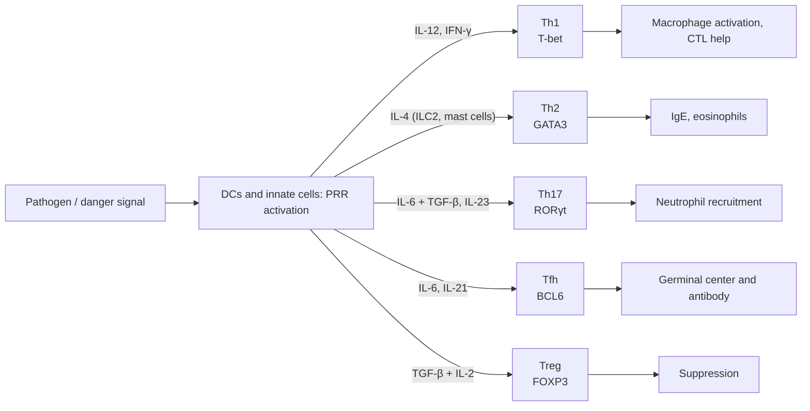

The fourth question on the knowledge path is "which effector clears the threat?" Chapter [7.15.16](/7.15.16) described how a naive T cell is activated by three kinds of signal; of these, the third signal (cytokines) determines what it differentiates into, and that is the subject of this chapter. Different antigens require different effectors: intracellular pathogens and tumors depend on activated macrophages and killer T cells, parasites depend on IgE, eosinophils and mast cells, extracellular bacteria and fungi depend on neutrophils, the antibody response of B cells depends on help within the follicle, and all of these responses must eventually be switched off. CD4⁺ T cells encode the decision of "which one to choose" as several subsets, each operating by the same three-layer logic: polarizing cytokines → master regulator → effector cytokines; CD8⁺ T cells instead differentiate into cytotoxic T lymphocytes, which kill target cells directly. This chapter first gives this logic, then covers the subsets one by one, then uses a bistability model to explain why the subsets exclude one another, and finally covers CTLs. Corresponding to ILC1, ILC2 and ILC3 of innate immunity ([7.15.5](/7.15.5)), the three effector modules (type 1, type 2 and type 3 immunity) each have their own T-cell subsets in adaptive immunity. The structure and receptors of cytokines are covered in [7.15.11](/7.15.11), expansion and memory after activation in [7.15.18](/7.15.18), and the "brakes" on Tregs and effector cells in [7.15.24](/7.15.24) and [7.15.25](/7.15.25).

## 17.1. Classification of T Cells

T cells can be classified along four mutually independent dimensions, and one cell carries one label in each dimension.

| Dimension | Categories | Basis |
|---|---|---|
| Stage of activation | Naive T cells, effector T cells, memory T cells | Whether antigen has been encountered; effector cells live days to weeks, do not recirculate and migrate to sites of inflammation; memory cells can live for years ([7.15.18](/7.15.18)) |
| TCR type | αβ T cells, γδ T cells | αβ recognize peptides presented by MHC; the γδ repertoire is limited and recognizes heat shock proteins, lipids and phosphorylated metabolites, among others, without classical MHC restriction; they are mostly distributed in skin and mucosal epithelia and make up only a few percent of peripheral blood T cells ([7.15.15](/7.15.15)) |
| Coreceptor | CD4⁺, CD8⁺ | Determines whether MHC class II or class I molecules are recognized ([7.15.13](/7.15.13), [7.15.15](/7.15.15)) |
| Function | Helper T cells (Th), cytotoxic T lymphocytes (CTL), regulatory T cells (Treg) | Effector function; Th and Treg come from CD4⁺ cells, CTLs from CD8⁺ cells |

CD4 and CD8 answer only "what is recognized," whereas function answers "what is done." The two largely correspond but do not coincide completely: a few CD4⁺ T cells are cytotoxic, and a few CD8⁺ T cells have regulatory functions. This chapter covers the dimension of function.

## 17.2. General Rules of CD4⁺ T-Cell Differentiation

**Definition 17.2.1 (Helper T Cell)** Effector T cells that express CD4, recognize peptides presented by MHC class II molecules, and help other immune cells (macrophages, B cells, CD8⁺ T cells, neutrophils and others) complete their responses through cell-surface molecules and cytokines are called **helper T cells** (Th cells).

Th cells were once thought to be a single kind of cell. In 1986, Mosmann and Coffman analyzed the cytokine profiles of mouse CD4⁺ T-cell clones and found that the clones did not each secrete all cytokines but fell into two nonoverlapping classes: one secreting IFN-γ and TNF-α (Th1), and one secreting IL-4, IL-5 and IL-13 (Th2). This finding showed that the CD4⁺ T-cell population is functionally heterogeneous, and subsets such as Th17, Tfh and Treg were subsequently identified.

**Definition 17.2.2 (T-Cell Polarization)** The process in which a naive CD4⁺ T cell, during activation and according to the surrounding polarizing cytokines, differentiates toward a particular subset and stabilizes its effector functions is called **T-cell polarization**, also called Th differentiation.

The polarization of all subsets follows the same three-layer pattern:

1. Polarizing cytokines: produced by APCs, innate immune cells or the T cells themselves, they act as the third signal on the activated T cell. Which polarizing cytokines appear depends on which pattern recognition receptors the pathogen has activated ([7.15.6](/7.15.6)): double-stranded RNA causes DCs to produce IL-12 through TLR3; helminths cause mast cells, basophils and ILC2 to produce IL-4; certain fungi and bacteria induce IL-23 and IL-6 through receptors such as Dectin-1. Innate immunity thereby passes the information "what has come" to adaptive immunity.
2. STATs and master regulators: the receptors for polarizing cytokines activate particular STATs through the **JAK–STAT pathway**, and the STATs induce a **master regulator**, the transcription factor that determines the identity of the subset; it both switches on the effector genes of that subset and represses the master regulators of other subsets.
3. Effector cytokines: the characteristic cytokines induced by the master regulator act on target cells and in turn promote the subset itself and inhibit other subsets.

| Subset | Polarizing cytokines | STAT | Master regulator | Effector cytokines | Main targets and functions | Corresponding immunity type |
|---|---|---|---|---|---|---|
| Th1 | IL-12, IFN-γ, IL-18 | STAT4, STAT1 | T-bet | IFN-γ, TNF-α | Activate macrophages; promote CTLs and complement-fixing antibodies; anti-intracellular pathogens | Type 1 |
| Th2 | IL-4 | STAT6 | GATA3 | IL-4, IL-5, IL-13 | Class switching of B cells to IgE; eosinophils; mucus and helminth clearance | Type 2 |
| Th17 | TGF-β + IL-6 (IL-23 maintains) | STAT3 | RORγt | IL-17A, IL-17F, IL-22 | Epithelial and stromal cells; neutrophil recruitment; anti-extracellular bacteria and fungi | Type 3 |
| Tfh | IL-6, IL-21 | STAT3 | BCL6 | IL-21, IL-4 | Help B cells in the follicle; germinal centers | Humoral immunity |
| Treg | TGF-β, IL-2 | STAT5, Smad | FOXP3 | IL-10, TGF-β, IL-35 | Suppress responses; peripheral tolerance | Regulatory |

Th9 (PU.1, IRF4; IL-9) and Th22 (AHR; IL-22) are subsets described later, with functions related to anti-helminth immunity, allergy and skin inflammation, respectively; their boundaries with the main subsets are not as clear as in the table above, and whether they are independent lineages or variants of existing subsets is still debated, so they are not discussed here.

## 17.3. Th1 and Th2

**Definition 17.3.1 (Th1 Cell)** A **Th1 cell** is a CD4⁺ effector T cell polarized by IL-12 and IFN-γ, with the transcription factor T-bet as master regulator, that secretes IFN-γ and TNF-α; its function is to activate macrophages and support cytotoxic responses against intracellular pathogens.

IL-12 is produced by DCs and macrophages after activation of receptors such as TLRs; IFN-γ comes from NK cells and early activated T cells; IL-18 promotes the proliferation and IFN-γ production of developing Th1 cells. IL-12 acting through STAT4 and IFN-γ through STAT1 induce T-bet, which activates the *IFNG* gene and upregulates the β2 chain of the IL-12 receptor, making the cell more sensitive to IL-12, a positive feedback. IFN-γ acts widely:

- Activating macrophages: enhancing killing (respiratory burst, nitric oxide, [7.15.7](/7.15.7)), upregulating MHC class II molecules and CD80/86, and causing them to secrete more IL-12, which in turn strengthens Th1;
- Causing B cells to switch to classes that can fix complement and promote phagocytosis, such as mouse IgG2a (human IgG1 and IgG3) ([7.15.20](/7.15.20));
- Activating DCs and helping CD8⁺ T cells differentiate into CTLs (see §17.7).

Patients with inactivation of Th1 cells and the IFN-γ pathway are highly susceptible to mycobacteria (including BCG) ([7.15.31](/7.15.31)); conversely, a persistent Th1 response underlies delayed-type hypersensitivity and some autoimmune diseases ([7.15.27](/7.15.27), [7.15.28](/7.15.28)).

**Definition 17.3.2 (Th2 Cell)** A **Th2 cell** is a CD4⁺ effector T cell polarized by IL-4, with the transcription factor GATA3 as master regulator, that secretes IL-4, IL-5 and IL-13; its function is to coordinate type 2 immunity: helping B cells produce IgE, recruiting and activating eosinophils, and enhancing mucus secretion and smooth muscle contraction, against large parasites such as helminths.

The IL-4 that polarizes Th2 can come from ILC2, mast cells, basophils, NKT cells and Tfh cells, and Th2 cells also secrete IL-4 themselves, forming a positive feedback. IL-4 induces GATA3 through STAT6, and GATA3 activates the *IL4*, *IL5* and *IL13* genes. In the presence of IL-4, naive CD4⁺ T cells tend to differentiate into Th2 even when IL-12 and IFN-γ are also present, showing that Th2 polarization has a strong advantage. As to effects:

- IL-4 and IL-13 cause B cells to switch to **IgE** ([7.15.20](/7.15.20)); IgE binds to Fc receptors on mast cells and eosinophils, and cross-linking by helminth antigen causes the cells to degranulate;
- IL-5 recruits and activates **eosinophils**;
- IL-13 acts on epithelial cells to promote goblet cell hyperplasia and mucus secretion and causes smooth muscle contraction, which together expel helminths from the gut.

A Th2 response to a harmless antigen (pollen, dust mites) is allergy ([7.15.26](/7.15.26)). IL-10 was once regarded as a characteristic Th2 cytokine, but it is now known to be produced by many subsets, so it is no longer used as a Th2 marker.

## 17.4. Th17, Tfh and Other Subsets

**Definition 17.4.1 (Th17 Cell)** A **Th17 cell** is a CD4⁺ effector T cell polarized by TGF-β and IL-6, with the transcription factor RORγt as master regulator, that secretes IL-17A, IL-17F and IL-22; its function is to coordinate type 3 immunity: recruiting neutrophils and strengthening the defense of the epithelial barrier, against extracellular bacteria and fungi.

The discovery of Th17 cells came from a surprise: IL-12 and IL-23 share the p40 subunit, and the deficiency of p40-deficient mice was at first attributed entirely to loss of Th1, and only later was it learned that part of it was caused by another, IL-23-dependent, subset. TGF-β and IL-6 initiate expression of RORγt through STAT3; IL-23 alone cannot polarize naive cells but can stabilize Th17 cells and give them pro-inflammatory properties ("pathogenic Th17"). IL-17 acts on epithelial and stromal cells, causing them to produce CXCL8, G-CSF and antimicrobial peptides, thereby recruiting neutrophils and increasing their numbers; IL-22 strengthens the epithelial barrier and expression of antimicrobial peptides.

A typical example of Th17 deficiency is hyper-IgE syndrome (Job syndrome): a dominant-negative mutation of *STAT3* prevents the CD4⁺ T cells of patients from differentiating into Th17 cells, so they suffer recurrent *Staphylococcus aureus* and *Candida* infections of the skin and lung ([7.15.31](/7.15.31)). Conversely, excessive Th17 responses are associated with inflammatory bowel disease, psoriasis, rheumatoid arthritis and multiple sclerosis, and antibodies against IL-17 and IL-23 have been used to treat psoriasis and related diseases ([7.15.28](/7.15.28)).

**Definition 17.4.2 (T Follicular Helper Cell)** A **T follicular helper cell** (Tfh cell) is a CD4⁺ T cell polarized by IL-6 and IL-21, with the transcription factor BCL6 as master regulator, that expresses the chemokine receptor CXCR5 and enters the B-cell follicle, where it helps B cells form germinal centers through CD40L, ICOS and IL-21.

CXCR5 makes Tfh cells migrate toward CXCL13 in the follicle, while CCR7 is downregulated so that they leave the T-cell zone ([7.15.3](/7.15.3), [7.15.4](/7.15.4)); PD-1 and ICOS are highly expressed, and the latter is required to stabilize Tfh identity. BCL6 is a transcriptional repressor that directly represses expression of T-bet, GATA3 and RORγt, so Tfh cells exclude the other subsets; IL-2 inhibits Tfh differentiation. The interaction between Tfh cells and B cells (CD40L–CD40, ICOS–ICOSL, IL-21, IL-4) determines B-cell proliferation, class switching, affinity maturation and plasma cell differentiation within the germinal center; the mechanisms are covered in [7.15.20](/7.15.20). Abnormally increased Tfh cells are associated with diseases producing autoantibodies.

## 17.5. Regulatory T Cells

**Definition 17.5.1 (Regulatory T Cell)** A **regulatory T cell** (Treg cell) is a CD4⁺ T cell with the transcription factor **FOXP3** as master regulator, high expression of the IL-2 receptor α chain (CD25), and the ability to suppress the activation and function of other immune cells.

The maintenance of Tregs depends on IL-2: Tregs constitutively express high CD25 (the high-affinity IL-2 receptor, [7.15.16](/7.15.16)) and produce almost no IL-2 themselves, relying on Th cells and others to supply it. Mutations in FOXP3 cause severe autoimmunity: human IPEX syndrome (X-linked; polyendocrinopathy, enteropathy and immune dysregulation) and the corresponding *scurfy* mouse show that Tregs are an essential component of peripheral tolerance, continually suppressing self-reactivity even in healthy individuals ([7.15.24](/7.15.24)).

By origin, there are two kinds of Treg:

| Type | Origin | Induction conditions | Main role |
|---|---|---|---|
| Thymic Treg (tTreg, formerly nTreg) | Thymocytes receiving a stronger (but below the deletion threshold) self antigen signal in the thymus ([7.15.15](/7.15.15)) | TCR signal strength and IL-2 | Tolerance to self antigens |
| Peripheral Treg (pTreg, formerly iTreg) | Peripheral naive CD4⁺ T cells | TGF-β, retinoic acid and IL-2; especially in the gut | Tolerance to commensal bacteria, food antigens and fetal antigens ([7.15.23](/7.15.23)) |

The basis of Treg stability is demethylation of the *FOXP3* locus (the Treg-specific demethylated region): such cells maintain FOXP3 expression over long periods, whereas FOXP3-positive cells induced in vitro are often unstable. There are four groups of suppressive mechanisms:

| Mechanism | Molecules | Effect |
|---|---|---|
| Competition for IL-2 | CD25 | Takes away IL-2 needed by effector T cells |
| Inhibitory cytokines | IL-10, TGF-β, IL-35 | Inhibit APCs and effector T cells |
| Weakening APCs | CTLA-4 | Competes with CD28 and removes CD80/86 from DCs by transendocytosis, suppressing costimulation ([7.15.16](/7.15.16)) |
| Metabolism and lysis | Adenosine produced by CD39/CD73; granzymes and perforin | Suppress effector cells; direct killing of CTLs and NK cells has also been reported |

Tregs play roles in the resolution of inflammation, tolerance in pregnancy and tissue repair; Tregs in the tumor microenvironment suppress antitumor immunity ([7.15.30](/7.15.30)). Low-dose IL-2 selectively expands Tregs to treat autoimmune diseases; further details of Treg regulation are in [7.15.25](/7.15.25).

## 17.6. Mutual Inhibition, Plasticity and Bistability of Subsets

The subsets exclude one another: the cytokines of one subset promote its own differentiation and at the same time inhibit the others.

| Pair | Promote own subset | Inhibit the other |
|---|---|---|
| Th1 against Th2 | IFN-γ, IL-12, T-bet | IFN-γ inhibits Th2 proliferation; T-bet represses *GATA3* |
| Th2 against Th1 | IL-4, GATA3 | IL-4 reduces IL-12 production by APCs; GATA3 represses *TBX21* and *IFNG* |
| Th17 against Treg | TGF-β + IL-6, IL-21, IL-23 | IL-6 inhibits expression of FOXP3, giving RORγt the upper hand |
| Treg against Th17 | High-concentration TGF-β, retinoic acid | FOXP3 binds and represses RORγt |
| Tfh against the others | IL-6, IL-21, BCL6 | BCL6 represses T-bet, GATA3, RORγt |

The relationship between Th17 and Treg is particularly subtle: TGF-β alone induces FOXP3, and only with IL-6 added does it induce RORγt. TGF-β is abundant in healthy barrier tissues, where Tregs and anti-inflammatory Th17 cells predominate; only after pathogens invade and inflammatory cytokines increase is the balance pushed toward pro-inflammatory Th17.

On the other hand, subsets are not always permanent. Early in differentiation, Th1 and Th2 cells can express the other's cytokines under the other's polarizing conditions; once "committed," Th1 and Th2 are relatively stable; Th17 and Treg are more flexible: Th17 cells can convert into "Th1-like" cells producing IFN-γ or into cells producing IL-4, and some Tregs can produce IFN-γ or convert into Th17-like cells under IL-6 and TGF-β; Tfh cells often lose their characteristics after the response ends. This plasticity allows cells to adjust to the local environment, but it also makes the division into subsets somewhat artificial, and single-cell sequencing often shows a continuum rather than several isolated categories.

A circuit of mutual inhibition with positive feedback is exactly bistability in dynamics. The relationship between T-bet and GATA3 can be written as the simplest switch model:

**Example 17.6.1 (A Bistable Th1/Th2 Switch)** Let $x$ and $y$ be the (dimensionless) activities of T-bet and GATA3, and $s_1$ and $s_2$ the inputs toward Th1 and Th2 (corresponding to the induction brought by IL-12 and IL-4 through STATs). The two master regulators inhibit each other:

$$
\begin{aligned}
\frac{\mathrm{d}x}{\mathrm{d}t} &= s_1 + \frac{a}{1 + y^{n}} - x, \\
\frac{\mathrm{d}y}{\mathrm{d}t} &= s_2 + \frac{a}{1 + x^{n}} - y.
\end{aligned}
$$

Take the illustrative parameters $a = 3$ and $n = 3$ (the cooperativity of inhibition), with time in units of the degradation time. When $s_1 = s_2 = 0.05$ (almost no input), the system has three fixed points: the Th1 state $(x, y) \approx (3.04, 0.15)$ and the Th2 state $(0.15, 3.04)$ are stable, and the symmetric point $(1.18, 1.18)$ in between is a saddle whose stable manifold divides the plane into two basins of attraction (panel A). Once a naive T cell ($x \approx y$ both low and pushed to one side by early signals) crosses the dividing line, it settles stably into one subset, and the other master regulator is pushed very low. Gradually increase the Th1 input $s_1$ (panel B): starting from the Th2 state, when $s_1$ exceeds about 0.5 the cell flips entirely to the Th1 state; after the flip, even if $s_1$ is brought back to 0, the cell remains in the Th1 state, an irreversible "memory." If the opposing input is also present ($s_2 = 0.6$, corresponding to the presence of IL-4), the $s_1$ needed for the flip rises to about 0.72, and the circuit shows hysteresis: $s_1$ must fall below about 0.35 before the cell flips back.

:::

This model is a structure of the same kind as the bistable switches of [7.9.15](/7.9.15) and [7.9.16](/7.9.16) (stability analysis in [2.4.11](/2.4.11)) and shows three things: mutual inhibition is sufficient to produce two mutually exclusive subsets; polarizing cytokines act by shifting the threshold and not by changing the output linearly; and positive feedback (cytokines promoting their own production, such as IL-4 and IFN-γ) makes the decision stable and gives the T cell a kind of "memory." The model does not include self-promotion (autoactivation of T-bet and GATA3), diffusion of cytokines between cells, or stochasticity, and the behavior of the real system is far more complex; plasticity shows that under certain conditions this switch is not irreversible.

![The mutually inhibiting Th1/Th2 switch (illustrative parameters $a = 3$, $n = 3$). A: Phase plane for $s_1 = s_2 = 0.05$; the two thick lines are the nullclines of the two variables, and the background color marks the two basins of attraction (colored by the sign of $x - y$ after integrating the initial values to $t = 40$, with Th2 above and Th1 below); the filled dots are the stable Th1 and Th2 states, the open dot is the saddle, and the gray lines are several trajectories. B: Steady-state $x - y$ obtained by first increasing and then decreasing the Th1 input $s_1$ (solid line increasing, dashed line decreasing); with the opposing input $s_2 = 0.6$, the flipping threshold rises and hysteresis appears](./plots/th1-th2-toggle.py)

## 17.7. Helper Functions of Th Cells and the Three Effector Modules

Th cells do not themselves kill pathogens directly; they act by helping other cells, in four main ways:

| Beneficiary cell | Main helper | Molecular mechanism | Result |
|---|---|---|---|
| Macrophages | Th1 | CD40L–CD40 and IFN-γ (two signals); the macrophage in turn supplies IL-12 and CD80/86 | Activated macrophages: enhanced killing, MHC II upregulated; TNF-α and chemokines from Th1 recruit more monocytes |
| B cells | Tfh (and Th2) | CD40L, ICOS, IL-21, IL-4 | Class switching, affinity maturation, plasma cell differentiation |
| CD8⁺ T cells | Th1 | CD40L licenses the DC ([7.15.16](/7.15.16)); IL-2 | Fully activated CTLs, memory CD8⁺ T cells |
| Neutrophils and epithelium | Th17 | IL-17, IL-22, GM-CSF | Recruit and activate neutrophils, induce **neutrophil extracellular traps**, strengthen antimicrobial peptides |

Matching the three effector modules with T-cell subsets and innate immune cells gives the core of the knowledge path ([7.15.1](/7.15.1)):

| Module | Trigger | Innate cells | T cells | Effect |
|---|---|---|---|---|
| Type 1 immunity | Viruses, intracellular bacteria and parasites, tumors | NK cells, ILC1 | Th1, CTL | IFN-γ → macrophage activation; cell killing |
| Type 2 immunity | Helminths, allergens | ILC2, mast cells, basophils | Th2 | IL-4, IL-5, IL-13 → IgE, eosinophils, mucus |
| Type 3 immunity | Extracellular bacteria, fungi | ILC3, neutrophils | Th17 | IL-17, IL-22 → neutrophils, barrier defense |

The same DC providing different polarizing signals can initiate several modules at once; within each module the Th cells, CTLs and innate lymphoid cells use the same cytokine language and amplify one another (the positive feedback of IFN-γ and IL-12, the mutual reinforcement of IL-4 and IL-13). A mismatched response is the cause of disease: type 2 is the right one against helminths, type 1 against *Mycobacterium tuberculosis*, and type 3 against *Candida albicans*. The matching of these effectors with pathogens is developed in [7.15.32](/7.15.32).

## 17.8. CD8⁺ T Cells and CTL Killing

**Definition 17.8.1 (Cytotoxic T Lymphocyte)** A **cytotoxic T lymphocyte** (CTL, also called cytotoxic T cell or Tc) is an effector CD8⁺ T cell that recognizes peptides presented by MHC class I molecules and can induce apoptosis of target cells.

Almost all nucleated cells express MHC class I molecules, so CTLs can eliminate any cell infected by a virus or intracellular bacterium, mutated tumor cells, and cells in an allograft. Naive CD8⁺ T cells have no killing ability: after activation (including CD4 help, [7.15.16](/7.15.16)), they express transcription factors such as T-bet and EOMES, perforin and granzymes, become CTLs, and leave the lymph node for the site of infection.

### 17.8.1. The Process of Killing

CTL killing of a target cell is a highly directed process in four steps:

1. Binding: the TCR of the CTL recognizes pMHC I on the target cell, LFA-1–ICAM-1 stabilizes the contact, and an immunological synapse similar to that of [7.15.16](/7.15.16) forms;
2. Polarization: TCR signaling turns the microtubule-organizing center (centrosome) of the CTL toward the synapse, and the lytic granules containing perforin and granzymes are carried along microtubules to the edge of the synapse, with the endoplasmic reticulum and Golgi apparatus also relocating;
3. Lethal hit: the lytic granules fuse with the plasma membrane and release their contents into the synaptic cleft (see below);
4. Dissociation: after the lethal hit has been delivered, the CTL detaches from the target cell to look for the next target.

There are two pathways for the lethal hit:

| Pathway | Molecules | Mechanism |
|---|---|---|
| Granule exocytosis | **Perforin**, granzymes | Perforin forms pores in the target cell membrane (and promotes release of granzymes into the cytosol through endosomes); **granzymes** are serine proteases, and granzyme B cleaves substrates after aspartate, activating **caspases** directly or through BID and the mitochondrial pathway to induce **apoptosis**; granzymes can also cleave other target proteins and cause DNA fragmentation |
| Death receptors | FasL–Fas, TNF–TNFR | Activated CTLs upregulate FasL and secrete TNF-α; these bind the **death receptors** of the target cell and activate caspase 8 through the extrinsic apoptotic pathway ([7.3.25](/7.3.25)) |

Granule exocytosis acts fastest, with DNA fragmentation appearing in the target cell within minutes, and is the main mechanism; the Fas pathway is slower and is especially important when the granule pathway is defective and in terminating the response (activation-induced cell death, [7.15.25](/7.15.25)). Perforin-deficient CTLs and the CTLs of Fas-deficient mice can each still kill, but not when both are lacking. Patients with perforin deficiency develop familial hemophagocytic lymphohistiocytosis, an uncontrolled hyperinflammation; *FAS* mutations cause autoimmune lymphoproliferative syndrome, in which lymphocytes cannot be eliminated ([7.15.24](/7.15.24), [7.15.31](/7.15.31)).

How does the CTL avoid being killed by its own weapons, and how are neighboring bystander cells spared? One reason is polarized secretion: the granule contents are released only into the synaptic cleft, corresponding to the target cell; another is that the CTL itself expresses serine protease inhibitors (serpins) to resist granzymes and can quickly repair its plasma membrane; the lysosomal membrane protein CD107a (LAMP-1) is transiently exposed at the cell surface during granule exocytosis and is often used to mark cell degranulation ([7.15.35](/7.15.35)). In addition, the IFN-γ and TNF-α secreted by CTLs can directly inhibit viral replication and enhance MHC class I expression without killing. Other cytotoxic cells (NK cells, γδ T cells, a few CD4⁺ CTLs) use the same granule and death receptor mechanisms and differ in the mode of recognition ([7.15.5](/7.15.5), [7.15.21](/7.15.21)).

### 17.8.2. Dynamics of Serial Killing

A single CTL can kill several target cells in succession, which is serial killing. Each kill passes through searching, binding, delivery of the hit and dissociation, so the killing rate of a CTL has an upper limit, and its behavior closely resembles that of an enzyme.

**Example 17.8.1 (Saturation Kinetics of Serial Killing)** Let each kill occupy the CTL for time $t_{\mathrm{kill}}$, and let the rate at which a CTL finds its next target at target-cell density $T$ be $k_{\mathrm{c}} T$. The killing rate of each CTL is then

$$
v(T) = \frac{1}{t_{\mathrm{kill}} + 1/(k_{\mathrm{c}} T)} = V_{\max}\frac{T}{K + T}, \qquad V_{\max} = \frac{1}{t_{\mathrm{kill}}},\quad K = \frac{1}{k_{\mathrm{c}} t_{\mathrm{kill}}}.
$$

This has the same form as Michaelis–Menten kinetics (enzyme kinetics in [7.1.12](/7.1.12)): when target cells are abundant, the killing rate of the CTL saturates at $V_{\max}$; when target cells are scarce, the rate is proportional to $T$ and is determined by "finding." Take the illustrative values $t_{\mathrm{kill}} = 20\,\mathrm{min}$ and $V_{\max} = 3\,\mathrm{h^{-1}}$, consistent in order of magnitude with several target cells killed per CTL per hour in vitro. With $E$ CTLs, the number of target cells $T$ satisfies $\mathrm{d}T/\mathrm{d}t = -E\,v(T)$. Take $k_{\mathrm{c}} = 1\,\mathrm{h^{-1}}$ (in units of the initial target-cell density); for effector-to-target ratios $E{:}T$ of 1, 0.3, 0.1 and 0.03, clearing 90% of the target cells takes about 2.6, 8.7, 26 and 87 h, respectively: the time is roughly inversely proportional to $E{:}T$.

:::

This estimate shows that the number of CTLs, rather than the killing power of a single CTL, is the bottleneck for the clearance rate: this agrees with the fact in [7.15.18](/7.15.18) that CD8⁺ T cells must first expand more than $10^4$-fold to control an infection. When target cells are many and CTLs few, each CTL works close to $V_{\max}$ but the proportion cleared is small, so when the ratio of CTLs to tumor cells in a solid tumor is low, killing is often insufficient to control the tumor ([7.15.30](/7.15.30)).

## Summary

- General rules of CD4⁺ T-cell differentiation (Definition 17.2.2): polarizing cytokines (from innate recognition of the pathogen) → STAT → master regulator → effector cytokines; each subset promotes itself and inhibits the others.
- Subsets, master regulators and functions:

| Subset | Master regulator | Characteristic cytokines | Immunity type and function |
|---|---|---|---|
| Th1 (Definition 17.3.1) | T-bet | IFN-γ | Type 1: activate macrophages, help CTLs |
| Th2 (Definition 17.3.2) | GATA3 | IL-4, IL-5, IL-13 | Type 2: IgE, eosinophils, anti-helminth, allergy |
| Th17 (Definition 17.4.1) | RORγt | IL-17, IL-22 | Type 3: neutrophils, anti-extracellular bacteria and fungi |
| Tfh (Definition 17.4.2) | BCL6 | IL-21 | Help B cells, germinal centers |
| Treg (Definition 17.5.1) | FOXP3 | IL-10, TGF-β | Suppress responses, peripheral tolerance |

- Tregs are of two kinds, thymic and peripheral; suppressive mechanisms include depriving others of IL-2, inhibitory cytokines, weakening APCs through CTLA-4, and metabolic suppression; FOXP3 deficiency causes IPEX.
- Subsets inhibit one another: Th1–Th2 (T-bet and GATA3), Th17–Treg (TGF-β concentration and IL-6), Tfh (BCL6); mutual inhibition plus positive feedback forms a bistable switch (Example 17.6.1), and the action of polarizing signals is to shift the threshold so that the cell settles on one subset and retains a "memory." Plasticity makes the switch reversible under some conditions, especially for Th17 and Treg.
- The three effector modules organize NK/ILC cells, Th cells and CTLs into a unified response: type 1 (IFN-γ), type 2 (IL-4/5/13), type 3 (IL-17/22).
- CTL (Definition 17.8.1) killing: binding → polarization → lethal hit (perforin and granzymes; Fas–FasL and TNF) → dissociation. Serial killing follows saturation kinetics (Example 17.8.1), and the clearance rate is determined by the number of CTLs.

## Questions

1. A mouse lacks the IL-12 receptor β1 chain. How does its response differ in infection with an intracellular bacterium (such as a mycobacterium) and in infection with a helminth?

   **Answer** IL-12 receptor β1 is the chain shared by the IL-12 and IL-23 receptors, and its loss impairs both Th1 polarization (IL-12 → STAT4 → T-bet) and the IL-23-supported stabilization of Th17. In infection with mycobacteria, IFN-γ production is insufficient, macrophages cannot be activated effectively, and the infection cannot be controlled; patients likewise show high susceptibility to mycobacteria. In infection with helminths, Th2 polarization depends on IL-4 and not on IL-12, so the response is essentially normal, and may even be skewed toward Th2 because the suppression of Th2 by Th1 (through IFN-γ) is reduced.

2. TGF-β can induce Tregs and also takes part in inducing Th17. Explain this seemingly contradictory phenomenon and describe how the balance between the two changes during inflammation.

   **Answer** TGF-β alone upregulates FOXP3, driving the cell toward Treg; at the same time both FOXP3 and RORγt are induced. IL-6 (through STAT3) inhibits FOXP3 expression, giving RORγt the upper hand and turning the cell toward Th17; IL-21 and IL-23 further support Th17, whereas high concentrations of TGF-β and retinoic acid favor Tregs. In healthy barrier tissue TGF-β and retinoic acid are abundant, and Tregs and anti-inflammatory Th17 cells predominate; invasion by a pathogen causes APCs to produce pro-inflammatory factors such as IL-6 and IL-23, tipping the balance toward pro-inflammatory Th17 so that neutrophils can be mobilized, and it is restored after the infection resolves.

3. In the model of Example 17.6.1, if $s_2$ is increased from 0.05 to 0.6, how does the $s_1$ threshold required for flipping to Th1 change? What phenomenon in immunology does this correspond to?

   **Answer** The threshold rises from about 0.5 to about 0.72, and hysteresis appears: a cell that has already flipped to Th1 must wait until $s_1$ falls below about 0.35 before it can flip back to Th2. In immunological terms, the presence of IL-4 (as in the setting of helminth infection) strengthens the preference for Th2, and a stronger IL-12 / IFN-γ signal is needed to initiate Th1; the fact that IL-4 can still drive Th2 polarization when IL-12 and IFN-γ are also present is this asymmetry. The hysteresis corresponds to the stability and memory of effector subsets.

4. Why is the clearance rate of CTLs determined mainly by the ratio of CTLs to target cells and not by the killing power of a single CTL? According to Example 17.8.1, how long does it take to clear 99% of the target cells at $E{:}T = 0.03$?

   **Answer** The killing rate of each CTL has an upper limit $V_{\max} = 1/t_{\mathrm{kill}}$ (each kill occupies a fixed time), so the killing power of a single cell cannot be raised without limit; the clearance rate is $E\,v(T)$, which for small $T$ is proportional to $E$ and $T$, so $T$ declines exponentially with a time constant inversely proportional to $E{:}T$. The numerical solution gives about 164 h (about 7 days) to clear 99% at $E{:}T = 0.03$, far longer than the replication time of a pathogen in an infection, so CTLs must first expand greatly ([7.15.18](/7.15.18)).

5. (Open question) Th-cell subsets show marked plasticity. What does this imply for designing therapies against Th17? What outcomes might arise if only IL-17 is blocked?

   **Answer** Ideas: blocking IL-17 (or IL-23) can relieve Th17-driven diseases such as psoriasis, but subset plasticity means that pathogenic Th17 cells can convert into IFN-γ-producing cells that continue to cause inflammation, so blocking a single cytokine may be insufficient; the protection of the barrier by Th17 (against *Candida* and *Staphylococcus aureus*) is weakened, leading to infections such as mucosal candidiasis (corresponding to the manifestations in patients with STAT3 deficiency); in inflammatory bowel disease, blocking IL-17A may even worsen the disease, suggesting that IL-17 also has a protective role in maintaining the intestinal barrier, so the "protective" and "pathogenic" functions of Th17 in different diseases must be distinguished. Therapy design must consider both the balance of subsets (Th17/Treg) and the tissue environment.
