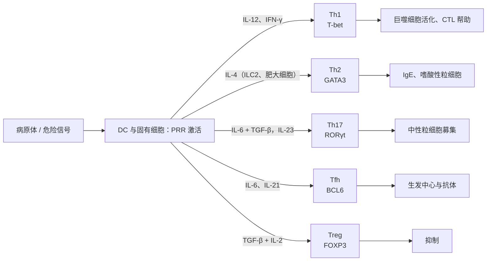

知识路径的第四问是"用什么效应清除"。[7.15.16](/7.15.16) 讲了初始 T 细胞怎样被三类信号活化；其中第三信号（细胞因子）决定它分化成什么，这就是本章的主题。抗原不同，需要的效应不同：胞内病原体与肿瘤要靠活化的巨噬细胞与杀伤性 T 细胞，寄生虫要靠 IgE、嗜酸性粒细胞与肥大细胞，胞外细菌与真菌要靠中性粒细胞，B 细胞的抗体应答要靠滤泡中的辅助，而所有这些应答最终都需要被关闭。CD4⁺ T 细胞把"选哪一种"的决定编码为几个亚群，每个亚群用同样的三层逻辑运作：极化细胞因子 → 主调控因子 → 效应细胞因子；CD8⁺ T 细胞则分化为细胞毒性 T 淋巴细胞，直接杀死靶细胞。本章先给出这套逻辑，再逐个讲亚群，随后用一个双稳性模型说明亚群为什么互相排斥，最后讲 CTL。对应固有免疫中的 ILC1、ILC2、ILC3（[7.15.5](/7.15.5)），三种效应模块（1 型、2 型、3 型免疫）在适应性免疫里各有自己的 T 细胞亚群。细胞因子的结构与受体见 [7.15.11](/7.15.11)，活化之后的扩增与记忆见 [7.15.18](/7.15.18)，Treg 与效应细胞的"刹车"见 [7.15.24](/7.15.24)、[7.15.25](/7.15.25)。

## 17.1. T 细胞的分类

T 细胞可以从四个互相独立的维度分类，同一个细胞在每个维度上各有一个标签。

| 维度 | 类别 | 依据 |
|---|---|---|
| 活化阶段 | 初始 T 细胞、效应 T 细胞、记忆 T 细胞 | 是否接触过抗原；效应细胞寿命数天至数周，不参与再循环，迁往炎症部位；记忆细胞寿命可达数年（[7.15.18](/7.15.18)） |
| TCR 类型 | αβ T 细胞、γδ T 细胞 | αβ 识别 MHC 提呈的肽；γδ 的组库有限，识别热休克蛋白、脂类与磷酸化代谢物等，不受经典 MHC 限制，多分布于皮肤与黏膜上皮，在外周血 T 细胞中只占百分之几（[7.15.15](/7.15.15)） |
| 共受体 | CD4⁺、CD8⁺ | 决定识别 MHC II 类还是 I 类分子（[7.15.13](/7.15.13)、[7.15.15](/7.15.15)） |
| 功能 | 辅助性 T 细胞（Th）、细胞毒性 T 淋巴细胞（CTL）、调节性 T 细胞（Treg） | 效应功能；Th 与 Treg 来自 CD4⁺，CTL 来自 CD8⁺ |

CD4 与 CD8 只回答"识别什么"，功能回答"做什么"。二者大体对应但不完全重合：少数 CD4⁺ T 细胞具有细胞毒性，少数 CD8⁺ T 细胞也有调节功能。本章讲功能这一维度。

## 17.2. CD4⁺ T 细胞分化的一般规则

**定义 17.2.1（辅助性 T 细胞）** 表达 CD4、识别 MHC II 类分子提呈的肽，并通过细胞表面分子与细胞因子帮助其他免疫细胞（巨噬细胞、B 细胞、CD8⁺ T 细胞、中性粒细胞等）完成应答的效应 T 细胞称为**辅助性 T 细胞**（Th 细胞）。

Th 细胞曾经被认为是一类细胞。Mosmann 与 Coffman 在 1986 年分析小鼠 CD4⁺ T 细胞克隆的细胞因子谱，发现克隆并不是各自都分泌所有细胞因子，而是分成互不相交的两类：一类分泌 IFN-γ 与 TNF-α（Th1），一类分泌 IL-4、IL-5 与 IL-13（Th2）。这个发现说明 CD4⁺ T 细胞群体在功能上是异质的，随后 Th17、Tfh、Treg 等亚群相继被确认。

**定义 17.2.2（T 细胞极化）** 初始 CD4⁺ T 细胞在活化过程中，根据周围的极化细胞因子，沿某个特定亚群的方向分化并稳定其效应功能的过程称为 **T 细胞极化**，也称 Th 分化。

所有亚群的极化遵循同一个三层模式：

1. 极化细胞因子：由 APC、固有免疫细胞或 T 细胞自己产生，作为第三信号作用于活化的 T 细胞。哪些极化细胞因子出现，取决于病原体激活了哪些模式识别受体（[7.15.6](/7.15.6)）：双链 RNA 经 TLR3 使 DC 产生 IL-12；蠕虫使肥大细胞、嗜碱性粒细胞与 ILC2 产生 IL-4；某些真菌与细菌通过 Dectin-1 等受体诱导 IL-23 与 IL-6。固有免疫借此把"来的是什么"的信息传给适应性免疫。
2. STAT 与主调控因子：极化细胞因子的受体经 **JAK–STAT 通路**激活特定的 STAT，STAT 诱导一个**主调控因子**——决定亚群身份的转录因子，它既开启该亚群效应基因，又抑制其他亚群的主调控因子。
3. 效应细胞因子：主调控因子诱导的特征性细胞因子，作用于靶细胞，也反过来促进本亚群、抑制其他亚群。

| 亚群 | 极化细胞因子 | STAT | 主调控因子 | 效应细胞因子 | 主要靶细胞与功能 | 对应免疫类型 |
|---|---|---|---|---|---|---|
| Th1 | IL-12、IFN-γ、IL-18 | STAT4、STAT1 | T-bet | IFN-γ、TNF-α | 活化巨噬细胞；促进 CTL 与补体结合型抗体；抗胞内病原体 | 1 型 |
| Th2 | IL-4 | STAT6 | GATA3 | IL-4、IL-5、IL-13 | B 细胞类别转换为 IgE；嗜酸性粒细胞；黏液与蠕虫清除 | 2 型 |
| Th17 | TGF-β + IL-6（IL-23 维持） | STAT3 | RORγt | IL-17A、IL-17F、IL-22 | 上皮与基质细胞；中性粒细胞募集；抗胞外细菌与真菌 | 3 型 |
| Tfh | IL-6、IL-21 | STAT3 | BCL6 | IL-21、IL-4 | 帮助滤泡内的 B 细胞；生发中心 | 体液免疫 |
| Treg | TGF-β、IL-2 | STAT5、Smad | FOXP3 | IL-10、TGF-β、IL-35 | 抑制应答；外周耐受 | 调节 |

Th9（PU.1、IRF4；IL-9）与 Th22（AHR；IL-22）是较晚被描述的亚群，功能分别与抗蠕虫、过敏和皮肤炎症有关；它们与主要亚群的边界尚不如上表清楚，是独立谱系还是已有亚群的变体仍有争议，这里不展开。

## 17.3. Th1 与 Th2

**定义 17.3.1（Th1 细胞）** **Th1 细胞**是由 IL-12 与 IFN-γ 极化、以转录因子 T-bet 为主调控因子、分泌 IFN-γ 与 TNF-α 的 CD4⁺ 效应 T 细胞，其功能是活化巨噬细胞并支持细胞毒性应答，针对胞内病原体。

IL-12 由 DC 与巨噬细胞在 TLR 等受体激活后产生；IFN-γ 来自 NK 细胞与早期活化的 T 细胞；IL-18 促进发育中的 Th1 细胞增殖与 IFN-γ 的产生。IL-12 经 STAT4、IFN-γ 经 STAT1 诱导 T-bet，T-bet 激活 *IFNG* 基因，并上调 IL-12 受体的 β2 链，使细胞对 IL-12 更敏感，这是一个正反馈。IFN-γ 的作用面很广：

- 活化巨噬细胞：增强杀菌（呼吸爆发、一氧化氮，[7.15.7](/7.15.7)），上调 MHC II 类分子与 CD80/86，并使其分泌更多 IL-12，反过来加强 Th1；
- 促使 B 细胞转换为小鼠 IgG2a（人为 IgG1 与 IgG3）等能结合补体、促进吞噬的类别（[7.15.20](/7.15.20)）；
- 活化 DC，帮助 CD8⁺ T 细胞分化为 CTL（见 §17.7）。

Th1 细胞与 IFN-γ 通路失活的病人对分枝杆菌（包括卡介苗）高度易感（[7.15.31](/7.15.31)）；反过来，持续的 Th1 反应是迟发型超敏反应与一些自身免疫病的基础（[7.15.27](/7.15.27)、[7.15.28](/7.15.28)）。

**定义 17.3.2（Th2 细胞）** **Th2 细胞**是由 IL-4 极化、以转录因子 GATA3 为主调控因子、分泌 IL-4、IL-5 与 IL-13 的 CD4⁺ 效应 T 细胞，其功能是协调 2 型免疫：帮助 B 细胞产生 IgE、募集并活化嗜酸性粒细胞、增强黏液分泌与平滑肌收缩，针对蠕虫等大型寄生虫。

极化 Th2 的 IL-4 可以来自 ILC2、肥大细胞、嗜碱性粒细胞、NKT 细胞和 Tfh 细胞，Th2 细胞自己也分泌 IL-4，形成正反馈。IL-4 经 STAT6 诱导 GATA3，GATA3 激活 *IL4*、*IL5*、*IL13* 基因。在 IL-4 存在时，即使同时有 IL-12 与 IFN-γ，初始 CD4⁺ T 细胞也倾向于分化为 Th2，说明 Th2 的极化有较强的优势。效应方面：

- IL-4 与 IL-13 使 B 细胞转换为 **IgE**（[7.15.20](/7.15.20)）；IgE 结合在肥大细胞与嗜酸性粒细胞的 Fc 受体上，蠕虫抗原交联后细胞脱颗粒；
- IL-5 招募并活化**嗜酸性粒细胞**；
- IL-13 作用于上皮细胞，促进杯状细胞增生与黏液分泌，并引起平滑肌收缩，共同把蠕虫排出肠道。

对无害抗原（花粉、尘螨）出现 Th2 反应就是过敏（[7.15.26](/7.15.26)）。IL-10 曾被当作 Th2 的特征性细胞因子，现已知多种亚群都产生它，所以不再用作 Th2 的标志。

## 17.4. Th17、Tfh 及其他亚群

**定义 17.4.1（Th17 细胞）** **Th17 细胞**是由 TGF-β 与 IL-6 极化、以转录因子 RORγt 为主调控因子、分泌 IL-17A、IL-17F 与 IL-22 的 CD4⁺ 效应 T 细胞，其功能是协调 3 型免疫：募集中性粒细胞并增强上皮屏障的防御，针对胞外细菌与真菌。

Th17 细胞的发现来自一个意外：IL-12 与 IL-23 共用 p40 亚基，p40 缺陷小鼠的缺陷最初被全部归因于 Th1 缺失，后来才知道其中一部分是 IL-23 依赖的另一个亚群造成的。TGF-β 与 IL-6 经 STAT3 启动 RORγt 的表达，IL-23 单独不能极化初始细胞，但能稳定 Th17 并使其获得致炎性（"致病性 Th17"）。IL-17 作用于上皮与基质细胞，使其产生 CXCL8、G-CSF 与抗菌肽，从而募集中性粒细胞并增加其数量；IL-22 增强上皮的屏障与抗菌肽表达。

Th17 缺陷的典型例子是高 IgE 综合征（Job 综合征）：*STAT3* 的显性负突变使病人的 CD4⁺ T 细胞不能分化为 Th17，因此反复发生皮肤与肺部的金黄色葡萄球菌感染和念珠菌感染（[7.15.31](/7.15.31)）。反过来，过度的 Th17 反应与炎症性肠病、银屑病、类风湿关节炎和多发性硬化有关，抗 IL-17 与抗 IL-23 的抗体已被用于治疗银屑病与相关疾病（[7.15.28](/7.15.28)）。

**定义 17.4.2（滤泡辅助性 T 细胞）** **滤泡辅助性 T 细胞**（Tfh 细胞）是由 IL-6 与 IL-21 极化、以转录因子 BCL6 为主调控因子、表达趋化因子受体 CXCR5 并迁入 B 细胞滤泡的 CD4⁺ T 细胞，通过 CD40L、ICOS 与 IL-21 帮助 B 细胞形成生发中心。

CXCR5 使 Tfh 细胞向滤泡中 CXCL13 的方向迁移，同时下调 CCR7，离开 T 细胞区（[7.15.3](/7.15.3)、[7.15.4](/7.15.4)）；高表达 PD-1 与 ICOS，后者对于稳定 Tfh 的身份是必需的。BCL6 是转录抑制因子，它直接压制 T-bet、GATA3 与 RORγt 的表达，因此 Tfh 与其他亚群互斥；IL-2 则抑制 Tfh 的分化。Tfh 细胞与 B 细胞的相互作用（CD40L–CD40、ICOS–ICOSL、IL-21、IL-4）决定生发中心内的 B 细胞增殖、类别转换、亲和力成熟和浆细胞分化，机制见 [7.15.20](/7.15.20)。Tfh 的异常增多与产生自身抗体的疾病有关。

## 17.5. 调节性 T 细胞

**定义 17.5.1（调节性 T 细胞）** **调节性 T 细胞**（Treg 细胞）是以转录因子 **FOXP3** 为主调控因子、高表达 IL-2 受体 α 链（CD25）、能抑制其他免疫细胞活化与功能的 CD4⁺ T 细胞。

Treg 的维持依赖 IL-2：Treg 组成性高表达 CD25（高亲和力 IL-2 受体，[7.15.16](/7.15.16)），自己几乎不产生 IL-2，靠 Th 细胞等提供。FOXP3 突变引起严重的自身免疫：人类的 IPEX 综合征（X 连锁，多内分泌病、肠病与免疫失调）与对应的 *scurfy* 小鼠，说明 Treg 是外周耐受的必要成分，即使健康个体也持续在压制自身反应性（[7.15.24](/7.15.24)）。

按来源，Treg 有两类：

| 类型 | 来源 | 诱导条件 | 主要作用 |
|---|---|---|---|
| 胸腺 Treg（tTreg，旧称 nTreg） | 胸腺中受到较强（但未达删除阈值）自身抗原信号的胸腺细胞（[7.15.15](/7.15.15)） | TCR 信号强度与 IL-2 | 对自身抗原的耐受 |
| 外周 Treg（pTreg，旧称 iTreg） | 外周初始 CD4⁺ T 细胞 | TGF-β、视黄酸与 IL-2；尤其在肠道 | 对共生菌、食物抗原与胎儿抗原的耐受（[7.15.23](/7.15.23)） |

Treg 稳定的基础是 *FOXP3* 基因座的去甲基化（Treg 特异性去甲基化区）：这样的细胞长期保持 FOXP3 表达，而体外诱导的 FOXP3 阳性细胞往往不稳定。抑制机制有四组：

| 机制 | 分子 | 效果 |
|---|---|---|
| 竞争 IL-2 | CD25 | 夺走效应 T 细胞所需的 IL-2 |
| 抑制性细胞因子 | IL-10、TGF-β、IL-35 | 抑制 APC 与效应 T 细胞 |
| 削弱 APC | CTLA-4 | 与 CD28 竞争并经转内吞移除 DC 上的 CD80/86，抑制共刺激（[7.15.16](/7.15.16)） |
| 代谢与溶解 | CD39/CD73 产生腺苷；颗粒酶与穿孔素 | 抑制效应细胞，也有对 CTL 与 NK 的直接杀伤报道 |

Treg 在炎症消退、妊娠耐受与组织修复中发挥作用；肿瘤微环境中的 Treg 则抑制抗肿瘤免疫（[7.15.30](/7.15.30)）。低剂量 IL-2 选择性扩增 Treg 以治疗自身免疫病，Treg 的深入调节细节见 [7.15.25](/7.15.25)。

## 17.6. 亚群的互相抑制、可塑性与双稳性

各亚群之间是互相排斥的：一个亚群的细胞因子促进自身分化，同时抑制别的亚群。

| 配对 | 促进本亚群 | 抑制对方 |
|---|---|---|
| Th1 对 Th2 | IFN-γ、IL-12、T-bet | IFN-γ 抑制 Th2 增殖；T-bet 抑制 *GATA3* |
| Th2 对 Th1 | IL-4、GATA3 | IL-4 使 APC 少产生 IL-12；GATA3 抑制 *TBX21* 与 *IFNG* |
| Th17 对 Treg | TGF-β + IL-6、IL-21、IL-23 | IL-6 抑制 FOXP3 的表达，使 RORγt 占上风 |
| Treg 对 Th17 | 高浓度 TGF-β、视黄酸 | FOXP3 结合并抑制 RORγt |
| Tfh 对其他 | IL-6、IL-21、BCL6 | BCL6 抑制 T-bet、GATA3、RORγt |

Th17 与 Treg 的关系尤为微妙：TGF-β 单独诱导 FOXP3，加上 IL-6 才诱导 RORγt。TGF-β 在健康的屏障组织中很多，Treg 与抗炎性 Th17 占优；病原体入侵后炎症性细胞因子增多，才把平衡推向致炎性 Th17。

另一方面，亚群并不总是永久性的。分化早期，Th1 与 Th2 细胞在对方的极化条件下可以表达另一方的细胞因子；一旦"坚定"之后，Th1 与 Th2 比较稳定；Th17 与 Treg 则比较灵活，Th17 可以转变为产生 IFN-γ 的"Th1 样"细胞或产生 IL-4 的细胞，部分 Treg 可以产生 IFN-γ，也可以在 IL-6 与 TGF-β 下转变为 Th17 样细胞；Tfh 细胞在应答结束后常失去特征。这种可塑性使细胞能随局部环境调整，但也使亚群的划分带有一定的人为性，单细胞测序显示的往往是一个连续谱而不是几个孤立的类别。

互相抑制并带有正反馈的回路，正是动力学中的双稳性。把 T-bet 与 GATA3 的关系写成最简单的开关模型：

**例 17.6.1（Th1/Th2 的双稳开关）** 设 $x$、$y$ 分别是 T-bet 与 GATA3 的（无量纲）活性，$s_1$、$s_2$ 分别是 Th1 与 Th2 方向的输入（相当于 IL-12 与 IL-4 经 STAT 带来的诱导）。两个主调控因子互相抑制：

$$
\begin{aligned}
\frac{\mathrm{d}x}{\mathrm{d}t} &= s_1 + \frac{a}{1 + y^{n}} - x, \\
\frac{\mathrm{d}y}{\mathrm{d}t} &= s_2 + \frac{a}{1 + x^{n}} - y.
\end{aligned}
$$

取示意参数 $a = 3$，$n = 3$（抑制的协同性），时间以降解时间为单位。当 $s_1 = s_2 = 0.05$（几乎无输入）时，系统有三个不动点：Th1 态 $(x, y) \approx (3.04, 0.15)$ 与 Th2 态 $(0.15, 3.04)$ 是稳定的，中间的对称点 $(1.18, 1.18)$ 是鞍点，其稳定流形把平面分成两个吸引盆（图 A）。初始 T 细胞（$x \approx y$ 都很低且被早期信号推向某一边）一旦越过分界线，就会稳定地落到一个亚群，并且另一个主调控因子被压到很低。逐渐增加 Th1 输入 $s_1$（图 B）：从 Th2 态出发，$s_1$ 超过约 0.5 时细胞整体翻转到 Th1 态；翻转之后，即使把 $s_1$ 降回 0，细胞仍留在 Th1 态，这是不可逆的"记忆"。如果同时存在对方的输入（$s_2 = 0.6$，相当于有 IL-4），翻转所需的 $s_1$ 升到约 0.74，并且回路出现滞后：$s_1$ 要降到约 0.3 以下才翻回去。

:::

这个模型与 [7.9.15](/7.9.15)、[7.9.16](/7.9.16) 的双稳开关是同一类结构（稳定性分析见 [2.4.11](/2.4.11)），说明了三件事：互相抑制足以产生两个互斥的亚群；极化细胞因子的作用是移动阈值而不是线性地改变输出；正反馈（细胞因子促进自己的产生，如 IL-4 与 IFN-γ）使决定变得稳定，给 T 细胞一种"记忆"。该模型没有加入自身促进（T-bet 与 GATA3 的自激活）、细胞因子在细胞之间的扩散与随机性，真实系统的行为要复杂得多；可塑性表明，在某些条件下，这个开关并不是不可逆的。

## 17.7. Th 细胞的辅助作用与三种效应模块

Th 细胞自己并不直接杀死病原体，它们通过帮助别的细胞起作用，主要有四种方式：

| 受益细胞 | 主要帮助者 | 分子机制 | 结果 |
|---|---|---|---|
| 巨噬细胞 | Th1 | CD40L–CD40 与 IFN-γ（两个信号）；巨噬细胞反过来给出 IL-12、CD80/86 | 活化巨噬细胞：杀菌增强，MHC II 上调；Th1 的 TNF-α 与趋化因子募集更多单核细胞 |
| B 细胞 | Tfh（及 Th2） | CD40L、ICOS、IL-21、IL-4 | 类别转换、亲和力成熟、浆细胞分化 |
| CD8⁺ T 细胞 | Th1 | CD40L 使 DC "许可"（[7.15.16](/7.15.16)）；IL-2 | 完全活化的 CTL，记忆 CD8⁺ T 细胞 |
| 中性粒细胞与上皮 | Th17 | IL-17、IL-22、GM-CSF | 募集并活化中性粒细胞，诱导**中性粒细胞胞外陷阱**，增强抗菌肽 |

把三种效应模块与 T 细胞亚群、固有免疫细胞对应起来，就是知识路径的核心（[7.15.1](/7.15.1)）：

| 模块 | 激发者 | 固有细胞 | T 细胞 | 效应 |
|---|---|---|---|---|
| 1 型免疫 | 病毒、胞内细菌与寄生虫、肿瘤 | NK 细胞、ILC1 | Th1、CTL | IFN-γ → 巨噬细胞活化；细胞杀伤 |
| 2 型免疫 | 蠕虫、过敏原 | ILC2、肥大细胞、嗜碱性粒细胞 | Th2 | IL-4、IL-5、IL-13 → IgE、嗜酸性粒细胞、黏液 |
| 3 型免疫 | 胞外细菌、真菌 | ILC3、中性粒细胞 | Th17 | IL-17、IL-22 → 中性粒细胞、屏障防御 |

同一个 DC 提供不同的极化信号，就能同时启动多种模块；每个模块内的 Th 细胞、CTL 和固有淋巴细胞使用相同的细胞因子语言，彼此放大（IFN-γ 与 IL-12 的正反馈、IL-4 与 IL-13 的互相加强）。不匹配的应答是疾病的原因：对蠕虫该用 2 型，对结核分枝杆菌该用 1 型，对白念珠菌该用 3 型。这些效应与病原体的匹配在 [7.15.32](/7.15.32) 中展开。

## 17.8. CD8⁺ T 细胞与 CTL 的杀伤

**定义 17.8.1（细胞毒性 T 淋巴细胞）** **细胞毒性 T 淋巴细胞**（CTL，也称细胞毒性 T 细胞或 Tc）是识别 MHC I 类分子提呈的肽、能够诱导靶细胞凋亡的效应 CD8⁺ T 细胞。

几乎所有有核细胞都表达 MHC I 类分子，因此 CTL 可以清除任何一个被病毒或胞内细菌感染的细胞、突变的肿瘤细胞，以及同种异体移植物中的细胞。初始 CD8⁺ T 细胞没有杀伤能力：活化（含 CD4 帮助，[7.15.16](/7.15.16)）之后，它们表达 T-bet 与 EOMES 等转录因子、穿孔素与颗粒酶，成为 CTL，并从淋巴结离开去感染部位。

### 17.8.1. 杀伤的过程

CTL 杀死靶细胞是一个高度定向的过程，分为四步：

1. 结合：CTL 的 TCR 识别靶细胞上的 pMHC I，LFA-1–ICAM-1 稳定接触，形成与 [7.15.16](/7.15.16) 相似的免疫突触；
2. 极化：TCR 信号使 CTL 的微管组织中心（中心体）转向突触，把含有穿孔素与颗粒酶的溶解颗粒沿微管运到突触边缘，内质网与高尔基体也随之转位；
3. 致死性打击：溶解颗粒与质膜融合，向突触间隙释放内容物（见下）；
4. 解离：致死性打击传递后，CTL 脱离靶细胞，去寻找下一个靶细胞。

致死性打击有两条通路：

| 通路 | 分子 | 机制 |
|---|---|---|
| 颗粒胞吐 | **穿孔素**、颗粒酶 | 穿孔素在靶细胞膜上形成孔（并促使颗粒酶经内吞体释放入胞质）；**颗粒酶**是丝氨酸蛋白酶，颗粒酶 B 在天冬氨酸之后切割底物，直接或经 BID 与线粒体途径激活**胱天蛋白酶**，诱导**细胞凋亡**；颗粒酶还可以切割其他靶蛋白，使 DNA 碎裂 |
| 死亡受体 | FasL–Fas、TNF–TNFR | 活化的 CTL 上调 FasL 与分泌 TNF-α；它们结合靶细胞的**死亡受体**，经外源性凋亡途径激活胱天蛋白酶 8（[7.3.25](/7.3.25)） |

颗粒胞吐起效最快，几分钟内靶细胞即出现 DNA 碎裂，是最主要的机制；Fas 通路较慢，在颗粒途径缺陷时和终止应答（活化诱导的细胞死亡，[7.15.25](/7.15.25)）中尤其重要。穿孔素缺陷的 CTL 与 Fas 缺陷的小鼠 CTL 各自仍能杀伤，但两者都缺则不能。穿孔素缺陷的病人患家族性噬血细胞性淋巴组织细胞增生症，是一种失控的过度炎症；*FAS* 突变导致自身免疫性淋巴增殖综合征，淋巴细胞不能被清除（[7.15.24](/7.15.24)、[7.15.31](/7.15.31)）。

CTL 怎样不被自己的武器杀死，旁观的邻近细胞又怎样不被牵连？一是靠极化的分泌：颗粒内容物只释放进突触间隙，与靶细胞对应；二是 CTL 自身表达丝氨酸蛋白酶抑制剂（serpin）以抵抗颗粒酶，并且能很快修复质膜；溶酶体膜蛋白 CD107a（LAMP-1）在颗粒胞吐时短暂暴露于细胞表面，常用来标记细胞脱颗粒（[7.15.35](/7.15.35)）。此外，CTL 分泌的 IFN-γ 与 TNF-α 可以不通过杀伤而直接抑制病毒复制并增强 MHC I 类分子表达。其他细胞毒性细胞（NK 细胞、γδ T 细胞、少数 CD4⁺ CTL）使用同样的颗粒与死亡受体机制，区别在于识别的方式（[7.15.5](/7.15.5)、[7.15.21](/7.15.21)）。

### 17.8.2. 串联杀伤的动力学

一个 CTL 可以连续杀死多个靶细胞，这就是串联杀伤。每次杀伤要经过寻找、结合、传递打击、解离，因此一个 CTL 的杀伤速度有上限，行为很像酶。

**例 17.8.1（串联杀伤的饱和动力学）** 设每次杀伤占用 CTL 的时间为 $t_{\mathrm{kill}}$，在靶细胞密度 $T$ 下，CTL 找到下一个靶细胞的速率为 $k_{\mathrm{c}} T$，则每个 CTL 的杀伤速率是

$$
v(T) = \frac{1}{t_{\mathrm{kill}} + 1/(k_{\mathrm{c}} T)} = V_{\max}\frac{T}{K + T}, \qquad V_{\max} = \frac{1}{t_{\mathrm{kill}}},\quad K = \frac{1}{k_{\mathrm{c}} t_{\mathrm{kill}}}.
$$

这与 Michaelis–Menten 形式相同（[7.1.12](/7.1.12) 中的酶动力学）：靶细胞很多时，CTL 的杀伤速度饱和于 $V_{\max}$；靶细胞稀少时，速度与 $T$ 成正比，由"找到"决定。取示意值 $t_{\mathrm{kill}} = 20\,\mathrm{min}$，$V_{\max} = 3\,\mathrm{h^{-1}}$，与体外实验中每个 CTL 每小时杀伤数个靶细胞的数量级一致。若有 $E$ 个 CTL，靶细胞数 $T$ 满足 $\mathrm{d}T/\mathrm{d}t = -E\,v(T)$。取 $k_{\mathrm{c}} = 1\,\mathrm{h^{-1}}$（以初始靶细胞密度为单位），效应细胞与靶细胞之比 $E{:}T$ 为 1、0.3、0.1、0.03 时，清除 90% 靶细胞各需约 2.6、8.7、26、87 h：时间与 $E{:}T$ 近似成反比。

:::

这个估算说明了 CTL 数量而非单个 CTL 的杀伤力是清除速度的瓶颈：这与 [7.15.18](/7.15.18) 中 CD8⁺ T 细胞必须先扩增 $10^4$ 倍以上才能控制感染的事实一致。当靶细胞很多而 CTL 少时，每个 CTL 以接近 $V_{\max}$ 工作，但清除的比例很小，所以实体肿瘤中 CTL 与肿瘤细胞之比很低时，杀伤往往不足以控制肿瘤（[7.15.30](/7.15.30)）。

## 小结

- CD4⁺ T 细胞分化的一般规则（定义 17.2.2）：极化细胞因子（来自固有免疫对病原体的识别）→ STAT → 主调控因子 → 效应细胞因子；每个亚群促进自己、抑制别的亚群。
- 亚群、主调控因子与功能：

| 亚群 | 主调控因子 | 特征细胞因子 | 免疫类型与功能 |
|---|---|---|---|
| Th1（定义 17.3.1） | T-bet | IFN-γ | 1 型：活化巨噬细胞，帮助 CTL |
| Th2（定义 17.3.2） | GATA3 | IL-4、IL-5、IL-13 | 2 型：IgE、嗜酸性粒细胞，抗蠕虫，过敏 |
| Th17（定义 17.4.1） | RORγt | IL-17、IL-22 | 3 型：中性粒细胞，抗胞外细菌与真菌 |
| Tfh（定义 17.4.2） | BCL6 | IL-21 | 帮助 B 细胞，生发中心 |
| Treg（定义 17.5.1） | FOXP3 | IL-10、TGF-β | 抑制应答，外周耐受 |

- Treg 有胸腺来源与外周来源两类，抑制机制包括夺取 IL-2、抑制性细胞因子、经 CTLA-4 削弱 APC 与代谢抑制；FOXP3 缺陷导致 IPEX。
- 亚群互相抑制：Th1–Th2（T-bet 与 GATA3）、Th17–Treg（TGF-β 浓度与 IL-6）、Tfh（BCL6）；互相抑制加正反馈构成双稳开关（例 17.6.1），极化信号的作用是移动阈值，使细胞选定一个亚群并留下"记忆"。可塑性使该开关在某些条件下可逆，Th17 与 Treg 尤其灵活。
- 三种效应模块把 NK/ILC、Th 与 CTL 组织成统一的应答：1 型（IFN-γ）、2 型（IL-4/5/13）、3 型（IL-17/22）。
- CTL（定义 17.8.1）的杀伤：结合 → 极化 → 致死性打击（穿孔素与颗粒酶；Fas–FasL 与 TNF）→ 解离。串联杀伤遵循饱和动力学（例 17.8.1），清除速度由 CTL 数量决定。

## 思考题

1. 一只小鼠缺乏 IL-12 受体 β1 链，感染胞内细菌（如分枝杆菌）与感染蠕虫时，应答分别会怎样？

   **答** IL-12 受体 β1 是 IL-12 与 IL-23 受体的共同链，缺失使 Th1 极化（IL-12 → STAT4 → T-bet）与 IL-23 支持的 Th17 稳定都受损。感染分枝杆菌时，IFN-γ 产生不足，巨噬细胞不能被有效活化，感染不能控制，病人也表现为对分枝杆菌高度易感；感染蠕虫时，Th2 的极化依赖 IL-4 而不依赖 IL-12，应答基本正常，甚至因为缺少 Th1 对 Th2 的抑制（IFN-γ 减少）而偏向 Th2。

2. TGF-β 既能诱导 Treg，也能参与诱导 Th17。解释这一看似矛盾的现象，并说明炎症时两者平衡怎样改变。

   **答** TGF-β 单独上调 FOXP3，使细胞走向 Treg；同时 FOXP3 与 RORγt 都被诱导。IL-6（经 STAT3）抑制 FOXP3 的表达，使 RORγt 占上风，细胞转向 Th17；IL-21 与 IL-23 进一步支持 Th17，高浓度 TGF-β 与视黄酸则有利于 Treg。健康的屏障组织中 TGF-β 与视黄酸丰富，Treg 与抗炎性 Th17 占优；病原体入侵使 APC 产生 IL-6、IL-23 等致炎因子，天平倒向致炎性 Th17，以便调动中性粒细胞，感染消退后又恢复。

3. 在例 17.6.1 的模型中，若把 $s_2$ 从 0.05 增至 0.6，Th1 翻转所需的 $s_1$ 阈值怎样变化？这对应免疫学上的什么现象？

   **答** 阈值从约 0.5 升到约 0.74，且出现滞后：已经翻转为 Th1 的细胞要等 $s_1$ 降到约 0.3 以下才能翻回 Th2。免疫学上，IL-4 的存在（如蠕虫感染的环境）使 Th2 的偏好更强，要启动 Th1 就需要更强的 IL-12 / IFN-γ 信号；IL-4 在 IL-12 与 IFN-γ 共存时仍可促使 Th2 极化，就是这种不对称。滞后则对应效应亚群的稳定与记忆。

4. 为什么 CTL 的清除速度主要取决于 CTL 与靶细胞的数量比，而不是单个 CTL 的杀伤力？按例 17.8.1，当 $E{:}T = 0.03$ 时清除 99% 的靶细胞需要多久？

   **答** 每个 CTL 的杀伤速率有上限 $V_{\max} = 1/t_{\mathrm{kill}}$（每次杀伤占用固定时间），所以单个细胞的杀伤力不能无限提高；清除速率等于 $E\,v(T)$，当 $T$ 较小时与 $E$ 和 $T$ 成正比，$T$ 呈指数下降，时间常数与 $E{:}T$ 成反比。数值解得 $E{:}T = 0.03$ 时清除 99% 约需 164 h（约 7 天），远长于感染中病原体的复制时间，所以 CTL 必须先大量扩增（[7.15.18](/7.15.18)）。

5. （开放题）Th 细胞亚群有明显的可塑性。这对设计针对 Th17 的疗法有什么含义？如果只阻断 IL-17，可能出现哪些结果？

   **答** 思路：阻断 IL-17（或 IL-23）可以缓解由 Th17 驱动的银屑病等疾病，但亚群可塑性意味着：致病性 Th17 可转化为产生 IFN-γ 的细胞，继续引起炎症，单一阻断细胞因子可能不足；Th17 对屏障的保护（抗念珠菌、金黄色葡萄球菌）被削弱，导致黏膜念珠菌病等感染（对应 STAT3 缺陷者的表现）；在炎症性肠病中阻断 IL-17A 甚至可能加重病情，提示 IL-17 在肠道屏障维持中也有保护作用，不同疾病中 Th17 的"保护"与"致病"功能需要区分。疗法设计要同时考虑亚群的平衡（Th17/Treg）与组织环境。
