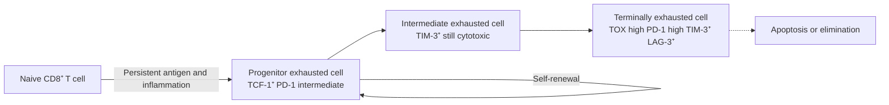

This chapter answers the second half of the question "how is the response shut down once the antigen is cleared?" and follows the chapter on tolerance ([7.15.24](/7.15.24)). Tolerance concerns the absence of a response to self antigens; this chapter concerns how the response to non-self antigens is held to an appropriate magnitude and duration. Clonal expansion is a strong positive feedback: a single activated T cell can divide into tens of thousands within days, and its cytokines recruit still more cells. Without an equally strong negative feedback, every infection would end in tissue damage (see [7.9.14](/7.9.14)–[7.9.16](/7.9.16) for feedback and network motifs). The immune system therefore fits brakes at every level, and the brakes often use the same ligands as the accelerators.

Tumors and chronic infections exploit these brakes to evade immunity, which is why immune checkpoint blockade has become a mainstay of cancer therapy ([7.3.27](/7.3.27), [7.15.30](/7.15.30)). Conversely, some therapies for autoimmune disease and transplant rejection deliberately tighten the brakes ([7.15.28](/7.15.28), [7.15.29](/7.15.29)). We first list the brakes by level, then treat receptors, exhaustion, Tregs, cell death, inhibitory receptors on other cells, soluble and neuroendocrine factors in turn, and end with the principle of therapy.

## 25.1. Levels of Braking

The decline of an immune response is not the work of a single mechanism but the sum of five overlapping levels, each answering the question of who applies the brake and when:

| Level | Brake | When and where | Section |
|---|---|---|---|
| Antigen clearance | Less antigen, weaker TCR signals, loss of the source of cytokines | Automatic, late in the response | 25.5 |
| Receptors on the cell itself | Coinhibitory receptors (CTLA-4, PD-1, etc.), inhibitory Fc receptors, inhibitory receptors on NK cells and B cells | Induced together with activation; local and fast | 25.2, 25.6 |
| Cell fate | Exhaustion, activation-induced cell death | When stimulation is persistent or repeated | 25.3, 25.5 |
| Regulatory cells | **Regulatory T cells** and other suppressive cells | Always present; mobilized as the response develops | 25.4 |
| Soluble factors and systemic regulation | IL-10, TGF-β, glucocorticoids, neural reflexes | Local to systemic | 25.7 |

A useful principle is that the induction of a brake depends on the accelerator. CTLA-4 is expressed only after CD28 costimulation, PD-1 is upregulated by TCR signaling, PD-L1 by IFN-γ, and Fas by activation. Negative feedback is therefore stronger the stronger the response, which is why it limits the response rather than simply switching it off.

## 25.2. Coinhibitory Receptors and Immune Checkpoints

### 25.2.1. Signaling Principle of Inhibitory Receptors

**Definition 25.2.1 (Inhibitory Receptor)** A receptor whose cytoplasmic tail carries an **immunoreceptor tyrosine-based inhibitory motif** (ITIM, consensus $(\mathrm{I/V/L/S})\mathrm{xYxx}(\mathrm{L/V})$) or a similar motif, and which, once phosphorylated, recruits the phosphatases SHP-1, SHP-2 or SHIP and thereby weakens the signal of activating receptors in the same cell, is called an **inhibitory receptor**.

Activating receptors recruit tyrosine kinases (Lck, Syk) through their ITAMs and phosphorylate signaling molecules; the phosphatases of inhibitory receptors remove these phosphate groups. The two compete for the same substrates, so the output of the cell depends on the ratio of activating to inhibitory signals, not on the presence of any single signal. This "enzyme against enzyme" architecture is a general design of the immune system: PD-1 on T cells, CD22 and FcγRIIB on B cells and KIR on NK cells all follow this pattern (see 25.6).

### 25.2.2. The CD28 and B7 Families

T-cell activation requires a second signal ([7.15.16](/7.15.16)). The second signal comes from receptor–ligand pairs of the CD28 and B7 families, some activating and some inhibitory:

| Receptor (on the T cell) | Ligand | Effect | Timing and site of expression |
|---|---|---|---|
| CD28 | CD80 (B7-1), CD86 (B7-2) | Activating | Constitutive on naive T cells |
| ICOS | ICOS-L | Activating (maintains effector and memory cells, Tfh) | After activation |
| CTLA-4 / CD152 | CD80, CD86 | Inhibitory | Induced within 24 h of activation, peak at 2–3 days; constitutively high on Tregs |
| PD-1 / CD279 | PD-L1 / B7-H1, PD-L2 (B7-DC) | Inhibitory | After activation; remains high in chronic stimulation |
| BTLA | HVEM | Inhibitory | After activation |
| TIGIT | CD155 | Inhibitory; competes with CD226 | Activated T cells, NK cells, Tregs |
| LAG-3 | MHC class II, among others | Inhibitory | After activation |
| TIM-3 | Galectin-9, among others | Inhibitory | Effector and exhausted T cells |

**CTLA-4** is the inhibitory member of the CD28 family. It binds the same ligands as CD28, CD80 and CD86, but with markedly higher affinity; it is induced after T-cell activation and cycles rapidly between intracellular vesicles and the cell surface, limiting costimulation by competing with CD28 for ligand and by removing ligand from the surface of the antigen-presenting cell.

**PD-1** is an inhibitory receptor expressed on activated T cells, B cells and myeloid cells. Its cytoplasmic tail contains an ITIM and an immunoreceptor tyrosine-based switch motif (ITSM), and its ligands are **PD-L1** and PD-L2. PD-L1 is expressed on many hematopoietic and nonhematopoietic cells (including many tumor cells) and is upregulated by IFN-γ; PD-L2 is expressed mainly on antigen-presenting cells.

**Definition 25.2.2 (Immune Checkpoint)** A receptor–ligand pair that sets the threshold and duration of an immune response through inhibitory signals, so that the immune system does not respond excessively to self tissues or to persistent antigens, is called an **immune checkpoint**.

The two most important checkpoints, CTLA-4 and PD-1, have different roles.

- CTLA-4 works in the priming phase, in the lymph node. It controls how many T cells are activated. Mice lacking *Ctla4* die within 3–4 weeks of birth from uncontrolled T-cell proliferation, enlarged lymph nodes and spleen, and multiorgan autoimmunity, which shows that it is a key brake of peripheral tolerance; in humans, CTLA-4 haploinsufficiency causes an immune dysregulation syndrome characterized by autoimmunity and lymphocytic infiltration.
- PD-1 works in the effector phase, in peripheral tissues. It controls what already-activated cells do in the tissue. Mice lacking *Pdcd1* do not have so lethal a phenotype; they develop lupus-like autoimmunity and tissue-specific inflammation such as cardiomyopathy only later, consistent with the broad expression of PD-L1 on tissue cells.

### 25.2.3. Competition of CTLA-4 and CD28 for B7

How does CTLA-4 limit costimulation? The first mechanism is competition. The dissociation constant of CTLA-4 for CD80 is about $0.2$–$0.4\,\mu\mathrm{M}$ and that of CD28 about $4\,\mu\mathrm{M}$ (binding to CD86 is weaker for both: about $2$–$3\,\mu\mathrm{M}$ and about $20\,\mu\mathrm{M}$), so CTLA-4 binds about an order of magnitude more tightly than CD28, and as a dimer it forms more stable multivalent contacts with the bivalent ligand. On the T-cell surface the peak level of CTLA-4 is lower than that of CD28, but its competitiveness for B7 more than makes up for the smaller number.

Second, CTLA-4 (especially on Tregs) can strip CD80 and CD86 from the surface of the antigen-presenting cell and take them into its own cell for degradation (transendocytosis), irreversibly reducing the costimulatory capacity of the antigen-presenting cell. Third, it also transmits inhibitory signals into the cell directly, but this contribution is of lesser importance.

**Example 25.2.1 (Competitive Binding of B7)** Treat CD28 and CTLA-4 as two receptors competing for a single ligand, B7, at equilibrium (the contact zone being approximated by effective concentrations). Let the total amount of B7 be $B$, the total amounts of the receptors $C_{28}$ and $C_4$, the dissociation constants $K_{28}$ and $K_4 = K_{28}/10$, and the free ligand concentration $x$, which satisfies

$$
B = x + x\,\frac{C_{28}}{K_{28} + x} + x\,\frac{C_4}{K_4 + x}.
$$

The right-hand side increases monotonically in $x$, so the equation can be solved numerically by bisection. The B7 bound by CD28 is $x\,C_{28}/(K_{28} + x)$, and dividing by $C_{28}$ gives the CD28 occupancy $\theta_{28} = x/(K_{28} + x)$. Take $K_{28}$ as the unit of concentration and $C_{28} = 1$, and vary the ratio of total CTLA-4 to total CD28, $r = C_4/C_{28}$; the results are shown in the figures.

![Balance of costimulatory and coinhibitory receptors. The contact zone between a T cell and an antigen-presenting cell: the TCR recognizes pMHC (signal 1); CD28 binds B7 and supplies the activating second signal; CTLA-4 binds the same ligand B7 with about tenfold higher affinity; PD-1 binds PD-L1 or PD-L2 and recruits SHP-2, which dampens TCR and CD28 signaling. The net signal decides whether the T cell is activated (IL-2 production, proliferation); anti-CTLA-4, anti-PD-1 and anti-PD-L1 antibodies each remove one brake.](./plots/checkpoint-balance.py)

Two points emerge. First, the less B7 there is, the more effective the CTLA-4 brake: at $B = 1$, CTLA-4 at only 20% of CD28 ($r = 0.2$, dashed line) already holds one third of the bound B7, and the CD28 occupancy falls from $0.38$ to $0.33$; at $B = 0.3$ it holds more than half; at $B = 3$ the ligand is in excess and CTLA-4 hardly affects CD28 occupancy ($0.70$ versus $0.68$). This explains why CTLA-4 mainly restrains weak responses with little ligand and poor antigen presentation, whereas strong responses with ample costimulation can push through this brake, and also why CTLA-4 expression increases with the strength of CD28 signaling. Second, as $r \to 1$ the CD28 occupancy falls below about $0.16$ for $B = 1$: the high level of CTLA-4 on the surface of Tregs ($r$ much larger than 1) can almost seal off costimulation. Anti-CTLA-4 antibody corresponds to the left-end point of panel A: with the competitor removed, the released CD28 occupancy is the height of the points in the figure.

### 25.2.4. PD-1 Signaling

When PD-1 binds its ligand, its ITSM tyrosine is phosphorylated and recruits SHP-2. Studies indicate that the first and most efficient substrate of SHP-2 is the cytoplasmic tail of CD28, followed by proximal TCR signaling molecules (CD3ζ, ZAP-70). PD-1 thus acts first by weakening CD28 costimulation, with the result that activation of PI3K–Akt and Ras–MAPK declines and IL-2 production and cell-cycle progression are blocked (see [7.3.19](/7.3.19)). CTLA-4 and PD-1, although they have different roles, therefore aim at the same target: CD28 signaling.

PD-L1 is expressed in two ways. "Innate expression" is driven directly by oncogenic signals (such as activation of PI3K–Akt or MYC, or amplification of *CD274*, the gene encoding PD-L1). "Adaptive expression" is the response of tumor or tissue cells to IFN-γ: cells attacked by CTLs are forced to raise their own "umbrella", so the stronger the immune response, the higher the PD-L1. The latter is adaptive immune resistance, and it makes the presence of PD-L1 a marker of "a T-cell response is here" ([7.15.30](/7.15.30), [7.15.35](/7.15.35)).

## 25.3. T-Cell Exhaustion

**Definition 25.3.1 (T-Cell Exhaustion)** The differentiation fate in which T cells, persistently stimulated by antigen and inflammatory signals in chronic infection or cancer, gradually lose proliferative capacity and effector function (first the production of IL-2 and TNF-α, then the production of IFN-γ and killing), while continuously expressing high levels of several inhibitory receptors (PD-1, LAG-3, TIM-3, TIGIT, etc.) and adopting an epigenetic and transcriptional state distinct from that of effector and memory cells, is called **T-cell exhaustion**.

Exhaustion was first discovered in mouse models of chronic viral infection: in acute infection the virus is cleared and CD8⁺ T cells form memory ([7.15.18](/7.15.18)); in chronic infection the antigen persists, and the CD8⁺ T cells are not eliminated but lose function progressively. Chronic viral infections in humans and the tumor-infiltrating T cells of almost all solid tumors show a similar state. Exhaustion is neither death nor anergy (see [7.15.24](/7.15.24)); it is a stable, regulated differentiation state. It can be understood as a compromise made by the immune system in the face of the contradiction that antigen is always present but immunopathology must not kill the host: effector capacity is traded for persistence.

Recent work divides exhausted cells along a differentiation trajectory:

- Progenitor exhausted cells express the transcription factor TCF-1 and are in a stem-like state, retaining the capacity for self-renewal and the proliferative response to PD-1 blockade; they are found mainly in lymphoid tissue or at the tumor periphery.
- Terminally exhausted cells depend on continual replenishment from the progenitors, have the highest expression of PD-1, TIM-3, LAG-3 and TIGIT and the weakest cytotoxic and cytokine functions, and are maintained by inhibitory receptor signals and by sustained expression of the transcription factor TOX.

This model explains the effect of checkpoint blockade (see 25.8): anti-PD-1 therapy does not mainly "awaken" terminally exhausted cells but makes progenitor exhausted cells proliferate and give rise to new effector cells, so the number of progenitors, and whether TCF-1⁺ cells are preserved in the tumor, correlates with response. The epigenetic state of exhausted cells (remodeling of chromatin accessibility) is partly maintained after blockade, which is why the response of many patients persists after the drug is stopped and also why exhausted cells cannot fully revert to memory cells after blockade ([7.9.6](/7.9.6) discusses how to read out these states by spatial omics).

## 25.4. Suppressive Mechanisms of Regulatory T Cells

The development and types of Tregs (thymus-derived tTregs and peripherally induced pTregs) are covered in [7.15.17](/7.15.17) and [7.15.24](/7.15.24). Loss of their core transcription factor **FOXP3** causes IPEX syndrome: X-linked, with multiorgan autoimmunity, enteropathy, endocrinopathy and high IgE in infancy, which shows that Treg function is a requirement for tolerance in humans.

Tregs do not suppress in one way but use several complementary mechanisms at once, which fall roughly into four classes:

| Mechanism | Molecules | Target | Logic |
|---|---|---|---|
| Depriving growth factor | High CD25 (IL-2 receptor α chain), continual consumption of **IL-2** | Neighboring effector T cells | Proliferation and survival of effector T cells depend on IL-2; Tregs produce none themselves and act as a "sponge" that leaves IL-2 in short supply |
| Remodeling antigen-presenting cells | CTLA-4 binds B7 and removes CD80/86; induction of indoleamine 2,3-dioxygenase (IDO) in DCs | Dendritic cells | The antigen-presenting cell can no longer provide the second signal and produces inhibitory tryptophan metabolites |
| Secreting inhibitory factors | IL-10, TGF-β, IL-35 | Effector T cells, antigen-presenting cells, macrophages | Local action; suppresses inflammatory genes and induces new Tregs ("infectious tolerance") |
| Metabolism and direct killing | CD39 and CD73 degrade ATP to adenosine, which suppresses T cells through the A2A receptor; granzymes and perforin | Effector T cells, antigen-presenting cells | Converts a "danger signal" of inflammation (extracellular ATP) into an inhibitory signal |

Among these mechanisms, CTLA-4 and IL-2 consumption are indispensable: in mice, deleting CTLA-4 in Tregs alone is enough to cause fatal autoimmunity, whereas Tregs lacking IL-10 mainly cause inflammation at mucosal barrier sites such as the gut and lung, showing that the different Treg mechanisms are divided among tissues. Another important fact is that most Treg suppression requires the Treg's own activation: Tregs are activated by TCR signals from self antigens, so suppression is triggered in an antigen-specific manner and then acts nonspecifically on neighboring cells.

## 25.5. Activation-Induced Cell Death and the Fas Pathway

**Definition 25.5.1 (Activation-Induced Cell Death)** The phenomenon in which activated T cells, on restimulation by antigen that is repeated or too strong, undergo apoptosis through upregulated **death receptors** (Fas, also called CD95, with its ligand FasL, or TNF receptors) and through the mitochondrial pathway, thereby limiting clone size, is called **activation-induced cell death** (AICD).

In the contraction phase of the response ([7.15.18](/7.15.18)), most effector T cells (commonly estimated at more than 90%) die and only a few differentiate into memory cells. This death is carried out mainly by two apoptotic pathways (the general mechanism of apoptosis is in [7.3.25](/7.3.25)):

1. The extrinsic (death receptor) pathway. Activated T cells express Fas and upregulate FasL; trimeric FasL aggregates Fas, and the intracellular death domain recruits the adaptor FADD and procaspase-8 to form the death-inducing signaling complex; activated caspase-8 either directly activates caspase-3 or cleaves Bid to enter the mitochondrial pathway. The sensitivity of T cells to Fas appears only a few days after activation and depends on **IL-2**: after repeated stimulation IL-2 makes cells more prone to apoptosis, so IL-2 is both a growth factor and its own "stop signal".
2. The intrinsic (mitochondrial) pathway. When antigen is cleared and cytokines (IL-2, IL-7, IL-15) decline, the antiapoptotic BCL-2 family proteins (BCL-2, MCL-1) fall, proapoptotic BIM predominates, the outer mitochondrial membrane is permeabilized, cytochrome c is released and caspase-9 is activated. This pathway is called death by "cytokine withdrawal" or "neglect", and it is the main mechanism of contraction because it does not need Fas.

Failure of the two pathways has different consequences. Mice deficient in Fas or FasL (*lpr* and *gld*) and humans with autoimmune lymphoproliferative syndrome (ALPS, *FAS* mutations) show lymphadenopathy, accumulation of double-negative T cells and autoimmunity (mainly autoantibodies), showing that the extrinsic pathway is critical for eliminating self-reactive cells; mice lacking *Bim* fail to contract their effector T cells properly after acute infection and likewise develop autoimmunity, showing that the intrinsic pathway is the main mechanism of contraction. Fas–FasL is also used by some cells as a "counterattack": epithelial cells at immune-privileged sites (eye, testis) express FasL, which induces apoptosis of infiltrating Fas⁺ lymphocytes ([7.15.24](/7.15.24)); some tumors also express FasL, but the importance of this mechanism remains controversial.

## 25.6. Inhibitory Receptors on B Cells, NK Cells and Myeloid Cells

The ITIM logic of inhibitory receptors (Definition 25.2.1) recurs in many cell types:

| Cell | Inhibitory receptor | Ligand | Logic |
|---|---|---|---|
| B cell | FcγRIIB (CD32B), recruits SHIP | Antigen-bound IgG (immune complexes) | Negative feedback after antibody production: an antigen–IgG complex binds both the BCR and FcγRIIB and prevents further activation of the B cell ([7.15.21](/7.15.21)) |
| B cell | CD22 (recruits SHP-1), CD72, PD-1 | Sialylated glycans, self molecules | Raises the threshold of BCR signaling to avoid responses to self glycans and weak antigens |
| Mast cells, myeloid cells | FcγRIIB, LILR, SIRPα, Siglecs | IgG immune complexes, self CD47, sialic acid | Limits IgE-dependent degranulation ([7.15.26](/7.15.26)) and prevents phagocytes from attacking self cells |
| NK cell | KIR (human), Ly49 (mouse), NKG2A–CD94 | Classical MHC class I molecules, HLA-E | Recognizes "self": the presence of self MHC class I inhibits killing, and its absence releases killing (**missing self**, [7.15.5](/7.15.5)) |
| T cell, NK cell | TIGIT, PD-1 | CD155, PD-L1 | Competes with, or weakens the signals of, activating receptors (CD226, TCR) |

The NK cell shows the design idea most clearly: activating and inhibitory receptors read the target cell surface simultaneously, and the inhibitory signal comes from the self MHC class I molecules that every normal cell expresses, so whether killing occurs depends on whether the "normal self" signal is absent. Some tumors and viruses downregulate MHC class I to escape CD8⁺ T cells and thereby become easier for NK cells to recognize, so that NK cells and T cells capture them in a complementary manner ([7.15.30](/7.15.30)).

## 25.7. Anti-Inflammatory Cytokines and Neuroendocrine Regulation

### 25.7.1. Anti-Inflammatory Cytokines

- IL-10 is produced by Tregs, Tr1 cells, Th2 cells, macrophages and B cells. Through STAT3 it suppresses the production of cytokines (IL-1, IL-6, IL-12, TNF-α) by macrophages and dendritic cells and lowers expression of MHC class II and B7, thereby suppressing T cells indirectly. Deficiency of IL-10 or its receptor causes severe early-onset inflammatory bowel disease ([7.15.23](/7.15.23)), showing how much the gut depends on this brake.
- **TGF-β** suppresses T-cell proliferation and effector differentiation through Smad signaling, induces FOXP3 and the generation of Tregs (together with IL-2), and promotes IgA class switching ([7.15.23](/7.15.23)). Its action depends on context: together with IL-6 it promotes Th17 cells, in the absence of inflammatory signals it promotes Tregs, and in fibrosis it is profibrotic, making it a typical pleiotropic cytokine ([7.15.11](/7.15.11)).
- IL-35, the IL-1 receptor antagonist (IL-1Ra), soluble TNF receptors, the decoy receptor IL-1R2 and IL-18 binding protein are, respectively, an inhibitory cytokine, receptor blockers and "sponges" that reduce signaling upstream or downstream of the cytokine (for the logic of decoy receptors see [7.15.11](/7.15.11)).

### 25.7.2. Neural and Endocrine Regulation

The immune response is also regulated by the organism as a whole. IL-1, IL-6 and TNF-α enter the blood and act on the hypothalamus, causing fever and stimulating the secretion of corticotropin-releasing hormone; through the pituitary–adrenal axis the level of glucocorticoids rises, and the glucocorticoids in turn suppress these cytokines, forming a negative feedback loop.

**Glucocorticoids** bind the intracellular glucocorticoid receptor. After entering the nucleus, the receptor on the one hand directly inhibits the transcriptional activity of NF-κB and AP-1 (transrepression), lowering expression of genes for inflammatory cytokines, adhesion molecules and cyclooxygenase, and on the other hand induces the expression of anti-inflammatory genes (such as *Annexin A1*, *GILZ* and *IκBα*); at higher exposure it also causes apoptosis of immature T cells and activated lymphocytes. This is why they suppress inflammation broadly and are used heavily as immunosuppressants in autoimmune disease, allergy and transplantation, and also why the risk of infection rises with long-term use.

The cholinergic anti-inflammatory pathway is an example of a neural reflex: inflammatory mediators or endotoxin activate afferent fibers of the vagus nerve, and after integration in the brainstem, efferent branches via the vagus and splenic nerves cause choline acetyltransferase-expressing T cells in the spleen to release acetylcholine, which acts on the α7 nicotinic receptor of macrophages and suppresses TNF-α release. The sympathetic nervous system also suppresses the inflammatory functions of macrophages and Th1 cells through the β₂-adrenergic receptor, and promotes neutrophil mobilization under stress. Most conclusions about these pathways come from mice, and their contribution in humans is still under study, but they give an important perspective: the "set point" of the immune system is regulated by the nervous and endocrine systems, and inflammation is in a sense a response whose magnitude is limited by neural reflexes (for the links between nervous and immune systems see [7.14](/7.14)).

## 25.8. Principle of Checkpoint Blockade

The tumor microenvironment and chronic infection turn checkpoints into tools of immune escape: tumor cells express PD-L1, infiltrating T cells express PD-1 and CTLA-4, and Tregs in tumors also express CTLA-4. **Immune checkpoint blockade** ([7.3.27](/7.3.27)) uses antibodies to block the binding of inhibitory receptors to their ligands. It does not add stimulation; it removes a brake and lets a response that already exists but is suppressed come to expression:

| Target | Antibody | Step mainly affected | Logic |
|---|---|---|---|
| CTLA-4 | Anti-CTLA-4 | Priming phase, lymph node, and also Tregs within the tumor | Relieves competition with CD28 so that more T cells are activated; the Fc of IgG, through FcγR, depletes Tregs that express high CTLA-4 (dependent on antibody isotype) |
| PD-1 | Anti-PD-1 | Effector phase, within tumor tissue | Makes progenitor exhausted cells proliferate and differentiate, restoring cytokine production and killing |
| PD-L1 | Anti-PD-L1 | Effector phase, ligand on tumor cells and myeloid cells | Blocks binding of PD-L1 to PD-1 and to CD80 |
| LAG-3, TIGIT, TIM-3 | Under investigation | Exhausted T cells, NK cells | Combined with PD-1 to target different inhibitory signals |

Three principles are worth remembering. First, blockade works only when a response has already been initiated and antigen is present: removing the brake has no effect on T cells that have not been activated, so whether the tumor has recognizable antigens (neoantigens, see [7.15.30](/7.15.30)) and whether activated T cells are present determine efficacy. Second, blockade also removes the brake from self-reactive cells, so autoimmune-like side effects (immune-related adverse events) are a mechanistic necessity, not an accident; the greater toxicity of anti-CTLA-4 than of anti-PD-1 fits the division of labor of the two checkpoints in Section 25.2 (CTLA-4 governs systemic priming, PD-1 governs local effector function). Third, the drug acting in the opposite direction is the fusion protein of the extracellular domain of CTLA-4 with the Fc of IgG: it binds B7 and blocks CD28 costimulation, and is used in rheumatoid arthritis and transplant rejection ([7.15.28](/7.15.28), [7.15.29](/7.15.29)).

## Summary

- The decline of an immune response has five layers of brakes (the table in Section 25.1): antigen clearance, inhibitory receptors within the cell, cell fate (exhaustion and death), regulatory cells, and soluble factors with neuroendocrine regulation. The induction of a brake depends on the accelerator, so negative feedback strengthens with the magnitude of the response.
- Inhibitory receptors use ITIMs to recruit phosphatases that remove phosphate groups from activating receptors (Definition 25.2.1). Among **immune checkpoints** (Definition 25.2.2), CTLA-4 competes with CD28 for B7 in the priming phase (Example 25.2.1; about tenfold higher affinity), and PD-1 weakens CD28 and TCR signaling through SHP-2 in the effector phase.
- **T-cell exhaustion** is a stable differentiation state under chronic stimulation (Definition 25.3.1), with a trajectory from TCF-1⁺ progenitor exhausted cells to terminally exhausted cells; PD-1 blockade acts mainly on the progenitors.
- Tregs suppress through four classes of complementary mechanisms: depriving IL-2, remodeling antigen-presenting cells (CTLA-4), secreting inhibitory factors, and producing adenosine and killing.
- Activation-induced cell death (Definition 25.5.1) is carried out by the extrinsic Fas pathway and the BIM-dependent intrinsic pathway; IL-2 is both a growth factor and a sensitizer to death. Defects in the two pathways lead to ALPS and to failed contraction, respectively.
- B cells, NK cells and myeloid cells use ITIM-type receptors to read "self" and antibody feedback (FcγRIIB, KIR, NKG2A).
- Checkpoint blockade removes a brake rather than adding fuel: it works only on responses that have been initiated, and it inevitably raises the risk of autoimmunity.

## Questions

1. Why are the autoimmune side effects of anti-CTLA-4 antibodies usually more severe than those of anti-PD-1 antibodies?

   **Answer** CTLA-4 controls the strength of costimulation in the lymph node during T-cell priming and acts on the activation threshold of all antigen-specific T cells, self-reactive ones included; CTLA-4 on Tregs also acts on systemic tolerance. Blocking it therefore activates large numbers of self-reactive clones that were previously held down. PD-1 mainly regulates the function of already-activated T cells in peripheral tissues, so its effect is more local. *Ctla4*-deficient mice die within weeks of systemic lymphocyte proliferation, whereas *Pdcd1*-deficient mice show only later and more limited autoimmunity, in agreement with this.

2. The model of Example 25.2.1 shows that CTLA-4 has almost no effect when B7 is abundant. What does this imply for tumors and for vaccine adjuvants?

   **Answer** Competition is effective only when ligand is limiting. An adjuvant makes antigen-presenting cells upregulate CD80/CD86 ([7.15.14](/7.15.14)), so costimulation is in excess and can push through the CTLA-4 brake; a strong adjuvant thus both enhances the response and makes it less sensitive to CTLA-4. In tumors the B7 level on antigen-presenting cells is often low and the CTLA-4 of Tregs is abundant (large $r$), so costimulation is pressed down further, which is one reason anti-CTLA-4 antibodies can be effective.

3. The CD8⁺ T cells of a patient with chronic infection express PD-1 and do not produce IFN-γ. Can one conclude directly that these cells are exhausted? What further evidence is needed?

   **Answer** No. Activated T cells transiently express PD-1, and the "functional suppression" caused by short-term stimulation can be reversed, whereas exhaustion is a stable differentiation state. What is needed: coexpression of multiple inhibitory receptors (TIM-3, LAG-3, TIGIT), high expression of the transcription factor TOX and the state of TCF-1, the order in which function is lost (IL-2 and TNF-α first, then IFN-γ), the chromatin accessibility signature, and its appearance in the setting of persistent antigen. PD-1 expression alone is insufficient for the judgment ([7.15.35](/7.15.35) discusses the limits of such markers).
