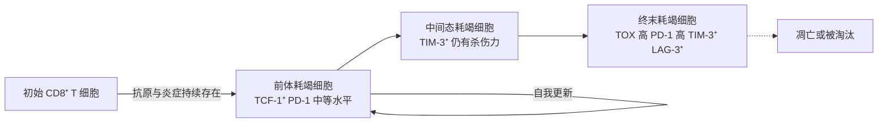

本章回答"清除之后怎样关闭"这一半问题，接在耐受一章（[7.15.24](/7.15.24)）之后：耐受讲的是对自身抗原不应答，这一章讲的是对非己抗原的应答怎样被限制在合适的强度与时间内。克隆扩增是一个强正反馈：一个被活化的 T 细胞数天内可以分裂成几万个，细胞因子又招来更多的细胞；没有同样强的负反馈，每一次感染都会以组织损伤收场（链接 [7.9.14](/7.9.14)–[7.9.16](/7.9.16) 的反馈与网络基序）。所以免疫系统在每一个层级都配备了刹车，而且刹车常与油门使用同一套配体。

肿瘤和慢性感染正是利用这些刹车躲避免疫的，免疫检查点阻断因此成为肿瘤治疗的支柱（[7.3.27](/7.3.27)，[7.15.30](/7.15.30)）；反过来，自身免疫病与移植排斥的一些疗法是人为拧紧刹车（[7.15.28](/7.15.28)、[7.15.29](/7.15.29)）。本章先按层级列出刹车，再依次讲受体、耗竭、Treg、细胞死亡、其他细胞上的抑制性受体、可溶性与神经内分泌的因素，最后落到治疗原理。

## 25.1. 刹车的层级

免疫应答的衰减不是一个机制，而是五个层级叠加的结果，每一层回答"谁来刹车、何时刹车"的一个问题：

| 层级 | 刹车 | 作用时间与位置 | 本章小节 |
|---|---|---|---|
| 抗原清除 | 抗原减少、TCR 信号减弱，细胞因子来源消失 | 自动，应答后期 | 25.5 |
| 细胞自身的受体 | 共抑制受体（CTLA-4、PD-1 等）、抑制性 Fc 受体、NK 细胞与 B 细胞上的抑制性受体 | 细胞活化的同时被诱导，局部、快速 | 25.2、25.6 |
| 细胞命运 | 耗竭、活化诱导的细胞死亡 | 刺激持续或重复时 | 25.3、25.5 |
| 调节细胞 | **调节性 T 细胞**及其他抑制性细胞 | 持续存在，随应答动员 | 25.4 |
| 可溶性因子与系统调节 | IL-10、TGF-β、糖皮质激素、神经反射 | 局部到全身 | 25.7 |

一个有用的原则是：刹车的诱导依赖于油门。CTLA-4 在 CD28 共刺激之后才表达，PD-1 随 TCR 信号上调，PD-L1 随 IFN-γ 上调，Fas 随活化上调。负反馈因此在应答越强时越强，这是它能够限幅而不是简单地关闭应答的原因。

## 25.2. 共抑制受体与免疫检查点

### 25.2.1. 抑制性受体的信号原理

**定义 25.2.1（抑制性受体）** 胞内段带有**免疫受体酪氨酸抑制基序**（ITIM，序列共有型 $(\mathrm{I/V/L/S})\mathrm{xYxx}(\mathrm{L/V})$）或类似基序，被磷酸化后招募磷酸酶 SHP-1、SHP-2 或 SHIP，从而削弱同一细胞内激活性受体信号的受体称为**抑制性受体**。

激活性受体经 ITAM 招募酪氨酸激酶（Lck、Syk），使信号分子磷酸化；抑制性受体的磷酸酶拆掉这些磷酸基团。两者争夺的是同一批底物，所以细胞的输出取决于激活与抑制信号的比值，而不是单个信号的有无。这一"酶对酶"的结构是免疫系统中普遍的设计：T 细胞上的 PD-1、B 细胞上的 CD22 与 FcγRIIB、NK 细胞上的 KIR 都是这个模式（见 25.6）。

### 25.2.2. CD28 家族与 B7 家族

T 细胞活化需要第二信号（[7.15.16](/7.15.16)）。第二信号来自 CD28 家族与 B7 家族的受体—配体对，其中既有激活的也有抑制的：

| 受体（T 细胞上） | 配体 | 作用 | 表达的时机与位置 |
|---|---|---|---|
| CD28 | CD80（B7-1）、CD86（B7-2） | 激活 | 初始 T 细胞组成性表达 |
| ICOS | ICOS-L | 激活（维持效应与记忆、Tfh） | 活化后 |
| CTLA-4 / CD152 | CD80、CD86 | 抑制 | 活化后 24 小时内诱导，2–3 天达峰；Treg 组成性高表达 |
| PD-1 / CD279 | PD-L1 / B7-H1、PD-L2（B7-DC） | 抑制 | 活化后；慢性刺激中持续高表达 |
| BTLA | HVEM | 抑制 | 活化后 |
| TIGIT | CD155 | 抑制，与 CD226 竞争 | 活化 T、NK、Treg |
| LAG-3 | MHC II 类分子等 | 抑制 | 活化后 |
| TIM-3 | 半乳凝素-9 等 | 抑制 | 效应与耗竭 T 细胞 |

**CTLA-4** 是 CD28 家族的抑制性成员，与 CD28 结合同样的配体 CD80 与 CD86，但亲和力显著更高，在 T 细胞活化之后被诱导并在细胞内囊泡与细胞表面之间快速循环，通过与 CD28 竞争配体、从抗原提呈细胞表面移除配体来限制共刺激。

**PD-1** 是在活化的 T 细胞、B 细胞与髓系细胞上表达的抑制性受体，胞内段含 ITIM 和免疫受体酪氨酸转换基序（ITSM），配体是 **PD-L1** 与 PD-L2；PD-L1 在多种造血与非造血细胞（包括许多肿瘤细胞）上表达，并被 IFN-γ 上调，PD-L2 主要在抗原提呈细胞上表达。

**定义 25.2.2（免疫检查点）** 通过抑制性信号设定免疫应答的阈值与持续时间、使免疫系统不至于对自身组织或持续存在的抗原过度应答的受体—配体对称为**免疫检查点**。

两个最重要的检查点（CTLA-4 与 PD-1）的分工不同。

- CTLA-4 在启动期、淋巴结内工作。 它控制的是有多少 T 细胞被活化：缺失 *Ctla4* 的小鼠在出生后 3–4 周内因 T 细胞不受控的增殖、淋巴结与脾脏肿大和多器官自身免疫而死亡，说明它是外周耐受的关键刹车；人类的 CTLA-4 单倍剂量不足引起以自身免疫与淋巴细胞浸润为特征的免疫失调综合征。
- PD-1 在效应期、外周组织中工作。 它控制的是已经活化的细胞在组织中做什么：*Pdcd1* 缺失的小鼠没有如此致命的表型，而是较晚出现类狼疮的自身免疫与心肌病等组织特异性炎症，与 PD-L1 在组织细胞上广泛表达的事实相符。

### 25.2.3. CTLA-4 与 CD28 对 B7 的竞争

CTLA-4 怎样限制共刺激？首先是竞争。CTLA-4 与 CD80 的解离常数约为 $0.2$–$0.4\,\mu\mathrm{M}$，CD28 约为 $4\,\mu\mathrm{M}$（与 CD86 的结合都更弱：约 $2$–$3\,\mu\mathrm{M}$ 与约 $20\,\mu\mathrm{M}$），CTLA-4 比 CD28 紧约一个数量级，并且以二聚体与二价配体形成更稳定的多价结合。在 T 细胞表面，CTLA-4 的峰值水平低于 CD28，但它对 B7 的竞争力足以弥补数量的不足。

其次，CTLA-4（尤其在 Treg 上）可以把 CD80 与 CD86 从抗原提呈细胞的表面"咬走"并带入自己的细胞内降解（反式内吞），使抗原提呈细胞的共刺激能力不可逆地降低；再者，它也直接向细胞内传递抑制信号，但这部分的重要性相对次要。

**例 25.2.1（B7 的竞争结合）** 把 CD28 与 CTLA-4 当作争夺同一种配体 B7 的两种受体（平衡态，接触区近似为有效浓度）。设 B7 总量 $B$，两种受体总量 $C_{28}$ 与 $C_4$，解离常数 $K_{28}$ 与 $K_4 = K_{28}/10$，游离配体浓度 $x$ 满足

$$
B = x + x\,\frac{C_{28}}{K_{28} + x} + x\,\frac{C_4}{K_4 + x},
$$

右边对 $x$ 单调增加，数值上用二分法求解。CD28 结合的 B7 为 $x\,C_{28}/(K_{28} + x)$，除以 $C_{28}$ 得到 CD28 的占据率 $\theta_{28} = x/(K_{28} + x)$。取 $K_{28}$ 为浓度单位、$C_{28} = 1$，改变 CTLA-4 与 CD28 的总量之比 $r = C_4/C_{28}$，结果见图。

结果有两点。第一，B7 越少，CTLA-4 的刹车越有效：$B = 1$ 时，CTLA-4 只有 CD28 的 20%（$r = 0.2$，虚线）就已经占据了三分之一的被结合 B7，CD28 占据率从 $0.38$ 降到 $0.33$；$B = 0.3$ 时占一半以上；而 $B = 3$ 时配体过量，CTLA-4 几乎不影响 CD28 的占据率（$0.70$ 对 $0.68$）。这解释了为什么 CTLA-4 主要限制配体少、抗原提呈弱的低强度应答，而强烈、有充分共刺激的应答能够穿过这道刹车；也解释了为什么 CTLA-4 的表达随 CD28 信号的强度而增加。第二，$r \to 1$ 时 CD28 的占据率降到约 $0.16$ 以下（$B = 1$ 时）：Treg 表面高水平的 CTLA-4（$r$ 远大于 1）可以几乎封闭共刺激。抗 CTLA-4 抗体对应图 A 左端的点：去除竞争者，被释放的 CD28 占据率就是图中各点的高度。

### 25.2.4. PD-1 的信号

PD-1 与配体结合后，ITSM 酪氨酸被磷酸化并招募 SHP-2。研究表明 SHP-2 最先、最有效的底物是 CD28 的胞内段，其次才是 TCR 近端信号分子（CD3ζ、ZAP-70）：也就是说，PD-1 首先是通过削弱 CD28 共刺激起作用，其结果是 PI3K–Akt 与 Ras–MAPK 的激活下降、IL-2 产生与细胞周期进程受阻（链接 [7.3.19](/7.3.19)）。这一点说明 CTLA-4 与 PD-1 虽然分工不同，对准的却是同一个靶点：CD28 的信号。

PD-L1 的表达有两种方式。"固有表达"由致癌信号（如 PI3K–Akt、MYC 的活化，编码 PD-L1 的基因 *CD274* 的扩增）直接驱动；"适应性表达"则是肿瘤或组织细胞对 IFN-γ 的反应：被 CTL 攻击的细胞被迫上调自己的"保护伞"，免疫应答越强，PD-L1 越高。后者是适应性免疫抵抗，它使 PD-L1 的出现成为"这里有 T 细胞应答"的标志（[7.15.30](/7.15.30)、[7.15.35](/7.15.35)）。

## 25.3. T 细胞耗竭

**定义 25.3.1（T 细胞耗竭）** 在慢性感染或肿瘤中，T 细胞长期受到抗原与炎症信号的持续刺激，逐渐丧失增殖能力和效应功能（先失去 IL-2 与 TNF-α 的产生，再失去 IFN-γ 的产生和杀伤），同时持续高表达多种抑制性受体（PD-1、LAG-3、TIM-3、TIGIT 等）并形成与效应及记忆细胞不同的表观遗传与转录状态的分化命运称为 **T 细胞耗竭**。

耗竭最初在慢性病毒感染的小鼠模型中发现：急性感染的病毒被清除，CD8⁺ T 细胞形成记忆（[7.15.18](/7.15.18)）；慢性感染中抗原持续存在，CD8⁺ T 细胞没有被清除，却功能日益下降。人类的慢性病毒感染与几乎所有实体瘤中的浸润 T 细胞都有类似的状态。耗竭既不是死亡，也不是失能（anergy，见 [7.15.24](/7.15.24)），而是一种稳定的、受调控的分化状态。它可以理解成在"抗原一直在，却又不能让免疫病理杀死宿主"的矛盾下，免疫系统做出的折中：把效应能力换成持久性。

近年的研究把耗竭细胞分成一条分化轨迹：

- 前体耗竭细胞表达转录因子 TCF-1，处于干细胞样状态，保持自我更新能力与对 PD-1 阻断的增殖反应能力，主要位于淋巴组织或肿瘤周围；
- 终末耗竭细胞依赖前体细胞不断补充，PD-1、TIM-3、LAG-3、TIGIT 的表达最高，细胞毒性与细胞因子功能最弱，靠抑制性受体的信号和持续的转录因子 TOX 维持。

这个模型解释了检查点阻断的效果（见 25.8）：抗 PD-1 治疗主要不是"唤醒"终末耗竭的细胞，而是使前体耗竭细胞增殖并分化出新的效应细胞，所以前体细胞的数量与肿瘤内是否保留 TCF-1⁺ 细胞与疗效相关。耗竭细胞的表观遗传状态（染色质可及性的重塑）部分地在阻断之后继续保持，这是许多患者在停药后反应仍能持续、也是阻断之后耗竭细胞不能完全恢复为记忆细胞的原因（[7.9.6](/7.9.6) 讨论怎样在空间组学中读出这些状态）。

## 25.4. 调节性 T 细胞的抑制机制

Treg 的发育与类型（胸腺来源的 tTreg 与外周诱导的 pTreg）见 [7.15.17](/7.15.17) 与 [7.15.24](/7.15.24)。其核心转录因子 **FOXP3** 的缺失导致 IPEX 综合征：X 连锁，婴儿期出现多器官自身免疫、肠病、内分泌病和高 IgE，说明 Treg 的功能是人体耐受的必要条件。

Treg 并非用一种方式抑制，而是同时使用几种互补的机制，大致分为四类：

| 机制 | 分子 | 作用对象 | 逻辑 |
|---|---|---|---|
| 夺取生长因子 | CD25（IL-2 受体 α 链）高表达，持续消耗 **IL-2** | 周围的效应 T 细胞 | 效应 T 细胞的增殖与存活依赖 IL-2，Treg 自己不产生 IL-2，作为"海绵"使 IL-2 不足 |
| 改造抗原提呈细胞 | CTLA-4 与 B7 结合，移除 CD80/86；诱导 DC 产生吲哚胺 2,3-双加氧酶（IDO） | 树突状细胞 | 使抗原提呈细胞不能提供第二信号，并产生抑制性的色氨酸代谢物 |
| 分泌抑制性因子 | IL-10、TGF-β、IL-35 | 效应 T 细胞、抗原提呈细胞、巨噬细胞 | 局部作用，抑制炎症基因，诱导新的 Treg（"传染性耐受"） |
| 代谢与直接杀伤 | CD39 与 CD73 把 ATP 降解为腺苷，腺苷经 A2A 受体抑制 T 细胞；颗粒酶与穿孔素 | 效应 T 细胞、抗原提呈细胞 | 把炎症的"危险信号"（胞外 ATP）转换成抑制信号 |

这几种机制中，CTLA-4 与 IL-2 消耗是不可缺的：在小鼠中仅在 Treg 上缺失 CTLA-4 就足以引起致命的自身免疫；缺失 IL-10 的 Treg 则主要导致肠道与肺等黏膜屏障部位的炎症，说明 Treg 的不同机制有组织分工。另一个重要事实是 Treg 的抑制多数需要自己的活化：Treg 被自身抗原的 TCR 信号活化，因此抑制是抗原特异性地被触发、再非特异地作用于周围。

## 25.5. 活化诱导的细胞死亡与 Fas 通路

**定义 25.5.1（活化诱导的细胞死亡）** 已活化的 T 细胞在被再次、反复或过强的抗原刺激后，经表达上调的**死亡受体**（Fas，又称 CD95）与配体 FasL 或 TNF 受体，以及线粒体途径，引发细胞凋亡，从而限制克隆大小的现象称为**活化诱导的细胞死亡**（AICD）。

应答的收缩期（[7.15.18](/7.15.18)）里，大部分效应 T 细胞（常见估计在 90% 以上）死亡，只有少数分化为记忆细胞。这一死亡主要由两条凋亡途径实现（凋亡的一般机制见 [7.3.25](/7.3.25)）：

1. 外源性途径（死亡受体途径）。 活化的 T 细胞表达 Fas 并上调 FasL；FasL 三聚体使 Fas 聚集，胞内的死亡结构域招募接头蛋白 FADD 与 procaspase-8，形成死亡诱导信号复合物，caspase-8 被活化后直接激活 caspase-3，或剪切 Bid 进入线粒体途径。T 细胞对 Fas 的敏感性在活化后几天才出现，且依赖 **IL-2**：重复刺激后 IL-2 使细胞更容易凋亡，所以 IL-2 既是生长因子，又是自己的"终止信号"。
2. 内源性途径（线粒体途径）。 抗原清除、细胞因子（IL-2、IL-7、IL-15）减少时，抗凋亡的 BCL-2 家族蛋白（BCL-2、MCL-1）下降，促凋亡的 BIM 占优势，线粒体外膜透化，细胞色素 c 释放，caspase-9 活化。这一途径被称为"细胞因子撤除"或"忽视"诱导的死亡，也是收缩期的主要机制，因为它不需要 Fas。

两条途径的失败有不同的后果：Fas 或 FasL 缺陷的小鼠（*lpr* 与 *gld*）与人类的自身免疫性淋巴增生综合征（ALPS，*FAS* 突变）出现淋巴结肿大、双阴性 T 细胞积累和自身免疫（以自身抗体为主），说明外源性途径对清除自身反应性细胞至关重要；缺失 *Bim* 的小鼠则在急性感染之后效应 T 细胞不能适当收缩，同样出现自身免疫，说明内源性途径是收缩的主要机制。Fas–FasL 也被一些细胞用作"反击"：免疫豁免部位（眼、睾丸）的上皮细胞表达 FasL，使浸润的 Fas⁺ 淋巴细胞凋亡（[7.15.24](/7.15.24)）；一些肿瘤也表达 FasL，但这一机制的重要性仍有争议。

## 25.6. B 细胞、NK 细胞与髓系细胞上的抑制性受体

抑制性受体的 ITIM 逻辑（定义 25.2.1）在多种细胞中重复出现：

| 细胞 | 抑制性受体 | 配体 | 作用的逻辑 |
|---|---|---|---|
| B 细胞 | FcγRIIB（CD32B），招募 SHIP | 与抗原结合的 IgG（免疫复合物） | 抗体产生后的负反馈：抗原—IgG 复合物同时结合 BCR 与 FcγRIIB，抑制 B 细胞继续活化（[7.15.21](/7.15.21)） |
| B 细胞 | CD22（SHP-1 招募）、CD72、PD-1 | 唾液酸化的糖链、自身分子 | 提高 BCR 信号的阈值，避免对自身糖链与弱抗原应答 |
| 肥大细胞、髓系细胞 | FcγRIIB、LILR、SIRPα、Siglec | IgG 免疫复合物、自身的 CD47、唾液酸 | 限制 IgE 依赖的脱颗粒（[7.15.26](/7.15.26)），避免吞噬细胞攻击自身细胞 |
| NK 细胞 | KIR（人）、Ly49（小鼠）、NKG2A–CD94 | 经典 MHC I 类分子、HLA-E | 识别"自我"：自身 MHC I 类分子出现就抑制杀伤，缺失则释放杀伤（**丢失自我**，[7.15.5](/7.15.5)） |
| T 细胞、NK 细胞 | TIGIT、PD-1 | CD155、PD-L1 | 与激活性受体（CD226、TCR）竞争或削弱其信号 |

NK 细胞的情形最清楚地体现了设计思想：激活性与抑制性受体同时读取靶细胞表面，抑制信号来自每个正常细胞都表达的自身 MHC I 类分子，因此是否杀伤取决于"正常自我"信号是否缺失。一些肿瘤与病毒为了躲避 CD8⁺ T 细胞而下调 MHC I 类分子，反而更容易被 NK 细胞识别，被 NK 细胞与 T 细胞的互补性捕获（[7.15.30](/7.15.30)）。

## 25.7. 抗炎细胞因子与神经内分泌调节

### 25.7.1. 抗炎细胞因子

- IL-10：由 Treg、Tr1 细胞、Th2 细胞、巨噬细胞与 B 细胞产生，经 STAT3 抑制巨噬细胞与树突状细胞的细胞因子（IL-1、IL-6、IL-12、TNF-α）的产生，降低 MHC II 类分子与 B7 的表达，从而间接抑制 T 细胞。IL-10 或其受体缺陷导致严重的早发炎症性肠病（[7.15.23](/7.15.23)），说明肠道对这一刹车的依赖。
- **TGF-β**：经 Smad 信号抑制 T 细胞增殖与效应分化，诱导 FOXP3 与 Treg 的产生（结合 IL-2），同时促进 IgA 类别转换（[7.15.23](/7.15.23)）。它的作用依赖背景：与 IL-6 同时存在时促进 Th17，缺少炎症信号时促进 Treg，在纤维化中又起促进作用，是典型的多效性细胞因子（[7.15.11](/7.15.11)）。
- IL-35、IL-1 受体拮抗剂（IL-1Ra）、可溶性 TNF 受体、诱饵受体 IL-1R2 与 IL-18 结合蛋白：分别是抑制性的细胞因子、受体阻断剂与"海绵"，从细胞因子的上游或下游降低信号（诱饵受体的逻辑见 [7.15.11](/7.15.11)）。

### 25.7.2. 神经与内分泌的调节

免疫应答还受整个机体的调节。IL-1、IL-6 与 TNF-α 进入血液，作用于下丘脑，引起发热并刺激促肾上腺皮质激素释放激素的分泌，经垂体—肾上腺轴使糖皮质激素水平上升，而后者反过来抑制这些细胞因子，构成一个负反馈环。

**糖皮质激素**结合细胞内的糖皮质激素受体，受体入核后一方面直接抑制 NF-κB 与 AP-1 的转录活性（反式抑制），降低炎症细胞因子、黏附分子与环氧合酶等基因的表达，另一方面诱导抗炎基因（如 *Annexin A1*、*GILZ*、*IκBα*）的表达；在较强的刺激下还引起未成熟 T 细胞与活化淋巴细胞的凋亡。这是它既广泛抑制炎症、又在自身免疫病、过敏与移植中被大量用作免疫抑制剂的原因，也是长期使用后感染风险上升的原因。

胆碱能抗炎通路则是神经反射的例子：炎症因子或内毒素激活迷走神经的传入纤维，经脑干的整合，通过迷走神经与脾神经的传出分支，使脾脏中表达胆碱乙酰转移酶的 T 细胞释放乙酰胆碱，乙酰胆碱作用于巨噬细胞的 α7 烟碱型受体，抑制 TNF-α 的释放。交感神经通过 β₂ 肾上腺素受体也抑制巨噬细胞与 Th1 细胞的炎症功能，同时在应激时促进中性粒细胞的动员。这些通路的结论多来自小鼠，在人体内的贡献仍在研究中，但它们给出一个重要的观点：免疫系统的"设定点"受神经系统与内分泌系统的调控，炎症在某种意义上是一种被神经反射限幅的反应（神经与免疫的联系见 [7.14](/7.14)）。

## 25.8. 检查点阻断的原理

肿瘤微环境与慢性感染把检查点变成免疫逃逸的工具：肿瘤细胞表达 PD-L1，浸润的 T 细胞表达 PD-1 与 CTLA-4，肿瘤中的 Treg 也表达 CTLA-4。**免疫检查点阻断**（[7.3.27](/7.3.27)）用抗体阻断抑制性受体与配体的结合，不是增加刺激，而是撤去一个刹车，让已经存在但被压制的应答表现出来：

| 靶点 | 抗体 | 主要作用的环节 | 逻辑 |
|---|---|---|---|
| CTLA-4 | 抗 CTLA-4 | 启动期，淋巴结，也包括肿瘤内的 Treg | 解除与 CD28 的竞争，使更多 T 细胞被活化；IgG 的 Fc 经 FcγR 清除高表达 CTLA-4 的 Treg（依赖抗体的同种型） |
| PD-1 | 抗 PD-1 | 效应期，肿瘤组织内 | 使前体耗竭细胞增殖并分化，恢复细胞因子产生与杀伤 |
| PD-L1 | 抗 PD-L1 | 效应期，肿瘤细胞与髓系细胞上的配体 | 阻断 PD-L1 与 PD-1 及 CD80 的结合 |
| LAG-3、TIGIT、TIM-3 | 在研 | 耗竭 T 细胞、NK 细胞 | 与 PD-1 组合，针对不同的抑制性信号 |

三点原理值得记住。第一，阻断只在应答已经启动、抗原存在时有效：对没有被活化的 T 细胞，撤去刹车没有任何效果，所以肿瘤是否有可识别的抗原（新抗原，见 [7.15.30](/7.15.30)）与是否有被活化的 T 细胞，决定疗效。第二，阻断同时撤去了对自身反应性细胞的刹车，所以自身免疫样的副作用（免疫相关不良反应）是机制上的必然，而不是偶然；抗 CTLA-4 的毒性大于抗 PD-1，与 25.2 节中两个检查点的分工相符（CTLA-4 管全身的启动，PD-1 管局部的效应）。第三，反方向的药物就是 CTLA-4 的细胞外域与 IgG Fc 的融合蛋白：它结合 B7，阻断 CD28 共刺激，用于类风湿关节炎与移植排斥（[7.15.28](/7.15.28)、[7.15.29](/7.15.29)）。

## 小结

- 免疫应答的衰减有五层刹车（25.1 节的表）：抗原清除、细胞内的抑制性受体、细胞命运（耗竭与死亡）、调节细胞，以及可溶性因子与神经内分泌。刹车的诱导依赖油门，所以负反馈随应答的强度而增强。
- 抑制性受体用 ITIM 招募磷酸酶，拆掉激活性受体的磷酸基团（定义 25.2.1）。**免疫检查点**（定义 25.2.2）中，CTLA-4 在启动期与 CD28 竞争 B7（例 25.2.1，亲和力高约一个数量级），PD-1 在效应期经 SHP-2 削弱 CD28 与 TCR 信号。
- **T 细胞耗竭**是慢性刺激下稳定的分化状态（定义 25.3.1），有 TCF-1⁺ 前体耗竭细胞到终末耗竭细胞的轨迹；PD-1 阻断主要作用于前体细胞。
- Treg 用四类互补的机制抑制：夺取 IL-2、改造抗原提呈细胞（CTLA-4）、分泌抑制性因子、产生腺苷并杀伤。
- 活化诱导的细胞死亡（定义 25.5.1）由 Fas 外源性途径与 BIM 依赖的内源性途径执行，IL-2 同时是生长因子和死亡的增敏因子；两条途径缺陷分别导致 ALPS 与收缩期失败。
- B 细胞、NK 细胞与髓系细胞用 ITIM 型受体读取"自我"与抗体反馈（FcγRIIB、KIR、NKG2A）。
- 检查点阻断撤去刹车而不是加油：只对已启动的应答有效，同时必然提高自身免疫风险。

## 思考题

1. 为什么抗 CTLA-4 抗体的自身免疫副作用通常比抗 PD-1 抗体更严重？

   **答** CTLA-4 控制的是 T 细胞启动阶段在淋巴结内的共刺激强度，对所有抗原特异性（包括自身反应性）T 细胞的活化阈值都起作用，Treg 上的 CTLA-4 也对全身耐受起作用，所以阻断时大量原本被压制的自身反应性克隆被活化；PD-1 主要调节已活化 T 细胞在外周组织中的功能，影响范围较局部。*Ctla4* 缺失小鼠在几周内死于全身淋巴细胞增殖，而 *Pdcd1* 缺失小鼠只出现较晚、较局限的自身免疫，与此一致。

2. 例 25.2.1 的模型显示当 B7 很多时 CTLA-4 几乎不起作用。这对肿瘤和疫苗佐剂各有什么启示？

   **答** 竞争只在配体有限时有效。佐剂使抗原提呈细胞上调 CD80/CD86（[7.15.14](/7.15.14)），共刺激过量，能够穿过 CTLA-4 的刹车，所以强的佐剂既增强应答，也使应答对 CTLA-4 不那么敏感。肿瘤中抗原提呈细胞的 B7 水平常较低，且 Treg 的 CTLA-4 丰富（$r$ 较大），所以共刺激被压得更低，是抗 CTLA-4 抗体可能有效的原因之一。

3. 一位慢性感染患者的 CD8⁺ T 细胞既表达 PD-1，也不产生 IFN-γ。能不能据此直接断定这些细胞是耗竭细胞？还需要什么证据？

   **答** 不能。活化后的 T 细胞暂时表达 PD-1，短期刺激的"功能抑制"也可以恢复；耗竭是一种稳定的分化状态。还需要：多种抑制性受体（TIM-3、LAG-3、TIGIT）的共表达、转录因子 TOX 的高表达与 TCF-1 的状态、功能丧失的顺序（先失去 IL-2 与 TNF-α，再失去 IFN-γ）、染色质可及性的特征，以及在持续抗原背景下的出现。仅凭 PD-1 的表达不足以判断（[7.15.35](/7.15.35) 讨论这类标志物的局限）。
