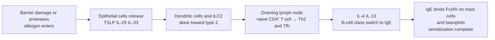

The preceding chapters described how immune responses are generated and how they are shut down; from this chapter on we turn to what happens when things go wrong. The common pattern of immunopathology is that a normal effector module is directed at the wrong target, or that its magnitude or duration is out of control. Type I hypersensitivity is the most typical example: it uses the module of **type 2 immunity**, which evolved to expel parasites and venoms (IL-4, IL-5, IL-13, **Th2 cells**, **IgE**, mast cells and eosinophils; see [7.15.17](/7.15.17), [7.15.20](/7.15.20), [7.15.21](/7.15.21)), but it is set off by harmless antigens such as pollen, dust mites and food proteins.

We first give the overall framework of the four types of hypersensitivity and then develop Type I along a single line of "sensitization, re-exposure, mediator release, two phases"; in the section on mast cell activation a quantitative model shows why cross-linking requires a multivalent antigen and why there is an optimal concentration. Types II–IV are in [7.15.27](/7.15.27), and autoimmune disease in [7.15.28](/7.15.28).

## 26.1. Classification and Common Elements of Hypersensitivity

**Definition 26.1.1 (Hypersensitivity)** An excessive adaptive immune response to a harmless non-self antigen or to a self antigen that causes tissue damage or physiological disturbance is called **hypersensitivity**, also called allergy in the broad sense.

According to the classification of Gell and Coombs, hypersensitivity falls into four types, based on the effector molecules and cells involved:

| | Type I (immediate) | Type II (cytotoxic) | Type III (immune complex) | Type IV (delayed) |
|---|---|---|---|---|
| Effector molecule | IgE | IgG, IgM | IgG, IgM (immune complexes) | T cells (Th1, Th17, CTL) |
| Antigen | Soluble antigen (allergen) | Antigen on cells or matrix | Soluble antigen | Soluble antigen or cellular antigen |
| Effector mechanism | Degranulation of mast cells and basophils | Complement, phagocytosis, ADCC, blockade or stimulation of receptors | Deposition of immune complexes; complement, neutrophils and platelets | Macrophage activation, CTL killing |
| Time of onset | Seconds to minutes; a late phase recurs after 4–8 h | Minutes to hours | Hours (Arthus reaction 4–10 h) | 24–72 h |
| Examples | Allergic rhinitis, asthma, food allergy, anaphylaxis | Transfusion reaction, hemolytic disease of the newborn, Graves disease, myasthenia gravis | Serum sickness, Arthus reaction, renal injury in systemic lupus erythematosus | Contact dermatitis, tuberculin reaction, type 1 diabetes |

The four types share three elements: (1) prior sensitization: there is no reaction to an antigen not previously encountered, and the first encounter, without symptoms, establishes the effector molecules or cells; (2) amplification on re-exposure: the memory property of adaptive immunity is applied to the wrong target; (3) innate cells as amplifiers: antibodies and T cells supply specificity, but mast cells, complement, neutrophils and macrophages cause the tissue damage.

This classification is an analytical tool, and real diseases often involve several types at once: a patient allergic to penicillin may show Type I urticaria and anaphylaxis, Type II hemolytic anemia, Type III serum-sickness-like reactions and Type IV contact dermatitis; asthma has both an IgE-mediated acute phase and chronic inflammation mediated by Th2 cells, Th17 cells and eosinophils. Some textbooks also list a "Type V" (stimulatory) hypersensitivity, in which antibodies activate a receptor (such as the antibodies to the thyroid-stimulating hormone receptor in Graves disease); in the classical scheme these belong to Type II ([7.15.27](/7.15.27)).

## 26.2. Allergens and Sensitization

**Definition 26.2.1 (Allergen)** An antigen that induces IgE production and causes Type I hypersensitivity is called an **allergen**.

Almost all allergens are soluble proteins or glycoproteins carrying multiple epitopes (haptens such as the degradation products of penicillin must first bind covalently to host proteins to become complete antigens). The sources are varied: pollen (ryegrass, ragweed, birch), excreta of dust mites and cockroaches, fungal spores, animal dander, foods (milk, egg, peanut, tree nuts, fish and shellfish), insect venoms, latex and drugs. For a long time no structural feature shared by allergens was found; it is now thought that becoming an allergen depends both on the protein itself and on the mode of exposure:

- Many allergens have enzymatic activity (proteases of dust mites, cockroaches, pollen and fungi) that can cut the junctions between epithelial cells so that the allergen crosses the barrier, activate complement, and cleave the IL-33 precursor to produce active IL-33.
- Many allergens carry or are accompanied by PAMPs ([7.15.6](/7.15.6)), which activate innate receptors and provide a proinflammatory environment.
- The mode of exposure favors type 2: low dose, through mucosa or skin, without a strong pathogen signal, rather than high dose through the blood. Food allergens are mostly stable glycoproteins that withstand heat, acid and proteases, which preserves their immunogenicity.
- Some allergens are themselves Th2 adjuvants (such as the major glycoprotein of peanut).

**Definition 26.2.2 (Atopy)** The genetic predisposition of an individual to produce IgE against common environmental antigens is called **atopy**. Atopic individuals often suffer simultaneously or in succession from atopic dermatitis, food allergy, allergic rhinitis and asthma, a progression called the "atopic march".

**Definition 26.2.3 (Sensitization)** The process in which, after first contact with an allergen, allergen-specific Th2 cells and IgE are produced, and the IgE binds through **FcεRI** to the surface of tissue **mast cells** and peripheral **basophils**, so that the individual is placed in a state in which a reaction to that allergen can occur at any time, is called **sensitization**.

Sensitization takes place at the first, symptom-free exposure and proceeds in three steps, "epithelial alarm, type 2 initiation, IgE production":

TSLP, IL-25 and IL-33 are epithelial "alarmins" ([7.15.6](/7.15.6)); they cause dendritic cells to withhold IL-12 and drive naive T cells to differentiate into **Th2 cells**, and at the same time directly activate type 2 innate lymphoid cells (ILC2) to produce IL-5 and IL-13. Differentiated Th2 cells and **follicular helper T cells** produce IL-4 and IL-13, which through STAT6 induce **class switch recombination** in B cells, producing IgE in germinal centers ([7.15.20](/7.15.20)). The serum concentration of IgE is the lowest of all isotypes (about $0.1$–$0.4\,\mu\mathrm{g\,mL^{-1}}$) and few plasma cells produce it, but once bound to FcεRI it persists for weeks. The skin is an important route of sensitization: infants with early eczema have a markedly higher risk of later food allergy than those without, because a damaged skin barrier exposes the immune cells of the skin to the allergen first (the "dual-allergen exposure" hypothesis: sensitization through the skin, tolerance induced by oral exposure, the relative strength of the two deciding the outcome).

## 26.3. FcεRI and Mast Cell Activation

**FcεRI** is an $\alpha\beta\gamma_2$ tetramer; the α chain binds the Cε3 domain of IgE, and the β and γ chains carry ITAMs ([7.15.21](/7.15.21)). Its affinity constant for IgE is about $10^{10}\,\mathrm{M^{-1}}$, so that even the very low serum concentration of IgE (about $10^{-9}\,\mathrm{M}$) occupies it stably: the half-life of free IgE is only 2–3 days, whereas receptor-bound IgE can persist for weeks. In turn, binding of IgE stabilizes the receptor and increases the amount of FcεRI on the mast cell surface, which is one reason the sensitized state sustains itself (and the basis for the receptor downregulation seen with anti-IgE therapy).

**Mast cells** are located in tissues in contact with the outside world, such as the skin and the mucosa of the airways and digestive tract, and around blood vessels; **basophils** are in the blood and few in number. Both express FcεRI. **Degranulation** is triggered when antigen cross-links IgE–FcεRI:

1. A multivalent antigen binds two or more adjacent IgE molecules simultaneously, so that FcεRI aggregates and enters membrane lipid rafts.
2. Receptor-associated Lyn phosphorylates the ITAMs, recruits and activates Syk, and the adaptor LAT is phosphorylated; PLCγ then hydrolyzes PIP₂ to produce IP₃ and DAG ([7.3.19](/7.3.19)).
3. Calcium is released from the endoplasmic reticulum store, followed by store-operated calcium entry, which raises cytosolic Ca²⁺ and activates PKC; granules fuse with the plasma membrane and the preformed mediators are released within seconds to minutes.
4. At the same time activation of PLA₂ starts arachidonic acid metabolism (leukotrienes, prostaglandins), and activation of transcription factors (NFAT, NF-κB) induces the synthesis of cytokines.

This signal is limited at several levels: mast cells also express the inhibitory receptor FcγRIIB, and when an allergen binds IgG and IgE together the inhibitory signal predominates (25.6 and [7.15.21](/7.15.21)); phosphatases (SHP, SHIP, PTEN) remove phosphate groups; and the Lyn and Syk signals also activate the E3 ubiquitin ligase c-Cbl, which degrades receptor and kinases, so that activation limits its own duration.

### 26.3.1. Why a Multivalent Antigen Is Needed: the Bell-Shaped Dose Response

Cross-linking requires the antigen to "bridge" two IgE molecules, so a monovalent hapten cannot trigger degranulation, whereas a bivalent antigen can; and when the antigen concentration is too high, the two sites of each IgE are occupied by different antigen molecules, no bridge can form, and the response falls instead. This is a classical "bell-shaped" dose response (a Goldstein–Perelson-type model), in line with the idea of receptor occupancy in [7.1.14](/7.1.14).

**Example 26.3.1 (Cross-Linking Model for a Bivalent Antigen)** Let the total number of receptors per cell be $R_{\mathrm{T}}$, all carrying IgE specific for the antigen. The concentration of bivalent antigen is $L$ (in units of the dissociation constant $K_{\mathrm{D}}$ of a single site). There are three states: free receptors $R$, singly bound receptors $C_1$, and complexes $C_2$ cross-linked into pairs by antigen (each containing 2 receptors). Then

$$
C_1 = 2LR,\qquad C_2 = \frac{\varepsilon}{R_{\mathrm{T}}}\,C_1 R,\qquad R_{\mathrm{T}} = R + C_1 + 2C_2,
$$

where the factor 2 arises because either of the antigen's two sites can bind first; the dimensionless number $\varepsilon = K_{\mathrm{x}}R_{\mathrm{T}}$ expresses the two-dimensional affinity with which the second site binds a neighboring receptor, and depends on receptor density and membrane fluidity. In units of $R_{\mathrm{T}}$, $R$ satisfies the quadratic equation $4\varepsilon L R^2 + (1 + 2L)R - 1 = 0$. The curve of the cross-linked receptor fraction $2C_2/R_{\mathrm{T}}$ against $L$ has a maximum near $L \approx 0.5$ (about half of $K_{\mathrm{D}}$). Degranulation requires the density of cross-links to exceed a threshold (approximated by a Hill function with $n = 2$):

![Bell-shaped dose response of IgE–FcεRI cross-linking by a bivalent antigen (illustrative model; concentrations in units of the dissociation constant $K_{\mathrm{D}}$ of a single site). A: fraction of receptors cross-linked into pairs, for two-dimensional cross-linking strengths $\varepsilon = 0.1$, 1 and 10; the curves peak at $L \approx 0.5K_{\mathrm{D}}$ and fall on both sides. B: degranulation computed as a steep function of cross-link density (Hill, $n = 2$, half-maximal point 0.02), red line; the gray dashed line is the fraction of receptors occupied by antigen, which rises monotonically and saturates; the purple line is a monovalent hapten, which cannot cross-link and gives no response at any concentration.](./plots/crosslinking-bell.py)

The results have three implications. First, occupancy is not activation: at $L \gg K_{\mathrm{D}}$ the receptors are almost entirely occupied but the response vanishes, because activation requires cross-linking, not occupancy. Second, the peak cross-linked fraction rises strongly with $\varepsilon$ (about $4.5\%$ at $\varepsilon = 0.1$, about $27\%$ at $1$ and about $64\%$ at $10$), so a multivalent antigen that brings receptors close together is far more effective than a bivalent one; real allergens are often multimers with several identical epitopes, or particles with repetitive structure. Third, the steep threshold of the effect makes the response switch-like: a small amount of cross-linking does not cause degranulation, but once the threshold is crossed degranulation is completed rapidly, so mast cells respond only to antigens of sufficient valency and not to low-level background contact (like the kinetic proofreading of [7.15.16](/7.15.16), this belongs to the idea of "reading rather than counting"). The same logic applies to the size of antibody–antigen complexes ([7.15.27](/7.15.27)).

## 26.4. Mediators and the Early and Late Phases

The mediators released by mast cells and basophils fall into three classes:

| Class | Mediators | Time of release | Main actions |
|---|---|---|---|
| Preformed (in granules) | Histamine, tryptase and chymase, heparin, eosinophil chemotactic factor | Seconds to minutes | Histamine acting through H1 receptors increases vascular permeability, contracts bronchial and intestinal smooth muscle and stimulates mucus secretion; through H2 receptors it dilates vessels, stimulates gastric acid secretion and inhibits degranulation by negative feedback; proteases degrade basement membrane and generate complement fragments (**anaphylatoxins**) |
| Newly synthesized lipid mediators | Leukotrienes C₄, D₄, E₄ (formerly called slow-reacting substance), prostaglandin D₂, platelet-activating factor | Minutes to tens of minutes | Leukotrienes constrict bronchi about 1000 times more potently than histamine and for longer, and also increase vascular permeability and mucus secretion |
| Cytokines and chemokines | IL-4, IL-5, IL-13, TNF-α, IL-8, GM-CSF | Hours | Recruit neutrophils and eosinophils and sustain the Th2 response; TNF-α is associated with the shock of anaphylaxis |

The reaction has two phases (sometimes a third):

- The early phase occurs seconds to minutes after contact with the allergen and lasts hours; it is caused by preformed mediators and newly synthesized lipid mediators, and the symptoms are mainly vasodilation, increased permeability and smooth muscle contraction.
- The late phase recurs after 4–8 hours (in asthma it may extend to 6–12 hours) and lasts one to several days; it is caused by cytokine-driven inflammation: TNF-α and IL-1 cause endothelial cells to upregulate adhesion molecules and chemokines ([7.15.4](/7.15.4)), and neutrophils, **eosinophils** and Th2 cells infiltrate; eosinophils aggravate tissue damage through their granule proteins (major basic protein, eosinophil cationic protein), lipid mediators and cytokines.
- The third phase (reported in skin models) lasts about 3–4 days and needs recruited basophils and fibroblasts, which draw in further eosinophils and neutrophils.

Long-standing chronic allergic inflammation leads to tissue remodeling: in asthma, damage to airway epithelium, thickening of the basement membrane, smooth muscle hypertrophy and increased goblet cells.

## 26.5. Clinical Manifestations: Local Reactions and Anaphylaxis

The site of symptoms is determined by the route by which the allergen enters. Inhalation causes allergic rhinitis (mast cells of the nasal mucosa and conjunctiva; the symptoms are runny nose and sneezing) and allergic asthma (bronchoconstriction and mucus in the lower airway). Ingestion causes nausea, vomiting, abdominal pain and diarrhea, and can also increase the permeability of the digestive epithelium so that allergen enters the blood. Contact or the transcutaneous route causes urticaria (histamine release in the skin) and angioedema (deeper skin). Atopic dermatitis is a chronic Th2 inflammation of the skin, with Th2 cells and eosinophils in the lesions, unlike the Th1 and Th17 of contact dermatitis. Food allergy is the most common cause of anaphylaxis in children.

**Definition 26.5.1 (Anaphylaxis)** A severe, potentially fatal reaction in which allergen enters the circulation, or after absorption widely activates mast cells and basophils, and within minutes involves several organ systems at once (skin, respiratory tract, cardiovascular system, gastrointestinal tract) is called **anaphylaxis**.

The mechanism is widespread degranulation: histamine, leukotrienes, prostaglandins and platelet-activating factor cause systemic vasodilation and increased vascular permeability, plasma leaks out, blood pressure falls abruptly and shock results, while contraction of airway smooth muscle and laryngeal edema cause difficulty in breathing. The most common triggers are foods (peanut, tree nuts, seafood), insect venoms, drugs (penicillins) and latex. Besides the classical IgE pathway, there is also IgE-independent mast cell activation (the complement anaphylatoxins C3a and C5a, and some drugs acting directly on the mast cell receptor MRGPRX2); the clinical picture is the same, but because no prior sensitization is needed, it can also occur at the first dose of a drug. The therapeutic principle is **epinephrine**: through α receptors it constricts vessels, raises blood pressure and reduces edema, through β₂ receptors it dilates the bronchi, and through β receptors it raises cAMP in mast cells and thereby suppresses further degranulation (a transient rise in cAMP promotes degranulation, whereas a sustained rise inhibits it), so that a single drug counteracts the actions of several mediators at once.

## 26.6. Genetics, Environment and the Hygiene Hypothesis

Allergic diseases show strong familial clustering and twin concordance. Genome-wide association studies (see [7.4.25](/7.4.25)) and candidate-gene studies have found susceptibility genes distributed along the pathway described above:

| Position on the pathway | Example genes |
|---|---|
| Epithelial barrier | Filaggrin (*FLG*), *DSG1*, *SPINK5*; loss-of-function variants of *FLG* are among the strongest genetic risk factors for atopic dermatitis |
| Alarmins and type 2 initiation | *TSLP*, *IL33*, *IL1RL1* (the IL-33 receptor chain), *IL25* |
| Type 2 cytokines and their signaling | *IL4*, *IL13*, *IL4R*, *STAT6*, *GATA3* |
| Regulation | The FOXP3 gene, *IL2*, *IL10*, *TGFBR* |
| Antigen recognition and effector function | HLA (DRB1, DQ, etc.), *FCER1A*, *PLCG2* |

Genetics explains the predisposition but not the rise in incidence over the past decades, so the environment matters equally: air pollutants (polycyclic aromatic hydrocarbons cause keratinocytes to produce TSLP and IL-33 through the aryl hydrocarbon receptor), secondhand smoke and barrier damage promote disease, whereas a farm environment and a high-fiber diet (short-chain fatty acids produced by microbes increase IL-10 and suppress type 2 responses), a diverse gut microbiota, little antibiotic use and contact with pets are associated with lower risk.

These observations come together in the hygiene hypothesis: a living environment with repeated early exposure to microbes pushes the immune system away from type 2 (through the induction of Th1 cells and Tregs), whereas modern cleanliness, vaccines, antibiotics and smaller families reduce such exposure, so that the Th2-biased immunity of the newborn is retained in atopic individuals. The hypothesis should be assessed in several layers:

- Evidence: epidemiological studies of farm children, of the comparison after German reunification, and of lower incidence with more siblings are fairly consistent; in mice, farm dust and low-dose lipopolysaccharide can protect.
- Limitations: the name is misleading, as it is not "too much cleanliness causes allergy"; what is thought to matter is microbial diversity, development of the gut microbiota and integrity of the barrier, not everyday cleanliness. The role of infection is not consistent, and some infections (such as severe early respiratory viral infection) instead promote asthma. The simple model of mutual inhibition of Th1 and Th2 also cannot explain the concurrent rise in autoimmune diseases (Th1/Th17 diseases), and later explanations have turned to "insufficient regulatory responses" and an overall imbalance of microbiota, barrier and Tregs.
- It is therefore a framework supported by evidence but whose mechanisms are still being revised, now more often called the "old friends" or "microbial diversity" hypothesis.

## 26.7. Immunological Principles of Diagnosis and Treatment

Diagnosis rests on the combination of "the presence of IgE" and "reproduction of symptoms". In the skin prick test a trace of allergen is introduced into the superficial skin, and if specific IgE is bound to skin mast cells, local histamine release within minutes produces a wheal and flare, a test that reads sensitization in vivo; measurement of total and specific IgE in serum in vitro (immunoassay, see [7.15.34](/7.15.34)) reads the antibody itself. But sensitization is not allergy: many individuals have specific IgE and no symptoms, so a positive test must be interpreted with the history (for the relation of sensitivity and specificity see [7.7.3](/7.7.3)); testing with recombinant single allergen components can distinguish true sensitization from cross-reactivity (for example, between pollen and fruit).

Treatment acts at different positions along the pathway, each corresponding to a class of drug or intervention:

| Position | Intervention | Principle |
|---|---|---|
| Exposure | Allergen avoidance | Removes the antigen so that there is no renewed activation |
| Action of mediators | Antihistamines (inverse agonists of the H1 receptor), leukotriene receptor antagonists | Block binding of mediators to receptors; effective for early-phase rhinitis and urticaria |
| Inflammation | Glucocorticoids | Suppress the cytokines and cellular infiltration of the late phase (25.7) |
| cAMP in mast cells | β₂ agonists, epinephrine, phosphodiesterase inhibitors | Dilate the bronchi and inhibit degranulation |
| IgE and receptor | Humanized anti-IgE antibody | Binds the Cε3 domain of IgE, preventing its binding to FcεRI, lowering free IgE and downregulating the receptor |
| Type 2 cytokines | Anti-IL-5 (eosinophils), anti-IL-4Rα (blocks IL-4 and IL-13), anti-TSLP | Target different nodes of the pathway |

The last class is causal:

**Definition 26.7.1 (Allergen Immunotherapy)** An immunological treatment in which an allergic person is repeatedly and gradually exposed to a specific allergen under controlled conditions, so that reactivity to that allergen falls and may even remain low after treatment stops, is called **allergen immunotherapy**, also called desensitization therapy.

Its mechanism is not to weaken IgE but to change the character of the response: (1) induction of allergen-specific **regulatory T cells**, which through IL-10 and TGF-β suppress Th2 cells, mast cells and eosinophils; (2) a shift of class switching toward IgG4 and IgG1 (under the influence of cytokines from Th1 cells and Tregs), which compete with IgE for the allergen and bring the allergen to bind FcγRIIB and FcεRI simultaneously, suppressing degranulation; (3) high-intensity stimulation can cause Th2 cells to undergo apoptosis or anergy; (4) the activation threshold of basophils and mast cells is raised. These mechanisms agree with the principle in the chapter on tolerance ([7.15.24](/7.15.24)) that the dose, route and costimulation of antigen decide response or tolerance. Efficacy depends on whether the change becomes durable tolerance and not merely a temporary "desensitization" (a transient rise of the response threshold that needs continued exposure to be maintained).

## 26.8. Why IgE Has Been Retained

A question asked repeatedly is why IgE, FcεRI and degranulation have not been eliminated given how dangerous Type I hypersensitivity is. The original function of type 2 immunity provides a clue. Against helminths (large parasites that cannot be phagocytosed), IgE causes eosinophils and mast cells to release enzymes and mediators on the surface of the worm, while increasing intestinal motility, mucus and epithelial turnover, expelling the worm ("weep and sweep"); against venoms (of snakes, bees, scorpions), studies in mice indicate that IgE-dependent mast cell activation can reduce the lethality of the venom; against proteases and toxic substances, sneezing, coughing, vomiting and diarrhea are also protective expulsion reflexes. In environments where parasites are rare, this system lacks a real target and, when it is set off against harmless environmental antigens, becomes allergy. Support for this view is indirect, but it fits the distribution of IgE (mucosa and skin, where foreign material first enters) and the actions of the cytokines.

## Summary

- Hypersensitivity has four types, with the common elements of prior sensitization, amplification on re-exposure and innate cells as effector amplifiers (Definition 26.1.1, the table in Section 26.1).
- The pathway of the Type I reaction: allergen enters through a damaged barrier; epithelial alarmins (TSLP, IL-25, IL-33) skew dendritic cells and ILC2 toward type 2; IL-4 and IL-13 from Th2 cells and Tfh cells induce B-cell class switching to IgE; IgE binds FcεRI to complete sensitization (Definitions 26.2.1–26.2.3).
- On re-exposure a multivalent antigen cross-links IgE–FcεRI, and Lyn, Syk, LAT and calcium signaling cause mast cell degranulation; the dose response of cross-linking is bell-shaped (Example 26.3.1), showing that activation depends on cross-linking, not on occupancy.
- The early phase is caused by histamine and lipid mediators, the late phase by cytokines and eosinophils; anaphylaxis is widespread degranulation and can be countered with epinephrine (Definition 26.5.1).
- Genetics explains the predisposition and the environment explains the trend; the hygiene hypothesis is a framework under revision that emphasizes microbial diversity and the barrier.
- Treatment is layered along the pathway: avoidance, blocking of mediators, anti-inflammatory drugs, anti-IgE and anti-cytokine therapy, and allergen immunotherapy, which changes the character of the response through Tregs, IgG4 and FcγRIIB (Definition 26.7.1).

## Questions

1. In the model of Example 26.3.1, why does a monovalent hapten cause no degranulation at any concentration, yet at high concentration inhibit the response caused by a multivalent antigen?

   **Answer** A monovalent hapten has only one binding site, so one antigen molecule can bind only one IgE, $C_2 = 0$, and two receptors cannot be linked; there is therefore no cross-linking. But it competes with the multivalent antigen for the binding sites of IgE: at high concentration most IgE is occupied by hapten, the multivalent antigen finds no free sites with which to bridge, and the cross-linked fraction falls. This is the same principle by which a high concentration of multivalent antigen makes the curve fall (occupancy is not activation).

2. How should a person with a positive skin prick test who has never had symptoms be interpreted?

   **Answer** A positive result shows that the skin mast cells of the individual carry FcεRI with bound specific IgE, that is, **sensitization**, which is not the same as clinical allergy. Only some sensitized individuals reach the degranulation threshold at the dose and route of natural exposure; others may fail to react because of concurrent IgG, lower IgE affinity or insufficient cross-linking; or the IgE may be cross-reactive (for example, IgE to pollen that cross-recognizes a fruit protein which is digested in vivo). Diagnosis needs the history, where necessary a controlled challenge, and testing at the molecular level, and should take into account the positive predictive value of the test ([7.7.3](/7.7.3)).

3. Explain why an anti-IgE antibody does not cause cross-linking and degranulation of mast cells even though it binds IgE.

   **Answer** The therapeutic anti-IgE antibody binds the Cε3 domain of IgE, which is exactly where IgE binds FcεRI, so it binds only free IgE and not IgE already bound to FcεRI (where Cε3 is occupied by the receptor), and therefore does not cross-link IgE on the cell surface. What it lowers is the concentration of free IgE, which in turn downregulates FcεRI expression and also prevents new sensitization.
