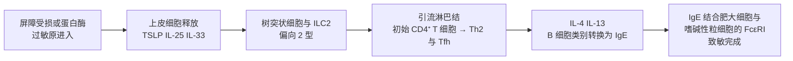

前面的章节讲的是免疫应答怎样产生、怎样被关闭；从这一章起进入"出了差错会怎样"。免疫病理的共同模式是：正常的效应模块被用在了错误的目标上，或者强度、时间失控。Ⅰ 型超敏反应是最典型的例子：它用的是为清除寄生虫和毒液而演化出的 **2 型免疫**模块（IL-4、IL-5、IL-13，**Th2 细胞**，**IgE**，肥大细胞与嗜酸性粒细胞，见 [7.15.17](/7.15.17)、[7.15.20](/7.15.20)、[7.15.21](/7.15.21)），却对花粉、尘螨和食物蛋白这类无害的抗原启动了。

本章先给出超敏反应四型的整体框架，然后展开 Ⅰ 型，沿着一条"致敏—再次接触—介质释放—两个时相"的主线展开，其中肥大细胞活化一节用一个定量模型说明为什么交联需要多价抗原、且存在最佳浓度。Ⅱ–Ⅳ 型在 [7.15.27](/7.15.27)，自身免疫病在 [7.15.28](/7.15.28)。

## 26.1. 超敏反应的分类与共同要素

**定义 26.1.1（超敏反应）** 机体对无害的非己抗原或自身抗原产生的、引起组织损伤或生理功能紊乱的过度适应性免疫应答称为**超敏反应**，又称变态反应。

按 Gell 与 Coombs 的分类，根据参与的效应分子与细胞，超敏反应分为四型：

| | Ⅰ 型（速发型） | Ⅱ 型（细胞毒型） | Ⅲ 型（免疫复合物型） | Ⅳ 型（迟发型） |
|---|---|---|---|---|
| 效应分子 | IgE | IgG、IgM | IgG、IgM（免疫复合物） | T 细胞（Th1、Th17、CTL） |
| 抗原 | 可溶性抗原（过敏原） | 细胞或基质上的抗原 | 可溶性抗原 | 可溶性抗原或细胞抗原 |
| 效应机制 | 肥大细胞、嗜碱性粒细胞脱颗粒 | 补体、吞噬、ADCC、受体的阻断或刺激 | 免疫复合物沉积，补体、中性粒细胞与血小板 | 巨噬细胞活化、CTL 杀伤 |
| 发生时间 | 数秒至数分钟，4–8 小时再现迟发相 | 数分钟至数小时 | 数小时（Arthus 反应 4–10 小时） | 24–72 小时 |
| 例 | 过敏性鼻炎、哮喘、食物过敏、全身性过敏反应 | 输血反应、新生儿溶血病、Graves 病、重症肌无力 | 血清病、Arthus 反应、系统性红斑狼疮的肾损伤 | 接触性皮炎、结核菌素反应、1 型糖尿病 |

四型有三个共同要素：（1）预先致敏，对没有接触过的抗原不会发生反应，第一次接触在不出现症状的情况下建立了效应分子或效应细胞；（2）再次接触时的放大，这是适应性免疫的记忆特点被用到了错误的目标上；（3）固有细胞作为放大器，抗体与 T 细胞提供特异性，肥大细胞、补体、中性粒细胞与巨噬细胞才造成组织损伤。

这个分类是分析性的工具，真实的疾病常同时涉及多型：例如青霉素过敏的患者可以表现出 Ⅰ 型的荨麻疹与全身性过敏反应、Ⅱ 型的溶血性贫血、Ⅲ 型的血清病样反应和 Ⅳ 型的接触性皮炎；哮喘既有 IgE 介导的急性期，也有 Th2、Th17 与嗜酸性粒细胞介导的慢性炎症。有的教材还列出"Ⅴ 型"（刺激型）超敏反应，指抗体激活受体（如 Graves 病中抗促甲状腺激素受体的抗体）；这些在经典分类中归入 Ⅱ 型（[7.15.27](/7.15.27)）。

## 26.2. 过敏原与致敏

**定义 26.2.1（过敏原）** 能诱导机体产生 IgE、引起 Ⅰ 型超敏反应的抗原称为**过敏原**。

几乎所有过敏原都是可溶性的蛋白质或糖蛋白，带有多个表位（半抗原如青霉素的降解产物要先与宿主蛋白共价结合才成为完整抗原）。来源很广：花粉（黑麦草、豚草、桦树）、尘螨与蟑螂的排泄物、真菌孢子、动物皮屑，食物（牛奶、鸡蛋、花生、坚果、鱼虾），昆虫毒液，乳胶与药物。过去很长时间里没有找到它们共有的结构特征；现在认为"成为过敏原"与蛋白质自身、与暴露的方式都有关：

- 多数过敏原有酶活性（尘螨、蟑螂、花粉与真菌的蛋白酶），可以切断上皮细胞之间的连接，使过敏原穿过屏障，激活补体，并切割 IL-33 前体产生活性的 IL-33；
- 许多过敏原带有或伴随 PAMP（[7.15.6](/7.15.6)），激活固有受体，提供促炎环境；
- 暴露的方式倾向于 2 型：低剂量、经黏膜或皮肤、没有强的病原体信号，而不是高剂量、经血液；食物过敏原多是稳定的糖蛋白，耐受热、酸和蛋白酶，使其保留免疫原性；
- 一些过敏原本身就是 Th2 的佐剂（如花生的主要糖蛋白）。

**定义 26.2.2（特应性）** 个体遗传上倾向于对常见环境抗原产生 IgE 的体质称为**特应性**。特应性个体常同时或相继患有特应性皮炎、食物过敏、过敏性鼻炎与哮喘，这一进程称为"特应性进程"。

**定义 26.2.3（致敏）** 首次接触过敏原后，产生过敏原特异性的 Th2 细胞与 IgE，IgE 通过 **FcεRI** 结合在组织的**肥大细胞**与外周的**嗜碱性粒细胞**表面，使个体对该过敏原进入随时可发生反应的状态的过程称为**致敏**。

致敏发生在没有症状的第一次接触中，按"上皮警报—2 型起始—IgE 产生"三步进行：

TSLP、IL-25 与 IL-33 是上皮"警报素"（[7.15.6](/7.15.6)），它们使树突状细胞不产生 IL-12、而促使初始 T 细胞分化为 **Th2 细胞**，同时直接激活 2 型固有淋巴细胞（ILC2）产生 IL-5 与 IL-13。分化的 Th2 与 **滤泡辅助性 T 细胞**产生 IL-4 与 IL-13，经 STAT6 诱导 B 细胞的**类别转换重组**，在生发中心产生 IgE（[7.15.20](/7.15.20)）。IgE 的血清浓度在所有同种型中最低（约 $0.1$–$0.4\,\mu\mathrm{g\,mL^{-1}}$），产生它的浆细胞很少，但一旦结合到 FcεRI 上就稳定存在数周。皮肤是致敏的重要途径：婴儿早期有湿疹者此后发生食物过敏的风险明显高于没有湿疹者，破损的皮肤屏障使过敏原先接触皮肤的免疫细胞（"双重过敏原暴露"假说：经皮肤致敏，经口腔接触诱导耐受，两者的相对强度决定结局）。

## 26.3. FcεRI 与肥大细胞的活化

**FcεRI** 是 $\alpha\beta\gamma_2$ 四聚体，α 链结合 IgE 的 Cε3 区，β 与 γ 链含 ITAM（[7.15.21](/7.15.21)）。它对 IgE 的亲和常数约为 $10^{10}\,\mathrm{M^{-1}}$，使血清中极低浓度（约 $10^{-9}\,\mathrm{M}$）的 IgE 也能稳定占据：游离 IgE 的半衰期只有 2–3 天，结合在受体上的可以持续数周。同时 IgE 的结合反过来稳定受体，使肥大细胞表面的 FcεRI 增多，这是致敏状态自我维持的一个原因（也是抗 IgE 治疗降低受体表达的基础）。

**肥大细胞**位于皮肤、气道与消化道黏膜等与外界接触的组织，血管周围；**嗜碱性粒细胞**在血液中，数量少。两者都表达 FcεRI。**脱颗粒**由抗原交联 IgE–FcεRI 触发：

1. 多价抗原同时结合两个或更多相邻的 IgE，使 FcεRI 聚集进入膜脂筏；
2. 受体相关的 Lyn 磷酸化 ITAM，招募并活化 Syk，使接头蛋白 LAT 磷酸化，由 PLCγ 水解 PIP₂，产生 IP₃ 与 DAG（[7.3.19](/7.3.19)）；
3. 内质网钙库释放，随后经钙池操纵的钙内流使胞质 Ca²⁺ 升高，PKC 激活，颗粒与质膜融合，预存的介质在数秒至数分钟内释放；
4. 同时 PLA₂ 的活化启动花生四烯酸代谢（白三烯、前列腺素），转录因子（NFAT、NF-κB）活化诱导细胞因子的合成。

这个信号受到几层限制：肥大细胞同时表达抑制性受体 FcγRIIB，当过敏原同时结合 IgG 与 IgE 时，抑制信号占优势（25.6 与 [7.15.21](/7.15.21)）；磷酸酶（SHP、SHIP、PTEN）拆除磷酸基团；Lyn 与 Syk 的信号还活化 E3 泛素连接酶 c-Cbl，使受体与激酶降解，也就是活化自己限制自己的持续时间。

### 26.3.1. 为什么需要多价抗原：钟形剂量响应

交联需要抗原在两个 IgE 之间"搭桥"，因此一个单价的半抗原不能触发脱颗粒，一个二价的抗原却可能触发；而且当抗原浓度太高时，每个 IgE 的两个位点都被不同的抗原分子占据，桥搭不起来，反应反而下降。这是一个经典的"钟形"剂量响应（Goldstein–Perelson 型模型），与 [7.1.14](/7.1.14) 的受体占据率思想一脉相承。

**例 26.3.1（二价抗原的交联模型）** 设每个细胞上的受体总数 $R_{\mathrm{T}}$，全部携带对该抗原有特异性的 IgE。二价抗原的浓度为 $L$（以单个位点的解离常数 $K_{\mathrm{D}}$ 为单位）。分三个状态：游离受体 $R$、单价结合的受体 $C_1$、被抗原交联成对的复合物 $C_2$（每个含 2 个受体）。则

$$
C_1 = 2LR,\qquad C_2 = \frac{\varepsilon}{R_{\mathrm{T}}}\,C_1 R,\qquad R_{\mathrm{T}} = R + C_1 + 2C_2,
$$

因子 2 来自抗原有两个位点可以先结合；无量纲数 $\varepsilon = K_{\mathrm{x}}R_{\mathrm{T}}$ 表示第二个位点与邻近受体结合的二维亲和力，与受体密度和膜的流动性相关。以 $R_{\mathrm{T}}$ 为单位，$R$ 满足二次方程 $4\varepsilon L R^2 + (1 + 2L)R - 1 = 0$。交联的受体份额 $2C_2/R_{\mathrm{T}}$ 对 $L$ 的曲线在 $L \approx 0.5$（即约 $K_{\mathrm{D}}$ 的一半）处有极大值。脱颗粒需要的是交联的密度超过一个阈值（用 $n = 2$ 的 Hill 函数近似）：

结果有三个含义。第一，占据不等于活化：受体在 $L \gg K_{\mathrm{D}}$ 时几乎全被占据，反应却消失，因为活化需要的是交联而不是占据。第二，交联的峰值份额随 $\varepsilon$ 强烈上升（$\varepsilon = 0.1$ 时约 $4.5\%$，$1$ 时约 $27\%$，$10$ 时约 $64\%$），所以多价的、能使受体靠近的抗原远比二价抗原更有效；真实的过敏原常是有多个相同表位的多聚体或有重复结构的颗粒。第三，效应的陡峭阈值使反应呈"开关"样：少量交联不引起脱颗粒，超过阈值后迅速完成，因此肥大细胞只对有足够多价的抗原有反应，对低水平的背景接触不反应（与 [7.15.16](/7.15.16) 的动力学校对同属"读取而不是计数"的思想）。同样的逻辑也适用于抗体—抗原复合物的大小（[7.15.27](/7.15.27)）。

## 26.4. 介质与速发相、迟发相

肥大细胞与嗜碱性粒细胞释放的介质分为三类：

| 类别 | 介质 | 释放的时间 | 主要作用 |
|---|---|---|---|
| 预存（颗粒内） | 组胺、类胰蛋白酶与糜蛋白酶、肝素、嗜酸性粒细胞趋化因子 | 数秒至数分钟 | 组胺经 H1 受体使血管通透性增加、支气管与肠平滑肌收缩、黏液分泌；经 H2 受体使血管扩张、胃酸分泌，并负反馈抑制脱颗粒；蛋白酶降解基底膜与产生补体片段（**过敏毒素**） |
| 新合成的脂质介质 | 白三烯 C₄、D₄、E₄（过去称为慢反应物质），前列腺素 D₂，血小板活化因子 | 数分钟到数十分钟 | 白三烯收缩支气管的作用约比组胺强 1000 倍，持续更长，也增加血管通透性与黏液分泌 |
| 细胞因子与趋化因子 | IL-4、IL-5、IL-13、TNF-α、IL-8、GM-CSF | 数小时 | 招募中性粒细胞与嗜酸性粒细胞，使 Th2 反应持续，TNF-α 与全身性过敏反应的休克相关 |

反应分成两个时相（有时还有第三相）：

- 速发相：接触过敏原后数秒至数分钟发生，持续数小时，由预存介质与新合成的脂质介质引起，症状以血管扩张、通透性增加和平滑肌收缩为主；
- 迟发相：4–8 小时后再次出现（哮喘可延至 6–12 小时），持续一到数天，由细胞因子引起的炎症引起：TNF-α 与 IL-1 使内皮细胞上调黏附分子与趋化因子（[7.15.4](/7.15.4)），中性粒细胞、**嗜酸性粒细胞**、Th2 细胞浸润，嗜酸性粒细胞经颗粒蛋白（主要碱性蛋白、嗜酸性粒细胞阳离子蛋白）、脂质介质与细胞因子加重组织损伤；
- 第三相（皮肤模型中报道）：约 3–4 天，需要被招募的嗜碱性粒细胞与成纤维细胞，使嗜酸性粒细胞与中性粒细胞进一步浸润。

长期的慢性过敏炎症导致组织重塑：哮喘中气道上皮损伤、基底膜增厚、平滑肌肥大、杯状细胞增多。

## 26.5. 临床表现：局部反应与全身性过敏反应

症状的位置由过敏原进入的途径决定：吸入引起过敏性鼻炎（鼻黏膜、结膜的肥大细胞，症状是流涕、打喷嚏）与过敏性哮喘（下气道的支气管收缩与黏液）；食入引起恶心、呕吐、腹痛和腹泻，也可以使消化道上皮的通透性增加，使过敏原入血；接触或经皮引起荨麻疹（皮肤的组胺释放）、血管性水肿（深层皮肤）；特应性皮炎则是皮肤的慢性 Th2 炎症，皮损中有 Th2 细胞与嗜酸性粒细胞，不同于接触性皮炎的 Th1 与 Th17。食物过敏是儿童全身性过敏反应最常见的原因。

**定义 26.5.1（全身性过敏反应）** 过敏原进入血液循环，或经吸收后广泛激活肥大细胞与嗜碱性粒细胞，在数分钟内引起多器官同时受累（皮肤、呼吸道、心血管、胃肠道）的严重、可致命的反应称为**全身性过敏反应**。

机制是广泛的脱颗粒：组胺、白三烯、前列腺素与血小板活化因子使全身血管扩张、血管通透性升高，血浆外渗，血压骤降而出现休克，同时气道平滑肌收缩与喉头水肿造成呼吸困难。最常见的诱因是食物（花生、坚果、海鲜）、昆虫毒液、药物（青霉素类）与乳胶。除经典的 IgE 通路外，也存在不依赖 IgE 的肥大细胞活化（补体的过敏毒素 C3a 与 C5a、某些药物直接作用于肥大细胞的受体 MRGPRX2），临床表现相同，但因为没有预先致敏，也可以在第一次用药时发生。治疗的原理是**肾上腺素**：它经 α 受体使血管收缩、升高血压、减轻水肿，经 β₂ 受体使支气管扩张，经 β 受体使肥大细胞的 cAMP 水平升高而抑制进一步的脱颗粒（cAMP 的短暂上升促进脱颗粒，持续的升高则抑制），所以单一药物同时对抗了几种介质的作用。

## 26.6. 遗传、环境与卫生假说

过敏性疾病有很强的家族聚集性与双胞胎一致性。全基因组关联研究（链接 [7.4.25](/7.4.25)）和候选基因研究发现的易感基因沿着前面的路径分布：

| 路径上的位置 | 基因的例子 |
|---|---|
| 上皮屏障 | 丝聚蛋白（*FLG*）、*DSG1*、*SPINK5*；*FLG* 的功能缺失变异是特应性皮炎最强的遗传危险因素之一 |
| 警报素与 2 型起始 | *TSLP*、*IL33*、*IL1RL1*（IL-33 受体链）、*IL25* |
| 2 型细胞因子及其信号 | *IL4*、*IL13*、*IL4R*、*STAT6*、*GATA3* |
| 调节 | FOXP3 基因、*IL2*、*IL10*、*TGFBR* |
| 抗原识别与效应 | HLA（DRB1、DQ 等）、*FCER1A*、*PLCG2* |

遗传解释了倾向，不解释近几十年发病率的上升，所以环境同样重要：空气污染物（多环芳烃经芳香烃受体使角质形成细胞产生 TSLP 与 IL-33）、二手烟与屏障损伤促进；农场环境与高纤维饮食（经微生物产生的短链脂肪酸使 IL-10 增加、2 型反应受抑）、多样的肠道菌群、抗生素的少用与宠物接触则与较低的风险相关。

这些观察汇集成卫生假说：早期反复接触微生物的生活环境使免疫系统偏离 2 型方向（经 Th1、Treg 的诱导），而现代的清洁、疫苗、抗生素与家庭规模缩小减少了这类接触，使新生儿出生时偏向 Th2 的免疫在特应性个体中得以保留。对这一假说应当分几层评价：

- 证据：农场儿童、东西德统一后的比较、同胞数量越多发病越少等流行病学研究相当一致；小鼠实验中农场灰尘与低剂量脂多糖可以保护；
- 局限：假说名称容易误导，并不是"太干净导致过敏"，被认为起作用的是微生物的多样性、肠道菌群的发育与屏障的完整，不是日常的清洁；感染的作用并不一致，一些感染（如呼吸道病毒的早期重症感染）反而促进哮喘；Th1 与 Th2 互相抑制的简单模型也不能解释同时增加的自身免疫病（Th1/Th17 的疾病），后来的解释转向"调节性反应不足"与菌群—屏障—Treg 的整体失衡；
- 因此它是一个有证据支持、但机制仍在修正的框架，现在更常称为"旧友"或"微生物多样性"假说。

## 26.7. 诊断与治疗的免疫学原理

诊断的依据是"IgE 的存在"和"症状的再现"的结合。皮肤点刺试验把微量过敏原引入皮肤表层，若皮肤肥大细胞上结合了特异性 IgE，几分钟内就出现局部的组胺释放，即风团与红晕，这是一个在体内读取致敏的试验；体外测血清的总 IgE 与特异性 IgE（免疫分析，链接 [7.15.34](/7.15.34)）则读取抗体本身。但致敏不等于过敏：许多个体有特异性 IgE 却没有症状，所以试验阳性必须结合病史（灵敏度与特异度的关系见 [7.7.3](/7.7.3)）；用重组的单个过敏原成分检测可以区分真正的致敏与交叉反应（如花粉与水果之间的交叉反应）。

治疗沿着路径的不同位置，各自对应一类药物或干预：

| 位置 | 干预 | 原理 |
|---|---|---|
| 暴露 | 避免过敏原 | 去除抗原，不引起再次活化 |
| 介质的作用 | 抗组胺药（H1 受体反向激动剂）、白三烯受体拮抗剂 | 阻断介质与受体的结合，对速发相的鼻炎与荨麻疹有效 |
| 炎症 | 糖皮质激素 | 抑制迟发相的细胞因子与细胞浸润（25.7） |
| 肥大细胞的 cAMP | β₂ 受体激动剂、肾上腺素、磷酸二酯酶抑制剂 | 使支气管扩张，抑制脱颗粒 |
| IgE 与受体 | 人源化抗 IgE 抗体 | 与 IgE 的 Cε3 区结合，阻止其与 FcεRI 结合，降低游离 IgE，使受体下调 |
| 2 型细胞因子 | 抗 IL-5（嗜酸性粒细胞）、抗 IL-4Rα（阻断 IL-4 与 IL-13）、抗 TSLP | 针对路径的不同节点 |

最后一类是对因的：

**定义 26.7.1（过敏原免疫治疗）** 通过反复、逐步地使过敏者在受控条件下接触特定的过敏原，使其对该过敏原的反应性降低、甚至在停止治疗后仍然保持的免疫学治疗称为**过敏原免疫治疗**，也称脱敏治疗。

它的作用机制不是减弱 IgE，而是改变应答的性质：（1）诱导过敏原特异性的 **调节性 T 细胞**，经 IL-10 与 TGF-β 抑制 Th2 与肥大细胞、嗜酸性粒细胞，（2）使类别转换偏向 IgG4 与 IgG1（受 Th1 与 Treg 的细胞因子影响），这些 IgG 与 IgE 竞争结合过敏原，并使过敏原同时结合 FcγRIIB 与 FcεRI，抑制脱颗粒；（3）高强度的刺激可以使 Th2 细胞凋亡或失能；（4）嗜碱性粒细胞与肥大细胞的活化阈值提高。这些机制与耐受一章（[7.15.24](/7.15.24)）的"抗原的剂量、途径与共刺激决定应答还是耐受"的原理是一致的。疗效取决于能否转变为持久的耐受，而不仅仅是暂时的"脱敏"（暂时提高反应阈值，需要持续接触才能维持）。

## 26.8. 为什么保留了 IgE

一个反复被问到的问题是：既然 Ⅰ 型超敏反应如此危险，为什么 IgE、FcεRI 与脱颗粒没有被淘汰？2 型免疫的原始功能提供了线索：对蠕虫（巨大的、不能被吞噬的寄生虫），IgE 使嗜酸性粒细胞与肥大细胞在虫体表面释放酶与介质，同时增加肠道的蠕动、黏液与上皮细胞的更替，把虫排出（"冲刷与清除"）；对毒液（蛇、蜂、蝎），小鼠中的研究表明 IgE 依赖的肥大细胞活化可以降低毒液的致死性；对蛋白酶与有毒物质，打喷嚏、咳嗽、呕吐与腹泻也是保护性的排出反射。在寄生虫少见的环境里，这套系统缺少真正的目标，而对无害的环境抗原启动，就成了过敏。这个观点得到的支持是间接的，但与 IgE 的分布（黏膜与皮肤等外来物首先进入的部位）和细胞因子的作用相符。

## 小结

- 超敏反应分四型，共同的要素是预先致敏、再次接触的放大和固有细胞作为效应放大器（定义 26.1.1，26.1 节的表）。
- Ⅰ 型反应的路径：过敏原经受损的屏障进入，上皮警报素（TSLP、IL-25、IL-33）使树突状细胞与 ILC2 偏向 2 型，Th2 与 Tfh 的 IL-4、IL-13 诱导 B 细胞类别转换产生 IgE，IgE 结合 FcεRI 完成致敏（定义 26.2.1–26.2.3）。
- 再次接触时多价抗原交联 IgE–FcεRI，Lyn、Syk、LAT、钙信号使肥大细胞脱颗粒；交联的剂量响应是钟形的（例 26.3.1），说明活化取决于交联，不取决于占据。
- 速发相由组胺与脂质介质引起，迟发相由细胞因子与嗜酸性粒细胞引起；全身性过敏反应是广泛的脱颗粒，可用肾上腺素对抗（定义 26.5.1）。
- 遗传解释倾向，环境解释趋势；卫生假说是被修正中的框架，强调微生物多样性与屏障。
- 治疗沿路径分层：避免、阻断介质、抗炎、抗 IgE 与抗细胞因子，以及过敏原免疫治疗通过 Treg、IgG4 与 FcγRIIB 改变应答的性质（定义 26.7.1）。

## 思考题

1. 例 26.3.1 的模型中，为什么单价半抗原在任何浓度下都不引起脱颗粒，却能在高浓度时抑制多价抗原引起的反应？

   **答** 单价半抗原只有一个结合位点，一个抗原分子只能结合一个 IgE，$C_2 = 0$，不能把两个受体连接起来，所以没有交联。但它与多价抗原竞争 IgE 的结合位点：浓度高时，大部分 IgE 被半抗原占据，多价抗原找不到空位点来搭桥，交联的份额下降。这与高浓度多价抗原使曲线下降是同一个原理（占据不等于活化）。

2. 皮肤点刺试验阳性、但从未有症状的人，应该怎样解释？

   **答** 阳性说明该个体的皮肤肥大细胞上有结合了特异性 IgE 的 FcεRI，即**致敏**，不等于有临床过敏。致敏者中只有一部分在自然暴露的剂量、途径下达到脱颗粒的阈值，另一部分可能因同时有 IgG、较低的 IgE 亲和力或交联不足而没有反应；也可能是交叉反应的 IgE（例如对花粉的 IgE 与某种水果蛋白交叉识别但在体内被消化）。诊断需要结合病史、必要时受控的激发试验与分子水平的检测，并考虑检验的阳性预测值（[7.7.3](/7.7.3)）。

3. 解释为什么抗 IgE 抗体不会引起肥大细胞的交联与脱颗粒，尽管它结合的是 IgE。

   **答** 用于治疗的抗 IgE 抗体结合 IgE 的 Cε3 区，也就是 IgE 与 FcεRI 结合的位置，所以它只与游离的 IgE 结合，不与已经结合在 FcεRI 上的 IgE 结合（那里 Cε3 被受体占据），也就不会交联细胞表面的 IgE。它降低的是游离 IgE 的浓度，随之使 FcεRI 表达下调，同时阻止新的致敏。
