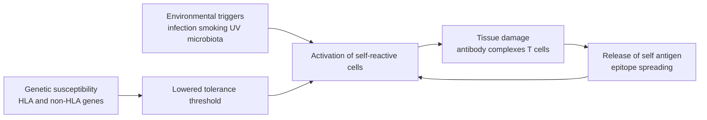

The chapter on tolerance ([7.15.24](/7.15.24)) described how the immune system avoids attacking itself; this chapter describes what happens when that principle fails. Autoimmune disease is a special case of Type II, III and IV hypersensitivity ([7.15.27](/7.15.27)): there is nothing new in the effector mechanisms, the novelty being that the target is a self antigen, and self antigens are not cleared, so once the effector response has started it is hard to stop and the disease is chronic and progressive. The key to understanding it is to see two things at once: at which steps tolerance can fail, and why most people who carry susceptibility genes never develop disease.

We first distinguish autoimmunity from autoimmune disease, then treat the mechanisms of etiology and genetics, then use several representative organ-specific and systemic diseases to illustrate the effector mechanisms, and finally discuss autoantibodies, animal models and the principles of treatment. Everything remains at the level of mechanism.

## 28.1. Autoimmunity and Autoimmune Disease

Autoimmunity is a response of the immune system to self components and is itself a physiological phenomenon: normal serum contains low-affinity natural autoantibodies (against senescent cells, DNA, immunoglobulins and so on), self-reactive B cells and T cells are present in large numbers in the periphery (tolerance does not require elimination of all self-reactive clones, see [7.15.24](/7.15.24)), and self antigens are also used for selection and maintenance (positive selection, development of Tregs). Autoantibodies appearing transiently after infection are also common.

**Definition 28.1.1 (Autoimmune Disease)** A disease of tissue damage or functional disturbance caused by an adaptive immune response against self antigens (autoantibodies or self-reactive T cells) is called an **autoimmune disease**.

**Definition 28.1.2 (Autoantibody)** An antibody directed against a component of self tissue is called an **autoantibody**.

Distinguishing "autoimmunity" from "autoimmune disease" requires proof of causation. A commonly used framework (the revision of Witebsky) has three levels by strength of evidence:

| Evidence | Content | Examples |
|---|---|---|
| Direct | Transfer of antibody or T cells to a healthy recipient reproduces the disease | Maternal anti-acetylcholine receptor IgG crossing the placenta causes transient myasthenia in the newborn; anti-TSHR antibodies cause neonatal hyperthyroidism; symptoms remit when the antibody is removed |
| Indirect | Immunizing animals with the self antigen, or finding spontaneous disease in animals, reproduces it | EAE, NOD mice |
| Circumstantial | Self-reactive cells and antibodies in lesions, association with genetic factors such as HLA, response to immunosuppression | Most autoimmune diseases |

By the extent of involvement, autoimmune diseases are divided into organ-specific (directed at a specific antigen of one organ, with lesions confined to that organ) and systemic (directed at widely distributed antigens such as nuclear components, involving several systems):

| Type | Disease | Target antigen | Main effector | Corresponding hypersensitivity |
|---|---|---|---|---|
| Organ-specific | Hashimoto thyroiditis | Thyroid peroxidase, thyroglobulin | Antibody plus Th1 cells | II + IV |
| | Graves disease | Thyroid-stimulating hormone receptor | Stimulating antibody | II (receptor stimulation) |
| | Myasthenia gravis | Acetylcholine receptor | Blocking antibody and complement | II (receptor blockade) |
| | Type 1 diabetes | Pancreatic β cells (insulin, GAD65, IA-2, etc.) | CD8⁺ and CD4⁺ T cells | IV |
| | Multiple sclerosis | Myelin (myelin basic protein, proteolipid protein, etc.) | Th1 and Th17 cells | IV |
| Systemic | Systemic lupus erythematosus | Nuclear components (DNA, histones, ribonucleoproteins) | Immune complexes | III (plus II) |
| | Rheumatoid arthritis | Fc portion of IgG, citrullinated proteins | Immune complexes, T cells, cytokines | III + IV |

## 28.2. Immunological Mechanisms of Etiology

Autoimmune diseases almost never have a single cause. The mechanisms can be organized by which line of defense of tolerance has failed and what has ignited the self-reactive cells.

### 28.2.1. Failure of Tolerance

- Defects of central tolerance: **AIRE** in the thymus causes tissue-specific antigens of peripheral tissues to be expressed in medullary thymic epithelial cells, so that the corresponding T cells are deleted and Tregs are generated; mutations of *AIRE* cause autoimmune polyendocrine syndrome type 1 (APS-1), in which several endocrine organs are attacked. Impaired central tolerance of B cells (receptor editing, clonal deletion) allows polyreactive and self-reactive newly formed B cells into the periphery (see [7.15.19](/7.15.19)).
- Defects of peripheral tolerance: mutation of FOXP3, the transcription factor of **regulatory T cells**, causes IPEX syndrome (X-linked, multiorgan autoimmunity in infancy); haploinsufficiency of *CTLA4*, mutation of *FAS* (autoimmune lymphoproliferative syndrome) and variants of *IL2RA* all disrupt the brakes described in [7.15.25](/7.15.25); loss of the signals of **clonal anergy** allows weak self-reactive T cells to be activated.
- The threshold of tolerance: most self-reactive cells have low affinity and are not deleted, and their activation is held at a level that does not cause disease; once the strength of stimulation, costimulation or the inflammatory background changes, the threshold is crossed. This is the common background of the mechanisms below.

### 28.2.2. Factors That Ignite Self-Reactive Cells

**Definition 28.2.1 (Molecular Mimicry)** The phenomenon in which an antigenic epitope of a pathogen resembles a self molecule in sequence or structure, so that B cells or T cells directed against the pathogen **cross-react** with a self antigen and, against an inflammatory background, bypass tolerance and attack self tissue, is called **molecular mimicry**.

The typical example is rheumatic fever: some weeks after infection with group A streptococci, antibodies against streptococcal antigens such as the M protein cross-react with proteins of the heart, joints and other tissues, causing inflammation of the heart and joints. Molecular mimicry has also been implicated in other diseases, but for most there is no direct evidence as in rheumatic fever, and a susceptible HLA haplotype (to present the cross-reactive peptide) and an inflammatory setting (to supply second signals and cytokines) are needed at the same time. Similar sequences alone are not sufficient; sequence similarity between human viruses and self proteins is almost everywhere and in the great majority of cases causes no disease.

**Definition 28.2.2 (Epitope Spreading)** The phenomenon in which, as disease progresses, an autoimmune response extends from the single epitope initially targeted to other epitopes of the same molecule (intramolecular spreading) or to other molecules in the same tissue (intermolecular spreading) is called **epitope spreading**.

The mechanism is that tissue damage releases more self antigen, which is taken up and processed by antigen-presenting cells that present "cryptic" epitopes not presented before (cryptic epitopes are not generated, or generated only in small amounts, in normal antigen processing, so the corresponding T cells were not deleted), thereby recruiting new clones. In systemic lupus erythematosus, for example, autoantibodies are first directed against one component of a ribonucleoprotein complex and then spread to other components of the same particle; in an animal model of multiple sclerosis, the T-cell response spreads from the initial myelin protein epitope to other epitopes. Epitope spreading makes disease worsen over time and makes treatment aimed at a single epitope less effective in late disease.

Other triggers include:

- Release of sequestered antigens: lens proteins of the eye, antigens of the testis and proteins of the heart enter the circulation after trauma, surgery, infection or myocardial infarction; because they were not adequately expressed in the thymus, the corresponding T cells were not deleted and are activated against a background of "danger" signals (sympathetic ophthalmia is the classic example; for immune-privileged sites see [7.15.24](/7.15.24)).
- Bystander activation: local infection or inflammation causes antigen-presenting cells to upregulate costimulatory molecules and cytokines, so that neighboring self-reactive T cells of unrelated specificity are activated with very weak TCR signals; polyclonal activation of B cells by Epstein–Barr virus and others causes low-affinity self-reactive B cells to produce autoantibodies.
- Persistent activation of innate immunity: self nucleic acids are recognized by TLR7, TLR9 and cGAS–STING ([7.15.6](/7.15.6)), causing plasmacytoid dendritic cells to produce type I interferon continuously, the source of the "interferon signature" of systemic lupus erythematosus.
- Other environmental factors: smoking (which citrullinates proteins in rheumatoid arthritis), ultraviolet light (which increases cell apoptosis and release of nuclear antigens), vitamin D and sunlight, changes of the microbiome, diet (salt promotes Th17 cells) and so on.
- Chance: the randomness of V(D)J rearrangement and peptide presentation makes each person's repertoire different, and monozygotic twins are not completely concordant.

The relations among the factors can be summarized as a self-amplifying loop of "genetic susceptibility × environmental trigger × defective tolerance → autoimmunity → tissue damage → antigen release and spreading → chronicity":

## 28.3. Genetic Susceptibility

Autoimmune diseases have an evident genetic component: the concordance of monozygotic twins is much higher than that of dizygotic twins; for multiple sclerosis, for example, the lifetime risk in the general population is about 1 in 1000, in siblings about 1 in 20 and in monozygotic twins about 1 in 4. At the same time the concordance is far below 100%, showing that genetics supplies the predisposition and the environment the trigger.

HLA genes are the strongest genetic factor because they determine which self peptides can be presented to T cells ([7.15.13](/7.15.13)):

| Disease | Associated HLA | Explanation |
|---|---|---|
| Ankylosing spondylitis | HLA-B27 (class I, risk about 90-fold higher) | Hypotheses of misfolding, peptide presentation and dimer formation; the mechanism is not fully established |
| Rheumatoid arthritis | The "shared epitope" of HLA-DRB1 (a stretch of sequence of the peptide-binding groove) | The groove of shared-epitope alleles is better suited to binding citrullinated peptides |
| Type 1 diabetes | HLA-DR3, DR4 and DQ8 | Certain positions of the groove affect binding of insulin peptides |
| Multiple sclerosis | HLA-DRB1\*15:01 | Binds a myelin basic protein peptide |
| Systemic lupus erythematosus | HLA-DR3, DR2 | Acts together with deficiency of early complement components |

Genes of the HLA region are in strong linkage disequilibrium ([7.4.8](/7.4.8), [7.4.22](/7.4.22)), so association signals often come from a haplotype rather than a single allele, and assigning causation to one allele requires fine mapping ([7.4.25](/7.4.25)).

Non-HLA genes act by two kinds of route: changing the threshold of the immune response and changing the ability to clear self material. The R620W variant of *PTPN22* (encoding the phosphatase LYP) is a common risk factor for several autoimmune diseases (type 1 diabetes, rheumatoid arthritis, systemic lupus erythematosus); it changes the strength of TCR and BCR signaling, so that self-reactive cells are more easily retained in negative selection and in the periphery. *CTLA4*, *IL2RA*, *STAT4*, *IL23R* (inflammatory bowel disease, psoriasis) and deficiencies of complement C1q and C4 (which cause lupus: debris of apoptotic cells cannot be cleared by complement and macrophages and nuclear antigens are exposed) each correspond to one link in the mechanism.

### 28.3.1. Statistical Interpretation of Association Strength

Case-control studies often report the **odds ratio** (OR), and cohort studies the **risk ratio** (RR, relative risk). The relation between the two depends on the baseline risk of the disease: let the probability of disease in those without the risk allele be $p_0$ and in carriers $p_1 = \mathrm{RR}\cdot p_0$; then

$$
\mathrm{OR} = \frac{p_1/(1 - p_1)}{p_0/(1 - p_0)},\qquad \mathrm{RR} = \frac{\mathrm{OR}}{1 - p_0 + p_0\,\mathrm{OR}}.
$$

When the disease is rare ($p_0$ very small), the OR approximates the RR; when the disease is common, the OR overestimates the RR. This is important when reading the literature: an association of "OR = 3" in a common disease may correspond to an RR of only about 2 (see [7.7.9](/7.7.9)).

**Example 28.3.1 (Absolute Risk of an HLA Association)** Suppose a case-control study (illustrative numbers for teaching, of the same order as the association of ankylosing spondylitis with HLA-B27) finds that the carrier frequency of the risk allele is $90\%$ in patients and $8\%$ in controls; then

$$
\mathrm{OR} = \frac{0.90/0.10}{0.08/0.92} \approx 104.
$$

Suppose the prevalence of the disease in the population is $K = 0.5\%$ (and further that the carrier frequency in controls is that of non-patients in the population); then the probabilities of disease in carriers and non-carriers are

$$
\mathbb{P}(\text{disease}\mid\text{carrier}) = \frac{K \times 0.90}{K \times 0.90 + (1 - K) \times 0.08} \approx 5.4\%,\qquad
\mathbb{P}(\text{disease}\mid\text{non-carrier}) = \frac{K \times 0.10}{K \times 0.10 + (1 - K)\times 0.92} \approx 0.05\%,
$$

and the risk ratio is about 98, close to the OR (the disease is rare). Panel B shows that although the risk ratio is nearly 100, the absolute risk of carriers is only about 5%, and 95% of carriers never develop the disease over their lifetime. Panel A plots the relation between OR and RR: the higher the baseline risk, the larger the gap between the two.

![Interpretation of an HLA association (numbers for teaching, not data from any study). A: relation between odds ratio (OR) and risk ratio (RR), $\mathrm{RR} = \mathrm{OR}/(1 - p_0 + p_0\,\mathrm{OR})$, for four baseline risks $p_0 = 0.001$, 0.05, 0.2 and 0.4; the dashed line is RR = OR; the two agree when the disease is rare, and the OR overestimates the RR when the disease is common. B: with carrier frequency 90% in patients and 8% in controls (OR ≈ 104) and prevalence 0.5%, the absolute risks of disease in carriers and non-carriers are about 5.35% and 0.05%.](./plots/hla-association.py)

:::

Association is neither causation nor prediction: an allele with a strong association explains part of the etiology at the population level but cannot be used for diagnosis (the positive predictive value for carriers is very low), the problem of sensitivity and specificity already met in [7.7.3](/7.7.3).

## 28.4. Organ-Specific Autoimmune Diseases

Hashimoto thyroiditis was the first organ-specific autoimmune disease to be recognized: patients produce antibodies against thyroid peroxidase and thyroglobulin, with infiltration of Th1 cells and CTLs; the thyroid is infiltrated by lymphocytes, plasma cells and germinal-center-like structures (similar tertiary lymphoid structures, see [7.15.22](/7.15.22)), the gland is gradually destroyed, production of thyroid hormone falls and hypothyroidism finally results. The antibodies can activate complement and mediate ADCC, but the destruction of tissue is mainly cell-mediated.

The autoantibodies of Graves disease bind the thyroid-stimulating hormone (TSH) receptor and activate it continuously like an agonist, so that the thyroid escapes the negative feedback of the hypothalamic–pituitary–thyroid axis and continuously synthesizes and secretes thyroid hormone. This is an example of "disease caused by receptor stimulation by antibody, with no cell killed" (the receptor stimulation of [7.15.27](/7.15.27)), and the IgG can cross the placenta and cause transient hyperthyroidism in the newborn, an instance of direct evidence.

In *myasthenia gravis*, the autoantibodies are directed against the acetylcholine receptor of the postsynaptic membrane of the neuromuscular junction, blocking acetylcholine binding, accelerating internalization and degradation of the receptor and activating complement to destroy the folds of the postsynaptic membrane, so that the end-plate potential falls and muscle weakness worsens with activity. Thymic abnormalities (hyperplasia or thymoma) are common in patients, presumed to be related to expression of the receptor by myoid cells in the thymus and to abnormal AIRE or tolerance.

**Type 1 diabetes** is caused by selective destruction of pancreatic β cells by CD8⁺ and CD4⁺ T cells (for the disease and the metabolism of insulin see [7.14](/7.14)). Autoantibodies against insulin, GAD65, IA-2 and ZnT8 can be detected years before clinical onset; they are markers and not pathogenic factors, since the antibodies themselves do not destroy β cells.

*Multiple sclerosis* is an inflammatory demyelinating disease of the central nervous system: self-reactive Th1 and Th17 cells (and also B cells and monocytes) cross the blood–brain barrier, recognize myelin antigens and cause myelin damage, blocking conduction of nerve impulses; the course is often relapsing–remitting. Risk factors include HLA-DRB1\*15:01, a history of Epstein–Barr virus infection, low sunlight exposure (low vitamin D), smoking and obesity. Crossing the blood–brain barrier depends on the adhesion molecule α4 integrin ([7.15.4](/7.15.4)), so blocking it is one therapeutic approach.

## 28.5. Systemic Autoimmune Diseases

*Systemic lupus erythematosus*, abbreviated SLE, is the typical systemic autoimmune disease, and patients produce antinuclear antibodies against nuclear components such as DNA, histones and ribonucleoproteins. The mechanism is a chain of linked steps: defective clearance of apoptotic cells (deficiency of complement C1q and C4, MFG-E8 and so on) exposes nuclear components; nucleic acids form immune complexes with antibody, which enter plasmacytoid dendritic cells through FcγR, activate TLR7 and TLR9 in endosomes and cause secretion of type I interferon; type I interferon activates self-reactive B cells and dendritic cells, which produce more autoantibody; the complexes are deposited in glomeruli, skin and joints and cause Type III damage ([7.15.27](/7.15.27)), and antibodies against red cells and platelets cause Type II damage. A positive feedback of "apoptotic debris, antibody, nucleic acid sensing, interferon, more antibody" results. Ninety percent of patients are women. Antinuclear antibodies are detected by indirect immunofluorescence of cell nuclei with the patient's serum ([7.15.34](/7.15.34)); sensitivity is high but specificity is lower, and anti-dsDNA and anti-Sm antibodies are more specific.

*Rheumatoid arthritis* involves the synovium of joints. Patient serum contains rheumatoid factor (autoantibody against the Fc of IgG) and anti-citrullinated protein antibodies (ACPA), the latter detectable years before clinical symptoms and associated with the HLA-DRB1 shared epitope and with smoking: after arginine is converted to citrulline by peptidylarginine deiminase, the peptides bind better to the HLA-DR groove with the shared epitope, so that modified peptides are presented and tolerance is broken. Complexes form in the synovium, with infiltration of T cells, B cells and macrophages, and TNF-α, IL-6, IL-1 and IL-17 drive synovial proliferation (pannus) and destruction of cartilage and bone, with both Type III complexes and Type IV T-cell responses.

## 28.6. Pathogenic and Marker Roles of Autoantibodies

Autoantibodies are useful in two senses, which must be distinguished:

| Role | Meaning | Examples |
|---|---|---|
| Pathogenic | The antibody itself causes disease, and transfer or removal changes the course | Anti-acetylcholine receptor, anti-TSHR, anti-glomerular basement membrane, anti-desmoglein (pemphigus) |
| Marker | The antibody is a product or by-product of the disease process, used for diagnosis, classification and prediction | Antinuclear antibodies, rheumatoid factor, ACPA, islet autoantibodies in type 1 diabetes |

The value of a marker antibody depends on the sensitivity and specificity of the test and on the prior probability of disease: antinuclear antibodies are positive in almost all SLE (high sensitivity) and also in a certain proportion of healthy people and of other diseases (not highly specific), so a negative result helps exclude and a positive result must be interpreted clinically; diagnosis is integrative (see [7.7.3](/7.7.3)). Pathogenic IgG can be lowered by removal (plasmapheresis), by accelerated degradation (blocking FcRn, which reduces recycling of IgG, see [7.15.21](/7.15.21)) or by depleting the B cells that produce it.

## 28.7. Animal Models

Animal models answer questions of causation, and both their value and their limits must be recognized:

- Experimental autoimmune encephalomyelitis (EAE): immunizing animals with myelin antigen and adjuvant (or transferring myelin-specific CD4⁺ T cells) causes inflammation and demyelination of the central nervous system; it is a model of a T-cell-mediated disease and the main tool for studying Th1 cells, Th17 cells and crossing of the blood–brain barrier.
- NOD mice: spontaneously develop type 1 diabetes, associated with a specific MHC class II molecule, with more disease in females; used to study pathogenic and regulatory T cells and prevention.
- NZB/W F1 mice: spontaneously develop a lupus-like disease.
- Collagen-induced arthritis: immunization with type II collagen causes arthritis; used for rheumatoid arthritis.

The limits are that models are often induced by artificial adjuvant immunization or by the specific genetic background of inbred strains, the mouse immune system differs from the human (for example in FcγR and the markers of T-cell subsets), and many interventions effective in models are ineffective in humans; models are therefore used to test mechanistic hypotheses and cannot directly predict efficacy.

## 28.8. Principles of Treatment

The ideal treatment would suppress only the self-reactive response and preserve protective immunity, which is hard to achieve; existing methods run from broad to narrow:

| Level | Examples | Principle |
|---|---|---|
| Broad immunosuppression | Glucocorticoids (25.7), antimetabolites, calcineurin inhibitors ([7.15.29](/7.15.29)) | Suppress all activated and proliferating cells, at the cost of risk of infection and cancer |
| Cell depletion | Anti-CD20 (depletes B cells, but plasma cells do not express CD20, so existing long-lived plasma cells continue to produce antibody), anti-CD3 | Remove the self-reactive cell population; reconstitution must be awaited |
| Cytokine blockade | Anti-TNF, anti-IL-6 receptor, anti-IL-17, anti-IL-23, anti-IL-1, anti-type I interferon receptor | Target nodes in the network ([7.15.11](/7.15.11), 27.4); the side effect is suppression of the corresponding defense |
| Blockade of costimulation and migration | Fusion protein of CTLA-4 (25.8), anti-α4 integrin, S1P receptor modulators (which retain lymphocytes in lymph nodes) | Reduce activation and arrival at the target tissue |
| Lowering pathogenic IgG | Blocking FcRn | Shortens the half-life of IgG |
| Antigen-specific tolerance | Giving a tolerizing form of the self antigen, Treg therapy, specific depletion of self-reactive B cells | Restore tolerance to a specific antigen ([7.15.24](/7.15.24); CAR-T of [7.15.30](/7.15.30) is used to deplete B cells) |
| Replacement of function | Insulin, thyroid hormone | Compensate for the destroyed organ |

Of these, antigen-specific therapy is the ideal and the most difficult direction, because it requires knowing the pathogenic antigen and epitope and intervening before epitope spreading (early in the disease).

## Summary

- Autoimmunity is physiological, and autoimmune disease requires evidence of causation (direct, indirect, circumstantial); autoantibodies (Definition 28.1.2) have two roles, pathogenic and marker.
- Failure of tolerance can occur centrally (AIRE), peripherally (FOXP3, CTLA4, FAS) and in the threshold; ignition factors include molecular mimicry (Definition 28.2.1), epitope spreading (Definition 28.2.2), release of sequestered antigens, bystander activation, innate sensing of nucleic acids and environmental factors, finally forming a self-amplifying loop.
- HLA is the strongest genetic factor, and non-HLA genes (such as *PTPN22*) change the threshold or the clearance capacity; the relation of OR to RR depends on baseline risk, and a strong association does not mean strong prediction (Example 28.3.1).
- Organ-specific diseases are caused by antibody (receptor stimulation or blockade) or by T cells, and systemic diseases by immune complexes and the loop of nucleic acid sensing and interferon.
- Treatment narrows layer by layer, from broad immunosuppression to anticytokine, costimulation and migration blockade, and then antigen-specific tolerance, at the cost of suppressing normal defense.

## Questions

1. Why do the great majority of people carrying an HLA risk allele not develop disease? What does this imply for the use of genetic testing?

   **Answer** HLA supplies a tendency to present certain peptides, and other defects of tolerance mechanisms, the joint action of non-HLA genes, environmental triggers and chance events are also required to cross the threshold of disease. In Example 28.3.1, even with an OR of about 100 the absolute risk of carriers is only about 5%: the positive predictive value is low. HLA typing therefore cannot be used to predict whether most people will fall ill and serves only as supporting evidence (differential diagnosis of disease, prediction of drug hypersensitivity risk, and so on).

2. Explain why anti-CD20 antibody can lower many autoantibodies but has little effect on the levels of some existing autoantibodies.

   **Answer** CD20 is expressed on B cells from pre-B cells to memory B cells but not on plasma cells (especially long-lived plasma cells), so what is depleted are the new antibody producers and the antigen-presenting B cells, not the plasma cells already differentiated, and existing long-lived plasma cells continue to secrete antibody; autoantibodies that depend on continual replenishment of plasma cells therefore fall, whereas those maintained by long-lived plasma cells change less.

3. Suppose a patient with an autoimmune disease has antibodies against self protein X that appeared 5 years before onset. Can one conclude that this antibody caused the disease?

   **Answer** No. Appearing before the disease shows only that the antibody is an early event in the course; it may be a cause or a product of the same earlier initiating process (tissue damage, antigen release). Further evidence is needed: whether transfer of the antibody to healthy animals reproduces the disease (direct evidence), whether the location of the antigen in tissue corresponds to the lesion, and whether removing the antibody improves the disease. ACPA in rheumatoid arthritis and islet autoantibodies in type 1 diabetes are markers to differing degrees.
